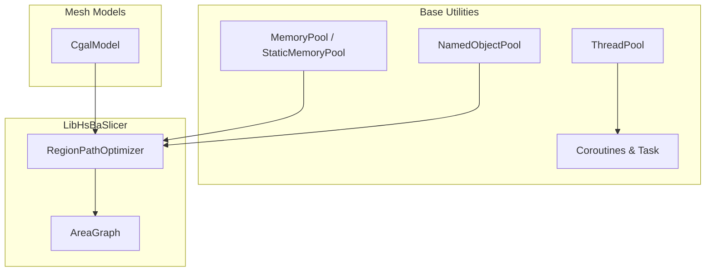
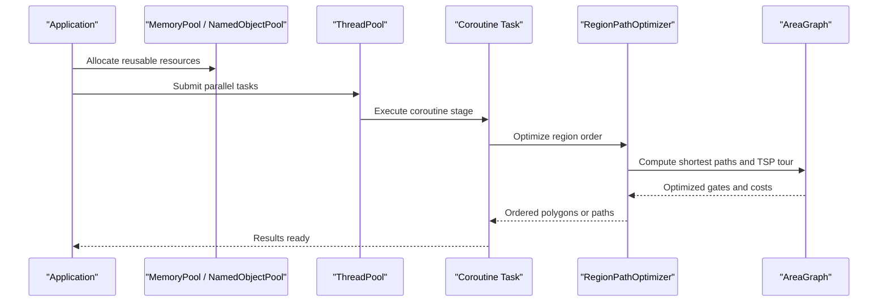
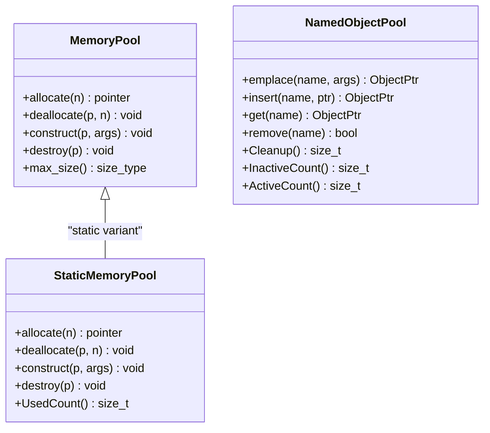
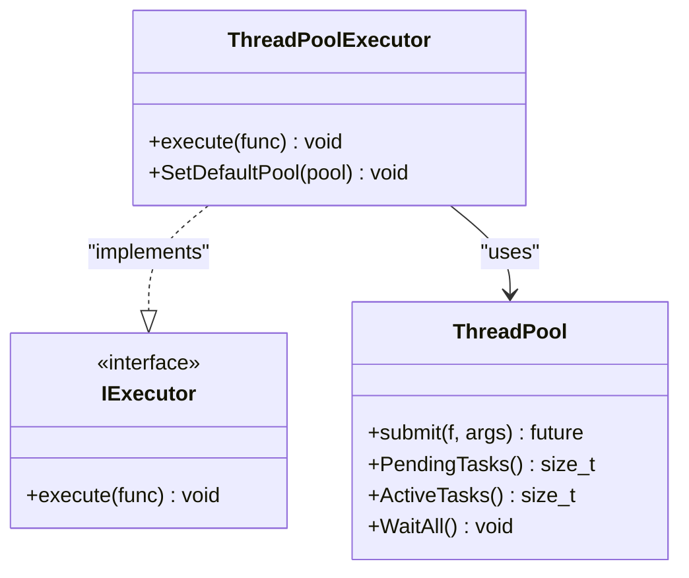
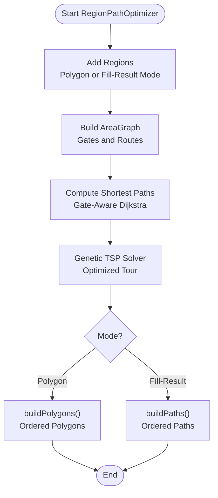
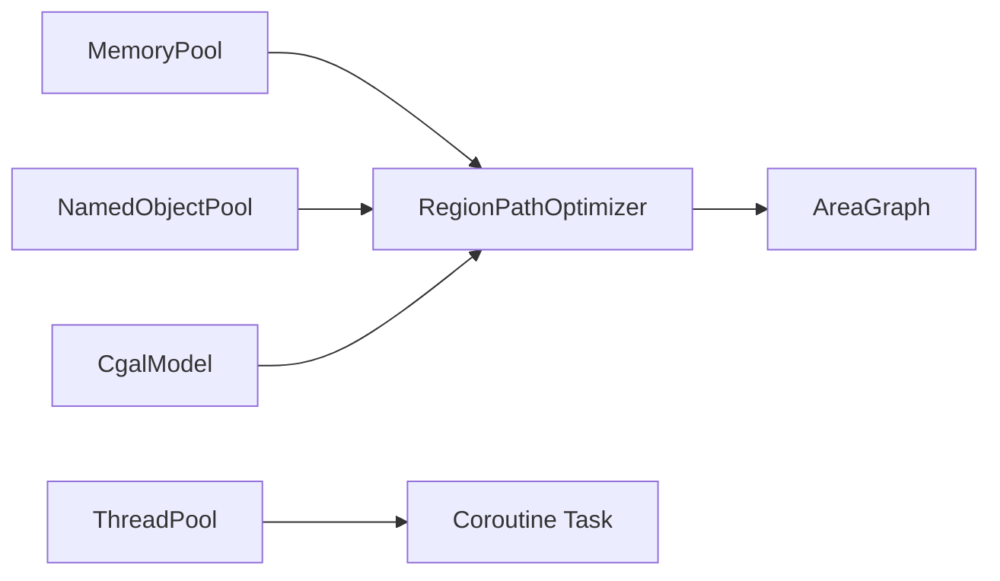

# Performance Optimization Techniques

<cite>
**Referenced Files in This Document**
- [memory_pool.hpp](file://base/memory_pool.hpp)
- [object_pool.hpp](file://base/object_pool.hpp)
- [thread_pool.hpp](file://base/thread_pool.hpp)
- [coroutine.hpp](file://base/coroutine.hpp)
- [path_optimizer.hpp](file://LibHsBaSlicer/Path/path_optimizer.hpp)
- [AreaGraph.hpp](file://utils/AreaGraph.hpp)
- [CgalModel.hpp](file://meshmodel/CgalModel.hpp)
- [optimize_paths.lua](file://tests/PolygonFill/optimize_paths.lua)
- [README.md](file://docs/en/LibHsBaSlicer/README.md)
</cite>

## Table of Contents
1. [Introduction](#introduction)
2. [Project Structure](#project-structure)
3. [Core Components](#core-components)
4. [Architecture Overview](#architecture-overview)
5. [Detailed Component Analysis](#detailed-component-analysis)
6. [Dependency Analysis](#dependency-analysis)
7. [Performance Considerations](#performance-considerations)
8. [Troubleshooting Guide](#troubleshooting-guide)
9. [Conclusion](#conclusion)
10. [Appendices](#appendices)

## Introduction
This document explains performance optimization techniques for HsBaSlicer applications with a focus on:
- Memory management using memory pools and object pools
- Parallel processing with thread pools and coroutines
- Algorithm optimization for mesh operations, polygon calculations, and path generation
- Caching strategies, lazy evaluation patterns, and efficient data structure usage
- Benchmarking approaches and performance monitoring techniques suitable for production

The guidance is grounded in the repository’s core infrastructure and path optimization components.

## Project Structure
HsBaSlicer organizes performance-critical primitives under base utilities and applies them across slicing, path generation, and model processing layers:
- Base utilities provide memory pools, object pools, thread pools, and coroutine abstractions
- LibHsBaSlicer exposes path optimization APIs that build on AreaGraph-based route planning
- Mesh models expose geometric operations such as geodesic paths and surface projections
- Tests and documentation demonstrate practical usage patterns

**Diagram sources**
- [memory_pool.hpp:43-208](file://base/memory_pool.hpp#L43-L208)
- [object_pool.hpp:22-92](file://base/object_pool.hpp#L22-L92)
- [thread_pool.hpp:29-162](file://base/thread_pool.hpp#L29-L162)
- [coroutine.hpp:47-122](file://base/coroutine.hpp#L47-L122)
- [path_optimizer.hpp:44-100](file://LibHsBaSlicer/Path/path_optimizer.hpp#L44-L100)
- [AreaGraph.hpp:95-113](file://utils/AreaGraph.hpp#L95-L113)
- [CgalModel.hpp:101-126](file://meshmodel/CgalModel.hpp#L101-L126)

**Section sources**
- [memory_pool.hpp:1-375](file://base/memory_pool.hpp#L1-L375)
- [object_pool.hpp:1-286](file://base/object_pool.hpp#L1-L286)
- [thread_pool.hpp:1-214](file://base/thread_pool.hpp#L1-L214)
- [coroutine.hpp:1-800](file://base/coroutine.hpp#L1-L800)
- [path_optimizer.hpp:1-191](file://LibHsBaSlicer/Path/path_optimizer.hpp#L1-L191)
- [AreaGraph.hpp:1-597](file://utils/AreaGraph.hpp#L1-L597)
- [CgalModel.hpp:101-126](file://meshmodel/CgalModel.hpp#L101-L126)

## Core Components
- Memory pools provide fixed-size, aligned allocation buffers to reduce heap fragmentation and allocation overhead. They are suitable for short-lived, frequently allocated small objects during slicing and path generation.
- Named object pools manage shared objects by name with automatic cleanup of inactive entries, reducing manual lifetime management and improving reuse.
- Thread pools offer concurrent task execution with futures, active/pending metrics, and graceful shutdown.
- Coroutines provide structured asynchronous programming with executors (including thread pool integration), enabling non-blocking pipeline stages.
- Path optimizer treats independent regions as graph vertices and solves region visit order via TSP over gate-aware shortest paths, minimizing air-move cost.
- AreaGraph implements gate-aware area routing, Dijkstra shortest paths, and genetic TSP solver caching.

**Section sources**
- [memory_pool.hpp:43-208](file://base/memory_pool.hpp#L43-L208)
- [object_pool.hpp:22-92](file://base/object_pool.hpp#L22-L92)
- [thread_pool.hpp:29-162](file://base/thread_pool.hpp#L29-L162)
- [coroutine.hpp:47-122](file://base/coroutine.hpp#L47-L122)
- [path_optimizer.hpp:23-43](file://LibHsBaSlicer/Path/path_optimizer.hpp#L23-L43)
- [AreaGraph.hpp:95-113](file://utils/AreaGraph.hpp#L95-L113)

## Architecture Overview
The performance architecture combines low-level resource management with high-level algorithmic optimizations:
- Memory pools and named object pools reduce allocation churn and simplify lifecycle management
- Thread pools and coroutines enable parallelization of independent tasks (e.g., per-region fill or path optimization)
- Path optimizer uses AreaGraph to compute optimal region traversal, minimizing travel distance between independent polygon regions
- Mesh model operations (geodesic paths, projections) can be offloaded to threads or coroutines for responsiveness

**Diagram sources**
- [memory_pool.hpp:111-142](file://base/memory_pool.hpp#L111-L142)
- [object_pool.hpp:66-92](file://base/object_pool.hpp#L66-L92)
- [thread_pool.hpp:67-90](file://base/thread_pool.hpp#L67-L90)
- [coroutine.hpp:81-122](file://base/coroutine.hpp#L81-L122)
- [path_optimizer.hpp:75-95](file://LibHsBaSlicer/Path/path_optimizer.hpp#L75-L95)
- [AreaGraph.hpp:197-256](file://utils/AreaGraph.hpp#L197-L256)

## Detailed Component Analysis

### Memory Pools and Object Pools
Memory pools allocate contiguous blocks from a fixed-size buffer, ensuring alignment and avoiding frequent heap calls. The static variant provides a global pool accessible across instances. Named object pools manage shared objects by name, automatically cleaning up inactive entries when capacity is reached.

Key behaviors:
- Fixed-size allocation with bounds checking and exception handling
- Thread-safe access via mutexes
- Automatic cleanup of inactive objects in named pools
- Rebind support for allocator compatibility

**Diagram sources**
- [memory_pool.hpp:43-208](file://base/memory_pool.hpp#L43-L208)
- [memory_pool.hpp:215-372](file://base/memory_pool.hpp#L215-L372)
- [object_pool.hpp:22-92](file://base/object_pool.hpp#L22-L92)

**Section sources**
- [memory_pool.hpp:111-175](file://base/memory_pool.hpp#L111-L175)
- [memory_pool.hpp:266-324](file://base/memory_pool.hpp#L266-L324)
- [object_pool.hpp:66-156](file://base/object_pool.hpp#L66-L156)

### Thread Pools and Coroutines
Thread pools manage worker threads, queue tasks, and track active/pending counts. Coroutines provide structured async execution with executors; ThreadPoolExecutor integrates coroutines with the thread pool.

Key behaviors:
- Submit tasks returning futures
- WaitAll synchronization
- Executor interface for coroutine dispatch
- Default pool fallback if none provided

**Diagram sources**
- [thread_pool.hpp:29-162](file://base/thread_pool.hpp#L29-L162)
- [coroutine.hpp:47-70](file://base/coroutine.hpp#L47-L70)
- [thread_pool.hpp:170-207](file://base/thread_pool.hpp#L170-L207)

**Section sources**
- [thread_pool.hpp:67-111](file://base/thread_pool.hpp#L67-L111)
- [coroutine.hpp:81-122](file://base/coroutine.hpp#L81-L122)
- [thread_pool.hpp:170-207](file://base/thread_pool.hpp#L170-L207)

### Path Optimization and Area Graph Routing
RegionPathOptimizer models independent polygon regions as graph vertices and computes an optimal visit order to minimize air-move cost. It supports two modes:
- Polygon mode (pre-fill): optimizes polygon ordering before filling
- Fill-result mode (post-fill): optimizes complete fill paths

AreaGraph provides:
- Gate-aware shortest paths between areas
- Genetic TSP solver with cached pairwise paths
- Expanded graph construction for internal area traversal

**Diagram sources**
- [path_optimizer.hpp:75-95](file://LibHsBaSlicer/Path/path_optimizer.hpp#L75-L95)
- [AreaGraph.hpp:197-256](file://utils/AreaGraph.hpp#L197-L256)
- [AreaGraph.hpp:267-345](file://utils/AreaGraph.hpp#L267-L345)

**Section sources**
- [path_optimizer.hpp:23-43](file://LibHsBaSlicer/Path/path_optimizer.hpp#L23-L43)
- [path_optimizer.hpp:75-95](file://LibHsBaSlicer/Path/path_optimizer.hpp#L75-L95)
- [AreaGraph.hpp:197-256](file://utils/AreaGraph.hpp#L197-L256)
- [AreaGraph.hpp:267-345](file://utils/AreaGraph.hpp#L267-L345)

### Mesh Operations and Geometric Algorithms
CgalModel exposes advanced geometric operations such as geodesic path computation, distance calculation, point projection, and spiral path generation. These operations can benefit from parallelization and caching strategies.

Key capabilities:
- Geodesic path between two points on mesh surface
- Geodesic distances from source to all vertices
- Point projection onto mesh surface
- Spiral path generation around axis

**Section sources**
- [CgalModel.hpp:101-126](file://meshmodel/CgalModel.hpp#L101-L126)

### Practical Usage Examples
- Lua scripts demonstrate pre-path-output optimization strategies, including one-shot functions for optimizing fill paths and polygons.
- Documentation outlines API usage for RegionPathOptimizer, showing how to add regions, set routes, optimize order, and build outputs.

**Section sources**
- [optimize_paths.lua:1-33](file://tests/PolygonFill/optimize_paths.lua#L1-L33)
- [README.md:234-266](file://docs/en/LibHsBaSlicer/README.md#L234-L266)

## Dependency Analysis
The following diagram shows key dependencies among performance-critical components:

**Diagram sources**
- [memory_pool.hpp:43-208](file://base/memory_pool.hpp#L43-L208)
- [object_pool.hpp:22-92](file://base/object_pool.hpp#L22-L92)
- [thread_pool.hpp:29-162](file://base/thread_pool.hpp#L29-L162)
- [coroutine.hpp:81-122](file://base/coroutine.hpp#L81-L122)
- [path_optimizer.hpp:75-95](file://LibHsBaSlicer/Path/path_optimizer.hpp#L75-L95)
- [AreaGraph.hpp:197-256](file://utils/AreaGraph.hpp#L197-L256)
- [CgalModel.hpp:101-126](file://meshmodel/CgalModel.hpp#L101-L126)

**Section sources**
- [memory_pool.hpp:43-208](file://base/memory_pool.hpp#L43-L208)
- [object_pool.hpp:22-92](file://base/object_pool.hpp#L22-L92)
- [thread_pool.hpp:29-162](file://base/thread_pool.hpp#L29-L162)
- [coroutine.hpp:81-122](file://base/coroutine.hpp#L81-L122)
- [path_optimizer.hpp:75-95](file://LibHsBaSlicer/Path/path_optimizer.hpp#L75-L95)
- [AreaGraph.hpp:197-256](file://utils/AreaGraph.hpp#L197-L256)
- [CgalModel.hpp:101-126](file://meshmodel/CgalModel.hpp#L101-L126)

## Performance Considerations
- Use memory pools for short-lived, frequently allocated objects to reduce heap fragmentation and allocation overhead.
- Prefer named object pools for shared resources requiring lifecycle management and automatic cleanup.
- Offload independent computations to thread pools; use coroutines for structured async pipelines.
- Apply path optimization to minimize air-move costs between regions; choose appropriate mode (polygon vs fill-result).
- Cache intermediate results (e.g., shortest paths in AreaGraph) to avoid recomputation during TSP iterations.
- Leverage lazy evaluation where possible (e.g., deferred graph expansion in AreaGraph).
- Monitor active/pending tasks and adjust thread pool sizes based on workload characteristics.

[No sources needed since this section provides general guidance]

## Troubleshooting Guide
Common issues and resolutions:
- Memory pool allocation failures: Ensure pool size is sufficient and avoid exceeding max_size; check alignment requirements.
- Named object pool full: Trigger cleanup of inactive objects or increase MaxSize; verify object lifetimes.
- Thread pool submission errors: Verify pool is not stopped; handle exceptions within tasks gracefully.
- Coroutine executor misconfiguration: Set default pool or pass explicit executor; ensure executor is available.
- Path optimizer mode mismatch: Do not mix polygon and fill-result regions in the same optimizer instance.

**Section sources**
- [memory_pool.hpp:111-142](file://base/memory_pool.hpp#L111-L142)
- [object_pool.hpp:78-85](file://base/object_pool.hpp#L78-L85)
- [thread_pool.hpp:77-89](file://base/thread_pool.hpp#L77-L89)
- [thread_pool.hpp:170-207](file://base/thread_pool.hpp#L170-L207)
- [path_optimizer.hpp:52-67](file://LibHsBaSlicer/Path/path_optimizer.hpp#L52-L67)

## Conclusion
HsBaSlicer provides robust performance primitives—memory pools, object pools, thread pools, and coroutines—that can be combined with algorithmic optimizations like region-based path planning and gate-aware routing. By applying these techniques thoughtfully, applications can achieve lower memory pressure, better parallelism, and reduced travel costs in path generation.

[No sources needed since this section summarizes without analyzing specific files]

## Appendices

### Benchmarking Approaches
- Use high-resolution clocks to measure allocation and deallocation times with and without pools.
- Compare sequential vs parallel execution using thread pools for independent regions.
- Profile path optimization by measuring time spent in shortest path computation and TSP solver.

[No sources needed since this section provides general guidance]

### Monitoring Techniques
- Track thread pool PendingTasks and ActiveTasks to detect bottlenecks.
- Monitor named object pool InactiveCount and ActiveCount to assess reuse efficiency.
- Log elapsed seconds in pipeline results for end-to-end performance tracking.

**Section sources**
- [thread_pool.hpp:94-111](file://base/thread_pool.hpp#L94-L111)
- [object_pool.hpp:219-236](file://base/object_pool.hpp#L219-L236)