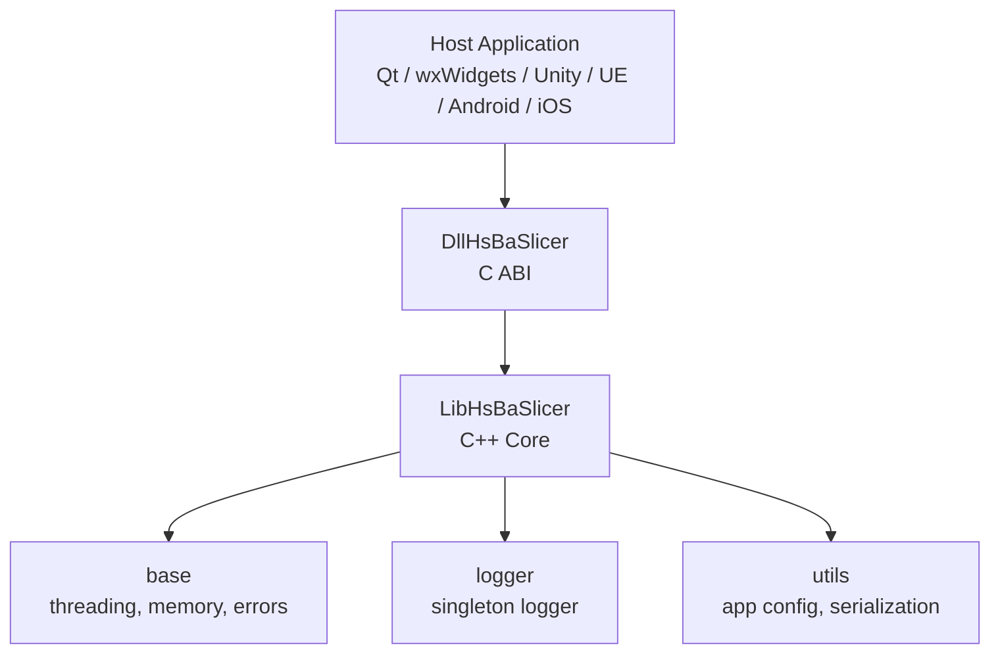
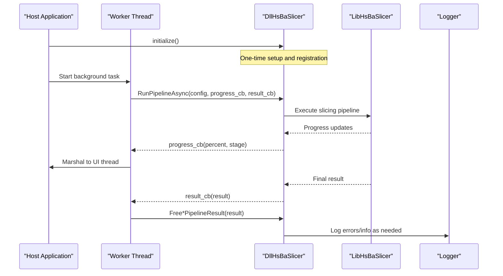
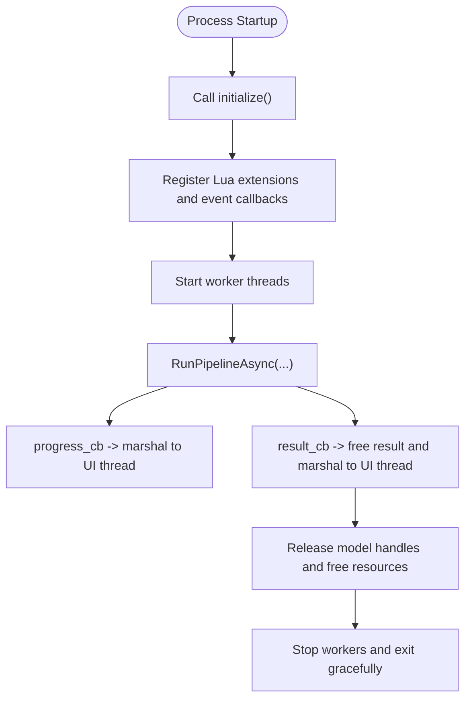
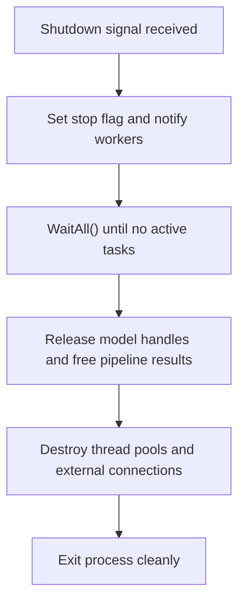
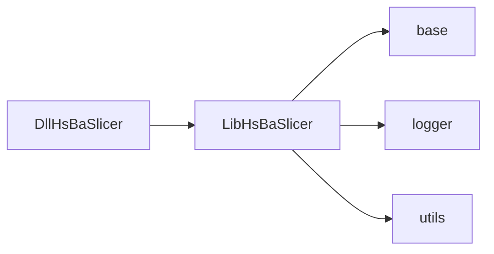

# Production Integration Patterns

<cite>
**Referenced Files in This Document**
- [README.md](file://README.md)
- [docs/en/DllHsBaSlicer/README.md](file://docs/en/DllHsBaSlicer/README.md)
- [docs/en/LibHsBaSlicer/README.md](file://docs/en/LibHsBaSlicer/README.md)
- [docs/en/DllHsBaSlicer/qt_wxwidgets_integration.md](file://docs/en/DllHsBaSlicer/qt_wxwidgets_integration.md)
- [docs/en/DllHsBaSlicer/game_engine_integration.md](file://docs/en/DllHsBaSlicer/game_engine_integration.md)
- [DllHsBaSlicer/initialize.h](file://DllHsBaSlicer/initialize.h)
- [DllHsBaSlicer/initialize.cpp](file://DllHsBaSlicer/initialize.cpp)
- [logger/logger.hpp](file://logger/logger.hpp)
- [logger/logger.cpp](file://logger/logger.cpp)
- [base/error.hpp](file://base/error.hpp)
- [base/thread_pool.hpp](file://base/thread_pool.hpp)
- [utils/app_config.hpp](file://utils/app_config.hpp)
</cite>

## Table of Contents
1. [Introduction](#introduction)
2. [Project Structure](#project-structure)
3. [Core Components](#core-components)
4. [Architecture Overview](#architecture-overview)
5. [Detailed Component Analysis](#detailed-component-analysis)
6. [Dependency Analysis](#dependency-analysis)
7. [Performance Considerations](#performance-considerations)
8. [Troubleshooting Guide](#troubleshooting-guide)
9. [Conclusion](#conclusion)
10. [Appendices](#appendices)

## Introduction
This document provides production-oriented integration guidance for HsBaSlicer, focusing on application lifecycle management, configuration and logging infrastructure, error handling patterns, memory and resource management, graceful shutdown, multi-threaded integration, plugin architecture via Lua extensions, external system communication, deployment strategies, dependency management, platform-specific considerations, security, input validation, and robustness patterns.

HsBaSlicer exposes:
- A C ABI shared library (DllHsBaSlicer) for cross-language integration.
- A C++ core library (LibHsBaSlicer) for full slicing pipelines.
- Cross-platform logging, thread pools, memory utilities, and configuration helpers.

The Dll layer is designed to call only LibHsBaSlicer exported interfaces, keeping the ABI boundary clean and stable for host applications such as Qt, wxWidgets, Unity, Unreal Engine, Android, iOS, and other languages.

**Section sources**
- [README.md:21-39](file://README.md#L21-L39)
- [docs/en/DllHsBaSlicer/README.md:1-19](file://docs/en/DllHsBaSlicer/README.md#L1-L19)

## Project Structure
At a high level, production integrations typically interact with:
- DllHsBaSlicer: C ABI entry points, pipeline APIs, version info, Lua extension registration, event source registration, and proto conversion helpers.
- LibHsBaSlicer: Core C++ slicing pipeline components (Preprocess, Slice, Support, Fill, Path Generation, SLA Floor/Render/Package, SLS Export, File Transfer, ParamStore, Extends).
- base/utils/logger: Threading, memory pools, errors, and logging.

**Diagram sources**
- [docs/en/DllHsBaSlicer/README.md:1-19](file://docs/en/DllHsBaSlicer/README.md#L1-L19)
- [docs/en/LibHsBaSlicer/README.md:18-31](file://docs/en/LibHsBaSlicer/README.md#L18-L31)

**Section sources**
- [README.md:100-124](file://README.md#L100-L124)
- [docs/en/DllHsBaSlicer/README.md:21-54](file://docs/en/DllHsBaSlicer/README.md#L21-L54)
- [docs/en/LibHsBaSlicer/README.md:18-31](file://docs/en/LibHsBaSlicer/README.md#L18-L31)

## Core Components
- Initialization: Call `initialize()` once at process startup before any pipeline calls. It performs one-time setup and registration.
- Pipeline APIs: FDM, SLA, SLS, SLM, LOM, TDP, WAAM, File Transfer, Custom Lua pipeline; each supports sync and async variants with progress/result callbacks.
- Model Preprocessing: Load/transform/query models, boolean operations, shelling; handles are reference-counted and must be released.
- Lua Extensions: Register custom functions per stage (2D/3D/File) and event callbacks.
- Event Sources: Register native C callbacks for Zipper progress and database events.
- Version Info: JSON/XML version strings with proper cleanup.
- Proto Conversion: Convert between C structs and Protobuf bytes for cross-process/cross-language communication.

Key lifecycle rules:
- Always call `initialize()` first.
- Never run synchronous pipeline APIs on UI threads.
- Marshal callback data back to UI/game threads before updating widgets.
- Respect string ownership rules for configs/results.

**Section sources**
- [docs/en/DllHsBaSlicer/README.md:56-62](file://docs/en/DllHsBaSlicer/README.md#L56-L62)
- [docs/en/DllHsBaSlicer/README.md:64-145](file://docs/en/DllHsBaSlicer/README.md#L64-L145)
- [docs/en/DllHsBaSlicer/README.md:147-355](file://docs/en/DllHsBaSlicer/README.md#L147-L355)
- [docs/en/DllHsBaSlicer/README.md:456-525](file://docs/en/DllHsBaSlicer/README.md#L456-L525)
- [docs/en/DllHsBaSlicer/README.md:612-682](file://docs/en/DllHsBaSlicer/README.md#L612-L682)
- [docs/en/DllHsBaSlicer/README.md:604-610](file://docs/en/DllHsBaSlicer/README.md#L604-L610)
- [docs/en/DllHsBaSlicer/README.md:527-603](file://docs/en/DllHsBaSlicer/README.md#L527-L603)

## Architecture Overview
The recommended production architecture separates concerns across layers:
- Host Application: UI/game logic, worker threads, marshalling, and resource management.
- DllHsBaSlicer: Stable C ABI boundary, pipeline orchestration, Lua environment setup, event registration, and result marshalling.
- LibHsBaSlicer: Core slicing algorithms and domain logic.
- base/utils/logger: Shared primitives for concurrency, memory, errors, and logging.

**Diagram sources**
- [docs/en/DllHsBaSlicer/README.md:684-703](file://docs/en/DllHsBaSlicer/README.md#L684-L703)
- [docs/en/DllHsBaSlicer/qt_wxwidgets_integration.md:7-13](file://docs/en/DllHsBaSlicer/qt_wxwidgets_integration.md#L7-L13)
- [docs/en/DllHsBaSlicer/game_engine_integration.md:128-183](file://docs/en/DllHsBaSlicer/game_engine_integration.md#L128-L183)

**Section sources**
- [docs/en/DllHsBaSlicer/README.md:684-703](file://docs/en/DllHsBaSlicer/README.md#L684-L703)
- [docs/en/DllHsBaSlicer/qt_wxwidgets_integration.md:7-13](file://docs/en/DllHsBaSlicer/qt_wxwidgets_integration.md#L7-L13)
- [docs/en/DllHsBaSlicer/game_engine_integration.md:128-183](file://docs/en/DllHsBaSlicer/game_engine_integration.md#L128-L183)

## Detailed Component Analysis

### Application Lifecycle Management
- Process startup:
  - Call `initialize()` once after process startup.
  - Optionally register Lua extension functions and event callbacks before running pipelines.
- Pipeline execution:
  - Use async APIs to avoid blocking UI threads.
  - Provide progress/result callbacks; marshal results back to UI/game threads.
- Shutdown:
  - Ensure all pending tasks complete before process exit.
  - Release model handles and free pipeline results.
  - Stop worker threads gracefully.

**Diagram sources**
- [docs/en/DllHsBaSlicer/README.md:56-62](file://docs/en/DllHsBaSlicer/README.md#L56-L62)
- [docs/en/DllHsBaSlicer/README.md:684-703](file://docs/en/DllHsBaSlicer/README.md#L684-L703)
- [docs/en/DllHsBaSlicer/qt_wxwidgets_integration.md:7-13](file://docs/en/DllHsBaSlicer/qt_wxwidgets_integration.md#L7-L13)

**Section sources**
- [DllHsBaSlicer/initialize.h:14-19](file://DllHsBaSlicer/initialize.h#L14-L19)
- [DllHsBaSlicer/initialize.cpp:7-9](file://DllHsBaSlicer/initialize.cpp#L7-L9)
- [docs/en/DllHsBaSlicer/README.md:684-703](file://docs/en/DllHsBaSlicer/README.md#L684-L703)

### Configuration File Setup
- Logging configuration:
  - The logger reads `logcfg.ini` from the current working directory if present.
  - Supports log levels, file output toggles, log path, and datetime format.
- Application configuration:
  - AppConfigSingletone provides shared settings like external tool paths (e.g., 7-Zip).

Best practices:
- Place `logcfg.ini` next to the executable or configure absolute paths.
- Validate configuration values at startup and fail fast on invalid inputs.
- Use AppConfigSingletone to centralize external tool paths and validate them early.

**Section sources**
- [logger/logger.cpp:147-183](file://logger/logger.cpp#L147-L183)
- [utils/app_config.hpp:19-46](file://utils/app_config.hpp#L19-L46)

### Logging Infrastructure
- Singleton logger with cross-platform backends:
  - Desktop: Boost.Log with console and optional file sinks.
  - Android: Kernel log.
  - iOS: System log.
- Levels: trace/debug/info/warning/error/fatal.
- Source location tracking and configurable datetime formatting.
- File rotation and size limits.

Production recommendations:
- Enable file logging in release builds for diagnostics.
- Set appropriate log levels per environment.
- Avoid excessive logging in hot paths; use structured messages where possible.

**Section sources**
- [logger/logger.hpp:35-122](file://logger/logger.hpp#L35-L122)
- [logger/logger.cpp:136-222](file://logger/logger.cpp#L136-L222)
- [logger/logger.cpp:242-343](file://logger/logger.cpp#L242-L343)

### Error Handling Patterns
- Custom exception hierarchy under `std::runtime_error`:
  - RuntimeError, OutOfRangeError, InvalidArgumentError, IOError, NotImplementedError, NullValueError, NotSupportedError, NotFoundError, AlreadyExistsError, PermissionDeniedError, TimeoutError, InterruptedError, CancelledError, OutOfMemoryError.
- Thread pool submits tasks safely and propagates exceptions through futures.
- Pipeline results include success flags and error messages; always check and free results.

Patterns:
- Wrap I/O and parsing in try/catch blocks; map to domain-specific exceptions.
- Validate inputs early; throw InvalidArgumentError for bad parameters.
- Handle network/file failures with IOError/TimeoutError and surface user-friendly messages.

**Section sources**
- [base/error.hpp:17-144](file://base/error.hpp#L17-L144)
- [base/thread_pool.hpp:67-90](file://base/thread_pool.hpp#L67-L90)
- [docs/en/DllHsBaSlicer/README.md:696-703](file://docs/en/DllHsBaSlicer/README.md#L696-L703)

### Memory Management Strategies for Long-Running Applications
- Model handle lifecycle:
  - Load/transform/query models via opaque handles; release with `HsBaReleaseModelHandle`.
  - Periodically call `HsBaCleanupModels` to remove unreferenced models.
- Pipeline result memory:
  - Strings inside results are allocated by the library; free with matching `HsBaFree*PipelineResult`.
- Proto deserialization:
  - Deserialized strings are malloc’d; release with matching `HsBaFree*ConfigStrings`.
- Memory pools:
  - Use MemoryPool/StaticMemoryPool for frequent small allocations to reduce fragmentation and improve performance.

Guidelines:
- Keep config strings valid only during the pipeline call; free after copying.
- Avoid holding large G-code content in memory longer than necessary; stream or write to disk promptly.
- Monitor pool usage and tune capacities based on workload profiles.

**Section sources**
- [docs/en/DllHsBaSlicer/README.md:64-145](file://docs/en/DllHsBaSlicer/README.md#L64-L145)
- [docs/en/DllHsBaSlicer/README.md:696-703](file://docs/en/DllHsBaSlicer/README.md#L696-L703)
- [docs/en/base/memory_pool.md:1-325](file://docs/en/base/memory_pool.md#L1-L325)

### Resource Cleanup Procedures and Graceful Shutdown
- Worker threads:
  - ThreadPool destructor joins all worker threads and waits for completion.
  - Use WaitAll to synchronize before shutdown.
- External resources:
  - Close file handles, release model handles, free pipeline results, and stop connection pools.
- Application-level shutdown:
  - Signal workers to stop, wait for pending tasks, then destroy resources in reverse order of creation.

**Diagram sources**
- [base/thread_pool.hpp:47-61](file://base/thread_pool.hpp#L47-L61)
- [base/thread_pool.hpp:107-111](file://base/thread_pool.hpp#L107-L111)
- [docs/en/DllHsBaSlicer/README.md:696-703](file://docs/en/DllHsBaSlicer/README.md#L696-L703)

**Section sources**
- [base/thread_pool.hpp:47-61](file://base/thread_pool.hpp#L47-L61)
- [base/thread_pool.hpp:107-111](file://base/thread_pool.hpp#L107-L111)

### Multi-threaded Integration
- Host threading model:
  - Do not run synchronous pipeline APIs on UI threads.
  - Use worker threads or thread pools; marshal callbacks back to UI/game threads.
- Qt/wxWidgets:
  - Use QThread + signals/slots or wxThread + CallAfter to update UI safely.
- Unity/Unreal Engine:
  - Keep delegates alive; post to main thread using engine-specific mechanisms.

Recommendations:
- Prefer async APIs with callbacks; avoid blocking calls on UI threads.
- Copy UTF-8 strings from callbacks before returning; do not access raw pointers beyond callback scope.
- Use thread-safe queues to pass work items to workers.

**Section sources**
- [docs/en/DllHsBaSlicer/qt_wxwidgets_integration.md:7-13](file://docs/en/DllHsBaSlicer/qt_wxwidgets_integration.md#L7-L13)
- [docs/en/DllHsBaSlicer/qt_wxwidgets_integration.md:47-106](file://docs/en/DllHsBaSlicer/qt_wxwidgets_integration.md#L47-L106)
- [docs/en/DllHsBaSlicer/qt_wxwidgets_integration.md:187-264](file://docs/en/DllHsBaSlicer/qt_wxwidgets_integration.md#L187-L264)
- [docs/en/DllHsBaSlicer/game_engine_integration.md:128-183](file://docs/en/DllHsBaSlicer/game_engine_integration.md#L128-L183)
- [docs/en/DllHsBaSlicer/game_engine_integration.md:272-349](file://docs/en/DllHsBaSlicer/game_engine_integration.md#L272-L349)

### Plugin Architecture Implementation (Lua Extensions)
- Register custom Lua functions per stage:
  - 2D functions (Support/Fill/SLA Output), 3D functions (Slice/Support), File functions (SLS/SLA Output).
- Event callbacks:
  - Register C-style event callbacks for Zipper progress and database events.
- Script-driven workflows:
  - Custom pipeline delegates entire workflow to Lua scripts; C++ side sets up environment and calls entry function.

Best practices:
- Keep registration function pointers valid for process lifetime.
- Validate script paths and inline sources; provide fallback defaults.
- Isolate script errors and report via pipeline result error messages.

**Section sources**
- [docs/en/DllHsBaSlicer/README.md:612-682](file://docs/en/DllHsBaSlicer/README.md#L612-L682)
- [docs/en/DllHsBaSlicer/README.md:456-525](file://docs/en/DllHsBaSlicer/README.md#L456-L525)
- [docs/en/DllHsBaSlicer/qt_wxwidgets_integration.md:293-338](file://docs/en/DllHsBaSlicer/qt_wxwidgets_integration.md#L293-L338)
- [docs/en/DllHsBaSlicer/game_engine_integration.md:380-451](file://docs/en/DllHsBaSlicer/game_engine_integration.md#L380-L451)

### External System Communication
- File transfer pipeline:
  - Validates configuration, establishes pooled TCP connections, transfers files sequentially to remote executor service.
- Param store pipeline:
  - Persists/retrieves process parameters to SQLite/MySQL/PostgreSQL; single-call connect/ensure table/execute/disconnect.
- Proto conversion:
  - Serialize/deserialize C structs to/from Protobuf bytes for cross-process/cross-language communication.

Security and robustness:
- Validate host/port/pool_size/file_paths before connecting.
- Handle backend availability gates (MySQL/PostgreSQL compile-time macros).
- Use timeouts and retries for network operations; surface errors via result structures.

**Section sources**
- [docs/en/DllHsBaSlicer/README.md:357-388](file://docs/en/DllHsBaSlicer/README.md#L357-L388)
- [docs/en/DllHsBaSlicer/README.md:386-454](file://docs/en/DllHsBaSlicer/README.md#L386-L454)
- [docs/en/DllHsBaSlicer/README.md:527-603](file://docs/en/DllHsBaSlicer/README.md#L527-L603)

### Deployment Strategies and Dependency Management
- Install/export:
  - Use `cmake --install` to install targets; downstream projects can `find_package(HsBaSlicer)`.
- Library targets:
  - DllHsBaSlicer (shared/static depending on platform), LibHsBaSlicer (static/shared), plus supporting modules.
- Platform notes:
  - Desktop platforms include all targets; mobile/console may exclude CADModel due to missing OpenCascade support.
- Per-platform artifacts:
  - Unity/UE guide details artifact placement and linking per platform.

Recommendations:
- Pin dependency versions via vcpkg; ensure consistent toolchains across CI and local environments.
- For iOS, link static library and use `__Internal` in P/Invoke bindings.
- Package runtime dependencies (DLLs/SOs) with your application bundle.

**Section sources**
- [README.md:100-124](file://README.md#L100-L124)
- [README.md:187-191](file://README.md#L187-L191)
- [docs/en/DllHsBaSlicer/game_engine_integration.md:7-18](file://docs/en/DllHsBaSlicer/game_engine_integration.md#L7-L18)

### Security Considerations, Input Validation, and Robustness
- Input validation:
  - Validate pipeline config fields (paths, enums, numeric ranges) before invoking pipelines.
  - Sanitize Lua script paths and inline sources; reject empty or malformed inputs.
- Backend availability:
  - MySQL/PostgreSQL branches are compile-time gated; return safe errors when unavailable.
- Error propagation:
  - Map low-level exceptions to domain errors; surface user-friendly messages in pipeline results.
- Resource safety:
  - Always free library-allocated strings and handles; avoid dangling pointers across threads.

Robustness patterns:
- Use timeouts for I/O and network operations.
- Implement retry logic with exponential backoff for transient failures.
- Log detailed context for debugging without exposing sensitive data.

**Section sources**
- [docs/en/DllHsBaSlicer/README.md:427-429](file://docs/en/DllHsBaSlicer/README.md#L427-L429)
- [base/error.hpp:17-144](file://base/error.hpp#L17-L144)
- [docs/en/DllHsBaSlicer/README.md:696-703](file://docs/en/DllHsBaSlicer/README.md#L696-L703)

## Dependency Analysis
High-level dependencies:
- DllHsBaSlicer depends on LibHsBaSlicer for core slicing functionality.
- LibHsBaSlicer uses base utilities (threading, memory, errors) and logger.
- Utils provide app configuration and serialization helpers.

**Diagram sources**
- [docs/en/DllHsBaSlicer/README.md:1-19](file://docs/en/DllHsBaSlicer/README.md#L1-L19)
- [docs/en/LibHsBaSlicer/README.md:18-31](file://docs/en/LibHsBaSlicer/README.md#L18-L31)

**Section sources**
- [docs/en/DllHsBaSlicer/README.md:1-19](file://docs/en/DllHsBaSlicer/README.md#L1-L19)
- [docs/en/LibHsBaSlicer/README.md:18-31](file://docs/en/LibHsBaSlicer/README.md#L18-L31)

## Performance Considerations
- Threading:
  - Use ThreadPoolExecutor for coroutine integration; set default pool appropriately.
  - Tune thread count based on hardware concurrency and workload characteristics.
- Memory:
  - Prefer memory pools for frequent small allocations; monitor used counts.
  - Stream large outputs to disk instead of holding in memory.
- I/O:
  - Use pooled connections for file transfer; batch operations where possible.
  - Configure log rotation to prevent disk exhaustion.

[No sources needed since this section provides general guidance]

## Troubleshooting Guide
Common issues and resolutions:
- UI freezes:
  - Cause: Running synchronous pipeline APIs on UI threads.
  - Fix: Move to worker threads; marshal callbacks back to UI thread.
- Callback crashes:
  - Cause: Delegates collected by GC or accessing raw pointers beyond callback scope.
  - Fix: Keep delegate references alive; copy strings before returning.
- Missing DLL/SO:
  - Cause: Artifact not placed correctly or not packaged.
  - Fix: Follow per-platform artifact placement; add post-build copy commands.
- Struct misalignment:
  - Cause: P/Invoke struct fields not matching C ABI layout.
  - Fix: Mirror field order/types exactly from pipeline_types.h.
- Backend unavailable:
  - Cause: MySQL/PostgreSQL not compiled in.
  - Fix: Check compile-time macros; fall back to SQLite or handle errors gracefully.

**Section sources**
- [docs/en/DllHsBaSlicer/qt_wxwidgets_integration.md:340-349](file://docs/en/DllHsBaSlicer/qt_wxwidgets_integration.md#L340-L349)
- [docs/en/DllHsBaSlicer/game_engine_integration.md:453-462](file://docs/en/DllHsBaSlicer/game_engine_integration.md#L453-L462)
- [docs/en/DllHsBaSlicer/README.md:427-429](file://docs/en/DllHsBaSlicer/README.md#L427-L429)

## Conclusion
Integrating HsBaSlicer into production applications requires careful attention to lifecycle management, threading discipline, memory ownership, and robust error handling. By leveraging the C ABI provided by DllHsBaSlicer, the C++ core in LibHsBaSlicer, and the cross-platform logging and utility libraries, teams can build reliable, scalable slicing pipelines across desktop, mobile, and game engine environments. Following the deployment, security, and troubleshooting guidance ensures stable operation in diverse production scenarios.

[No sources needed since this section summarizes without analyzing specific files]

## Appendices
- Minimal example references:
  - C/C++ minimal example for FDM pipeline.
  - Unity/UE integration examples for async slicing and main-thread marshalling.
  - Qt/wxWidgets worker thread patterns and CallAfter usage.

**Section sources**
- [docs/en/DllHsBaSlicer/README.md:705-730](file://docs/en/DllHsBaSlicer/README.md#L705-L730)
- [docs/en/DllHsBaSlicer/game_engine_integration.md:128-183](file://docs/en/DllHsBaSlicer/game_engine_integration.md#L128-L183)
- [docs/en/DllHsBaSlicer/qt_wxwidgets_integration.md:47-106](file://docs/en/DllHsBaSlicer/qt_wxwidgets_integration.md#L47-L106)