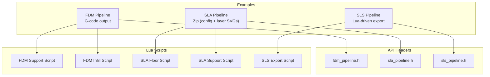
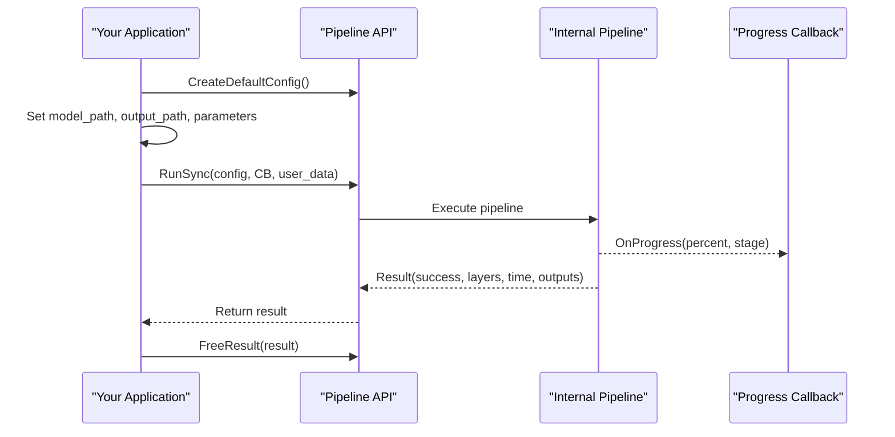
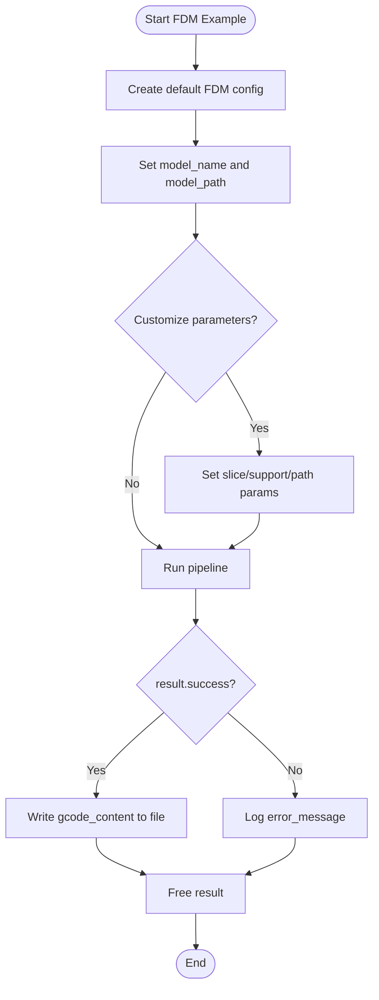
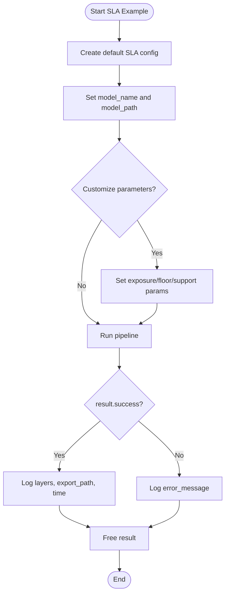
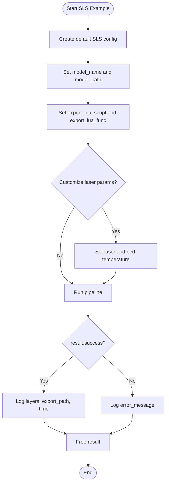
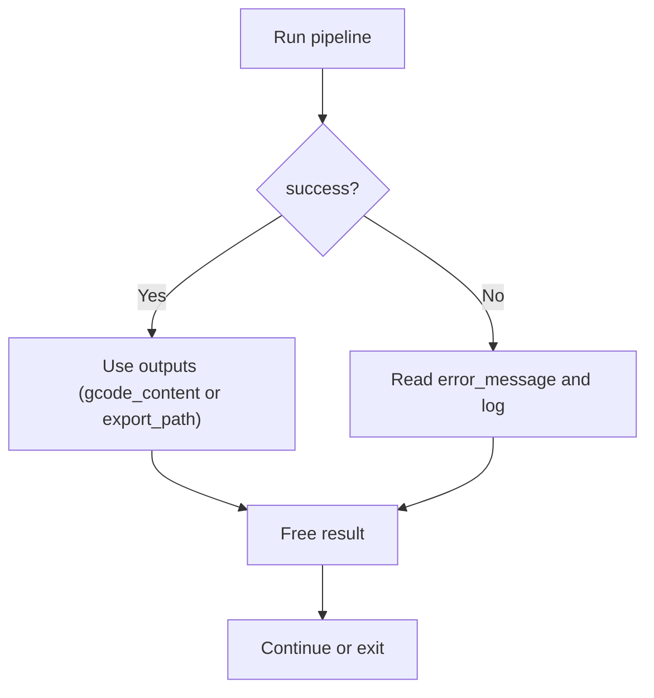
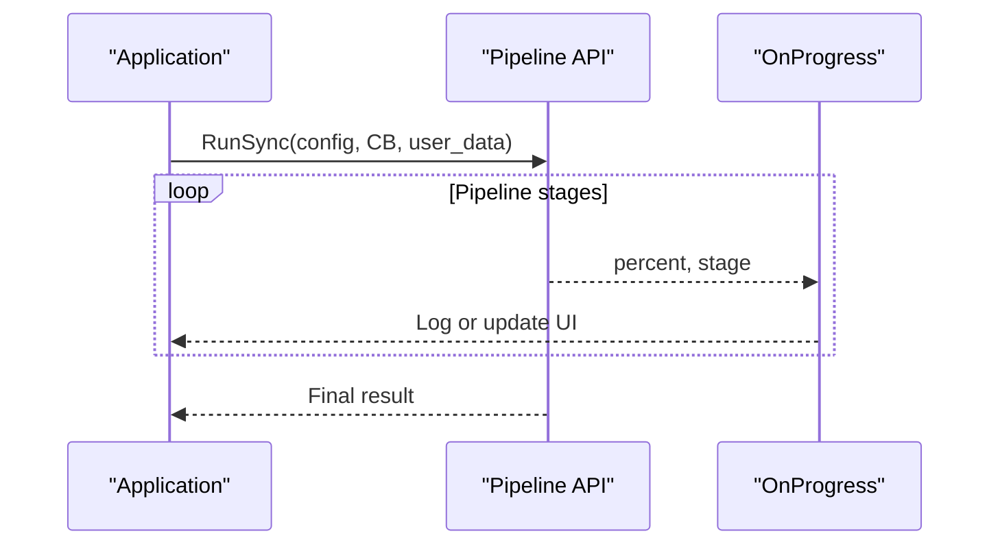
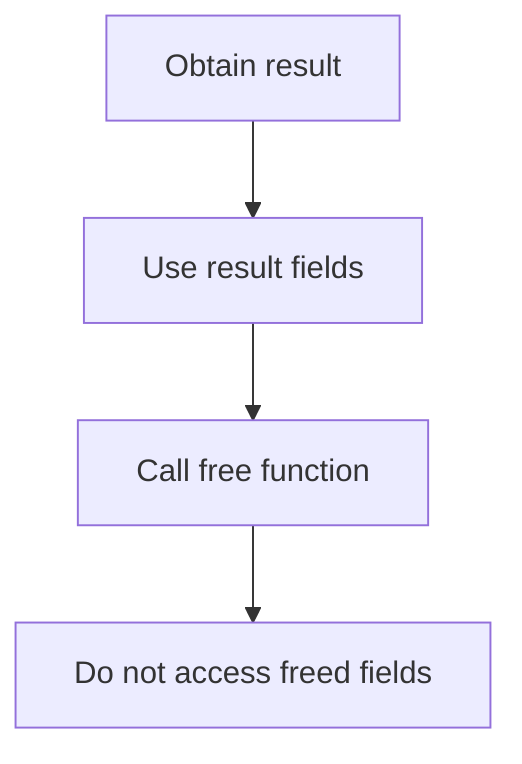
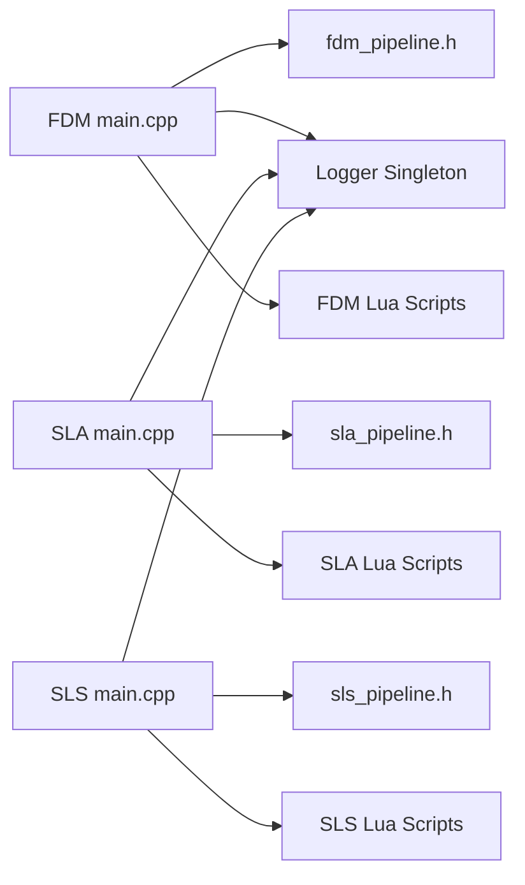

# Basic Examples

<cite>
**Referenced Files in This Document**
- [README.md](file://README.md)
- [HsBaSlicer.cpp](file://HsBaSlicer/HsBaSlicer.cpp)
- [fdm_pipeline.h](file://DllHsBaSlicer/fdm_pipeline.h)
- [sla_pipeline.h](file://DllHsBaSlicer/sla_pipeline.h)
- [sls_pipeline.h](file://DllHsBaSlicer/sls_pipeline.h)
- [FDM main.cpp](file://samples/FDM/main.cpp)
- [SLA main.cpp](file://samples/SLA/main.cpp)
- [SLS main.cpp](file://samples/SLS/main.cpp)
- [my_support.lua](file://samples/FDM/scripts/my_support.lua)
- [my_infill.lua](file://samples/FDM/scripts/my_infill.lua)
- [my_sla_floor.lua](file://samples/SLA/scripts/my_sla_floor.lua)
- [my_sla_support.lua](file://samples/SLA/scripts/my_sla_support.lua)
- [my_sls_export.lua](file://samples/SLS/scripts/my_sls_export.lua)
</cite>

## Table of Contents
1. [Introduction](#introduction)
2. [Project Structure](#project-structure)
3. [Core Components](#core-components)
4. [Architecture Overview](#architecture-overview)
5. [Detailed Component Analysis](#detailed-component-analysis)
6. [Dependency Analysis](#dependency-analysis)
7. [Performance Considerations](#performance-considerations)
8. [Troubleshooting Guide](#troubleshooting-guide)
9. [Conclusion](#conclusion)
10. [Appendices](#appendices)

## Introduction
This document provides basic examples and step-by-step tutorials for HsBaSlicer using the core library API. It focuses on simple slicing workflows for FDM, SLA, and SLS technologies, covering model loading, parameter configuration, output generation, error handling, progress monitoring, resource management, and Lua-based customization.

The repository includes:
- C ABI pipeline headers for FDM, SLA, and SLS
- Sample applications demonstrating synchronous and asynchronous execution
- Lua scripts for custom support, infill, floor, and export logic

You can use these examples as a starting point to integrate HsBaSlicer into your own application or build system.

**Section sources**
- [README.md:21-39](file://README.md#L21-L39)

## Project Structure
At a high level, the examples are organized by technology:
- FDM: G-code generation with support and infill (including Lua customization)
- SLA: Layered resin printing with floor/raft, support, and zip export
- SLS: Powder bed laser sintering with Lua-driven export

**Diagram sources**
- [fdm_pipeline.h:1-68](file://DllHsBaSlicer/fdm_pipeline.h#L1-L68)
- [sla_pipeline.h:1-63](file://DllHsBaSlicer/sla_pipeline.h#L1-L63)
- [sls_pipeline.h:1-63](file://DllHsBaSlicer/sls_pipeline.h#L1-L63)
- [FDM main.cpp:1-337](file://samples/FDM/main.cpp#L1-L337)
- [SLA main.cpp:1-259](file://samples/SLA/main.cpp#L1-L259)
- [SLS main.cpp:1-209](file://samples/SLS/main.cpp#L1-L209)
- [my_support.lua:1-83](file://samples/FDM/scripts/my_support.lua#L1-L83)
- [my_infill.lua:1-89](file://samples/FDM/scripts/my_infill.lua#L1-L89)
- [my_sla_floor.lua:1-64](file://samples/SLA/scripts/my_sla_floor.lua#L1-L64)
- [my_sla_support.lua:1-76](file://samples/SLA/scripts/my_sla_support.lua#L1-L76)
- [my_sls_export.lua:1-80](file://samples/SLS/scripts/my_sls_export.lua#L1-L80)

**Section sources**
- [README.md:101-124](file://README.md#L101-L124)

## Core Components
The core components you will interact with are:
- Configuration creation functions that return default settings per technology
- Synchronous run functions that block until completion
- Asynchronous run functions that return via a completion callback
- Progress callbacks to monitor pipeline stages
- Result structures containing success flags, timing, outputs, and error messages
- Memory cleanup functions to release allocated result data

Key APIs:
- FDM: create config, run sync/async, free result
- SLA: create config, run sync/async, free result
- SLS: create config, run sync/async, free result

These APIs are exposed through C ABI headers and used by the sample applications.

**Section sources**
- [fdm_pipeline.h:17-61](file://DllHsBaSlicer/fdm_pipeline.h#L17-L61)
- [sla_pipeline.h:17-56](file://DllHsBaSlicer/sla_pipeline.h#L17-L56)
- [sls_pipeline.h:17-56](file://DllHsBaSlicer/sls_pipeline.h#L17-L56)

## Architecture Overview
The typical workflow is:
1. Initialize logging and environment (as shown in the desktop entry example)
2. Create a default configuration for the chosen technology
3. Set required fields such as model path and output path
4. Optionally customize process parameters
5. Run the pipeline synchronously or asynchronously
6. Handle results and errors
7. Free allocated memory in the result

**Diagram sources**
- [HsBaSlicer.cpp:49-106](file://HsBaSlicer/HsBaSlicer.cpp#L49-L106)
- [HsBaSlicer.cpp:112-156](file://HsBaSlicer/HsBaSlicer.cpp#L112-L156)
- [HsBaSlicer.cpp:162-208](file://HsBaSlicer/HsBaSlicer.cpp#L162-L208)
- [fdm_pipeline.h:23-61](file://DllHsBaSlicer/fdm_pipeline.h#L23-L61)
- [sla_pipeline.h:23-56](file://DllHsBaSlicer/sla_pipeline.h#L23-L56)
- [sls_pipeline.h:23-56](file://DllHsBaSlicer/sls_pipeline.h#L23-L56)

## Detailed Component Analysis

### FDM Workflow (Fused Deposition Modeling)
What it does:
- Loads a mesh model
- Slices into layers
- Generates supports and infill (with optional Lua customization)
- Produces G-code paths and writes them to an output file

Basic steps:
- Create default FDM config
- Set model_name and model_path
- Optionally set layer_height, first_layer_height, wall_count, top/bottom layer counts, infill density, fill mode, support options, line width, print speed, travel speed, extrusion multiplier
- Run the pipeline synchronously or asynchronously
- Write gcode_content to a file if successful
- Free the result

Common parameters:
- layer_height, first_layer_height
- wall_count, top_layer_count, bottom_layer_count
- infill_density, fill_mode, fill_spacing, fill_angle
- enable_support, overhang_angle, support_pattern
- line_width, print_speed, travel_speed, extrusion_multiplier
- spiral_mode (for continuous single-wall vase mode)

Lua customization:
- support_lua_script and support_lua_func to replace support generation
- infill_lua_script and infill_lua_func to replace infill generation

Error handling:
- Check result.success
- Read result.error_message when failed
- Always call the free function to release memory

Resource management:
- Use the provided free function after processing the result

Progress monitoring:
- Implement a progress callback to log percent and stage

**Diagram sources**
- [FDM main.cpp:53-96](file://samples/FDM/main.cpp#L53-L96)
- [FDM main.cpp:101-165](file://samples/FDM/main.cpp#L101-L165)
- [FDM main.cpp:170-220](file://samples/FDM/main.cpp#L170-L220)
- [FDM main.cpp:274-318](file://samples/FDM/main.cpp#L274-L318)
- [fdm_pipeline.h:23-61](file://DllHsBaSlicer/fdm_pipeline.h#L23-L61)

**Section sources**
- [FDM main.cpp:53-96](file://samples/FDM/main.cpp#L53-L96)
- [FDM main.cpp:101-165](file://samples/FDM/main.cpp#L101-L165)
- [FDM main.cpp:170-220](file://samples/FDM/main.cpp#L170-L220)
- [FDM main.cpp:274-318](file://samples/FDM/main.cpp#L274-L318)
- [my_support.lua:1-83](file://samples/FDM/scripts/my_support.lua#L1-L83)
- [my_infill.lua:1-89](file://samples/FDM/scripts/my_infill.lua#L1-L89)

### SLA Workflow (Stereolithography)
What it does:
- Loads a mesh model
- Slices into layers
- Generates floor/raft and supports (with optional Lua customization)
- Exports a zip archive containing configuration and layer images

Basic steps:
- Create default SLA config
- Set model_name and model_path
- Optionally set layer_height, first_layer_height, exposure/lift/retract parameters, floor/raft parameters, support parameters
- Run the pipeline synchronously or asynchronously
- Inspect result.export_path and elapsed time
- Free the result

Common parameters:
- layer_height, first_layer_height
- bottom_exposure_time, normal_exposure_time
- bottom_lift_distance, lift_distance, lift_speed, retract_speed
- floor_raft_offset, floor_border_width, floor_fill_spacing, floor_border_count, floor_use_convex_hull
- enable_support, overhang_angle, support_gap, support_diameter, support_density, support_pattern

Lua customization:
- floor_lua_script and floor_lua_func to replace floor generation
- support_lua_script and support_lua_func to replace support generation
- Optional export_lua_script and export_lua_func to override built-in export

Error handling and resource management:
- Same pattern as FDM: check result.success, handle error_message, free result

Progress monitoring:
- Implement a progress callback to observe pipeline stages

**Diagram sources**
- [SLA main.cpp:52-84](file://samples/SLA/main.cpp#L52-L84)
- [SLA main.cpp:89-144](file://samples/SLA/main.cpp#L89-L144)
- [SLA main.cpp:149-191](file://samples/SLA/main.cpp#L149-L191)
- [sla_pipeline.h:23-56](file://DllHsBaSlicer/sla_pipeline.h#L23-L56)

**Section sources**
- [SLA main.cpp:52-84](file://samples/SLA/main.cpp#L52-L84)
- [SLA main.cpp:89-144](file://samples/SLA/main.cpp#L89-L144)
- [SLA main.cpp:149-191](file://samples/SLA/main.cpp#L149-L191)
- [my_sla_floor.lua:1-64](file://samples/SLA/scripts/my_sla_floor.lua#L1-L64)
- [my_sla_support.lua:1-76](file://samples/SLA/scripts/my_sla_support.lua#L1-L76)

### SLS Workflow (Selective Laser Sintering)
What it does:
- Loads a mesh model
- Slices into layers
- Uses a Lua script to define the final export format (zip + database registration)

Basic steps:
- Create default SLS config
- Set model_name and model_path
- Provide export_lua_script and export_lua_func (required because SLS has no standard output format)
- Optionally set laser-related parameters and bed temperature
- Run the pipeline synchronously or asynchronously
- Inspect result.export_path and elapsed time
- Free the result

Common parameters:
- layer_height, first_layer_height
- laser_power, scan_speed, hatch_spacing, hatch_rotation, bed_temperature

Lua export:
- The export script receives configuration and layer data, then creates a zip and optionally registers records in a database

Error handling and resource management:
- Same pattern as other technologies

Progress monitoring:
- Implement a progress callback to observe pipeline stages

**Diagram sources**
- [SLS main.cpp:56-92](file://samples/SLS/main.cpp#L56-L92)
- [SLS main.cpp:97-140](file://samples/SLS/main.cpp#L97-L140)
- [sls_pipeline.h:23-56](file://DllHsBaSlicer/sls_pipeline.h#L23-L56)

**Section sources**
- [SLS main.cpp:56-92](file://samples/SLS/main.cpp#L56-L92)
- [SLS main.cpp:97-140](file://samples/SLS/main.cpp#L97-L140)
- [my_sls_export.lua:1-80](file://samples/SLS/scripts/my_sls_export.lua#L1-L80)

### Error Handling Patterns
Across all technologies:
- Always check result.success
- If false, read result.error_message for diagnostics
- For file I/O failures (e.g., writing G-code), detect and log the failure separately from slicing success
- Always call the corresponding free function to release memory owned by the result

**Diagram sources**
- [FDM main.cpp:69-95](file://samples/FDM/main.cpp#L69-L95)
- [SLA main.cpp:69-83](file://samples/SLA/main.cpp#L69-L83)
- [SLS main.cpp:77-91](file://samples/SLS/main.cpp#L77-L91)

**Section sources**
- [FDM main.cpp:69-95](file://samples/FDM/main.cpp#L69-L95)
- [SLA main.cpp:69-83](file://samples/SLA/main.cpp#L69-L83)
- [SLS main.cpp:77-91](file://samples/SLS/main.cpp#L77-L91)

### Progress Monitoring
Implement a progress callback that logs percentage and stage. All three pipelines accept a progress callback and user data pointer.

**Diagram sources**
- [FDM main.cpp:38-48](file://samples/FDM/main.cpp#L38-L48)
- [SLA main.cpp:37-47](file://samples/SLA/main.cpp#L37-L47)
- [SLS main.cpp:41-51](file://samples/SLS/main.cpp#L41-L51)

**Section sources**
- [FDM main.cpp:38-48](file://samples/FDM/main.cpp#L38-L48)
- [SLA main.cpp:37-47](file://samples/SLA/main.cpp#L37-L47)
- [SLS main.cpp:41-51](file://samples/SLS/main.cpp#L41-L51)

### Resource Management
- After obtaining a result, always call the appropriate free function to release internal memory for strings and buffers.
- Avoid holding references to result fields after freeing.

**Diagram sources**
- [fdm_pipeline.h:53-61](file://DllHsBaSlicer/fdm_pipeline.h#L53-L61)
- [sla_pipeline.h:49-56](file://DllHsBaSlicer/sla_pipeline.h#L49-L56)
- [sls_pipeline.h:49-56](file://DllHsBaSlicer/sls_pipeline.h#L49-L56)

**Section sources**
- [fdm_pipeline.h:53-61](file://DllHsBaSlicer/fdm_pipeline.h#L53-L61)
- [sla_pipeline.h:49-56](file://DllHsBaSlicer/sla_pipeline.h#L49-L56)
- [sls_pipeline.h:49-56](file://DllHsBaSlicer/sls_pipeline.h#L49-L56)

### Lua Customization Basics

#### FDM Support and Infill
- Support script defines generate_support and uses polygon operations and support generators
- Infill script defines generate_fill and returns polygons intersected with the current layer

Key ideas:
- Detect overhang regions
- Choose generator based on configuration
- Generate support/infill polygons
- Optionally refine polygons using offset/difference/intersection

**Section sources**
- [my_support.lua:1-83](file://samples/FDM/scripts/my_support.lua#L1-L83)
- [my_infill.lua:1-89](file://samples/FDM/scripts/my_infill.lua#L1-L89)

#### SLA Floor and Support
- Floor script computes raft footprint, border loops, and zigzag fill
- Support script detects overhangs and generates sacrificial supports

Key ideas:
- Convex hull or raw footprint
- Offset operations for raft borders
- Polygon fill algorithms
- Area filtering for support density control

**Section sources**
- [my_sla_floor.lua:1-64](file://samples/SLA/scripts/my_sla_floor.lua#L1-L64)
- [my_sla_support.lua:1-76](file://samples/SLA/scripts/my_sla_support.lua#L1-L76)

#### SLS Export
- Export script packages configuration and layer outlines into a zip
- Optionally registers export metadata in a SQLite database

Key ideas:
- Zipper API to add files and save archive
- Database adapter to record export history

**Section sources**
- [my_sls_export.lua:1-80](file://samples/SLS/scripts/my_sls_export.lua#L1-L80)

## Dependency Analysis
The samples depend on:
- C ABI pipeline headers for each technology
- Logger singleton for cross-platform logging
- Standard libraries for filesystem and file I/O
- Lua scripts for advanced customization

**Diagram sources**
- [FDM main.cpp:11-22](file://samples/FDM/main.cpp#L11-L22)
- [SLA main.cpp:12-21](file://samples/SLA/main.cpp#L12-L21)
- [SLS main.cpp:16-25](file://samples/SLS/main.cpp#L16-L25)
- [fdm_pipeline.h:1-68](file://DllHsBaSlicer/fdm_pipeline.h#L1-L68)
- [sla_pipeline.h:1-63](file://DllHsBaSlicer/sla_pipeline.h#L1-L63)
- [sls_pipeline.h:1-63](file://DllHsBaSlicer/sls_pipeline.h#L1-L63)

**Section sources**
- [FDM main.cpp:11-22](file://samples/FDM/main.cpp#L11-L22)
- [SLA main.cpp:12-21](file://samples/SLA/main.cpp#L12-L21)
- [SLS main.cpp:16-25](file://samples/SLS/main.cpp#L16-L25)

## Performance Considerations
- Prefer asynchronous runs in UI applications to keep the interface responsive
- Tune layer height, infill density, and support density to balance quality and speed
- Use spiral/vase mode for single-wall objects to reduce complexity
- Limit support volume by adjusting overhang angle and support density
- Reuse configurations across multiple models when possible

[No sources needed since this section provides general guidance]

## Troubleshooting Guide
Common issues and resolutions:
- Model path incorrect: Ensure model_path points to a valid STL file relative to the working directory
- Output write failure: Check filesystem permissions and ensure the output directory exists
- Missing Lua scripts: Verify script paths and function names match configuration
- SLS export missing: Remember to set export_lua_script and export_lua_func
- Memory leaks: Always call the free function for pipeline results
- Progress not updating: Confirm the progress callback is non-null and invoked during pipeline execution

**Section sources**
- [FDM main.cpp:69-95](file://samples/FDM/main.cpp#L69-L95)
- [SLA main.cpp:69-83](file://samples/SLA/main.cpp#L69-L83)
- [SLS main.cpp:77-91](file://samples/SLS/main.cpp#L77-L91)

## Conclusion
You now have complete, minimal examples for FDM, SLA, and SLS workflows using HsBaSlicer’s core API. You can start with default configurations, progressively customize parameters, and extend behavior with Lua scripts. Follow the error handling and resource management patterns to ensure robust integration.

[No sources needed since this section summarizes without analyzing specific files]

## Appendices

### Quick Reference: Typical Steps per Technology
- FDM
  - Create default config
  - Set model and output
  - Customize slice/support/path parameters
  - Run sync/async
  - Write G-code and free result
- SLA
  - Create default config
  - Set model and output
  - Customize exposure/floor/support parameters
  - Run sync/async
  - Inspect zip export and free result
- SLS
  - Create default config
  - Set model and Lua export script
  - Customize laser parameters
  - Run sync/async
  - Inspect zip export and free result

**Section sources**
- [FDM main.cpp:53-96](file://samples/FDM/main.cpp#L53-L96)
- [SLA main.cpp:52-84](file://samples/SLA/main.cpp#L52-L84)
- [SLS main.cpp:56-92](file://samples/SLS/main.cpp#L56-L92)