# Examples and Samples

<cite>
**Referenced Files in This Document**
- [README.md](file://README.md)
- [samples/FDM/main.cpp](file://samples/FDM/main.cpp)
- [samples/SLA/main.cpp](file://samples/SLA/main.cpp)
- [samples/SLS/main.cpp](file://samples/SLS/main.cpp)
- [samples/LOM/main.cpp](file://samples/LOM/main.cpp)
- [samples/TDP/main.cpp](file://samples/TDP/main.cpp)
- [samples/WAAM/main.cpp](file://samples/WAAM/main.cpp)
- [samples/SLM/main.cpp](file://samples/SLM/main.cpp)
- [samples/LibHsBaSlicer/main_module.cpp](file://samples/LibHsBaSlicer/main_module.cpp)
- [samples/FDM/scripts/my_infill.lua](file://samples/FDM/scripts/my_infill.lua)
- [samples/FDM/scripts/my_support.lua](file://samples/FDM/scripts/my_support.lua)
- [samples/SLA/scripts/my_sla_floor.lua](file://samples/SLA/scripts/my_sla_floor.lua)
- [samples/SLA/scripts/my_sla_support.lua](file://samples/SLA/scripts/my_sla_support.lua)
- [samples/SLS/scripts/my_sls_export.lua](file://samples/SLS/scripts/my_sls_export.lua)
- [samples/LOM/scripts/my_lom_export.lua](file://samples/LOM/scripts/my_lom_export.lua)
- [samples/TDP/scripts/my_tdp_export.lua](file://samples/TDP/scripts/my_tdp_export.lua)
- [samples/WAAM/scripts/my_waam_path.lua](file://samples/WAAM/scripts/my_waam_path.lua)
</cite>

## Table of Contents
1. [Introduction](#introduction)
2. [Project Structure](#project-structure)
3. [Core Components](#core-components)
4. [Architecture Overview](#architecture-overview)
5. [Detailed Component Analysis](#detailed-component-analysis)
6. [Dependency Analysis](#dependency-analysis)
7. [Performance Considerations](#performance-considerations)
8. [Troubleshooting Guide](#troubleshooting-guide)
9. [Conclusion](#conclusion)
10. [Appendices](#appendices)

## Introduction
This document provides comprehensive examples and samples for using HsBaSlicer across multiple 3D printing technologies. It covers:
- Basic slicing workflows with configuration management and error handling
- Advanced patterns including custom algorithms via Lua, complex pipeline configurations, and performance optimization strategies
- Integration guidance for GUI applications, web service backends, and mobile apps
- Complete working sample implementations for FDM, SLA, SLS, LOM, TDP (3DP), SLM, and WAAM
- Lua scripting examples for custom fill/support generation, floor generation, export packaging, and robot path generation
- Step-by-step tutorials and migration notes from legacy approaches to the modern C++ API and module usage

The repository includes cross-platform C++ samples and Lua scripts that demonstrate synchronous and asynchronous execution, spiral/vase modes where applicable, and Lua-driven customization points.

**Section sources**
- [README.md:21-39](file://README.md#L21-L39)

## Project Structure
The samples are organized by technology under `samples/<Technology>/main.cpp` with optional Lua scripts under `scripts/`. The key entry points are:
- FDM: G-code output with support and infill customization
- SLA: Layer SVG + config zip with floor and support customization
- SLS/SLM: Powder-bed processes with Lua-driven export
- LOM: Sheet-bonding process with Lua-driven export
- TDP (3DP): Binder jetting with Lua-driven export and optional spiral mode
- WAAM: Robot program generation (ABB/KUKA/FANUC or custom Lua)
- LibHsBaSlicer: Modern C++20 module-based workflow

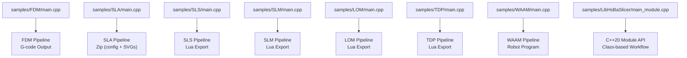

**Diagram sources**
- [samples/FDM/main.cpp:1-337](file://samples/FDM/main.cpp#L1-L337)
- [samples/SLA/main.cpp:1-259](file://samples/SLA/main.cpp#L1-L259)
- [samples/SLS/main.cpp:1-209](file://samples/SLS/main.cpp#L1-L209)
- [samples/SLM/main.cpp:1-196](file://samples/SLM/main.cpp#L1-L196)
- [samples/LOM/main.cpp:1-194](file://samples/LOM/main.cpp#L1-L194)
- [samples/TDP/main.cpp:1-225](file://samples/TDP/main.cpp#L1-L225)
- [samples/WAAM/main.cpp:1-237](file://samples/WAAM/main.cpp#L1-L237)
- [samples/LibHsBaSlicer/main_module.cpp:1-162](file://samples/LibHsBaSlicer/main_module.cpp#L1-L162)

**Section sources**
- [samples/FDM/main.cpp:1-337](file://samples/FDM/main.cpp#L1-L337)
- [samples/SLA/main.cpp:1-259](file://samples/SLA/main.cpp#L1-L259)
- [samples/SLS/main.cpp:1-209](file://samples/SLS/main.cpp#L1-L209)
- [samples/SLM/main.cpp:1-196](file://samples/SLM/main.cpp#L1-L196)
- [samples/LOM/main.cpp:1-194](file://samples/LOM/main.cpp#L1-L194)
- [samples/TDP/main.cpp:1-225](file://samples/TDP/main.cpp#L1-L225)
- [samples/WAAM/main.cpp:1-237](file://samples/WAAM/main.cpp#L1-L237)
- [samples/LibHsBaSlicer/main_module.cpp:1-162](file://samples/LibHsBaSlicer/main_module.cpp#L1-L162)

## Core Components
This section summarizes the core components demonstrated by the samples:
- Configuration creation and model binding
- Synchronous and asynchronous pipeline execution
- Customization via Lua scripts (infill, support, floor, export, robot path)
- Spiral/vase mode for continuous deposition paths
- Error handling and result memory management

Key patterns:
- Create default config for the target technology
- Set required fields: model_name, model_path, output_path
- Optionally set process parameters (layer height, first layer height, line width, speeds, etc.)
- Run pipeline synchronously or asynchronously
- Check result.success and handle error_message
- Free result memory using the provided free function

**Section sources**
- [samples/FDM/main.cpp:53-96](file://samples/FDM/main.cpp#L53-L96)
- [samples/SLA/main.cpp:52-84](file://samples/SLA/main.cpp#L52-L84)
- [samples/SLS/main.cpp:56-92](file://samples/SLS/main.cpp#L56-L92)
- [samples/SLM/main.cpp:56-84](file://samples/SLM/main.cpp#L56-L84)
- [samples/LOM/main.cpp:55-82](file://samples/LOM/main.cpp#L55-L82)
- [samples/TDP/main.cpp:55-82](file://samples/TDP/main.cpp#L55-L82)
- [samples/WAAM/main.cpp:54-81](file://samples/WAAM/main.cpp#L54-L81)

## Architecture Overview
The HsBaSlicer samples follow a consistent architecture:
- Application code sets up configuration and runs the pipeline
- The pipeline performs slicing and optionally generates supports/fills/paths
- Lua scripts can customize specific stages (support/infill/floor/export/robot path)
- Results include success flag, total layers, elapsed time, and output paths/content

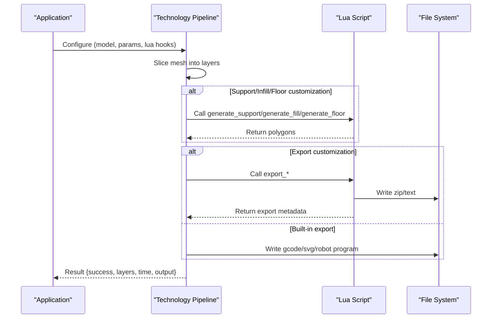

**Diagram sources**
- [samples/FDM/main.cpp:170-220](file://samples/FDM/main.cpp#L170-L220)
- [samples/SLA/main.cpp:149-191](file://samples/SLA/main.cpp#L149-L191)
- [samples/SLS/main.cpp:56-92](file://samples/SLS/main.cpp#L56-L92)
- [samples/LOM/main.cpp:55-82](file://samples/LOM/main.cpp#L55-L82)
- [samples/TDP/main.cpp:55-82](file://samples/TDP/main.cpp#L55-L82)
- [samples/WAAM/main.cpp:54-81](file://samples/WAAM/main.cpp#L54-L81)

## Detailed Component Analysis

### FDM (Fused Deposition Modeling)
Demonstrates:
- Basic pipeline with default configuration
- Custom process parameters (layer height, wall count, fill density, support pattern)
- Lua-driven custom infill and support generation
- Asynchronous execution
- Spiral/vase mode for continuous outer-wall path

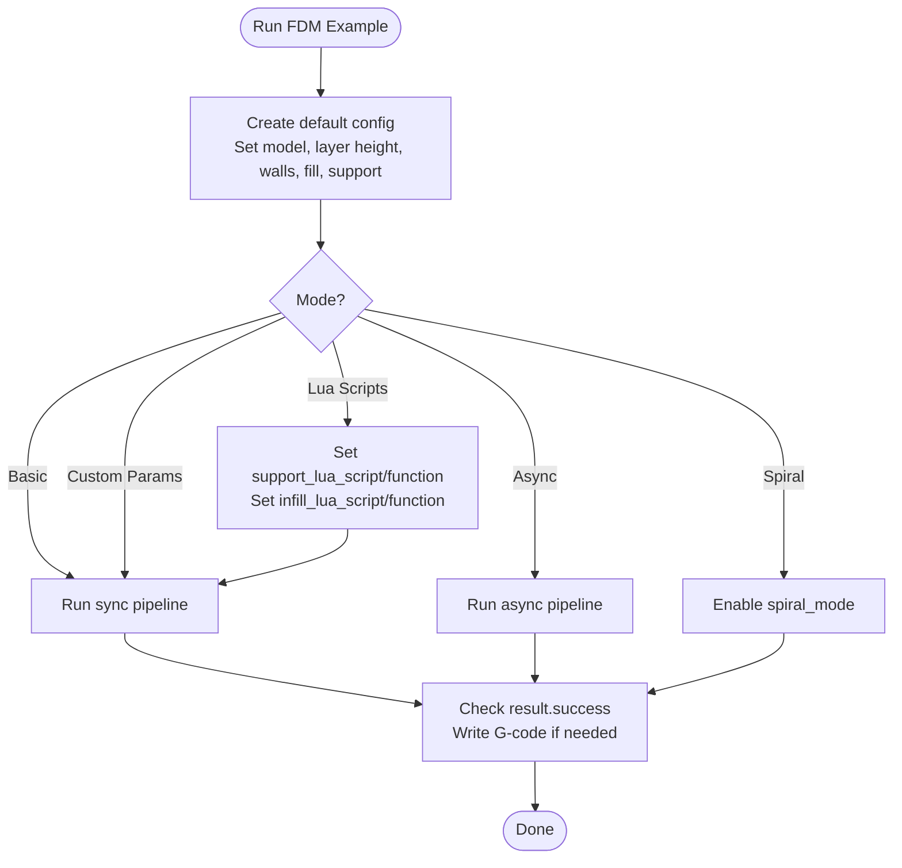

**Diagram sources**
- [samples/FDM/main.cpp:53-96](file://samples/FDM/main.cpp#L53-L96)
- [samples/FDM/main.cpp:101-165](file://samples/FDM/main.cpp#L101-L165)
- [samples/FDM/main.cpp:170-220](file://samples/FDM/main.cpp#L170-L220)
- [samples/FDM/main.cpp:245-269](file://samples/FDM/main.cpp#L245-L269)
- [samples/FDM/main.cpp:274-318](file://samples/FDM/main.cpp#L274-L318)

**Section sources**
- [samples/FDM/main.cpp:53-96](file://samples/FDM/main.cpp#L53-L96)
- [samples/FDM/main.cpp:101-165](file://samples/FDM/main.cpp#L101-L165)
- [samples/FDM/main.cpp:170-220](file://samples/FDM/main.cpp#L170-L220)
- [samples/FDM/main.cpp:245-269](file://samples/FDM/main.cpp#L245-L269)
- [samples/FDM/main.cpp:274-318](file://samples/FDM/main.cpp#L274-L318)

#### Lua Custom Infill (FDM)
- Function signature: `generate_fill(current_layer)`
- Uses PolygonOperations to compute bounding box, generate parallel lines, intersect with current layer
- Demonstrates angle-based zigzag-like fill generation

**Section sources**
- [samples/FDM/scripts/my_infill.lua:1-89](file://samples/FDM/scripts/my_infill.lua#L1-L89)

#### Lua Custom Support (FDM)
- Global variables: current_layer, prev_layer, layer_height, config
- Uses Support.detect_overhang and Support.generate with selectable generator (plane/tree/honeycomb)
- Optional refinement via polygon offset

**Section sources**
- [samples/FDM/scripts/my_support.lua:1-83](file://samples/FDM/scripts/my_support.lua#L1-L83)

### SLA (Stereolithography)
Demonstrates:
- Basic pipeline producing zip with config.json and per-layer SVGs
- Custom exposure/lift/retract parameters and floor/raft settings
- Lua-driven floor and support generation
- Asynchronous execution

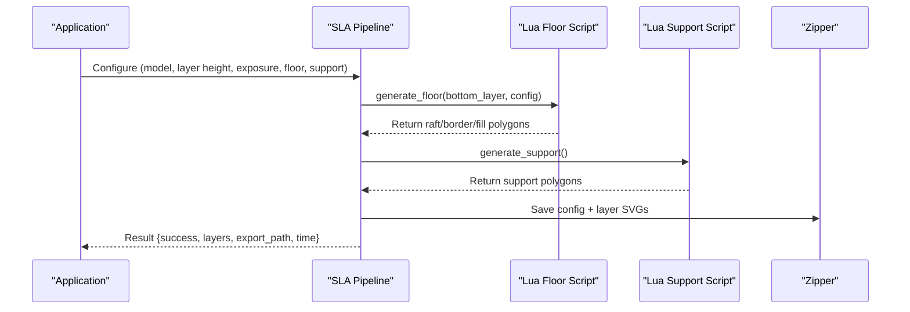

**Diagram sources**
- [samples/SLA/main.cpp:52-84](file://samples/SLA/main.cpp#L52-L84)
- [samples/SLA/main.cpp:89-144](file://samples/SLA/main.cpp#L89-L144)
- [samples/SLA/main.cpp:149-191](file://samples/SLA/main.cpp#L149-L191)
- [samples/SLA/main.cpp:217-239](file://samples/SLA/main.cpp#L217-L239)

**Section sources**
- [samples/SLA/main.cpp:52-84](file://samples/SLA/main.cpp#L52-L84)
- [samples/SLA/main.cpp:89-144](file://samples/SLA/main.cpp#L89-L144)
- [samples/SLA/main.cpp:149-191](file://samples/SLA/main.cpp#L149-L191)
- [samples/SLA/main.cpp:217-239](file://samples/SLA/main.cpp#L217-L239)

#### Lua Custom Floor (SLA)
- Function signature: `generate_floor(bottom_layer, config)`
- Computes convex hull (optional), offsets to create raft border, fills interior with zigzag

**Section sources**
- [samples/SLA/scripts/my_sla_floor.lua:1-64](file://samples/SLA/scripts/my_sla_floor.lua#L1-L64)

#### Lua Custom Support (SLA)
- Global variables: current_layer, prev_layer, layer_height, config
- Uses Support.new_sla() and Support.generate; optional area filtering

**Section sources**
- [samples/SLA/scripts/my_sla_support.lua:1-76](file://samples/SLA/scripts/my_sla_support.lua#L1-L76)

### SLS (Selective Laser Sintering)
Demonstrates:
- Minimal configuration with Lua-driven export
- Custom laser power, scan speed, hatch spacing/rotation, bed temperature
- Asynchronous execution

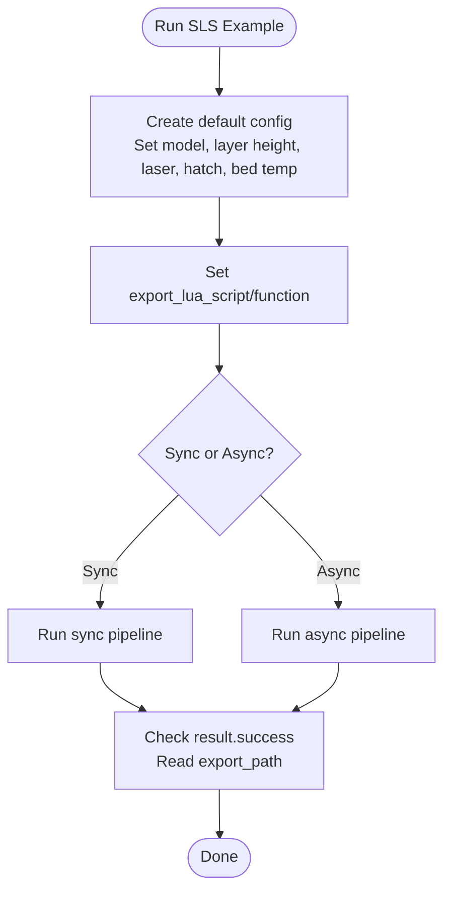

**Diagram sources**
- [samples/SLS/main.cpp:56-92](file://samples/SLS/main.cpp#L56-L92)
- [samples/SLS/main.cpp:97-140](file://samples/SLS/main.cpp#L97-L140)
- [samples/SLS/main.cpp:166-190](file://samples/SLS/main.cpp#L166-L190)

**Section sources**
- [samples/SLS/main.cpp:56-92](file://samples/SLS/main.cpp#L56-L92)
- [samples/SLS/main.cpp:97-140](file://samples/SLS/main.cpp#L97-L140)
- [samples/SLS/main.cpp:166-190](file://samples/SLS/main.cpp#L166-L190)

#### Lua Export (SLS)
- Packs config.json and per-layer JSON outlines into zip
- Optional SQLite registration for export history

**Section sources**
- [samples/SLS/scripts/my_sls_export.lua:1-80](file://samples/SLS/scripts/my_sls_export.lua#L1-L80)

### LOM (Laminated Object Manufacturing)
Demonstrates:
- Minimal configuration with Lua-driven export
- Custom cut/bond parameters (cut speed/margin/power, seal contour, bond temperature/pressure/time)
- Asynchronous execution

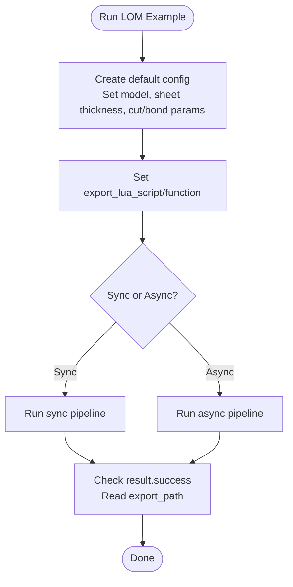

**Diagram sources**
- [samples/LOM/main.cpp:55-82](file://samples/LOM/main.cpp#L55-L82)
- [samples/LOM/main.cpp:87-130](file://samples/LOM/main.cpp#L87-L130)
- [samples/LOM/main.cpp:154-175](file://samples/LOM/main.cpp#L154-L175)

**Section sources**
- [samples/LOM/main.cpp:55-82](file://samples/LOM/main.cpp#L55-L82)
- [samples/LOM/main.cpp:87-130](file://samples/LOM/main.cpp#L87-L130)
- [samples/LOM/main.cpp:154-175](file://samples/LOM/main.cpp#L154-L175)

#### Lua Export (LOM)
- Packs config.json and per-layer JSON outlines into zip
- Optional SQLite registration for export history

**Section sources**
- [samples/LOM/scripts/my_lom_export.lua:1-58](file://samples/LOM/scripts/my_lom_export.lua#L1-L58)

### TDP / 3DP (Binder Jetting)
Demonstrates:
- Minimal configuration with Lua-driven export
- Custom head count, drop spacing, binder saturation, curing time, bed temperature
- Spiral mode for continuous rising deposition path
- Asynchronous execution

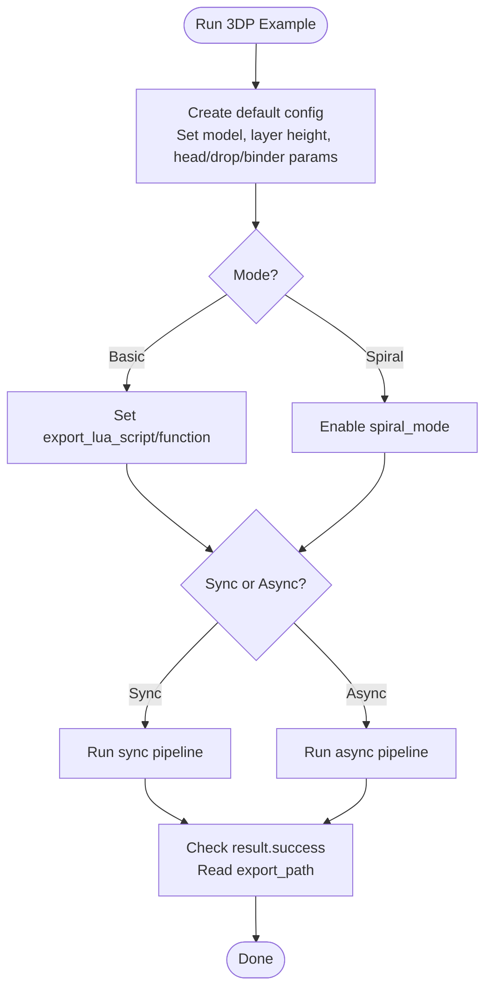

**Diagram sources**
- [samples/TDP/main.cpp:55-82](file://samples/TDP/main.cpp#L55-L82)
- [samples/TDP/main.cpp:87-125](file://samples/TDP/main.cpp#L87-L125)
- [samples/TDP/main.cpp:149-170](file://samples/TDP/main.cpp#L149-L170)
- [samples/TDP/main.cpp:175-205](file://samples/TDP/main.cpp#L175-L205)

**Section sources**
- [samples/TDP/main.cpp:55-82](file://samples/TDP/main.cpp#L55-L82)
- [samples/TDP/main.cpp:87-125](file://samples/TDP/main.cpp#L87-L125)
- [samples/TDP/main.cpp:149-170](file://samples/TDP/main.cpp#L149-L170)
- [samples/TDP/main.cpp:175-205](file://samples/TDP/main.cpp#L175-L205)

#### Lua Export (TDP)
- Packs config.json and per-layer JSON outlines into zip
- Optional SQLite registration for export history

**Section sources**
- [samples/TDP/scripts/my_tdp_export.lua:1-63](file://samples/TDP/scripts/my_tdp_export.lua#L1-L63)

### SLM (Selective Laser Melting)
Demonstrates:
- Minimal configuration with Lua-driven export
- Custom laser power, scan speed, hatch spacing/rotation, bed temperature
- Metal-specific parameters: material, light source, shielding gas
- Asynchronous execution

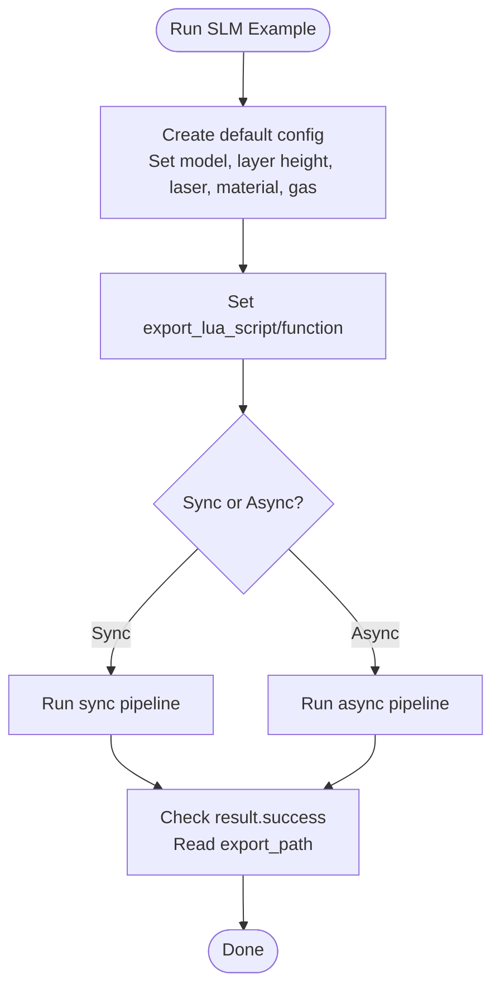

**Diagram sources**
- [samples/SLM/main.cpp:56-84](file://samples/SLM/main.cpp#L56-L84)
- [samples/SLM/main.cpp:89-132](file://samples/SLM/main.cpp#L89-L132)
- [samples/SLM/main.cpp:156-177](file://samples/SLM/main.cpp#L156-L177)

**Section sources**
- [samples/SLM/main.cpp:56-84](file://samples/SLM/main.cpp#L56-L84)
- [samples/SLM/main.cpp:89-132](file://samples/SLM/main.cpp#L89-L132)
- [samples/SLM/main.cpp:156-177](file://samples/SLM/main.cpp#L156-L177)

### WAAM (Wire Arc Additive Manufacturing)
Demonstrates:
- Built-in robot program generation (ABB/KUKA/FANUC)
- Custom welding parameters (material, process, protection gas, arc current/voltage, wire feed, gas flow, interpass temperature)
- Custom Lua path script to replace built-in code generator
- Spiral/vase mode for continuous rising weld bead
- Asynchronous execution

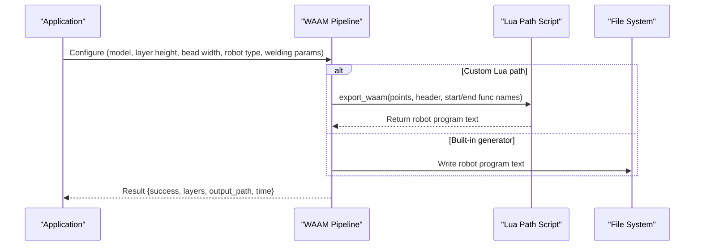

**Diagram sources**
- [samples/WAAM/main.cpp:54-81](file://samples/WAAM/main.cpp#L54-L81)
- [samples/WAAM/main.cpp:86-131](file://samples/WAAM/main.cpp#L86-L131)
- [samples/WAAM/main.cpp:155-178](file://samples/WAAM/main.cpp#L155-L178)
- [samples/WAAM/main.cpp:183-217](file://samples/WAAM/main.cpp#L183-L217)

**Section sources**
- [samples/WAAM/main.cpp:54-81](file://samples/WAAM/main.cpp#L54-L81)
- [samples/WAAM/main.cpp:86-131](file://samples/WAAM/main.cpp#L86-L131)
- [samples/WAAM/main.cpp:155-178](file://samples/WAAM/main.cpp#L155-L178)
- [samples/WAAM/main.cpp:183-217](file://samples/WAAM/main.cpp#L183-L217)

#### Lua Custom Path (WAAM)
- Function signature: `export_waam()`
- Receives global variables: header, startProgramFunc, endProgramFunc, points array
- Returns complete robot program text

**Section sources**
- [samples/WAAM/scripts/my_waam_path.lua:1-46](file://samples/WAAM/scripts/my_waam_path.lua#L1-L46)

### LibHsBaSlicer (C++20 Module API)
Demonstrates:
- Class-based workflow using Model, FdmPipeline, FdmResult
- RAII model loading and automatic cleanup
- Full pipeline run and optional fully Lua-defined workflow via CustomLuaPipeline
- Step-by-step stage usage commented for advanced control

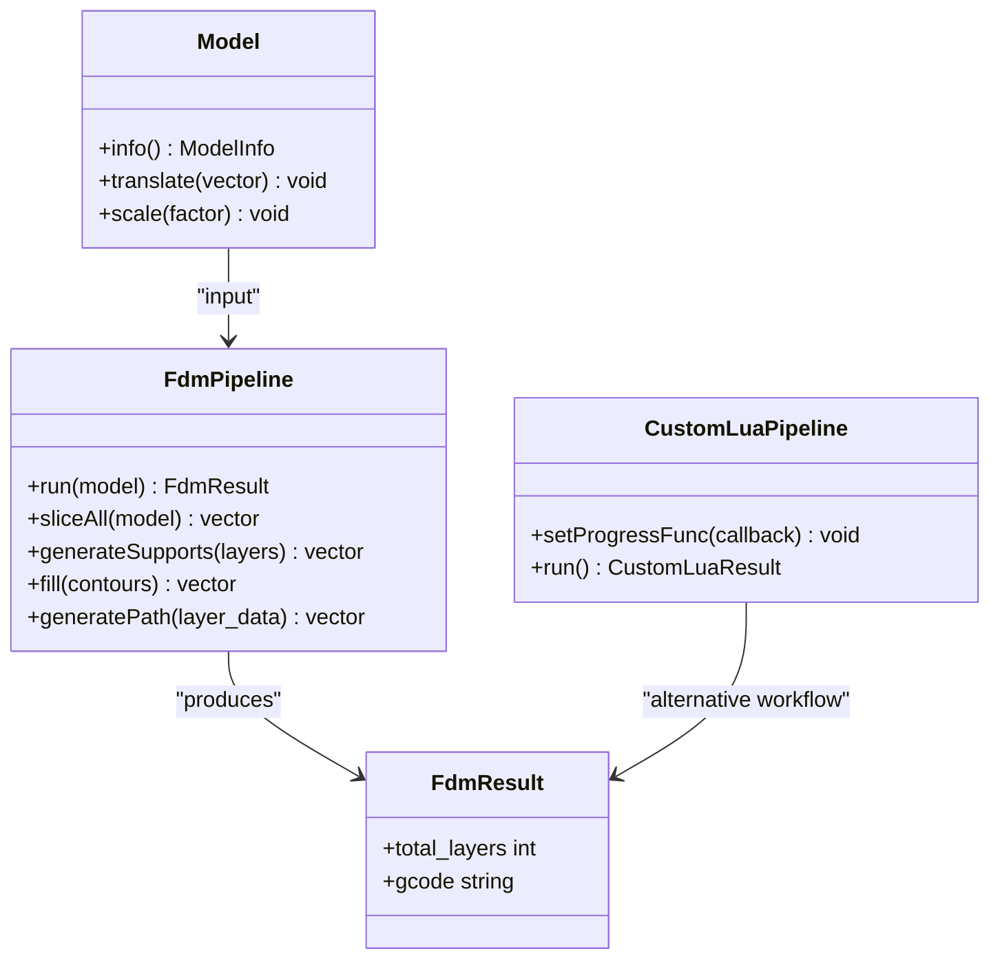

**Diagram sources**
- [samples/LibHsBaSlicer/main_module.cpp:45-98](file://samples/LibHsBaSlicer/main_module.cpp#L45-L98)
- [samples/LibHsBaSlicer/main_module.cpp:101-127](file://samples/LibHsBaSlicer/main_module.cpp#L101-L127)
- [samples/LibHsBaSlicer/main_module.cpp:141-153](file://samples/LibHsBaSlicer/main_module.cpp#L141-L153)

**Section sources**
- [samples/LibHsBaSlicer/main_module.cpp:45-98](file://samples/LibHsBaSlicer/main_module.cpp#L45-L98)
- [samples/LibHsBaSlicer/main_module.cpp:101-127](file://samples/LibHsBaSlicer/main_module.cpp#L101-L127)
- [samples/LibHsBaSlicer/main_module.cpp:141-153](file://samples/LibHsBaSlicer/main_module.cpp#L141-L153)

## Dependency Analysis
The samples depend on:
- Technology-specific pipeline headers (fdm_pipeline.h, sla_pipeline.h, sls_pipeline.h, lom_pipeline.h, tdp_pipeline.h, waam_pipeline.h, slm_pipeline.h)
- Logger singleton for cross-platform logging (when not HSBA_GAME_CONSOLE)
- Lua scripts for customization points
- File system for model input and output writing

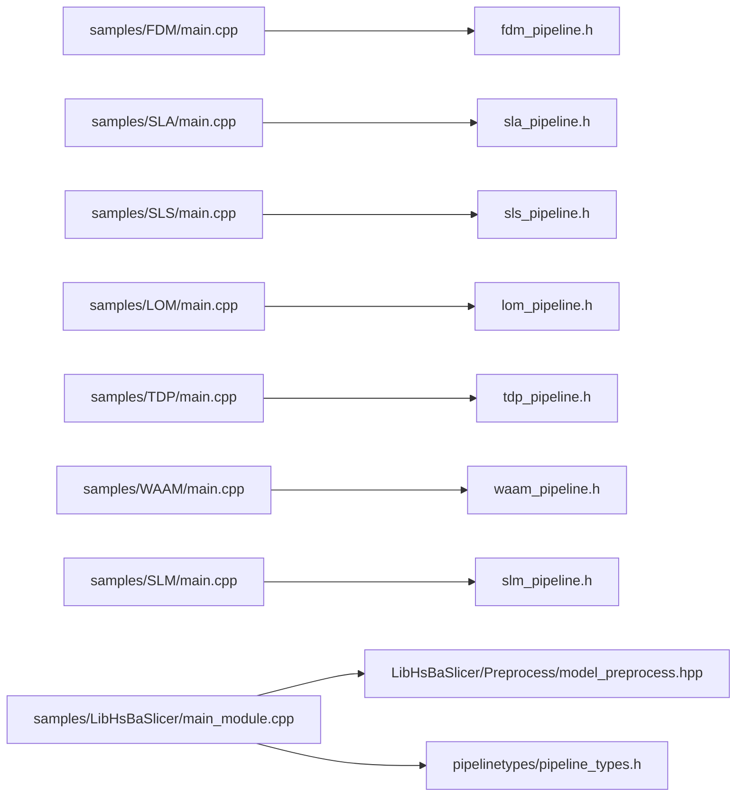

**Diagram sources**
- [samples/FDM/main.cpp:11-22](file://samples/FDM/main.cpp#L11-L22)
- [samples/SLA/main.cpp:12-21](file://samples/SLA/main.cpp#L12-L21)
- [samples/SLS/main.cpp:16-25](file://samples/SLS/main.cpp#L16-L25)
- [samples/LOM/main.cpp:16-25](file://samples/LOM/main.cpp#L16-L25)
- [samples/TDP/main.cpp:16-25](file://samples/TDP/main.cpp#L16-L25)
- [samples/WAAM/main.cpp:15-24](file://samples/WAAM/main.cpp#L15-L24)
- [samples/SLM/main.cpp:16-25](file://samples/SLM/main.cpp#L16-L25)
- [samples/LibHsBaSlicer/main_module.cpp:24-29](file://samples/LibHsBaSlicer/main_module.cpp#L24-L29)

**Section sources**
- [samples/FDM/main.cpp:11-22](file://samples/FDM/main.cpp#L11-L22)
- [samples/SLA/main.cpp:12-21](file://samples/SLA/main.cpp#L12-L21)
- [samples/SLS/main.cpp:16-25](file://samples/SLS/main.cpp#L16-L25)
- [samples/LOM/main.cpp:16-25](file://samples/LOM/main.cpp#L16-L25)
- [samples/TDP/main.cpp:16-25](file://samples/TDP/main.cpp#L16-L25)
- [samples/WAAM/main.cpp:15-24](file://samples/WAAM/main.cpp#L15-L24)
- [samples/SLM/main.cpp:16-25](file://samples/SLM/main.cpp#L16-L25)
- [samples/LibHsBaSlicer/main_module.cpp:24-29](file://samples/LibHsBaSlicer/main_module.cpp#L24-L29)

## Performance Considerations
- Use asynchronous pipelines to avoid blocking the UI thread in GUI applications
- Prefer built-in generators for support/infill when possible; only use Lua scripts for specialized needs
- Enable spiral/vase mode for continuous deposition to reduce travel moves and restarts (FDM, TDP, WAAM)
- Tune layer height and first layer height to balance quality and speed
- Adjust fill spacing and wall count to control print time and material usage
- For powder-bed processes (SLS/SLM), optimize hatch spacing and rotation to improve part properties without excessive scan time

[No sources needed since this section provides general guidance]

## Troubleshooting Guide
Common issues and resolutions:
- Model file not found: Ensure the STL is placed in the expected directory relative to the executable
- Lua script errors: Verify function names match the configured hooks (e.g., generate_support, generate_fill, generate_floor, export_*)
- Export failures: Check output_path permissions and ensure the correct return type from Lua scripts (table for zip exporters, string for WAAM path exporter)
- Memory leaks: Always call the corresponding free function for pipeline results (e.g., HsBaFreePipelineResult, HsBaFreeSlaPipelineResult, etc.)
- Asynchronous completion: Ensure the completion callback frees the result and updates the done flag appropriately

**Section sources**
- [samples/LibHsBaSlicer/main_module.cpp:37-43](file://samples/LibHsBaSlicer/main_module.cpp#L37-L43)
- [samples/FDM/main.cpp:69-96](file://samples/FDM/main.cpp#L69-L96)
- [samples/SLA/main.cpp:70-84](file://samples/SLA/main.cpp#L70-L84)
- [samples/SLS/main.cpp:77-92](file://samples/SLS/main.cpp#L77-L92)
- [samples/LOM/main.cpp:70-82](file://samples/LOM/main.cpp#L70-L82)
- [samples/TDP/main.cpp:70-82](file://samples/TDP/main.cpp#L70-L82)
- [samples/WAAM/main.cpp:69-81](file://samples/WAAM/main.cpp#L69-L81)

## Conclusion
HsBaSlicer provides a flexible, high-performance framework for 3D printing slicing across multiple technologies. The samples demonstrate:
- Simple and advanced usage patterns
- Robust configuration management
- Comprehensive error handling
- Extensibility through Lua scripting
- Cross-platform compatibility and modern C++20 module support

Use these examples as a foundation for integrating HsBaSlicer into your applications, whether desktop GUIs, web services, or mobile apps.

[No sources needed since this section summarizes without analyzing specific files]

## Appendices

### Step-by-Step Tutorials

#### Basic FDM Slicing
1. Create default FDM config
2. Set model_name and model_path
3. Optionally set layer_height, first_layer_height, wall_count, fill_density, support_pattern
4. Run pipeline synchronously or asynchronously
5. Check result.success and write G-code if needed
6. Free result memory

**Section sources**
- [samples/FDM/main.cpp:53-96](file://samples/FDM/main.cpp#L53-L96)
- [samples/FDM/main.cpp:101-165](file://samples/FDM/main.cpp#L101-L165)

#### SLA Floor and Support Customization
1. Create default SLA config
2. Set model and output path
3. Configure exposure and lift parameters
4. Provide Lua scripts for floor and support generation
5. Run pipeline and inspect zip output

**Section sources**
- [samples/SLA/main.cpp:89-144](file://samples/SLA/main.cpp#L89-L144)
- [samples/SLA/scripts/my_sla_floor.lua:1-64](file://samples/SLA/scripts/my_sla_floor.lua#L1-L64)
- [samples/SLA/scripts/my_sla_support.lua:1-76](file://samples/SLA/scripts/my_sla_support.lua#L1-L76)

#### SLS/SLM/LOM/TDP Export Packaging
1. Create default config for the technology
2. Set model and output path
3. Provide Lua export script
4. Run pipeline and verify zip contents

**Section sources**
- [samples/SLS/main.cpp:56-92](file://samples/SLS/main.cpp#L56-L92)
- [samples/SLM/main.cpp:56-84](file://samples/SLM/main.cpp#L56-L84)
- [samples/LOM/main.cpp:55-82](file://samples/LOM/main.cpp#L55-L82)
- [samples/TDP/main.cpp:55-82](file://samples/TDP/main.cpp#L55-L82)

#### WAAM Robot Program Generation
1. Create default WAAM config
2. Set model and robot type (ABB/KUKA/FANUC)
3. Optionally provide Lua path script for custom robot code
4. Run pipeline and inspect generated robot program

**Section sources**
- [samples/WAAM/main.cpp:54-81](file://samples/WAAM/main.cpp#L54-L81)
- [samples/WAAM/scripts/my_waam_path.lua:1-46](file://samples/WAAM/scripts/my_waam_path.lua#L1-L46)

### Migration from Legacy Approaches
- Replace direct library calls with the modern C++20 module API where possible
- Use class-based workflows (Model, FdmPipeline, FdmResult) for better resource management
- Migrate Lua scripts to the updated function signatures and global variable conventions
- Adopt asynchronous execution patterns for responsive UIs

**Section sources**
- [samples/LibHsBaSlicer/main_module.cpp:45-98](file://samples/LibHsBaSlicer/main_module.cpp#L45-L98)
- [samples/LibHsBaSlicer/main_module.cpp:101-127](file://samples/LibHsBaSlicer/main_module.cpp#L101-L127)