# Integration Examples

<cite>
**Referenced Files in This Document**   
- [README.md](file://README.md)
- [DllHsBaSlicer README](file://docs/en/DllHsBaSlicer/README.md)
- [Qt / wxWidgets Integration Guide](file://docs/en/DllHsBaSlicer/qt_wxwidgets_integration.md)
- [Unity / Unreal Engine Integration Guide](file://docs/en/DllHsBaSlicer/game_engine_integration.md)
- [dllexport.h](file://DllHsBaSlicer/dllexport.h)
- [initialize.cpp](file://DllHsBaSlicer/initialize.cpp)
- [pipeline_convert.cpp](file://DllHsBaSlicer/pipeline_convert.cpp)
- [export.h](file://LibHsBaSlicer/export.h)
- [thread_pool.hpp](file://base/thread_pool.hpp)
- [Android README](file://android/README.md)
- [MainActivity.java](file://android/app/src/main/java/com/hsmbanlance/hsbaslicer/example/MainActivity.java)
- [HsBaSlicerBridge.h](file://ios/HsBaSlicerExample/HsBaSlicerBridge.h)
- [ViewController.swift](file://ios/HsBaSlicerExample/ViewController.swift)
- [FDM sample main.cpp](file://samples/FDM/main.cpp)
- [Custom pipeline sample main.cpp](file://samples/Custom/main.cpp)
</cite>

## Table of Contents
1. [Introduction](#introduction)
2. [Project Structure](#project-structure)
3. [Core Components](#core-components)
4. [Architecture Overview](#architecture-overview)
5. [Detailed Component Analysis](#detailed-component-analysis)
6. [Dependency Analysis](#dependency-analysis)
7. [Performance Considerations](#performance-considerations)
8. [Troubleshooting Guide](#troubleshooting-guide)
9. [Conclusion](#conclusion)
10. [Appendices](#appendices)

## Introduction
This document provides integration examples for embedding HsBaSlicer into different application types: GUI applications, web service backends, mobile apps, and game engines. It demonstrates C++ module usage, C ABI integration, language binding patterns, asynchronous processing, event handling, real-time progress reporting, deployment strategies, dependency management, and platform-specific considerations.

The repository exposes two primary integration surfaces:
- `LibHsBaSlicer`: a C++ static/shared library with full slicing capabilities.
- `DllHsBaSlicer`: a C ABI shared/static export layer that wraps the C++ core and is suitable for cross-language bindings (C#, Java, Python, Swift, Unity, Unreal Engine).

The project supports desktop platforms, Android, iOS, and game consoles, with conditional licensing depending on whether GPL/LGPL kernels are linked.

**Section sources**
- [README.md:21-39](file://README.md#L21-L39)
- [README.md:100-124](file://README.md#L100-L124)
- [README.md:187-210](file://README.md#L187-L210)

## Project Structure
At a high level, integrations typically link against either:
- `HsBaSlicer::DllHsBaSlicer` for C ABI access from any host language.
- `HsBaSlicer::LibHsBaSlicer` for direct C++ integration.

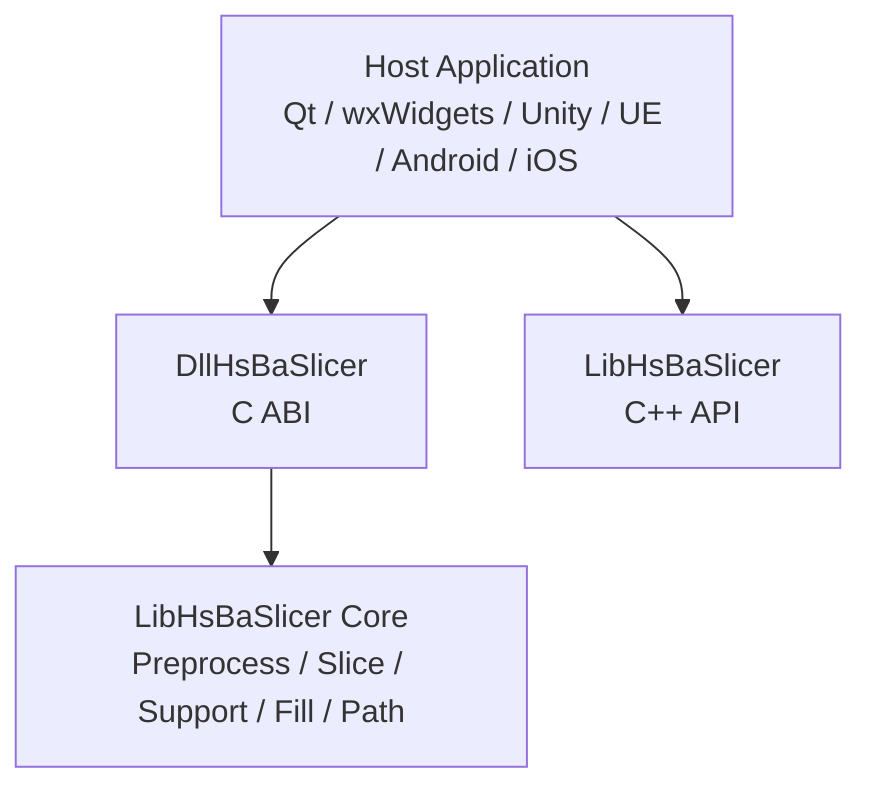

**Diagram sources**
- [DllHsBaSlicer README:7-19](file://docs/en/DllHsBaSlicer/README.md#L7-L19)

Key artifacts and headers:
- C ABI macros and initialization: `dllexport.h`, `initialize.h`.
- Pipeline conversion helpers for Protobuf wire formats: `pipeline_convert.h/cpp`.
- C++ library export macro: `export.h`.

**Section sources**
- [README.md:126-151](file://README.md#L126-L151)
- [DllHsBaSlicer README:33-54](file://docs/en/DllHsBaSlicer/README.md#L33-L54)
- [dllexport.h:1-23](file://DllHsBaSlicer/dllexport.h#L1-L23)
- [export.h:1-22](file://LibHsBaSlicer/export.h#L1-L22)

## Core Components
- Initialization: call `initialize()` once at process startup before any pipeline calls.
- Pipelines: FDM, SLA, SLS, SLM, LOM, TDP, WAAM, File Transfer, Param Store, Custom Lua.
- Callback model: progress and result callbacks fire on internal worker threads; hosts must marshal to UI/game thread.
- Memory rules: config structs are value types; result strings are allocated by the library and must be freed via matching `HsBaFree*PipelineResult()`.
- Proto conversion: bidirectional conversion between C structs and Protobuf bytes for cross-process/cross-language communication.

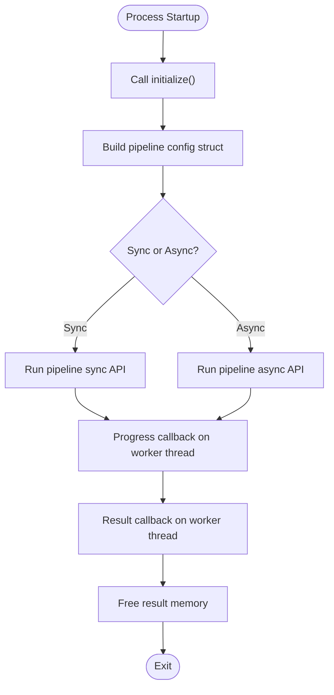

**Diagram sources**
- [DllHsBaSlicer README:684-703](file://docs/en/DllHsBaSlicer/README.md#L684-L703)

**Section sources**
- [DllHsBaSlicer README:56-54](file://docs/en/DllHsBaSlicer/README.md#L56-L54)
- [DllHsBaSlicer README:684-703](file://docs/en/DllHsBaSlicer/README.md#L684-L703)

## Architecture Overview
The recommended architecture separates host concerns from slicing logic:
- Host app manages UI, threading, and resource lifetimes.
- DllHsBaSlicer provides stable C ABI boundaries.
- LibHsBaSlicer implements the slicing core.

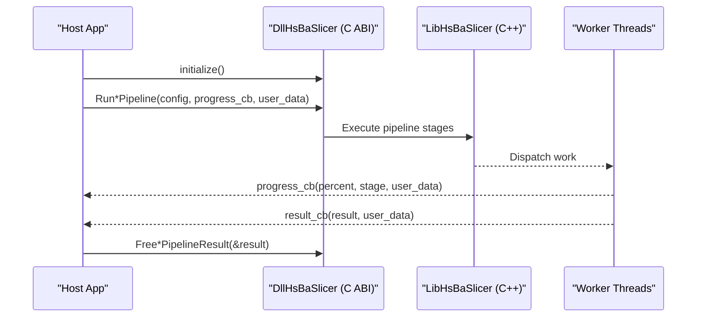

**Diagram sources**
- [DllHsBaSlicer README:7-19](file://docs/en/DllHsBaSlicer/README.md#L7-L19)
- [DllHsBaSlicer README:684-703](file://docs/en/DllHsBaSlicer/README.md#L684-L703)

## Detailed Component Analysis

### GUI Application Integration (Qt / wxWidgets)
- Call `initialize()` once after process startup.
- Never run synchronous APIs on the UI thread; use worker threads.
- Marshal progress/result callbacks back to the UI thread using Qt signals/slots or wxWidgets `CallAfter`.
- Keep UTF-8 string lifetimes valid during pipeline execution.

Recommended pattern:
- Create a worker object that owns config strings.
- Use QThread + signals or std::thread + CallAfter.
- Update progress bars and status labels only on the UI thread.

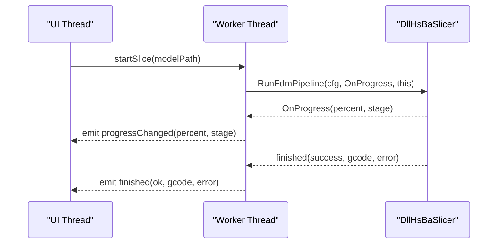

**Diagram sources**
- [Qt / wxWidgets Integration Guide:47-106](file://docs/en/DllHsBaSlicer/qt_wxwidgets_integration.md#L47-L106)
- [Qt / wxWidgets Integration Guide:108-151](file://docs/en/DllHsBaSlicer/qt_wxwidgets_integration.md#L108-L151)

Practical notes:
- CMake linking via `find_package(HsBaSlicer CONFIG REQUIRED)` and linking `HsBaSlicer::DllHsBaSlicer`.
- For quick validation, point directly at build artifacts and copy DLL next to executable on Windows.
- In production, prefer managed threads (`QThread`, `wxThread`) and ensure proper cleanup.

**Section sources**
- [Qt / wxWidgets Integration Guide:7-13](file://docs/en/DllHsBaSlicer/qt_wxwidgets_integration.md#L7-L13)
- [Qt / wxWidgets Integration Guide:18-45](file://docs/en/DllHsBaSlicer/qt_wxwidgets_integration.md#L18-L45)
- [Qt / wxWidgets Integration Guide:47-106](file://docs/en/DllHsBaSlicer/qt_wxwidgets_integration.md#L47-L106)
- [Qt / wxWidgets Integration Guide:171-265](file://docs/en/DllHsBaSlicer/qt_wxwidgets_integration.md#L171-L265)

### Web Service Backend Implementation
- Use `DllHsBaSlicer` C ABI for cross-language services (C#, Java, Python).
- Prefer async pipelines to avoid blocking request threads.
- Serialize requests/responses using Protobuf wire format via `pipeline_convert.h` helpers.
- Maintain connection pools and queue slicing jobs; report progress via server-side events or polling endpoints.

Integration steps:
- Initialize once per process.
- Decode incoming Protobuf bytes into C config structs using `*FromProtoBytes`.
- Run pipeline asynchronously; collect results via result callback.
- Encode results using `*ToProtoBytes`; free buffers appropriately.

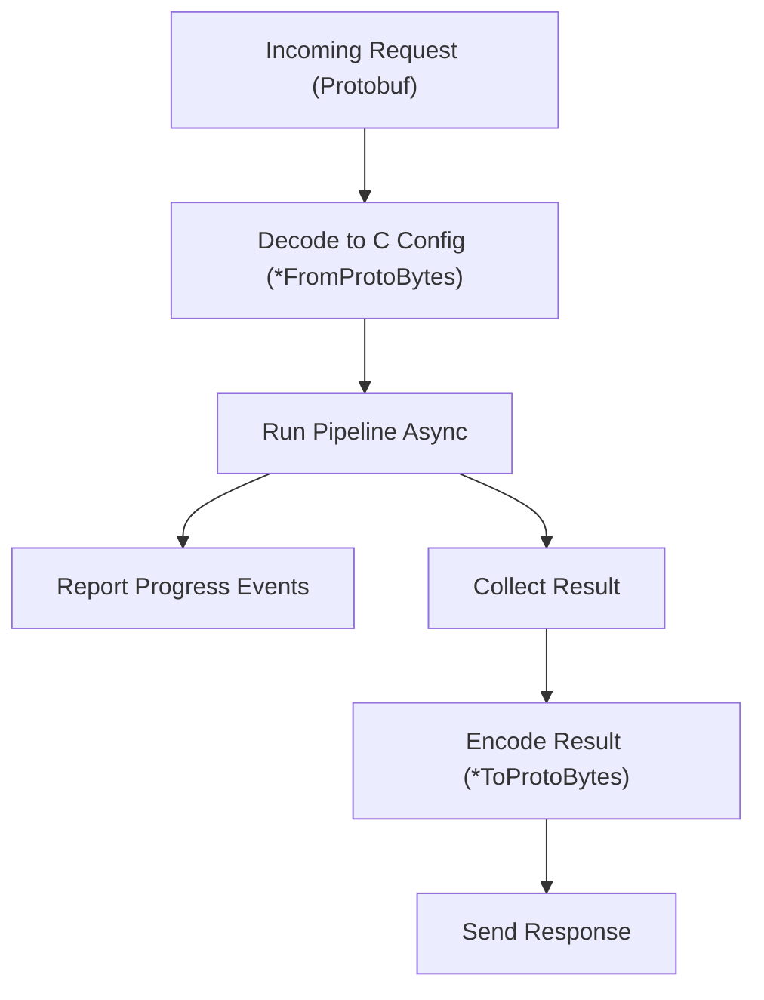

**Diagram sources**
- [pipeline_convert.cpp:27-99](file://DllHsBaSlicer/pipeline_convert.cpp#L27-L99)
- [DllHsBaSlicer README:527-603](file://docs/en/DllHsBaSlicer/README.md#L527-L603)

**Section sources**
- [DllHsBaSlicer README:527-603](file://docs/en/DllHsBaSlicer/README.md#L527-L603)
- [pipeline_convert.cpp:27-99](file://DllHsBaSlicer/pipeline_convert.cpp#L27-L99)

### Mobile App Integration (Android / iOS)
- Android: Load native libraries via JNI; place `.so` files under `jniLibs/<abi>/`.
- iOS: Link static library; use bridging header to expose C functions to Swift.

Android example:
- `System.loadLibrary("HsBaSlicer")` loads the native library.
- Invoke JNI entry to run pipeline examples.

iOS example:
- Bridging header declares `HsBaRunPipelineExamples()`.
- Swift ViewController runs examples on background queue and updates UI on main queue.

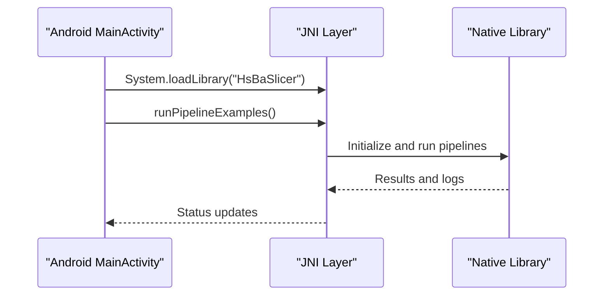

**Diagram sources**
- [MainActivity.java:17-27](file://android/app/src/main/java/com/hsmbanlance/hsbaslicer/example/MainActivity.java#L17-L27)
- [Android README:1-22](file://android/README.md#L1-L22)

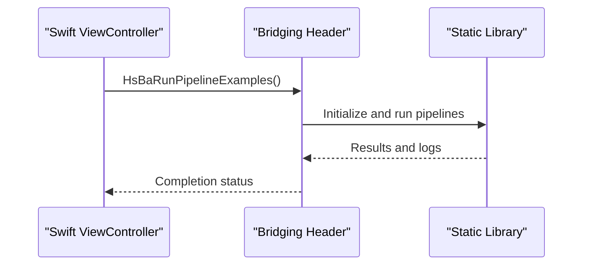

**Diagram sources**
- [HsBaSlicerBridge.h:14-25](file://ios/HsBaSlicerExample/HsBaSlicerBridge.h#L14-L25)
- [ViewController.swift:43-55](file://ios/HsBaSlicerExample/ViewController.swift#L43-L55)

**Section sources**
- [Android README:1-22](file://android/README.md#L1-L22)
- [MainActivity.java:1-46](file://android/app/src/main/java/com/hsmbanlance/hsbaslicer/example/MainActivity.java#L1-L46)
- [HsBaSlicerBridge.h:1-32](file://ios/HsBaSlicerExample/HsBaSlicerBridge.h#L1-L32)
- [ViewController.swift:1-86](file://ios/HsBaSlicerExample/ViewController.swift#L1-L86)

### Game Engine Integration (Unity / Unreal Engine)
- Unity: Use C# P/Invoke with `[DllImport]`; keep delegates alive; marshal to main thread.
- Unreal Engine: Use ThirdParty module; wrap C ABI in UGameInstanceSubsystem; broadcast delegates on GameThread.

Unity highlights:
- Platform-specific library placement and `DllImport("__Internal")` for iOS.
- High-level wrapper maintains delegate references and posts to Unity main thread.

Unreal Engine highlights:
- ThirdParty module layout and Build.cs configuration.
- C++ wrapper uses `AsyncTask(ENamedThreads::GameThread, ...)` for safe UI updates.

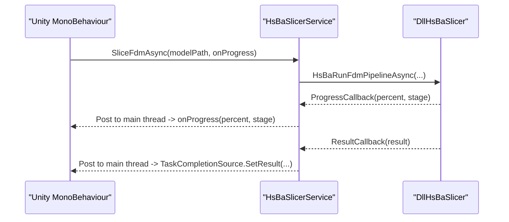

**Diagram sources**
- [Unity / Unreal Engine Integration Guide:21-124](file://docs/en/DllHsBaSlicer/game_engine_integration.md#L21-L124)
- [Unity / Unreal Engine Integration Guide:128-183](file://docs/en/DllHsBaSlicer/game_engine_integration.md#L128-L183)

**Section sources**
- [Unity / Unreal Engine Integration Guide:7-18](file://docs/en/DllHsBaSlicer/game_engine_integration.md#L7-L18)
- [Unity / Unreal Engine Integration Guide:21-124](file://docs/en/DllHsBaSlicer/game_engine_integration.md#L21-L124)
- [Unity / Unreal Engine Integration Guide:128-213](file://docs/en/DllHsBaSlicer/game_engine_integration.md#L128-L213)
- [Unity / Unreal Engine Integration Guide:216-362](file://docs/en/DllHsBaSlicer/game_engine_integration.md#L216-L362)

### C++ Module Usage and Asynchronous Processing
- Direct C++ usage via `LibHsBaSlicer` or samples like FDM and Custom pipeline.
- Asynchronous pipelines return immediately and invoke result callbacks when complete.
- Progress callbacks provide real-time feedback during slicing.

FDM sample demonstrates:
- Basic pipeline usage.
- Custom parameters.
- Lua custom support/fill.
- Async pipeline execution.
- Spiral/vase mode.

Custom pipeline sample demonstrates:
- Fully Lua-defined workflows.
- Inline Lua source.
- Async execution.
- Protobuf wire format usage.

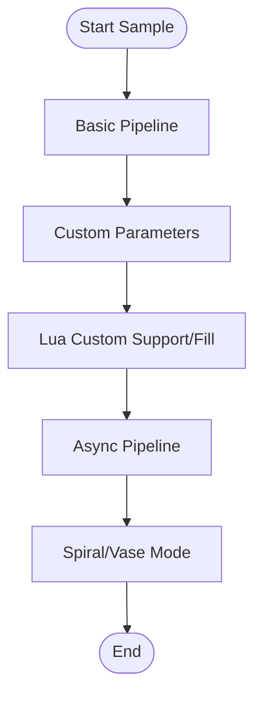

**Diagram sources**
- [FDM sample main.cpp:50-96](file://samples/FDM/main.cpp#L50-L96)
- [FDM sample main.cpp:98-165](file://samples/FDM/main.cpp#L98-L165)
- [FDM sample main.cpp:167-220](file://samples/FDM/main.cpp#L167-L220)
- [FDM sample main.cpp:222-269](file://samples/FDM/main.cpp#L222-L269)
- [FDM sample main.cpp:271-318](file://samples/FDM/main.cpp#L271-L318)

**Section sources**
- [FDM sample main.cpp:1-337](file://samples/FDM/main.cpp#L1-L337)
- [Custom pipeline sample main.cpp:1-616](file://samples/Custom/main.cpp#L1-L616)

### Event Handling and Real-Time Progress Reporting
- Register Lua extension functions for custom operations within pipeline stages.
- Register C-style event callbacks for Zipper compression progress and database events.
- Progress callbacks provide percentage and stage descriptions; marshal to UI thread.

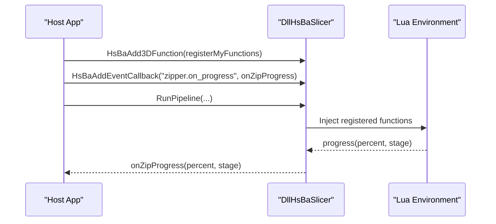

**Diagram sources**
- [DllHsBaSlicer README:612-682](file://docs/en/DllHsBaSlicer/README.md#L612-L682)

**Section sources**
- [DllHsBaSlicer README:612-682](file://docs/en/DllHsBaSlicer/README.md#L612-L682)

### Deployment Strategies and Dependency Management
- Install via `cmake --install` and reference via `find_package(HsBaSlicer CONFIG REQUIRED)`.
- Platform-specific artifacts:
  - Windows: `.dll` + `.lib`.
  - Linux/macOS: `.so`/`.dylib`.
  - Android: `.so` via JNI.
  - iOS: static `.a`.
- Conditional licensing based on GPL/LGPL components.

**Section sources**
- [README.md:100-124](file://README.md#L100-L124)
- [README.md:181-210](file://README.md#L181-L210)

### Platform-Specific Considerations
- Desktop: All library targets participate in installation.
- Android/iOS/game consoles: `HsBaSlicerCADModel` excluded due to missing OpenCascade support.
- iOS requires static library linkage and special P/Invoke handling.

**Section sources**
- [README.md:187-191](file://README.md#L187-L191)
- [Unity / Unreal Engine Integration Guide:7-18](file://docs/en/DllHsBaSlicer/game_engine_integration.md#L7-L18)

## Dependency Analysis
The integration layers have clear dependencies:
- Host applications depend on `DllHsBaSlicer` (C ABI) or `LibHsBaSlicer` (C++).
- `DllHsBaSlicer` depends only on exported interfaces of `LibHsBaSlicer`.
- Samples demonstrate both direct C++ usage and C ABI usage.

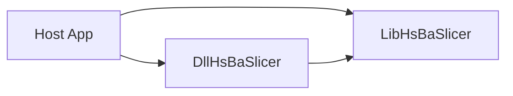

**Diagram sources**
- [DllHsBaSlicer README:7-19](file://docs/en/DllHsBaSlicer/README.md#L7-L19)

**Section sources**
- [DllHsBaSlicer README:7-19](file://docs/en/DllHsBaSlicer/README.md#L7-L19)

## Performance Considerations
- Use asynchronous pipelines to avoid blocking UI/request threads.
- Leverage thread pools for concurrent tasks where appropriate.
- Minimize data marshalling across language boundaries; prefer Protobuf wire formats for cross-process communication.
- Reuse configuration objects and avoid unnecessary allocations.

[No sources needed since this section provides general guidance]

## Troubleshooting Guide
Common issues and resolutions:
- Missing DLL on Windows: ensure DLL is copied next to executable.
- UI freezes: avoid running sync APIs on UI thread; use worker threads.
- Callback crashes: keep delegates alive and marshal to UI thread.
- Non-ASCII paths: pass UTF-8 encoded paths.
- Garbled strings: ensure correct lifetime of result strings and free them properly.

**Section sources**
- [Qt / wxWidgets Integration Guide:340-349](file://docs/en/DllHsBaSlicer/qt_wxwidgets_integration.md#L340-L349)
- [Unity / Unreal Engine Integration Guide:453-462](file://docs/en/DllHsBaSlicer/game_engine_integration.md#L453-L462)

## Conclusion
HsBaSlicer provides robust integration options across multiple platforms and languages. By leveraging the C ABI layer (`DllHsBaSlicer`) and following best practices for threading, memory management, and event handling, developers can embed slicing capabilities into GUI applications, web services, mobile apps, and game engines effectively.

[No sources needed since this section summarizes without analyzing specific files]

## Appendices

### API Reference Summary
- Initialization: `initialize()`
- Pipelines: FDM, SLA, SLS, SLM, LOM, TDP, WAAM, File Transfer, Param Store, Custom Lua
- Callbacks: progress and result callbacks
- Memory: free result strings via `HsBaFree*PipelineResult()`
- Proto conversion: `*FromProtoBytes` and `*ToProtoBytes`

**Section sources**
- [DllHsBaSlicer README:56-703](file://docs/en/DllHsBaSlicer/README.md#L56-L703)