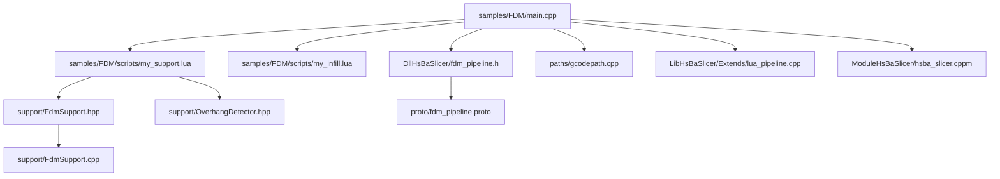
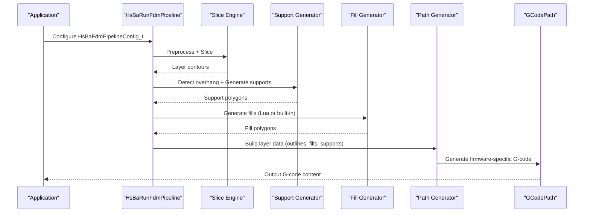
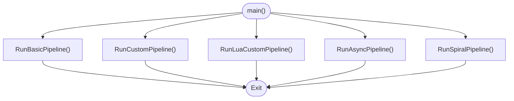
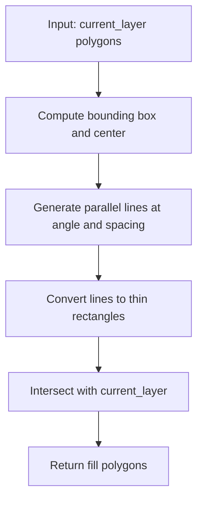
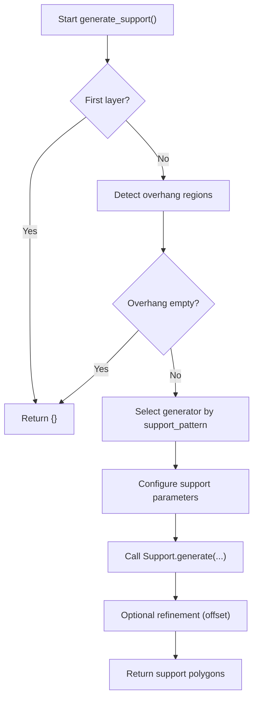
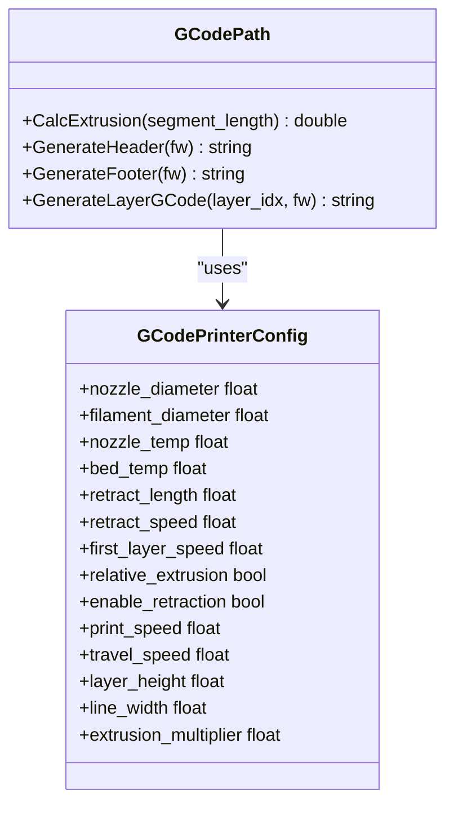
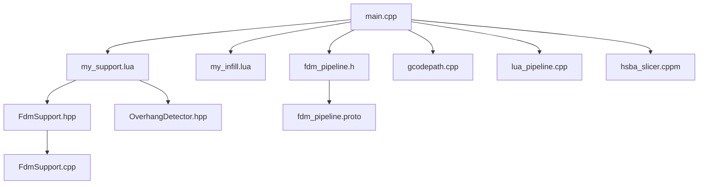

# FDM (Fused Deposition Modeling) Samples

<cite>
**Referenced Files in This Document**
- [samples/FDM/main.cpp](file://samples/FDM/main.cpp)
- [samples/FDM/scripts/my_infill.lua](file://samples/FDM/scripts/my_infill.lua)
- [samples/FDM/scripts/my_support.lua](file://samples/FDM/scripts/my_support.lua)
- [DllHsBaSlicer/fdm_pipeline.h](file://DllHsBaSlicer/fdm_pipeline.h)
- [support/FdmSupport.hpp](file://support/FdmSupport.hpp)
- [support/OverhangDetector.hpp](file://support/OverhangDetector.hpp)
- [support/FdmSupport.cpp](file://support/FdmSupport.cpp)
- [paths/gcodepath.cpp](file://paths/gcodepath.cpp)
- [LibHsBaSlicer/Extends/lua_pipeline.cpp](file://LibHsBaSlicer/Extends/lua_pipeline.cpp)
- [proto/fdm_pipeline.proto](file://proto/fdm_pipeline.proto)
- [ModuleHsBaSlicer/hsba_slicer.cppm](file://ModuleHsBaSlicer/hsba_slicer.cppm)
</cite>

## Table of Contents
1. [Introduction](#introduction)
2. [Project Structure](#project-structure)
3. [Core Components](#core-components)
4. [Architecture Overview](#architecture-overview)
5. [Detailed Component Analysis](#detailed-component-analysis)
6. [Dependency Analysis](#dependency-analysis)
7. [Performance Considerations](#performance-considerations)
8. [Troubleshooting Guide](#troubleshooting-guide)
9. [Conclusion](#conclusion)
10. [Appendices](#appendices)

## Introduction
This document provides comprehensive FDM-specific samples documentation for the HsBaSlicer repository. It explains how to configure and run the FDM slicing pipeline from the main entry point, how to write custom infill patterns in Lua, how to generate support structures including tree supports, plane supports, and overhang detection, and how to tune parameters such as layer height, print speed, temperature settings, and material properties. It also documents G-code output customization and printer-specific optimizations for Marlin, RepRap/RRF, and Klipper firmware targets.

## Project Structure
The FDM sample is located under `samples/FDM`. The key files are:
- `main.cpp`: Entry point demonstrating basic, custom, Lua-driven, asynchronous, and spiral/vase mode pipelines.
- `scripts/my_infill.lua`: Custom infill generation script using PolygonOperations.
- `scripts/my_support.lua`: Custom support generation script using built-in support generators and overhang detection.

**Diagram sources**
- [samples/FDM/main.cpp:1-337](file://samples/FDM/main.cpp#L1-L337)
- [DllHsBaSlicer/fdm_pipeline.h:1-68](file://DllHsBaSlicer/fdm_pipeline.h#L1-L68)
- [samples/FDM/scripts/my_infill.lua:1-89](file://samples/FDM/scripts/my_infill.lua#L1-L89)
- [samples/FDM/scripts/my_support.lua:1-83](file://samples/FDM/scripts/my_support.lua#L1-L83)
- [support/FdmSupport.hpp:1-67](file://support/FdmSupport.hpp#L1-L67)
- [support/OverhangDetector.hpp:1-54](file://support/OverhangDetector.hpp#L1-L54)
- [support/FdmSupport.cpp:136-235](file://support/FdmSupport.cpp#L136-L235)
- [paths/gcodepath.cpp:47-214](file://paths/gcodepath.cpp#L47-L214)
- [LibHsBaSlicer/Extends/lua_pipeline.cpp:619-637](file://LibHsBaSlicer/Extends/lua_pipeline.cpp#L619-L637)
- [proto/fdm_pipeline.proto:1-41](file://proto/fdm_pipeline.proto#L1-L41)
- [ModuleHsBaSlicer/hsba_slicer.cppm:695-734](file://ModuleHsBaSlicer/hsba_slicer.cppm#L695-L734)

**Section sources**
- [samples/FDM/main.cpp:1-337](file://samples/FDM/main.cpp#L1-L337)
- [DllHsBaSlicer/fdm_pipeline.h:1-68](file://DllHsBaSlicer/fdm_pipeline.h#L1-L68)

## Core Components
- FDM Pipeline API: Provides default configuration creation, synchronous and asynchronous execution, and result cleanup.
- Support Generators: Plane, Tree, and Honeycomb strategies implemented in C++.
- Overhang Detection: Computes unsupported regions between adjacent layers based on angle thresholds.
- G-code Generation: Multi-firmware G-code output with printer configuration fields.
- Lua Integration: Custom infill and support scripts integrated into the pipeline.

Key responsibilities:
- `fdm_pipeline.h` exposes the C ABI for creating configs and running the pipeline.
- `FdmSupport.hpp` defines generator classes for plane, tree, and honeycomb supports.
- `OverhangDetector.hpp` detects overhang regions requiring support.
- `gcodepath.cpp` generates firmware-specific G-code headers, footers, and layer commands.
- `lua_pipeline.cpp` maps Lua-provided path and printer configurations to internal structures.

**Section sources**
- [DllHsBaSlicer/fdm_pipeline.h:17-61](file://DllHsBaSlicer/fdm_pipeline.h#L17-L61)
- [support/FdmSupport.hpp:13-63](file://support/FdmSupport.hpp#L13-L63)
- [support/OverhangDetector.hpp:14-49](file://support/OverhangDetector.hpp#L14-L49)
- [paths/gcodepath.cpp:47-214](file://paths/gcodepath.cpp#L47-L214)
- [LibHsBaSlicer/Extends/lua_pipeline.cpp:619-637](file://LibHsBaSlicer/Extends/lua_pipeline.cpp#L619-L637)

## Architecture Overview
The FDM pipeline processes a model through preprocessing, slicing, support generation, fill generation, and path generation to produce G-code. The sample demonstrates multiple usage patterns:
- Basic pipeline with defaults.
- Customized process parameters (layer height, wall count, fill density, support pattern).
- Lua-driven custom infill and support.
- Asynchronous execution with completion callbacks.
- Spiral/vase mode that merges outer walls into a continuous helix.

**Diagram sources**
- [samples/FDM/main.cpp:53-96](file://samples/FDM/main.cpp#L53-L96)
- [DllHsBaSlicer/fdm_pipeline.h:23-35](file://DllHsBaSlicer/fdm_pipeline.h#L23-L35)
- [support/FdmSupport.hpp:13-63](file://support/FdmSupport.hpp#L13-L63)
- [paths/gcodepath.cpp:65-142](file://paths/gcodepath.cpp#L65-L142)

## Detailed Component Analysis

### Main Entry Point: FDM Pipeline Configuration and Execution
The FDM sample’s `main.cpp` demonstrates five scenarios:
- Basic pipeline: Uses default configuration and writes G-code to an output file.
- Custom pipeline: Sets layer height, first layer height, fill spacing, fill mode, fill angle, wall count, top/bottom solid layers, infill density, support enablement, overhang angle, support pattern, line width, print/travel speeds, extrusion multiplier, and output path.
- Lua custom pipeline: Points to `my_support.lua` and `my_infill.lua`, specifying function names for support and fill generation.
- Asynchronous pipeline: Starts non-blocking execution and waits via a flag; completion callback frees results.
- Spiral/vase mode: Enables `spiral_mode` to merge outer walls into a single continuous rising path and skip per-layer infill/support.

Configuration fields used include:
- Model identification: `model_name`, `model_path`.
- Slicing: `layer_height`, `first_layer_height`.
- Fill: `fill_spacing`, `fill_mode`, `fill_angle`, `wall_count`, `top_layer_count`, `bottom_layer_count`, `infill_density`.
- Support: `enable_support`, `overhang_angle`, `support_pattern`.
- Path: `line_width`, `print_speed`, `travel_speed`, `extrusion_multiplier`.
- Output: `output_path`.
- Special modes: `spiral_mode`.

Execution functions:
- `HsBaCreateDefaultConfig()` creates default config.
- `HsBaRunFdmPipeline()` runs synchronously with progress callback.
- `HsBaRunFdmPipelineAsync()` runs asynchronously with completion callback.
- `HsBaFreePipelineResult()` releases allocated memory.

**Diagram sources**
- [samples/FDM/main.cpp:323-336](file://samples/FDM/main.cpp#L323-L336)
- [samples/FDM/main.cpp:53-96](file://samples/FDM/main.cpp#L53-L96)
- [samples/FDM/main.cpp:101-165](file://samples/FDM/main.cpp#L101-L165)
- [samples/FDM/main.cpp:170-220](file://samples/FDM/main.cpp#L170-L220)
- [samples/FDM/main.cpp:245-269](file://samples/FDM/main.cpp#L245-L269)
- [samples/FDM/main.cpp:274-318](file://samples/FDM/main.cpp#L274-L318)

**Section sources**
- [samples/FDM/main.cpp:53-96](file://samples/FDM/main.cpp#L53-L96)
- [samples/FDM/main.cpp:101-165](file://samples/FDM/main.cpp#L101-L165)
- [samples/FDM/main.cpp:170-220](file://samples/FDM/main.cpp#L170-L220)
- [samples/FDM/main.cpp:245-269](file://samples/FDM/main.cpp#L245-L269)
- [samples/FDM/main.cpp:274-318](file://samples/FDM/main.cpp#L274-L318)
- [DllHsBaSlicer/fdm_pipeline.h:17-61](file://DllHsBaSlicer/fdm_pipeline.h#L17-L61)

### Custom Infill Patterns: my_infill.lua
The custom infill script defines a `generate_fill(current_layer)` function that:
- Accepts current layer polygons (already subtracted from walls).
- Computes bounding box and center.
- Generates parallel lines at a specified angle and spacing.
- Converts each line into a thin rectangle polygon.
- Intersects generated lines with the current layer to clip to valid areas.
- Returns resulting fill polygons.

Available operations:
- `PolygonOperations.offsetOperation(polys, delta)`
- Boolean operations: `union`, `intersection`, `difference`, `xor`
- Geometry helpers: `makeCircle`, `makeRectangle`, `makeRegularPolygon`
- Area calculation: `area(poly)`

To implement grid, honeycomb, gyroid, or custom geometric patterns:
- Grid: Generate two orthogonal sets of parallel lines and intersect both with the layer.
- Honeycomb: Generate hexagonal cells within the bounding region and intersect with the layer.
- Gyroid: Use a mathematical surface sampling approach to create periodic curves, then convert to polygons and intersect.
- Custom geometric patterns: Define parametric shapes (e.g., circles, diamonds) and tile them across the layer area.

**Diagram sources**
- [samples/FDM/scripts/my_infill.lua:20-87](file://samples/FDM/scripts/my_infill.lua#L20-L87)

**Section sources**
- [samples/FDM/scripts/my_infill.lua:1-89](file://samples/FDM/scripts/my_infill.lua#L1-L89)

### Support Structure Generation: my_support.lua
The custom support script uses built-in support generators and overhang detection:
- Skips support generation on the first layer.
- Detects overhang regions using `Support.detect_overhang(current_layer, prev_layer, layer_height, overhang_angle)`.
- Selects a generator based on `config.support_pattern`:
  - 0: Plane support (`Support.new_plane()`)
  - 1: Tree support (`Support.new_tree()`)
  - 2: Honeycomb support (`Support.new_honeycomb()`)
- Configures support parameters: overhang angle threshold, layer height, gap, diameter, density.
- Calls `Support.generate(generator, current_layer, prev_layer, layer_height, support_cfg)`.
- Optionally refines support polygons (e.g., shrinking contact points).

Supported generators:
- Plane: Simple column supports inflated from overhang regions.
- Tree: Branching structures growing upward and merging.
- Honeycomb: Hexagonal cell patterns filling overhang areas.

**Diagram sources**
- [samples/FDM/scripts/my_support.lua:32-79](file://samples/FDM/scripts/my_support.lua#L32-L79)
- [support/FdmSupport.hpp:13-63](file://support/FdmSupport.hpp#L13-L63)
- [support/OverhangDetector.hpp:14-49](file://support/OverhangDetector.hpp#L14-L49)

**Section sources**
- [samples/FDM/scripts/my_support.lua:1-83](file://samples/FDM/scripts/my_support.lua#L1-L83)
- [support/FdmSupport.hpp:13-63](file://support/FdmSupport.hpp#L13-L63)
- [support/OverhangDetector.hpp:14-49](file://support/OverhangDetector.hpp#L14-L49)

### Parameter Tuning: Layer Height, Print Speed, Temperature, Material Properties
Key tunable parameters demonstrated in the sample:
- Layer height: `cfg.layer_height`, `cfg.first_layer_height`.
- Wall thickness: `cfg.wall_count`.
- Solid layers: `cfg.top_layer_count`, `cfg.bottom_layer_count`.
- Fill density and spacing: `cfg.infill_density`, `cfg.fill_spacing`, `cfg.fill_angle`, `cfg.fill_mode`.
- Support settings: `cfg.enable_support`, `cfg.overhang_angle`, `cfg.support_pattern`.
- Path settings: `cfg.line_width`, `cfg.print_speed`, `cfg.travel_speed`, `cfg.extrusion_multiplier`.
- Spiral mode: `cfg.spiral_mode`.

Printer-specific G-code configuration includes:
- Firmware selection: `gcode_firmware` (Marlin, RepRap/RRF, Klipper).
- Nozzle and filament: `nozzle_diameter`, `filament_diameter`.
- Temperatures: `nozzle_temp`, `bed_temp`.
- Retraction: `retract_length`, `retract_speed`.
- First layer speed: `first_layer_speed`.
- Extrusion mode: `relative_extrusion`.
- Retraction enablement: `enable_retraction`.

These fields are mapped from Lua tables to internal structures in `lua_pipeline.cpp` and used by `gcodepath.cpp` to generate firmware-specific G-code.

**Section sources**
- [samples/FDM/main.cpp:111-133](file://samples/FDM/main.cpp#L111-L133)
- [samples/FDM/main.cpp:283-290](file://samples/FDM/main.cpp#L283-L290)
- [LibHsBaSlicer/Extends/lua_pipeline.cpp:619-637](file://LibHsBaSlicer/Extends/lua_pipeline.cpp#L619-L637)
- [paths/gcodepath.cpp:65-142](file://paths/gcodepath.cpp#L65-L142)

### G-code Output Customization and Printer-Specific Optimizations
The G-code generator produces headers, footers, and layer commands tailored to target firmware:
- Marlin: Includes temperature waits, absolute/relative positioning, retraction, motor disable.
- RepRap/RRF: Adds fan control commands and explicit extrusion mode switches.
- Klipper: Includes pressure advance, speed/flow percentage, fan control, and relative/absolute extrusion modes.

Extrusion calculation:
- Volume = line_width × layer_height × segment_length.
- Filament cross-section area = π × (filament_diameter / 2)^2.
- E value = volume / area × extrusion_multiplier.

Layer command generation:
- Uses first layer speed for layer 0 and print speed for subsequent layers.
- Travel feed rate derived from travel speed.
- Z movement and layer markers included.

**Diagram sources**
- [paths/gcodepath.cpp:47-214](file://paths/gcodepath.cpp#L47-L214)

**Section sources**
- [paths/gcodepath.cpp:47-214](file://paths/gcodepath.cpp#L47-L214)
- [LibHsBaSlicer/Extends/lua_pipeline.cpp:619-637](file://LibHsBaSlicer/Extends/lua_pipeline.cpp#L619-L637)

## Dependency Analysis
The FDM pipeline integrates several components:
- Entry point depends on the C ABI for pipeline execution.
- Lua scripts depend on PolygonOperations and Support modules.
- Support generators depend on overhang detection and geometric operations.
- G-code generation depends on printer configuration and firmware-specific logic.

**Diagram sources**
- [samples/FDM/main.cpp:1-337](file://samples/FDM/main.cpp#L1-L337)
- [DllHsBaSlicer/fdm_pipeline.h:1-68](file://DllHsBaSlicer/fdm_pipeline.h#L1-L68)
- [samples/FDM/scripts/my_support.lua:1-83](file://samples/FDM/scripts/my_support.lua#L1-L83)
- [support/FdmSupport.hpp:1-67](file://support/FdmSupport.hpp#L1-L67)
- [support/OverhangDetector.hpp:1-54](file://support/OverhangDetector.hpp#L1-L54)
- [support/FdmSupport.cpp:136-235](file://support/FdmSupport.cpp#L136-L235)
- [paths/gcodepath.cpp:47-214](file://paths/gcodepath.cpp#L47-L214)
- [LibHsBaSlicer/Extends/lua_pipeline.cpp:619-637](file://LibHsBaSlicer/Extends/lua_pipeline.cpp#L619-L637)
- [proto/fdm_pipeline.proto:1-41](file://proto/fdm_pipeline.proto#L1-L41)
- [ModuleHsBaSlicer/hsba_slicer.cppm:695-734](file://ModuleHsBaSlicer/hsba_slicer.cppm#L695-L734)

**Section sources**
- [samples/FDM/main.cpp:1-337](file://samples/FDM/main.cpp#L1-L337)
- [DllHsBaSlicer/fdm_pipeline.h:1-68](file://DllHsBaSlicer/fdm_pipeline.h#L1-L68)
- [support/FdmSupport.hpp:1-67](file://support/FdmSupport.hpp#L1-L67)
- [support/OverhangDetector.hpp:1-54](file://support/OverhangDetector.hpp#L1-L54)
- [support/FdmSupport.cpp:136-235](file://support/FdmSupport.cpp#L136-L235)
- [paths/gcodepath.cpp:47-214](file://paths/gcodepath.cpp#L47-L214)
- [LibHsBaSlicer/Extends/lua_pipeline.cpp:619-637](file://LibHsBaSlicer/Extends/lua_pipeline.cpp#L619-L637)
- [proto/fdm_pipeline.proto:1-41](file://proto/fdm_pipeline.proto#L1-L41)
- [ModuleHsBaSlicer/hsba_slicer.cppm:695-734](file://ModuleHsBaSlicer/hsba_slicer.cppm#L695-L734)

## Performance Considerations
- Layer height and line width directly affect print time and resolution; smaller values increase detail but slow down printing.
- Fill density and spacing influence material usage and strength; lower density reduces weight and time.
- Support structure type affects print time and post-processing effort; tree supports typically use less material than honeycomb but may require more complex generation.
- Print speed and travel speed impact overall throughput; higher speeds reduce time but may compromise quality.
- Spiral mode eliminates per-layer infill and support, significantly reducing print time for vase-like models.
- Firmware-specific G-code features like pressure advance and fan control can improve print quality and reliability.

[No sources needed since this section provides general guidance]

## Troubleshooting Guide
Common issues and resolutions:
- G-code write failures: Ensure output directory exists and file paths are valid. Check permissions and disk space.
- Missing Lua scripts: Verify `support_lua_script` and `infill_lua_script` paths are correct and accessible.
- Empty support or fill results: Validate input polygons and ensure overhang detection thresholds are appropriate.
- Incorrect G-code behavior: Confirm firmware selection matches the target printer and that printer configuration fields are set correctly.
- Memory leaks: Always call `HsBaFreePipelineResult()` after processing results.

**Section sources**
- [samples/FDM/main.cpp:70-90](file://samples/FDM/main.cpp#L70-L90)
- [samples/FDM/main.cpp:141-161](file://samples/FDM/main.cpp#L141-L161)
- [samples/FDM/main.cpp:197-216](file://samples/FDM/main.cpp#L197-L216)
- [samples/FDM/main.cpp:231-243](file://samples/FDM/main.cpp#L231-L243)

## Conclusion
The HsBaSlicer FDM samples provide a robust foundation for configuring and extending the slicing pipeline. By leveraging the provided entry point, Lua scripts for custom infill and support, and firmware-specific G-code generation, users can tailor the workflow to diverse printing requirements. Parameter tuning enables optimization of print quality, speed, and material usage, while troubleshooting guidance ensures reliable operation.

[No sources needed since this section summarizes without analyzing specific files]

## Appendices

### FDM Fill Types and Support Patterns
- Fill types: Line fill, simple zigzag, advanced zigzag.
- Support patterns: Plane, tree, honeycomb.
- G-code firmware: Marlin, RepRap/RRF, Klipper.

**Section sources**
- [proto/fdm_pipeline.proto:5-24](file://proto/fdm_pipeline.proto#L5-L24)

### Module-Based API Usage
The module-based API offers a class-based interface for FDM pipeline execution:
- Create a model instance.
- Initialize default FDM configuration.
- Run the pipeline and retrieve results.

**Section sources**
- [ModuleHsBaSlicer/hsba_slicer.cppm:695-734](file://ModuleHsBaSlicer/hsba_slicer.cppm#L695-L734)