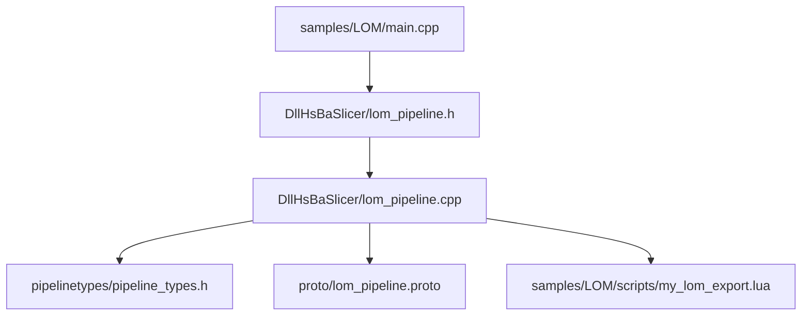
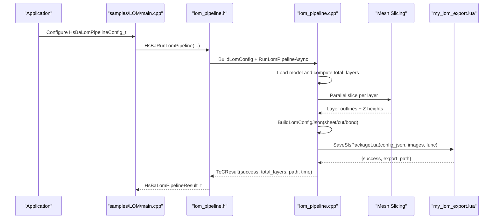
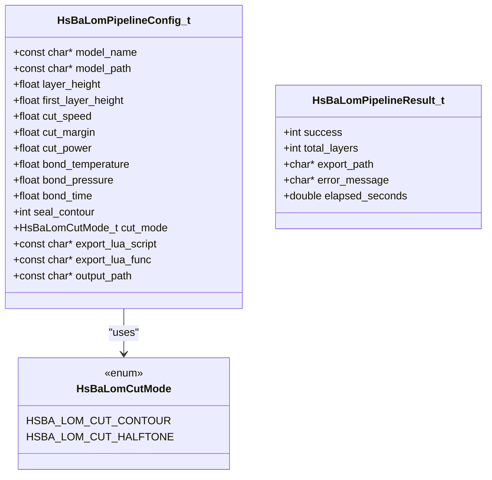
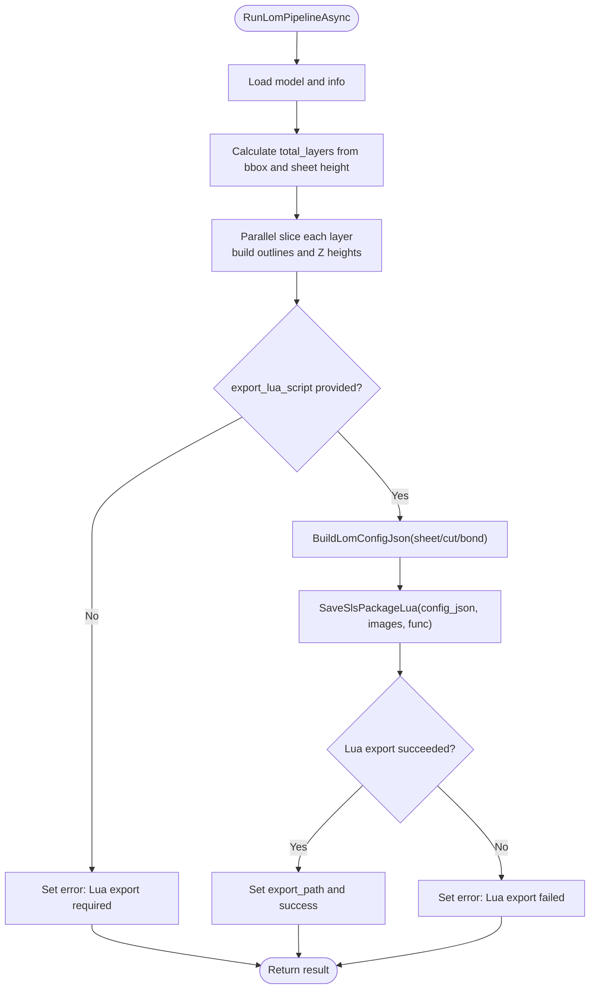
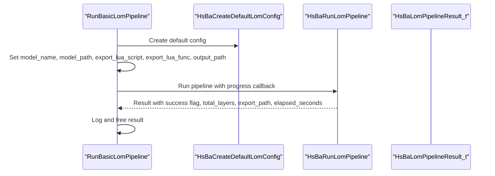
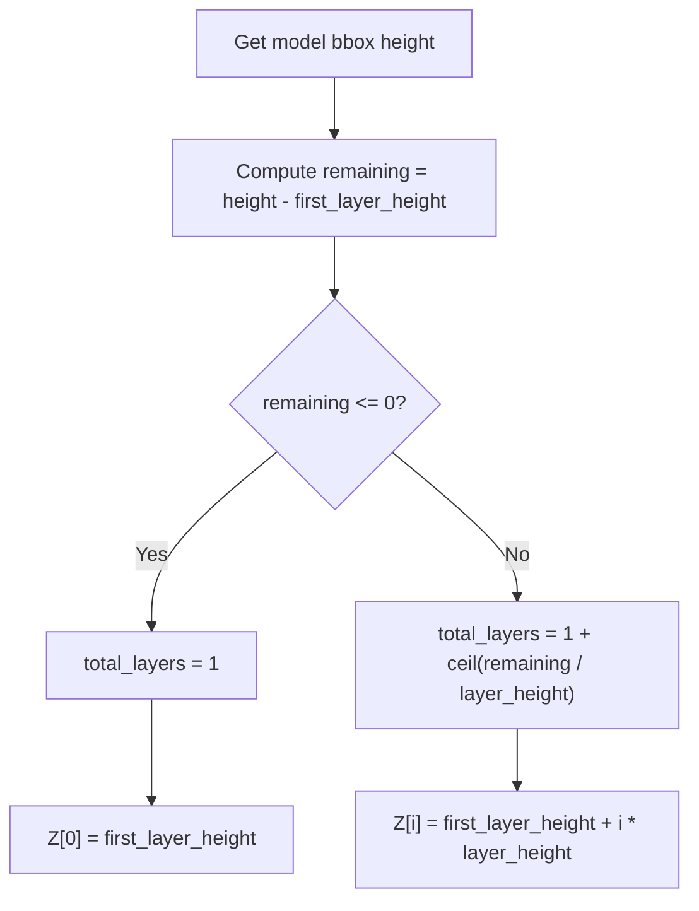
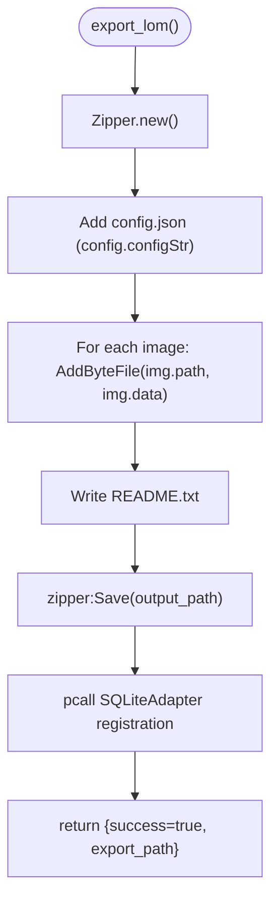
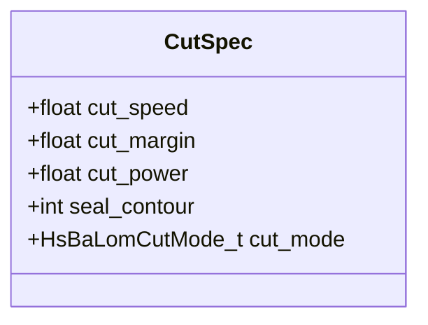
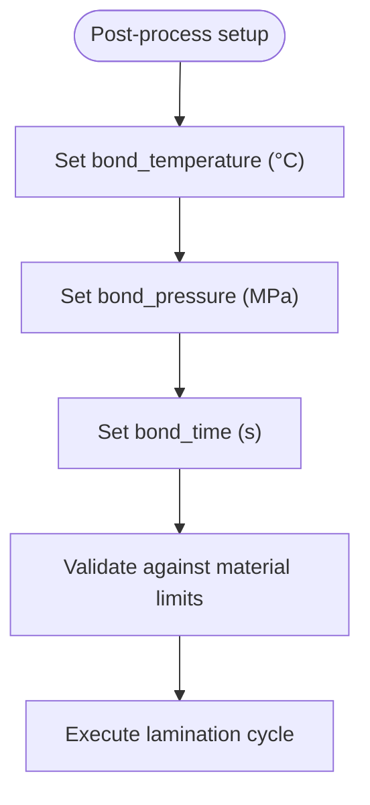
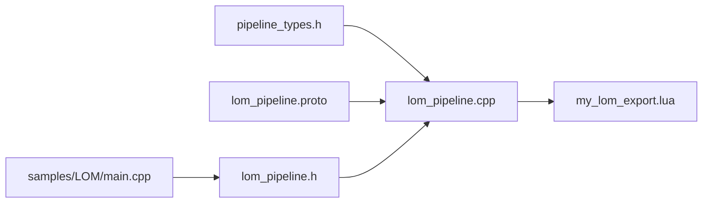

# LOM (Laminated Object Manufacturing) Samples

<cite>
**Referenced Files in This Document**
- [main.cpp](file://samples/LOM/main.cpp)
- [my_lom_export.lua](file://samples/LOM/scripts/my_lom_export.lua)
- [lom_pipeline.h](file://DllHsBaSlicer/lom_pipeline.h)
- [lom_pipeline.cpp](file://DllHsBaSlicer/lom_pipeline.cpp)
- [pipeline_types.h](file://pipelinetypes/pipeline_types.h)
- [lom_pipeline.proto](file://proto/lom_pipeline.proto)
</cite>

## Table of Contents
1. [Introduction](#introduction)
2. [Project Structure](#project-structure)
3. [Core Components](#core-components)
4. [Architecture Overview](#architecture-overview)
5. [Detailed Component Analysis](#detailed-component-analysis)
6. [Dependency Analysis](#dependency-analysis)
7. [Performance Considerations](#performance-considerations)
8. [Troubleshooting Guide](#troubleshooting-guide)
9. [Conclusion](#conclusion)

## Introduction
This document provides LOM-specific samples documentation for laminated object manufacturing workflows in HsBaSlicer. It explains how the LOM pipeline slices a model into sheet layers, generates per-layer contours, and passes cutting and bonding parameters to a Lua-driven export script. The main entry point demonstrates basic, custom-parameter, and asynchronous LOM runs. The sample export script packages layer outlines and process configuration into a zip archive and optionally registers the export in a database.

LOM is modeled as:
- Preprocess: load model and compute bounding information.
- Slice: generate one contour set per sheet thickness.
- Export: write a JSON configuration containing sheet, cut, and bond settings, then package layer data through a Lua export function.

## Project Structure
The LOM samples are located under `samples/LOM`. The C++ entry point configures and runs the LOM pipeline, while the Lua export script defines the final packaging behavior.

**Diagram sources**
- [main.cpp:55-129](file://samples/LOM/main.cpp#L55-L129)
- [lom_pipeline.h:17-56](file://DllHsBaSlicer/lom_pipeline.h#L17-L56)
- [lom_pipeline.cpp:187-299](file://DllHsBaSlicer/lom_pipeline.cpp#L187-L299)
- [pipeline_types.h:407-461](file://pipelinetypes/pipeline_types.h#L407-L461)
- [lom_pipeline.proto:1-45](file://proto/lom_pipeline.proto#L1-L45)
- [my_lom_export.lua:10-57](file://samples/LOM/scripts/my_lom_export.lua#L10-L57)

**Section sources**
- [main.cpp:1-194](file://samples/LOM/main.cpp#L1-L194)
- [lom_pipeline.h:1-63](file://DllHsBaSlicer/lom_pipeline.h#L1-L63)
- [lom_pipeline.cpp:1-344](file://DllHsBaSlicer/lom_pipeline.cpp#L1-L344)
- [pipeline_types.h:407-461](file://pipelinetypes/pipeline_types.h#L407-L461)
- [lom_pipeline.proto:1-45](file://proto/lom_pipeline.proto#L1-L45)
- [my_lom_export.lua:1-58](file://samples/LOM/scripts/my_lom_export.lua#L1-L58)

## Core Components
- LOM C API header: declares default config creation, synchronous and asynchronous run functions, and result cleanup.
- LOM implementation: builds internal configuration, calculates layer count, slices layers in parallel, constructs JSON configuration, and invokes the Lua export.
- Pipeline types: defines LOM configuration struct, result struct, progress/result callbacks, and cut mode enum.
- Protocol buffer schema: defines LOM message fields for serialization across boundaries.
- Sample main: shows three usage patterns with minimal and custom parameters.
- Sample Lua export: writes configuration JSON and layer images into a zip file and records export metadata in SQLite.

Key responsibilities:
- `main.cpp`: user-facing examples for configuring and running LOM.
- `lom_pipeline.*`: core slicing and export orchestration.
- `pipeline_types.h`: stable C ABI for configuration and results.
- `lom_pipeline.proto`: canonical field definitions for LOM.
- `my_lom_export.lua`: export packaging and optional database registration.

**Section sources**
- [lom_pipeline.h:17-56](file://DllHsBaSlicer/lom_pipeline.h#L17-L56)
- [lom_pipeline.cpp:187-299](file://DllHsBaSlicer/lom_pipeline.cpp#L187-L299)
- [pipeline_types.h:407-461](file://pipelinetypes/pipeline_types.h#L407-L461)
- [lom_pipeline.proto:1-45](file://proto/lom_pipeline.proto#L1-L45)
- [main.cpp:55-175](file://samples/LOM/main.cpp#L55-L175)
- [my_lom_export.lua:10-57](file://samples/LOM/scripts/my_lom_export.lua#L10-L57)

## Architecture Overview
The LOM pipeline follows a three-stage flow: preprocess, slice, and Lua export. The C++ side computes geometry and slicing; the Lua side controls output packaging.

**Diagram sources**
- [main.cpp:55-129](file://samples/LOM/main.cpp#L55-L129)
- [lom_pipeline.h:23-50](file://DllHsBaSlicer/lom_pipeline.h#L23-L50)
- [lom_pipeline.cpp:187-299](file://DllHsBaSlicer/lom_pipeline.cpp#L187-L299)
- [my_lom_export.lua:10-57](file://samples/LOM/scripts/my_lom_export.lua#L10-L57)

## Detailed Component Analysis

### LOM C API and Configuration
The LOM C API exposes:
- Default configuration creation.
- Synchronous execution with progress callback.
- Asynchronous execution with completion callback.
- Result memory management.

Configuration fields include:
- Model name and path.
- Sheet thickness (`layer_height`, `first_layer_height`).
- Cutting parameters (`cut_speed`, `cut_margin`, `cut_power`, `seal_contour`, `cut_mode`).
- Bonding parameters (`bond_temperature`, `bond_pressure`, `bond_time`).
- Export script path and function name.
- Output path.

Cut modes:
- Contour cutting: outline-only cuts.
- Halftone cutting: pocket/hatch-style cutting.

**Diagram sources**
- [pipeline_types.h:407-461](file://pipelinetypes/pipeline_types.h#L407-L461)

**Section sources**
- [pipeline_types.h:407-461](file://pipelinetypes/pipeline_types.h#L407-L461)
- [lom_pipeline.h:17-56](file://DllHsBaSlicer/lom_pipeline.h#L17-L56)

### LOM Pipeline Implementation
The implementation performs:
- Model loading and validation.
- Layer count calculation from bounding box and sheet thickness.
- Parallel slicing to produce per-layer polygon outlines.
- JSON configuration generation including sheet, cut, and bond parameters.
- Invocation of the Lua export function via a shared packaging helper.

Key behaviors:
- If no Lua export script is provided, the pipeline fails early.
- If output path is empty, a default name based on model name is used.
- Progress callbacks report stages like model loading, slicing, and export.

**Diagram sources**
- [lom_pipeline.cpp:187-299](file://DllHsBaSlicer/lom_pipeline.cpp#L187-L299)

**Section sources**
- [lom_pipeline.cpp:95-146](file://DllHsBaSlicer/lom_pipeline.cpp#L95-L146)
- [lom_pipeline.cpp:187-299](file://DllHsBaSlicer/lom_pipeline.cpp#L187-L299)

### Sample Main Setup for LAM Pipelines
The sample demonstrates:
- Basic LOM run with minimal configuration.
- Custom cut and bond parameters including sheet thickness, laser speed, margin, power, sealing, and cut mode.
- Asynchronous run with a completion callback.

Important notes:
- Always set `export_lua_script` and `export_lua_func`.
- Use `HsBaCreateDefaultLomConfig()` to initialize defaults before overriding fields.
- Free the result using `HsBaFreeLomPipelineResult`.

**Diagram sources**
- [main.cpp:55-82](file://samples/LOM/main.cpp#L55-L82)

**Section sources**
- [main.cpp:55-129](file://samples/LOM/main.cpp#L55-L129)
- [main.cpp:154-175](file://samples/LOM/main.cpp#L154-L175)

### Sheet Material Handling and Layer Thickness
Sheet handling is driven by:
- `layer_height`: nominal sheet thickness.
- `first_layer_height`: thickness for the first sheet.
- Bounding box height determines total layers.

Layer Z positions are computed as:
- First layer at `first_layer_height`.
- Subsequent layers at `first_layer_height + i * layer_height`.

These values are embedded into the JSON configuration passed to the Lua export.

**Diagram sources**
- [lom_pipeline.cpp:95-111](file://DllHsBaSlicer/lom_pipeline.cpp#L95-L111)

**Section sources**
- [lom_pipeline.cpp:95-111](file://DllHsBaSlicer/lom_pipeline.cpp#L95-L111)
- [lom_pipeline.cpp:121-146](file://DllHsBaSlicer/lom_pipeline.cpp#L121-L146)

### Export Configuration in my_lom_export.lua
The sample export script:
- Creates a zip archive.
- Adds the generated configuration JSON.
- Adds per-layer image or outline files.
- Writes a README describing contents.
- Saves the zip to disk.
- Optionally connects to SQLite and registers export metadata.

Important contract:
- The function must return a table with `success` and `export_path`.
- Returning a string will overwrite the written zip file.

**Diagram sources**
- [my_lom_export.lua:10-57](file://samples/LOM/scripts/my_lom_export.lua#L10-L57)

**Section sources**
- [my_lom_export.lua:1-58](file://samples/LOM/scripts/my_lom_export.lua#L1-L58)

### Cutting Tool Specifications and Laser Parameters
The LOM configuration includes:
- `cut_speed`: laser cut speed in mm/s.
- `cut_margin`: contour offset from part outline in mm.
- `cut_power`: normalized laser power in [0,1].
- `seal_contour`: whether to seal the part edge.
- `cut_mode`: contour or halftone cutting.

These parameters are serialized into the JSON configuration and consumed by downstream equipment or further processing scripts.

**Diagram sources**
- [pipeline_types.h:419-436](file://pipelinetypes/pipeline_types.h#L419-L436)
- [lom_pipeline.proto:13-36](file://proto/lom_pipeline.proto#L13-L36)

**Section sources**
- [pipeline_types.h:419-436](file://pipelinetypes/pipeline_types.h#L419-L436)
- [lom_pipeline.proto:13-36](file://proto/lom_pipeline.proto#L13-L36)

### Registration Accuracy Requirements
Registration accuracy is not explicitly exposed as a numeric field in the LOM configuration. In practice, it is influenced by:
- `cut_margin`: contour offset that affects alignment between layers.
- `seal_contour`: edge sealing can improve interlayer registration stability.
- Machine-level calibration and sheet handling precision.

Users should tune `cut_margin` and validate physical registration during process development.

**Section sources**
- [pipeline_types.h:419-436](file://pipelinetypes/pipeline_types.h#L419-L436)
- [lom_pipeline.cpp:121-146](file://DllHsBaSlicer/lom_pipeline.cpp#L121-L146)

### Post-Processing Steps: Lamination Pressure, Temperature Control, Part Finishing
Post-processing parameters are represented by:
- `bond_temperature`: lamination temperature in °C.
- `bond_pressure`: lamination pressure in MPa.
- `bond_time`: bonding duration per layer in seconds.

These values are included in the JSON configuration and should be matched to material properties and machine capabilities.

**Diagram sources**
- [pipeline_types.h:419-436](file://pipelinetypes/pipeline_types.h#L419-L436)
- [lom_pipeline.proto:13-36](file://proto/lom_pipeline.proto#L13-L36)

**Section sources**
- [pipeline_types.h:419-436](file://pipelinetypes/pipeline_types.h#L419-L436)
- [lom_pipeline.proto:13-36](file://proto/lom_pipeline.proto#L13-L36)

### Material Types: Paper, Plastic Films, Metal Foils
The repository does not define explicit LOM material enums for paper, plastic films, or metal foils. Material selection is typically handled outside the C++ pipeline and reflected in:
- Process parameters (`cut_power`, `cut_speed`, `bond_temperature`, `bond_pressure`, `bond_time`).
- The JSON configuration consumed by downstream equipment or custom Lua logic.

Recommendation:
- Choose conservative `cut_power` and `cut_speed` for thin materials like paper or plastic films.
- Increase `bond_temperature` and `bond_pressure` appropriately for adhesives used with metal foils.
- Validate cut quality and registration empirically for each material family.

**Section sources**
- [pipeline_types.h:419-436](file://pipelinetypes/pipeline_types.h#L419-L436)
- [lom_pipeline.proto:13-36](file://proto/lom_pipeline.proto#L13-L36)

## Dependency Analysis
The LOM components depend on:
- Pipeline types for stable C ABI.
- Protocol buffer schema for canonical field definitions.
- Mesh slicing utilities for generating layer contours.
- Lua environment for export packaging.

**Diagram sources**
- [pipeline_types.h:407-461](file://pipelinetypes/pipeline_types.h#L407-L461)
- [lom_pipeline.proto:1-45](file://proto/lom_pipeline.proto#L1-L45)
- [lom_pipeline.cpp:187-299](file://DllHsBaSlicer/lom_pipeline.cpp#L187-L299)
- [my_lom_export.lua:10-57](file://samples/LOM/scripts/my_lom_export.lua#L10-L57)
- [main.cpp:55-129](file://samples/LOM/main.cpp#L55-L129)
- [lom_pipeline.h:17-56](file://DllHsBaSlicer/lom_pipeline.h#L17-L56)

**Section sources**
- [pipeline_types.h:407-461](file://pipelinetypes/pipeline_types.h#L407-L461)
- [lom_pipeline.proto:1-45](file://proto/lom_pipeline.proto#L1-L45)
- [lom_pipeline.cpp:187-299](file://DllHsBaSlicer/lom_pipeline.cpp#L187-L299)
- [my_lom_export.lua:10-57](file://samples/LOM/scripts/my_lom_export.lua#L10-L57)
- [main.cpp:55-129](file://samples/LOM/main.cpp#L55-L129)
- [lom_pipeline.h:17-56](file://DllHsBaSlicer/lom_pipeline.h#L17-L56)

## Performance Considerations
- Parallel slicing: layer slicing is executed in parallel to reduce total slicing time.
- Progress reporting: callbacks provide stage updates for monitoring long-running jobs.
- Export overhead: Lua packaging adds I/O cost; ensure sufficient disk space and fast storage.
- Parameter tuning: higher `cut_speed` reduces cycle time but may degrade cut quality; balance with `cut_power`.

[No sources needed since this section provides general guidance]

## Troubleshooting Guide
Common issues and resolutions:
- Missing Lua export script: ensure `export_lua_script` is set; otherwise the pipeline fails early.
- Invalid model height: if the model has zero or negative height, layer count becomes invalid; check model bounds.
- Lua export failure: verify the Lua function returns a table with `success` and `export_path`; avoid returning strings.
- Database registration skipped: SQLite operations are wrapped in error handling; warnings indicate connection or SQL errors.

**Section sources**
- [lom_pipeline.cpp:247-285](file://DllHsBaSlicer/lom_pipeline.cpp#L247-L285)
- [my_lom_export.lua:30-49](file://samples/LOM/scripts/my_lom_export.lua#L30-L49)

## Conclusion
The LOM samples demonstrate a complete workflow from model slicing to Lua-driven export. The C++ pipeline handles geometry and slicing, while the Lua script controls packaging and optional database registration. Users configure sheet thickness, cutting parameters, and bonding parameters to match their materials and equipment. For best results, validate cut quality, registration accuracy, and post-processing conditions for each material family.

[No sources needed since this section summarizes without analyzing specific files]