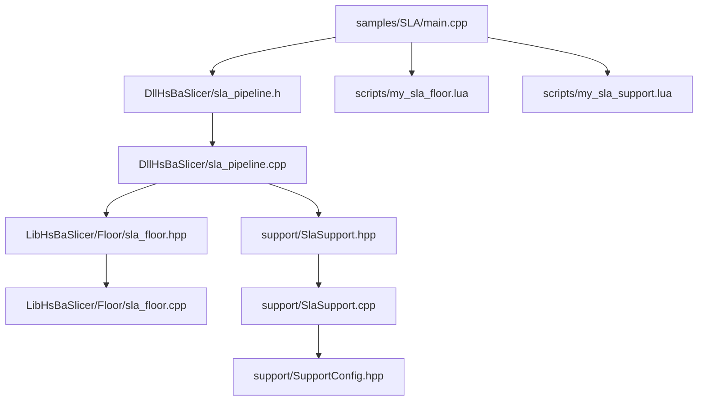
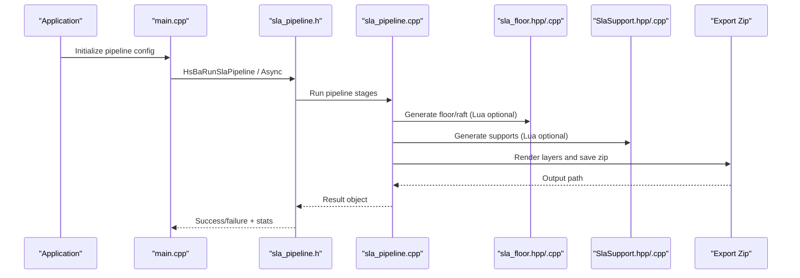
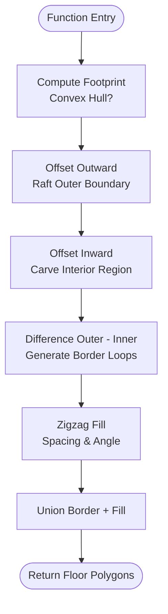
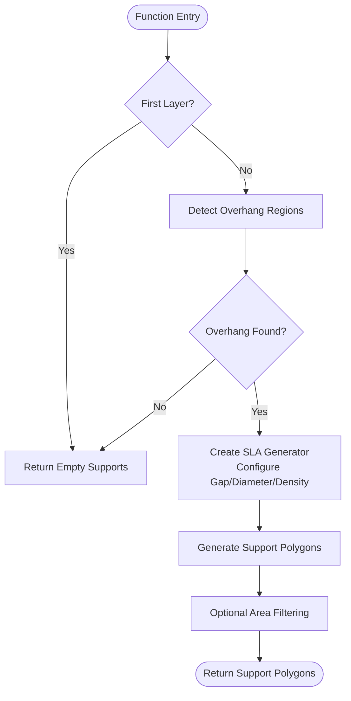
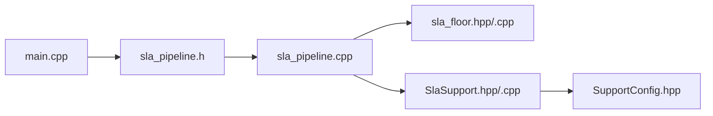

# SLA (Stereolithography) Samples

<cite>
**Referenced Files in This Document**
- [main.cpp](file://samples/SLA/main.cpp)
- [my_sla_floor.lua](file://samples/SLA/scripts/my_sla_floor.lua)
- [my_sla_support.lua](file://samples/SLA/scripts/my_sla_support.lua)
- [sla_pipeline.h](file://DllHsBaSlicer/sla_pipeline.h)
- [sla_pipeline.cpp](file://DllHsBaSlicer/sla_pipeline.cpp)
- [sla_floor.hpp](file://LibHsBaSlicer/Floor/sla_floor.hpp)
- [sla_floor.cpp](file://LibHsBaSlicer/Floor/sla_floor.cpp)
- [SlaSupport.hpp](file://support/SlaSupport.hpp)
- [SlaSupport.cpp](file://support/SlaSupport.cpp)
- [SupportConfig.hpp](file://support/SupportConfig.hpp)
</cite>

## Table of Contents
1. [Introduction](#introduction)
2. [Project Structure](#project-structure)
3. [Core Components](#core-components)
4. [Architecture Overview](#architecture-overview)
5. [Detailed Component Analysis](#detailed-component-analysis)
6. [Dependency Analysis](#dependency-analysis)
7. [Performance Considerations](#performance-considerations)
8. [Troubleshooting Guide](#troubleshooting-guide)
9. [Conclusion](#conclusion)

## Introduction
This document provides SLA-specific samples and guidance for stereolithography processing within HsBaSlicer. It explains how the sample main.cpp configures SLA pipelines, documents UV curing parameters such as exposure times and lift/retract speeds, and details floor generation in my_sla_floor.lua including bottom layers, top layers, and exposure time optimization strategies. It also covers sacrificial support generation in my_sla_support.lua with contact points, support density, and removal strategies, along with resin-specific parameters like cure depth, exposure times, and layer adhesion settings. Finally, it documents SLA output formats and post-processing considerations.

## Project Structure
The SLA samples are organized under samples/SLA:
- main.cpp demonstrates synchronous and asynchronous pipeline execution, default and custom parameter configuration, and Lua-based customization for floor and support generation.
- scripts/my_sla_floor.lua implements a custom floor generator using polygon operations and fill functions.
- scripts/my_sla_support.lua implements a custom support generator leveraging built-in SLA support detection and generation.

**Diagram sources**
- [main.cpp:1-259](file://samples/SLA/main.cpp#L1-L259)
- [sla_pipeline.h:1-63](file://DllHsBaSlicer/sla_pipeline.h#L1-L63)
- [sla_pipeline.cpp:1-57](file://DllHsBaSlicer/sla_pipeline.cpp#L1-L57)
- [sla_floor.hpp:1-184](file://LibHsBaSlicer/Floor/sla_floor.hpp#L1-L184)
- [sla_floor.cpp:1-200](file://LibHsBaSlicer/Floor/sla_floor.cpp#L1-L200)
- [SlaSupport.hpp:1-45](file://support/SlaSupport.hpp#L1-L45)
- [SlaSupport.cpp:1-119](file://support/SlaSupport.cpp#L1-L119)
- [SupportConfig.hpp:1-47](file://support/SupportConfig.hpp#L1-L47)

**Section sources**
- [main.cpp:1-259](file://samples/SLA/main.cpp#L1-L259)
- [sla_pipeline.h:1-63](file://DllHsBaSlicer/sla_pipeline.h#L1-L63)

## Core Components
- SLA Pipeline API: Provides synchronous and asynchronous execution, progress callbacks, and result handling. The pipeline stages include preprocessing, slicing, floor/raft generation, support generation, and export to a zip archive containing layer images and configuration JSON.
- Floor Generation: Built-in functions compute footprint, border loops, and internal fill; Lua customization allows user-defined logic via PolygonOperations and PolygonFill.
- Support Generation: Built-in SLA sacrificial supports generate thin columns suitable for resin printing; Lua customization enables overhang detection and support placement.
- Output Formats: Default export produces a zip archive with per-layer PNG/JPG/SVG images and a config.json. Custom Lua export can alter this behavior.

Key responsibilities:
- Configure model input, slice parameters, UV curing parameters, floor/raft parameters, and support parameters.
- Execute pipeline synchronously or asynchronously.
- Customize floor and support generation through Lua scripts.
- Export results to standard or custom formats.

**Section sources**
- [sla_pipeline.h:17-56](file://DllHsBaSlicer/sla_pipeline.h#L17-L56)
- [sla_floor.hpp:21-180](file://LibHsBaSlicer/Floor/sla_floor.hpp#L21-L180)
- [SlaSupport.hpp:13-42](file://support/SlaSupport.hpp#L13-L42)

## Architecture Overview
The SLA pipeline orchestrates multiple stages:
- Preprocess: Load and prepare the CAD model.
- Slice: Generate per-layer contours at specified heights.
- Floor/Raft: Compute contact area, borders, and fills; optionally use Lua customization.
- Support: Detect overhangs and generate sacrificial supports; optionally use Lua customization.
- Export: Render polygons to images and package into a zip archive with configuration.

**Diagram sources**
- [main.cpp:52-84](file://samples/SLA/main.cpp#L52-L84)
- [sla_pipeline.h:23-47](file://DllHsBaSlicer/sla_pipeline.h#L23-L47)
- [sla_pipeline.cpp:233-256](file://DllHsBaSlicer/sla_pipeline.cpp#L233-L256)
- [sla_floor.hpp:45-116](file://LibHsBaSlicer/Floor/sla_floor.hpp#L45-L116)
- [SlaSupport.hpp:23-35](file://support/SlaSupport.hpp#L23-L35)

## Detailed Component Analysis

### SLA Pipeline Setup in main.cpp
The sample main.cpp demonstrates four usage patterns:
- Basic pipeline with default configuration.
- Custom process parameters including layer height, exposure times, lift/retract speeds, floor/raft parameters, and support parameters.
- Lua customization for floor and support generation.
- Asynchronous pipeline execution with completion callback.

UV curing parameters demonstrated:
- Bottom exposure time and normal exposure time control resin cure depth at the build plate and subsequent layers.
- Lift distance and retract speed affect peel forces and layer adhesion.
- Layer height and first layer height influence resolution and initial adhesion.

Floor/raft parameters:
- Raft offset expands the footprint outward.
- Border width and count define perimeter loops.
- Fill spacing and angle determine internal structure density and orientation.
- Convex hull simplification can reduce complexity.

Support parameters:
- Overhang angle threshold determines where supports are needed.
- Support gap controls clearance between support and model.
- Support diameter affects column thickness and strength.
- Support density influences material usage and removal difficulty.
- Support pattern selects algorithmic strategy (e.g., sacrificial).

Output format:
- Default export is a zip archive containing config.json and per-layer images (PNG/JPG/SVG).

**Section sources**
- [main.cpp:52-84](file://samples/SLA/main.cpp#L52-L84)
- [main.cpp:89-144](file://samples/SLA/main.cpp#L89-L144)
- [main.cpp:149-191](file://samples/SLA/main.cpp#L149-L191)
- [main.cpp:217-239](file://samples/SLA/main.cpp#L217-L239)

### UV Curing Parameters and Exposure Time Optimization
Exposure time directly impacts cure depth and layer adhesion:
- Bottom exposure time should be tuned to ensure strong adhesion to the build plate without excessive overcure that could damage the release film.
- Normal exposure time balances print speed and mechanical strength; too low leads to weak layers, too high causes overcure and reduced detail.
- Lift distance and retract speed must be optimized for resin viscosity and peel force; higher lift distances reduce stress but increase cycle time.

Optimization strategies:
- Start with manufacturer-recommended values for your resin.
- Perform test prints varying exposure time by small increments (e.g., ±0.2s) to find the minimum time that still yields acceptable strength.
- Adjust lift distance based on observed delamination; increase if peeling fails, decrease if cycle time is too long.
- Monitor first layer quality; adjust first layer height and bottom exposure together for optimal adhesion.

Resin-specific parameters:
- Cure depth is influenced by exposure time and light intensity; while not explicitly exposed in the sample config, it is implicitly controlled by exposure_time fields.
- Layer adhesion depends on bottom exposure and first layer height; tune these to avoid warping or detachment.

**Section sources**
- [main.cpp:99-109](file://samples/SLA/main.cpp#L99-L109)
- [sla_pipeline.cpp:233-239](file://DllHsBaSlicer/sla_pipeline.cpp#L233-L239)

### Floor Generation in my_sla_floor.lua
The custom floor script defines a generate_floor function that receives bottom_layer polygons and a config table. It uses PolygonOperations and PolygonFill to construct raft structures:
- Footprint computation: Optionally apply convex hull to simplify the base contour.
- Raft outer boundary: Offset footprint outward by raft_offset plus border_width.
- Inner boundary: Offset raft_outer inward by border_width to carve out the interior fill region.
- Border loops: Difference between outer and inner boundaries creates perimeter rings.
- Internal fill: Zigzag fill applied to the interior region with configurable spacing and angle.
- Union of border and fill yields the final floor geometry.

Configuration fields:
- raft_offset: Expansion from model footprint.
- border_width: Width of border loops.
- fill_spacing: Distance between fill lines.
- fill_angle_deg: Orientation of fill lines.
- border_count: Number of border loops.
- use_convex_hull: Simplify footprint using convex hull.
- concave_hull_points: Additional points for concave hull approximation.

Bottom layers and top layers:
- Bottom layers benefit from larger raft_offset and thicker borders to improve adhesion.
- Top layers typically do not require raft; floor generation applies only to the first layer(s).

Exposure time optimization interaction:
- Larger raft areas may require increased bottom exposure time to ensure full cure across the expanded footprint.
- Fill spacing and angle can be adjusted to balance print time and structural integrity.

**Diagram sources**
- [my_sla_floor.lua:35-63](file://samples/SLA/scripts/my_sla_floor.lua#L35-L63)
- [sla_floor.hpp:24-33](file://LibHsBaSlicer/Floor/sla_floor.hpp#L24-L33)
- [sla_floor.cpp:25-108](file://LibHsBaSlicer/Floor/sla_floor.cpp#L25-L108)

**Section sources**
- [my_sla_floor.lua:1-64](file://samples/SLA/scripts/my_sla_floor.lua#L1-L64)
- [sla_floor.hpp:21-116](file://LibHsBaSlicer/Floor/sla_floor.hpp#L21-L116)
- [sla_floor.cpp:25-108](file://LibHsBaSlicer/Floor/sla_floor.cpp#L25-L108)

### Sacrificial Support Generation in my_sla_support.lua
The custom support script defines a generate_support function that leverages built-in SLA support detection and generation:
- First layer check: Skip support generation for the bottom-most layer.
- Overhang detection: Use Support.detect_overhang to identify regions requiring support based on current and previous layer geometry and overhang angle threshold.
- Built-in SLA support generator: Create an SLA sacrificial support generator and configure it with gap, diameter, and density parameters.
- Density filtering: Optionally filter support polygons by area to remove negligible supports.

Contact points and support density:
- Contact points are sampled from overhang regions using tip radius and spacing derived from support_diameter.
- Support density controls the frequency and distribution of support columns; lower density reduces material usage but may compromise stability.

Removal strategies:
- Small tip diameter facilitates easier removal after printing.
- Adequate support gap prevents bonding to the model surface, easing post-processing.
- Pattern selection (sacrificial vs. other modes) influences removal difficulty and surface finish.

**Diagram sources**
- [my_sla_support.lua:34-75](file://samples/SLA/scripts/my_sla_support.lua#L34-L75)
- [SlaSupport.cpp:38-109](file://support/SlaSupport.cpp#L38-L109)
- [SupportConfig.hpp:39-43](file://support/SupportConfig.hpp#L39-L43)

**Section sources**
- [my_sla_support.lua:1-76](file://samples/SLA/scripts/my_sla_support.lua#L1-L76)
- [SlaSupport.hpp:13-42](file://support/SlaSupport.hpp#L13-L42)
- [SlaSupport.cpp:38-119](file://support/SlaSupport.cpp#L38-L119)
- [SupportConfig.hpp:14-43](file://support/SupportConfig.hpp#L14-L43)

### Resin-Specific Parameters: Cure Depth, Exposure Times, Layer Adhesion
While cure depth is not explicitly exposed as a field in the sample configuration, it is governed by exposure times and resin properties:
- Bottom exposure time: Controls initial cure depth at the build plate; critical for adhesion.
- Normal exposure time: Controls subsequent layer cure depth; affects interlayer bonding and detail fidelity.
- Layer height: Thinner layers improve resolution but increase print time; must be balanced with exposure time to avoid undercure.
- Lift distance and retract speed: Influence peel forces; improper settings can cause delamination or poor layer adhesion.

Recommended tuning approach:
- Start with resin manufacturer recommendations for exposure time and layer height.
- Perform calibration prints to measure actual cure depth and adjust exposure time accordingly.
- Monitor edge quality and overhang performance; adjust support gap and density to balance strength and removability.

**Section sources**
- [main.cpp:99-109](file://samples/SLA/main.cpp#L99-L109)
- [sla_pipeline.cpp:233-239](file://DllHsBaSlicer/sla_pipeline.cpp#L233-L239)

### Output Formats for SLA Printers and Post-Processing Considerations
Default output:
- Zip archive containing:
  - config.json: Slicing and process parameters.
  - Per-layer images: PNG/JPG/SVG files representing slice outlines and optional floor/support images.

Customization:
- Lua export scripts can modify the packaging process, add metadata, or integrate with external systems.

Post-processing considerations:
- Remove supports carefully to avoid damaging the model surface; smaller tip diameters aid removal.
- Clean printed parts with appropriate solvents to remove uncured resin.
- Perform secondary curing to achieve full mechanical properties.
- Inspect layer adhesion and surface finish; adjust exposure time and lift parameters if defects are observed.

**Section sources**
- [sla_floor.hpp:141-179](file://LibHsBaSlicer/Floor/sla_floor.hpp#L141-L179)
- [sla_floor.cpp:334-366](file://LibHsBaSlicer/Floor/sla_floor.cpp#L334-L366)
- [main.cpp:244-258](file://samples/SLA/main.cpp#L244-L258)

## Dependency Analysis
The SLA pipeline components have clear dependencies:
- main.cpp depends on sla_pipeline.h for API access.
- sla_pipeline.cpp integrates floor and support generation modules.
- sla_floor.hpp/.cpp provide floor generation and export utilities.
- SlaSupport.hpp/.cpp implement sacrificial support algorithms.
- SupportConfig.hpp defines shared configuration structures.

**Diagram sources**
- [main.cpp:1-259](file://samples/SLA/main.cpp#L1-L259)
- [sla_pipeline.h:1-63](file://DllHsBaSlicer/sla_pipeline.h#L1-L63)
- [sla_pipeline.cpp:1-57](file://DllHsBaSlicer/sla_pipeline.cpp#L1-L57)
- [sla_floor.hpp:1-184](file://LibHsBaSlicer/Floor/sla_floor.hpp#L1-L184)
- [SlaSupport.hpp:1-45](file://support/SlaSupport.hpp#L1-L45)
- [SupportConfig.hpp:1-47](file://support/SupportConfig.hpp#L1-L47)

**Section sources**
- [sla_pipeline.cpp:233-256](file://DllHsBaSlicer/sla_pipeline.cpp#L233-L256)
- [sla_floor.hpp:45-116](file://LibHsBaSlicer/Floor/sla_floor.hpp#L45-L116)
- [SlaSupport.hpp:23-35](file://support/SlaSupport.hpp#L23-L35)

## Performance Considerations
- Exposure time optimization: Minimize exposure time while maintaining adequate cure depth to reduce print time and prevent overcure.
- Layer height trade-offs: Thinner layers improve detail but increase total layers and print duration.
- Support density: Lower density reduces material usage and post-processing time but may compromise structural integrity.
- Floor complexity: Excessive raft offset and dense fill patterns increase material usage and print time.
- Image rendering: Large image dimensions increase export time; choose appropriate resolution for downstream processing.

[No sources needed since this section provides general guidance]

## Troubleshooting Guide
Common issues and resolutions:
- Poor layer adhesion: Increase bottom exposure time or adjust first layer height; verify lift distance and retract speed.
- Delamination during printing: Reduce lift distance or increase normal exposure time; check resin viscosity and temperature.
- Weak supports: Increase support density or diameter; ensure overhang detection thresholds are appropriate.
- Difficult support removal: Reduce tip diameter and increase support gap; consider adjusting support pattern.
- Export failures: Verify Lua script paths and function names; ensure sufficient disk space for zip creation.

**Section sources**
- [main.cpp:70-83](file://samples/SLA/main.cpp#L70-L83)
- [sla_floor.cpp:153-177](file://LibHsBaSlicer/Floor/sla_floor.cpp#L153-L177)

## Conclusion
The HsBaSlicer SLA samples provide a comprehensive framework for configuring and executing stereolithography workflows. By tuning UV curing parameters, optimizing floor and support generation, and understanding output formats, users can achieve reliable prints with good surface quality and manageable post-processing. The modular architecture allows extensive customization through Lua scripts, enabling adaptation to specific resins, printers, and application requirements.

[No sources needed since this section summarizes without analyzing specific files]