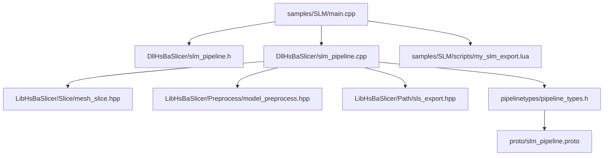
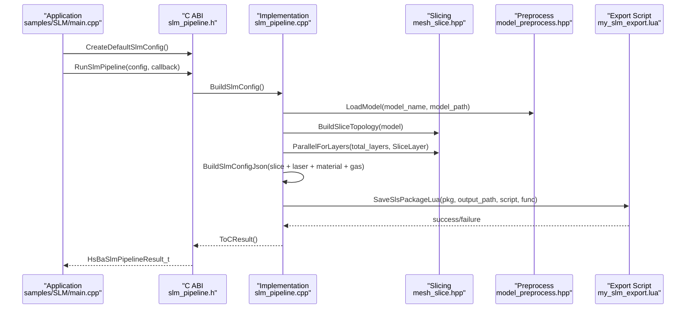
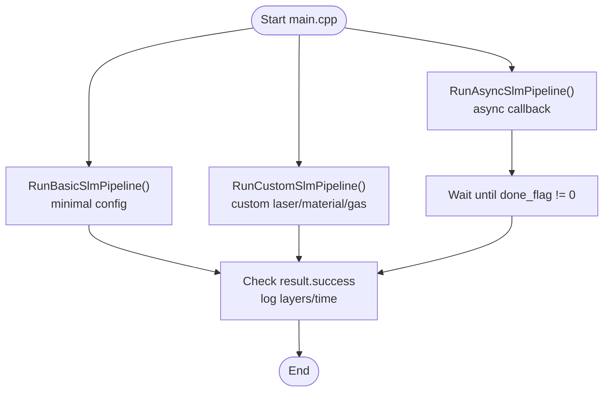
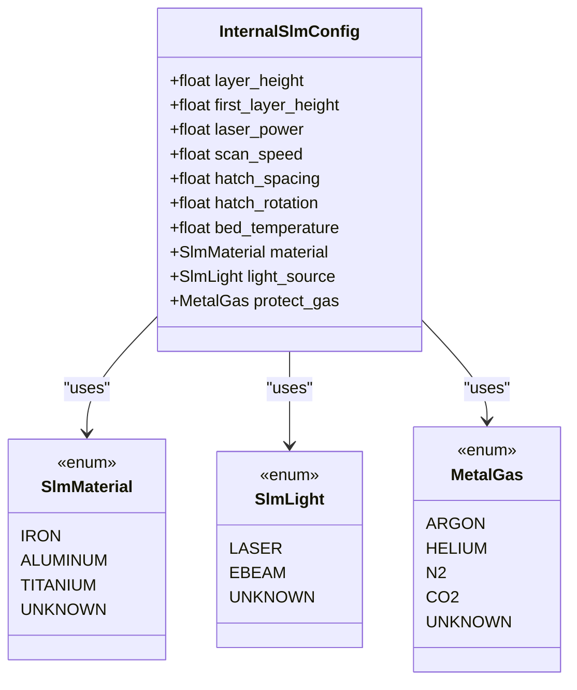
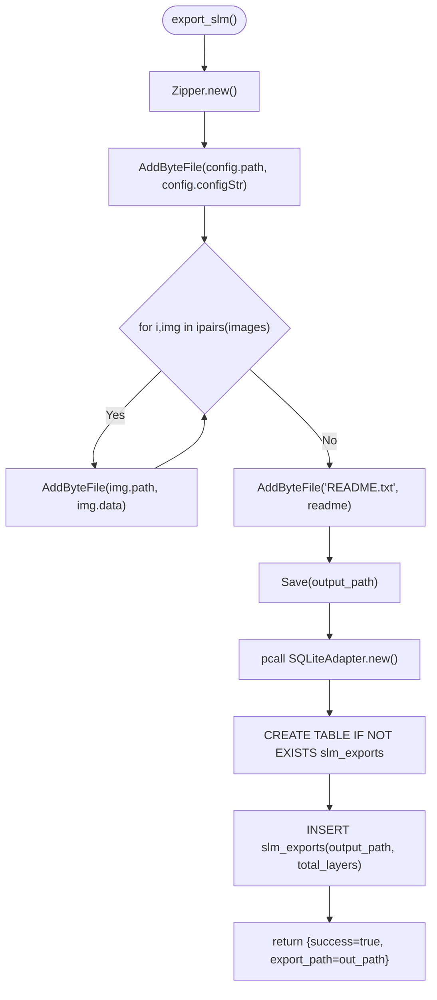
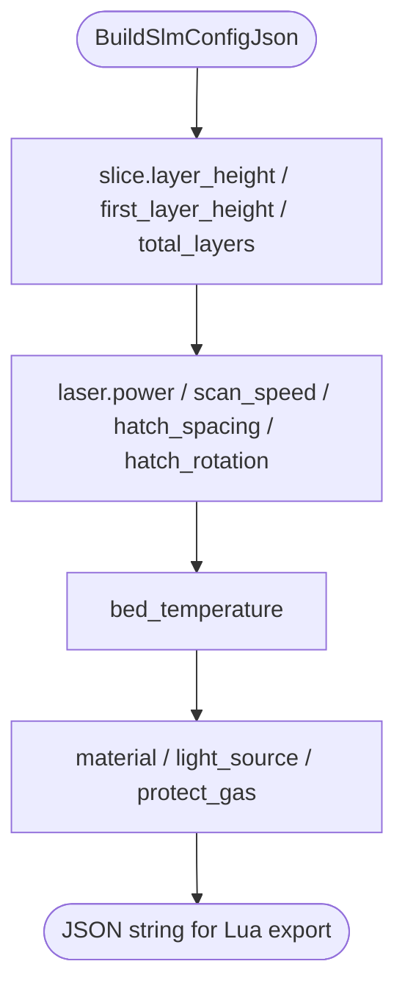
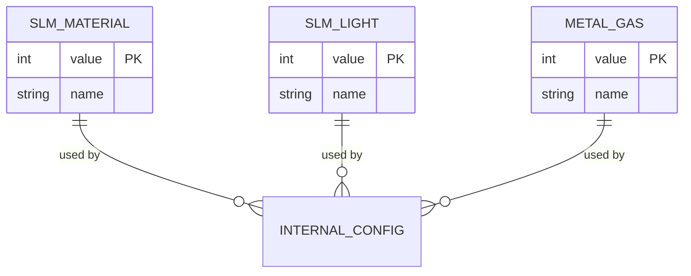
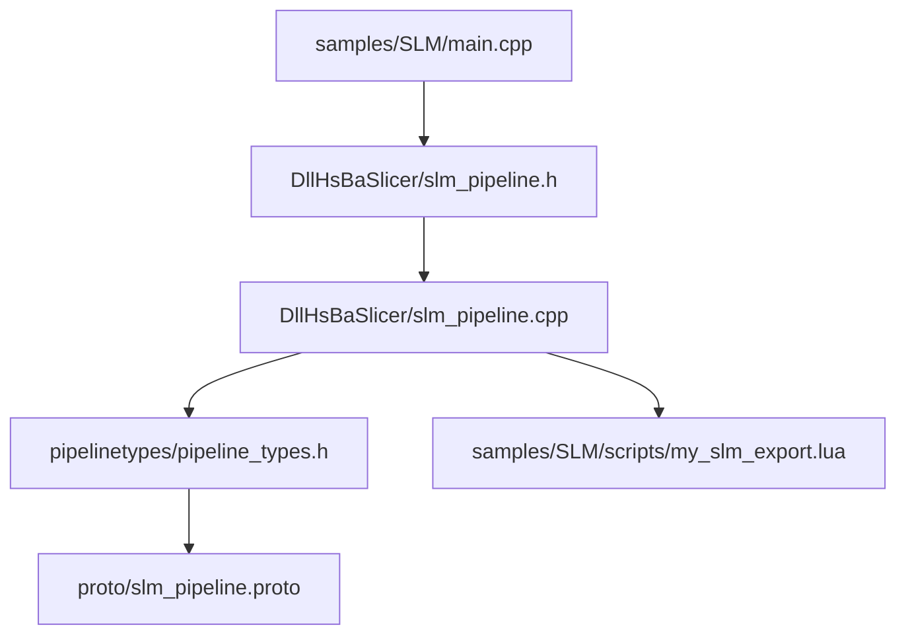
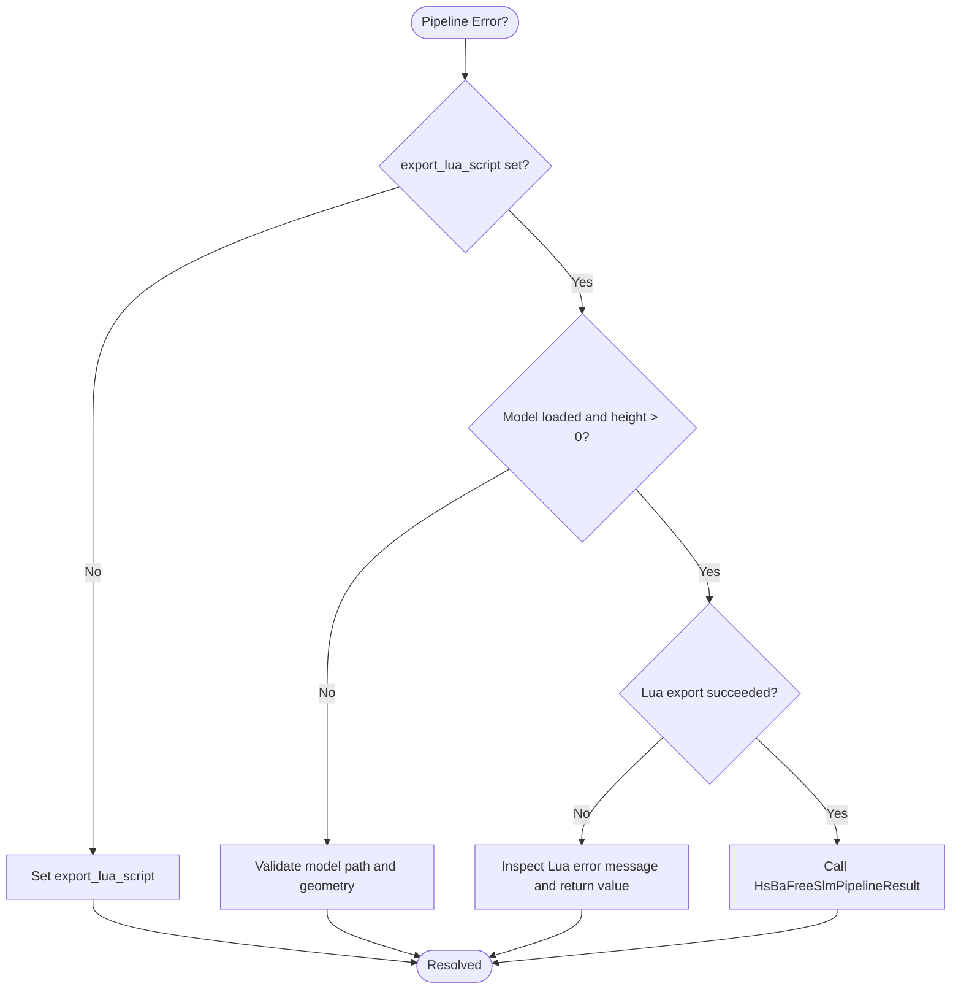

# SLM (Selective Laser Melting) Samples

<cite>
**Referenced Files in This Document**   
- [main.cpp](file://samples/SLM/main.cpp)
- [my_slm_export.lua](file://samples/SLM/scripts/my_slm_export.lua)
- [slm_pipeline.h](file://DllHsBaSlicer/slm_pipeline.h)
- [slm_pipeline.cpp](file://DllHsBaSlicer/slm_pipeline.cpp)
- [pipeline_types.h](file://pipelinetypes/pipeline_types.h)
- [slm_pipeline.proto](file://proto/slm_pipeline.proto)
</cite>

## Table of Contents
1. [Introduction](#introduction)
2. [Project Structure](#project-structure)
3. [Core Components](#core-components)
4. [Architecture Overview](#architecture-overview)
5. [Detailed Component Analysis](#detailed-component-analysis)
6. [Dependency Analysis](#dependency-analysis)
7. [Performance Considerations](#performance-considerations)
8. [Troubleshooting Guide](#troubleshooting-guide)
9. [Conclusion](#conclusion)
10. [Appendices](#appendices)

## Introduction
This document provides comprehensive SLM-specific samples documentation for the HsBaSlicer repository. It focuses on:
- The SLM pipeline entry point and configuration in `samples/SLM/main.cpp`.
- Metal powder handling through material, energy source, and shielding gas parameters.
- Export configuration via `samples/SLM/scripts/my_slm_export.lua`, including how laser parameters, scanning strategies, and melt pool control are carried into the generated package.
- Metal alloy properties, powder characteristics, and inert gas environments as represented by the SLM type system.
- Support structures, residual stress management, and anisotropic property control from a process perspective.
- Post-processing steps such as HIP treatment, heat treatment, and surface finishing for metal parts.

The SLM pipeline mirrors the SLS flow: preprocess, slice, then export through a Lua script that packages layer data and a JSON configuration describing slicing, laser, bed temperature, material, light source, and shielding gas.

## Project Structure
The SLM sample is organized under `samples/SLM`:
- `main.cpp` demonstrates synchronous, asynchronous, and custom-parameter usage of the SLM pipeline.
- `scripts/my_slm_export.lua` defines the export function that archives configuration and layer polygons into a zip file and optionally registers the export in a SQLite database.

**Diagram sources**
- [main.cpp:1-196](file://samples/SLM/main.cpp#L1-L196)
- [slm_pipeline.h:1-63](file://DllHsBaSlicer/slm_pipeline.h#L1-L63)
- [slm_pipeline.cpp:1-387](file://DllHsBaSlicer/slm_pipeline.cpp#L1-L387)
- [pipeline_types.h:312-401](file://pipelinetypes/pipeline_types.h#L312-L401)
- [slm_pipeline.proto:1-44](file://proto/slm_pipeline.proto#L1-L44)

**Section sources**
- [main.cpp:1-196](file://samples/SLM/main.cpp#L1-L196)
- [slm_pipeline.h:1-63](file://DllHsBaSlicer/slm_pipeline.h#L1-L63)
- [slm_pipeline.cpp:1-387](file://DllHsBaSlicer/slm_pipeline.cpp#L1-L387)
- [pipeline_types.h:312-401](file://pipelinetypes/pipeline_types.h#L312-L401)
- [slm_pipeline.proto:1-44](file://proto/slm_pipeline.proto#L1-L44)

## Core Components
The SLM workflow consists of three main components:
- Pipeline API header defining the C ABI for SLM configuration and execution.
- Pipeline implementation performing model loading, parallel slicing, and Lua-driven export.
- Sample application demonstrating basic, custom, and async usage patterns.

Key responsibilities:
- `slm_pipeline.h`: Declares default config creation, synchronous/asynchronous run functions, and result cleanup.
- `slm_pipeline.cpp`: Implements preprocessing, slicing, progress reporting, JSON configuration building, and Lua packaging.
- `main.cpp`: Shows how to configure model paths, layer heights, laser power, scan speed, hatch spacing/rotation, bed temperature, material, light source, and shielding gas.

**Section sources**
- [slm_pipeline.h:17-56](file://DllHsBaSlicer/slm_pipeline.h#L17-L56)
- [slm_pipeline.cpp:28-56](file://DllHsBaSlicer/slm_pipeline.cpp#L28-L56)
- [main.cpp:53-132](file://samples/SLM/main.cpp#L53-L132)

## Architecture Overview
The SLM pipeline follows a clear sequence: load model, compute layers in parallel, build a JSON configuration containing slicing and metal parameters, then delegate output generation to a Lua export script.

**Diagram sources**
- [slm_pipeline.cpp:230-342](file://DllHsBaSlicer/slm_pipeline.cpp#L230-L342)
- [slm_pipeline.h:23-50](file://DllHsBaSlicer/slm_pipeline.h#L23-L50)
- [main.cpp:56-84](file://samples/SLM/main.cpp#L56-L84)

## Detailed Component Analysis

### SLM Pipeline Configuration and Execution
The sample application demonstrates three usage patterns:
- Basic pipeline with minimal configuration.
- Custom pipeline with explicit laser, scanning, and metal parameters.
- Asynchronous pipeline with completion callback.

Configuration fields include:
- Model name and path.
- Layer height and first layer height.
- Laser power, scan speed, hatch spacing, hatch rotation.
- Bed temperature.
- Material (iron, aluminum, titanium).
- Light source (laser, electron beam).
- Shielding gas (argon, helium, nitrogen, CO2).
- Export Lua script and function name.
- Output path.

**Diagram sources**
- [main.cpp:56-84](file://samples/SLM/main.cpp#L56-L84)
- [main.cpp:89-132](file://samples/SLM/main.cpp#L89-L132)
- [main.cpp:156-177](file://samples/SLM/main.cpp#L156-L177)

**Section sources**
- [main.cpp:53-132](file://samples/SLM/main.cpp#L53-L132)
- [main.cpp:156-177](file://samples/SLM/main.cpp#L156-L177)

### Metal Powder Handling and Process Parameters
Metal powder handling is represented by:
- Material enum: iron, aluminum, titanium.
- Energy source: laser or electron beam.
- Shielding gas: argon, helium, nitrogen, CO2.

These values are mapped to string names when constructing the JSON configuration passed to the Lua exporter. The default configuration uses titanium, laser, and argon.

**Diagram sources**
- [pipeline_types.h:320-351](file://pipelinetypes/pipeline_types.h#L320-L351)
- [slm_pipeline.cpp:37-56](file://DllHsBaSlicer/slm_pipeline.cpp#L37-L56)

**Section sources**
- [pipeline_types.h:320-351](file://pipelinetypes/pipeline_types.h#L320-L351)
- [slm_pipeline.cpp:121-188](file://DllHsBaSlicer/slm_pipeline.cpp#L121-L188)

### Export Configuration in my_slm_export.lua
The Lua export script performs:
- Creating a zip archive.
- Adding the JSON configuration (`config.configStr`) which includes slicing, laser, bed temperature, material, light source, and shielding gas.
- Adding per-layer polygon outlines (`images`).
- Writing a README describing contents.
- Optionally registering the export in a SQLite database with output path and total layers.

Important notes:
- The global variables available in the Lua environment are `config`, `images`, and `output_path`.
- The function must return a table with `success` and `export_path`; returning a string would overwrite the zip file.

**Diagram sources**
- [my_slm_export.lua:15-63](file://samples/SLM/scripts/my_slm_export.lua#L15-L63)

**Section sources**
- [my_slm_export.lua:1-63](file://samples/SLM/scripts/my_slm_export.lua#L1-L63)

### Laser Parameters, Scanning Strategies, and Melt Pool Control
The JSON configuration built by the pipeline includes:
- Slicing: layer height, first layer height, total layers.
- Laser: power, scan speed, hatch spacing, hatch rotation.
- Bed temperature.
- Material, light source, shielding gas.

These parameters influence melt pool behavior:
- Laser power and scan speed determine energy input per unit length.
- Hatch spacing controls overlap between adjacent scan lines.
- Hatch rotation reduces directional thermal accumulation across layers.
- Bed temperature affects preheating and cooling rates.

**Diagram sources**
- [slm_pipeline.cpp:166-188](file://DllHsBaSlicer/slm_pipeline.cpp#L166-L188)

**Section sources**
- [slm_pipeline.cpp:166-188](file://DllHsBaSlicer/slm_pipeline.cpp#L166-L188)

### Metal Alloy Properties, Powder Characteristics, and Inert Gas Environments
The type system models:
- Metal alloys: iron, aluminum, titanium.
- Energy sources: laser, electron beam.
- Inert gas environments: argon, helium, nitrogen, CO2.

These are used throughout the pipeline to generate consistent metadata for downstream consumers.

**Diagram sources**
- [pipeline_types.h:320-351](file://pipelinetypes/pipeline_types.h#L320-L351)
- [slm_pipeline.cpp:121-164](file://DllHsBaSlicer/slm_pipeline.cpp#L121-L164)

**Section sources**
- [pipeline_types.h:320-351](file://pipelinetypes/pipeline_types.h#L320-L351)
- [slm_pipeline.cpp:121-164](file://DllHsBaSlicer/slm_pipeline.cpp#L121-L164)

### Support Structures, Residual Stress Management, and Anisotropic Property Control
From the codebase perspective:
- SLM mirrors SLS and does not generate floor/raft or support structures; the powder bed provides support and thermal stability.
- Hatch rotation is provided as a parameter to mitigate directional effects and can help manage anisotropy.
- No explicit residual stress control fields exist in the SLM config; however, bed temperature and hatch rotation are relevant to thermal management.

Process guidance:
- Use appropriate hatch rotation angles to reduce directional thermal gradients.
- Maintain stable bed temperature to reduce thermal shock and residual stresses.
- For complex geometries requiring mechanical support during printing, consider part orientation and external fixturing rather than software-generated supports.

**Section sources**
- [slm_pipeline.h:23-35](file://DllHsBaSlicer/slm_pipeline.h#L23-L35)
- [pipeline_types.h:247-283](file://pipelinetypes/pipeline_types.h#L247-L283)
- [slm_pipeline.cpp:37-56](file://DllHsBaSlicer/slm_pipeline.cpp#L37-L56)

### Post-Processing Steps for Metal Parts
While post-processing is not implemented in the SLM pipeline code, typical steps for metal parts include:
- Hot Isostatic Pressing (HIP) to reduce porosity and improve density.
- Heat treatment to relieve residual stresses and adjust microstructure.
- Surface finishing (machining, polishing, shot peening) to meet tolerances and surface quality requirements.

These steps should be planned based on the selected material, laser parameters, and intended application.

[No sources needed since this section provides general guidance]

## Dependency Analysis
The SLM sample depends on:
- The C ABI header for configuration and execution.
- The implementation for model loading, slicing, and Lua export.
- The shared pipeline types for enums and structs.
- The protocol definition for serialization and cross-language compatibility.

**Diagram sources**
- [main.cpp:1-196](file://samples/SLM/main.cpp#L1-L196)
- [slm_pipeline.h:1-63](file://DllHsBaSlicer/slm_pipeline.h#L1-L63)
- [slm_pipeline.cpp:1-387](file://DllHsBaSlicer/slm_pipeline.cpp#L1-L387)
- [pipeline_types.h:312-401](file://pipelinetypes/pipeline_types.h#L312-L401)
- [slm_pipeline.proto:1-44](file://proto/slm_pipeline.proto#L1-L44)

**Section sources**
- [main.cpp:1-196](file://samples/SLM/main.cpp#L1-L196)
- [slm_pipeline.h:1-63](file://DllHsBaSlicer/slm_pipeline.h#L1-L63)
- [slm_pipeline.cpp:1-387](file://DllHsBaSlicer/slm_pipeline.cpp#L1-L387)
- [pipeline_types.h:312-401](file://pipelinetypes/pipeline_types.h#L312-L401)
- [slm_pipeline.proto:1-44](file://proto/slm_pipeline.proto#L1-L44)

## Performance Considerations
- Parallel slicing: Layers are sliced independently using a parallel loop, improving throughput for large models.
- Progress callbacks: Provide incremental updates during model loading, slicing, and export phases.
- Memory management: Results contain allocated strings that must be freed via the provided cleanup function.

Recommendations:
- Tune layer height and first layer height to balance resolution and build time.
- Adjust hatch spacing and rotation to optimize scan coverage and thermal uniformity.
- Monitor progress callbacks to integrate UI feedback and handle long-running jobs gracefully.

**Section sources**
- [slm_pipeline.cpp:270-288](file://DllHsBaSlicer/slm_pipeline.cpp#L270-L288)
- [slm_pipeline.cpp:348-387](file://DllHsBaSlicer/slm_pipeline.cpp#L348-L387)

## Troubleshooting Guide
Common issues and resolutions:
- Missing export Lua script: The pipeline requires `export_lua_script`; ensure it is set and points to a valid script.
- Invalid model path or empty model height: The pipeline validates model loading and height; verify the model file exists and has non-zero height.
- Lua export failure: Check the error message returned by the Lua script; ensure the script returns a table with `success` and `export_path`.
- Resource leaks: Always call the result cleanup function to free allocated strings.

**Diagram sources**
- [slm_pipeline.cpp:237-342](file://DllHsBaSlicer/slm_pipeline.cpp#L237-L342)
- [slm_pipeline.cpp:380-387](file://DllHsBaSlicer/slm_pipeline.cpp#L380-L387)

**Section sources**
- [slm_pipeline.cpp:237-342](file://DllHsBaSlicer/slm_pipeline.cpp#L237-L342)
- [slm_pipeline.cpp:380-387](file://DllHsBaSlicer/slm_pipeline.cpp#L380-L387)

## Conclusion
The HsBaSlicer SLM sample provides a robust foundation for configuring and running selective laser melting pipelines. It exposes clear APIs for synchronous and asynchronous execution, supports metal-specific parameters through typed enums, and delegates output generation to a flexible Lua export script. Users can tailor laser parameters, scanning strategies, and environmental conditions while leveraging parallel slicing for performance. For advanced needs such as support structures, residual stress control, and post-processing, users should combine process knowledge with the provided parameters and plan additional manufacturing steps accordingly.

[No sources needed since this section summarizes without analyzing specific files]

## Appendices

### SLM Configuration Fields Reference
- Model name and path.
- Layer height and first layer height.
- Laser power, scan speed, hatch spacing, hatch rotation.
- Bed temperature.
- Material: iron, aluminum, titanium.
- Light source: laser, electron beam.
- Shielding gas: argon, helium, nitrogen, CO2.
- Export Lua script and function name.
- Output path.

**Section sources**
- [pipeline_types.h:353-376](file://pipelinetypes/pipeline_types.h#L353-L376)
- [slm_pipeline.cpp:37-56](file://DllHsBaSlicer/slm_pipeline.cpp#L37-L56)