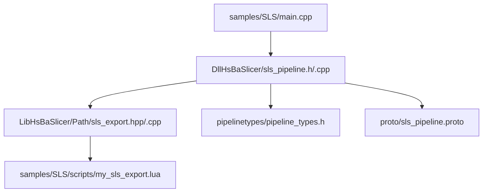
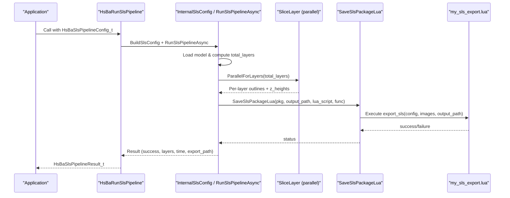
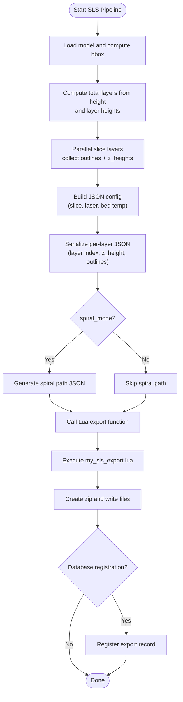
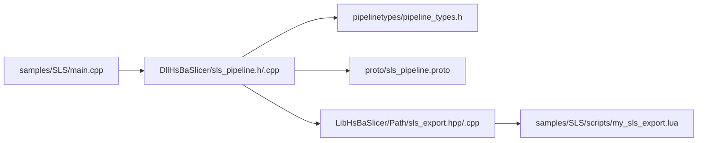

# SLS (Selective Laser Sintering) Samples

<cite>
**Referenced Files in This Document**
- [main.cpp](file://samples/SLS/main.cpp)
- [my_sls_export.lua](file://samples/SLS/scripts/my_sls_export.lua)
- [sls_pipeline.h](file://DllHsBaSlicer/sls_pipeline.h)
- [sls_pipeline.cpp](file://DllHsBaSlicer/sls_pipeline.cpp)
- [sls_export.hpp](file://LibHsBaSlicer/Path/sls_export.hpp)
- [sls_export.cpp](file://LibHsBaSlicer/Path/sls_export.cpp)
- [pipeline_types.h](file://pipelinetypes/pipeline_types.h)
- [sls_pipeline.proto](file://proto/sls_pipeline.proto)
</cite>

## Table of Contents
1. [Introduction](#introduction)
2. [Project Structure](#project-structure)
3. [Core Components](#core-components)
4. [Architecture Overview](#architecture-overview)
5. [Detailed Component Analysis](#detailed-component-analysis)
6. [Dependency Analysis](#dependency-analysis)
7. [Performance Considerations](#performance-considerations)
8. [Troubleshooting Guide](#troubleshooting-guide)
9. [Conclusion](#conclusion)
10. [Appendices](#appendices)

## Introduction
This document provides comprehensive, SLS-specific samples and guidance for configuring the HsBaSlicer SLS pipeline. It focuses on:
- How to configure the SLS pipeline from C++ using the provided sample main.cpp
- How powder bed–oriented slicing works (no floor or supports)
- How to customize export behavior via my_sls_export.lua
- Which process parameters are exposed by the API (laser power, scan speed, hatch spacing/rotation, bed temperature)
- What data is exported and how it is packaged
- Practical notes on preheating, cooling, chamber conditions, and post-processing based on what the code exposes

Where applicable, this guide references concrete source files so you can trace implementation details.

## Project Structure
The SLS samples live under samples/SLS and integrate with the core SLS pipeline in DllHsBaSlicer and LibHsBaSlicer.

**Diagram sources**
- [main.cpp:1-209](file://samples/SLS/main.cpp#L1-L209)
- [sls_pipeline.h:1-63](file://DllHsBaSlicer/sls_pipeline.h#L1-L63)
- [sls_pipeline.cpp:1-334](file://DllHsBaSlicer/sls_pipeline.cpp#L1-L334)
- [sls_export.hpp:1-61](file://LibHsBaSlicer/Path/sls_export.hpp#L1-L61)
- [sls_export.cpp:1-133](file://LibHsBaSlicer/Path/sls_export.cpp#L1-L133)
- [pipeline_types.h:246-847](file://pipelinetypes/pipeline_types.h#L246-L847)
- [sls_pipeline.proto:1-33](file://proto/sls_pipeline.proto#L1-L33)

**Section sources**
- [main.cpp:1-209](file://samples/SLS/main.cpp#L1-L209)
- [sls_pipeline.h:1-63](file://DllHsBaSlicer/sls_pipeline.h#L1-L63)
- [sls_pipeline.cpp:1-334](file://DllHsBaSlicer/sls_pipeline.cpp#L1-L334)
- [sls_export.hpp:1-61](file://LibHsBaSlicer/Path/sls_export.hpp#L1-L61)
- [sls_export.cpp:1-133](file://LibHsBaSlicer/Path/sls_export.cpp#L1-L133)
- [pipeline_types.h:246-847](file://pipelinetypes/pipeline_types.h#L246-L847)
- [sls_pipeline.proto:1-33](file://proto/sls_pipeline.proto#L1-L33)

## Core Components
- SLS Pipeline API (C ABI): Provides default configuration, synchronous/asynchronous execution, and result cleanup.
- Internal SLS pipeline: Loads model, slices layers in parallel, builds a JSON config including laser and bed settings, then exports via Lua.
- SLS Export Package: Serializes per-layer polygon outlines and optional spiral path into JSON, then hands everything to a Lua script for packaging and database registration.
- Sample main.cpp: Demonstrates basic, custom-parameter, and async usage patterns.
- Sample Lua export: Shows how to create a zip archive, write layer JSON, and optionally register records in SQLite.

Key responsibilities:
- Configuration: Layer height, first layer height, laser power, scan speed, hatch spacing, hatch rotation, bed temperature, export script/function, output path.
- Slicing: Computes total layers, generates per-layer outlines, and computes Z heights.
- Export: Builds a JSON config and passes it plus per-layer polygons to the Lua script.

**Section sources**
- [sls_pipeline.h:17-56](file://DllHsBaSlicer/sls_pipeline.h#L17-L56)
- [sls_pipeline.cpp:37-53](file://DllHsBaSlicer/sls_pipeline.cpp#L37-L53)
- [sls_pipeline.cpp:118-138](file://DllHsBaSlicer/sls_pipeline.cpp#L118-L138)
- [sls_export.hpp:17-56](file://LibHsBaSlicer/Path/sls_export.hpp#L17-L56)
- [pipeline_types.h:259-276](file://pipelinetypes/pipeline_types.h#L259-L276)

## Architecture Overview
The SLS pipeline follows a three-stage flow: Preprocess -> Slice -> Export (Lua). The export format is fully controlled by a Lua script.

**Diagram sources**
- [sls_pipeline.cpp:176-289](file://DllHsBaSlicer/sls_pipeline.cpp#L176-L289)
- [sls_export.cpp:72-130](file://LibHsBaSlicer/Path/sls_export.cpp#L72-L130)
- [my_sls_export.lua:23-79](file://samples/SLS/scripts/my_sls_export.lua#L23-L79)

## Detailed Component Analysis

### SLS Pipeline Configuration (C API)
The C API exposes:
- Default configuration creation
- Synchronous run
- Asynchronous run
- Result memory cleanup

Configuration fields relevant to SLS:
- Model name/path
- Slice: layer_height, first_layer_height
- Laser: laser_power, scan_speed, hatch_spacing, hatch_rotation
- Bed: bed_temperature
- Export: export_lua_script, export_lua_func
- Output: output_path

Defaults are defined centrally and used when constructing internal configuration.

Practical usage examples:
- Basic pipeline: minimal config, set model, export script, output path, run synchronously
- Custom parameters: override layer heights, laser power, scan speed, hatch spacing/rotation, bed temperature
- Async pipeline: start non-blocking, poll completion callback

**Section sources**
- [sls_pipeline.h:17-56](file://DllHsBaSlicer/sls_pipeline.h#L17-L56)
- [pipeline_types.h:259-276](file://pipelinetypes/pipeline_types.h#L259-L276)
- [pipeline_types.h:831-847](file://pipelinetypes/pipeline_types.h#L831-L847)
- [main.cpp:56-92](file://samples/SLS/main.cpp#L56-L92)
- [main.cpp:97-140](file://samples/SLS/main.cpp#L97-L140)
- [main.cpp:166-190](file://samples/SLS/main.cpp#L166-L190)

### SLS Pipeline Internals
Internally, the pipeline:
- Loads the model and computes bounding box to determine total layers
- Slices each layer in parallel and collects outlines and Z heights
- Builds a JSON configuration containing slice, laser, and bed temperature values
- Calls the Lua-based exporter with package data

Error handling:
- Invalid model height returns an error
- Missing Lua export script returns an error
- Runtime exceptions are caught and reported

Progress reporting:
- Progress callbacks are invoked at key stages (model load, slicing, export, complete)

**Section sources**
- [sls_pipeline.cpp:92-108](file://DllHsBaSlicer/sls_pipeline.cpp#L92-L108)
- [sls_pipeline.cpp:118-138](file://DllHsBaSlicer/sls_pipeline.cpp#L118-L138)
- [sls_pipeline.cpp:176-289](file://DllHsBaSlicer/sls_pipeline.cpp#L176-L289)

### SLS Export Package and Lua Integration
The export package includes:
- Per-layer polygon outlines
- Per-layer Z heights
- JSON configuration string
- Optional spiral mode flag (for continuous outer-wall path)

The exporter serializes:
- config.json with version, process type, slice/laser/bed settings
- layers/N.json for each layer, wrapping outlines with layer index and Z height
- Optionally spiral/path.json if spiral_mode is enabled

The Lua environment receives:
- Global config table with path and JSON content
- Global images array with per-layer JSON payloads
- Global output_path
- Registered libraries: Zipper, Cipher, Bit7zZipper (optional), SQLite/MySQL/PostgreSQL adapters (if compiled)

Sample Lua export demonstrates:
- Creating a zip archive
- Writing config.json and README.txt
- Writing per-layer JSON files
- Optional SQLite registration of export metadata

**Section sources**
- [sls_export.hpp:17-56](file://LibHsBaSlicer/Path/sls_export.hpp#L17-L56)
- [sls_export.cpp:25-68](file://LibHsBaSlicer/Path/sls_export.cpp#L25-L68)
- [sls_export.cpp:72-130](file://LibHsBaSlicer/Path/sls_export.cpp#L72-L130)
- [my_sls_export.lua:1-80](file://samples/SLS/scripts/my_sls_export.lua#L1-L80)

### SLS Process Parameters Reference
The following parameters are exposed by the SLS pipeline configuration and included in the generated config JSON:

- layer_height: mm, default 0.1
- first_layer_height: mm, default 0.15
- laser_power: W, default 30.0
- scan_speed: mm/s, default 2000.0
- hatch_spacing: mm, default 0.15
- hatch_rotation: degrees, default 90.0
- bed_temperature: °C, default 180.0

These values are written into the exported JSON configuration that accompanies the per-layer outlines.

**Section sources**
- [pipeline_types.h:259-276](file://pipelinetypes/pipeline_types.h#L259-L276)
- [pipeline_types.h:831-847](file://pipelinetypes/pipeline_types.h#L831-L847)
- [sls_pipeline.cpp:118-138](file://DllHsBaSlicer/sls_pipeline.cpp#L118-L138)
- [sls_pipeline.proto:5-22](file://proto/sls_pipeline.proto#L5-L22)

### Powder Bed Management
In SLS, the powder bed acts as both support material and thermal mass. The codebase emphasizes:
- No floor or raft is required
- No support structures are needed because the surrounding powder provides support
- The build platform temperature (bed_temperature) is part of the configuration and exported JSON

Operational implications:
- Ensure the bed temperature is set appropriately for your material to maintain sintering stability
- Since no supports are generated, overhangs rely on powder support; consider geometry orientation accordingly

Note: The current SLS configuration does not include explicit fields for powder properties (e.g., particle size distribution) or recycling procedures. These would need to be handled outside the slicer or extended into the configuration schema.

**Section sources**
- [main.cpp:8-13](file://samples/SLS/main.cpp#L8-L13)
- [pipeline_types.h:251-258](file://pipelinetypes/pipeline_types.h#L251-L258)
- [sls_pipeline.cpp:118-138](file://DllHsBaSlicer/sls_pipeline.cpp#L118-L138)

### Export Configuration Examples (my_sls_export.lua)
The sample Lua export shows how to:
- Create a zip archive
- Write the configuration JSON and README
- Iterate through images (per-layer JSON) and add them to the archive
- Optionally register export metadata in SQLite

You can extend this script to:
- Add additional metadata (e.g., machine ID, operator, batch number)
- Include additional artifacts (e.g., STL of the original model, inspection reports)
- Integrate with other databases (MySQL/PostgreSQL) if available

**Section sources**
- [my_sls_export.lua:23-79](file://samples/SLS/scripts/my_sls_export.lua#L23-L79)
- [sls_export.cpp:105-121](file://LibHsBaSlicer/Path/sls_export.cpp#L105-L121)

### Data Flow and Processing Logic

**Diagram sources**
- [sls_pipeline.cpp:176-289](file://DllHsBaSlicer/sls_pipeline.cpp#L176-L289)
- [sls_export.cpp:72-130](file://LibHsBaSlicer/Path/sls_export.cpp#L72-L130)
- [my_sls_export.lua:23-79](file://samples/SLS/scripts/my_sls_export.lua#L23-L79)

## Dependency Analysis
The SLS samples depend on:
- C ABI for pipeline control (create config, run sync/async, free result)
- Internal pipeline logic for preprocessing, slicing, and exporting
- Export package serialization and Lua integration
- Sample Lua script for packaging and optional database registration

**Diagram sources**
- [main.cpp:1-209](file://samples/SLS/main.cpp#L1-L209)
- [sls_pipeline.h:1-63](file://DllHsBaSlicer/sls_pipeline.h#L1-L63)
- [sls_pipeline.cpp:1-334](file://DllHsBaSlicer/sls_pipeline.cpp#L1-L334)
- [pipeline_types.h:246-847](file://pipelinetypes/pipeline_types.h#L246-L847)
- [sls_pipeline.proto:1-33](file://proto/sls_pipeline.proto#L1-L33)
- [sls_export.hpp:1-61](file://LibHsBaSlicer/Path/sls_export.hpp#L1-L61)
- [sls_export.cpp:1-133](file://LibHsBaSlicer/Path/sls_export.cpp#L1-L133)
- [my_sls_export.lua:1-80](file://samples/SLS/scripts/my_sls_export.lua#L1-L80)

**Section sources**
- [main.cpp:1-209](file://samples/SLS/main.cpp#L1-L209)
- [sls_pipeline.h:1-63](file://DllHsBaSlicer/sls_pipeline.h#L1-L63)
- [sls_pipeline.cpp:1-334](file://DllHsBaSlicer/sls_pipeline.cpp#L1-L334)
- [pipeline_types.h:246-847](file://pipelinetypes/pipeline_types.h#L246-L847)
- [sls_pipeline.proto:1-33](file://proto/sls_pipeline.proto#L1-L33)
- [sls_export.hpp:1-61](file://LibHsBaSlicer/Path/sls_export.hpp#L1-L61)
- [sls_export.cpp:1-133](file://LibHsBaSlicer/Path/sls_export.cpp#L1-L133)
- [my_sls_export.lua:1-80](file://samples/SLS/scripts/my_sls_export.lua#L1-L80)

## Performance Considerations
- Parallel slicing: Layers are sliced in parallel to reduce total processing time.
- Minimal overhead: The pipeline avoids unnecessary allocations by reusing topology and computing layer counts once.
- Export efficiency: The exporter serializes only necessary data (config JSON and per-layer outlines), keeping the payload compact.

[No sources needed since this section provides general guidance]

## Troubleshooting Guide
Common issues and resolutions:
- Missing model file: Ensure model_name and model_path are set correctly.
- Invalid model height: If the model has zero or negative height, the pipeline will fail; verify the input mesh.
- Missing Lua export script: SLS requires a Lua export script; ensure export_lua_script points to a valid file and export_lua_func exists.
- Lua export failure: Check the Lua script for errors; the pipeline returns a descriptive error message.
- Database registration skipped: In the sample Lua script, database registration is wrapped in pcall; failures are non-fatal and logged.

Memory management:
- Always call HsBaFreeSlsPipelineResult after receiving a result to avoid leaks.

**Section sources**
- [sls_pipeline.cpp:186-211](file://DllHsBaSlicer/sls_pipeline.cpp#L186-L211)
- [sls_pipeline.cpp:237-275](file://DllHsBaSlicer/sls_pipeline.cpp#L237-L275)
- [sls_pipeline.cpp:327-333](file://DllHsBaSlicer/sls_pipeline.cpp#L327-L333)
- [my_sls_export.lua:50-71](file://samples/SLS/scripts/my_sls_export.lua#L50-L71)

## Conclusion
The HsBaSlicer SLS samples provide a clear, extensible workflow:
- Configure the SLS pipeline via the C API with laser and bed parameters
- Rely on the built-in parallel slicing to generate per-layer outlines
- Customize output entirely through a Lua export script, which can package results and register metadata
- Use the provided samples as templates for your own SLS workflows

While the current SLS configuration does not expose powder material properties or recycling procedures, the architecture allows extension through additional configuration fields and Lua-driven export logic.

[No sources needed since this section summarizes without analyzing specific files]

## Appendices

### SLS Configuration Fields Summary
- Model: model_name, model_path
- Slice: layer_height, first_layer_height
- Laser: laser_power, scan_speed, hatch_spacing, hatch_rotation
- Bed: bed_temperature
- Export: export_lua_script, export_lua_func
- Output: output_path

**Section sources**
- [pipeline_types.h:259-276](file://pipelinetypes/pipeline_types.h#L259-L276)
- [sls_pipeline.proto:5-22](file://proto/sls_pipeline.proto#L5-L22)

### Example Usage Patterns
- Basic: Set model, export script, output path; run synchronously
- Custom: Override layer heights, laser power, scan speed, hatch spacing/rotation, bed temperature
- Async: Start non-blocking and handle completion callback

**Section sources**
- [main.cpp:56-92](file://samples/SLS/main.cpp#L56-L92)
- [main.cpp:97-140](file://samples/SLS/main.cpp#L97-L140)
- [main.cpp:166-190](file://samples/SLS/main.cpp#L166-L190)