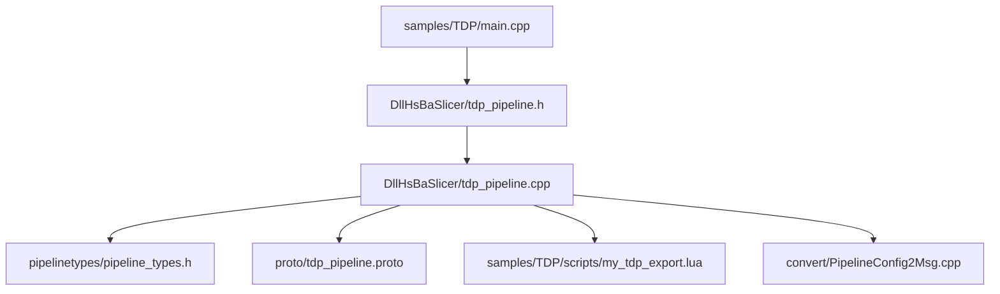
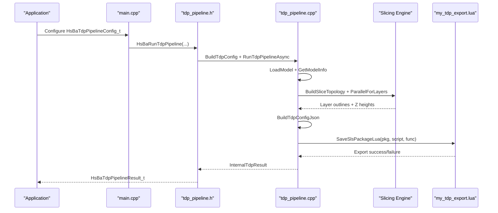
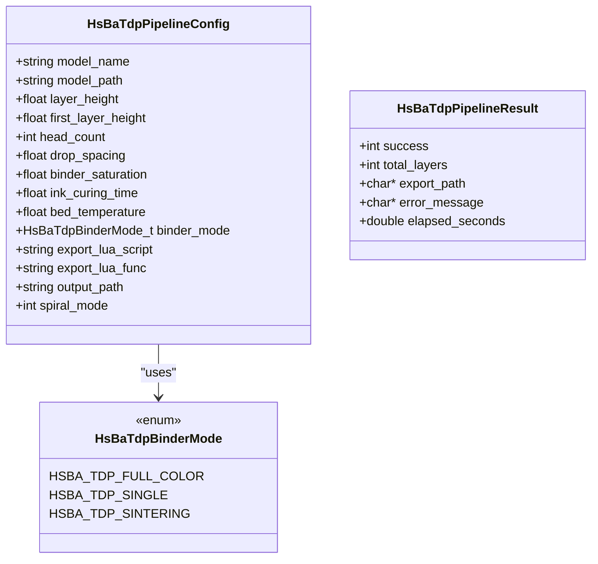
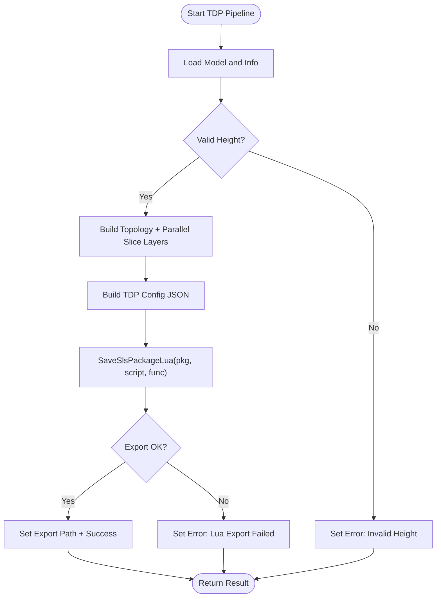
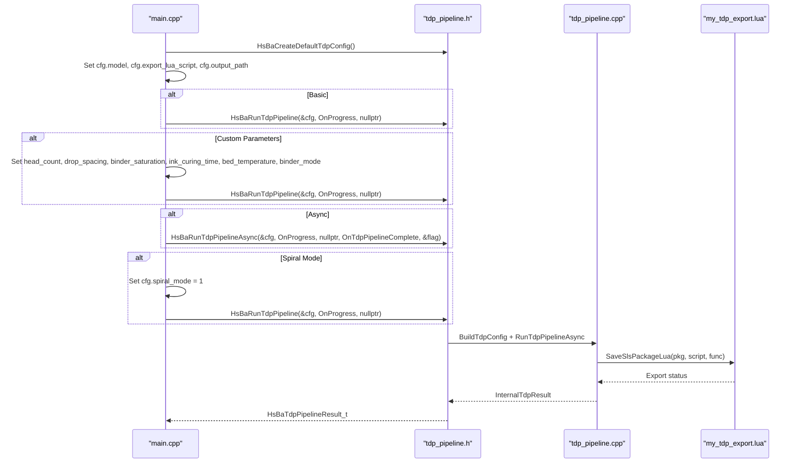
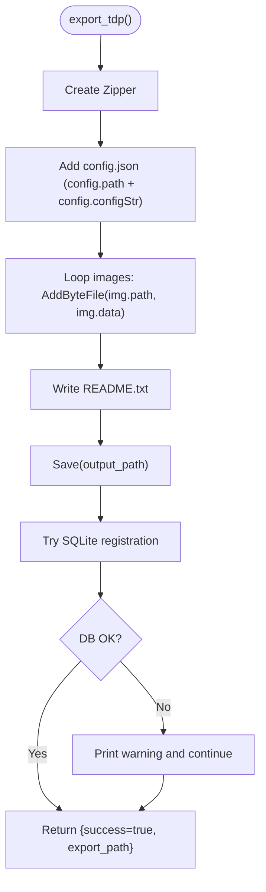
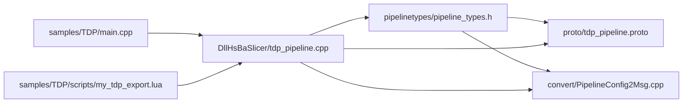

# TDP (Thermal Deposition Processing) Samples

<cite>
**Referenced Files in This Document**   
- [samples/TDP/main.cpp](file://samples/TDP/main.cpp)
- [samples/TDP/scripts/my_tdp_export.lua](file://samples/TDP/scripts/my_tdp_export.lua)
- [DllHsBaSlicer/tdp_pipeline.h](file://DllHsBaSlicer/tdp_pipeline.h)
- [DllHsBaSlicer/tdp_pipeline.cpp](file://DllHsBaSlicer/tdp_pipeline.cpp)
- [pipelinetypes/pipeline_types.h](file://pipelinetypes/pipeline_types.h)
- [proto/tdp_pipeline.proto](file://proto/tdp_pipeline.proto)
- [convert/PipelineConfig2Msg.cpp](file://convert/PipelineConfig2Msg.cpp)
</cite>

## Table of Contents
1. [Introduction](#introduction)
2. [Project Structure](#project-structure)
3. [Core Components](#core-components)
4. [Architecture Overview](#architecture-overview)
5. [Detailed Component Analysis](#detailed-component-analysis)
6. [Dependency Analysis](#dependency-analysis)
7. [Performance Considerations](#performance-considerations)
8. [Troubleshooting Guide](#troubleshooting-guide)
9. [Conclusion](#conclusion)
10. [Appendices](#appendices)

## Introduction
This document provides detailed, TDP-specific samples documentation for thermal deposition processing workflows. It focuses on the HsBaSlicer 3DP/TDP pipeline as implemented in this repository and explains how to configure and run thermal deposition pipelines using C++ entry points and Lua-driven export scripts.

Important clarification: in this codebase, “TDP” is implemented as a binder jetting / powder-bed process called 3DP. The configuration includes head count, drop spacing, binder saturation, curing time, bed temperature, and binder mode. The sample export script packages per-layer outlines and a JSON configuration into a zip archive and optionally registers export history in a SQLite database.

The repository does not define material melting points, thermal conductivity, heat affected zones, or explicit thermal stress/distortion compensation fields in the TDP pipeline. Those aspects are outside the current API surface. Where relevant, this document distinguishes between what the code implements and general thermal manufacturing guidance that is not directly represented by the TDP pipeline types.

## Project Structure
The TDP samples live under `samples/TDP`, with a C++ example driver and a Lua export script. The core pipeline implementation is exposed through a C ABI header and its implementation, which coordinates model loading, slicing, and Lua-based packaging.

**Diagram sources**
- [samples/TDP/main.cpp:1-225](file://samples/TDP/main.cpp#L1-L225)
- [DllHsBaSlicer/tdp_pipeline.h:1-63](file://DllHsBaSlicer/tdp_pipeline.h#L1-L63)
- [DllHsBaSlicer/tdp_pipeline.cpp:1-355](file://DllHsBaSlicer/tdp_pipeline.cpp#L1-L355)
- [pipelinetypes/pipeline_types.h:463-521](file://pipelinetypes/pipeline_types.h#L463-L521)
- [proto/tdp_pipeline.proto:1-47](file://proto/tdp_pipeline.proto#L1-L47)
- [convert/PipelineConfig2Msg.cpp:328-354](file://convert/PipelineConfig2Msg.cpp#L328-L354)
- [samples/TDP/scripts/my_tdp_export.lua:1-63](file://samples/TDP/scripts/my_tdp_export.lua#L1-L63)

**Section sources**
- [samples/TDP/main.cpp:1-225](file://samples/TDP/main.cpp#L1-L225)
- [DllHsBaSlicer/tdp_pipeline.h:1-63](file://DllHsBaSlicer/tdp_pipeline.h#L1-L63)
- [DllHsBaSlicer/tdp_pipeline.cpp:1-355](file://DllHsBaSlicer/tdp_pipeline.cpp#L1-L355)
- [pipelinetypes/pipeline_types.h:463-521](file://pipelinetypes/pipeline_types.h#L463-L521)
- [proto/tdp_pipeline.proto:1-47](file://proto/tdp_pipeline.proto#L1-L47)
- [samples/TDP/scripts/my_tdp_export.lua:1-63](file://samples/TDP/scripts/my_tdp_export.lua#L1-L63)

## Core Components
- TDP pipeline C ABI: defines default configuration creation, synchronous and asynchronous execution, and result cleanup.
- Internal TDP pipeline: loads models, computes layer counts, slices layers in parallel, builds a JSON configuration, and delegates packaging to a Lua export script.
- TDP configuration types: expose binder jetting parameters such as head count, drop spacing, binder saturation, curing time, bed temperature, binder mode, spiral mode, and output path.
- Sample main: demonstrates basic, custom parameter, async, and spiral-mode runs.
- Sample Lua export: archives config and per-layer outlines into a zip and optionally records export metadata in SQLite.

Key responsibilities:
- C++ side: geometry preprocessing, slicing, progress reporting, and Lua package delivery.
- Lua side: file packaging and optional database registration.

**Section sources**
- [DllHsBaSlicer/tdp_pipeline.h:17-56](file://DllHsBaSlicer/tdp_pipeline.h#L17-L56)
- [DllHsBaSlicer/tdp_pipeline.cpp:28-55](file://DllHsBaSlicer/tdp_pipeline.cpp#L28-L55)
- [pipelinetypes/pipeline_types.h:463-521](file://pipelinetypes/pipeline_types.h#L463-L521)
- [samples/TDP/main.cpp:55-220](file://samples/TDP/main.cpp#L55-L220)
- [samples/TDP/scripts/my_tdp_export.lua:15-60](file://samples/TDP/scripts/my_tdp_export.lua#L15-L60)

## Architecture Overview
The TDP pipeline follows a three-stage flow: preprocess, slice, and export via Lua.

**Diagram sources**
- [samples/TDP/main.cpp:55-220](file://samples/TDP/main.cpp#L55-L220)
- [DllHsBaSlicer/tdp_pipeline.h:23-50](file://DllHsBaSlicer/tdp_pipeline.h#L23-L50)
- [DllHsBaSlicer/tdp_pipeline.cpp:197-310](file://DllHsBaSlicer/tdp_pipeline.cpp#L197-L310)
- [samples/TDP/scripts/my_tdp_export.lua:15-60](file://samples/TDP/scripts/my_tdp_export.lua#L15-L60)

## Detailed Component Analysis

### TDP Pipeline Configuration Types
The TDP configuration structure exposes binder jetting parameters and export options. Defaults are provided by an inline initializer.

- Model inputs: model name and model path.
- Slicing inputs: layer height and first layer height.
- Binder jetting inputs: head count, drop spacing, binder saturation, ink curing time, bed temperature, binder mode.
- Export inputs: export Lua script path, export function name, output path.
- Spiral mode: enables continuous rising outer-wall path exposure to the export script.

Binder modes include full-color, single-channel, and sintering-assisted binder jetting.

**Diagram sources**
- [pipelinetypes/pipeline_types.h:463-521](file://pipelinetypes/pipeline_types.h#L463-L521)
- [pipelinetypes/pipeline_types.h:900-921](file://pipelinetypes/pipeline_types.h#L900-L921)

**Section sources**
- [pipelinetypes/pipeline_types.h:463-521](file://pipelinetypes/pipeline_types.h#L463-L521)
- [pipelinetypes/pipeline_types.h:900-921](file://pipelinetypes/pipeline_types.h#L900-L921)
- [proto/tdp_pipeline.proto:8-37](file://proto/tdp_pipeline.proto#L8-L37)

### TDP Pipeline Implementation
The internal pipeline performs:
- Model loading and validation.
- Layer count calculation from bounding box and layer heights.
- Parallel slicing across layers.
- JSON configuration generation including binder jetting parameters.
- Delegation to a Lua export script for packaging.

**Diagram sources**
- [DllHsBaSlicer/tdp_pipeline.cpp:94-110](file://DllHsBaSlicer/tdp_pipeline.cpp#L94-L110)
- [DllHsBaSlicer/tdp_pipeline.cpp:135-157](file://DllHsBaSlicer/tdp_pipeline.cpp#L135-L157)
- [DllHsBaSlicer/tdp_pipeline.cpp:197-310](file://DllHsBaSlicer/tdp_pipeline.cpp#L197-L310)

**Section sources**
- [DllHsBaSlicer/tdp_pipeline.cpp:94-110](file://DllHsBaSlicer/tdp_pipeline.cpp#L94-L110)
- [DllHsBaSlicer/tdp_pipeline.cpp:135-157](file://DllHsBaSlicer/tdp_pipeline.cpp#L135-L157)
- [DllHsBaSlicer/tdp_pipeline.cpp:197-310](file://DllHsBaSlicer/tdp_pipeline.cpp#L197-L310)

### Sample Entry Point: main.cpp
The sample demonstrates four usage patterns:
- Basic pipeline run with minimal configuration.
- Custom binder jetting parameters (head count, drop spacing, saturation, curing time, bed temperature, binder mode).
- Asynchronous pipeline execution with completion callback.
- Spiral mode enabling a continuous rising outer-wall path.

**Diagram sources**
- [samples/TDP/main.cpp:55-220](file://samples/TDP/main.cpp#L55-L220)
- [DllHsBaSlicer/tdp_pipeline.h:23-50](file://DllHsBaSlicer/tdp_pipeline.h#L23-L50)
- [DllHsBaSlicer/tdp_pipeline.cpp:197-310](file://DllHsBaSlicer/tdp_pipeline.cpp#L197-L310)
- [samples/TDP/scripts/my_tdp_export.lua:15-60](file://samples/TDP/scripts/my_tdp_export.lua#L15-L60)

**Section sources**
- [samples/TDP/main.cpp:55-220](file://samples/TDP/main.cpp#L55-L220)

### Export Configuration: my_tdp_export.lua
The sample Lua export script:
- Creates a zip archive.
- Adds the generated configuration JSON.
- Adds per-layer outline files.
- Writes a README describing contents.
- Optionally connects to SQLite and records export metadata.

Global variables available to the script:
- config: table containing path and configStr (JSON content).
- images: array of per-layer data objects with path and data.
- output_path: string indicating where to save the zip.

Return value:
- Must return a table with success flag and export_path; returning a string would overwrite the zip.

**Diagram sources**
- [samples/TDP/scripts/my_tdp_export.lua:15-60](file://samples/TDP/scripts/my_tdp_export.lua#L15-L60)

**Section sources**
- [samples/TDP/scripts/my_tdp_export.lua:1-63](file://samples/TDP/scripts/my_tdp_export.lua#L1-L63)

### Thermal Energy Sources and Heat-Affected Zones
In this repository’s TDP implementation, the energy source is binder jetting rather than direct thermal melting. The configuration includes:
- Head count and drop spacing for binder deposition.
- Binder saturation controlling binder volume per area.
- Ink curing time per layer.
- Bed temperature for powder bed stabilization.

There are no explicit fields for laser power, scan speed, hatch spacing, or metal shielding gas in the TDP configuration. Those belong to other processes like SLM/SLS/WAAM.

Material properties such as melting point, thermal conductivity, and heat affected zone are not modeled in the TDP pipeline types. If you need those, they must be added to the configuration structures and propagated into the exported JSON and downstream toolchain.

**Section sources**
- [pipelinetypes/pipeline_types.h:463-521](file://pipelinetypes/pipeline_types.h#L463-L521)
- [proto/tdp_pipeline.proto:8-37](file://proto/tdp_pipeline.proto#L8-L37)
- [DllHsBaSlicer/tdp_pipeline.cpp:135-157](file://DllHsBaSlicer/tdp_pipeline.cpp#L135-L157)

### Cooling Strategies, Thermal Stress Mitigation, and Distortion Compensation
The current TDP pipeline does not implement cooling strategies, thermal stress mitigation, or distortion compensation. These would require additional configuration fields and post-processing logic beyond the existing API.

Potential extension points:
- Add cooling rate or dwell time parameters to the TDP configuration.
- Introduce stress-relief passes or interlayer rest times.
- Implement distortion compensation by adjusting layer outlines based on predicted shrinkage.

These enhancements are not present in the current code and should be designed as new fields and pipeline stages.

[No sources needed since this section provides general guidance]

### Quality Control and Defect Detection
The sample Lua export script includes optional SQLite registration of export metadata (output path, total layers, timestamp). This can serve as a baseline for quality control tracking.

To extend quality control:
- Record additional metrics in the database (e.g., binder saturation, curing time, bed temperature).
- Integrate defect detection by analyzing per-layer outlines (e.g., gaps, overlaps, porosity proxies).
- Generate inspection reports alongside the zip archive.

These capabilities are not implemented in the sample script and would require extensions to the Lua export logic.

**Section sources**
- [samples/TDP/scripts/my_tdp_export.lua:35-54](file://samples/TDP/scripts/my_tdp_export.lua#L35-L54)

## Dependency Analysis
The TDP pipeline depends on:
- Pipeline type definitions for configuration and results.
- Protocol buffer definitions for serialization.
- Conversion utilities mapping C structs to protobuf messages.
- The Lua export script for packaging.

**Diagram sources**
- [pipelinetypes/pipeline_types.h:463-521](file://pipelinetypes/pipeline_types.h#L463-L521)
- [proto/tdp_pipeline.proto:1-47](file://proto/tdp_pipeline.proto#L1-L47)
- [convert/PipelineConfig2Msg.cpp:328-354](file://convert/PipelineConfig2Msg.cpp#L328-L354)
- [DllHsBaSlicer/tdp_pipeline.cpp:1-355](file://DllHsBaSlicer/tdp_pipeline.cpp#L1-L355)
- [samples/TDP/main.cpp:1-225](file://samples/TDP/main.cpp#L1-L225)
- [samples/TDP/scripts/my_tdp_export.lua:1-63](file://samples/TDP/scripts/my_tdp_export.lua#L1-L63)

**Section sources**
- [pipelinetypes/pipeline_types.h:463-521](file://pipelinetypes/pipeline_types.h#L463-L521)
- [proto/tdp_pipeline.proto:1-47](file://proto/tdp_pipeline.proto#L1-L47)
- [convert/PipelineConfig2Msg.cpp:328-354](file://convert/PipelineConfig2Msg.cpp#L328-L354)
- [DllHsBaSlicer/tdp_pipeline.cpp:1-355](file://DllHsBaSlicer/tdp_pipeline.cpp#L1-L355)
- [samples/TDP/main.cpp:1-225](file://samples/TDP/main.cpp#L1-L225)
- [samples/TDP/scripts/my_tdp_export.lua:1-63](file://samples/TDP/scripts/my_tdp_export.lua#L1-L63)

## Performance Considerations
- Parallel slicing: The pipeline uses parallel iteration over layers to improve throughput.
- Progress callbacks: Provide real-time feedback during model loading, slicing, and export.
- Memory management: Results and strings are allocated and freed via dedicated functions to avoid leaks.

Recommendations:
- Tune layer height and first layer height to balance resolution and build time.
- Adjust head count and drop spacing according to printer hardware constraints.
- Use spiral mode only when appropriate for your application, as it changes the output path structure.

[No sources needed since this section provides general guidance]

## Troubleshooting Guide
Common issues and resolutions:
- Missing Lua export script: Ensure export_lua_script is set; otherwise the pipeline fails with an error message.
- Invalid model height: If the model has zero or negative height, the pipeline returns an error.
- Lua export failure: Check the Lua script path and function name; errors are captured and returned in the result.
- Database registration skipped: If SQLite operations fail, the script prints a warning but continues exporting.

Operational tips:
- Inspect the returned error_message field for details.
- Verify that output_path is writable.
- Confirm that the Lua script returns a table with success and export_path.

**Section sources**
- [DllHsBaSlicer/tdp_pipeline.cpp:260-296](file://DllHsBaSlicer/tdp_pipeline.cpp#L260-L296)
- [samples/TDP/scripts/my_tdp_export.lua:35-54](file://samples/TDP/scripts/my_tdp_export.lua#L35-L54)

## Conclusion
The HsBaSlicer TDP (3DP/binder jetting) pipeline provides a clear, extensible workflow:
- C++ entry points configure and execute the pipeline synchronously or asynchronously.
- The internal pipeline handles model loading, slicing, and JSON configuration generation.
- A Lua export script packages outputs and can record metadata for traceability.

While the current implementation focuses on binder jetting parameters and packaging, it does not include material melting points, thermal conductivity, heat affected zones, or advanced thermal stress mitigation. Extending these areas requires adding new configuration fields and processing logic aligned with the existing pipeline architecture.

[No sources needed since this section summarizes without analyzing specific files]

## Appendices

### TDP Configuration Fields Summary
- model_name: Identifier for the model.
- model_path: File path to the model.
- layer_height: Standard layer thickness.
- first_layer_height: Initial layer thickness.
- head_count: Number of print head nozzles.
- drop_spacing: Distance between binder drops.
- binder_saturation: Binder saturation level.
- ink_curing_time: Per-layer curing duration.
- bed_temperature: Powder bed temperature.
- binder_mode: Full-color, single, or sintering-assisted.
- export_lua_script: Path to the Lua export script.
- export_lua_func: Name of the Lua export function.
- output_path: Destination path for the packaged output.
- spiral_mode: Enable continuous rising outer-wall path.

**Section sources**
- [pipelinetypes/pipeline_types.h:463-521](file://pipelinetypes/pipeline_types.h#L463-L521)
- [proto/tdp_pipeline.proto:15-37](file://proto/tdp_pipeline.proto#L15-L37)