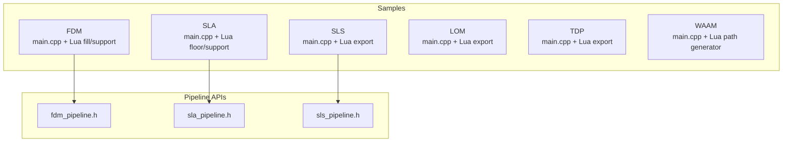
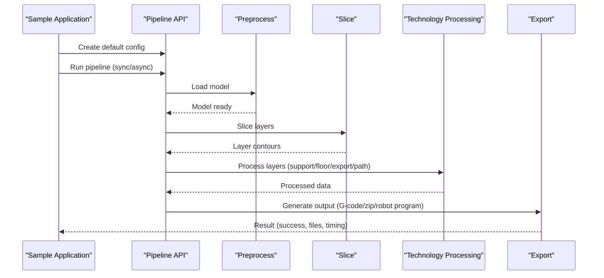
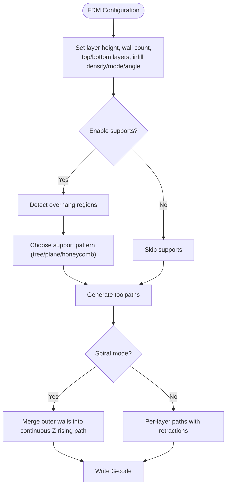
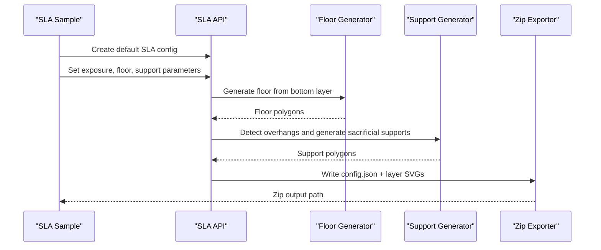
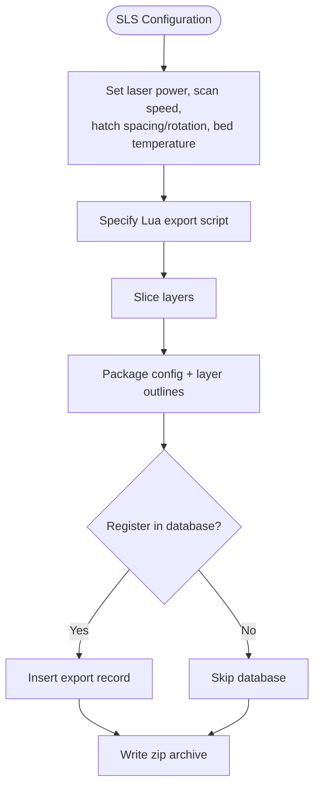
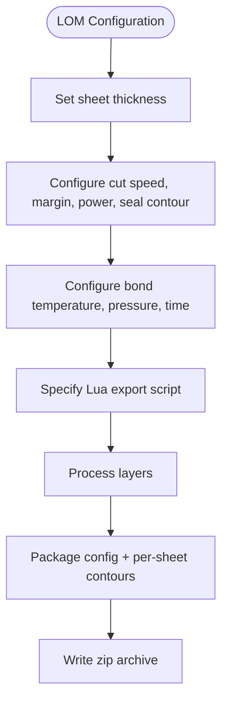
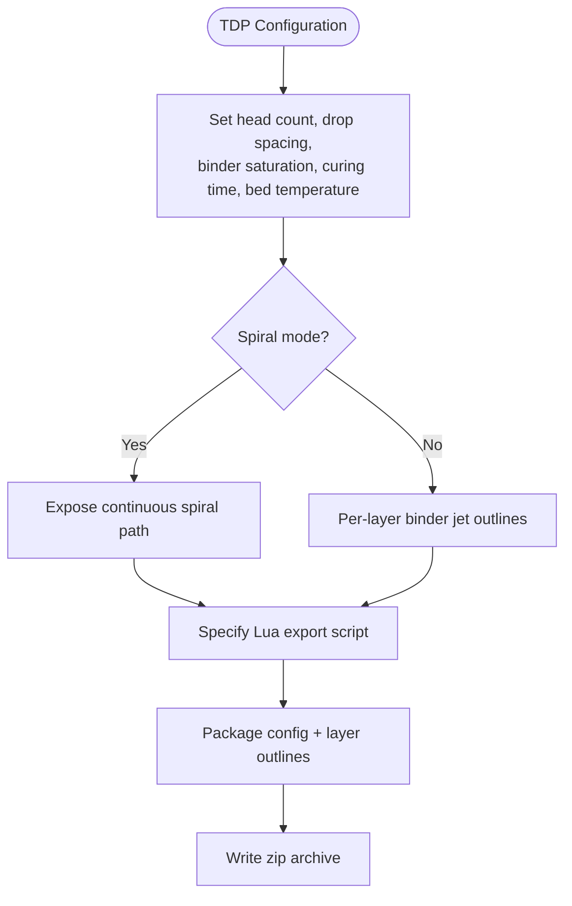
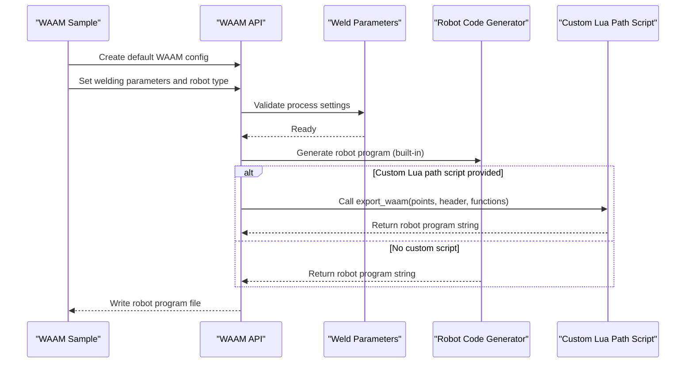
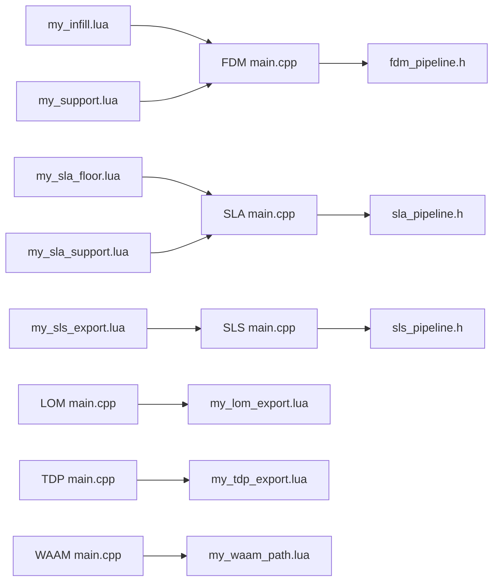

# Technology-Specific Samples

<cite>
**Referenced Files in This Document**
- [samples/FDM/main.cpp](file://samples/FDM/main.cpp)
- [samples/FDM/scripts/my_infill.lua](file://samples/FDM/scripts/my_infill.lua)
- [samples/FDM/scripts/my_support.lua](file://samples/FDM/scripts/my_support.lua)
- [DllHsBaSlicer/fdm_pipeline.h](file://DllHsBaSlicer/fdm_pipeline.h)
- [samples/SLA/main.cpp](file://samples/SLA/main.cpp)
- [samples/SLA/scripts/my_sla_floor.lua](file://samples/SLA/scripts/my_sla_floor.lua)
- [samples/SLA/scripts/my_sla_support.lua](file://samples/SLA/scripts/my_sla_support.lua)
- [DllHsBaSlicer/sla_pipeline.h](file://DllHsBaSlicer/sla_pipeline.h)
- [samples/SLS/main.cpp](file://samples/SLS/main.cpp)
- [samples/SLS/scripts/my_sls_export.lua](file://samples/SLS/scripts/my_sls_export.lua)
- [DllHsBaSlicer/sls_pipeline.h](file://DllHsBaSlicer/sls_pipeline.h)
- [samples/LOM/main.cpp](file://samples/LOM/main.cpp)
- [samples/LOM/scripts/my_lom_export.lua](file://samples/LOM/scripts/my_lom_export.lua)
- [samples/TDP/main.cpp](file://samples/TDP/main.cpp)
- [samples/TDP/scripts/my_tdp_export.lua](file://samples/TDP/scripts/my_tdp_export.lua)
- [samples/WAAM/main.cpp](file://samples/WAAM/main.cpp)
- [samples/WAAM/scripts/my_waam_path.lua](file://samples/WAAM/scripts/my_waam_path.lua)
</cite>

## Table of Contents
1. [Introduction](#introduction)
2. [Project Structure](#project-structure)
3. [Core Components](#core-components)
4. [Architecture Overview](#architecture-overview)
5. [Detailed Component Analysis](#detailed-component-analysis)
6. [Dependency Analysis](#dependency-analysis)
7. [Performance Considerations](#performance-considerations)
8. [Troubleshooting Guide](#troubleshooting-guide)
9. [Conclusion](#conclusion)

## Introduction
This document provides comprehensive, technology-specific samples for 3D printing workflows supported by the project. It covers Fused Deposition Modeling (FDM), Stereolithography (SLA), Selective Laser Sintering (SLS), Laminated Object Manufacturing (LOM), Three-Dimensional Printing / binder jetting (TDP), and Wire Arc Additive Manufacturing (WAAM). For each technology, it explains:
- How to configure and run the slicing pipeline synchronously or asynchronously
- Technology-specific parameter tuning and optimization strategies
- Output format customization through built-in exporters or Lua scripts
- Printer-specific considerations and material property integration where applicable

The goal is to help both new and experienced users quickly produce high-quality toolpaths and outputs tailored to their hardware and materials.

## Project Structure
The repository organizes technology-specific examples under a shared samples directory, with one folder per technology. Each example includes:
- A C++ main program demonstrating configuration and execution
- Optional Lua scripts for customizing fill/support generation or export behavior
- Pipeline headers defining the public C ABI for creating configurations and running pipelines

**Diagram sources**
- [samples/FDM/main.cpp:1-337](file://samples/FDM/main.cpp#L1-L337)
- [samples/SLA/main.cpp:1-259](file://samples/SLA/main.cpp#L1-L259)
- [samples/SLS/main.cpp:1-209](file://samples/SLS/main.cpp#L1-L209)
- [samples/LOM/main.cpp:1-194](file://samples/LOM/main.cpp#L1-L194)
- [samples/TDP/main.cpp:1-225](file://samples/TDP/main.cpp#L1-L225)
- [samples/WAAM/main.cpp:1-237](file://samples/WAAM/main.cpp#L1-L237)
- [DllHsBaSlicer/fdm_pipeline.h:1-68](file://DllHsBaSlicer/fdm_pipeline.h#L1-L68)
- [DllHsBaSlicer/sla_pipeline.h:1-63](file://DllHsBaSlicer/sla_pipeline.h#L1-L63)
- [DllHsBaSlicer/sls_pipeline.h:1-63](file://DllHsBaSlicer/sls_pipeline.h#L1-L63)

**Section sources**
- [samples/FDM/main.cpp:1-337](file://samples/FDM/main.cpp#L1-L337)
- [samples/SLA/main.cpp:1-259](file://samples/SLA/main.cpp#L1-L259)
- [samples/SLS/main.cpp:1-209](file://samples/SLS/main.cpp#L1-L209)
- [samples/LOM/main.cpp:1-194](file://samples/LOM/main.cpp#L1-L194)
- [samples/TDP/main.cpp:1-225](file://samples/TDP/main.cpp#L1-L225)
- [samples/WAAM/main.cpp:1-237](file://samples/WAAM/main.cpp#L1-L237)
- [DllHsBaSlicer/fdm_pipeline.h:1-68](file://DllHsBaSlicer/fdm_pipeline.h#L1-L68)
- [DllHsBaSlicer/sla_pipeline.h:1-63](file://DllHsBaSlicer/sla_pipeline.h#L1-L63)
- [DllHsBaSlicer/sls_pipeline.h:1-63](file://DllHsBaSlicer/sls_pipeline.h#L1-L63)

## Core Components
Each technology has a dedicated pipeline API and sample application that demonstrates:
- Creating default configuration structures
- Setting model inputs and output paths
- Configuring process parameters (layer height, exposure/laser/binder/welding settings)
- Running the pipeline synchronously or asynchronously
- Handling results and freeing allocated memory

Key entry points:
- FDM: HsBaCreateDefaultConfig, HsBaRunFdmPipeline, HsBaRunFdmPipelineAsync, HsBaFreePipelineResult
- SLA: HsBaCreateDefaultSlaConfig, HsBaRunSlaPipeline, HsBaRunSlaPipelineAsync, HsBaFreeSlaPipelineResult
- SLS: HsBaCreateDefaultSlsConfig, HsBaRunSlsPipeline, HsBaRunSlsPipelineAsync, HsBaFreeSlsPipelineResult

These APIs encapsulate preprocessing, slicing, support/floor generation, path planning, and export steps.

**Section sources**
- [samples/FDM/main.cpp:50-96](file://samples/FDM/main.cpp#L50-L96)
- [samples/SLA/main.cpp:49-84](file://samples/SLA/main.cpp#L49-L84)
- [samples/SLS/main.cpp:53-92](file://samples/SLS/main.cpp#L53-L92)
- [DllHsBaSlicer/fdm_pipeline.h:17-61](file://DllHsBaSlicer/fdm_pipeline.h#L17-L61)
- [DllHsBaSlicer/sla_pipeline.h:17-56](file://DllHsBaSlicer/sla_pipeline.h#L17-L56)
- [DllHsBaSlicer/sls_pipeline.h:17-56](file://DllHsBaSlicer/sls_pipeline.h#L17-L56)

## Architecture Overview
The pipelines follow a consistent architecture:
- Preprocess: Load and prepare the CAD model
- Slice: Generate layer contours
- Technology-specific processing:
  - FDM: Support detection/generation, infill generation, path planning
  - SLA: Floor/raft generation, sacrificial support generation, export to zip (config JSON + layer SVGs)
  - SLS/LOM/TDP: Export driven by Lua scripts (zip archive + optional database registration)
  - WAAM: Robot code generation (ABB/KUKA/FANUC) or custom Lua path generator

**Diagram sources**
- [samples/FDM/main.cpp:50-96](file://samples/FDM/main.cpp#L50-L96)
- [samples/SLA/main.cpp:49-84](file://samples/SLA/main.cpp#L49-L84)
- [samples/SLS/main.cpp:53-92](file://samples/SLS/main.cpp#L53-L92)
- [samples/LOM/main.cpp:52-82](file://samples/LOM/main.cpp#L52-L82)
- [samples/TDP/main.cpp:52-82](file://samples/TDP/main.cpp#L52-L82)
- [samples/WAAM/main.cpp:51-81](file://samples/WAAM/main.cpp#L51-L81)
- [DllHsBaSlicer/fdm_pipeline.h:23-35](file://DllHsBaSlicer/fdm_pipeline.h#L23-L35)
- [DllHsBaSlicer/sla_pipeline.h:23-34](file://DllHsBaSlicer/sla_pipeline.h#L23-L34)
- [DllHsBaSlicer/sls_pipeline.h:23-34](file://DllHsBaSlicer/sls_pipeline.h#L23-L34)

## Detailed Component Analysis

### FDM: Infill Patterns and Support Structures
FDM supports configurable infill patterns and support structures via built-in options or Lua scripts. The sample demonstrates:
- Basic usage with default configuration
- Custom process parameters (layer height, wall count, top/bottom layers, infill density, fill mode/angle)
- Support generation using tree pattern and overhang angle threshold
- Spiral/vase mode for continuous outer-wall deposition without per-layer retraction
- Asynchronous execution with completion callback

Parameter tuning highlights:
- Fill spacing and angle control infill density and strength
- Wall count affects surface quality and stiffness
- Top/bottom layer counts improve printability and surface finish
- Overhang angle determines when supports are needed
- Spiral mode merges outer walls into a single rising path

Output: G-code file containing extrusion paths.

**Diagram sources**
- [samples/FDM/main.cpp:98-165](file://samples/FDM/main.cpp#L98-L165)
- [samples/FDM/main.cpp:271-318](file://samples/FDM/main.cpp#L271-L318)
- [samples/FDM/scripts/my_support.lua:32-79](file://samples/FDM/scripts/my_support.lua#L32-L79)
- [samples/FDM/scripts/my_infill.lua:20-87](file://samples/FDM/scripts/my_infill.lua#L20-L87)

**Section sources**
- [samples/FDM/main.cpp:50-96](file://samples/FDM/main.cpp#L50-L96)
- [samples/FDM/main.cpp:98-165](file://samples/FDM/main.cpp#L98-L165)
- [samples/FDM/main.cpp:167-220](file://samples/FDM/main.cpp#L167-L220)
- [samples/FDM/main.cpp:271-318](file://samples/FDM/main.cpp#L271-L318)
- [samples/FDM/scripts/my_infill.lua:1-89](file://samples/FDM/scripts/my_infill.lua#L1-L89)
- [samples/FDM/scripts/my_support.lua:1-83](file://samples/FDM/scripts/my_support.lua#L1-L83)
- [DllHsBaSlicer/fdm_pipeline.h:23-35](file://DllHsBaSlicer/fdm_pipeline.h#L23-L35)

### SLA: Floor Generation and Sacrificial Supports
SLA workflow focuses on resin curing parameters, floor/raft generation, and sacrificial supports. The sample demonstrates:
- Basic usage producing a zip archive with config JSON and layer SVGs
- Custom exposure parameters (bottom/normal exposure time, lift/retract speeds)
- Floor/raft configuration (offset, border width, fill spacing, convex hull)
- Support generation using sacrificial pattern and gap/density controls
- Lua customization for floor and support generation

Parameter tuning highlights:
- Bottom exposure time ensures adhesion to build plate
- Normal exposure time balances detail and speed
- Lift distance/speed affect peel forces and failure rates
- Floor raft offset and border width improve bed adhesion
- Support gap and diameter tune printability vs. post-processing effort

Output: Zip archive containing configuration and per-layer SVG images.

**Diagram sources**
- [samples/SLA/main.cpp:86-144](file://samples/SLA/main.cpp#L86-L144)
- [samples/SLA/scripts/my_sla_floor.lua:35-62](file://samples/SLA/scripts/my_sla_floor.lua#L35-L62)
- [samples/SLA/scripts/my_sla_support.lua:34-72](file://samples/SLA/scripts/my_sla_support.lua#L34-L72)
- [DllHsBaSlicer/sla_pipeline.h:23-34](file://DllHsBaSlicer/sla_pipeline.h#L23-L34)

**Section sources**
- [samples/SLA/main.cpp:49-84](file://samples/SLA/main.cpp#L49-L84)
- [samples/SLA/main.cpp:86-144](file://samples/SLA/main.cpp#L86-L144)
- [samples/SLA/main.cpp:146-191](file://samples/SLA/main.cpp#L146-L191)
- [samples/SLA/scripts/my_sla_floor.lua:1-64](file://samples/SLA/scripts/my_sla_floor.lua#L1-L64)
- [samples/SLA/scripts/my_sla_support.lua:1-76](file://samples/SLA/scripts/my_sla_support.lua#L1-L76)
- [DllHsBaSlicer/sla_pipeline.h:23-34](file://DllHsBaSlicer/sla_pipeline.h#L23-L34)

### SLS: Export Configurations
SLS uses powder bed fusion with no floor or supports required. The sample demonstrates:
- Minimal configuration with Lua-driven export
- Custom laser parameters (power, scan speed, hatch spacing/rotation, bed temperature)
- Async execution

Parameter tuning highlights:
- Hatch spacing controls part density and mechanical properties
- Hatch rotation reduces anisotropy between layers
- Bed temperature influences sintering quality and warpage
- Laser power and scan speed balance energy input and resolution

Output: Zip archive generated by Lua script, optionally including database registration.

**Diagram sources**
- [samples/SLS/main.cpp:94-140](file://samples/SLS/main.cpp#L94-L140)
- [samples/SLS/scripts/my_sls_export.lua:23-76](file://samples/SLS/scripts/my_sls_export.lua#L23-L76)
- [DllHsBaSlicer/sls_pipeline.h:23-34](file://DllHsBaSlicer/sls_pipeline.h#L23-L34)

**Section sources**
- [samples/SLS/main.cpp:53-92](file://samples/SLS/main.cpp#L53-L92)
- [samples/SLS/main.cpp:94-140](file://samples/SLS/main.cpp#L94-L140)
- [samples/SLS/scripts/my_sls_export.lua:1-80](file://samples/SLS/scripts/my_sls_export.lua#L1-L80)
- [DllHsBaSlicer/sls_pipeline.h:23-34](file://DllHsBaSlicer/sls_pipeline.h#L23-L34)

### LOM: Layer Processing
LOM bonds sheets and cuts contours per layer. The sample demonstrates:
- Minimal configuration with Lua-driven export
- Cut parameters (speed, margin, power, seal contour, cut mode)
- Bond parameters (temperature, pressure, time)
- Async execution

Parameter tuning highlights:
- Cut margin compensates for kerf and alignment tolerances
- Seal contour improves edge quality and prevents delamination
- Bond temperature/pressure/time must match sheet material specifications

Output: Zip archive generated by Lua script, optionally including database registration.

**Diagram sources**
- [samples/LOM/main.cpp:84-130](file://samples/LOM/main.cpp#L84-L130)
- [samples/LOM/scripts/my_lom_export.lua:10-54](file://samples/LOM/scripts/my_lom_export.lua#L10-L54)

**Section sources**
- [samples/LOM/main.cpp:52-82](file://samples/LOM/main.cpp#L52-L82)
- [samples/LOM/main.cpp:84-130](file://samples/LOM/main.cpp#L84-L130)
- [samples/LOM/scripts/my_lom_export.lua:1-58](file://samples/LOM/scripts/my_lom_export.lua#L1-L58)

### TDP: Thermal Deposition (Binder Jetting)
TDP jets binder onto a powder bed. The sample demonstrates:
- Minimal configuration with Lua-driven export
- Head/drop/binder/curing parameters (head count, drop spacing, saturation, curing time, bed temperature, binder mode)
- Spiral mode for continuous rising deposition path
- Async execution

Parameter tuning highlights:
- Drop spacing controls binder placement resolution
- Binder saturation affects green part strength
- Curing time impacts drying and interlayer bonding
- Spiral mode can reduce start/stop events and improve surface continuity

Output: Zip archive generated by Lua script, optionally including database registration.

**Diagram sources**
- [samples/TDP/main.cpp:84-125](file://samples/TDP/main.cpp#L84-L125)
- [samples/TDP/main.cpp:173-205](file://samples/TDP/main.cpp#L173-L205)
- [samples/TDP/scripts/my_tdp_export.lua:15-59](file://samples/TDP/scripts/my_tdp_export.lua#L15-L59)

**Section sources**
- [samples/TDP/main.cpp:52-82](file://samples/TDP/main.cpp#L52-L82)
- [samples/TDP/main.cpp:84-125](file://samples/TDP/main.cpp#L84-L125)
- [samples/TDP/main.cpp:173-205](file://samples/TDP/main.cpp#L173-L205)
- [samples/TDP/scripts/my_tdp_export.lua:1-63](file://samples/TDP/scripts/my_tdp_export.lua#L1-L63)

### WAAM: Wire Arc Manufacturing
WAAM deposits metal bead-by-bead along contours using a robot. The sample demonstrates:
- Built-in robot code generation (ABB/KUKA/FANUC)
- Custom welding parameters (material, process type, shielding gas, arc current/voltage, wire feed speed, gas flow rate, interpass temperature)
- Custom Lua path generator to replace brand-specific code
- Spiral mode for continuous rising weld bead

Parameter tuning highlights:
- Bead width and layer height determine cross-section and build rate
- Arc current/voltage and wire feed speed control heat input and deposition rate
- Shielding gas selection and flow rate protect the weld pool
- Interpass temperature manages thermal cycling and microstructure
- Spiral mode reduces arc restarts and travel moves between layers

Output: Robot language program text file (or custom Lua-generated string).

**Diagram sources**
- [samples/WAAM/main.cpp:83-131](file://samples/WAAM/main.cpp#L83-L131)
- [samples/WAAM/main.cpp:133-178](file://samples/WAAM/main.cpp#L133-L178)
- [samples/WAAM/scripts/my_waam_path.lua:17-42](file://samples/WAAM/scripts/my_waam_path.lua#L17-L42)

**Section sources**
- [samples/WAAM/main.cpp:51-81](file://samples/WAAM/main.cpp#L51-L81)
- [samples/WAAM/main.cpp:83-131](file://samples/WAAM/main.cpp#L83-L131)
- [samples/WAAM/main.cpp:133-178](file://samples/WAAM/main.cpp#L133-L178)
- [samples/WAAM/main.cpp:180-217](file://samples/WAAM/main.cpp#L180-L217)
- [samples/WAAM/scripts/my_waam_path.lua:1-46](file://samples/WAAM/scripts/my_waam_path.lua#L1-L46)

## Dependency Analysis
The following diagram shows how sample applications depend on pipeline APIs and Lua scripts:

**Diagram sources**
- [samples/FDM/main.cpp:1-337](file://samples/FDM/main.cpp#L1-L337)
- [samples/FDM/scripts/my_infill.lua:1-89](file://samples/FDM/scripts/my_infill.lua#L1-L89)
- [samples/FDM/scripts/my_support.lua:1-83](file://samples/FDM/scripts/my_support.lua#L1-L83)
- [samples/SLA/main.cpp:1-259](file://samples/SLA/main.cpp#L1-L259)
- [samples/SLA/scripts/my_sla_floor.lua:1-64](file://samples/SLA/scripts/my_sla_floor.lua#L1-L64)
- [samples/SLA/scripts/my_sla_support.lua:1-76](file://samples/SLA/scripts/my_sla_support.lua#L1-L76)
- [samples/SLS/main.cpp:1-209](file://samples/SLS/main.cpp#L1-L209)
- [samples/SLS/scripts/my_sls_export.lua:1-80](file://samples/SLS/scripts/my_sls_export.lua#L1-L80)
- [samples/LOM/main.cpp:1-194](file://samples/LOM/main.cpp#L1-L194)
- [samples/LOM/scripts/my_lom_export.lua:1-58](file://samples/LOM/scripts/my_lom_export.lua#L1-L58)
- [samples/TDP/main.cpp:1-225](file://samples/TDP/main.cpp#L1-L225)
- [samples/TDP/scripts/my_tdp_export.lua:1-63](file://samples/TDP/scripts/my_tdp_export.lua#L1-L63)
- [samples/WAAM/main.cpp:1-237](file://samples/WAAM/main.cpp#L1-L237)
- [samples/WAAM/scripts/my_waam_path.lua:1-46](file://samples/WAAM/scripts/my_waam_path.lua#L1-L46)
- [DllHsBaSlicer/fdm_pipeline.h:1-68](file://DllHsBaSlicer/fdm_pipeline.h#L1-L68)
- [DllHsBaSlicer/sla_pipeline.h:1-63](file://DllHsBaSlicer/sla_pipeline.h#L1-L63)
- [DllHsBaSlicer/sls_pipeline.h:1-63](file://DllHsBaSlicer/sls_pipeline.h#L1-L63)

**Section sources**
- [samples/FDM/main.cpp:1-337](file://samples/FDM/main.cpp#L1-L337)
- [samples/SLA/main.cpp:1-259](file://samples/SLA/main.cpp#L1-L259)
- [samples/SLS/main.cpp:1-209](file://samples/SLS/main.cpp#L1-L209)
- [samples/LOM/main.cpp:1-194](file://samples/LOM/main.cpp#L1-L194)
- [samples/TDP/main.cpp:1-225](file://samples/TDP/main.cpp#L1-L225)
- [samples/WAAM/main.cpp:1-237](file://samples/WAAM/main.cpp#L1-L237)
- [DllHsBaSlicer/fdm_pipeline.h:1-68](file://DllHsBaSlicer/fdm_pipeline.h#L1-L68)
- [DllHsBaSlicer/sla_pipeline.h:1-63](file://DllHsBaSlicer/sla_pipeline.h#L1-L63)
- [DllHsBaSlicer/sls_pipeline.h:1-63](file://DllHsBaSlicer/sls_pipeline.h#L1-L63)

## Performance Considerations
- Use asynchronous pipeline execution to avoid blocking the UI thread and to enable background processing
- Tune layer height and line width to balance resolution and print time
- Reduce infill density and use efficient patterns (zigzag/line) for faster prints while maintaining structural integrity
- Enable spiral mode for continuous deposition processes (FDM/TDP/WAAM) to minimize start/stop events and travel moves
- Optimize support structures by adjusting gap, diameter, and density to reduce material usage and post-processing time
- For SLA, adjust exposure times and lift speeds to prevent peel failures and reduce cycle time
- For SLS/LOM/TDP, ensure export scripts efficiently package data and avoid unnecessary I/O operations

[No sources needed since this section provides general guidance]

## Troubleshooting Guide
Common issues and resolutions:
- Pipeline returns failure: Check model path validity, output directory permissions, and Lua script paths
- Incorrect layer heights or poor adhesion: Adjust first layer height and exposure/bonding parameters
- Excessive supports or weak overhangs: Lower overhang angle threshold and increase support density
- Poor surface finish: Increase wall count, reduce infill spacing, or enable spiral mode where appropriate
- Export errors: Ensure Lua export scripts return the expected structure (table for zip exports; string for WAAM path scripts)
- Database registration skipped: Non-fatal warnings indicate missing dependencies; verify SQLite availability if used

**Section sources**
- [samples/SLS/scripts/my_sls_export.lua:50-71](file://samples/SLS/scripts/my_sls_export.lua#L50-L71)
- [samples/LOM/scripts/my_lom_export.lua:30-49](file://samples/LOM/scripts/my_lom_export.lua#L30-L49)
- [samples/TDP/scripts/my_tdp_export.lua:35-54](file://samples/TDP/scripts/my_tdp_export.lua#L35-L54)

## Conclusion
This guide presented technology-specific samples for FDM, SLA, SLS, LOM, TDP, and WAAM. By leveraging the provided pipeline APIs and Lua customization hooks, users can fine-tune process parameters, optimize performance, and customize outputs to match their printers and materials. Adopting asynchronous execution, spiral modes, and well-calibrated support/floor strategies will yield reliable, efficient, and high-quality results across all supported technologies.

[No sources needed since this section summarizes without analyzing specific files]