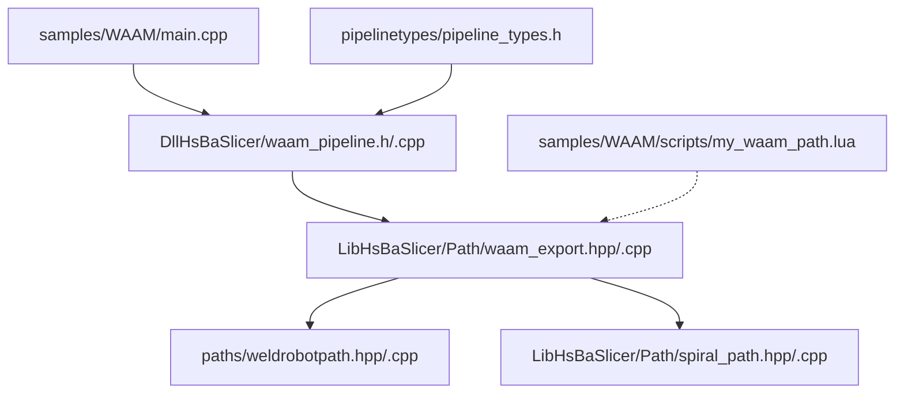
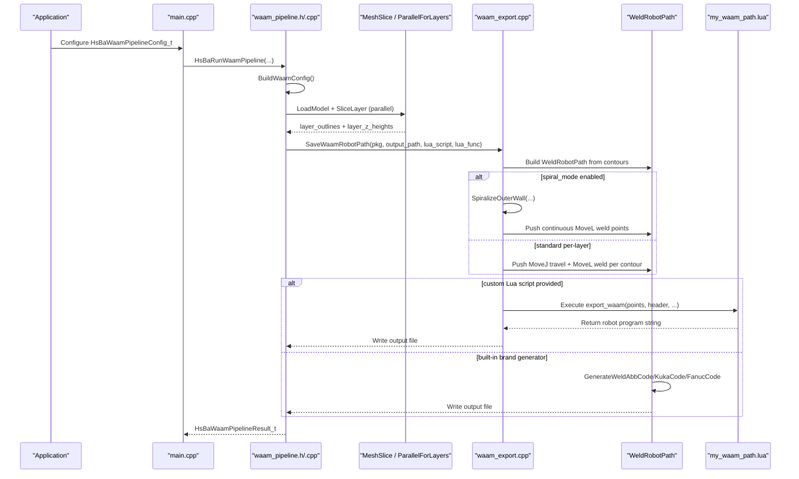
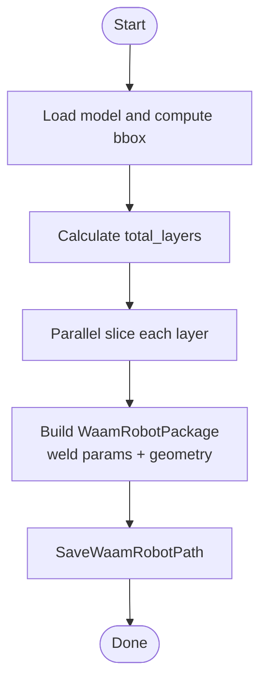
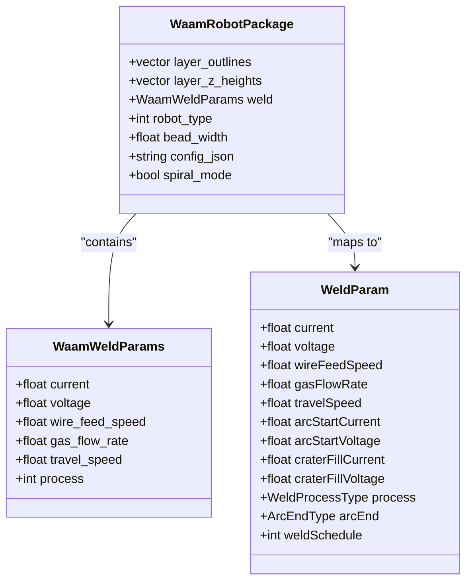
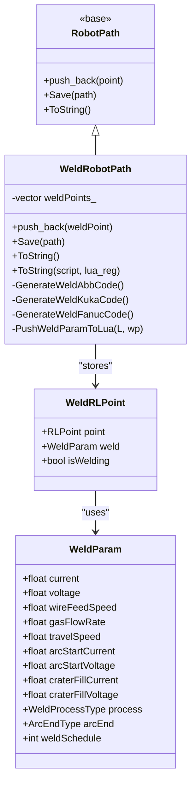
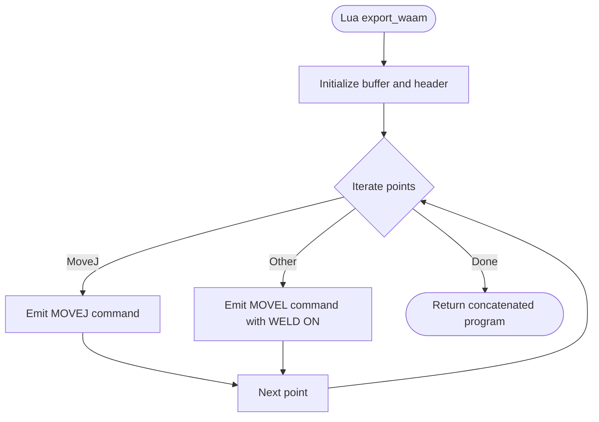
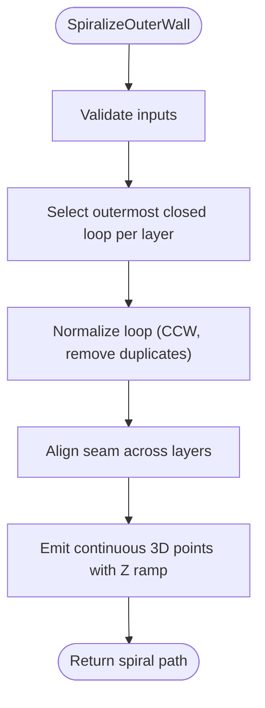
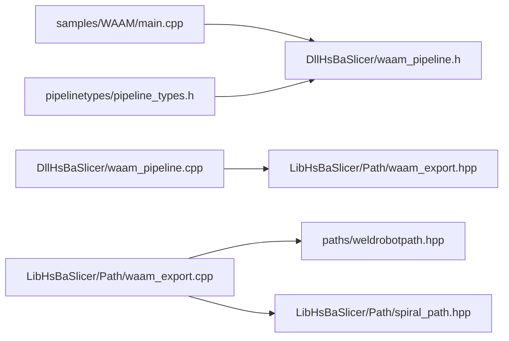

# WAAM (Wire Arc Additive Manufacturing) Samples

<cite>
**Referenced Files in This Document**   
- [main.cpp](file://samples/WAAM/main.cpp)
- [my_waam_path.lua](file://samples/WAAM/scripts/my_waam_path.lua)
- [waam_pipeline.h](file://DllHsBaSlicer/waam_pipeline.h)
- [waam_pipeline.cpp](file://DllHsBaSlicer/waam_pipeline.cpp)
- [pipeline_types.h](file://pipelinetypes/pipeline_types.h)
- [waam_export.hpp](file://LibHsBaSlicer/Path/waam_export.hpp)
- [waam_export.cpp](file://LibHsBaSlicer/Path/waam_export.cpp)
- [weldrobotpath.hpp](file://paths/weldrobotpath.hpp)
- [weldrobotpath.cpp](file://paths/weldrobotpath.cpp)
- [spiral_path.hpp](file://LibHsBaSlicer/Path/spiral_path.hpp)
- [spiral_path.cpp](file://LibHsBaSlicer/Path/spiral_path.cpp)
</cite>

## Table of Contents
1. [Introduction](#introduction)
2. [Project Structure](#project-structure)
3. [Core Components](#core-components)
4. [Architecture Overview](#architecture-overview)
5. [Detailed Component Analysis](#detailed-component-analysis)
6. [Dependency Analysis](#dependency-analysis)
7. [Performance Considerations](#performance-considerations)
8. [Troubleshooting Guide](#troubleshooting-guide)
9. [Conclusion](#conclusion)
10. [Appendices](#appendices)

## Introduction
This document provides comprehensive, WAAM-specific samples documentation for the HsBaSlicer repository. It explains how to configure and run the WAAM slicing pipeline from the sample entry point, how welding parameters are integrated into path generation, and how robot programs are produced for ABB, KUKA, and FANUC controllers. It also documents the optional Lua-based custom path generator, spiral/vase mode continuous bead generation, and the data structures that carry welding parameters through the pipeline.

WAAM is modeled as a robot-based deposition process: metal is deposited bead-by-bead along per-layer contours, and the output is a robot language program rather than a layer archive. The system supports both built-in brand-specific code generators and fully custom Lua-generated robot programs.

## Project Structure
The WAAM samples live under `samples/WAAM`, with supporting implementation spread across the Dll and Lib layers:

- Sample entry point: `samples/WAAM/main.cpp`
- Custom Lua path script: `samples/WAAM/scripts/my_waam_path.lua`
- C ABI for WAAM pipeline: `DllHsBaSlicer/waam_pipeline.{h,cpp}`
- Pipeline types and enums: `pipelinetypes/pipeline_types.h`
- WAAM export package and save API: `LibHsBaSlicer/Path/waam_export.{hpp,cpp}`
- Welding-aware robot path and brand code generation: `paths/weldrobotpath.{hpp,cpp}`
- Spiralized outer-wall path generation: `LibHsBaSlicer/Path/spiral_path.{hpp,cpp}`

**Diagram sources**
- [main.cpp:1-237](file://samples/WAAM/main.cpp#L1-L237)
- [waam_pipeline.h:1-64](file://DllHsBaSlicer/waam_pipeline.h#L1-L64)
- [waam_pipeline.cpp:1-322](file://DllHsBaSlicer/waam_pipeline.cpp#L1-L322)
- [waam_export.hpp:1-77](file://LibHsBaSlicer/Path/waam_export.hpp#L1-L77)
- [waam_export.cpp:1-179](file://LibHsBaSlicer/Path/waam_export.cpp#L1-L179)
- [weldrobotpath.hpp:1-100](file://paths/weldrobotpath.hpp#L1-L100)
- [weldrobotpath.cpp:1-479](file://paths/weldrobotpath.cpp#L1-L479)
- [spiral_path.hpp:1-63](file://LibHsBaSlicer/Path/spiral_path.hpp#L1-L63)
- [spiral_path.cpp:1-167](file://LibHsBaSlicer/Path/spiral_path.cpp#L1-L167)

**Section sources**
- [main.cpp:1-237](file://samples/WAAM/main.cpp#L1-L237)
- [waam_pipeline.h:1-64](file://DllHsBaSlicer/waam_pipeline.h#L1-L64)
- [waam_pipeline.cpp:1-322](file://DllHsBaSlicer/waam_pipeline.cpp#L1-L322)
- [pipeline_types.h:523-625](file://pipelinetypes/pipeline_types.h#L523-L625)

## Core Components
- WAAM pipeline configuration and results are defined as C-compatible structs and enums in `pipeline_types.h`. These include material, welding process, protection method, shielding gas, travel speed, wire feed speed, arc current/voltage, gas flow rate, interpass temperature, robot type, and spiral mode.
- The C ABI exposes default config creation, synchronous and asynchronous pipeline execution, and result cleanup in `waam_pipeline.h` and `waam_pipeline.cpp`.
- The WAAM export package (`WaamRobotPackage`) carries per-layer outlines, Z heights, weld parameters, robot type, bead width, optional JSON sidecar, and spiral mode flag.
- `WeldRobotPath` extends the base robot path class to support welding parameters per point and generates brand-specific robot code for ABB, KUKA, and FANUC.
- Spiral path generation produces a continuous 3D polyline by selecting the outermost closed contour per layer and ramping Z continuously between layers.

Key responsibilities:
- `main.cpp`: Demonstrates basic, custom-parameter, async, and spiral modes.
- `waam_pipeline.*`: Orchestrates model loading, slicing, parallel layer processing, and robot path export.
- `waam_export.*`: Builds `WeldRobotPath` from layer contours and writes robot code or delegates to a Lua script.
- `weldrobotpath.*`: Generates ABB/KUKA/FANUC welding instructions and exposes points + weld parameters to Lua.
- `spiral_path.*`: Computes continuous helical outer-wall paths for vase/spiral mode.

**Section sources**
- [pipeline_types.h:523-625](file://pipelinetypes/pipeline_types.h#L523-L625)
- [waam_pipeline.h:1-64](file://DllHsBaSlicer/waam_pipeline.h#L1-L64)
- [waam_pipeline.cpp:26-59](file://DllHsBaSlicer/waam_pipeline.cpp#L26-L59)
- [waam_export.hpp:17-72](file://LibHsBaSlicer/Path/waam_export.hpp#L17-L72)
- [weldrobotpath.hpp:16-96](file://paths/weldrobotpath.hpp#L16-L96)
- [spiral_path.hpp:16-58](file://LibHsBaSlicer/Path/spiral_path.hpp#L16-L58)

## Architecture Overview
The WAAM pipeline follows a three-stage flow: preprocess, slice, and robot path export. Slicing runs in parallel per layer. The export stage builds a `WeldRobotPath` from per-layer contours and either uses built-in brand generators or a custom Lua script.

**Diagram sources**
- [main.cpp:54-217](file://samples/WAAM/main.cpp#L54-L217)
- [waam_pipeline.cpp:168-277](file://DllHsBaSlicer/waam_pipeline.cpp#L168-L277)
- [waam_export.cpp:61-179](file://LibHsBaSlicer/Path/waam_export.cpp#L61-L179)
- [weldrobotpath.cpp:79-101](file://paths/weldrobotpath.cpp#L79-L101)
- [spiral_path.cpp:88-163](file://LibHsBaSlicer/Path/spiral_path.cpp#L88-L163)

## Detailed Component Analysis

### WAAM Configuration and Examples in main.cpp
`main.cpp` demonstrates four usage patterns:
- Basic ABB robot program generation using defaults.
- Custom welding parameters with KUKA robot.
- Asynchronous pipeline execution with a custom Lua path generator.
- Spiral mode producing one continuous rising bead.

Important configuration fields demonstrated:
- Geometry: `layer_height`, `first_layer_height`, `bead_width`, `travel_speed`.
- Welding: `material`, `welding_process`, `protection`, `protect_gas`, `arc_current`, `arc_voltage`, `wire_feed_speed`, `gas_flow_rate`, `interpass_temperature`.
- Output: `robot_type`, `path_lua_script`, `path_lua_func`, `output_path`, `spiral_mode`.

Error handling and progress callbacks are shown via `OnProgress` and result inspection.

**Section sources**
- [main.cpp:54-81](file://samples/WAAM/main.cpp#L54-L81)
- [main.cpp:86-131](file://samples/WAAM/main.cpp#L86-L131)
- [main.cpp:155-178](file://samples/WAAM/main.cpp#L155-L178)
- [main.cpp:183-217](file://samples/WAAM/main.cpp#L183-L217)

### WAAM Pipeline C ABI and Orchestration
`waam_pipeline.h` defines the public C interface:
- Default config creation
- Synchronous and asynchronous execution
- Result memory management

`waam_pipeline.cpp` implements:
- Internal config/result structures
- Layer count calculation and Z height computation
- Progress reporting
- Full pipeline orchestration:
  - Model loading and info retrieval
  - Parallel slicing per layer
  - Building `WaamRobotPackage` with weld parameters
  - Calling `SaveWaamRobotPath`
  - Error propagation and timing

**Diagram sources**
- [waam_pipeline.cpp:98-122](file://DllHsBaSlicer/waam_pipeline.cpp#L98-L122)
- [waam_pipeline.cpp:168-277](file://DllHsBaSlicer/waam_pipeline.cpp#L168-L277)

**Section sources**
- [waam_pipeline.h:17-57](file://DllHsBaSlicer/waam_pipeline.h#L17-L57)
- [waam_pipeline.cpp:26-59](file://DllHsBaSlicer/waam_pipeline.cpp#L26-L59)
- [waam_pipeline.cpp:98-122](file://DllHsBaSlicer/waam_pipeline.cpp#L98-L122)
- [waam_pipeline.cpp:168-277](file://DllHsBaSlicer/waam_pipeline.cpp#L168-L277)

### WAAM Export Package and Robot Path Generation
`waam_export.hpp` defines:
- `WaamWeldParams`: current, voltage, wire feed speed, gas flow rate, travel speed, process type.
- `WaamRobotPackage`: layer outlines, Z heights, weld params, robot type, bead width, optional JSON, spiral mode.
- `SaveWaamRobotPath`: exports robot program, optionally post-processed by a Lua script.

`waam_export.cpp` implements:
- Mapping C ABI robot type and welding process to internal enums.
- Building `WeldParam` from `WaamWeldParams`.
- Spiral mode logic:
  - Calls `SpiralizeOuterWall` to generate a continuous 3D path.
  - Adds initial rapid move and then continuous `MoveL` weld points.
- Standard per-layer logic:
  - Adds `MoveJ` travel to contour start.
  - Adds `MoveL` weld points along each contour vertex.
- Saves to file, optionally invoking Lua script.

**Diagram sources**
- [waam_export.hpp:17-72](file://LibHsBaSlicer/Path/waam_export.hpp#L17-L72)
- [weldrobotpath.hpp:34-49](file://paths/weldrobotpath.hpp#L34-L49)

**Section sources**
- [waam_export.hpp:17-72](file://LibHsBaSlicer/Path/waam_export.hpp#L17-L72)
- [waam_export.cpp:21-57](file://LibHsBaSlicer/Path/waam_export.cpp#L21-L57)
- [waam_export.cpp:61-179](file://LibHsBaSlicer/Path/waam_export.cpp#L61-L179)

### Welding Robot Path and Brand Code Generation
`weldrobotpath.hpp` defines:
- `WeldProcessType`: MIG/MAG, TIG, Plasma, Laser.
- `ArcEndType`: Normal, CraterFill, SlowRetract.
- `WeldParam`: detailed welding parameters including start and crater fill settings.
- `WeldRLPoint`: base RL point plus weld parameters and welding flag.
- `WeldRobotPath`: manages weld points and generates brand-specific code.

`weldrobotpath.cpp` implements:
- String conversion helpers for process and arc end types.
- Saving to file and converting to string.
- Lua integration:
  - Exposes `header`, `points` array with `end`, `middle`, `velocity`, `type`, `isWelding`, and nested `weld` table.
  - Executes user script and returns generated robot program text.
- Brand generators:
  - ABB: Arc start/end, continuous `ArcL`, movement commands.
  - KUKA: ARC_Init, ARC_SetWeldParam, ARC_On/Off, crater fill.
  - FANUC: ARC START/END with schedules and motion lines.

**Diagram sources**
- [weldrobotpath.hpp:16-96](file://paths/weldrobotpath.hpp#L16-L96)
- [weldrobotpath.cpp:79-101](file://paths/weldrobotpath.cpp#L79-L101)
- [weldrobotpath.cpp:103-190](file://paths/weldrobotpath.cpp#L103-L190)
- [weldrobotpath.cpp:221-301](file://paths/weldrobotpath.cpp#L221-L301)
- [weldrobotpath.cpp:303-390](file://paths/weldrobotpath.cpp#L303-L390)
- [weldrobotpath.cpp:392-477](file://paths/weldrobotpath.cpp#L392-L477)

**Section sources**
- [weldrobotpath.hpp:16-96](file://paths/weldrobotpath.hpp#L16-L96)
- [weldrobotpath.cpp:79-101](file://paths/weldrobotpath.cpp#L79-L101)
- [weldrobotpath.cpp:103-190](file://paths/weldrobotpath.cpp#L103-L190)
- [weldrobotpath.cpp:221-301](file://paths/weldrobotpath.cpp#L221-L301)
- [weldrobotpath.cpp:303-390](file://paths/weldrobotpath.cpp#L303-L390)
- [weldrobotpath.cpp:392-477](file://paths/weldrobotpath.cpp#L392-L477)

### Custom Lua Path Generator: my_waam_path.lua
The sample Lua script demonstrates how to generate a custom robot program from the global `points` array. Each point includes:
- `end` position `{x,y,z}`
- `middle` position `{x,y,z}`
- `velocity`
- `type` (e.g., `MoveJ`, `MoveL`)
- `isWelding`
- `weld` table with welding parameters exposed by `WeldRobotPath::PushWeldParamToLua`.

The script constructs a simple program header, iterates over points, and emits robot commands based on point type. It can be used to adapt output to proprietary robot languages or add machine-specific directives.

**Diagram sources**
- [my_waam_path.lua:17-45](file://samples/WAAM/scripts/my_waam_path.lua#L17-L45)
- [weldrobotpath.cpp:103-190](file://paths/weldrobotpath.cpp#L103-L190)

**Section sources**
- [my_waam_path.lua:1-46](file://samples/WAAM/scripts/my_waam_path.lua#L1-L46)
- [weldrobotpath.cpp:103-190](file://paths/weldrobotpath.cpp#L103-L190)

### Spiral/Vase Mode Continuous Bead Generation
Spiral mode merges the outer walls of all layers into one continuous, Z-rising weld bead. The algorithm:
- Selects the outermost closed contour per layer (largest signed area).
- Normalizes loops to CCW orientation and removes duplicate closing vertices.
- Aligns seams across layers by rotating the seam vertex closest to the previous layer’s seam.
- Emits a continuous polyline where Z ramps linearly from the current layer’s height to the next layer’s height; the top layer is traversed flat.

In `waam_export.cpp`, when spiral mode is enabled:
- A rapid `MoveJ` moves to the base of the helix.
- Subsequent points are emitted as continuous `MoveL` weld points with the base weld parameters.

**Diagram sources**
- [spiral_path.cpp:88-163](file://LibHsBaSlicer/Path/spiral_path.cpp#L88-L163)
- [waam_export.cpp:80-122](file://LibHsBaSlicer/Path/waam_export.cpp#L80-L122)

**Section sources**
- [spiral_path.hpp:16-58](file://LibHsBaSlicer/Path/spiral_path.hpp#L16-L58)
- [spiral_path.cpp:16-85](file://LibHsBaSlicer/Path/spiral_path.cpp#L16-L85)
- [spiral_path.cpp:88-163](file://LibHsBaSlicer/Path/spiral_path.cpp#L88-L163)
- [waam_export.cpp:80-122](file://LibHsBaSlicer/Path/waam_export.cpp#L80-L122)

## Dependency Analysis
The WAAM pipeline has clear separation of concerns:
- `main.cpp` depends on the C ABI (`waam_pipeline.h`).
- `waam_pipeline.cpp` depends on preprocessing, slicing, and export modules.
- `waam_export.cpp` depends on `WeldRobotPath` and spiral path generation.
- `weldrobotpath.cpp` depends on base robot path and Lua integration.
- `spiral_path.*` is independent but consumed by export.

**Diagram sources**
- [main.cpp:19-19](file://samples/WAAM/main.cpp#L19-L19)
- [waam_pipeline.cpp:16-21](file://DllHsBaSlicer/waam_pipeline.cpp#L16-L21)
- [waam_export.cpp:11-13](file://LibHsBaSlicer/Path/waam_export.cpp#L11-L13)
- [weldrobotpath.hpp:1-12](file://paths/weldrobotpath.hpp#L1-L12)
- [spiral_path.hpp:1-12](file://LibHsBaSlicer/Path/spiral_path.hpp#L1-L12)
- [pipeline_types.h:523-625](file://pipelinetypes/pipeline_types.h#L523-L625)

**Section sources**
- [waam_pipeline.cpp:16-21](file://DllHsBaSlicer/waam_pipeline.cpp#L16-L21)
- [waam_export.cpp:11-13](file://LibHsBaSlicer/Path/waam_export.cpp#L11-L13)

## Performance Considerations
- Parallel slicing: The pipeline uses `ParallelForLayers` to slice each layer independently, improving throughput for multi-layer models.
- Spiral mode reduces arc restarts and travel moves by generating a single continuous bead, which can improve surface quality and reduce thermal interruptions.
- Avoid excessive per-layer travel moves by enabling spiral mode when appropriate for prismatic or cylindrical geometries.
- Ensure adequate shielding gas flow and appropriate interpass temperature to maintain consistent heat input and avoid defects during long continuous beads.

[No sources needed since this section provides general guidance]

## Troubleshooting Guide
Common issues and resolutions:
- Invalid model height: If the model bounding box yields zero or negative height, the pipeline reports an error and skips processing. Verify model units and orientation.
- No layers in export package: If `layer_outlines` is empty, export fails. Ensure slicing produces valid per-layer contours.
- Unsupported robot type: Using an unknown robot type without a Lua script throws an error. Provide a supported robot type or supply a custom Lua path script.
- Lua script errors: Syntax or runtime errors in the custom Lua script will propagate as pipeline errors. Validate the script independently and ensure it returns a string.
- Spiral mode fallback: If no closed contours exist, spiral mode falls back to standard per-layer deposition. Check layer topology and ensure at least one closed contour per layer.

**Section sources**
- [waam_pipeline.cpp:191-198](file://DllHsBaSlicer/waam_pipeline.cpp#L191-L198)
- [waam_export.cpp:67-73](file://LibHsBaSlicer/Path/waam_export.cpp#L67-L73)
- [weldrobotpath.cpp:97-99](file://paths/weldrobotpath.cpp#L97-L99)
- [weldrobotpath.cpp:160-170](file://paths/weldrobotpath.cpp#L160-L170)
- [waam_export.cpp:121-122](file://LibHsBaSlicer/Path/waam_export.cpp#L121-L122)

## Conclusion
The HsBaSlicer WAAM samples provide a robust framework for configuring and running wire arc additive manufacturing pipelines. They expose clear configuration options for welding parameters, support multiple robot brands, and allow full customization via Lua scripts. Spiral mode enables efficient continuous deposition for suitable geometries. By understanding the pipeline stages, data structures, and export mechanisms, users can integrate WAAM workflows into industrial robot systems effectively.

[No sources needed since this section summarizes without analyzing specific files]

## Appendices

### WAAM Configuration Fields Reference
- Geometry: `layer_height`, `first_layer_height`, `bead_width`, `travel_speed`
- Welding: `material`, `welding_process`, `protection`, `protect_gas`, `arc_current`, `arc_voltage`, `wire_feed_speed`, `gas_flow_rate`, `interpass_temperature`
- Output: `robot_type`, `path_lua_script`, `path_lua_func`, `output_path`, `spiral_mode`

**Section sources**
- [pipeline_types.h:578-600](file://pipelinetypes/pipeline_types.h#L578-L600)
- [waam_pipeline.cpp:35-59](file://DllHsBaSlicer/waam_pipeline.cpp#L35-L59)

### Industrial Machine Integration Notes
- Built-in generators produce ABB RAPID, KUKA KRL, and FANUC TP programs with arc start/end and motion commands.
- For proprietary controllers, implement a custom Lua script that reads `points` and `weld` tables and emits machine-specific instructions.
- Ensure proper tool and work object definitions in the generated program match your robot setup.

**Section sources**
- [weldrobotpath.cpp:221-301](file://paths/weldrobotpath.cpp#L221-L301)
- [weldrobotpath.cpp:303-390](file://paths/weldrobotpath.cpp#L303-L390)
- [weldrobotpath.cpp:392-477](file://paths/weldrobotpath.cpp#L392-L477)