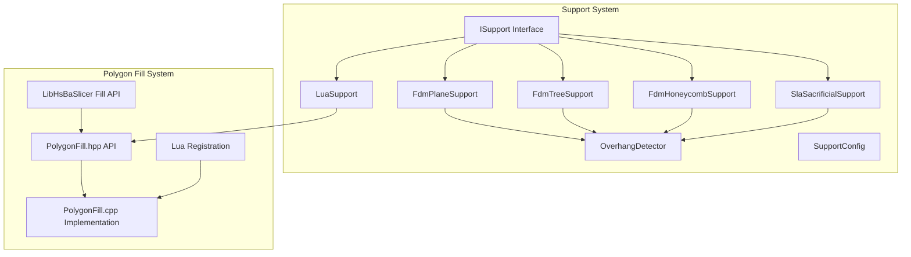
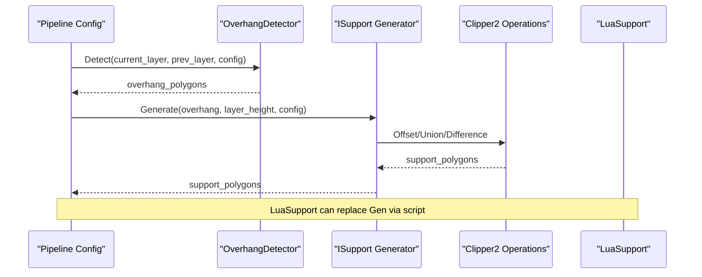
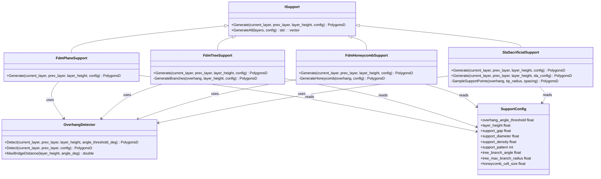
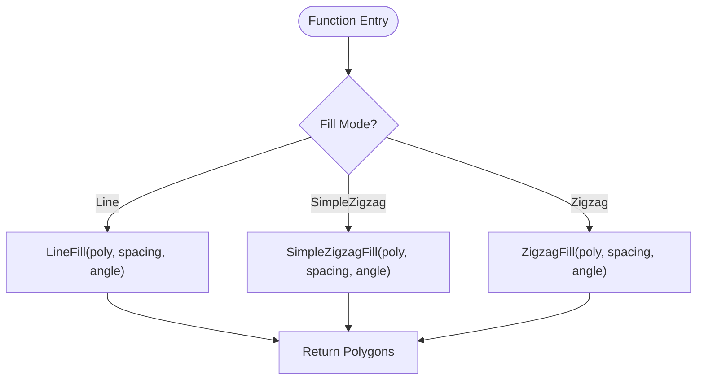
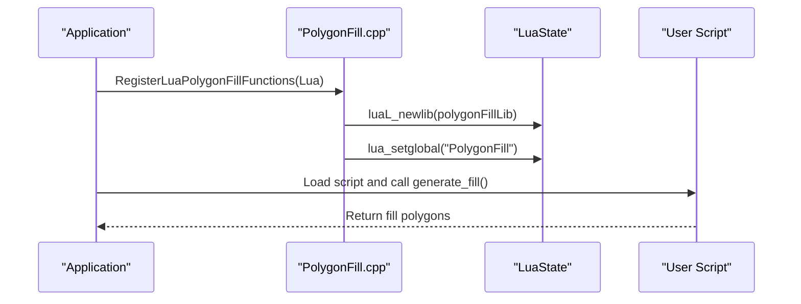
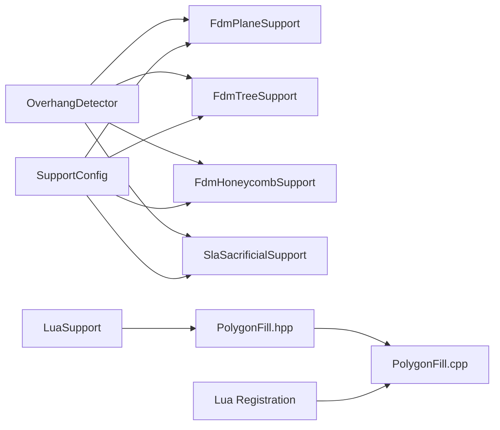

# Custom Algorithms

<cite>
**Referenced Files in This Document**   
- [ISupport.hpp](file://support/ISupport.hpp)
- [ISupport.cpp](file://support/ISupport.cpp)
- [FdmSupport.hpp](file://support/FdmSupport.hpp)
- [FdmSupport.cpp](file://support/FdmSupport.cpp)
- [SlaSupport.hpp](file://support/SlaSupport.hpp)
- [SlaSupport.cpp](file://support/SlaSupport.cpp)
- [LuaSupport.hpp](file://support/LuaSupport.hpp)
- [LuaSupport.cpp](file://support/LuaSupport.cpp)
- [OverhangDetector.hpp](file://support/OverhangDetector.hpp)
- [OverhangDetector.cpp](file://support/OverhangDetector.cpp)
- [SupportConfig.hpp](file://support/SupportConfig.hpp)
- [PolygonFill.hpp](file://2D/PolygonFill.hpp)
- [PolygonFill.cpp](file://2D/PolygonFill.cpp)
- [polygon_fill.hpp](file://LibHsBaSlicer/Fill/polygon_fill.hpp)
- [polygon_fill.cpp](file://LibHsBaSlicer/Fill/polygon_fill.cpp)
- [pipeline_types.h](file://pipelinetypes/pipeline_types.h)
- [sla_floor.cpp](file://LibHsBaSlicer/Floor/sla_floor.cpp)
- [path_optimizer.cpp](file://LibHsBaSlicer/Path/path_optimizer.cpp)
- [lua_pipeline_api.md](file://docs/en/lua_pipeline_api.md)
- [polygon_fill_test.cpp](file://tests/PolygonFill/polygon_fill_test.cpp)
</cite>

## Table of Contents
1. [Introduction](#introduction)
2. [Project Structure](#project-structure)
3. [Core Components](#core-components)
4. [Architecture Overview](#architecture-overview)
5. [Detailed Component Analysis](#detailed-component-analysis)
6. [Dependency Analysis](#dependency-analysis)
7. [Performance Considerations](#performance-considerations)
8. [Troubleshooting Guide](#troubleshooting-guide)
9. [Conclusion](#conclusion)
10. [Appendices](#appendices)

## Introduction
This document explains how to create custom algorithms in HsBaSlicer, focusing on two extension points:

- Support generation algorithms through the `ISupport` interface. You can implement overhang detection, support structure creation, and parameter configuration for FDM and SLA workflows.
- Polygon fill algorithms through the `PolygonFill` API and Lua registration system. You can implement infill patterns, boundary processing, and optimization techniques.

The guide also covers algorithm registration mechanisms, parameter binding, configuration file integration, performance strategies, parallel processing considerations, memory efficiency, testing methodologies, validation techniques, and debugging approaches for computational geometry code.

## Project Structure
Custom algorithms live primarily under:

- `support/`: support generator interfaces, implementations, overhang detection, and Lua-based custom support.
- `2D/`: polygon fill algorithms, Lua bindings, and helper utilities.
- `LibHsBaSlicer/Fill/`: public C++ wrapper around the 2D fill engine.
- `pipelinetypes/pipeline_types.h`: pipeline configuration types used by higher-level pipelines.
- `samples/`: example scripts and executables demonstrating usage.

**Diagram sources**
- [ISupport.hpp:14-45](file://support/ISupport.hpp#L14-L45)
- [FdmSupport.hpp:11-63](file://support/FdmSupport.hpp#L11-L63)
- [SlaSupport.hpp:11-42](file://support/SlaSupport.hpp#L11-L42)
- [LuaSupport.hpp:19-81](file://support/LuaSupport.hpp#L19-L81)
- [OverhangDetector.hpp:12-50](file://support/OverhangDetector.hpp#L12-L50)
- [SupportConfig.hpp:9-43](file://support/SupportConfig.hpp#L9-L43)
- [PolygonFill.hpp:16-136](file://2D/PolygonFill.hpp#L16-L136)
- [polygon_fill.hpp:15-53](file://LibHsBaSlicer/Fill/polygon_fill.hpp#L15-L53)

**Section sources**
- [ISupport.hpp:14-45](file://support/ISupport.hpp#L14-L45)
- [FdmSupport.hpp:11-63](file://support/FdmSupport.hpp#L11-L63)
- [SlaSupport.hpp:11-42](file://support/SlaSupport.hpp#L11-L42)
- [LuaSupport.hpp:19-81](file://support/LuaSupport.hpp#L19-L81)
- [OverhangDetector.hpp:12-50](file://support/OverhangDetector.hpp#L12-L50)
- [SupportConfig.hpp:9-43](file://support/SupportConfig.hpp#L9-L43)
- [PolygonFill.hpp:16-136](file://2D/PolygonFill.hpp#L16-L136)
- [polygon_fill.hpp:15-53](file://LibHsBaSlicer/Fill/polygon_fill.hpp#L15-L53)

## Core Components
Key components for custom algorithms:

- `ISupport`: Abstract interface defining per-layer support generation. Implementations include FDM plane/tree/honeycomb and SLA sacrificial supports.
- `OverhangDetector`: Detects unsupported regions between adjacent layers using angle thresholds and bridge distance logic.
- `SupportConfig`, `FdmSupportConfig`, `SlaSupportConfig`: Configuration structures shared across support generators.
- `PolygonFill` API: Provides offset, line, zigzag, composite, hybrid fills, plus Lua-custom fill functions.
- `LibHsBaSlicer Fill API`: Public C++ wrapper exposing fill capabilities to consumers.
- `LuaSupport`: Allows users to replace built-in support generation with a Lua script.

Implementation highlights:

- `ISupport::GenerateAll` provides default layer iteration behavior.
- FDM supports use gap application, inflation, union operations, and pattern-specific generation.
- SLA support samples points within overhang regions and unions circles into support cross-sections.
- Polygon fill algorithms operate on integerized polygons and return filled paths or rings.

**Section sources**
- [ISupport.hpp:14-45](file://support/ISupport.hpp#L14-L45)
- [ISupport.cpp:9-21](file://support/ISupport.cpp#L9-L21)
- [OverhangDetector.hpp:12-50](file://support/OverhangDetector.hpp#L12-L50)
- [SupportConfig.hpp:9-43](file://support/SupportConfig.hpp#L9-L43)
- [PolygonFill.hpp:16-136](file://2D/PolygonFill.hpp#L16-L136)
- [polygon_fill.hpp:15-53](file://LibHsBaSlicer/Fill/polygon_fill.hpp#L15-L53)

## Architecture Overview
The support generation architecture is layered:

- Configuration flows from pipeline config into `SupportConfig`.
- Overhang detection computes unsupported regions based on layer height and angle threshold.
- Support generators transform overhang regions into per-layer support polygons.
- Lua support allows dynamic replacement of built-in algorithms.

The polygon fill architecture separates:

- High-level API (`PolygonFill.hpp`) offering multiple fill modes.
- Core implementation (`PolygonFill.cpp`) handling geometry, offsets, zigzag bridging, and Lua bindings.
- Public wrapper (`LibHsBaSlicer/Fill/polygon_fill.hpp`) exposing fill functions to consumers.

**Diagram sources**
- [OverhangDetector.cpp:41-80](file://support/OverhangDetector.cpp#L41-L80)
- [FdmSupport.cpp:48-75](file://support/FdmSupport.cpp#L48-L75)
- [SlaSupport.cpp:81-123](file://support/SlaSupport.cpp#L81-L123)
- [LuaSupport.cpp:113-177](file://support/LuaSupport.cpp#L113-L177)

**Section sources**
- [OverhangDetector.cpp:41-80](file://support/OverhangDetector.cpp#L41-L80)
- [FdmSupport.cpp:48-75](file://support/FdmSupport.cpp#L48-L75)
- [SlaSupport.cpp:81-123](file://support/SlaSupport.cpp#L81-L123)
- [LuaSupport.cpp:113-177](file://support/LuaSupport.cpp#L113-L177)

## Detailed Component Analysis

### Support Generation Through ISupport
The `ISupport` interface defines:

- `Generate`: Produces support polygons for a single layer given current and previous layer contours, layer height, and configuration.
- `GenerateAll`: Default implementation iterates over all layers, calling `Generate` for each.

Implementations:

- `FdmPlaneSupport`: Inflates overhang regions by half the support diameter after applying gap.
- `FdmTreeSupport`: Samples branch tips within overhang regions and unions circles.
- `FdmHoneycombSupport`: Generates hexagonal cells and intersects them with overhang regions.
- `SlaSacrificialSupport`: Samples support points and unions circles; supports both base and SLA-specific configurations.

**Diagram sources**
- [ISupport.hpp:14-45](file://support/ISupport.hpp#L14-L45)
- [FdmSupport.hpp:11-63](file://support/FdmSupport.hpp#L11-L63)
- [SlaSupport.hpp:11-42](file://support/SlaSupport.hpp#L11-L42)
- [OverhangDetector.hpp:12-50](file://support/OverhangDetector.hpp#L12-L50)
- [SupportConfig.hpp:9-43](file://support/SupportConfig.hpp#L9-L43)

**Section sources**
- [ISupport.hpp:14-45](file://support/ISupport.hpp#L14-L45)
- [ISupport.cpp:9-21](file://support/ISupport.cpp#L9-L21)
- [FdmSupport.cpp:48-75](file://support/FdmSupport.cpp#L48-L75)
- [FdmSupport.cpp:145-167](file://support/FdmSupport.cpp#L145-L167)
- [FdmSupport.cpp:244-266](file://support/FdmSupport.cpp#L244-L266)
- [SlaSupport.cpp:81-123](file://support/SlaSupport.cpp#L81-L123)
- [OverhangDetector.cpp:41-80](file://support/OverhangDetector.cpp#L41-L80)
- [SupportConfig.hpp:9-43](file://support/SupportConfig.hpp#L9-L43)

### Polygon Fill Algorithm Development
The `PolygonFill` API exposes:

- `OffsetFill`: Nested inward offset rings.
- `LineFill`: Parallel line segments.
- `SimpleZigzagFill` and `ZigzagFill`: Connected zigzag paths with improved corner handling.
- `CompositeOffsetFill` and `HybridFill`: Composite patterns combining borders and internal fills.
- `LuaCustomFill` and `LuaCustomFillString`: Custom fill via Lua scripts.

Implementation details:

- Integerization ensures robust geometric operations.
- Zigzag bridging connects segments across scanlines while respecting polygon boundaries.
- Lua registration binds fill functions to the `PolygonFill` module.

**Diagram sources**
- [PolygonFill.cpp:544-563](file://2D/PolygonFill.cpp#L544-L563)
- [PolygonFill.cpp:568-800](file://2D/PolygonFill.cpp#L568-L800)
- [polygon_fill.cpp:13-33](file://LibHsBaSlicer/Fill/polygon_fill.cpp#L13-L33)

**Section sources**
- [PolygonFill.hpp:16-136](file://2D/PolygonFill.hpp#L16-L136)
- [PolygonFill.cpp:504-540](file://2D/PolygonFill.cpp#L504-L540)
- [PolygonFill.cpp:544-563](file://2D/PolygonFill.cpp#L544-L563)
- [PolygonFill.cpp:568-800](file://2D/PolygonFill.cpp#L568-L800)
- [polygon_fill.cpp:13-33](file://LibHsBaSlicer/Fill/polygon_fill.cpp#L13-L33)

### Algorithm Registration Mechanisms
Registration occurs at multiple levels:

- **Polygon fill Lua registration**: `RegisterLuaPolygonFillFunctions` binds fill functions to the `PolygonFill` module.
- **Support Lua registration**: `LuaSupport` sets up environment, registers polygon operations and support helpers, then executes user scripts.
- **Pipeline configuration**: `pipeline_types.h` defines C-compatible structs for pipeline parameters, including fill mode and support settings.

**Diagram sources**
- [PolygonFill.cpp:488-502](file://2D/PolygonFill.cpp#L488-L502)
- [LuaSupport.cpp:67-90](file://support/LuaSupport.cpp#L67-L90)
- [pipeline_types.h:56-74](file://pipelinetypes/pipeline_types.h#L56-L74)

**Section sources**
- [PolygonFill.cpp:488-502](file://2D/PolygonFill.cpp#L488-L502)
- [LuaSupport.cpp:67-90](file://support/LuaSupport.cpp#L67-L90)
- [pipeline_types.h:56-74](file://pipelinetypes/pipeline_types.h#L56-L74)

### Parameter Binding and Configuration File Integration
Configuration flows from pipeline configs into support and fill algorithms:

- `SupportConfig` fields control overhang detection, gap, diameter, density, pattern selection, tree parameters, and honeycomb cell size.
- `FdmSupportConfig` adds interface layers and density.
- `SlaSupportConfig` adds tip diameter and raft thickness.
- `HsBaFdmPipelineConfig` includes fill spacing, mode, angle, wall count, top/bottom layer counts, and infill density.

Integration examples:

- SLA floor generation uses `ZigzagFill` with configurable spacing and angle.
- Path optimizer integrates with region modeling and gate management.

**Section sources**
- [SupportConfig.hpp:9-43](file://support/SupportConfig.hpp#L9-L43)
- [pipeline_types.h:56-74](file://pipelinetypes/pipeline_types.h#L56-L74)
- [sla_floor.cpp:105-116](file://LibHsBaSlicer/Floor/sla_floor.cpp#L105-L116)
- [path_optimizer.cpp:43-72](file://LibHsBaSlicer/Path/path_optimizer.cpp#L43-L72)

### Practical Examples

#### FDM Support Generators
- **Plane**: Detect overhang, apply gap, inflate by half diameter.
- **Tree**: Sample branch tips within overhang, union circles.
- **Honeycomb**: Generate hexagonal cells, intersect with overhang.

#### SLA Support Algorithms
- **Sacrificial**: Sample support points within overhang, union circles; supports SLA-specific configuration.

**Section sources**
- [FdmSupport.cpp:48-75](file://support/FdmSupport.cpp#L48-L75)
- [FdmSupport.cpp:145-167](file://support/FdmSupport.cpp#L145-L167)
- [FdmSupport.cpp:244-266](file://support/FdmSupport.cpp#L244-L266)
- [SlaSupport.cpp:81-123](file://support/SlaSupport.cpp#L81-L123)

## Dependency Analysis
Dependencies between components:

- Support generators depend on `OverhangDetector` and `SupportConfig`.
- Polygon fill algorithms depend on integerization, boolean operations, and Lua adapters.
- Lua support depends on polygon operations and support helpers.

**Diagram sources**
- [OverhangDetector.hpp:12-50](file://support/OverhangDetector.hpp#L12-L50)
- [FdmSupport.hpp:11-63](file://support/FdmSupport.hpp#L11-L63)
- [SlaSupport.hpp:11-42](file://support/SlaSupport.hpp#L11-L42)
- [PolygonFill.hpp:16-136](file://2D/PolygonFill.hpp#L16-L136)
- [LuaSupport.hpp:19-81](file://support/LuaSupport.hpp#L19-L81)

**Section sources**
- [OverhangDetector.hpp:12-50](file://support/OverhangDetector.hpp#L12-L50)
- [FdmSupport.hpp:11-63](file://support/FdmSupport.hpp#L11-L63)
- [SlaSupport.hpp:11-42](file://support/SlaSupport.hpp#L11-L42)
- [PolygonFill.hpp:16-136](file://2D/PolygonFill.hpp#L16-L136)
- [LuaSupport.hpp:19-81](file://support/LuaSupport.hpp#L19-L81)

## Performance Considerations
Optimization strategies:

- **Integerization**: Use integer coordinates for robust geometric operations to avoid floating-point errors.
- **Early exits**: Check for empty inputs or invalid parameters before expensive computations.
- **Bounding box filtering**: Limit point sampling and grid generation to bounding boxes of overhang regions.
- **Union and intersection batching**: Combine multiple polygons before boolean operations to reduce overhead.
- **Parallel processing**: Layer-wise independence enables parallel execution of `GenerateAll` if needed.
- **Memory efficiency**: Reuse buffers, avoid unnecessary copies, and prefer move semantics where possible.

[No sources needed since this section provides general guidance]

## Troubleshooting Guide
Common issues and debugging approaches:

- **Lua script errors**: `LuaSupport` throws runtime errors with detailed messages when script loading or execution fails.
- **Invalid polygon data**: Ensure input polygons are valid and closed; check for degenerate cases.
- **Overhang detection failures**: Verify angle thresholds and layer heights; inspect intermediate difference and erosion results.
- **Fill algorithm anomalies**: Validate spacing, angles, and join types; use tests to verify expected behavior.

Validation techniques:

- Unit tests for polygon fill algorithms cover basic cases, edge conditions, and Lua bindings.
- Geometry assertions ensure output correctness (e.g., segment counts, containment checks).

**Section sources**
- [LuaSupport.cpp:141-177](file://support/LuaSupport.cpp#L141-L177)
- [polygon_fill_test.cpp:26-44](file://tests/PolygonFill/polygon_fill_test.cpp#L26-L44)
- [polygon_fill_test.cpp:177-200](file://tests/PolygonFill/polygon_fill_test.cpp#L177-L200)
- [polygon_fill_test.cpp:202-240](file://tests/PolygonFill/polygon_fill_test.cpp#L202-L240)

## Conclusion
HsBaSlicer provides a flexible framework for extending support generation and polygon fill algorithms. By implementing `ISupport`, you can create custom FDM and SLA support strategies. The `PolygonFill` API and Lua registration system enable powerful infill pattern development. Configuration integration, performance optimizations, and comprehensive testing ensure robust and efficient algorithm deployment.

[No sources needed since this section summarizes without analyzing specific files]

## Appendices

### API Reference Summary

#### Support Interfaces
- `ISupport::Generate`: Per-layer support generation.
- `ISupport::GenerateAll`: Default layer iteration.
- `OverhangDetector::Detect`: Overhang region detection.
- `SupportConfig`: Shared configuration fields.

#### Polygon Fill APIs
- `OffsetFill`: Nested offset rings.
- `LineFill`: Parallel lines.
- `SimpleZigzagFill` / `ZigzagFill`: Zigzag patterns.
- `CompositeOffsetFill` / `HybridFill`: Composite patterns.
- `LuaCustomFill` / `LuaCustomFillString`: Custom Lua fills.

**Section sources**
- [ISupport.hpp:14-45](file://support/ISupport.hpp#L14-L45)
- [OverhangDetector.hpp:12-50](file://support/OverhangDetector.hpp#L12-L50)
- [SupportConfig.hpp:9-43](file://support/SupportConfig.hpp#L9-L43)
- [PolygonFill.hpp:16-136](file://2D/PolygonFill.hpp#L16-L136)

### Lua Scripting Notes
- `PolygonOperations` provides boolean operations, offsets, hulls, area calculations, and shape creation.
- `PolygonFill` module exposes fill algorithms to Lua scripts.

**Section sources**
- [lua_pipeline_api.md:140-159](file://docs/en/lua_pipeline_api.md#L140-L159)