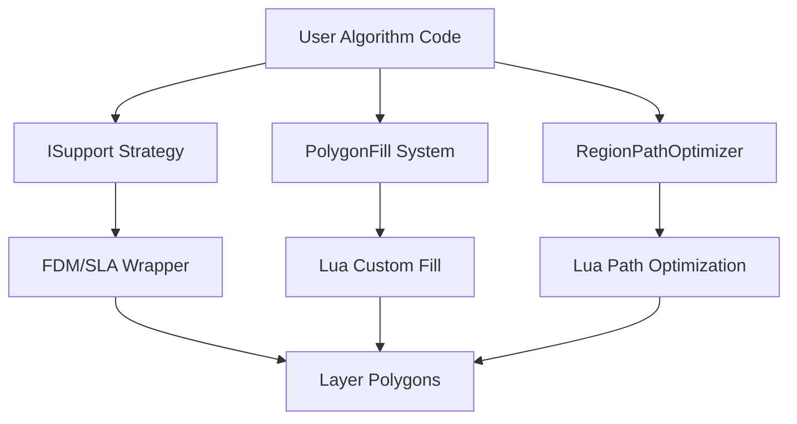
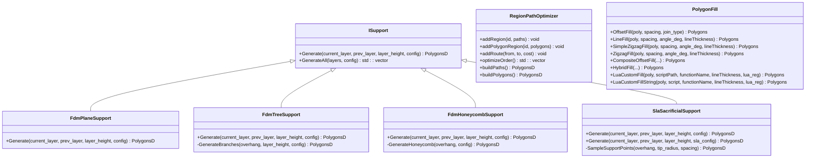
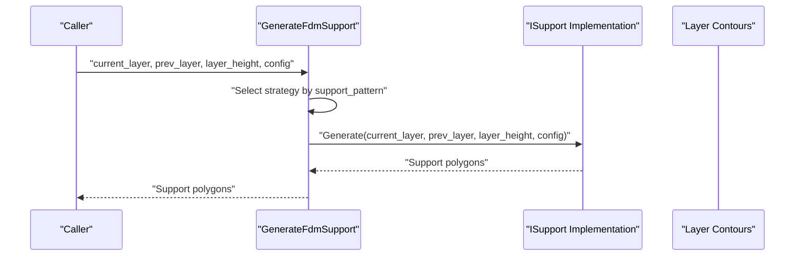
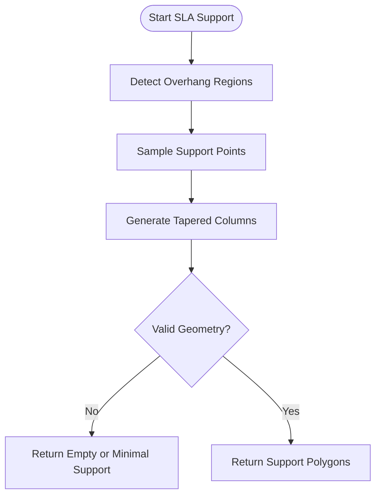
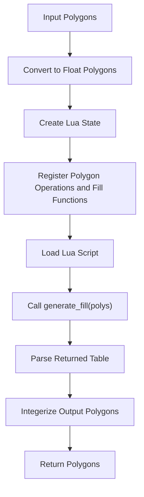
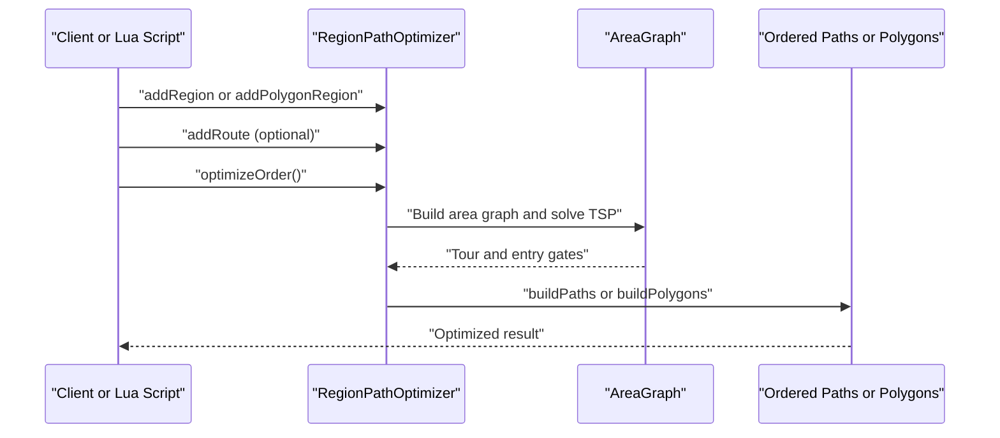
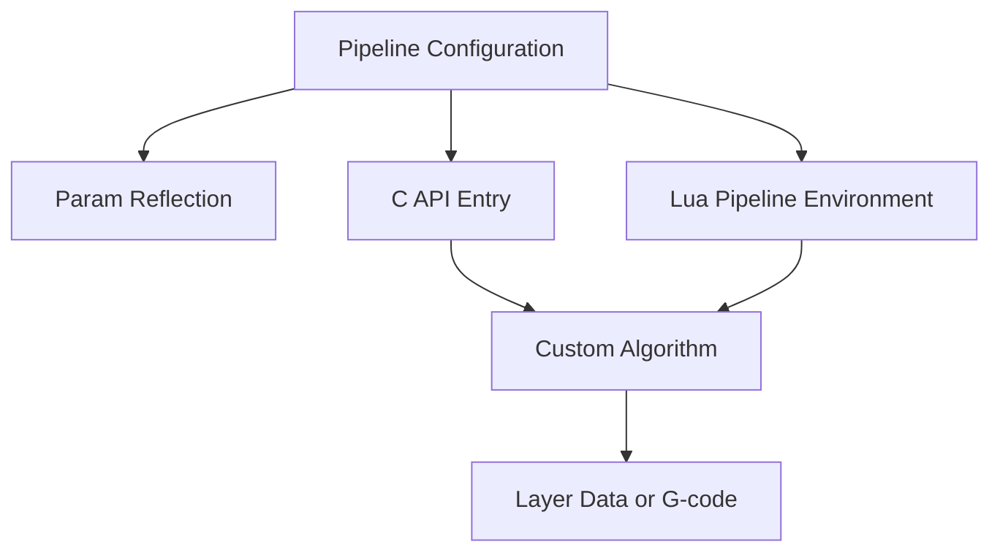
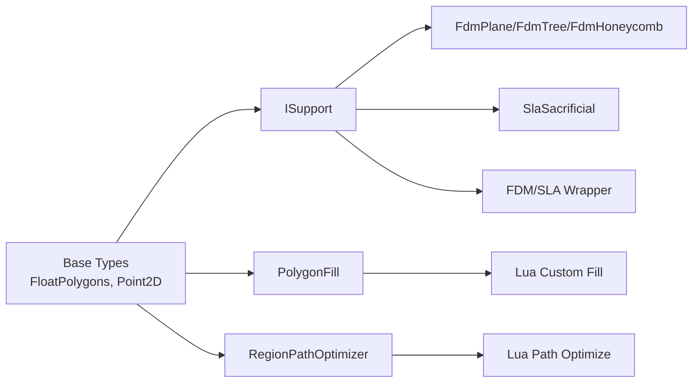

# Custom Algorithms

<cite>
**Referenced Files in This Document**
- [ISupport.hpp](file://support/ISupport.hpp)
- [ISupport.cpp](file://support/ISupport.cpp)
- [FdmSupport.hpp](file://support/FdmSupport.hpp)
- [SlaSupport.hpp](file://support/SlaSupport.hpp)
- [fdm_support.hpp](file://LibHsBaSlicer/support/fdm_support.hpp)
- [fdm_support.cpp](file://LibHsBaSlicer/support/fdm_support.cpp)
- [PolygonFill.hpp](file://2D/PolygonFill.hpp)
- [PolygonFill.cpp](file://2D/PolygonFill.cpp)
- [path_optimizer.hpp](file://LibHsBaSlicer/Path/path_optimizer.hpp)
- [path_optimizer.cpp](file://LibHsBaSlicer/Path/path_optimizer.cpp)
- [hsba_pipeline.d.lua](file://types/hsba_pipeline.d.lua)
- [optimize_paths.lua](file://tests/PolygonFill/optimize_paths.lua)
- [my_sla_floor.lua](file://samples/SLA/scripts/my_sla_floor.lua)
- [polygon_fill_test.cpp](file://tests/PolygonFill/polygon_fill_test.cpp)
- [fdm_support_lib_test.cpp](file://tests/Support/fdm_support_lib_test.cpp)
- [README.md](file://docs/en/LibHsBaSlicer/README.md)
- [lua_pipeline_api.md](file://docs/en/lua_pipeline_api.md)
- [param_reflect.cpp](file://fileoperator/param_reflect.cpp)
- [custom_pipeline.cpp](file://DllHsBaSlicer/custom_pipeline.cpp)
</cite>

## Table of Contents
1. [Introduction](#introduction)
2. [Project Structure](#project-structure)
3. [Core Components](#core-components)
4. [Architecture Overview](#architecture-overview)
5. [Detailed Component Analysis](#detailed-component-analysis)
6. [Dependency Analysis](#dependency-analysis)
7. [Performance Considerations](#performance-considerations)
8. [Testing Strategies](#testing-strategies)
9. [Troubleshooting Guide](#troubleshooting-guide)
10. [Conclusion](#conclusion)

## Introduction
This document explains how to implement custom algorithms in HsBaSlicer using its strategy-based extension points. It focuses on three main areas:

- **Support generation**: Implementing new support strategies by extending the `ISupport` interface, including FDM and SLA examples.
- **Fill patterns**: Extending or replacing polygon infill behavior through built-in fill functions and Lua-based custom fills.
- **Path optimization**: Creating specialized region ordering and path routing algorithms using `RegionPathOptimizer`.

The goal is to show how these components fit into the slicing pipeline, how parameters are validated, how algorithms are registered and invoked, and how to test, benchmark, and manage memory for custom implementations.

## Project Structure
Custom algorithm development spans several modules:

| Area | Primary Files | Purpose |
|---|---|---|
| Support strategy interface | `support/ISupport.hpp`, `support/ISupport.cpp` | Defines the abstract support generator contract and default layer iteration. |
| FDM support implementations | `support/FdmSupport.hpp`, `LibHsBaSlicer/support/fdm_support.cpp` | Concrete FDM strategies and C API wrapper. |
| SLA support implementation | `support/SlaSupport.hpp` | Thin-column sacrificial support strategy. |
| Fill pattern system | `2D/PolygonFill.hpp`, `2D/PolygonFill.cpp` | Built-in offset, line, zigzag, composite, hybrid, and Lua custom fills. |
| Path optimization | `LibHsBaSlicer/Path/path_optimizer.hpp`, `LibHsBaSlicer/Path/path_optimizer.cpp` | Region-based TSP-style optimizer with Lua bindings. |
| Pipeline integration | `types/hsba_pipeline.d.lua`, `samples/SLA/scripts/my_sla_floor.lua`, `tests/PolygonFill/optimize_paths.lua` | Lua entry points and sample scripts. |
| Tests | `tests/Support/fdm_support_lib_test.cpp`, `tests/PolygonFill/polygon_fill_test.cpp` | Validation of support and path optimization behavior. |

**Diagram sources**
- [ISupport.hpp:16-45](file://support/ISupport.hpp#L16-L45)
- [PolygonFill.hpp:20-136](file://2D/PolygonFill.hpp#L20-L136)
- [path_optimizer.hpp:23-115](file://LibHsBaSlicer/Path/path_optimizer.hpp#L23-L115)
- [fdm_support.cpp:14-31](file://LibHsBaSlicer/support/fdm_support.cpp#L14-L31)

**Section sources**
- [ISupport.hpp:1-49](file://support/ISupport.hpp#L1-L49)
- [PolygonFill.hpp:1-141](file://2D/PolygonFill.hpp#L1-L141)
- [path_optimizer.hpp:1-191](file://LibHsBaSlicer/Path/path_optimizer.hpp#L1-L191)

## Core Components
The core extensibility surface consists of three strategy-oriented systems:

### Support Generation Strategy (`ISupport`)
`ISupport` defines a per-layer support generation contract:

| Member | Responsibility |
|---|---|
| `Generate(current_layer, prev_layer, layer_height, config)` | Produces support polygons for one layer. |
| `GenerateAll(layers, config)` | Default loop over layers; subclasses may override for batch optimizations. |

Concrete strategies include:

| Class | Mode | Description |
|---|---|---|
| `FdmPlaneSupport` | FDM | Column supports from overhang regions. |
| `FdmTreeSupport` | FDM | Tree-like branching supports. |
| `FdmHoneycombSupport` | FDM | Hexagonal honeycomb overhang fill. |
| `SlaSacrificialSupport` | SLA | Thin sacrificial columns for resin printing. |

The C API wrapper selects an implementation based on configuration and calls its `Generate` method.

**Section sources**
- [ISupport.hpp:16-45](file://support/ISupport.hpp#L16-L45)
- [ISupport.cpp:9-21](file://support/ISupport.cpp#L9-L21)
- [FdmSupport.hpp:13-63](file://support/FdmSupport.hpp#L13-L63)
- [SlaSupport.hpp:13-42](file://support/SlaSupport.hpp#L13-L42)
- [fdm_support.hpp:19-67](file://LibHsBaSlicer/support/fdm_support.hpp#L19-L67)
- [fdm_support.cpp:14-31](file://LibHsBaSlicer/support/fdm_support.cpp#L14-L31)

### Fill Pattern System (`PolygonFill`)
`PolygonFill` provides multiple fill strategies:

| Function | Input | Output | Notes |
|---|---|---|---|
| `OffsetFill` | Polygons + spacing | Polygons | Offset-based borders and internal fill. |
| `LineFill` | Polygons + spacing + angle + thickness | Polygons | Parallel-line fill. |
| `SimpleZigzagFill` | Polygons + spacing + angle + thickness | Polygons | Basic zigzag. |
| `ZigzagFill` | Polygons + spacing + angle + thickness | Polygons | Improved corner handling. |
| `CompositeOffsetFill` | Polygons + spacing + offsets + mode + angle + thickness | Polygons | Border rings plus internal fill. |
| `HybridFill` | Polygons + spacing + offsets + mode + angle + thickness | Polygons | Outward/inward offset rings plus final interior fill. |
| `LuaCustomFill` / `LuaCustomFillString` | Polygons + script + function name | Polygons | Custom fill via Lua. |

The Lua environment exposes `generate_fill(polys)` as the standard entry point for custom FDM fills.

**Section sources**
- [PolygonFill.hpp:20-136](file://2D/PolygonFill.hpp#L20-L136)
- [PolygonFill.cpp:1380-1490](file://2D/PolygonFill.cpp#L1380-L1490)
- [PolygonFill.cpp:1493-1579](file://2D/PolygonFill.cpp#L1493-L1579)
- [hsba_pipeline.d.lua:515-525](file://types/hsba_pipeline.d.lua#L515-L525)

### Path Optimization Strategy (`RegionPathOptimizer`)
`RegionPathOptimizer` treats independent regions as graph vertices and solves a visit order that minimizes travel cost. Two modes exist:

| Mode | Timing | Region Input | Gates | Output |
|---|---|---|---|---|
| Polygon mode | Before fill | Polygon outlines | All polygon vertices | Ordered polygons for subsequent filling. |
| Fill-result mode | After fill | Fill paths (multi-point polylines supported) | Head/tail endpoints | Complete optimized fill paths. |

Key operations:

| Method | Purpose |
|---|---|
| `addRegion(id, paths)` | Add post-fill path region. |
| `addPolygonRegion(id, polygons)` | Add pre-fill polygon region. |
| `addRoute(from, to, cost)` | Override inter-region air-move cost. |
| `optimizeOrder()` | Solve region visit order. |
| `buildPaths()` | Build complete fill paths (fill-result mode). |
| `buildPolygons()` | Build ordered polygons (polygon mode). |

**Section sources**
- [path_optimizer.hpp:23-115](file://LibHsBaSlicer/Path/path_optimizer.hpp#L23-L115)
- [path_optimizer.cpp:45-120](file://LibHsBaSlicer/Path/path_optimizer.cpp#L45-L120)
- [path_optimizer.cpp:129-235](file://LibHsBaSlicer/Path/path_optimizer.cpp#L129-L235)
- [README.md:234-266](file://docs/en/LibHsBaSlicer/README.md#L234-L266)

## Architecture Overview
The custom algorithm architecture follows a strategy pattern layered over the slicing pipeline:

**Diagram sources**
- [ISupport.hpp:16-45](file://support/ISupport.hpp#L16-L45)
- [FdmSupport.hpp:13-63](file://support/FdmSupport.hpp#L13-L63)
- [SlaSupport.hpp:13-42](file://support/SlaSupport.hpp#L13-L42)
- [path_optimizer.hpp:44-100](file://LibHsBaSlicer/Path/path_optimizer.hpp#L44-L100)
- [PolygonFill.hpp:20-136](file://2D/PolygonFill.hpp#L20-L136)

## Detailed Component Analysis

### Support Algorithm Lifecycle
The support lifecycle has two levels:

1. **C API selection**: The wrapper chooses a concrete `ISupport` implementation based on configuration.
2. **Per-layer execution**: Each implementation receives current and previous layer contours and produces support polygons.

**Diagram sources**
- [fdm_support.cpp:14-31](file://LibHsBaSlicer/support/fdm_support.cpp#L14-L31)
- [ISupport.hpp:27-44](file://support/ISupport.hpp#L27-L44)

#### Implementing a New FDM Support Generator
To add a new FDM support strategy:

1. Create a class inheriting from `ISupport`.
2. Override `Generate`.
3. Use existing overhang detection and polygon utilities where appropriate.
4. If needed, expose a new strategy selector in the wrapper.

Recommended structure:

| Step | Action |
|---|---|
| Define class | Extend `ISupport` in a dedicated header. |
| Implement `Generate` | Compute overhangs, generate support geometry, return `PolygonsD`. |
| Validate parameters | Check layer height, diameter, gap, and cell size against reasonable ranges. |
| Integrate with wrapper | Add the new strategy to the selection logic if it should be selectable by configuration. |
| Test | Add unit tests covering first layer, empty predecessor, large overhangs, and invalid inputs. |

**Section sources**
- [FdmSupport.hpp:13-63](file://support/FdmSupport.hpp#L13-L63)
- [fdm_support.cpp:14-31](file://LibHsBaSlicer/support/fdm_support.cpp#L14-L31)
- [fdm_support_lib_test.cpp:41-75](file://tests/Support/fdm_support_lib_test.cpp#L41-L75)

#### Implementing a New SLA Support Generator
SLA support differs from FDM because it targets sacrificial thin columns rather than structural overhang fills. A new SLA strategy should:

- Sample support points from overhang regions.
- Generate tapered circular cross-sections.
- Respect SLA-specific configuration such as tip radius and base adhesion.

**Diagram sources**
- [SlaSupport.hpp:13-42](file://support/SlaSupport.hpp#L13-L42)

**Section sources**
- [SlaSupport.hpp:13-42](file://support/SlaSupport.hpp#L13-L42)

### Fill Pattern Extension Strategy
HsBaSlicer supports both C++ fill functions and Lua-driven custom fills.

#### Built-in Fill Functions
Use built-in functions when the desired pattern can be expressed as:

- Offset borders.
- Parallel lines.
- Zigzag patterns.
- Composite or hybrid combinations.

#### Lua Custom Fill Pattern
For complex or experimental patterns:

1. Write a Lua function named `generate_fill(polys)`.
2. Return a table of polygons or polylines.
3. Call `LuaCustomFill` or `LuaCustomFillString`.
4. Register additional Lua helpers through the optional `lua_reg` callback.

**Diagram sources**
- [PolygonFill.cpp:1493-1579](file://2D/PolygonFill.cpp#L1493-L1579)

**Section sources**
- [PolygonFill.hpp:104-136](file://2D/PolygonFill.hpp#L104-L136)
- [PolygonFill.cpp:1493-1579](file://2D/PolygonFill.cpp#L1493-L1579)
- [hsba_pipeline.d.lua:515-525](file://types/hsba_pipeline.d.lua#L515-L525)

#### Example: Custom FDM Fill Pattern
A typical custom FDM fill script:

- Receives `polys`, the current layer polygons after wall deduction.
- Uses `PolygonOperations` for boolean operations.
- Uses `PolygonFill` for built-in fills.
- Returns a union of border and internal fill.

Reference example:

**Section sources**
- [my_sla_floor.lua:28-63](file://samples/SLA/scripts/my_sla_floor.lua#L28-L63)
- [hsba_pipeline.d.lua:515-525](file://types/hsba_pipeline.d.lua#L515-L525)

### Specialized Path Optimization Algorithms
Path optimization is designed around independent regions. You can extend behavior by:

- Using the built-in TSP-based optimizer.
- Providing manual route costs.
- Writing a Lua script that wraps `PathOptimize`.

**Diagram sources**
- [path_optimizer.cpp:45-120](file://LibHsBaSlicer/Path/path_optimizer.cpp#L45-L120)
- [path_optimizer.cpp:129-235](file://LibHsBaSlicer/Path/path_optimizer.cpp#L129-L235)

#### Implementing a Custom Path Optimization Strategy
Two approaches exist:

| Approach | When to Use | How |
|---|---|---|
| C++ `RegionPathOptimizer` | High-performance or deterministic pipelines. | Construct optimizer, add regions, call `optimizeOrder`, then `buildPaths` or `buildPolygons`. |
| Lua script | Rapid experimentation or user-defined strategies. | Use `PathOptimize.new()` and register custom logic in `optimize_paths` or `optimize_polygons`. |

Reference Lua example:

**Section sources**
- [optimize_paths.lua:1-33](file://tests/PolygonFill/optimize_paths.lua#L1-L33)
- [path_optimizer.hpp:102-186](file://LibHsBaSlicer/Path/path_optimizer.hpp#L102-L186)
- [polygon_fill_test.cpp:354-441](file://tests/PolygonFill/polygon_fill_test.cpp#L354-L441)

### Parameter Validation and Error Handling
Parameter validation should happen early:

- For support generators: validate layer height, support diameter, gap, cell size, and overhang geometry.
- For fill patterns: validate spacing, angle, thickness, and polygon validity.
- For path optimization: validate region IDs, avoid mixing polygon and path modes, and handle unreachable regions.

Common error signals in the codebase include:

| Area | Error Behavior |
|---|---|
| Support generation | Selection defaults to plane support when unknown pattern is used. |
| Lua custom fill | Throws runtime errors for missing Lua state, missing function, or invalid return type. |
| Path optimization | Throws runtime errors when mixing region types or calling wrong builder method. |

**Section sources**
- [fdm_support.cpp:14-31](file://LibHsBaSlicer/support/fdm_support.cpp#L14-L31)
- [PolygonFill.cpp:1501-1579](file://2D/PolygonFill.cpp#L1501-L1579)
- [path_optimizer.cpp:68-127](file://LibHsBaSlicer/Path/path_optimizer.cpp#L68-L127)
- [path_optimizer.cpp:187-235](file://LibHsBaSlicer/Path/path_optimizer.cpp#L187-L235)

### Integration with the Pipeline System
Custom algorithms integrate with the pipeline through:

1. **C API wrappers**: e.g., `GenerateFdmSupport`, `GenerateAllSlaSupport`.
2. **Lua pipeline functions**: e.g., `HsBa.fdmSupport`, `HsBa.slaSupport`, `HsBa.floor`.
3. **Custom pipeline configuration**: e.g., `HsBaRunCustomPipeline`.
4. **Parameter reflection**: pipeline configs are reflected for serialization and UI binding.

**Diagram sources**
- [param_reflect.cpp:59-86](file://fileoperator/param_reflect.cpp#L59-L86)
- [custom_pipeline.cpp:117-126](file://DllHsBaSlicer/custom_pipeline.cpp#L117-L126)
- [hsba_pipeline.d.lua:404-450](file://types/hsba_pipeline.d.lua#L404-L450)

**Section sources**
- [hsba_pipeline.d.lua:404-450](file://types/hsba_pipeline.d.lua#L404-L450)
- [param_reflect.cpp:59-86](file://fileoperator/param_reflect.cpp#L59-L86)
- [custom_pipeline.cpp:117-126](file://DllHsBaSlicer/custom_pipeline.cpp#L117-L126)

## Dependency Analysis
The custom algorithm subsystem has clear dependency boundaries:

**Diagram sources**
- [ISupport.hpp:9-12](file://support/ISupport.hpp#L9-L12)
- [PolygonFill.hpp:9-11](file://2D/PolygonFill.hpp#L9-L11)
- [path_optimizer.hpp:15-16](file://LibHsBaSlicer/Path/path_optimizer.hpp#L15-L16)
- [fdm_support.cpp:14-31](file://LibHsBaSlicer/support/fdm_support.cpp#L14-L31)

**Section sources**
- [ISupport.hpp:9-12](file://support/ISupport.hpp#L9-L12)
- [PolygonFill.hpp:9-11](file://2D/PolygonFill.hpp#L9-L11)
- [path_optimizer.hpp:15-16](file://LibHsBaSlicer/Path/path_optimizer.hpp#L15-L16)

## Performance Considerations
When implementing custom algorithms:

- **Support generation**: Prefer vectorized polygon operations and avoid unnecessary copies. Reuse configuration objects where possible.
- **Fill patterns**: Large offset counts and small spacing increase polygon complexity. Use `lineThickness` and minimum area checks to prune degenerate regions.
- **Path optimization**: TSP solving scales poorly with many regions. Cluster distant regions, limit region count, or use polygon-mode optimization before filling.
- **Lua integration**: Minimize Lua-C++ boundary crossings. Batch polygon conversions and avoid creating many temporary Lua tables.

[No sources needed since this section provides general guidance]

## Testing Strategies
Custom algorithms should be tested across three dimensions: correctness, performance, and integration.

### Unit Testing
- Validate single-layer and multi-layer support generation.
- Verify fill output topology: number of polygons, connectivity, and expected bounds.
- Confirm path optimizer preserves region identity and reduces travel distance.

### Regression Testing
- Keep reference outputs for representative models.
- Test edge cases: first layer, empty predecessor, very small features, disconnected regions.

### Benchmarking
- Measure time per layer for support and fill.
- Measure total travel distance or air-move reduction from path optimization.
- Compare Lua vs C++ implementations when applicable.

**Section sources**
- [fdm_support_lib_test.cpp:41-75](file://tests/Support/fdm_support_lib_test.cpp#L41-L75)
- [polygon_fill_test.cpp:354-441](file://tests/PolygonFill/polygon_fill_test.cpp#L354-L441)

## Troubleshooting Guide
Common issues and resolutions:

| Symptom | Likely Cause | Resolution |
|---|---|---|
| Support generation returns empty results | No overhang detected or invalid configuration | Check overhang detection thresholds, layer height, and support diameter. |
| Lua custom fill crashes | Missing function, invalid return type, or malformed polygon table | Ensure the function exists and returns a table of `{x, y}` points. |
| Path optimizer throws mode mismatch | Mixed `addRegion` and `addPolygonRegion` calls | Use only one mode per optimizer instance. |
| Path optimizer returns insertion order | TSP failed or fewer than two regions | Inspect region count and graph connectivity. |
| Pipeline fails during custom execution | Missing registration or invalid config | Verify common object types are installed and config fields match expected schema. |

**Section sources**
- [PolygonFill.cpp:1501-1579](file://2D/PolygonFill.cpp#L1501-L1579)
- [path_optimizer.cpp:68-127](file://LibHsBaSlicer/Path/path_optimizer.cpp#L68-L127)
- [custom_pipeline.cpp:117-126](file://DllHsBaSlicer/custom_pipeline.cpp#L117-L126)

## Conclusion
HsBaSlicer’s custom algorithm framework is built around clear strategy interfaces and pluggable pipeline integration points. To implement a new algorithm:

- Choose the correct extension point: `ISupport` for support generation, `PolygonFill` for infill patterns, or `RegionPathOptimizer` for path optimization.
- Follow the existing contracts: input/output types, parameter semantics, and error signaling.
- Provide robust parameter validation and edge-case handling.
- Integrate through C APIs, Lua scripts, or custom pipeline configurations.
- Test thoroughly with unit tests, regression tests, and performance benchmarks.

This approach allows HsBaSlicer to remain extensible while keeping core slicing logic stable and predictable.