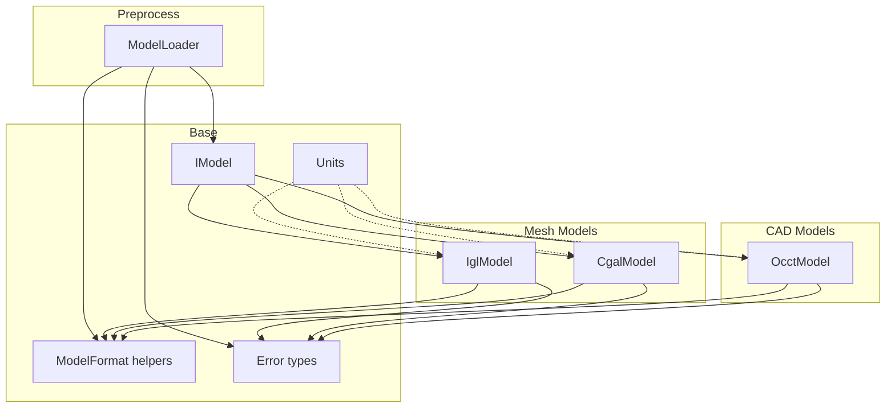
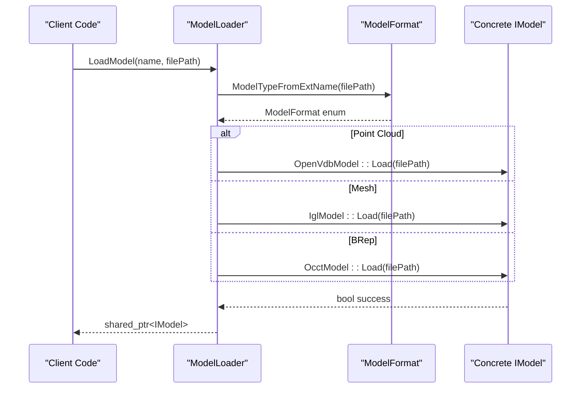
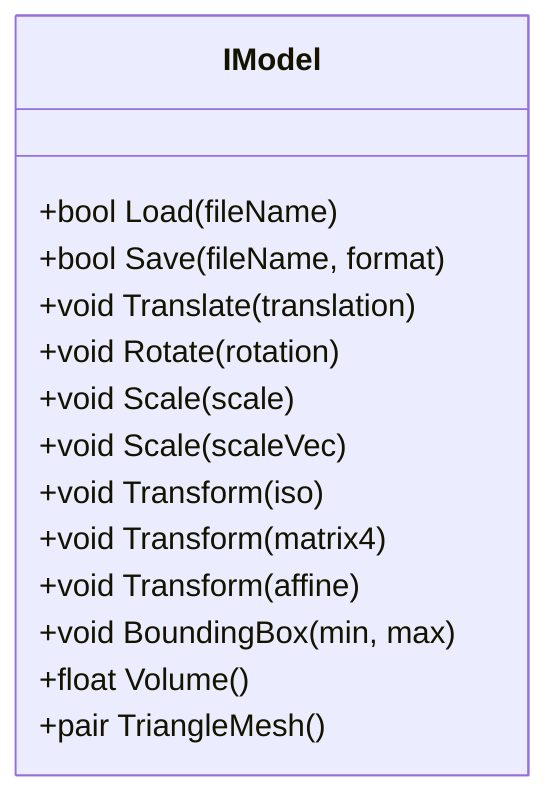
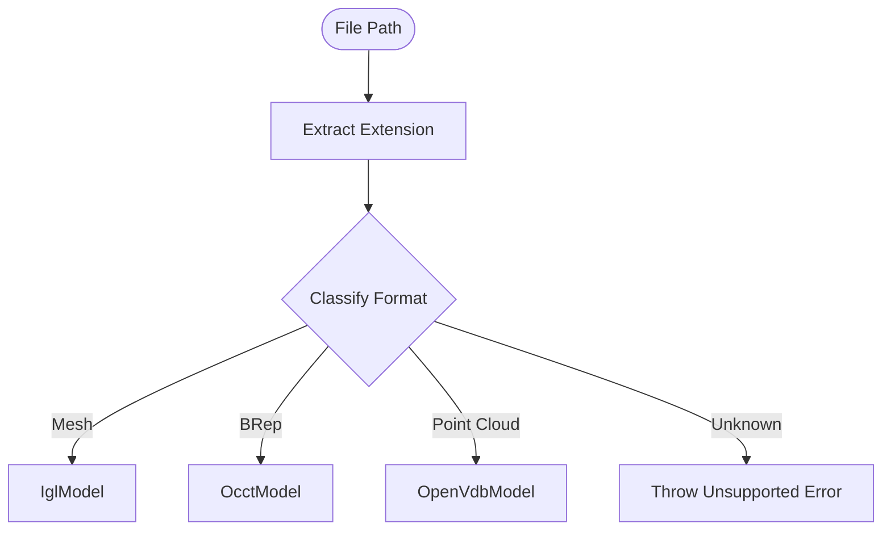
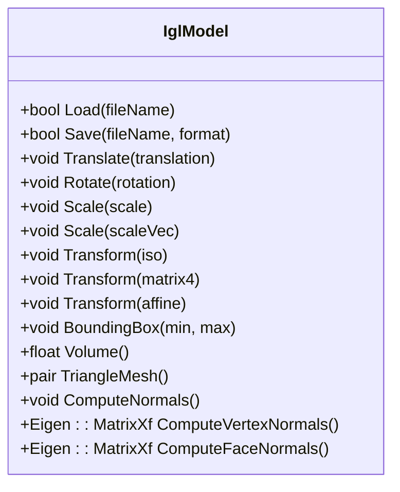
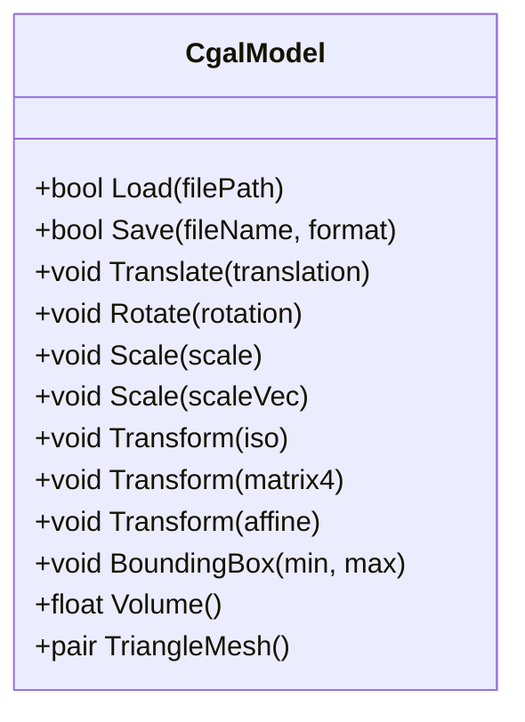
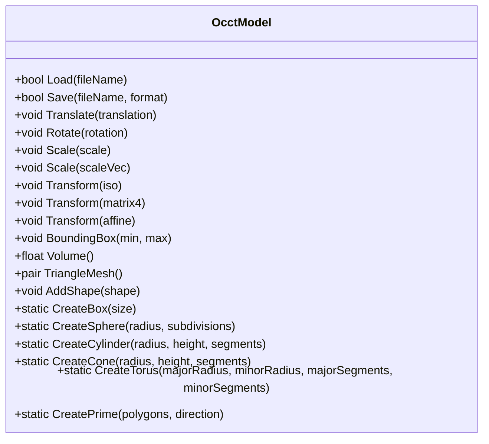
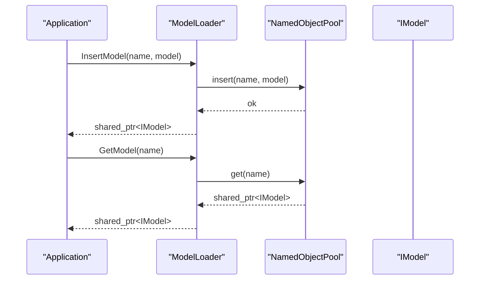
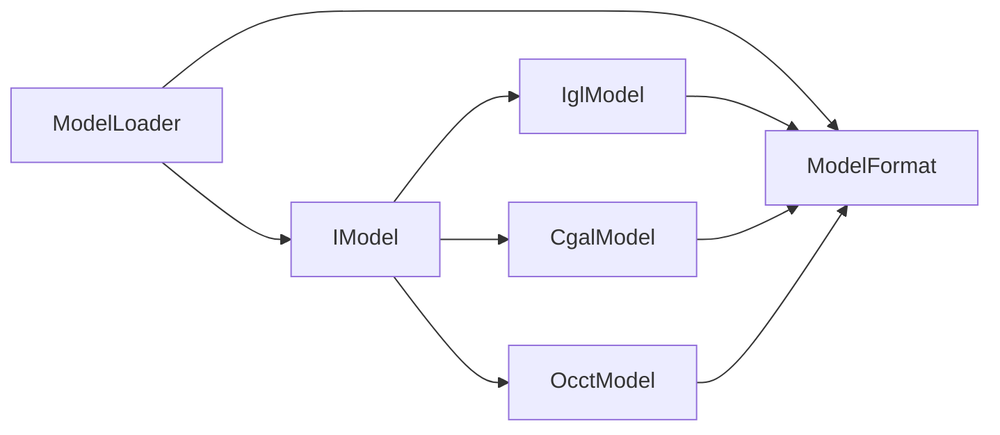

# Custom Model Formats

<cite>
**Referenced Files in This Document**
- [IModel.hpp](file://base/IModel.hpp)
- [ModelFormat.hpp](file://base/ModelFormat.hpp)
- [ModelFormat.cpp](file://base/ModelFormat.cpp)
- [error.hpp](file://base/error.hpp)
- [units.hpp](file://base/units.hpp)
- [ModelLoader.hpp](file://preprocess/ModelLoader.hpp)
- [ModelLoader.cpp](file://preprocess/ModelLoader.cpp)
- [OcctModel.hpp](file://cadmodel/OcctModel.hpp)
- [OcctModel.cpp](file://cadmodel/OcctModel.cpp)
- [CgalModel.hpp](file://meshmodel/CgalModel.hpp)
- [CgalModel.cpp](file://meshmodel/CgalModel.cpp)
- [IglModel.hpp](file://meshmodel/IglModel.hpp)
- [IglModel.cpp](file://meshmodel/IglModel.cpp)
</cite>

## Table of Contents
1. [Introduction](#introduction)
2. [Project Structure](#project-structure)
3. [Core Components](#core-components)
4. [Architecture Overview](#architecture-overview)
5. [Detailed Component Analysis](#detailed-component-analysis)
6. [Dependency Analysis](#dependency-analysis)
7. [Performance Considerations](#performance-considerations)
8. [Troubleshooting Guide](#troubleshooting-guide)
9. [Conclusion](#conclusion)
10. [Appendices](#appendices)

## Introduction
This document explains how to implement and integrate custom model formats into HsBaSlicer. It focuses on the IModel interface, the loader dispatch system, coordinate systems, mesh validation, error reporting, metadata handling, unit conversion, optimization techniques, performance considerations for large models, memory management, threading safety, and troubleshooting guidance. It includes complete examples for CAD-based models (OpenCASCADE) and mesh-based models (CGAL or libigl).

## Project Structure
The model format subsystem is centered around:
- A common model abstraction IModel
- Format detection utilities
- A unified loader that selects a concrete model implementation based on file extension
- Concrete implementations for mesh models (libigl, CGAL) and CAD models (OpenCASCADE)

**Diagram sources**
- [IModel.hpp:111-139](file://base/IModel.hpp#L111-L139)
- [ModelFormat.hpp:19-114](file://base/ModelFormat.hpp#L19-L114)
- [ModelFormat.cpp:14-99](file://base/ModelFormat.cpp#L14-L99)
- [ModelLoader.hpp:30-89](file://preprocess/ModelLoader.hpp#L30-L89)
- [ModelLoader.cpp:45-84](file://preprocess/ModelLoader.cpp#L45-L84)
- [IglModel.hpp:26-82](file://meshmodel/IglModel.hpp#L26-L82)
- [CgalModel.hpp:34-82](file://meshmodel/CgalModel.hpp#L34-L82)
- [OcctModel.hpp:30-81](file://cadmodel/OcctModel.hpp#L30-L81)

**Section sources**
- [IModel.hpp:111-139](file://base/IModel.hpp#L111-L139)
- [ModelFormat.hpp:19-114](file://base/ModelFormat.hpp#L19-L114)
- [ModelFormat.cpp:14-99](file://base/ModelFormat.cpp#L14-L99)
- [ModelLoader.hpp:30-89](file://preprocess/ModelLoader.hpp#L30-L89)
- [ModelLoader.cpp:45-84](file://preprocess/ModelLoader.cpp#L45-L84)

## Core Components
- IModel: The abstract base defining load/save, transformations, bounding box, volume, and triangle mesh extraction.
- ModelFormat: Enumerates supported formats and provides helper functions to classify formats by extension.
- ModelLoader: Unified loader that detects format from extension and instantiates the appropriate model type; also manages a named pool of loaded models.
- IglModel: Mesh model backed by libigl with STL/OBJ/PLY/OFF support, normals computation, and boolean operations via CGAL when available.
- CgalModel: Polyhedral mesh model backed by CGAL with robust boolean operations and surface geometry utilities.
- OcctModel: BRep CAD model backed by OpenCASCADE supporting STEP/IGES/VRML/BREP, thick-solid, primitives, and boolean operations.

Key responsibilities:
- Load/Save: Each model implements Load(fileName) and Save(fileName, format).
- Transformations: Translate, Rotate, Scale, Transform overloads are provided consistently across implementations.
- Geometry queries: BoundingBox, Volume, TriangleMesh.

**Section sources**
- [IModel.hpp:111-139](file://base/IModel.hpp#L111-L139)
- [ModelFormat.hpp:19-114](file://base/ModelFormat.hpp#L19-L114)
- [ModelLoader.hpp:30-89](file://preprocess/ModelLoader.hpp#L30-L89)
- [IglModel.hpp:26-82](file://meshmodel/IglModel.hpp#L26-L82)
- [CgalModel.hpp:34-82](file://meshmodel/CgalModel.hpp#L34-L82)
- [OcctModel.hpp:30-81](file://cadmodel/OcctModel.hpp#L30-L81)

## Architecture Overview
The pipeline integrates model loading through ModelLoader, which routes to concrete implementations based on file extensions. Consumers interact only with IModel, enabling pluggable backends.

**Diagram sources**
- [ModelLoader.cpp:45-84](file://preprocess/ModelLoader.cpp#L45-L84)
- [ModelFormat.cpp:95-99](file://base/ModelFormat.cpp#L95-L99)
- [IglModel.cpp:64-70](file://meshmodel/IglModel.cpp#L64-L70)
- [CgalModel.cpp:121-131](file://meshmodel/CgalModel.cpp#L121-L131)
- [OcctModel.cpp:213-237](file://cadmodel/OcctModel.cpp#L213-L237)

## Detailed Component Analysis

### IModel Interface
Required virtual methods:
- Load(fileName): Load model from file path.
- Save(fileName, format): Save model to file in specified format.
- Translate(translation), Rotate(rotation), Scale(scale), Transform(transform overloads): Apply geometric transforms.
- BoundingBox(min, max): Compute axis-aligned bounding box.
- Volume(): Compute signed volume.
- TriangleMesh(): Return vertices and faces in libigl style.

Coordinate system:
- Eigen vectors and matrices are used throughout.
- Transformations use row-major storage conventions in mesh models; see per-implementation notes below.

Error handling:
- Implementations throw domain-specific exceptions derived from RuntimeError.

**Diagram sources**
- [IModel.hpp:111-139](file://base/IModel.hpp#L111-L139)

**Section sources**
- [IModel.hpp:111-139](file://base/IModel.hpp#L111-L139)

### Model Format Detection and Registration
- ModelTypeFromExtName maps file extensions to ModelFormat enums.
- IsMeshFormat/IsBrepFormat/IsPointCloudFormat categorize formats.
- ModelLoader uses these helpers to select the correct backend.

Supported categories:
- Mesh: STL, OBJ, PLY, OFF
- BRep: STEP, IGES, VRML, BREP
- Point Cloud: XYZ, VDB

**Diagram sources**
- [ModelFormat.cpp:14-99](file://base/ModelFormat.cpp#L14-L99)
- [ModelLoader.cpp:45-84](file://preprocess/ModelLoader.cpp#L45-L84)

**Section sources**
- [ModelFormat.hpp:19-114](file://base/ModelFormat.hpp#L19-L114)
- [ModelFormat.cpp:14-99](file://base/ModelFormat.cpp#L14-L99)
- [ModelLoader.hpp:30-89](file://preprocess/ModelLoader.hpp#L30-L89)
- [ModelLoader.cpp:45-84](file://preprocess/ModelLoader.cpp#L45-L84)

### Mesh-Based Models: IglModel and CgalModel

#### IglModel
- Backed by libigl; supports STL/OBJ/PLY/OFF.
- Provides normals computation and boolean operations via CGAL when enabled.
- Transformation implementations respect row-major vertex storage.

Key behaviors:
- Load reads triangle meshes using libigl.
- Save writes to supported mesh formats.
- BoundingBox uses column-wise min/max over vertices.
- Volume computes signed volume via tetrahedralization.

**Diagram sources**
- [IglModel.hpp:26-82](file://meshmodel/IglModel.hpp#L26-L82)
- [IglModel.cpp:64-99](file://meshmodel/IglModel.cpp#L64-L99)
- [IglModel.cpp:101-150](file://meshmodel/IglModel.cpp#L101-L150)
- [IglModel.cpp:152-193](file://meshmodel/IglModel.cpp#L152-L193)

**Section sources**
- [IglModel.hpp:26-82](file://meshmodel/IglModel.hpp#L26-L82)
- [IglModel.cpp:64-99](file://meshmodel/IglModel.cpp#L64-L99)
- [IglModel.cpp:101-150](file://meshmodel/IglModel.cpp#L101-L150)
- [IglModel.cpp:152-193](file://meshmodel/IglModel.cpp#L152-L193)

#### CgalModel
- Backed by CGAL polyhedron; supports mesh IO and robust boolean operations.
- Includes advanced surface geometry utilities (geodesic paths, spirals, helixes).

Key behaviors:
- Load reads polygon meshes and triangulates faces.
- Save writes to STL/PLY/OBJ/OFF depending on format.
- Transformations apply affine transforms to the underlying mesh.
- Volume uses CGAL’s polygon mesh processing.

**Diagram sources**
- [CgalModel.hpp:34-82](file://meshmodel/CgalModel.hpp#L34-L82)
- [CgalModel.cpp:121-157](file://meshmodel/CgalModel.cpp#L121-L157)
- [CgalModel.cpp:158-204](file://meshmodel/CgalModel.cpp#L158-L204)
- [CgalModel.cpp:206-237](file://meshmodel/CgalModel.cpp#L206-L237)

**Section sources**
- [CgalModel.hpp:34-82](file://meshmodel/CgalModel.hpp#L34-L82)
- [CgalModel.cpp:121-157](file://meshmodel/CgalModel.cpp#L121-L157)
- [CgalModel.cpp:158-204](file://meshmodel/CgalModel.cpp#L158-L204)
- [CgalModel.cpp:206-237](file://meshmodel/CgalModel.cpp#L206-L237)

### CAD-Based Models: OcctModel
- Backed by OpenCASCADE TopoDS_Shape; supports STEP/IGES/VRML/BREP.
- Provides boolean operations, thick-solid, and primitive factories.

Key behaviors:
- Load dispatches to reader functions based on format.
- Save dispatches to writer functions based on format.
- AddShape merges shapes into a compound.
- Transformations and geometry queries operate on the underlying shape.

**Diagram sources**
- [OcctModel.hpp:30-124](file://cadmodel/OcctModel.hpp#L30-L124)
- [OcctModel.cpp:213-237](file://cadmodel/OcctModel.cpp#L213-L237)
- [OcctModel.cpp:238-250](file://cadmodel/OcctModel.cpp#L238-L250)

**Section sources**
- [OcctModel.hpp:30-124](file://cadmodel/OcctModel.hpp#L30-L124)
- [OcctModel.cpp:213-237](file://cadmodel/OcctModel.cpp#L213-L237)
- [OcctModel.cpp:238-250](file://cadmodel/OcctModel.cpp#L238-L250)

### Model Registration and Pipeline Integration
- ModelLoader.LoadModel determines the format and constructs the appropriate model instance.
- The loader stores models in a NamedObjectPool keyed by name.
- Advanced operations (thick-solid, boolean) are exposed via ModelLoader and delegate to concrete implementations.

**Diagram sources**
- [ModelLoader.hpp:70-89](file://preprocess/ModelLoader.hpp#L70-L89)
- [ModelLoader.cpp:98-130](file://preprocess/ModelLoader.cpp#L98-L130)

**Section sources**
- [ModelLoader.hpp:30-89](file://preprocess/ModelLoader.hpp#L30-L89)
- [ModelLoader.cpp:98-130](file://preprocess/ModelLoader.cpp#L98-L130)

### Coordinate System Handling
- All models use right-handed coordinates with units typically in meters or millimeters depending on input data.
- Transformations are applied consistently:
  - IglModel applies row-wise homogeneous transforms and updates normals accordingly.
  - CgalModel converts Eigen transforms to CGAL affine transformations.
  - OcctModel uses OpenCASCADE transformation APIs.

Best practices:
- Ensure consistent units across the pipeline; convert at import time if necessary.
- Validate orientation after transformations; check volume sign where applicable.

**Section sources**
- [IglModel.cpp:101-150](file://meshmodel/IglModel.cpp#L101-L150)
- [CgalModel.cpp:158-204](file://meshmodel/CgalModel.cpp#L158-L204)
- [OcctModel.cpp:213-237](file://cadmodel/OcctModel.cpp#L213-L237)

### Mesh Validation and Error Reporting
- IglModel and CgalModel validate inputs during construction and IO; they throw errors on invalid data.
- OcctModel wraps OCCT failures in IOError.
- ModelLoader throws InvalidArgumentError or RuntimeError for unsupported formats or missing models.

Common exceptions:
- RuntimeError: General runtime issues.
- InvalidArgumentError: Invalid arguments or unsupported formats.
- IOError: File I/O failures.
- NotSupportedError: Feature not available in current build configuration.

**Section sources**
- [IglModel.cpp:64-99](file://meshmodel/IglModel.cpp#L64-L99)
- [CgalModel.cpp:121-157](file://meshmodel/CgalModel.cpp#L121-L157)
- [OcctModel.cpp:76-147](file://cadmodel/OcctModel.cpp#L76-L147)
- [ModelLoader.cpp:45-84](file://preprocess/ModelLoader.cpp#L45-L84)
- [error.hpp:20-144](file://base/error.hpp#L20-L144)

### Metadata Handling and Unit Conversion
- Units are defined via Boost.Units literals for length, mass, energy, time, etc.
- Use units to normalize model dimensions before slicing or exporting.
- For CAD models, ensure STEP/IGES units match application expectations; convert if needed.

Recommended workflow:
- Detect units from metadata or assume default (e.g., mm for STL/OBJ).
- Convert to internal units (meters) using units helpers.
- Store unit information alongside model metadata for downstream consumers.

**Section sources**
- [units.hpp:126-254](file://base/units.hpp#L126-L254)
- [units.hpp:453-566](file://base/units.hpp#L453-L566)

### Model Optimization Techniques
- Tessellation control:
  - For CAD models, control tessellation density when extracting TriangleMesh to balance accuracy and performance.
- Mesh repair:
  - CgalModel attempts to orient and repair polygon soup when constructing from raw meshes.
- Normal computation:
  - IglModel can compute face/vertex normals on demand to avoid unnecessary work.
- Boolean operations:
  - Prefer OcctModel for robust CSG when available; otherwise fallback to CGAL-backed mesh booleans.

**Section sources**
- [CgalModel.cpp:42-119](file://meshmodel/CgalModel.cpp#L42-L119)
- [IglModel.cpp:170-185](file://meshmodel/IglModel.cpp#L170-L185)
- [IglModel.cpp:195-245](file://meshmodel/IglModel.cpp#L195-L245)

## Dependency Analysis

**Diagram sources**
- [IModel.hpp:111-139](file://base/IModel.hpp#L111-L139)
- [ModelLoader.hpp:30-89](file://preprocess/ModelLoader.hpp#L30-L89)
- [ModelFormat.hpp:19-114](file://base/ModelFormat.hpp#L19-L114)

**Section sources**
- [IModel.hpp:111-139](file://base/IModel.hpp#L111-L139)
- [ModelLoader.hpp:30-89](file://preprocess/ModelLoader.hpp#L30-L89)
- [ModelFormat.hpp:19-114](file://base/ModelFormat.hpp#L19-L114)

## Performance Considerations
- Large models:
  - Avoid unnecessary conversions between representations; prefer working in the native representation (OCCT for CAD, CGAL for polyhedra, libigl for meshes).
  - Limit tessellation resolution when extracting TriangleMesh from CAD models.
- Memory management:
  - Use shared pointers and the NamedObjectPool to manage lifecycle; call Cleanup to release unreferenced models.
- Threading safety:
  - ModelLoader is non-copyable and holds a unique pool; avoid concurrent modifications to the same model instance.
  - Operations like boolean computations may be CPU-intensive; consider offloading to background threads while keeping UI responsive.

[No sources needed since this section provides general guidance]

## Troubleshooting Guide
Common issues and resolutions:
- Unsupported model format:
  - Ensure the file extension matches one of the supported categories; verify ModelTypeFromExtName mapping.
- Missing optional dependencies:
  - BRep formats require USE_OCCT; point cloud formats require USE_OPENVDB. Build with appropriate flags or handle NotSupportedError gracefully.
- Invalid mesh data:
  - Check for non-manifold edges, duplicate vertices, or inconsistent winding; use CgalModel’s repair routines or preprocess with external tools.
- Incorrect units:
  - Normalize units at import; verify bounding box and volume values to detect scale mismatches.
- Errors propagation:
  - Catch RuntimeError and its subclasses to provide user-friendly messages; log the original exception details for debugging.

**Section sources**
- [ModelLoader.cpp:45-84](file://preprocess/ModelLoader.cpp#L45-L84)
- [error.hpp:20-144](file://base/error.hpp#L20-L144)

## Conclusion
HsBaSlicer provides a clean abstraction via IModel and a flexible loader that routes to specialized backends. By implementing Load/Save, transformations, and geometry queries, you can integrate new formats seamlessly. Use ModelFormat helpers for classification, adhere to consistent units, and leverage existing optimizations and error handling to ensure robust integration.

[No sources needed since this section summarizes without analyzing specific files]

## Appendices

### Example: Implementing a New Mesh-Based Model (libigl)
Steps:
- Derive from IModel.
- Implement Load/Save using libigl readers/writers.
- Implement transformations respecting row-major storage.
- Provide BoundingBox, Volume, and TriangleMesh.
- Integrate with ModelLoader by registering format detection and instantiation.

Reference paths:
- [IglModel.cpp:64-99](file://meshmodel/IglModel.cpp#L64-L99)
- [IglModel.cpp:101-150](file://meshmodel/IglModel.cpp#L101-L150)
- [IglModel.cpp:152-193](file://meshmodel/IglModel.cpp#L152-L193)

### Example: Implementing a New CAD-Based Model (OpenCASCADE)
Steps:
- Derive from IModel.
- Implement Load/Save using OCCT readers/writers.
- Implement transformations using OCCT transformation APIs.
- Provide BoundingBox, Volume, and TriangleMesh via tessellation.
- Optionally expose boolean operations and primitives.

Reference paths:
- [OcctModel.cpp:76-147](file://cadmodel/OcctModel.cpp#L76-L147)
- [OcctModel.cpp:213-237](file://cadmodel/OcctModel.cpp#L213-L237)
- [OcctModel.cpp:238-250](file://cadmodel/OcctModel.cpp#L238-L250)