# Extension Development

<cite>
**Referenced Files in This Document**
- [README.md](file://README.md)
- [pipeline_types.h](file://pipelinetypes/pipeline_types.h)
- [hsba_slicer.cppm](file://ModuleHsBaSlicer/hsba_slicer.cppm)
- [initialize.h](file://DllHsBaSlicer/initialize.h)
- [initialize.cpp](file://DllHsBaSlicer/initialize.cpp)
- [lua_register.h](file://DllHsBaSlicer/lua_register.h)
- [lua_register.cpp](file://DllHsBaSlicer/lua_register.cpp)
- [LuaAddFunction.hpp](file://LibHsBaSlicer/Extends/LuaAddFunction.hpp)
- [EventSourceFunction.hpp](file://LibHsBaSlicer/Extends/EventSourceFunction.hpp)
- [param_reflect.hpp](file://fileoperator/param_reflect.hpp)
- [custom_pipeline.proto](file://proto/custom_pipeline.proto)
</cite>

## Table of Contents
1. [Introduction](#introduction)
2. [Project Structure](#project-structure)
3. [Core Components](#core-components)
4. [Architecture Overview](#architecture-overview)
5. [Detailed Component Analysis](#detailed-component-analysis)
6. [Dependency Analysis](#dependency-analysis)
7. [Performance Considerations](#performance-considerations)
8. [Troubleshooting Guide](#troubleshooting-guide)
9. [Conclusion](#conclusion)
10. [Appendices](#appendices)

## Introduction
This document explains how to develop extensions for HsBaSlicer, including:
- Implementing new slicing algorithms through the plugin architecture and Lua extension points.
- Adding support for new manufacturing processes by defining pipeline stages, export formats, and configuration schemas.
- Developing custom algorithms using strategy-style selection between built-in and Lua implementations.
- Testing custom extensions, integrating third-party libraries, and packaging distributions.
- Using the event system for inter-component communication, callback registration, and asynchronous processing.
- Debugging, profiling, and distributing extensions alongside HsBaSlicer.

HsBaSlicer is a modular, cross-platform C++ framework for 3D-printing slicers with both a C ABI shared library (`DllHsBaSlicer`) and a C++ module API (`hsba.slicer`). Extensions typically integrate at three levels:
- C ABI level via `DllHsBaSlicer` (C entry points, Lua function/event registration).
- Lib layer via `LibHsBaSlicer` (Lua environment injection, event sources).
- Module/API level via `ModuleHsBaSlicer` (C++ classes such as `FdmPipeline`, `SlaPipeline`, `CustomLuaPipeline`).

**Section sources**
- [README.md:21-39](file://README.md#L21-L39)
- [README.md:104-124](file://README.md#L104-L124)

## Project Structure
The extension surface spans several modules:

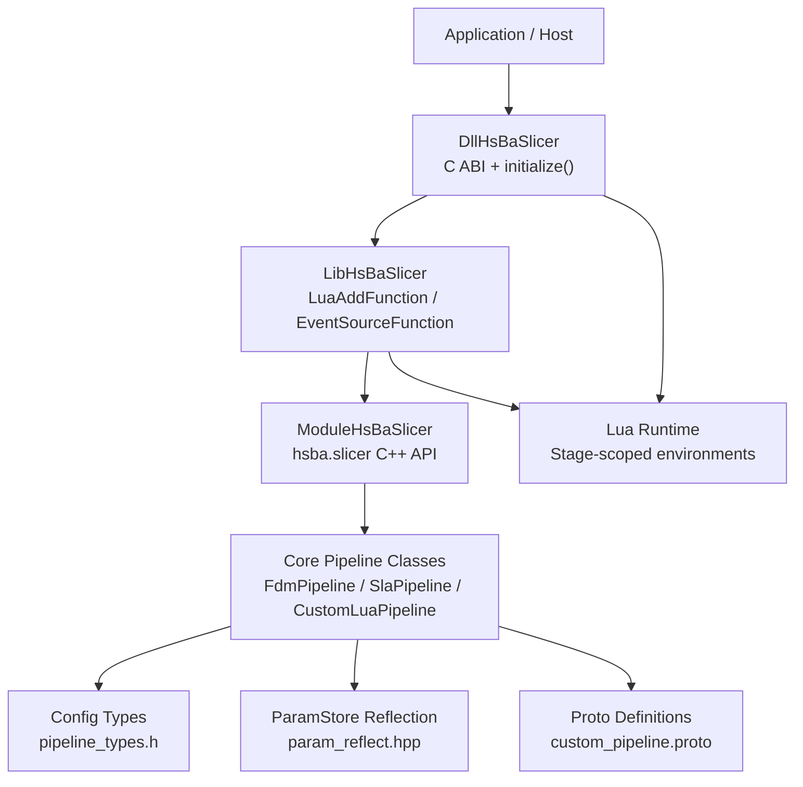

**Diagram sources**
- [initialize.h:1-22](file://DllHsBaSlicer/initialize.h#L1-L22)
- [lua_register.h:1-38](file://DllHsBaSlicer/lua_register.h#L1-L38)
- [LuaAddFunction.hpp:1-78](file://LibHsBaSlicer/Extends/LuaAddFunction.hpp#L1-L78)
- [EventSourceFunction.hpp:1-44](file://LibHsBaSlicer/Extends/EventSourceFunction.hpp#L1-L44)
- [hsba_slicer.cppm:1-120](file://ModuleHsBaSlicer/hsba_slicer.cppm#L1-L120)
- [pipeline_types.h:1-120](file://pipelinetypes/pipeline_types.h#L1-L120)
- [param_reflect.hpp:1-419](file://fileoperator/param_reflect.hpp#L1-L419)
- [custom_pipeline.proto:1-25](file://proto/custom_pipeline.proto#L1-L25)

**Section sources**
- [README.md:29-38](file://README.md#L29-L38)
- [README.md:126-151](file://README.md#L126-L151)

## Core Components
For extension development, focus on these core components:

- C ABI initialization and registration:
  - `initialize()` is the DLL entry point for one-time setup.
  - `lua_register.h` exposes `HsBaAdd2DFunction`, `HsBaAdd3DFunction`, `HsBaAddFileFunction`, and `HsBaAddEventCallback`.

- Lib-side Lua extension registry:
  - `LuaAddFunction.hpp` provides `Add2DFunctions`, `Add3DFunctions`, `AddFileFunctions`, and named event callbacks.

- Event source callbacks:
  - `EventSourceFunction.hpp` exposes Zipper and Database event callback registration.

- C++ API pipeline classes:
  - `hsba_slicer.cppm` defines `FdmPipeline`, `SlaPipeline`, `SlsPipeline`, `SlmPipeline`, `LomPipeline`, `TdpPipeline`, `WaamPipeline`, `FileTransferPipeline`, `ParamStorePipeline`, and `CustomLuaPipeline`.

- Configuration schema:
  - `pipeline_types.h` defines all pipeline config/result structs and default initializers.
  - `param_reflect.hpp` registers reflection metadata for ParamStore persistence.
  - `custom_pipeline.proto` defines the protobuf representation of the fully Lua-driven custom pipeline.

**Section sources**
- [initialize.h:1-22](file://DllHsBaSlicer/initialize.h#L1-L22)
- [lua_register.h:1-38](file://DllHsBaSlicer/lua_register.h#L1-L38)
- [LuaAddFunction.hpp:1-78](file://LibHsBaSlicer/Extends/LuaAddFunction.hpp#L1-L78)
- [EventSourceFunction.hpp:1-44](file://LibHsBaSlicer/Extends/EventSourceFunction.hpp#L1-L44)
- [hsba_slicer.cppm:129-146](file://ModuleHsBaSlicer/hsba_slicer.cppm#L129-L146)
- [hsba_slicer.cppm:204-479](file://ModuleHsBaSlicer/hsba_slicer.cppm#L204-L479)
- [pipeline_types.h:23-127](file://pipelinetypes/pipeline_types.h#L23-L127)
- [param_reflect.hpp:55-105](file://fileoperator/param_reflect.hpp#L55-L105)
- [custom_pipeline.proto:1-25](file://proto/custom_pipeline.proto#L1-L25)

## Architecture Overview
The extension architecture separates concerns across layers:

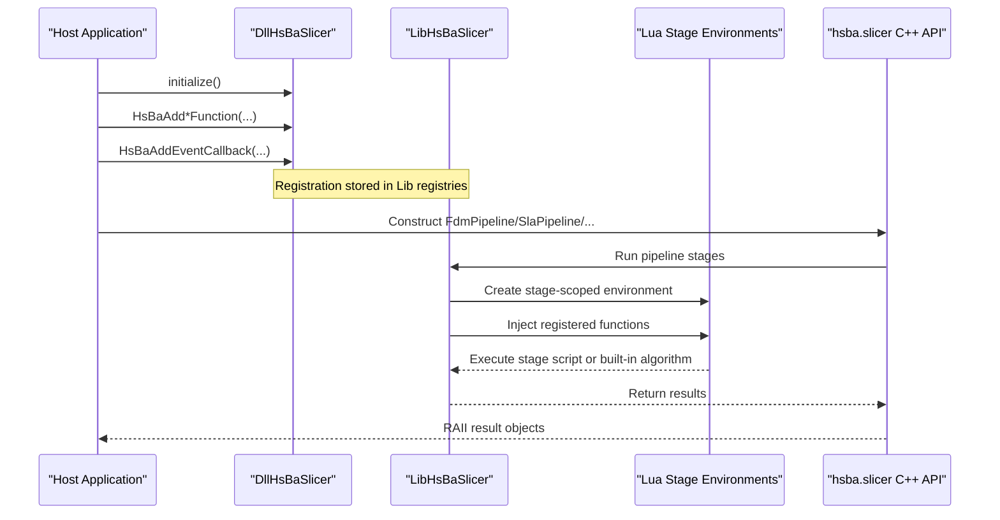

**Diagram sources**
- [initialize.cpp:1-10](file://DllHsBaSlicer/initialize.cpp#L1-L10)
- [lua_register.cpp:1-43](file://DllHsBaSlicer/lua_register.cpp#L1-L43)
- [LuaAddFunction.hpp:24-74](file://LibHsBaSlicer/Extends/LuaAddFunction.hpp#L24-L74)
- [hsba_slicer.cppm:617-751](file://ModuleHsBaSlicer/hsba_slicer.cppm#L617-L751)

## Detailed Component Analysis

### Plugin Architecture Patterns
HsBaSlicer supports two complementary plugin patterns:

- Strategy pattern via configuration fields:
  - Many pipelines expose Lua script/function fields that select between built-in algorithms and user-provided scripts. For example, FDM support and infill can be driven by Lua when configured.
  - SLA floor generation and export can also be replaced by Lua scripts.

- Fully Lua-driven workflow:
  - The custom pipeline lets the entire stage order and content be defined by a Lua entry function, while the C++ side exposes building blocks through the global `HsBa` table.

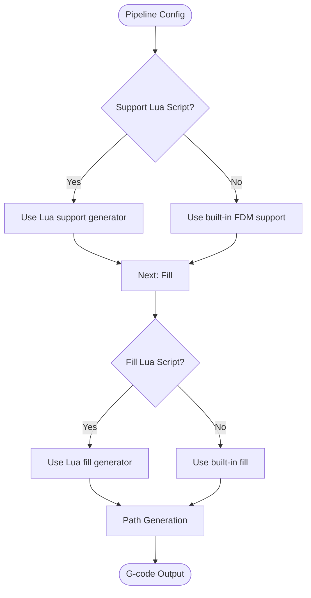

**Diagram sources**
- [hsba_slicer.cppm:640-702](file://ModuleHsBaSlicer/hsba_slicer.cppm#L640-L702)
- [hsba_slicer.cppm:757-791](file://ModuleHsBaSlicer/hsba_slicer.cppm#L757-L791)
- [pipeline_types.h:104-113](file://pipelinetypes/pipeline_types.h#L104-L113)
- [pipeline_types.h:204-217](file://pipelinetypes/pipeline_types.h#L204-L217)

**Section sources**
- [hsba_slicer.cppm:640-702](file://ModuleHsBaSlicer/hsba_slicer.cppm#L640-L702)
- [hsba_slicer.cppm:757-791](file://ModuleHsBaSlicer/hsba_slicer.cppm#L757-L791)
- [pipeline_types.h:104-113](file://pipelinetypes/pipeline_types.h#L104-L113)
- [pipeline_types.h:204-217](file://pipelinetypes/pipeline_types.h#L204-L217)

### Interface Implementation and Registration Mechanisms
To extend HsBaSlicer externally:

1. Initialize the DLL once:
   - Call `initialize()` during host startup.

2. Register external Lua functions:
   - Use `HsBaAdd2DFunction`, `HsBaAdd3DFunction`, `HsBaAddFileFunction` to inject stage-scoped functions.
   - These are forwarded to `HsBa::Slicer::Add*Functions`.

3. Register event callbacks:
   - Use `HsBaAddEventCallback` to bind named events (e.g., zipper or database events).
   - Internally this calls `HsBa::Slicer::AddEventCallback`.

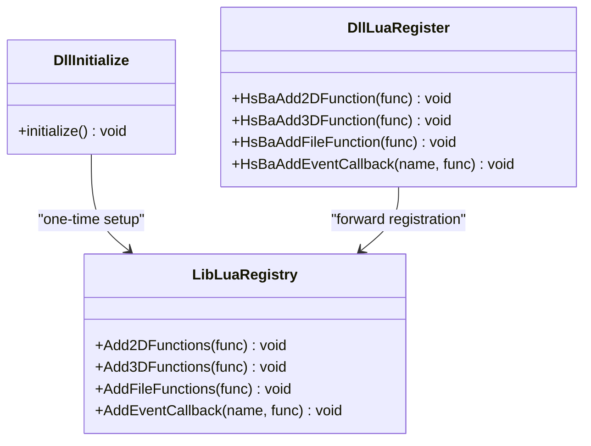

**Diagram sources**
- [initialize.h:1-22](file://DllHsBaSlicer/initialize.h#L1-L22)
- [lua_register.h:1-38](file://DllHsBaSlicer/lua_register.h#L1-L38)
- [lua_register.cpp:1-43](file://DllHsBaSlicer/lua_register.cpp#L1-L43)
- [LuaAddFunction.hpp:24-74](file://LibHsBaSlicer/Extends/LuaAddFunction.hpp#L24-L74)

**Section sources**
- [initialize.h:1-22](file://DllHsBaSlicer/initialize.h#L1-L22)
- [lua_register.h:1-38](file://DllHsBaSlicer/lua_register.h#L1-L38)
- [lua_register.cpp:1-43](file://DllHsBaSlicer/lua_register.cpp#L1-L43)
- [LuaAddFunction.hpp:24-74](file://LibHsBaSlicer/Extends/LuaAddFunction.hpp#L24-L74)

### Adding New Manufacturing Process Support
To add a new manufacturing process:

- Define configuration and result types:
  - Add new structs in `pipeline_types.h` following existing patterns (model, slice, process-specific parameters, Lua hooks, output path).
  - Provide default initializer functions if needed.

- Expose pipeline classes:
  - Add a new pipeline class in `hsba_slicer.cppm` (e.g., `MyProcessPipeline`) with `run()` and optional per-stage helpers.

- Persist configuration:
  - Add reflection metadata in `param_reflect.hpp` so ParamStore can save/load the new config.

- Optionally define protobuf messages:
  - Add messages in `custom_pipeline.proto` if the new process participates in serialized pipeline definitions.

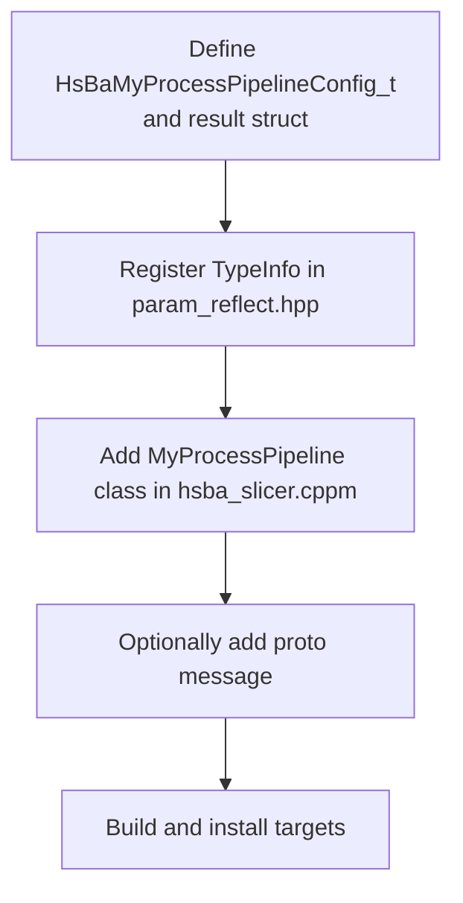

**Diagram sources**
- [pipeline_types.h:56-127](file://pipelinetypes/pipeline_types.h#L56-L127)
- [param_reflect.hpp:55-105](file://fileoperator/param_reflect.hpp#L55-L105)
- [hsba_slicer.cppm:204-225](file://ModuleHsBaSlicer/hsba_slicer.cppm#L204-L225)
- [custom_pipeline.proto:1-25](file://proto/custom_pipeline.proto#L1-L25)

**Section sources**
- [pipeline_types.h:56-127](file://pipelinetypes/pipeline_types.h#L56-L127)
- [param_reflect.hpp:55-105](file://fileoperator/param_reflect.hpp#L55-L105)
- [hsba_slicer.cppm:204-225](file://ModuleHsBaSlicer/hsba_slicer.cppm#L204-L225)
- [custom_pipeline.proto:1-25](file://proto/custom_pipeline.proto#L1-L25)

### Export Format Implementation
Export formats are implemented either:
- Through built-in exporters (e.g., G-code path generation for FDM).
- Through Lua export scripts selected by config fields (e.g., SLA export, SLS export, WAAM path script).

Key integration points:
- FDM path generation uses `GenerateGCodePathV2` and firmware-specific G-code conversion.
- SLA export can use `SaveSlaPackage` or a Lua export function.
- WAAM uses robot-program generation and optional Lua path script.

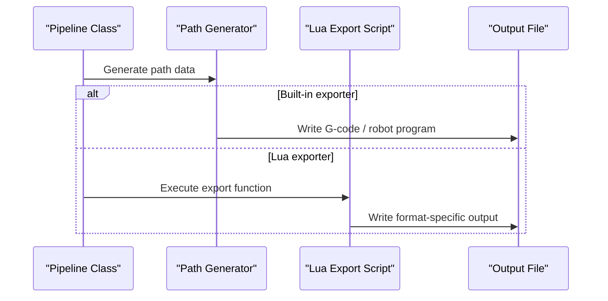

**Diagram sources**
- [hsba_slicer.cppm:677-702](file://ModuleHsBaSlicer/hsba_slicer.cppm#L677-L702)
- [hsba_slicer.cppm:783-791](file://ModuleHsBaSlicer/hsba_slicer.cppm#L783-L791)
- [pipeline_types.h:578-612](file://pipelinetypes/pipeline_types.h#L578-L612)

**Section sources**
- [hsba_slicer.cppm:677-702](file://ModuleHsBaSlicer/hsba_slicer.cppm#L677-L702)
- [hsba_slicer.cppm:783-791](file://ModuleHsBaSlicer/hsba_slicer.cppm#L783-L791)
- [pipeline_types.h:578-612](file://pipelinetypes/pipeline_types.h#L578-L612)

### Configuration Schema Definition
Configuration schemas are defined as C-compatible structs in `pipeline_types.h`. Each struct includes:
- Model inputs.
- Slice parameters.
- Process-specific parameters.
- Optional Lua hooks.
- Output paths and format options.

Reflection metadata in `param_reflect.hpp` maps each field to a type and offset, enabling ParamStore persistence.

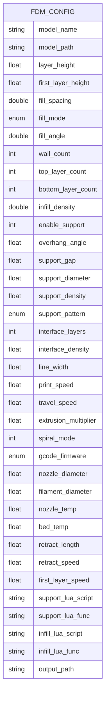

**Diagram sources**
- [pipeline_types.h:56-113](file://pipelinetypes/pipeline_types.h#L56-L113)
- [param_reflect.hpp:55-105](file://fileoperator/param_reflect.hpp#L55-L105)

**Section sources**
- [pipeline_types.h:56-113](file://pipelinetypes/pipeline_types.h#L56-L113)
- [param_reflect.hpp:55-105](file://fileoperator/param_reflect.hpp#L55-L105)

### Custom Algorithm Development
Custom algorithms are best developed using the strategy pattern exposed by pipeline configuration:

- Replace built-in support or fill with Lua scripts by setting `support_lua_script` / `infill_lua_script`.
- Replace SLA floor or export with Lua scripts by setting `floor_lua_script` / `export_lua_script`.
- Use `CustomLuaPipeline` to orchestrate an entirely Lua-defined workflow.

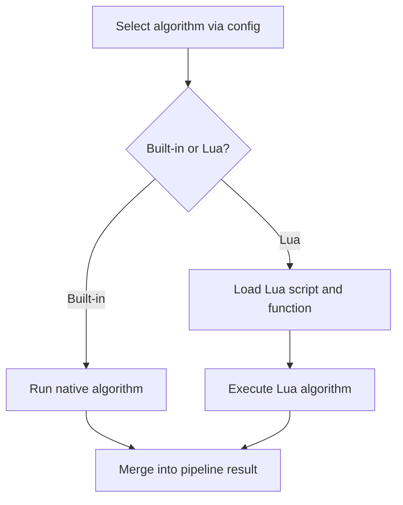

**Diagram sources**
- [hsba_slicer.cppm:640-702](file://ModuleHsBaSlicer/hsba_slicer.cppm#L640-L702)
- [hsba_slicer.cppm:757-791](file://ModuleHsBaSlicer/hsba_slicer.cppm#L757-L791)
- [hsba_slicer.cppm:464-479](file://ModuleHsBaSlicer/hsba_slicer.cppm#L464-L479)

**Section sources**
- [hsba_slicer.cppm:640-702](file://ModuleHsBaSlicer/hsba_slicer.cppm#L640-L702)
- [hsba_slicer.cppm:757-791](file://ModuleHsBaSlicer/hsba_slicer.cppm#L757-L791)
- [hsba_slicer.cppm:464-479](file://ModuleHsBaSlicer/hsba_slicer.cppm#L464-L479)

### Testing Custom Extensions
Recommended testing approach:
- Unit-test C++ pipeline classes using the C++ API (`FdmPipeline`, `SlaPipeline`, `CustomLuaPipeline`).
- Test Lua scripts independently by invoking them through the same Lua environment used by pipeline stages.
- Validate configuration persistence using ParamStore APIs and reflection metadata.

Testing checklist:
- Verify default configs produce expected outputs.
- Verify Lua overrides replace built-in behavior.
- Verify error messages and result lifetimes match documented contracts.

[No sources needed since this section provides general guidance]

### Integrating Third-Party Libraries
Integration steps:
- Link third-party libraries into your extension target.
- Register C/C++ functions via `HsBaAdd2DFunction` / `HsBaAdd3DFunction` / `HsBaAddFileFunction`.
- Expose functionality to Lua stages through the registration callback.

Example integration pattern:
- Wrap third-party C API in a C function.
- Register it under a stable Lua name.
- Consume it from Lua scripts executed by pipeline stages.

**Section sources**
- [lua_register.h:1-38](file://DllHsBaSlicer/lua_register.h#L1-L38)
- [lua_register.cpp:1-43](file://DllHsBaSlicer/lua_register.cpp#L1-L43)

### Event System for Inter-Component Communication
The event system supports:
- Named Lua event callbacks via `HsBaAddEventCallback`.
- C++ event callbacks for Zipper and Database operations via `EventSourceFunction.hpp`.

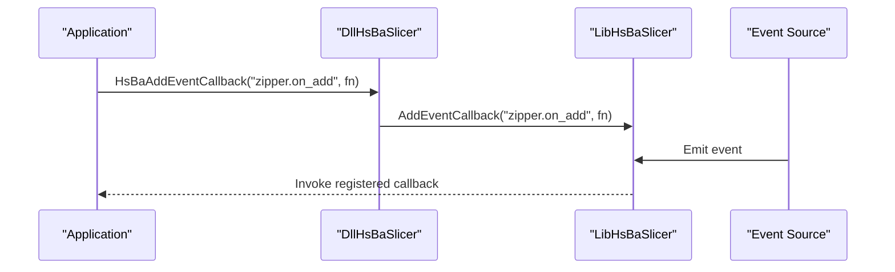

**Diagram sources**
- [lua_register.h:30-31](file://DllHsBaSlicer/lua_register.h#L30-L31)
- [lua_register.cpp:35-41](file://DllHsBaSlicer/lua_register.cpp#L35-L41)
- [LuaAddFunction.hpp:62-74](file://LibHsBaSlicer/Extends/LuaAddFunction.hpp#L62-L74)
- [EventSourceFunction.hpp:18-41](file://LibHsBaSlicer/Extends/EventSourceFunction.hpp#L18-L41)

**Section sources**
- [lua_register.h:30-31](file://DllHsBaSlicer/lua_register.h#L30-L31)
- [lua_register.cpp:35-41](file://DllHsBaSlicer/lua_register.cpp#L35-L41)
- [LuaAddFunction.hpp:62-74](file://LibHsBaSlicer/Extends/LuaAddFunction.hpp#L62-L74)
- [EventSourceFunction.hpp:18-41](file://LibHsBaSlicer/Extends/EventSourceFunction.hpp#L18-L41)

### Asynchronous Processing
Asynchronous processing is modeled through progress and result callback types defined in `pipeline_types.h`:
- Progress callbacks report percentage and stage description.
- Result callbacks deliver pipeline results asynchronously.

These patterns apply to FDM, SLA, SLS, SLM, LOM, TDP, WAAM, file transfer, and custom Lua pipelines.

**Section sources**
- [pipeline_types.h:130-141](file://pipelinetypes/pipeline_types.h#L130-L141)
- [pipeline_types.h:235-245](file://pipelinetypes/pipeline_types.h#L235-L245)
- [pipeline_types.h:300-310](file://pipelinetypes/pipeline_types.h#L300-L310)
- [pipeline_types.h:391-401](file://pipelinetypes/pipeline_types.h#L391-L401)
- [pipeline_types.h:451-461](file://pipelinetypes/pipeline_types.h#L451-L461)
- [pipeline_types.h:511-521](file://pipelinetypes/pipeline_types.h#L511-L521)
- [pipeline_types.h:615-625](file://pipelinetypes/pipeline_types.h#L615-L625)
- [pipeline_types.h:664-674](file://pipelinetypes/pipeline_types.h#L664-L674)
- [pipeline_types.h:721-732](file://pipelinetypes/pipeline_types.h#L721-L732)

## Dependency Analysis
Extension dependencies follow a clear direction:

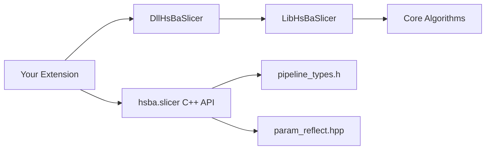

**Diagram sources**
- [README.md:104-124](file://README.md#L104-L124)
- [hsba_slicer.cppm:1-63](file://ModuleHsBaSlicer/hsba_slicer.cppm#L1-L63)
- [pipeline_types.h:1-12](file://pipelinetypes/pipeline_types.h#L1-L12)
- [param_reflect.hpp:1-15](file://fileoperator/param_reflect.hpp#L1-L15)

**Section sources**
- [README.md:104-124](file://README.md#L104-L124)
- [hsba_slicer.cppm:1-63](file://ModuleHsBaSlicer/hsba_slicer.cppm#L1-L63)
- [pipeline_types.h:1-12](file://pipelinetypes/pipeline_types.h#L1-L12)
- [param_reflect.hpp:1-15](file://fileoperator/param_reflect.hpp#L1-L15)

## Performance Considerations
Guidelines for performance-aware extensions:
- Prefer built-in algorithms where possible; only override with Lua when necessary.
- Avoid heavy work inside Lua callbacks; delegate to optimized C/C++ code and expose it via registration functions.
- Reuse pipeline instances when running multiple models to reduce setup overhead.
- Profile critical stages (slice, support, fill, path generation) using timing fields in pipeline results.
- Use appropriate precision (integer vs double polygons) based on downstream requirements.

[No sources needed since this section provides general guidance]

## Troubleshooting Guide
Common issues and resolutions:
- Memory ownership:
  - Ensure you free dynamically allocated strings returned by pipeline results using the matching free functions documented in the C ABI.
- String lifetime:
  - Keep `const char*` config fields valid for the duration of pipeline execution.
- Event callback registration:
  - Ensure registration function pointers remain valid for the process lifetime.
- Parameter store errors:
  - If encountering unregistered pipeline kind errors, verify that reflection metadata is present and initialized.

**Section sources**
- [pipeline_types.h:118-127](file://pipelinetypes/pipeline_types.h#L118-L127)
- [pipeline_types.h:220-232](file://pipelinetypes/pipeline_types.h#L220-L232)
- [pipeline_types.h:285-297](file://pipelinetypes/pipeline_types.h#L285-L297)
- [pipeline_types.h:378-388](file://pipelinetypes/pipeline_types.h#L378-L388)
- [pipeline_types.h:438-448](file://pipelinetypes/pipeline_types.h#L438-L448)
- [pipeline_types.h:498-508](file://pipelinetypes/pipeline_types.h#L498-L508)
- [pipeline_types.h:602-612](file://pipelinetypes/pipeline_types.h#L602-L612)
- [pipeline_types.h:649-661](file://pipelinetypes/pipeline_types.h#L649-L661)
- [pipeline_types.h:706-719](file://pipelinetypes/pipeline_types.h#L706-L719)

## Conclusion
HsBaSlicer’s extension model combines:
- A stable C ABI for external integration.
- A flexible Lua environment for stage-level customization.
- A strong C++ API for high-performance pipeline orchestration.
- Robust configuration reflection for persistence.
- An event system for inter-component communication.

By following the patterns described here—strategy-based algorithm selection, explicit configuration schemas, staged Lua extension points, and careful memory/event management—you can implement new slicing algorithms, add manufacturing process support, and integrate third-party libraries safely and efficiently.

[No sources needed since this section summarizes without analyzing specific files]

## Appendices

### Complete Example Workflow: Creating a Custom Plugin
Steps:
1. Initialize the DLL and register Lua functions.
2. Configure a pipeline (e.g., FDM or SLA) to use your Lua algorithm.
3. Run the pipeline and handle results.
4. Optionally persist configuration via ParamStore.

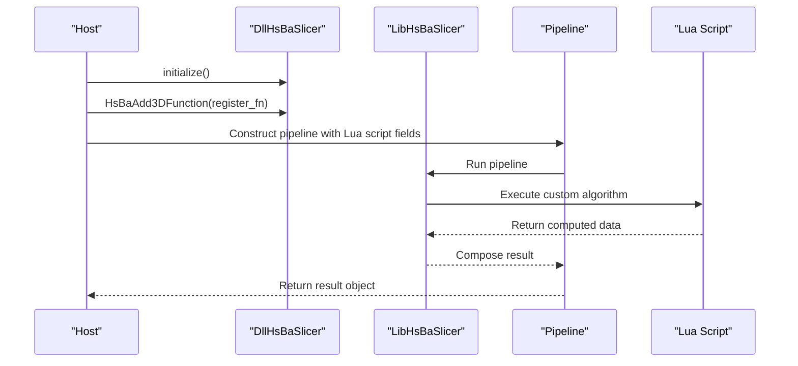

**Diagram sources**
- [initialize.cpp:1-10](file://DllHsBaSlicer/initialize.cpp#L1-L10)
- [lua_register.cpp:1-43](file://DllHsBaSlicer/lua_register.cpp#L1-L43)
- [hsba_slicer.cppm:617-751](file://ModuleHsBaSlicer/hsba_slicer.cppm#L617-L751)

**Section sources**
- [initialize.cpp:1-10](file://DllHsBaSlicer/initialize.cpp#L1-L10)
- [lua_register.cpp:1-43](file://DllHsBaSlicer/lua_register.cpp#L1-L43)
- [hsba_slicer.cppm:617-751](file://ModuleHsBaSlicer/hsba_slicer.cppm#L617-L751)