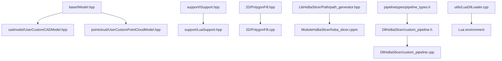
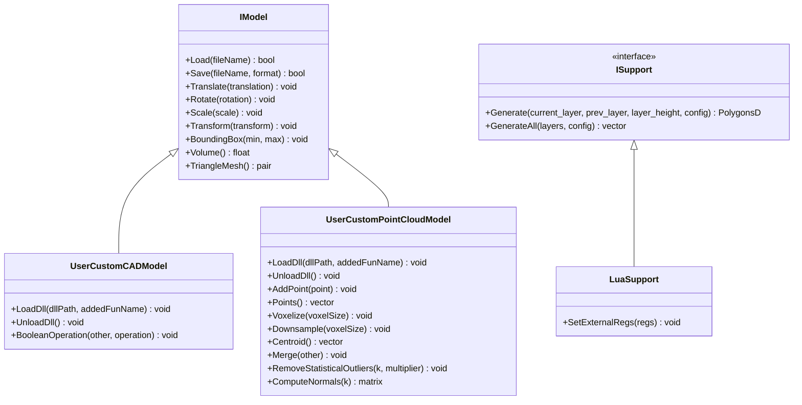
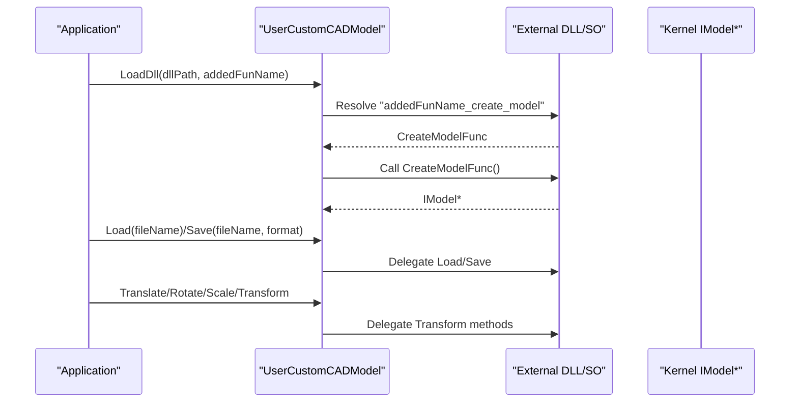
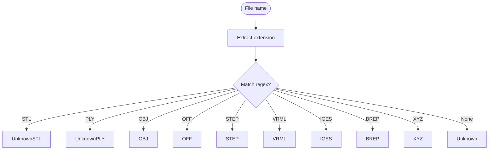
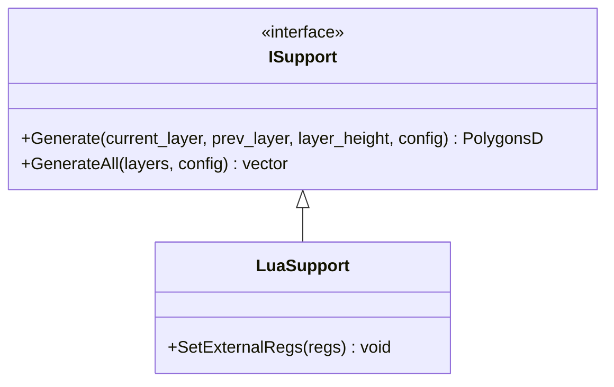
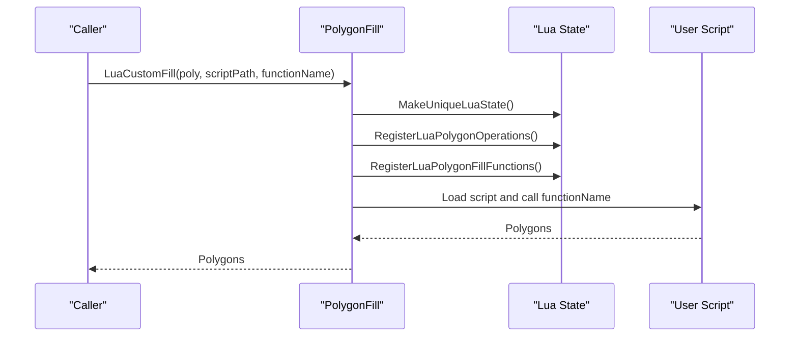
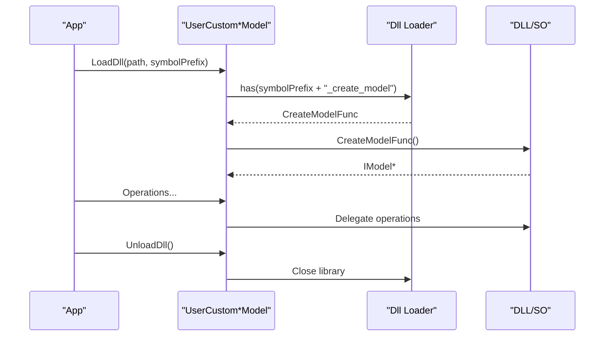
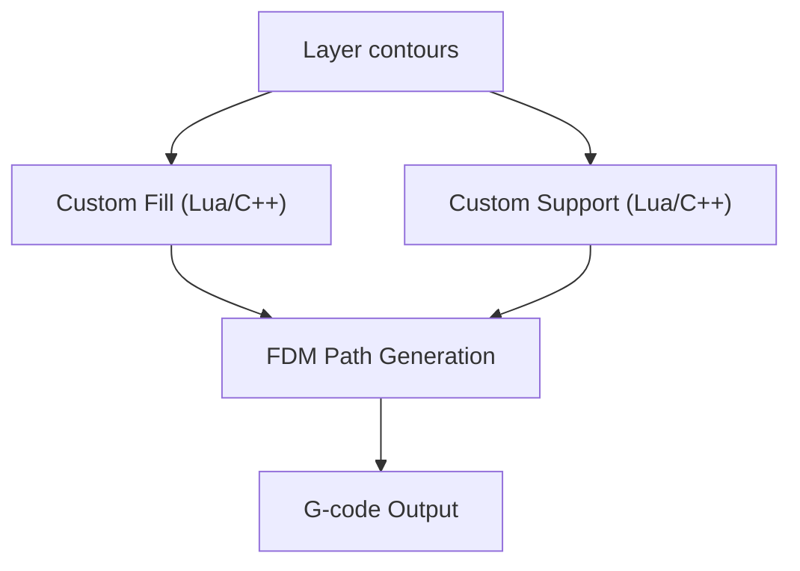
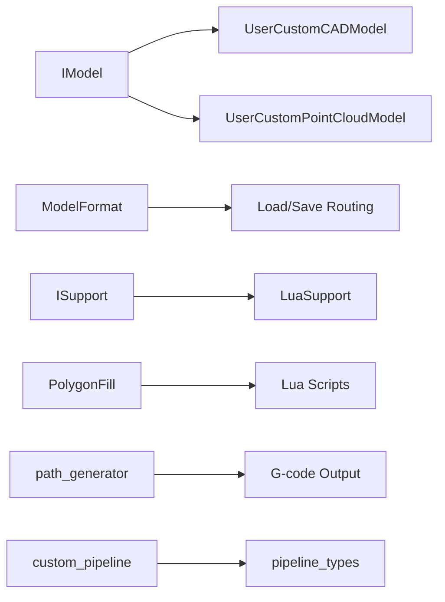
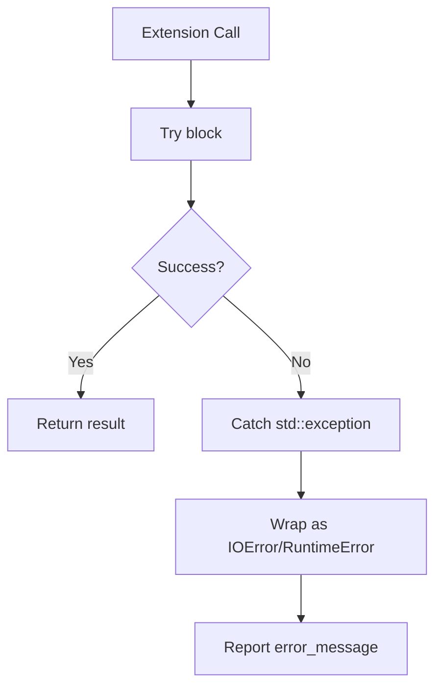

# Extension Development

<cite>
**Referenced Files in This Document**
- [IModel.hpp](file://base/IModel.hpp)
- [ModelFormat.hpp](file://base/ModelFormat.hpp)
- [ModelFormat.cpp](file://base/ModelFormat.cpp)
- [UserCustomCADModel.hpp](file://cadmodel/UserCustomCADModel.hpp)
- [UserCustomPointCloudModel.hpp](file://pointcloud/UserCustomPointCloudModel.hpp)
- [UserCustomPointCloudModel.cpp](file://pointcloud/UserCustomPointCloudModel.cpp)
- [ISupport.hpp](file://support/ISupport.hpp)
- [LuaSupport.hpp](file://support/LuaSupport.hpp)
- [fdm_support.cpp](file://LibHsBaSlicer/Support/fdm_support.cpp)
- [PolygonFill.hpp](file://2D/PolygonFill.hpp)
- [PolygonFill.cpp](file://2D/PolygonFill.cpp)
- [path_generator.hpp](file://LibHsBaSlicer/Path/path_generator.hpp)
- [custom_pipeline.h](file://DllHsBaSlicer/custom_pipeline.h)
- [custom_pipeline.cpp](file://DllHsBaSlicer/custom_pipeline.cpp)
- [pipeline_types.h](file://pipelinetypes/pipeline_types.h)
- [hsba_slicer.cppm](file://ModuleHsBaSlicer/hsba_slicer.cppm)
- [LuaDllLoader.cpp](file://utils/LuaDllLoader.cpp)
- [error.hpp](file://base/error.hpp)
- [mesh_slice.cpp](file://LibHsBaSlicer/Slice/mesh_slice.cpp)
- [param_reflect.cpp](file://fileoperator/param_reflect.cpp)
</cite>

## Table of Contents
1. [Introduction](#introduction)
2. [Project Structure](#project-structure)
3. [Core Components](#core-components)
4. [Architecture Overview](#architecture-overview)
5. [Detailed Component Analysis](#detailed-component-analysis)
6. [Dependency Analysis](#dependency-analysis)
7. [Performance Considerations](#performance-considerations)
8. [Troubleshooting Guide](#troubleshooting-guide)
9. [Conclusion](#conclusion)
10. [Appendices](#appendices)

## Introduction
This document explains how to extend HsBaSlicer through custom models, algorithms, and plugins. It covers:
- Implementing the IModel interface for new model formats.
- Registering format metadata and handling load/save logic.
- Developing custom slicing algorithms via Lua or C++ interfaces.
- Building dynamic plugins with a stable C ABI and lifecycle management.
- Using extension points such as support generators, path planners, fill scripts, and output formatters.
- Packaging, version compatibility, performance optimization, testing, and upgrade procedures.

The guidance is grounded in the repository’s actual extension APIs: IModel, UserCustomCADModel, UserCustomPointCloudModel, ISupport, Lua-based fill/support hooks, FDM path generation, and the fully Lua-driven custom pipeline C ABI.

## Project Structure
Extension-related code spans several modules:
- base: core model abstraction and format utilities.
- cadmodel and pointcloud: dynamic plugin adapters for CAD and point cloud kernels.
- support and 2D: support generator and fill algorithm extension points.
- LibHsBaSlicer: public C++ API for path generation and pipeline integration.
- DllHsBaSlicer: exported C ABI for Lua-driven pipelines and progress/result handling.
- ModuleHsBaSlicer: module-level Lua bindings and registration helpers.
- utils: Lua-visible dynamic loader helper.

**Diagram sources**
- [IModel.hpp:110-139](file://base/IModel.hpp#L110-L139)
- [UserCustomCADModel.hpp:75-121](file://cadmodel/UserCustomCADModel.hpp#L75-L121)
- [UserCustomPointCloudModel.hpp:90-171](file://pointcloud/UserCustomPointCloudModel.hpp#L90-L171)
- [ISupport.hpp:22-45](file://support/ISupport.hpp#L22-L45)
- [LuaSupport.hpp:40-81](file://support/LuaSupport.hpp#L40-L81)
- [PolygonFill.hpp:106-136](file://2D/PolygonFill.hpp#L106-L136)
- [path_generator.hpp:23-91](file://LibHsBaSlicer/Path/path_generator.hpp#L23-L91)
- [custom_pipeline.h:17-62](file://DllHsBaSlicer/custom_pipeline.h#L17-L62)
- [pipeline_types.h:698-726](file://pipelinetypes/pipeline_types.h#L698-L726)
- [LuaDllLoader.cpp:14-103](file://utils/LuaDllLoader.cpp#L14-L103)

**Section sources**
- [IModel.hpp:110-139](file://base/IModel.hpp#L110-L139)
- [ModelFormat.hpp:19-114](file://base/ModelFormat.hpp#L19-L114)
- [ModelFormat.cpp:14-175](file://base/ModelFormat.cpp#L14-L175)
- [UserCustomCADModel.hpp:75-121](file://cadmodel/UserCustomCADModel.hpp#L75-L121)
- [UserCustomPointCloudModel.hpp:90-171](file://pointcloud/UserCustomPointCloudModel.hpp#L90-L171)
- [ISupport.hpp:22-45](file://support/ISupport.hpp#L22-L45)
- [LuaSupport.hpp:40-81](file://support/LuaSupport.hpp#L40-L81)
- [PolygonFill.hpp:106-136](file://2D/PolygonFill.hpp#L106-L136)
- [path_generator.hpp:23-91](file://LibHsBaSlicer/Path/path_generator.hpp#L23-L91)
- [custom_pipeline.h:17-62](file://DllHsBaSlicer/custom_pipeline.h#L17-L62)
- [pipeline_types.h:698-726](file://pipelinetypes/pipeline_types.h#L698-L726)
- [LuaDllLoader.cpp:14-103](file://utils/LuaDllLoader.cpp#L14-L103)

## Core Components
This section summarizes the primary extension surfaces:
- IModel: the universal 3D model interface used by all model implementations and plugins.
- ModelFormat utilities: file extension detection and category checks (mesh/BRep/CSG/point cloud).
- Dynamic plugin adapters: UserCustomCADModel and UserCustomPointCloudModel for external DLL/SO kernels.
- Support generators: ISupport and LuaSupport for custom per-layer support algorithms.
- Fill algorithms: PolygonFill Lua hooks for custom infill patterns.
- Path generation: FDM path generation API and spiral/vase mode.
- Custom pipeline: fully Lua-driven pipeline exposed via C ABI.

Key responsibilities:
- IModel defines Load/Save, transforms, bounding box, volume, and triangle mesh extraction.
- ModelFormat provides string conversion and extension-to-format mapping.
- UserCustom* classes wrap external libraries and expose them as IModel instances.
- ISupport/LuaSupport allow replacing built-in support algorithms with user code.
- PolygonFill exposes Lua functions for custom fill patterns.
- path_generator provides G-code path generation from layer data.
- custom_pipeline exposes a C ABI for running Lua-defined pipelines with progress callbacks and result handling.

**Section sources**
- [IModel.hpp:110-139](file://base/IModel.hpp#L110-L139)
- [ModelFormat.hpp:19-114](file://base/ModelFormat.hpp#L19-L114)
- [ModelFormat.cpp:14-175](file://base/ModelFormat.cpp#L14-L175)
- [UserCustomCADModel.hpp:75-121](file://cadmodel/UserCustomCADModel.hpp#L75-L121)
- [UserCustomPointCloudModel.hpp:90-171](file://pointcloud/UserCustomPointCloudModel.hpp#L90-L171)
- [ISupport.hpp:22-45](file://support/ISupport.hpp#L22-L45)
- [LuaSupport.hpp:40-81](file://support/LuaSupport.hpp#L40-L81)
- [PolygonFill.hpp:106-136](file://2D/PolygonFill.hpp#L106-L136)
- [path_generator.hpp:23-91](file://LibHsBaSlicer/Path/path_generator.hpp#L23-L91)
- [custom_pipeline.h:17-62](file://DllHsBaSlicer/custom_pipeline.h#L17-L62)
- [pipeline_types.h:698-726](file://pipelinetypes/pipeline_types.h#L698-L726)

## Architecture Overview
The extension architecture centers on stable interfaces and pluggable components:
- Models implement IModel; dynamic adapters bridge external libraries.
- Algorithms are either C++ classes (e.g., support generators) or Lua scripts invoked through registered functions.
- The custom pipeline orchestrates model loading, slicing, support, fill, floor, and output using Lua.

**Diagram sources**
- [IModel.hpp:110-139](file://base/IModel.hpp#L110-L139)
- [UserCustomCADModel.hpp:75-121](file://cadmodel/UserCustomCADModel.hpp#L75-L121)
- [UserCustomPointCloudModel.hpp:90-171](file://pointcloud/UserCustomPointCloudModel.hpp#L90-L171)
- [ISupport.hpp:22-45](file://support/ISupport.hpp#L22-L45)
- [LuaSupport.hpp:40-81](file://support/LuaSupport.hpp#L40-L81)

## Detailed Component Analysis

### Custom Model Format Development
To add a new model format:
- Implement IModel in your kernel library.
- Provide C entry points for create/destroy and optional operations.
- Use UserCustomCADModel or UserCustomPointCloudModel to load your plugin dynamically.
- Register format metadata via ModelFormat utilities if needed.

Implementation pattern:
- Define an external factory function returning IModel*.
- Implement destroy and any additional operations (boolean ops, primitives, thickness, extrusion).
- Wrap the plugin with UserCustomCADModel or UserCustomPointCloudModel.

**Diagram sources**
- [UserCustomCADModel.hpp:75-121](file://cadmodel/UserCustomCADModel.hpp#L75-L121)
- [UserCustomPointCloudModel.hpp:90-171](file://pointcloud/UserCustomPointCloudModel.hpp#L90-L171)
- [UserCustomPointCloudModel.cpp:39-79](file://pointcloud/UserCustomPointCloudModel.cpp#L39-L79)

Metadata and format registration:
- Use ModelTypeFromExtName to map file extensions to ModelFormat.
- Use IsMeshFormat/IsBrepFormat/IsCSGFormat/IsPointCloudFormat to categorize formats.
- ToString converts enum values to strings for logging/UI.

**Diagram sources**
- [ModelFormat.cpp:14-99](file://base/ModelFormat.cpp#L14-L99)

Practical example outline:
- Build a shared library exporting create/destroy and optional operations.
- Ensure signatures match HsBaVector3f_t and other C types defined in IModel.hpp.
- Load via UserCustomCADModel::LoadDll or UserCustomPointCloudModel::LoadDll.
- Handle errors by checking returned function pointers and delegating safely.

**Section sources**
- [IModel.hpp:19-48](file://base/IModel.hpp#L19-L48)
- [UserCustomCADModel.hpp:75-121](file://cadmodel/UserCustomCADModel.hpp#L75-L121)
- [UserCustomPointCloudModel.hpp:90-171](file://pointcloud/UserCustomPointCloudModel.hpp#L90-L171)
- [UserCustomPointCloudModel.cpp:39-79](file://pointcloud/UserCustomPointCloudModel.cpp#L39-L79)
- [ModelFormat.hpp:19-114](file://base/ModelFormat.hpp#L19-L114)
- [ModelFormat.cpp:14-175](file://base/ModelFormat.cpp#L14-L175)

### Custom Algorithm Development
Two main paths exist:
- C++ algorithms implementing ISupport (for support generation).
- Lua scripts plugged into PolygonFill or Support stages.

C++ support algorithm:
- Derive from ISupport and implement Generate.
- Optionally override GenerateAll for batch processing.
- Integrate via fdm_support selection or LuaSupport wrapper.

**Diagram sources**
- [ISupport.hpp:22-45](file://support/ISupport.hpp#L22-L45)
- [LuaSupport.hpp:40-81](file://support/LuaSupport.hpp#L40-L81)

Lua fill algorithm:
- Use LuaCustomFill or LuaCustomFillString to execute user scripts.
- Register polygon operations and fill functions via RegisterLuaPolygonFillFunctions.
- Scripts return polygons representing the fill pattern.

**Diagram sources**
- [PolygonFill.cpp:1493-1518](file://2D/PolygonFill.cpp#L1493-L1518)
- [PolygonFill.hpp:106-136](file://2D/PolygonFill.hpp#L106-L136)

Testing strategies:
- For C++ algorithms, write unit tests against ISupport::Generate and Validate outputs.
- For Lua algorithms, use LuaCustomFillString with known inputs and assert polygon properties.
- Leverage existing test patterns in tests/ directories for similar components.

**Section sources**
- [ISupport.hpp:22-45](file://support/ISupport.hpp#L22-L45)
- [LuaSupport.hpp:40-81](file://support/LuaSupport.hpp#L40-L81)
- [fdm_support.cpp:36-69](file://LibHsBaSlicer/Support/fdm_support.cpp#L36-L69)
- [PolygonFill.hpp:106-136](file://2D/PolygonFill.hpp#L106-L136)
- [PolygonFill.cpp:1493-1518](file://2D/PolygonFill.cpp#L1493-L1518)

### Plugin Development
Dynamic loading mechanisms:
- UserCustomCADModel and UserCustomPointCloudModel provide C++ wrappers around external DLL/SO plugins.
- LuaDllLoader exposes a Lua-visible object for loading/unloading/reloading libraries and calling typed functions.

Lifecycle management:
- LoadDll resolves symbols like "addedFunName_create_model".
- UnloadDll releases resources and closes the library.
- Ensure proper destruction via DestroyModelFunc provided by the plugin.

Dependency injection patterns:
- Plugins export functions conforming to typedefs in IUserCustomCAD or IUserCustomPointCloud.
- The adapter injects these functions into the pipeline without coupling to concrete kernels.

**Diagram sources**
- [UserCustomCADModel.hpp:75-121](file://cadmodel/UserCustomCADModel.hpp#L75-L121)
- [UserCustomPointCloudModel.hpp:90-171](file://pointcloud/UserCustomPointCloudModel.hpp#L90-L171)
- [LuaDllLoader.cpp:14-103](file://utils/LuaDllLoader.cpp#L14-L103)

Error handling and memory management:
- Check function pointer availability before use.
- Always call DestroyModelFunc to release plugin-owned IModel instances.
- Propagate project exceptions consistently; avoid leaking foreign exception types across boundaries.

**Section sources**
- [UserCustomCADModel.hpp:75-121](file://cadmodel/UserCustomCADModel.hpp#L75-L121)
- [UserCustomPointCloudModel.hpp:90-171](file://pointcloud/UserCustomPointCloudModel.hpp#L90-L171)
- [LuaDllLoader.cpp:14-103](file://utils/LuaDllLoader.cpp#L14-L103)
- [error.hpp:17-145](file://base/error.hpp#L17-L145)

### Extension Points Throughout the System
- Custom slicing algorithms: Lua scripts via PolygonFill and Support stages.
- Support generators: ISupport implementations and LuaSupport wrapper.
- Path planners: FDM path generation API for converting layer data to G-code.
- Output formatters: Custom pipeline results and Lua-driven output generation.

Integration examples:
- Use GenerateGCodePath or GenerateGCodePathV2 to convert LayerPathData to G-code.
- Use GenerateGCodePathSpiral for vase-mode continuous wall generation.
- Use LuaCustomFill/LuaCustomFillString for custom infill patterns.
- Use GenerateAllLuaSupport for custom support generation.

**Diagram sources**
- [path_generator.hpp:23-91](file://LibHsBaSlicer/Path/path_generator.hpp#L23-L91)
- [PolygonFill.hpp:106-136](file://2D/PolygonFill.hpp#L106-L136)
- [fdm_support.cpp:36-69](file://LibHsBaSlicer/Support/fdm_support.cpp#L36-L69)

**Section sources**
- [path_generator.hpp:23-91](file://LibHsBaSlicer/Path/path_generator.hpp#L23-L91)
- [PolygonFill.hpp:106-136](file://2D/PolygonFill.hpp#L106-L136)
- [fdm_support.cpp:36-69](file://LibHsBaSlicer/Support/fdm_support.cpp#L36-L69)

### Complete Implementation Examples

#### Custom Model Example Outline
- Implement IModel in your kernel.
- Export create/destroy and optional operations matching typedefs in IUserCustomCAD or IUserCustomPointCloud.
- Load via UserCustomCADModel::LoadDll or UserCustomPointCloudModel::LoadDll.
- Perform Load/Save/Transform operations through the adapter.

References:
- [UserCustomCADModel.hpp:75-121](file://cadmodel/UserCustomCADModel.hpp#L75-L121)
- [UserCustomPointCloudModel.hpp:90-171](file://pointcloud/UserCustomPointCloudModel.hpp#L90-L171)

#### Custom Support Algorithm Example Outline
- Implement ISupport::Generate to compute support polygons for a single layer.
- Optionally override GenerateAll for batch processing.
- Use LuaSupport to wrap a Lua script that returns support polygons.

References:
- [ISupport.hpp:22-45](file://support/ISupport.hpp#L22-L45)
- [LuaSupport.hpp:40-81](file://support/LuaSupport.hpp#L40-L81)
- [fdm_support.cpp:36-69](file://LibHsBaSlicer/Support/fdm_support.cpp#L36-L69)

#### Custom Fill Algorithm Example Outline
- Write a Lua script that returns polygons for the given input.
- Call LuaCustomFill or LuaCustomFillString with the script path/source and function name.
- Register additional Lua functions via lua_reg callback if needed.

References:
- [PolygonFill.hpp:106-136](file://2D/PolygonFill.hpp#L106-L136)
- [PolygonFill.cpp:1493-1518](file://2D/PolygonFill.cpp#L1493-L1518)

#### Custom Pipeline Example Outline
- Configure HsBaCustomPipelineConfig_t with pipeline_lua_script or pipeline_lua_source.
- Call HsBaRunCustomPipeline synchronously or HsBaRunCustomPipelineAsync asynchronously.
- Handle progress callbacks and free results with HsBaFreeCustomPipelineResult.

References:
- [custom_pipeline.h:17-62](file://DllHsBaSlicer/custom_pipeline.h#L17-L62)
- [custom_pipeline.cpp:23-126](file://DllHsBaSlicer/custom_pipeline.cpp#L23-L126)
- [pipeline_types.h:698-726](file://pipelinetypes/pipeline_types.h#L698-L726)

**Section sources**
- [UserCustomCADModel.hpp:75-121](file://cadmodel/UserCustomCADModel.hpp#L75-L121)
- [UserCustomPointCloudModel.hpp:90-171](file://pointcloud/UserCustomPointCloudModel.hpp#L90-L171)
- [ISupport.hpp:22-45](file://support/ISupport.hpp#L22-L45)
- [LuaSupport.hpp:40-81](file://support/LuaSupport.hpp#L40-L81)
- [PolygonFill.hpp:106-136](file://2D/PolygonFill.hpp#L106-L136)
- [PolygonFill.cpp:1493-1518](file://2D/PolygonFill.cpp#L1493-L1518)
- [custom_pipeline.h:17-62](file://DllHsBaSlicer/custom_pipeline.h#L17-L62)
- [custom_pipeline.cpp:23-126](file://DllHsBaSlicer/custom_pipeline.cpp#L23-L126)
- [pipeline_types.h:698-726](file://pipelinetypes/pipeline_types.h#L698-L726)

## Dependency Analysis
Extensions depend on stable interfaces and registries:
- IModel is central to all model implementations and plugins.
- ModelFormat utilities provide format classification and string conversion.
- ISupport and LuaSupport enable algorithm substitution.
- PolygonFill exposes Lua hooks for custom fills.
- path_generator depends on layer data structures and printer configuration.
- custom_pipeline depends on pipeline_types and Lua pipeline infrastructure.

**Diagram sources**
- [IModel.hpp:110-139](file://base/IModel.hpp#L110-L139)
- [ModelFormat.hpp:19-114](file://base/ModelFormat.hpp#L19-L114)
- [ISupport.hpp:22-45](file://support/ISupport.hpp#L22-L45)
- [LuaSupport.hpp:40-81](file://support/LuaSupport.hpp#L40-L81)
- [PolygonFill.hpp:106-136](file://2D/PolygonFill.hpp#L106-L136)
- [path_generator.hpp:23-91](file://LibHsBaSlicer/Path/path_generator.hpp#L23-L91)
- [custom_pipeline.h:17-62](file://DllHsBaSlicer/custom_pipeline.h#L17-L62)
- [pipeline_types.h:698-726](file://pipelinetypes/pipeline_types.h#L698-L726)

**Section sources**
- [IModel.hpp:110-139](file://base/IModel.hpp#L110-L139)
- [ModelFormat.hpp:19-114](file://base/ModelFormat.hpp#L19-L114)
- [ISupport.hpp:22-45](file://support/ISupport.hpp#L22-L45)
- [LuaSupport.hpp:40-81](file://support/LuaSupport.hpp#L40-L81)
- [PolygonFill.hpp:106-136](file://2D/PolygonFill.hpp#L106-L136)
- [path_generator.hpp:23-91](file://LibHsBaSlicer/Path/path_generator.hpp#L23-L91)
- [custom_pipeline.h:17-62](file://DllHsBaSlicer/custom_pipeline.h#L17-L62)
- [pipeline_types.h:698-726](file://pipelinetypes/pipeline_types.h#L698-L726)

## Performance Considerations
- Prefer batch operations when possible (e.g., AddPoints vs AddPoint).
- Avoid unnecessary copies of large Eigen matrices; pass references where feasible.
- Use voxelization/downsampling for point clouds to reduce computational load.
- Profile Lua script execution time and minimize heavy computations inside scripts.
- Reuse Lua states and registered functions where appropriate.
- Use GenerateGCodePathSpiral for vase-mode to avoid per-layer overhead.

[No sources needed since this section provides general guidance]

## Troubleshooting Guide
Common issues and resolutions:
- Plugin symbol resolution failures: verify exported function names match expected prefixes and signatures.
- Memory leaks: ensure DestroyModelFunc is called for every created IModel instance.
- Exception propagation: foreign exceptions (CGAL, OCCT) are wrapped into IOError at slicing boundaries; catch and handle appropriately.
- Lua errors: inspect error_message from HsBaCustomPipelineResult_t and validate script syntax/function names.

**Diagram sources**
- [mesh_slice.cpp:19-43](file://LibHsBaSlicer/Slice/mesh_slice.cpp#L19-L43)
- [error.hpp:17-145](file://base/error.hpp#L17-L145)
- [custom_pipeline.cpp:23-126](file://DllHsBaSlicer/custom_pipeline.cpp#L23-L126)

**Section sources**
- [mesh_slice.cpp:19-43](file://LibHsBaSlicer/Slice/mesh_slice.cpp#L19-L43)
- [error.hpp:17-145](file://base/error.hpp#L17-L145)
- [custom_pipeline.cpp:23-126](file://DllHsBaSlicer/custom_pipeline.cpp#L23-L126)

## Conclusion
HsBaSlicer provides robust extension points for models, algorithms, and plugins:
- Implement IModel for new formats and wrap with UserCustom* adapters.
- Replace support and fill algorithms via ISupport and Lua scripts.
- Use FDM path generation APIs for G-code output.
- Orchestrate entire workflows with the Lua-driven custom pipeline C ABI.
Follow the documented patterns for lifecycle management, error handling, and performance optimization to build reliable and efficient extensions.

[No sources needed since this section summarizes without analyzing specific files]

## Appendices

### Packaging and Distribution
- Build plugins as shared libraries (DLL/SO) exporting required C functions.
- Distribute alongside the application with clear naming conventions for symbol prefixes.
- Include documentation for supported ModelFormat categories and Lua API usage.

[No sources needed since this section provides general guidance]

### Version Compatibility and Upgrade Procedures
- Maintain ABI stability for exported functions; avoid changing signatures of create/destroy and operation functions.
- Test upgrades against existing plugins; validate symbol resolution and behavior.
- Use pipeline_types structs for configuration; keep field compatibility in mind during upgrades.

**Section sources**
- [pipeline_types.h:698-726](file://pipelinetypes/pipeline_types.h#L698-L726)

### Profiling and Debugging Strategies
- Profile Lua scripts using timing around LuaCustomFill calls.
- Inspect error_message from custom pipeline results.
- Use RegisterLuaPolygonFillFunctions and SetExternalRegs to add debug logging functions.

**Section sources**
- [PolygonFill.cpp:1493-1518](file://2D/PolygonFill.cpp#L1493-L1518)
- [LuaSupport.hpp:63-67](file://support/LuaSupport.hpp#L63-L67)
- [custom_pipeline.cpp:23-126](file://DllHsBaSlicer/custom_pipeline.cpp#L23-L126)