# Extension Points

<cite>
**Referenced Files in This Document**   
- [README.md](file://README.md)
- [custom_pipeline.h](file://DllHsBaSlicer/custom_pipeline.h)
- [custom_pipeline.cpp](file://DllHsBaSlicer/custom_pipeline.cpp)
- [event_source_register.h](file://DllHsBaSlicer/event_source_register.h)
- [LuaAddFunction.hpp](file://LibHsBaSlicer/Extends/LuaAddFunction.hpp)
- [LuaAddFunction.cpp](file://LibHsBaSlicer/Extends/LuaAddFunction.cpp)
- [LuaCommonTypes.hpp](file://LibHsBaSlicer/Extends/LuaCommonTypes.hpp)
- [param_store.hpp](file://fileoperator/param_store.hpp)
- [logger.hpp](file://logger/logger.hpp)
- [lua_pipeline_api.md](file://docs/en/lua_pipeline_api.md)
- [pipeline_types.h](file://pipelinetypes/pipeline_types.h)
- [tdp_pipeline.h](file://DllHsBaSlicer/tdp_pipeline.h)
- [lom_pipeline.h](file://DllHsBaSlicer/lom_pipeline.h)
- [slm_pipeline.h](file://DllHsBaSlicer/slm_pipeline.h)
- [waam_pipeline.h](file://DllHsBaSlicer/waam_pipeline.h)
- [LuaSupport.hpp](file://support/LuaSupport.hpp)
</cite>

## Table of Contents
1. [Introduction](#introduction)
2. [Project Structure](#project-structure)
3. [Core Components](#core-components)
4. [Architecture Overview](#architecture-overview)
5. [Detailed Component Analysis](#detailed-component-analysis)
6. [Dependency Analysis](#dependency-analysis)
7. [Performance Considerations](#performance-considerations)
8. [Troubleshooting Guide](#troubleshooting-guide)
9. [Conclusion](#conclusion)
10. [Appendices](#appendices)

## Introduction
This document describes the extension points in HsBaSlicer where developers can inject custom functionality into slicing pipelines, event systems, configuration persistence, logging, and telemetry. It focuses on:
- Pipeline extension points for custom slicing algorithms, intermediate processing stages, and output formatting hooks.
- Event system integration for progress reporting, error handling, and state synchronization.
- Configuration extension mechanisms including custom parameters, validation rules, and default value management.
- Logging and telemetry extension points for monitoring custom code execution.
- Examples of hooking into model preprocessing through final output generation.
- Thread safety, resource management, cleanup procedures, and backward compatibility guidelines.

The repository provides both C ABI entry points for external languages and C++/Lua extension APIs inside `LibHsBaSlicer`. The README confirms that `DllHsBaSlicer` exports a C ABI runtime pipeline interface while `LibHsBaSlicer` encapsulates core slicing capabilities.

**Section sources**
- [README.md:21-37](file://README.md#L21-L37)

## Project Structure
HsBaSlicer organizes extension points across several modules:
- `DllHsBaSlicer`: C ABI pipeline interfaces, async/sync execution, and event registration helpers.
- `LibHsBaSlicer\Extends`: Lua function registration pools, common type adapters, and pipeline context execution.
- `fileoperator`: Parameter store with migration hooks and progress callbacks.
- `logger`: Thread-safe singleton logger used by extensions.
- `pipelinetypes`: C-compatible pipeline configuration and result types, including progress/result callback definitions.
- `support`: Lua-based support generator replacing built-in algorithms.
- Documentation under `docs/en` describing Lua pipeline API stages.

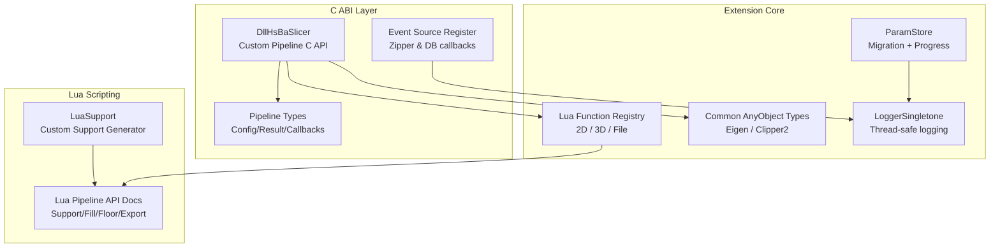

**Diagram sources**
- [custom_pipeline.h:17-62](file://DllHsBaSlicer/custom_pipeline.h#L17-L62)
- [event_source_register.h:15-17](file://DllHsBaSlicer/event_source_register.h#L15-L17)
- [LuaAddFunction.hpp:24-74](file://LibHsBaSlicer/Extends/LuaAddFunction.hpp#L24-L74)
- [LuaCommonTypes.hpp:148-183](file://LibHsBaSlicer/Extends/LuaCommonTypes.hpp#L148-L183)
- [param_store.hpp:33-105](file://fileoperator/param_store.hpp#L33-L105)
- [logger.hpp:35-122](file://logger/logger.hpp#L35-L122)
- [lua_pipeline_api.md:219-254](file://docs/en/lua_pipeline_api.md#L219-L254)

**Section sources**
- [README.md:29-37](file://README.md#L29-L37)

## Core Components
This section summarizes the primary extension components:

- Custom Pipeline C API: Provides synchronous and asynchronous execution of fully Lua-driven pipelines, with progress callbacks and result memory management.
- Event Source Registration: Allows registering C callbacks for zipper progress and database events.
- Lua Function Registry: Global pools to register 2D, 3D, and File Lua functions per pipeline stage; also supports named event callbacks.
- Common AnyObject Types: Registers Eigen and Clipper2 types into Lua via AnyObject reflection, enabling typed data exchange between C++ and Lua.
- ParamStore: Persists pipeline configurations with schema enforcement, validation, coercion, upsert, batch transactions, progress callbacks, and migration hooks.
- Logger: Thread-safe singleton logger with leveled output and user-defined literals.

Key responsibilities:
- Custom Pipeline bridges C ABI to Lua pipeline execution.
- Event Source Register exposes host-side hooks for subsystem events.
- Lua Add Functions centralizes extension registration by pipeline dimension.
- Common Types ensures consistent Lua/C++ type mapping.
- ParamStore enables extensible parameter persistence and lifecycle hooks.
- Logger provides observability for all extension code.

**Section sources**
- [custom_pipeline.h:17-62](file://DllHsBaSlicer/custom_pipeline.h#L17-L62)
- [event_source_register.h:15-17](file://DllHsBaSlicer/event_source_register.h#L15-L17)
- [LuaAddFunction.hpp:24-74](file://LibHsBaSlicer/Extends/LuaAddFunction.hpp#L24-L74)
- [LuaCommonTypes.hpp:148-183](file://LibHsBaSlicer/Extends/LuaCommonTypes.hpp#L148-L183)
- [param_store.hpp:33-105](file://fileoperator/param_store.hpp#L33-L105)
- [logger.hpp:35-122](file://logger/logger.hpp#L35-L122)

## Architecture Overview
The extension architecture separates concerns across layers:
- C ABI layer exposes stable entry points for external applications.
- Extension core manages Lua registries, type adapters, parameter persistence, and logging.
- Lua scripting layer allows users to define custom slicing logic, support/fill/floor/export stages.

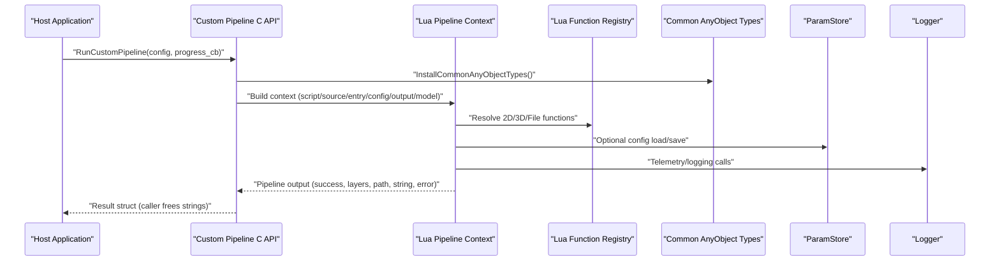

**Diagram sources**
- [custom_pipeline.cpp:118-163](file://DllHsBaSlicer/custom_pipeline.cpp#L118-L163)
- [LuaAddFunction.hpp:24-74](file://LibHsBaSlicer/Extends/LuaAddFunction.hpp#L24-L74)
- [LuaCommonTypes.hpp:173-183](file://LibHsBaSlicer/Extends/LuaCommonTypes.hpp#L173-L183)
- [param_store.hpp:33-105](file://fileoperator/param_store.hpp#L33-L105)
- [logger.hpp:35-122](file://logger/logger.hpp#L35-L122)

## Detailed Component Analysis

### Custom Pipeline Extension Point
The custom pipeline is the primary extension point for fully Lua-driven workflows. Developers provide either a script file or inline source, optionally an entry function name, JSON configuration, model metadata, and output path. The C API offers:
- Default config creation.
- Synchronous run with progress callback.
- Asynchronous run with completion callback.
- Result memory freeing.

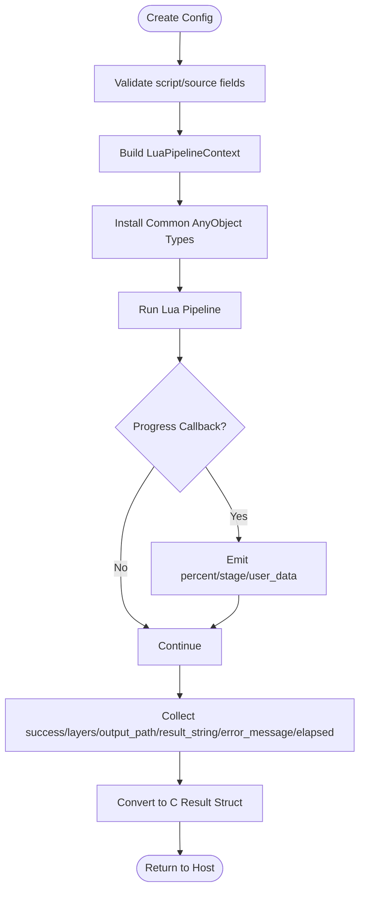

**Diagram sources**
- [custom_pipeline.cpp:86-115](file://DllHsBaSlicer/custom_pipeline.cpp#L86-L115)
- [custom_pipeline.cpp:118-163](file://DllHsBaSlicer/custom_pipeline.cpp#L118-L163)
- [custom_pipeline.cpp:171-213](file://DllHsBaSlicer/custom_pipeline.cpp#L171-L213)

**Section sources**
- [custom_pipeline.h:17-62](file://DllHsBaSlicer/custom_pipeline.h#L17-L62)
- [custom_pipeline.cpp:86-115](file://DllHsBaSlicer/custom_pipeline.cpp#L86-L115)
- [custom_pipeline.cpp:118-163](file://DllHsBaSlicer/custom_pipeline.cpp#L118-L163)
- [custom_pipeline.cpp:171-213](file://DllHsBaSlicer/custom_pipeline.cpp#L171-L213)

### Event System Integration
HsBaSlicer exposes event registration for subsystems such as zip compression and database operations. Host applications register C callbacks for named events. These callbacks are invoked from internal worker threads, requiring UI marshaling.

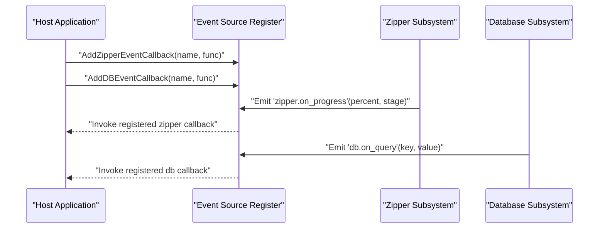

**Diagram sources**
- [event_source_register.h:15-17](file://DllHsBaSlicer/event_source_register.h#L15-L17)

**Section sources**
- [event_source_register.h:15-17](file://DllHsBaSlicer/event_source_register.h#L15-L17)

### Lua Function Registration Pools
Extensions can register additional Lua functions grouped by pipeline dimension:
- 2D functions: Used in Support, Fill, SLA Output.
- 3D functions: Used in Slice, Support.
- File functions: Used in SLS Output, SLA Output.
- Named event callbacks: Bind Lua registration functions to event names.

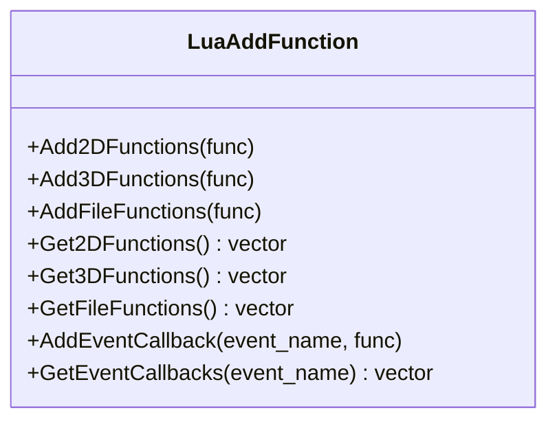

**Diagram sources**
- [LuaAddFunction.hpp:24-74](file://LibHsBaSlicer/Extends/LuaAddFunction.hpp#L24-L74)
- [LuaAddFunction.cpp:21-67](file://LibHsBaSlicer/Extends/LuaAddFunction.cpp#L21-L67)

**Section sources**
- [LuaAddFunction.hpp:24-74](file://LibHsBaSlicer/Extends/LuaAddFunction.hpp#L24-L74)
- [LuaAddFunction.cpp:21-67](file://LibHsBaSlicer/Extends/LuaAddFunction.cpp#L21-L67)

### Common AnyObject Types Extension
Common types (Eigen vectors/matrices/quaternions and Clipper2 points/polygons) are reflected into AnyObject and exposed to Lua via new/cast adapters. Extensions install these types once per pipeline stage to ensure consistent data exchange.

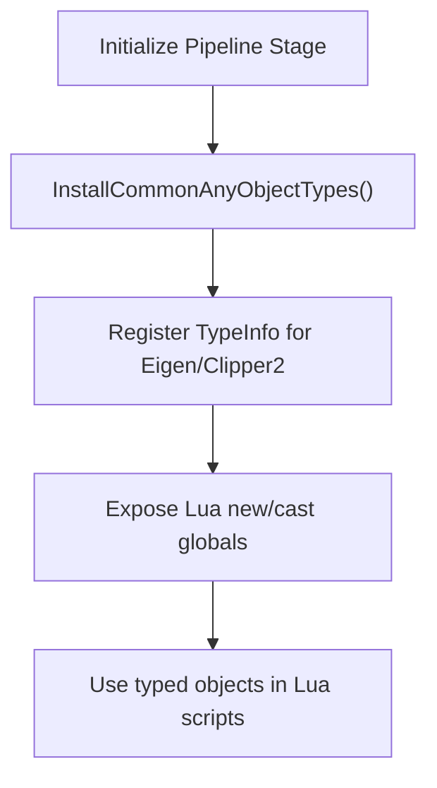

**Diagram sources**
- [LuaCommonTypes.hpp:148-183](file://LibHsBaSlicer/Extends/LuaCommonTypes.hpp#L148-L183)

**Section sources**
- [LuaCommonTypes.hpp:148-183](file://LibHsBaSlicer/Extends/LuaCommonTypes.hpp#L148-L183)

### Configuration Extension Mechanisms
ParamStore provides a robust mechanism for extending configuration persistence:
- Schema enforcement and table creation per pipeline config type.
- Save/Load/Update/Delete with validation, reflection, coercion, and upsert.
- Batch save wrapped in transactions.
- Progress callbacks for long-running operations.
- Migration hooks for backend/schema evolution.

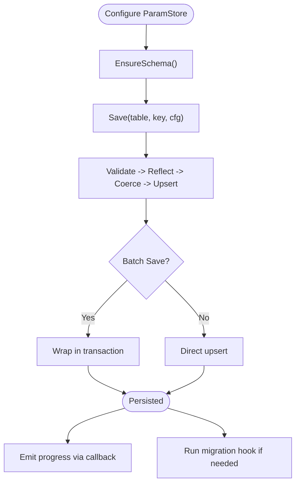

**Diagram sources**
- [param_store.hpp:33-105](file://fileoperator/param_store.hpp#L33-L105)

**Section sources**
- [param_store.hpp:33-105](file://fileoperator/param_store.hpp#L33-L105)

### Logging and Telemetry Extension Points
LoggerSingletone provides thread-safe logging with leveled output and user-defined literals. Extensions should use this singleton for diagnostics and telemetry.

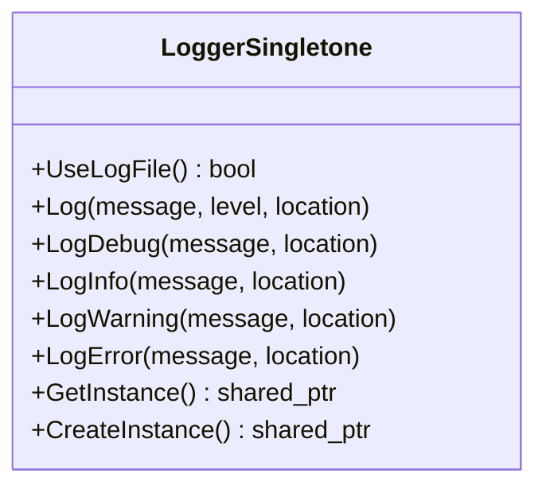

**Diagram sources**
- [logger.hpp:35-122](file://logger/logger.hpp#L35-L122)

**Section sources**
- [logger.hpp:35-122](file://logger/logger.hpp#L35-L122)

### Lua Scripting Stages and Hooks
The Lua pipeline API documents agreed entry functions and available globals for each stage:
- Support stage: `generate_support()` returning polygons; globals include current_layer, prev_layer, layer_height, config.
- Fill stage: `generate_fill(current_layer)` returning fill polygons; no injected globals.
- Floor stage (SLA): Customize bottom floor/raft generation.
- Export stage (SLS/SLA/SLM/LOM/3DP/WAAM): Packaging stage with config, images, output_path.

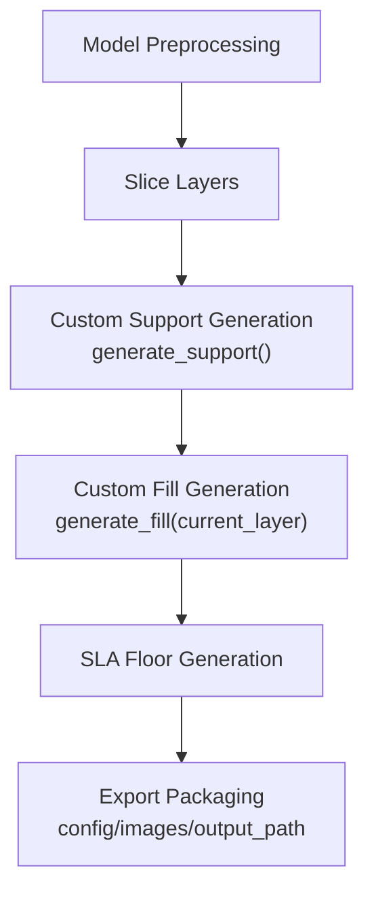

**Diagram sources**
- [lua_pipeline_api.md:219-254](file://docs/en/lua_pipeline_api.md#L219-L254)

**Section sources**
- [lua_pipeline_api.md:219-254](file://docs/en/lua_pipeline_api.md#L219-L254)

### Custom Support Generator
LuaSupport replaces built-in support generation with a Lua script. It supports inline scripts, script files, and custom function names. External Lua registrations (2D+3D) can be injected at Lua state initialization.

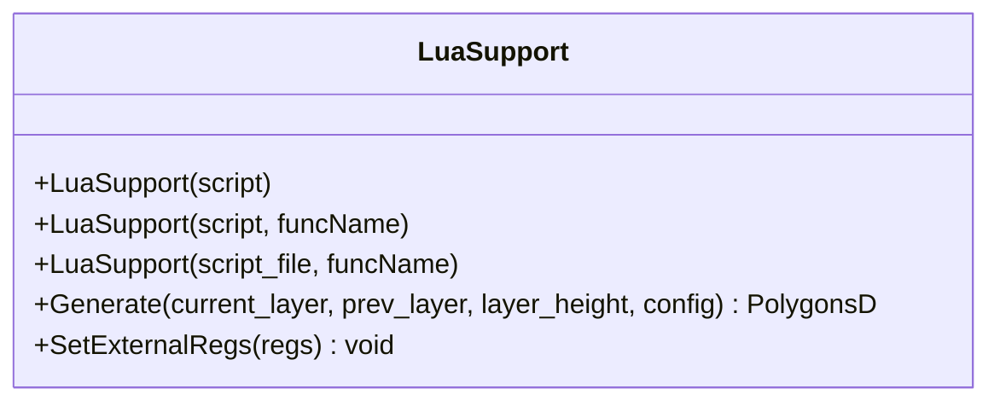

**Diagram sources**
- [LuaSupport.hpp:40-81](file://support/LuaSupport.hpp#L40-L81)

**Section sources**
- [LuaSupport.hpp:40-81](file://support/LuaSupport.hpp#L40-L81)

### Pipeline Types and Callback Contracts
Pipeline types define C-compatible configuration and result structures, along with progress and result callback signatures. These contracts apply across FDM, SLA, SLS, LOM, TDP, WAAM, and other pipelines.

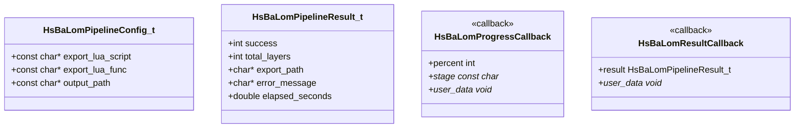

**Diagram sources**
- [pipeline_types.h:438-461](file://pipelinetypes/pipeline_types.h#L438-L461)

**Section sources**
- [pipeline_types.h:438-461](file://pipelinetypes/pipeline_types.h#L438-L461)

## Dependency Analysis
The extension system has clear dependency boundaries:
- Custom Pipeline depends on Lua pipeline context, common types installation, and registry resolution.
- Event registration depends on host-provided callbacks and subsystem emission points.
- Lua function registry is global but idempotent per pipeline stage.
- ParamStore depends on SQL adapter, schema, and reflection utilities.
- Logger is a singleton used throughout.

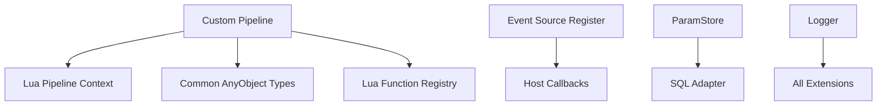

**Diagram sources**
- [custom_pipeline.cpp:118-163](file://DllHsBaSlicer/custom_pipeline.cpp#L118-L163)
- [LuaAddFunction.hpp:24-74](file://LibHsBaSlicer/Extends/LuaAddFunction.hpp#L24-L74)
- [param_store.hpp:33-105](file://fileoperator/param_store.hpp#L33-L105)
- [logger.hpp:35-122](file://logger/logger.hpp#L35-L122)

**Section sources**
- [custom_pipeline.cpp:118-163](file://DllHsBaSlicer/custom_pipeline.cpp#L118-L163)
- [LuaAddFunction.hpp:24-74](file://LibHsBaSlicer/Extends/LuaAddFunction.hpp#L24-L74)
- [param_store.hpp:33-105](file://fileoperator/param_store.hpp#L33-L105)
- [logger.hpp:35-122](file://logger/logger.hpp#L35-L122)

## Performance Considerations
- Avoid heavy computation in progress callbacks; they may be called frequently.
- Marshal UI updates off the library’s internal worker thread.
- Reuse Lua registration functions rather than re-registering per stage.
- Prefer batch operations in ParamStore to reduce transaction overhead.
- Minimize string copies in callbacks; copy only when necessary.
- Use logger levels appropriately to avoid excessive I/O.

[No sources needed since this section provides general guidance]

## Troubleshooting Guide
Common issues and resolutions:
- Missing script/source: Custom pipeline requires either `pipeline_lua_script` or `pipeline_lua_source`; otherwise it returns an error message.
- Callback threading: Progress and result callbacks fire on internal worker threads; hosts must marshal back to UI/game threads before updating widgets.
- Memory ownership: C API results allocate strings; callers must free them using provided free functions.
- Event callback registration: Ensure event names match emitted names; verify initialization order.
- ParamStore errors: Errors are not swallowed; last_error is recorded and exceptions propagate to callers.

**Section sources**
- [custom_pipeline.cpp:127-133](file://DllHsBaSlicer/custom_pipeline.cpp#L127-L133)
- [custom_pipeline.cpp:203-213](file://DllHsBaSlicer/custom_pipeline.cpp#L203-L213)
- [event_source_register.h:15-17](file://DllHsBaSlicer/event_source_register.h#L15-L17)
- [param_store.hpp:81-87](file://fileoperator/param_store.hpp#L81-L87)

## Conclusion
HsBaSlicer provides comprehensive extension points across pipeline execution, event handling, configuration persistence, and logging. Developers can inject custom slicing algorithms via Lua scripts, extend intermediate stages with registered functions, and format outputs through export hooks. Event callbacks enable progress reporting and state synchronization, while ParamStore supports extensible configuration management. Proper attention to thread safety, resource management, and backward compatibility ensures robust and maintainable extensions.

[No sources needed since this section summarizes without analyzing specific files]

## Appendices

### Backward Compatibility Guidelines
- Preserve existing Lua entry function names (`run_pipeline`, `generate_support`, `generate_fill`).
- Keep C ABI structs compatible; add optional fields rather than changing layouts.
- Maintain event names for existing subsystems; introduce new events with distinct prefixes.
- Version configuration schemas in ParamStore migrations to avoid breaking existing stores.
- Avoid removing registered Lua functions; deprecate with warnings instead.

[No sources needed since this section provides general guidance]