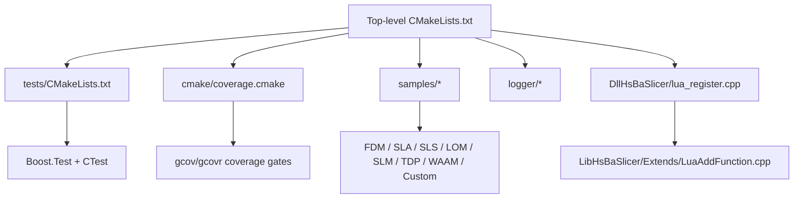
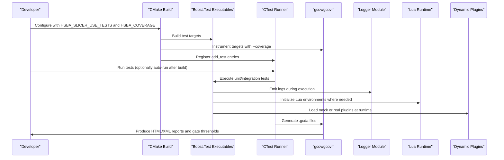
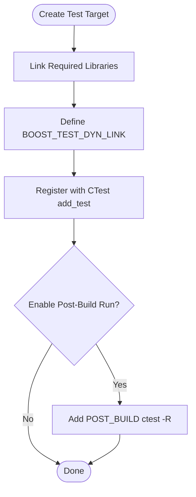
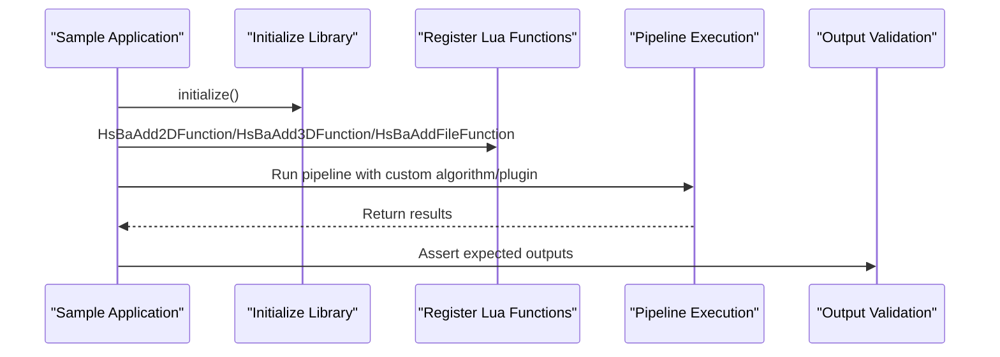
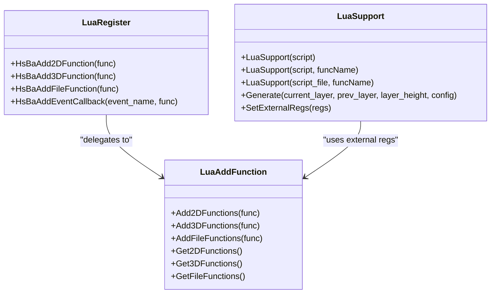
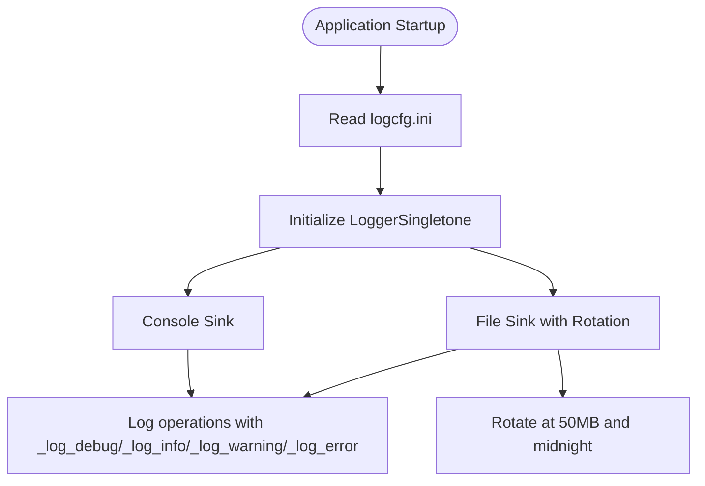
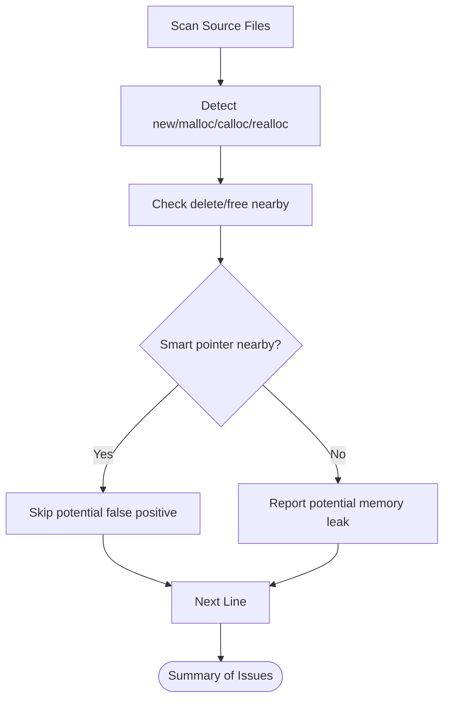
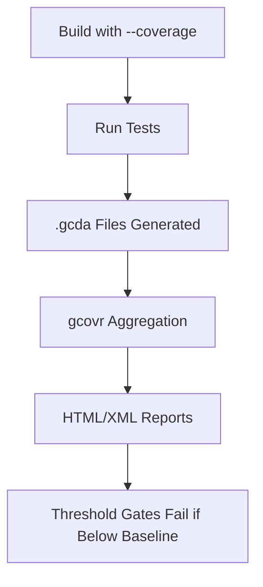
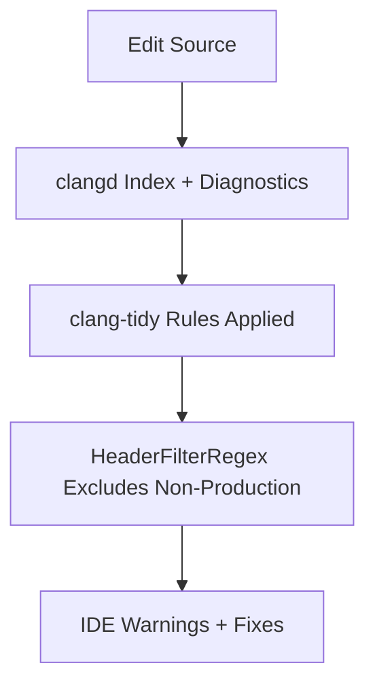
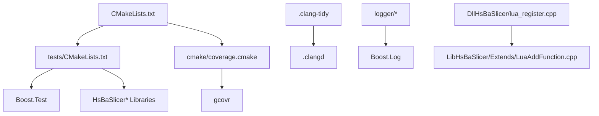

# Extension Testing & Debugging

<cite>
**Referenced Files in This Document**   
- [CMakeLists.txt](file://CMakeLists.txt)
- [tests/CMakeLists.txt](file://tests/CMakeLists.txt)
- [cmake/coverage.cmake](file://cmake/coverage.cmake)
- [CMakePresets.json](file://CMakePresets.json)
- [.clang-tidy](file://.clang-tidy)
- [.clangd](file://.clangd)
- [static_check/cpp_analyzer.py](file://static_check/cpp_analyzer.py)
- [logger/logger.hpp](file://logger/logger.hpp)
- [logger/logger.cpp](file://logger/logger.cpp)
- [utils/logcfg.ini](file://utils/logcfg.ini)
- [DllHsBaSlicer/lua_register.cpp](file://DllHsBaSlicer/lua_register.cpp)
- [LibHsBaSlicer/Extends/LuaAddFunction.cpp](file://LibHsBaSlicer/Extends/LuaAddFunction.cpp)
- [support/LuaSupport.hpp](file://support/LuaSupport.hpp)
- [samples/Custom/main.cpp](file://samples/Custom/main.cpp)
- [samples/FDM/main.cpp](file://samples/FDM/main.cpp)
- [samples/SLA/main.cpp](file://samples/SLA/main.cpp)
- [samples/SLS/main.cpp](file://samples/SLS/main.cpp)
- [samples/LOM/main.cpp](file://samples/LOM/main.cpp)
- [samples/SLM/main.cpp](file://samples/SLM/main.cpp)
- [samples/TDP/main.cpp](file://samples/TDP/main.cpp)
- [samples/WAAM/main.cpp](file://samples/WAAM/main.cpp)
- [samples/LibHsBaSlicer/main_header.cpp](file://samples/LibHsBaSlicer/main_header.cpp)
- [samples/LibHsBaSlicer/main_module.cpp](file://samples/LibHsBaSlicer/main_module.cpp)
</cite>

## Table of Contents
1. [Introduction](#introduction)
2. [Project Structure](#project-structure)
3. [Core Components](#core-components)
4. [Architecture Overview](#architecture-overview)
5. [Detailed Component Analysis](#detailed-component-analysis)
6. [Dependency Analysis](#dependency-analysis)
7. [Performance Considerations](#performance-considerations)
8. [Troubleshooting Guide](#troubleshooting-guide)
9. [Conclusion](#conclusion)
10. [Appendices](#appendices)

## Introduction
This document explains how to test and debug HsBaSlicer extensions, including custom C++ algorithms, Lua scripts, and dynamically loaded plugins. It covers:
- Unit testing strategies using the existing Boost.Test-based framework.
- Integration testing approaches that validate extension behavior inside full slicing pipelines.
- Debugging techniques for Lua scripts, C++ extensions, and plugin interactions.
- Performance profiling, memory leak detection, static analysis with clang-tidy, and code quality tooling.
- Common debugging scenarios, troubleshooting extension failures, and optimization guidance.

The guidance is grounded in the repository’s build system, test configuration, logging infrastructure, Lua extension registration, and sample applications.

## Project Structure
The testing and debugging surface spans several layers:
- Top-level CMake enables tests, coverage, samples, and optional features.
- The `tests/` directory defines many Boost.Test executables and registers them with CTest.
- Coverage is configured through a dedicated CMake script and a Linux preset.
- Static analysis is configured via `.clang-tidy` and `.clangd`, with an additional Python analyzer for potential memory leaks.
- Logging is provided by a cross-platform logger module and INI configuration.
- Lua extension functions are registered per pipeline stage through C ABI and internal registries.
- Sample applications demonstrate how to initialize the library and run different pipeline types.

**Diagram sources**
- [CMakeLists.txt:392-454](file://CMakeLists.txt#L392-L454)
- [tests/CMakeLists.txt:1-40](file://tests/CMakeLists.txt#L1-L40)
- [cmake/coverage.cmake:1-28](file://cmake/coverage.cmake#L1-L28)
- [DllHsBaSlicer/lua_register.cpp:1-42](file://DllHsBaSlicer/lua_register.cpp#L1-L42)
- [LibHsBaSlicer/Extends/LuaAddFunction.cpp:1-54](file://LibHsBaSlicer/Extends/LuaAddFunction.cpp#L1-L54)

**Section sources**
- [CMakeLists.txt:392-454](file://CMakeLists.txt#L392-L454)
- [tests/CMakeLists.txt:1-40](file://tests/CMakeLists.txt#L1-L40)

## Core Components
Key components for extension testing and debugging:
- Test framework: Boost.Test executables registered with CTest; automatic post-build execution controlled by options.
- Coverage: gcov instrumentation and gcovr gating for core and other modules.
- Static analysis: clang-tidy rules, clangd diagnostics, and a Python-based analyzer for potential memory leaks.
- Logging: Cross-platform logger with file/console output and configurable log levels.
- Lua extension registration: Stage-scoped function registration and event callbacks.
- Samples: Pipeline-specific entry points for integration testing.

**Section sources**
- [tests/CMakeLists.txt:1-40](file://tests/CMakeLists.txt#L1-L40)
- [cmake/coverage.cmake:1-28](file://cmake/coverage.cmake#L1-L28)
- [.clang-tidy:1-32](file://.clang-tidy#L1-L32)
- [.clangd:104-117](file://.clangd#L104-L117)
- [static_check/cpp_analyzer.py:43-196](file://static_check/cpp_analyzer.py#L43-L196)
- [logger/logger.hpp:147-195](file://logger/logger.hpp#L147-L195)
- [logger/logger.cpp:186-213](file://logger/logger.cpp#L186-L213)
- [DllHsBaSlicer/lua_register.cpp:1-42](file://DllHsBaSlicer/lua_register.cpp#L1-L42)

## Architecture Overview
The extension testing and debugging architecture connects unit tests, integration samples, coverage, static analysis, logging, and Lua extension registration into a cohesive workflow.

**Diagram sources**
- [CMakeLists.txt:392-454](file://CMakeLists.txt#L392-L454)
- [tests/CMakeLists.txt:1-40](file://tests/CMakeLists.txt#L1-L40)
- [cmake/coverage.cmake:1-28](file://cmake/coverage.cmake#L1-L28)
- [logger/logger.cpp:186-213](file://logger/logger.cpp#L186-L213)
- [DllHsBaSlicer/lua_register.cpp:1-42](file://DllHsBaSlicer/lua_register.cpp#L1-L42)

## Detailed Component Analysis

### Unit Testing Strategies for Custom Algorithms and Plugins
The repository uses Boost.Test with CTest. Each test target links against relevant libraries and registers itself with CTest. Many tests also link Lua when they exercise Lua bindings or scripts.

Recommended strategy:
- Create one executable per feature area under `tests/<Feature>/`.
- Link only the minimal set of libraries required for the test.
- Use `BOOST_TEST_DYN_LINK` consistently as done across existing tests.
- Register the test with `add_test(NAME ... COMMAND $<TARGET_FILE:...>)`.
- Optionally enable post-build execution via `HSBA_RUN_TESTS_AFTER_BUILD`.

Examples from the repository:
- Polygon fill tests link `HsBaSlicer2D` and `LibHsBaSlicer`.
- Path generator tests link `LibHsBaSlicer`, `HsBaPaths`, `HsBaSlicer2D`, `HsBaSlicerBase`, and Lua.
- Mock DLL tests build a shared library and load it at runtime to simulate dynamic plugin behavior.

**Diagram sources**
- [tests/CMakeLists.txt:15-39](file://tests/CMakeLists.txt#L15-L39)
- [tests/CMakeLists.txt:854-880](file://tests/CMakeLists.txt#L854-L880)
- [tests/CMakeLists.txt:1344-1375](file://tests/CMakeLists.txt#L1344-L1375)
- [tests/CMakeLists.txt:1377-1420](file://tests/CMakeLists.txt#L1377-L1420)

**Section sources**
- [tests/CMakeLists.txt:1-40](file://tests/CMakeLists.txt#L1-L40)
- [tests/CMakeLists.txt:854-880](file://tests/CMakeLists.txt#L854-L880)
- [tests/CMakeLists.txt:1344-1375](file://tests/CMakeLists.txt#L1344-L1375)
- [tests/CMakeLists.txt:1377-1420](file://tests/CMakeLists.txt#L1377-L1420)

### Integration Testing Approaches for Full Pipeline Context
Integration testing should validate that custom algorithms and plugins behave correctly within complete pipelines. The repository provides multiple sample applications for FDM, SLA, SLS, LOM, SLM, TDP, WAAM, and Custom pipelines. These serve as practical integration entry points.

Approach:
- Use sample applications as integration harnesses.
- For custom pipelines, register Lua functions and event callbacks before running the pipeline.
- Validate end-to-end outputs such as generated paths, exported files, or transformed models.
- When testing dynamic plugins, build mock DLLs and load them at runtime similar to existing mock tests.

**Diagram sources**
- [samples/Custom/main.cpp](file://samples/Custom/main.cpp)
- [samples/FDM/main.cpp](file://samples/FDM/main.cpp)
- [samples/SLA/main.cpp](file://samples/SLA/main.cpp)
- [samples/SLS/main.cpp](file://samples/SLS/main.cpp)
- [samples/LOM/main.cpp](file://samples/LOM/main.cpp)
- [samples/SLM/main.cpp](file://samples/SLM/main.cpp)
- [samples/TDP/main.cpp](file://samples/TDP/main.cpp)
- [samples/WAAM/main.cpp](file://samples/WAAM/main.cpp)
- [DllHsBaSlicer/lua_register.cpp:1-42](file://DllHsBaSlicer/lua_register.cpp#L1-L42)

**Section sources**
- [samples/Custom/main.cpp](file://samples/Custom/main.cpp)
- [samples/FDM/main.cpp](file://samples/FDM/main.cpp)
- [samples/SLA/main.cpp](file://samples/SLA/main.cpp)
- [samples/SLS/main.cpp](file://samples/SLS/main.cpp)
- [samples/LOM/main.cpp](file://samples/LOM/main.cpp)
- [samples/SLM/main.cpp](file://samples/SLM/main.cpp)
- [samples/TDP/main.cpp](file://samples/TDP/main.cpp)
- [samples/WAAM/main.cpp](file://samples/WAAM/main.cpp)
- [DllHsBaSlicer/lua_register.cpp:1-42](file://DllHsBaSlicer/lua_register.cpp#L1-L42)

### Debugging Techniques for Lua Scripts, C++ Extensions, and Plugin Interactions
Debugging involves three main areas:
- Lua scripts: Use the Lua runtime environment created by pipeline stages and external registration functions.
- C++ extensions: Use breakpoints, structured logging, and source location information.
- Plugin interactions: Use mock DLLs and runtime loading patterns already present in tests.

Key mechanisms:
- External Lua function registration is exposed via C ABI (`HsBaAdd2DFunction`, `HsBaAdd3DFunction`, `HsBaAddFileFunction`, `HsBaAddEventCallback`).
- Internal registries store function pointers per dimension (2D/3D/File).
- Lua support classes can be constructed inline or from files and accept external registration functions.

**Diagram sources**
- [DllHsBaSlicer/lua_register.cpp:1-42](file://DllHsBaSlicer/lua_register.cpp#L1-L42)
- [LibHsBaSlicer/Extends/LuaAddFunction.cpp:1-54](file://LibHsBaSlicer/Extends/LuaAddFunction.cpp#L1-L54)
- [support/LuaSupport.hpp:41-84](file://support/LuaSupport.hpp#L41-L84)

Practical debugging steps:
- Set breakpoints in C++ registration functions and Lua-bound C functions.
- Enable detailed logging around pipeline stages and plugin load/unload.
- Use mock DLLs to isolate plugin behavior and verify error paths.
- Inspect Lua stack state when calling custom Lua functions from C++.

**Section sources**
- [DllHsBaSlicer/lua_register.cpp:1-42](file://DllHsBaSlicer/lua_register.cpp#L1-L42)
- [LibHsBaSlicer/Extends/LuaAddFunction.cpp:1-54](file://LibHsBaSlicer/Extends/LuaAddFunction.cpp#L1-L54)
- [support/LuaSupport.hpp:41-84](file://support/LuaSupport.hpp#L41-L84)
- [tests/CMakeLists.txt:1377-1420](file://tests/CMakeLists.txt#L1377-L1420)

### Logging Strategies and Configuration
The logger module provides cross-platform logging with Boost.Log on desktop platforms, Android kernel logging, and iOS OS logging. It supports console and file output, rotation, and configurable log levels. An INI configuration file controls log settings.

Recommendations:
- Use the logger literals for concise logging with source location.
- Configure log level and file output via the INI file copied into the build output directory.
- Increase verbosity selectively during debugging to avoid excessive I/O overhead.

**Diagram sources**
- [logger/logger.cpp:186-213](file://logger/logger.cpp#L186-L213)
- [logger/logger.hpp:147-195](file://logger/logger.hpp#L147-L195)
- [utils/logcfg.ini](file://utils/logcfg.ini)

**Section sources**
- [logger/logger.cpp:186-213](file://logger/logger.cpp#L186-L213)
- [logger/logger.hpp:147-195](file://logger/logger.hpp#L147-L195)
- [utils/logcfg.ini](file://utils/logcfg.ini)

### Memory Leak Detection and Sanitizers
The repository includes a Python-based analyzer that scans for potential memory leaks by detecting allocations without corresponding frees nearby and considering smart pointers. While not a sanitizer, it complements runtime tools like AddressSanitizer or Valgrind.

Recommended approach:
- Use the Python analyzer to catch obvious mismatches between allocation and deallocation.
- Combine with compiler sanitizers (e.g., `-fsanitize=address`) in Debug builds for runtime leak detection.
- Review allocations near widget or resource handles carefully, as the analyzer accounts for common patterns.

**Diagram sources**
- [static_check/cpp_analyzer.py:43-196](file://static_check/cpp_analyzer.py#L43-L196)

**Section sources**
- [static_check/cpp_analyzer.py:43-196](file://static_check/cpp_analyzer.py#L43-L196)

### Performance Profiling Methods
While the repository does not include built-in profilers, the following methods are effective:
- Use gcov coverage to identify untested hot paths and guide targeted profiling.
- Profile CPU time with platform tools (perf, VTune, Instruments) on Release builds.
- Measure memory usage with heap profilers (Valgrind massif, Visual Studio Diagnostic Tools).
- Benchmark custom algorithms using high-resolution clocks and repeat runs.

Coverage configuration:
- Enable coverage via `HSBA_COVERAGE` and use the `linux-coverage` preset for CI.
- Core modules must meet a higher threshold than other modules.

**Diagram sources**
- [cmake/coverage.cmake:1-28](file://cmake/coverage.cmake#L1-L28)
- [cmake/coverage.cmake:158-173](file://cmake/coverage.cmake#L158-L173)
- [CMakePresets.json:82-119](file://CMakePresets.json#L82-L119)

**Section sources**
- [cmake/coverage.cmake:1-28](file://cmake/coverage.cmake#L1-L28)
- [cmake/coverage.cmake:158-173](file://cmake/coverage.cmake#L158-L173)
- [CMakePresets.json:82-119](file://CMakePresets.json#L82-L119)

### Static Analysis Setup with clang-tidy and Code Quality Tools
Static analysis is configured via `.clang-tidy` and `.clangd`. Production code is analyzed while tests, samples, and static_tests are excluded to reduce noise.

Key aspects:
- Checks include clang-analyzer, bugprone, cert, cppcoreguidelines, misc, modernize, performance, readability.
- Header filter excludes third-party, generated, tests, samples, and static_tests directories.
- clangd integrates diagnostics and index background tasks.

**Diagram sources**
- [.clang-tidy:1-32](file://.clang-tidy#L1-L32)
- [.clang-tidy:29-66](file://.clang-tidy#L29-L66)
- [.clangd:104-117](file://.clangd#L104-L117)

**Section sources**
- [.clang-tidy:1-32](file://.clang-tidy#L1-L32)
- [.clang-tidy:29-66](file://.clang-tidy#L29-L66)
- [.clangd:104-117](file://.clangd#L104-L117)

## Dependency Analysis
The testing and debugging dependencies form a layered structure:
- Top-level CMake enables tests, samples, and coverage.
- Tests depend on specific libraries and optionally Lua.
- Coverage depends on gcov/gcovr and enforces thresholds.
- Static analysis depends on clang-tidy and clangd configurations.
- Logging depends on Boost.Log and INI configuration.
- Lua extension registration depends on C ABI and internal registries.

**Diagram sources**
- [CMakeLists.txt:392-454](file://CMakeLists.txt#L392-L454)
- [tests/CMakeLists.txt:1-40](file://tests/CMakeLists.txt#L1-L40)
- [cmake/coverage.cmake:1-28](file://cmake/coverage.cmake#L1-L28)
- [.clang-tidy:1-32](file://.clang-tidy#L1-L32)
- [.clangd:104-117](file://.clangd#L104-L117)
- [logger/logger.cpp:186-213](file://logger/logger.cpp#L186-L213)
- [DllHsBaSlicer/lua_register.cpp:1-42](file://DllHsBaSlicer/lua_register.cpp#L1-L42)
- [LibHsBaSlicer/Extends/LuaAddFunction.cpp:1-54](file://LibHsBaSlicer/Extends/LuaAddFunction.cpp#L1-L54)

**Section sources**
- [CMakeLists.txt:392-454](file://CMakeLists.txt#L392-L454)
- [tests/CMakeLists.txt:1-40](file://tests/CMakeLists.txt#L1-L40)
- [cmake/coverage.cmake:1-28](file://cmake/coverage.cmake#L1-L28)
- [.clang-tidy:1-32](file://.clang-tidy#L1-L32)
- [.clangd:104-117](file://.clangd#L104-L117)
- [logger/logger.cpp:186-213](file://logger/logger.cpp#L186-L213)
- [DllHsBaSlicer/lua_register.cpp:1-42](file://DllHsBaSlicer/lua_register.cpp#L1-L42)
- [LibHsBaSlicer/Extends/LuaAddFunction.cpp:1-54](file://LibHsBaSlicer/Extends/LuaAddFunction.cpp#L1-L54)

## Performance Considerations
Guidance for optimizing custom implementations:
- Prefer memory pools for frequent small allocations; benchmark against standard allocators.
- Avoid heavy boolean operations in Debug builds; the project disables them in Debug due to CGAL/IGL slowness.
- Use targeted logging to minimize I/O overhead during profiling.
- Profile CPU and memory separately; focus on hot loops and large data structures.
- Validate correctness first, then optimize; use tests to guard regressions.

[No sources needed since this section provides general guidance]

## Troubleshooting Guide
Common issues and resolutions:
- Tests do not run after build: Ensure `HSBA_RUN_TESTS_AFTER_BUILD` is enabled and CTest is available.
- Coverage thresholds fail: Adjust thresholds or improve test coverage; check gcovr installation.
- Lua functions not available: Verify registration via `HsBaAddXXXFunction` before pipeline execution.
- Dynamic plugin fails to load: Confirm mock DLL path and working directory; inspect loader errors via logs.
- Excessive log output: Reduce log level or disable file logging temporarily.

Actionable checks:
- Run individual tests with verbose mode to see failure details.
- Inspect `.gcda` generation and gcovr output for coverage gaps.
- Add logging around plugin load/unload and Lua initialization.
- Use mock DLLs to isolate failures and reproduce reliably.

**Section sources**
- [tests/CMakeLists.txt:35-39](file://tests/CMakeLists.txt#L35-L39)
- [cmake/coverage.cmake:67-71](file://cmake/coverage.cmake#L67-L71)
- [DllHsBaSlicer/lua_register.cpp:1-42](file://DllHsBaSlicer/lua_register.cpp#L1-L42)
- [tests/CMakeLists.txt:1377-1420](file://tests/CMakeLists.txt#L1377-L1420)
- [logger/logger.cpp:186-213](file://logger/logger.cpp#L186-L213)

## Conclusion
HsBaSlicer provides a robust foundation for testing and debugging extensions:
- Unit tests are straightforward to extend using Boost.Test and CTest.
- Integration tests leverage sample applications and mock DLLs.
- Coverage gating ensures test quality across core and other modules.
- Static analysis and logging help maintain code quality and aid debugging.
- Lua extension registration and event callbacks enable flexible pipeline customization.

Adopt these practices to ensure reliable, performant, and maintainable extensions.

[No sources needed since this section summarizes without analyzing specific files]

## Appendices

### Appendix A: Running Tests and Coverage
- Enable tests: `HSBA_SLICER_USE_TESTS=ON`.
- Run tests after build: `HSBA_SLICER_RUN_TESTS_AFTER_BUILD=ON`.
- Enable coverage: `HSBA_COVERAGE=ON` and use the `linux-coverage` preset.
- Run coverage target: `cmake --build ... --target coverage`.

**Section sources**
- [CMakeLists.txt:392-407](file://CMakeLists.txt#L392-L407)
- [CMakePresets.json:82-119](file://CMakePresets.json#L82-L119)
- [cmake/coverage.cmake:158-173](file://cmake/coverage.cmake#L158-L173)

### Appendix B: Lua Extension Registration Checklist
- Register 2D/3D/File functions before pipeline execution.
- Ensure registration function pointers remain valid for process lifetime.
- Use event callbacks for progress and database events.
- Validate Lua environment availability in each pipeline stage.

**Section sources**
- [DllHsBaSlicer/lua_register.cpp:1-42](file://DllHsBaSlicer/lua_register.cpp#L1-L42)
- [LibHsBaSlicer/Extends/LuaAddFunction.cpp:1-54](file://LibHsBaSlicer/Extends/LuaAddFunction.cpp#L1-L54)