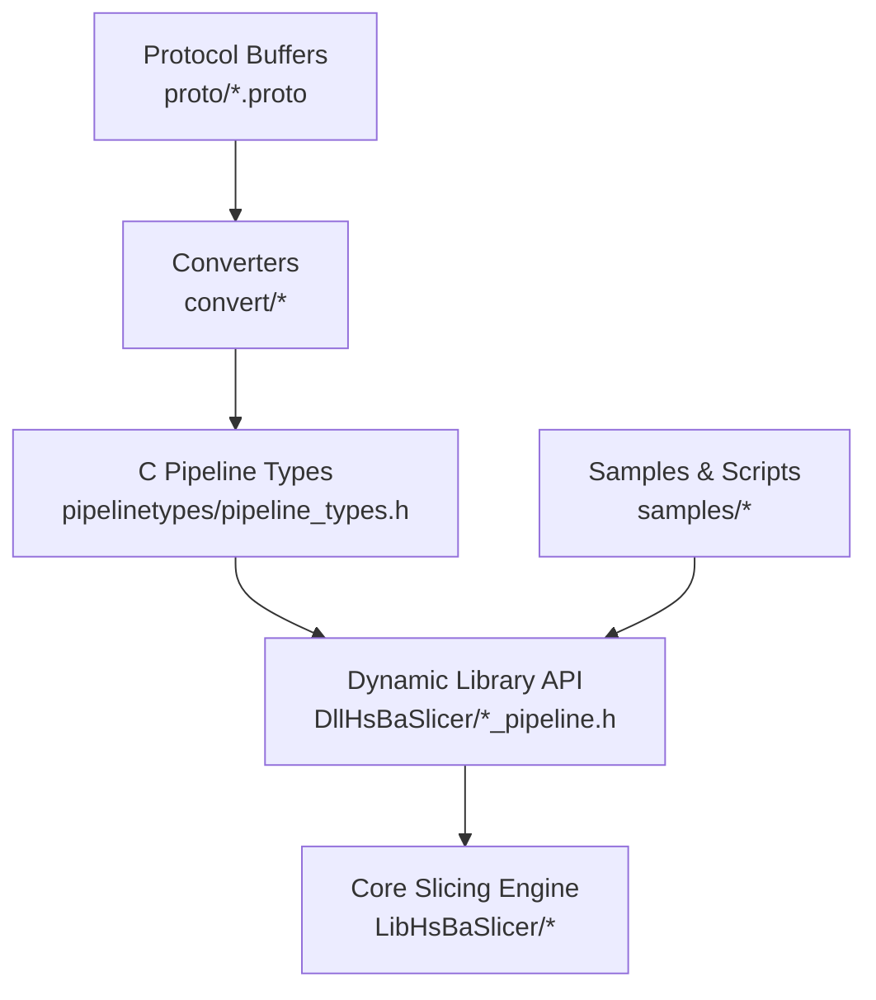
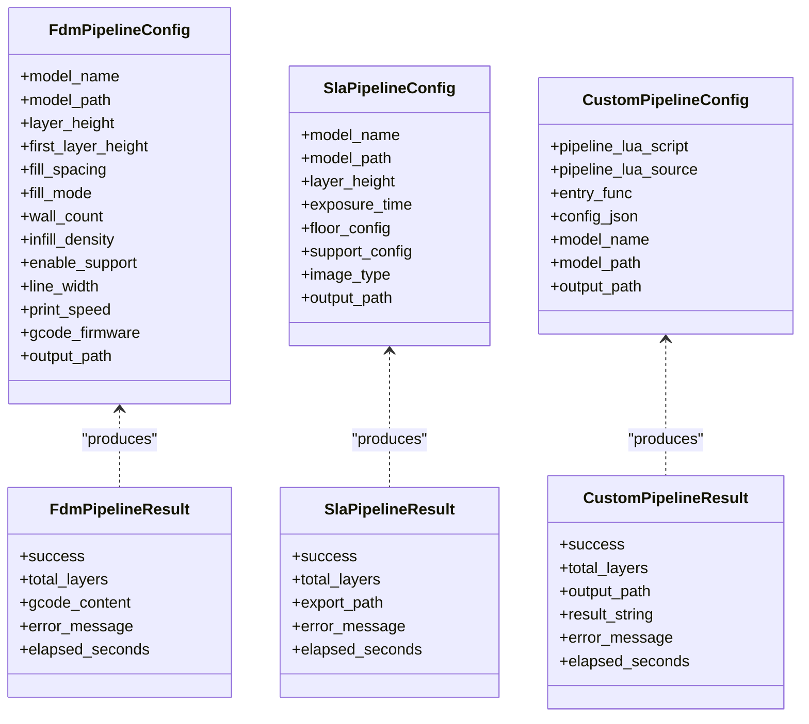
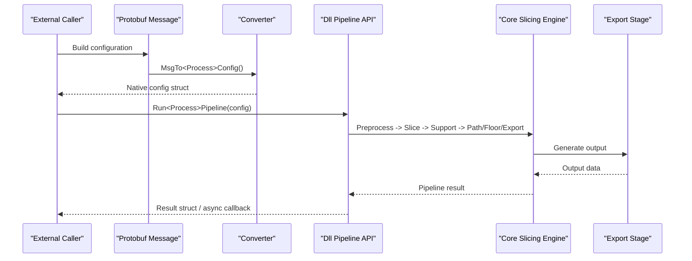
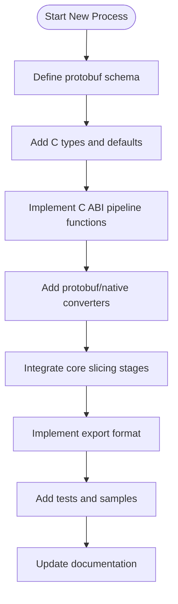
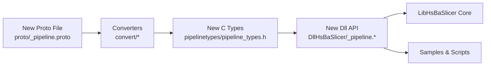

# New Manufacturing Processes

<cite>
**Referenced Files in This Document**   
- [README.md](file://README.md)
- [pipeline_types.h](file://pipelinetypes/pipeline_types.h)
- [fdm_pipeline.h](file://DllHsBaSlicer/fdm_pipeline.h)
- [sla_pipeline.h](file://DllHsBaSlicer/sla_pipeline.h)
- [custom_pipeline.h](file://DllHsBaSlicer/custom_pipeline.h)
- [initialize.h](file://DllHsBaSlicer/initialize.h)
- [Msg2PipelineConfig.hpp](file://convert/Msg2PipelineConfig.hpp)
- [PipelineConfig2Msg.hpp](file://convert/PipelineConfig2Msg.hpp)
- [fdm_pipeline.proto](file://proto/fdm_pipeline.proto)
- [sla_pipeline.proto](file://proto/sla_pipeline.proto)
- [custom_pipeline.proto](file://proto/custom_pipeline.proto)
</cite>

## Table of Contents
1. [Introduction](#introduction)
2. [Project Structure](#project-structure)
3. [Core Components](#core-components)
4. [Architecture Overview](#architecture-overview)
5. [Detailed Component Analysis](#detailed-component-analysis)
6. [Dependency Analysis](#dependency-analysis)
7. [Performance Considerations](#performance-considerations)
8. [Troubleshooting Guide](#troubleshooting-guide)
9. [Conclusion](#conclusion)
10. [Appendices](#appendices)

## Introduction
This document explains how to add support for a new manufacturing process to HsBaSlicer. It covers the complete pipeline stage development lifecycle: defining protocol buffer configuration schemas, implementing C ABI pipeline entry points, wiring processing stages through the core slicing engine, and providing export format implementations. It also documents parameter validation, default value management, testing strategies, performance considerations, and documentation requirements.

HsBaSlicer is a modular, cross-platform C++ framework for 3D-printing slicers with both static library APIs and a dynamic library exposing a stable C ABI for external integration. The repository already includes multiple manufacturing processes such as FDM, SLA, SLS, SLM, LOM, 3DP, WAAM, file transfer, and fully Lua-driven custom pipelines.

**Section sources**
- [README.md:21-39](file://README.md#L21-L39)

## Project Structure
The relevant parts of the repository for adding a new manufacturing process are:

- `proto/`: Protocol buffer definitions for pipeline configurations and results.
- `pipelinetypes/pipeline_types.h`: Stable C-compatible type definitions for all pipeline configurations and results.
- `DllHsBaSlicer/`: Dynamic library headers and implementations that expose C ABI functions for each pipeline.
- `convert/`: Converters between protobuf messages and native C config/result structs.
- `LibHsBaSlicer/`: Core slicing capabilities used by pipeline stages (preprocess, slice, support, fill, path generation, floor, export).
- `samples/`: Example applications and Lua scripts demonstrating existing processes.

**Diagram sources**
- [fdm_pipeline.proto:26-72](file://proto/fdm_pipeline.proto#L26-L72)
- [Msg2PipelineConfig.hpp:24-99](file://convert/Msg2PipelineConfig.hpp#L24-L99)
- [PipelineConfig2Msg.hpp:24-76](file://convert/PipelineConfig2Msg.hpp#L24-L76)
- [pipeline_types.h:56-127](file://pipelinetypes/pipeline_types.h#L56-L127)
- [fdm_pipeline.h:17-61](file://DllHsBaSlicer/fdm_pipeline.h#L17-L61)

**Section sources**
- [README.md:104-124](file://README.md#L104-L124)

## Core Components
Adding a new manufacturing process requires working across four layers:

1. **Configuration schema**: Define protobuf messages for configuration and result in `proto/<new_process>_pipeline.proto`.
2. **Native types**: Add C-compatible struct and enum definitions in `pipelinetypes/pipeline_types.h`, including default initializers.
3. **C ABI entry points**: Implement synchronous and asynchronous pipeline run functions in `DllHsBaSlicer/<new_process>_pipeline.{h,cpp}`.
4. **Message converters**: Provide conversion functions in `convert/Msg2PipelineConfig.hpp` and `convert/PipelineConfig2Msg.hpp`.

Existing examples:

- FDM: G-code path output with firmware targets, infill, support, and optional Lua customization.
- SLA: Layer image packaging into zip files with floor and support generation.
- Custom Lua pipeline: Fully script-defined workflow using the global `HsBa` table.

**Diagram sources**
- [pipeline_types.h:56-127](file://pipelinetypes/pipeline_types.h#L56-L127)
- [pipeline_types.h:170-232](file://pipelinetypes/pipeline_types.h#L170-L232)
- [pipeline_types.h:689-719](file://pipelinetypes/pipeline_types.h#L689-L719)

**Section sources**
- [pipeline_types.h:56-127](file://pipelinetypes/pipeline_types.h#L56-L127)
- [pipeline_types.h:170-232](file://pipelinetypes/pipeline_types.h#L170-L232)
- [pipeline_types.h:689-719](file://pipelinetypes/pipeline_types.h#L689-L719)

## Architecture Overview
The end-to-end flow for a new manufacturing process follows this pattern:

1. External caller constructs a protobuf configuration message or a native C config struct.
2. Converters translate between protobuf and native types.
3. Dynamic library C ABI functions validate inputs, initialize defaults, and invoke the core slicing engine.
4. Core engine executes pipeline stages: preprocess, slice, support, fill/path generation, and export.
5. Results are serialized back into protobuf or returned via C ABI result structs.

**Diagram sources**
- [fdm_pipeline.h:23-35](file://DllHsBaSlicer/fdm_pipeline.h#L23-L35)
- [sla_pipeline.h:23-34](file://DllHsBaSlicer/sla_pipeline.h#L23-L34)
- [Msg2PipelineConfig.hpp:24-99](file://convert/Msg2PipelineConfig.hpp#L24-L99)
- [PipelineConfig2Msg.hpp:24-76](file://convert/PipelineConfig2Msg.hpp#L24-L76)

**Section sources**
- [fdm_pipeline.h:17-61](file://DllHsBaSlicer/fdm_pipeline.h#L17-L61)
- [sla_pipeline.h:17-56](file://DllHsBaSlicer/sla_pipeline.h#L17-L56)

## Detailed Component Analysis

### Step 1: Define Configuration Schema Using Protobuf
Create a new protobuf file under `proto/`, for example `my_process_pipeline.proto`. Follow the patterns from existing files:

- Use `syntax = "proto3"` and package `HsbaProto`.
- Define enums for process-specific options.
- Define a configuration message with typed fields for model, slicing, process parameters, Lua hooks, and output paths.
- Define a result message with success flag, layer count, output path or content, error message, and elapsed time.

Example references:

- FDM configuration and result: [fdm_pipeline.proto:26-81](file://proto/fdm_pipeline.proto#L26-L81)
- SLA configuration and result: [sla_pipeline.proto:18-67](file://proto/sla_pipeline.proto#L18-L67)
- Custom pipeline configuration and result: [custom_pipeline.proto:9-30](file://proto/custom_pipeline.proto#L9-L30)

Validation rules should be documented alongside the proto schema:
- Required string fields must not be empty where applicable.
- Numeric ranges should be constrained by comments or downstream validation.
- Enum values must map cleanly to C enums.

**Section sources**
- [fdm_pipeline.proto:26-81](file://proto/fdm_pipeline.proto#L26-L81)
- [sla_pipeline.proto:18-67](file://proto/sla_pipeline.proto#L18-L67)
- [custom_pipeline.proto:9-30](file://proto/custom_pipeline.proto#L9-L30)

### Step 2: Add Native C-Compatible Types and Defaults
Add matching C-compatible structs and enums to `pipelinetypes/pipeline_types.h`. Each new process should include:

- Enums for process-specific options.
- A configuration struct documenting every field’s purpose and units.
- A result struct with success, total layers, output path/content, error message, and elapsed seconds.
- An inline default initializer function returning a fully initialized configuration.

Existing patterns:

- FDM config and result: [pipeline_types.h:56-127](file://pipelinetypes/pipeline_types.h#L56-L127)
- SLA config and result: [pipeline_types.h:170-232](file://pipelinetypes/pipeline_types.h#L170-L232)
- Custom pipeline config and result: [pipeline_types.h:689-719](file://pipelinetypes/pipeline_types.h#L689-L719)
- Default initializer example: [pipeline_types.h:742-783](file://pipelinetypes/pipeline_types.h#L742-L783)

Default value management guidelines:
- Always provide a default initializer so callers can start from known-good values.
- Keep string pointers NULL by default unless required.
- Document sensible defaults in comments next to each field.

**Section sources**
- [pipeline_types.h:56-127](file://pipelinetypes/pipeline_types.h#L56-L127)
- [pipeline_types.h:170-232](file://pipelinetypes/pipeline_types.h#L170-L232)
- [pipeline_types.h:689-719](file://pipelinetypes/pipeline_types.h#L689-L719)
- [pipeline_types.h:742-783](file://pipelinetypes/pipeline_types.h#L742-L783)

### Step 3: Implement C ABI Pipeline Entry Points
Implement the dynamic library interface in `DllHsBaSlicer/<new_process>_pipeline.{h,cpp}`. At minimum, provide:

- A default config creation function.
- A synchronous run function.
- An asynchronous run function.
- A result-free function.

Existing patterns:

- FDM API: [fdm_pipeline.h:17-61](file://DllHsBaSlicer/fdm_pipeline.h#L17-L61)
- SLA API: [sla_pipeline.h:17-56](file://DllHsBaSlicer/sla_pipeline.h#L17-L56)
- Custom Lua pipeline API: [custom_pipeline.h:17-62](file://DllHsBaSlicer/custom_pipeline.h#L17-L62)

Pipeline stage responsibilities:
- Validate input configuration.
- Initialize defaults where appropriate.
- Execute preprocessing, slicing, support generation, path/floor generation, and export.
- Report progress via callbacks.
- Return structured results with proper memory ownership semantics.

For Lua-driven workflows, use the custom pipeline API, which exposes the global `HsBa` table and allows full control over stage order and content.

**Section sources**
- [fdm_pipeline.h:17-61](file://DllHsBaSlicer/fdm_pipeline.h#L17-L61)
- [sla_pipeline.h:17-56](file://DllHsBaSlicer/sla_pipeline.h#L17-L56)
- [custom_pipeline.h:17-62](file://DllHsBaSlicer/custom_pipeline.h#L17-L62)

### Step 4: Wire Converters Between Protobuf and Native Types
Add converter functions in `convert/Msg2PipelineConfig.hpp` and `convert/PipelineConfig2Msg.hpp`:

- `MsgTo<Process>Config` and `MsgTo<Process>Result` for incoming messages.
- `<Process>ConfigToMsg` and `<Process>ResultToMsg` for outgoing messages.

Existing patterns:

- Converter declarations: [Msg2PipelineConfig.hpp:24-99](file://convert/Msg2PipelineConfig.hpp#L24-L99)
- Reverse converter declarations: [PipelineConfig2Msg.hpp:24-76](file://convert/PipelineConfig2Msg.hpp#L24-L76)

Memory ownership notes:
- String fields allocated by converters must be freed by the caller or passed through the corresponding pipeline run function that handles copying.
- Result strings must be released using the provided free functions.

**Section sources**
- [Msg2PipelineConfig.hpp:24-99](file://convert/Msg2PipelineConfig.hpp#L24-L99)
- [PipelineConfig2Msg.hpp:24-76](file://convert/PipelineConfig2Msg.hpp#L24-L76)

### Step 5: Integrate With the Core Slicing Engine
The core slicing engine lives in `LibHsBaSlicer`. Depending on the manufacturing process, integrate these stages:

- Preprocessing: model loading and geometry preparation.
- Slicing: mesh slicing into layers.
- Support: support structure generation.
- Fill: infill or layer filling algorithms.
- Path generation: toolpath or robot path creation.
- Floor: base or raft generation for vat-based processes.
- Export: serialization to target format.

Examples of existing integrations:

- FDM path generation and G-code export.
- SLA floor and layer image export.
- Custom Lua pipeline exposing building blocks through the `HsBa` table.

[No sources needed since this diagram shows conceptual workflow, not actual code structure]

**Section sources**
- [custom_pipeline.h:23-36](file://DllHsBaSlicer/custom_pipeline.h#L23-L36)

### Step 6: Implement Export Format for New Technologies
Export implementation depends on the technology:

- FDM: G-code path output with firmware-specific formatting.
- SLA: Layer images packaged into zip archives.
- SLS/SLM/LOM/3DP/WAAM: Often rely on Lua export scripts or specialized path generators.

Guidelines:
- Define clear file format specifications.
- Serialize layer data, toolpaths, material settings, and machine parameters consistently.
- Provide Lua hooks when the export format is highly customizable.
- Ensure output paths are reported in results.

Existing references:

- FDM result contains G-code content: [pipeline_types.h:120-127](file://pipelinetypes/pipeline_types.h#L120-L127)
- SLA result contains exported zip path: [pipeline_types.h:225-232](file://pipelinetypes/pipeline_types.h#L225-L232)
- Custom pipeline result reports output path and result string: [pipeline_types.h:711-719](file://pipelinetypes/pipeline_types.h#L711-L719)

**Section sources**
- [pipeline_types.h:120-127](file://pipelinetypes/pipeline_types.h#L120-L127)
- [pipeline_types.h:225-232](file://pipelinetypes/pipeline_types.h#L225-L232)
- [pipeline_types.h:711-719](file://pipelinetypes/pipeline_types.h#L711-L719)

### Step 7: Parameter Validation and Default Value Management
Validation should occur early in the pipeline entry point:

- Check required fields are present.
- Clamp numeric values to safe ranges.
- Validate enum mappings.
- Fail fast with descriptive error messages.

Default value management:

- Use default initializer functions.
- Allow partial overrides by callers.
- Keep defaults consistent with existing processes.

References:

- Default initializer pattern: [pipeline_types.h:742-783](file://pipelinetypes/pipeline_types.h#L742-L783)
- Progress and result callback types: [pipeline_types.h:130-140](file://pipelinetypes/pipeline_types.h#L130-L140), [pipeline_types.h:235-245](file://pipelinetypes/pipeline_types.h#L235-L245), [pipeline_types.h:721-732](file://pipelinetypes/pipeline_types.h#L721-L732)

**Section sources**
- [pipeline_types.h:742-783](file://pipelinetypes/pipeline_types.h#L742-L783)
- [pipeline_types.h:130-140](file://pipelinetypes/pipeline_types.h#L130-L140)
- [pipeline_types.h:235-245](file://pipelinetypes/pipeline_types.h#L235-L245)
- [pipeline_types.h:721-732](file://pipelinetypes/pipeline_types.h#L721-L732)

### Step 8: DLL Initialization and Registration
Ensure the dynamic library initializes once at load time. The initialization function registers Lua functions, pipelines, and one-time runtime setup.

Reference:

- Initialization entry point: [initialize.h:14-19](file://DllHsBaSlicer/initialize.h#L14-L19)

**Section sources**
- [initialize.h:14-19](file://DllHsBaSlicer/initialize.h#L14-L19)

## Dependency Analysis
The new manufacturing process introduces dependencies across several modules:

**Diagram sources**
- [Msg2PipelineConfig.hpp:24-99](file://convert/Msg2PipelineConfig.hpp#L24-L99)
- [PipelineConfig2Msg.hpp:24-76](file://convert/PipelineConfig2Msg.hpp#L24-L76)
- [pipeline_types.h:56-127](file://pipelinetypes/pipeline_types.h#L56-L127)
- [fdm_pipeline.h:17-61](file://DllHsBaSlicer/fdm_pipeline.h#L17-L61)

Key dependency relationships:

- Proto definitions drive converter implementations.
- Converters depend on generated protobuf headers and native C types.
- Dll pipeline APIs depend on converters and core slicing engine.
- Samples and scripts consume Dll APIs.

Potential circular dependencies:

- Avoid importing Dll headers into converters or core libraries.
- Keep protobuf and native type definitions independent of runtime pipeline logic.

**Section sources**
- [Msg2PipelineConfig.hpp:24-99](file://convert/Msg2PipelineConfig.hpp#L24-L99)
- [PipelineConfig2Msg.hpp:24-76](file://convert/PipelineConfig2Msg.hpp#L24-L76)
- [pipeline_types.h:56-127](file://pipelinetypes/pipeline_types.h#L56-L127)
- [fdm_pipeline.h:17-61](file://DllHsBaSlicer/fdm_pipeline.h#L17-L61)

## Performance Considerations
When implementing a new manufacturing process:

- Prefer batch operations for large datasets.
- Reuse buffers where possible.
- Avoid unnecessary string copies; pass references or move semantics internally.
- Use progress callbacks to keep UI responsive during long-running stages.
- Profile critical stages such as slicing, support generation, and export serialization.
- Consider parallelization only where data dependencies allow it.

[No sources needed since this section provides general guidance]

## Troubleshooting Guide
Common issues and resolutions:

- Missing protobuf-generated headers: ensure the build system generates `.pb.h` files from `proto/*.proto`.
- Memory leaks in results: always call the corresponding free function for pipeline results.
- Invalid configuration: validate required fields and ranges before running the pipeline.
- Lua script errors: verify script paths, function names, and exposed variables.
- Export format mismatches: confirm file format specifications and serialization logic.

Relevant reference points:

- Result free functions: [fdm_pipeline.h:53-61](file://DllHsBaSlicer/fdm_pipeline.h#L53-L61), [sla_pipeline.h:49-56](file://DllHsBaSlicer/sla_pipeline.h#L49-L56), [custom_pipeline.h:57-62](file://DllHsBaSlicer/custom_pipeline.h#L57-L62)
- Callback types for progress and async results: [pipeline_types.h:130-140](file://pipelinetypes/pipeline_types.h#L130-L140), [pipeline_types.h:235-245](file://pipelinetypes/pipeline_types.h#L235-L245), [pipeline_types.h:721-732](file://pipelinetypes/pipeline_types.h#L721-L732)

**Section sources**
- [fdm_pipeline.h:53-61](file://DllHsBaSlicer/fdm_pipeline.h#L53-L61)
- [sla_pipeline.h:49-56](file://DllHsBaSlicer/sla_pipeline.h#L49-L56)
- [custom_pipeline.h:57-62](file://DllHsBaSlicer/custom_pipeline.h#L57-L62)
- [pipeline_types.h:130-140](file://pipelinetypes/pipeline_types.h#L130-L140)
- [pipeline_types.h:235-245](file://pipelinetypes/pipeline_types.h#L235-L245)
- [pipeline_types.h:721-732](file://pipelinetypes/pipeline_types.h#L721-L732)

## Conclusion
Adding a new manufacturing process to HsBaSlicer involves defining a protobuf schema, adding native C types with defaults, implementing C ABI pipeline entry points, wiring converters, integrating core slicing stages, and implementing export formats. Following the established patterns from FDM, SLA, and custom Lua pipelines ensures consistency, maintainability, and interoperability across the framework. Proper validation, memory management, testing, and documentation are essential for production-quality extensions.

[No sources needed since this section summarizes without analyzing specific files]

## Appendices

### Appendix A: End-to-End Implementation Checklist
- Create `proto/<new>_pipeline.proto` with configuration and result messages.
- Add C-compatible structs, enums, and default initializer in `pipelinetypes/pipeline_types.h`.
- Implement `DllHsBaSlicer/<new>_pipeline.{h,cpp}` with default config, sync run, async run, and result free.
- Add converter functions in `convert/Msg2PipelineConfig.hpp` and `convert/PipelineConfig2Msg.hpp`.
- Integrate preprocessing, slicing, support, fill/path, floor, and export stages.
- Implement export format according to technology requirements.
- Add tests and sample scripts.
- Update documentation and README if necessary.

[No sources needed since this section provides general guidance]