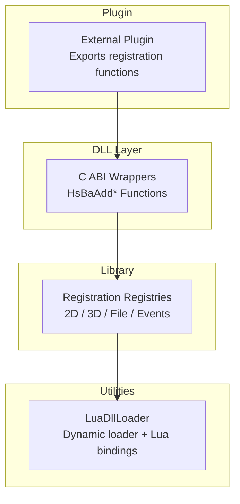
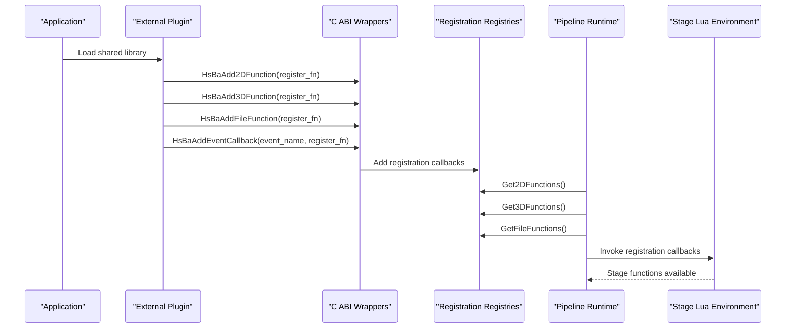
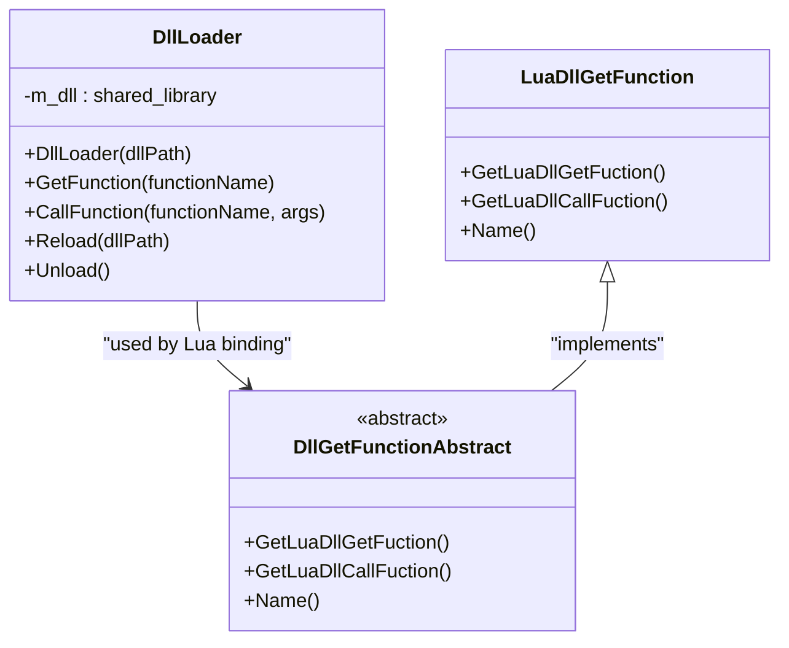
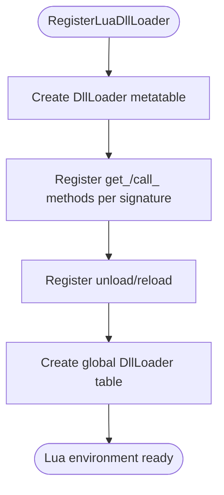
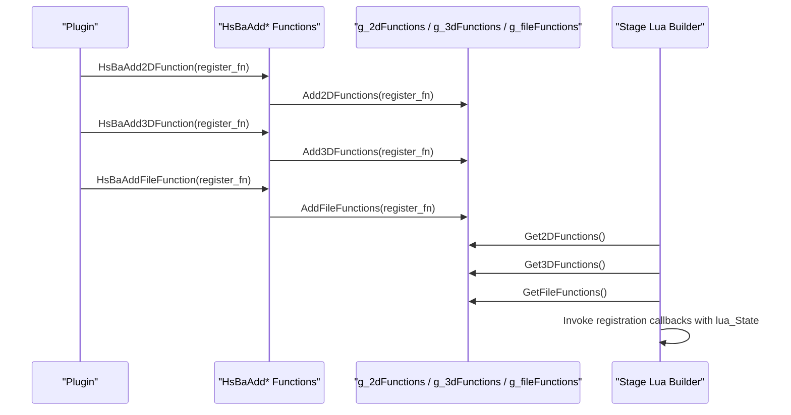
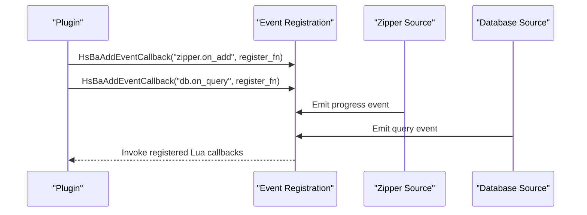
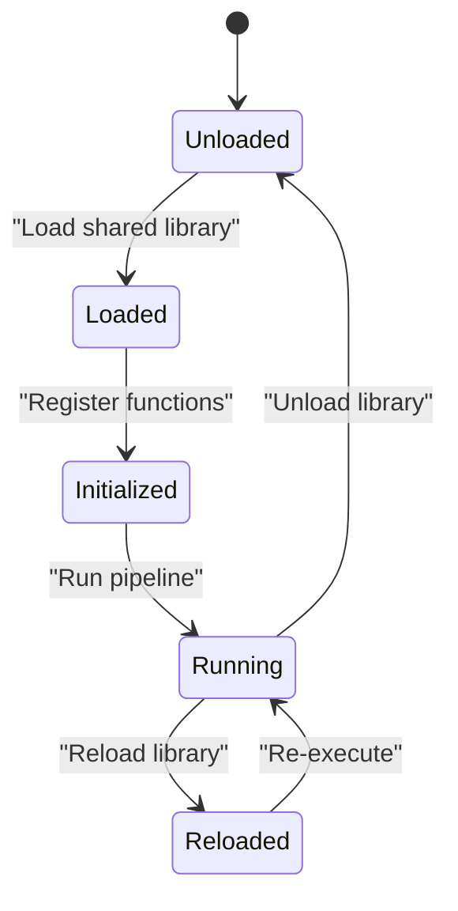
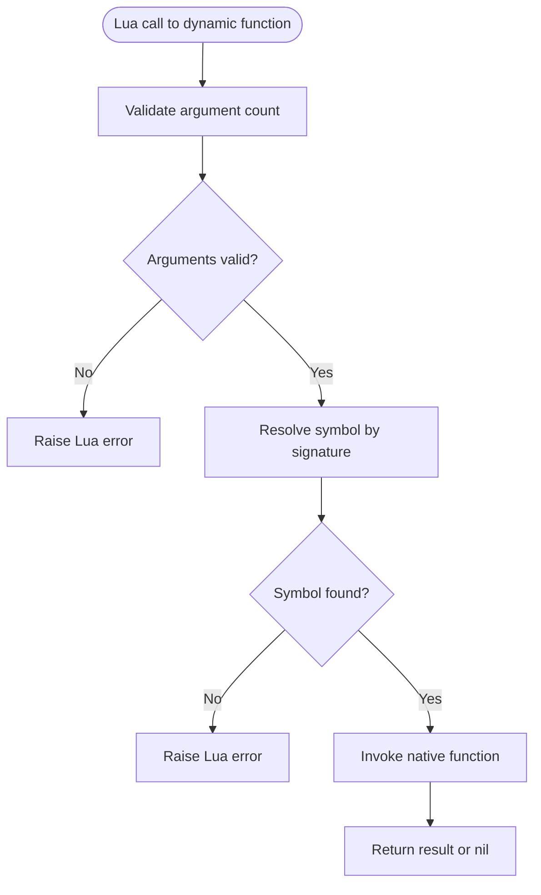
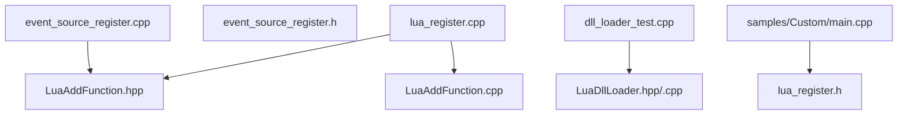

# Plugin Architecture

<cite>
**Referenced Files in This Document**   
- [LuaDllLoader.hpp](file://utils/LuaDllLoader.hpp)
- [LuaDllLoader.cpp](file://utils/LuaDllLoader.cpp)
- [LuaAddFunction.hpp](file://LibHsBaSlicer/Extends/LuaAddFunction.hpp)
- [LuaAddFunction.cpp](file://LibHsBaSlicer/Extends/LuaAddFunction.cpp)
- [lua_register.h](file://DllHsBaSlicer/lua_register.h)
- [lua_register.cpp](file://DllHsBaSlicer/lua_register.cpp)
- [event_source_register.h](file://DllHsBaSlicer/event_source_register.h)
- [event_source_register.cpp](file://DllHsBaSlicer/event_source_register.cpp)
- [dll_loader_test.cpp](file://tests/DllLoader/dll_loader_test.cpp)
- [main.cpp](file://samples/Custom/main.cpp)
</cite>

## Table of Contents
1. [Introduction](#introduction)
2. [Project Structure](#project-structure)
3. [Core Components](#core-components)
4. [Architecture Overview](#architecture-overview)
5. [Detailed Component Analysis](#detailed-component-analysis)
6. [Dependency Analysis](#dependency-analysis)
7. [Performance Considerations](#performance-considerations)
8. [Troubleshooting Guide](#troubleshooting-guide)
9. [Conclusion](#conclusion)
10. [Appendices](#appendices)

## Introduction
This document explains the HsBaSlicer plugin architecture with a focus on dynamic loading and extension points:

- Dynamic native library loading through `LuaDllLoader`, which exposes a Lua-visible `DllLoader` object for runtime discovery, invocation, reload, and unload of exported functions.
- Registration mechanisms that allow plugins to extend core pipeline stages via C ABI entry points: `HsBaAdd2DFunction`, `HsBaAdd3DFunction`, `HsBaAddFileFunction`, and `HsBaAddEventCallback`.
- Event callback system for inter-component communication, including both Lua event callbacks and non-Lua event sources such as zipper progress and database queries.
- Practical guidance for creating C/C++ plugins, handling lifecycle, error handling, debugging, security considerations, version compatibility, and performance implications.

The goal is to help developers build loadable plugins that integrate cleanly into the slicer pipeline while remaining safe, debuggable, and maintainable.

## Project Structure
The plugin-related code spans three main areas:

- Utilities layer: dynamic loader implementation and Lua bindings.
- Library layer: registration registries for 2D, 3D, file-stage functions, and named event callbacks.
- DLL layer: C ABI wrappers that expose registration functions to external plugins.

**Diagram sources**
- [LuaDllLoader.hpp:27-79](file://utils/LuaDllLoader.hpp#L27-L79)
- [LuaAddFunction.hpp:21-74](file://LibHsBaSlicer/Extends/LuaAddFunction.hpp#L21-L74)
- [lua_register.h:13-31](file://DllHsBaSlicer/lua_register.h#L13-L31)

**Section sources**
- [LuaDllLoader.hpp:27-79](file://utils/LuaDllLoader.hpp#L27-L79)
- [LuaAddFunction.hpp:21-74](file://LibHsBaSlicer/Extends/LuaAddFunction.hpp#L21-L74)
- [lua_register.h:13-31](file://DllHsBaSlicer/lua_register.h#L13-L31)

## Core Components
This section summarizes the key components used by plugins and the runtime.

- `DllLoader`: Runtime wrapper around a dynamically loaded native library. It supports symbol lookup, typed function calls, reload, and unload.
- `RegisterLuaDllLoader`: Registers Lua methods for constructing `DllLoader`, calling functions, getting function pointers, reloading, and unloading libraries.
- Registration registries: Global vectors storing Lua registration callbacks for 2D, 3D, and file pipeline stages; a map storing named event callbacks.
- C ABI registration functions: `HsBaAdd2DFunction`, `HsBaAdd3DFunction`, `HsBaAddFileFunction`, `HsBaAddEventCallback`. These are the official entry points for plugins.
- Non-Lua event source registration: `HsBaAddZipperEventCallback` and `HsBaAddDBEventCallback` for progress and query events.

Key responsibilities:

- Plugins export registration functions that install Lua functions into a provided `lua_State`.
- The runtime invokes these registration functions when building stage-specific Lua environments.
- Plugins can also register event callbacks under named events or subscribe to built-in event sources.

**Section sources**
- [LuaDllLoader.hpp:27-79](file://utils/LuaDllLoader.hpp#L27-L79)
- [LuaDllLoader.cpp:55-103](file://utils/LuaDllLoader.cpp#L55-L103)
- [LuaAddFunction.hpp:21-74](file://LibHsBaSlicer/Extends/LuaAddFunction.hpp#L21-L74)
- [lua_register.h:13-31](file://DllHsBaSlicer/lua_register.h#L13-L31)
- [event_source_register.h:15-17](file://DllHsBaSlicer/event_source_register.h#L15-L17)

## Architecture Overview
The plugin architecture separates concerns across three layers:

1. **Plugin Layer**: External C/C++ code compiled into a shared library. It exports registration functions and optionally implements custom logic invoked by the runtime.
2. **DLL Layer**: Thin C ABI wrappers that forward plugin registrations into the library registries.
3. **Library Layer**: Central registries that collect all registered functions and events, then inject them into the appropriate Lua environments during pipeline execution.
4. **Utilities Layer**: `LuaDllLoader` provides a Lua API for discovering and invoking symbols from other native libraries at runtime.

**Diagram sources**
- [lua_register.cpp:11-41](file://DllHsBaSlicer/lua_register.cpp#L11-L41)
- [LuaAddFunction.cpp:21-67](file://LibHsBaSlicer/Extends/LuaAddFunction.cpp#L21-L67)

**Section sources**
- [lua_register.cpp:11-41](file://DllHsBaSlicer/lua_register.cpp#L11-L41)
- [LuaAddFunction.cpp:21-67](file://LibHsBaSlicer/Extends/LuaAddFunction.cpp#L21-L67)

## Detailed Component Analysis

### Dynamic Loading System: LuaDllLoader
`LuaDllLoader` enables Lua scripts to load native libraries, resolve symbols, call functions with type-safe signatures, and manage library lifetimes.

Key capabilities:

- Constructing a loader with a library path.
- Resolving exported functions by name and signature.
- Calling resolved functions from Lua with automatic argument unpacking and return value conversion.
- Reloading and unloading libraries.
- Exposing a Lua metatable with constructor, method, and class-level helpers.

**Diagram sources**
- [LuaDllLoader.hpp:27-79](file://utils/LuaDllLoader.hpp#L27-L79)
- [LuaDllLoader.hpp:81-111](file://utils/LuaDllLoader.hpp#L81-L111)
- [LuaDllLoader.hpp:247-254](file://utils/LuaDllLoader.hpp#L247-L254)

#### Lua Binding Flow
When registering the DLL loader, the runtime creates a Lua metatable and registers methods for each declared function signature. This allows Lua scripts to call `get_<name>` and `call_<name>` for every supported signature.

**Diagram sources**
- [LuaDllLoader.cpp:55-103](file://utils/LuaDllLoader.cpp#L55-L103)

**Section sources**
- [LuaDllLoader.hpp:27-79](file://utils/LuaDllLoader.hpp#L27-L79)
- [LuaDllLoader.hpp:113-254](file://utils/LuaDllLoader.hpp#L113-L254)
- [LuaDllLoader.cpp:55-103](file://utils/LuaDllLoader.cpp#L55-L103)

### Registration Mechanisms: HsBaAdd2DFunction, HsBaAdd3DFunction, HsBaAddFileFunction
Plugins use these C ABI functions to register Lua registration callbacks. Each callback receives a `lua_State` and installs stage-specific functions.

- `HsBaAdd2DFunction`: For 2D pipeline stages such as support generation, polygon filling, and SLA output.
- `HsBaAdd3DFunction`: For 3D pipeline stages such as slicing and support generation.
- `HsBaAddFileFunction`: For file-oriented stages such as SLS export and SLA packaging.

**Diagram sources**
- [lua_register.cpp:11-41](file://DllHsBaSlicer/lua_register.cpp#L11-L41)
- [LuaAddFunction.cpp:21-49](file://LibHsBaSlicer/Extends/LuaAddFunction.cpp#L21-L49)

**Section sources**
- [lua_register.h:21-31](file://DllHsBaSlicer/lua_register.h#L21-L31)
- [lua_register.cpp:11-41](file://DllHsBaSlicer/lua_register.cpp#L11-L41)
- [LuaAddFunction.hpp:24-58](file://LibHsBaSlicer/Extends/LuaAddFunction.hpp#L24-L58)
- [LuaAddFunction.cpp:21-49](file://LibHsBaSlicer/Extends/LuaAddFunction.cpp#L21-L49)

### Event Callback System: HsBaAddEventCallback and Non-Lua Event Sources
Plugins can register Lua event callbacks under named events. Additionally, the system provides non-Lua event source registration for zipper progress and database queries.

- `HsBaAddEventCallback(event_name, register_fn)`: Binds a Lua registration callback to an event name.
- `HsBaAddZipperEventCallback(event_name, c_callback)`: Subscribes to zipper compression progress events.
- `HsBaAddDBEventCallback(event_name, c_callback)`: Subscribes to database query events.

**Diagram sources**
- [lua_register.cpp:35-41](file://DllHsBaSlicer/lua_register.cpp#L35-L41)
- [LuaAddFunction.cpp:59-67](file://LibHsBaSlicer/Extends/LuaAddFunction.cpp#L59-L67)
- [event_source_register.cpp:9-34](file://DllHsBaSlicer/event_source_register.cpp#L9-L34)

**Section sources**
- [lua_register.h:30-31](file://DllHsBaSlicer/lua_register.h#L30-L31)
- [lua_register.cpp:35-41](file://DllHsBaSlicer/lua_register.cpp#L35-L41)
- [LuaAddFunction.hpp:62-74](file://LibHsBaSlicer/Extends/LuaAddFunction.hpp#L62-L74)
- [LuaAddFunction.cpp:59-67](file://LibHsBaSlicer/Extends/LuaAddFunction.cpp#L59-L67)
- [event_source_register.h:15-17](file://DllHsBaSlicer/event_source_register.h#L15-L17)
- [event_source_register.cpp:9-34](file://DllHsBaSlicer/event_source_register.cpp#L9-L34)

### Creating Loadable Plugins: Practical Guidance
To create a C/C++ plugin that extends HsBaSlicer:

1. Build your plugin as a shared library (DLL on Windows, `.so` on Linux, `.dylib` on macOS).
2. Export registration functions using the C ABI:
   - `HsBaAdd2DFunction`
   - `HsBaAdd3DFunction`
   - `HsBaAddFileFunction`
   - `HsBaAddEventCallback`
3. In each registration function, receive a `lua_State` and install your Lua functions using standard Lua C API calls.
4. Optionally register non-Lua event callbacks for zipper and database events.
5. Load the plugin before running pipelines so the runtime can discover and invoke your registration callbacks.

Example usage patterns are demonstrated in the Custom sample, which shows how to configure and run pipelines driven by Lua scripts and how to interact with the runtime.

**Section sources**
- [lua_register.h:13-31](file://DllHsBaSlicer/lua_register.h#L13-L31)
- [lua_register.cpp:11-41](file://DllHsBaSlicer/lua_register.cpp#L11-L41)
- [main.cpp:98-131](file://samples/Custom/main.cpp#L98-L131)

### Plugin Lifecycle Management
Lifecycle management involves loading, initializing, executing, and cleaning up plugins:

- Load the plugin shared library early in application startup.
- Call registration functions to populate registries.
- Let the runtime invoke registration callbacks when building stage Lua environments.
- Use `DllLoader.unload` and `DllLoader.reload` to manage dynamically loaded libraries from Lua.

**Diagram sources**
- [LuaDllLoader.cpp:27-52](file://utils/LuaDllLoader.cpp#L27-L52)

**Section sources**
- [LuaDllLoader.cpp:27-52](file://utils/LuaDllLoader.cpp#L27-L52)

### Error Handling and Debugging
Error handling is implemented at multiple levels:

- Argument validation in Lua-to-native bridges raises Lua errors when types or counts mismatch.
- Unknown symbol resolution throws exceptions caught and converted to Lua errors.
- Null-object guards prevent dereferencing invalid objects in loader methods.
- Tests verify error paths for argument count mismatches, unknown symbols, and invalid object usage.

Debugging techniques:

- Use Lua `pcall` to catch errors from dynamic calls.
- Log error messages returned by the loader.
- Validate function signatures match between Lua declarations and native exports.
- Inspect test cases for expected error behavior.

**Diagram sources**
- [LuaDllLoader.hpp:188-245](file://utils/LuaDllLoader.hpp#L188-L245)
- [dll_loader_test.cpp:140-185](file://tests/DllLoader/dll_loader_test.cpp#L140-L185)

**Section sources**
- [LuaDllLoader.hpp:188-245](file://utils/LuaDllLoader.hpp#L188-L245)
- [dll_loader_test.cpp:140-185](file://tests/DllLoader/dll_loader_test.cpp#L140-L185)

### Security Considerations
Dynamic loading introduces risks that must be managed:

- Only load trusted libraries from verified locations.
- Validate library paths and avoid arbitrary user-controlled paths without checks.
- Restrict permissions for directories containing plugins.
- Sign plugins and verify signatures before loading.
- Isolate plugin execution where possible to limit damage from malicious code.
- Avoid exposing unsafe Lua APIs to untrusted plugins.

[No sources needed since this section provides general guidance]

### Version Compatibility
Ensure compatibility between plugins and the runtime:

- Define a stable C ABI for registration functions.
- Avoid breaking changes to function signatures.
- Use version negotiation if necessary.
- Test plugins against multiple runtime versions.
- Document required runtime versions in plugin metadata.

[No sources needed since this section provides general guidance]

### Performance Implications
Consider performance when designing plugins:

- Minimize repeated symbol lookups; cache resolved function pointers when appropriate.
- Avoid heavy initialization in registration callbacks; defer expensive work until needed.
- Be mindful of memory allocation and lifetime when returning values to Lua.
- Use efficient data structures and avoid unnecessary copies.
- Profile plugin execution within pipeline stages to identify bottlenecks.

[No sources needed since this section provides general guidance]

## Dependency Analysis
The following diagram shows dependencies among plugin-related components:

**Diagram sources**
- [LuaDllLoader.hpp:27-79](file://utils/LuaDllLoader.hpp#L27-L79)
- [LuaAddFunction.hpp:21-74](file://LibHsBaSlicer/Extends/LuaAddFunction.hpp#L21-L74)
- [lua_register.h:13-31](file://DllHsBaSlicer/lua_register.h#L13-L31)
- [event_source_register.h:15-17](file://DllHsBaSlicer/event_source_register.h#L15-L17)

**Section sources**
- [LuaDllLoader.hpp:27-79](file://utils/LuaDllLoader.hpp#L27-L79)
- [LuaAddFunction.hpp:21-74](file://LibHsBaSlicer/Extends/LuaAddFunction.hpp#L21-L74)
- [lua_register.h:13-31](file://DllHsBaSlicer/lua_register.h#L13-L31)
- [event_source_register.h:15-17](file://DllHsBaSlicer/event_source_register.h#L15-L17)

## Performance Considerations
[No sources needed since this section provides general guidance]

## Troubleshooting Guide
Common issues and resolutions:

- **Argument count mismatch**: Ensure Lua calls pass the exact number of arguments expected by the native function signature.
- **Unknown symbol**: Verify the exported symbol name matches the Lua declaration.
- **Invalid DllLoader object**: Ensure you are calling methods on a properly constructed loader instance.
- **Reload failures**: Confirm the new library path is valid and compatible with the current runtime.
- **Event not firing**: Check that the event name matches exactly and that the registration callback was called before the event source emits.

Use tests as reference for expected error behavior and validation patterns.

**Section sources**
- [dll_loader_test.cpp:140-185](file://tests/DllLoader/dll_loader_test.cpp#L140-L185)

## Conclusion
HsBaSlicer’s plugin architecture provides a robust mechanism for extending core functionality through dynamic loading and registration. By using `LuaDllLoader` for runtime library access and the C ABI registration functions for pipeline integration, developers can create flexible, secure, and performant plugins. Proper lifecycle management, error handling, and security practices ensure reliable operation across diverse deployment scenarios.

[No sources needed since this section summarizes without analyzing specific files]

## Appendices
- Example configuration and pipeline execution patterns are available in the Custom sample.
- Tests demonstrate dynamic loader behavior, including argument validation, symbol resolution, and lifecycle operations.

**Section sources**
- [main.cpp:98-131](file://samples/Custom/main.cpp#L98-L131)
- [dll_loader_test.cpp:96-121](file://tests/DllLoader/dll_loader_test.cpp#L96-L121)