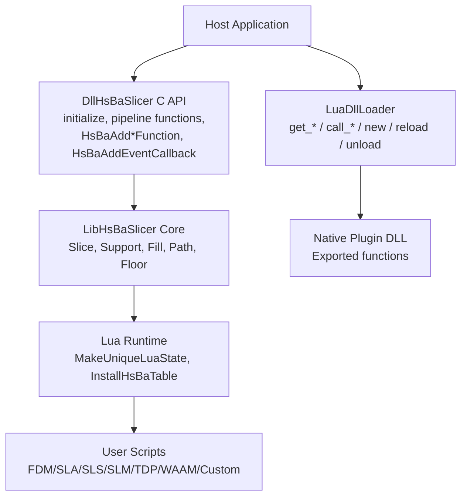
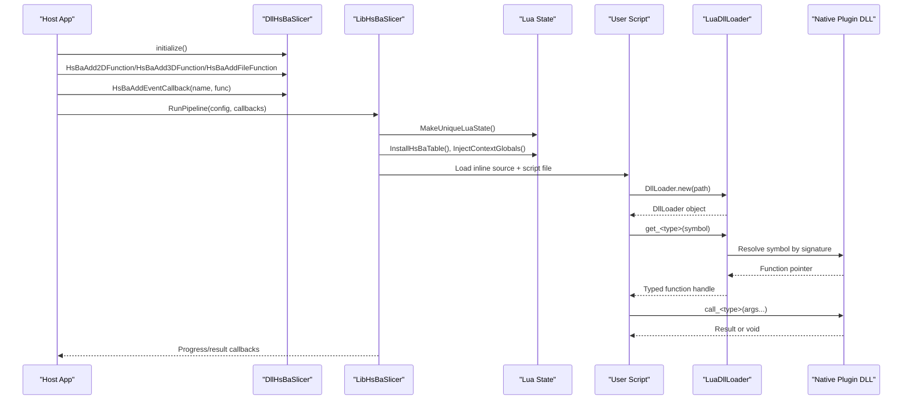
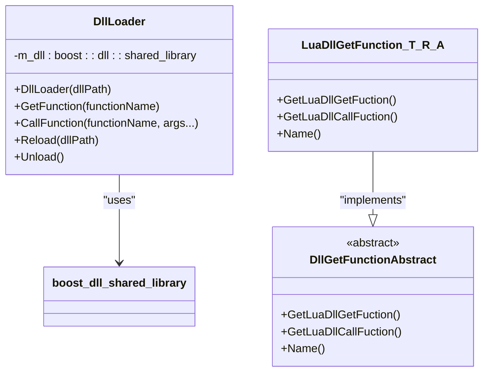
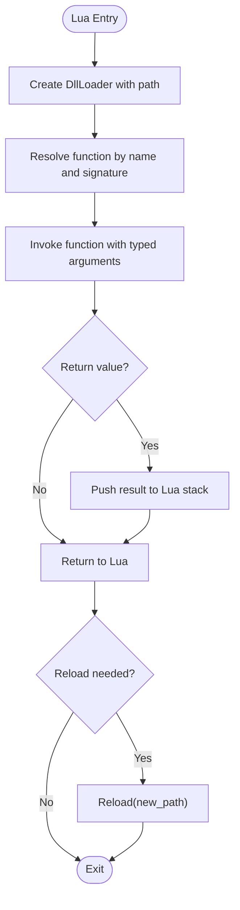
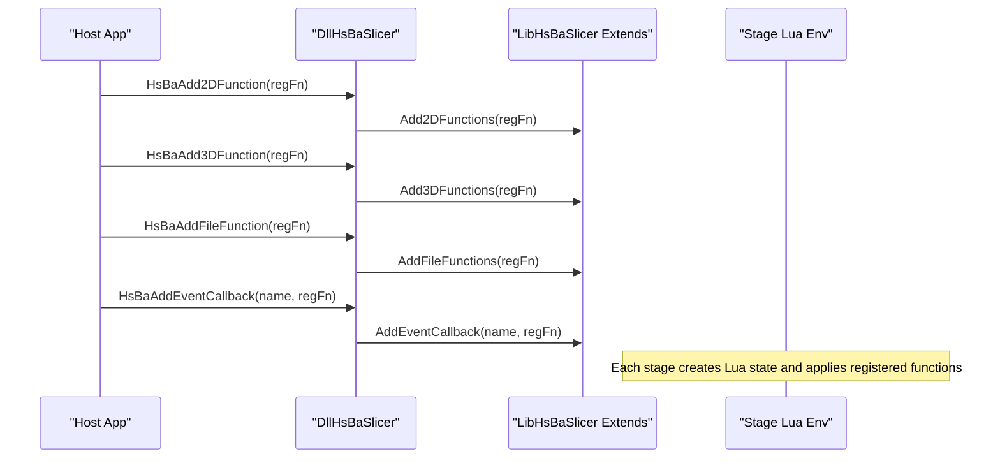
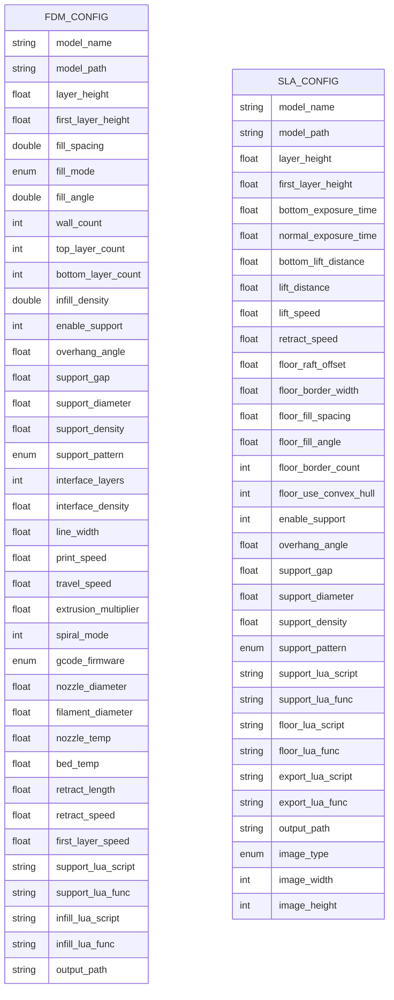
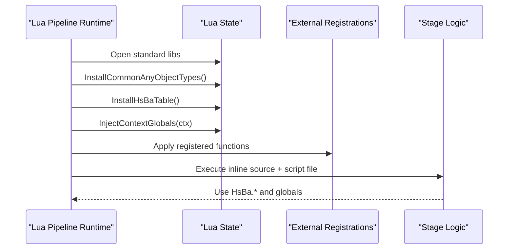
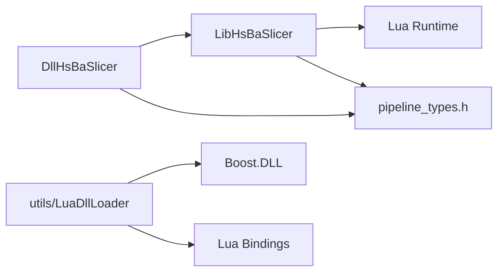

# Plugin Development

<cite>
**Referenced Files in This Document**
- [LuaDllLoader.hpp](file://utils/LuaDllLoader.hpp)
- [LuaDllLoader.cpp](file://utils/LuaDllLoader.cpp)
- [lua_register.h](file://DllHsBaSlicer/lua_register.h)
- [lua_register.cpp](file://DllHsBaSlicer/lua_register.cpp)
- [EventSourceFunction.cpp](file://LibHsBaSlicer/Extends/EventSourceFunction.cpp)
- [pipeline_types.h](file://pipelinetypes/pipeline_types.h)
- [lua_pipeline.cpp](file://LibHsBaSlicer/Extends/lua_pipeline.cpp)
- [LuaSupport.cpp](file://support/LuaSupport.cpp)
- [PolygonFill.cpp](file://2D/PolygonFill.cpp)
- [dll_loader_test.cpp](file://tests/DllLoader/dll_loader_test.cpp)
</cite>

## Table of Contents
1. [Introduction](#introduction)
2. [Project Structure](#project-structure)
3. [Core Components](#core-components)
4. [Architecture Overview](#architecture-overview)
5. [Detailed Component Analysis](#detailed-component-analysis)
6. [Dependency Analysis](#dependency-analysis)
7. [Performance Considerations](#performance-considerations)
8. [Troubleshooting Guide](#troubleshooting-guide)
9. [Conclusion](#conclusion)
10. [Appendices](#appendices)

## Introduction
This document explains how to develop plugins and dynamic extensions for HsBaSlicer. It focuses on:
- The Lua DLL loading mechanism through `LuaDllLoader`.
- Plugin discovery, initialization, lifecycle management, and versioning considerations.
- The plugin interface definitions used by the host and plugins.
- Function registration patterns and data exchange between host C++ code and Lua scripts or native DLLs.
- The Lua scripting environment setup, global variable injection, and callback integration.
- Examples of standalone plugins that extend slicing pipelines, add output formats, or implement custom processing stages.
- Packaging, distribution, dependency resolution, security, sandboxing, resource limits, debugging, profiling, and performance monitoring.

The goal is to help you build safe, testable, and maintainable extensions while keeping the core slicing pipeline stable.

## Project Structure
HsBaSlicer exposes extension points at multiple layers:
- A C ABI shared library (`DllHsBaSlicer`) provides pipeline entry points and Lua function registration APIs.
- A C++ static/shared library (`LibHsBaSlicer`) contains the core slicing logic and Lua pipeline runtime.
- Utility modules provide Lua bindings, including a generic DLL loader usable from Lua.
- Pipeline configuration types are defined in a header-free-of-DLL-dependency file so downstream code can use them without linking the shared library.

**Diagram sources**
- [lua_register.h:1-38](file://DllHsBaSlicer/lua_register.h#L1-L38)
- [lua_register.cpp:1-43](file://DllHsBaSlicer/lua_register.cpp#L1-L43)
- [lua_pipeline.cpp:872-994](file://LibHsBaSlicer/Extends/lua_pipeline.cpp#L872-L994)
- [LuaDllLoader.hpp:27-79](file://utils/LuaDllLoader.hpp#L27-L79)
- [LuaDllLoader.cpp:55-103](file://utils/LuaDllLoader.cpp#L55-L103)

**Section sources**
- [README.md:25-39](file://README.md#L25-L39)
- [README.md:104-124](file://README.md#L104-L124)

## Core Components
This section summarizes the main extension components relevant to plugin development.

- `DllLoader` (C++ wrapper around `boost::dll::shared_library`):
  - Loads a native DLL by path.
  - Resolves exported functions by name and signature.
  - Supports reloading and unloading.
- `RegisterLuaDllLoader`:
  - Creates a Lua metatable named `DllLoader`.
  - Exposes methods `new`, `reload`, `unload`, plus per-type `get_<name>` and `call_<name>` helpers generated from registered type descriptors.
- External Lua function registration:
  - `HsBaAdd2DFunction`, `HsBaAdd3DFunction`, `HsBaAddFileFunction` register C callbacks that inject Lua functions into stage-specific environments.
  - `HsBaAddEventCallback` registers event-driven callbacks by event name.
- Lua pipeline runtime:
  - Creates a fresh Lua state per run.
  - Installs common tables and functions.
  - Injects context globals such as `pipeline_config`, `output_path`, `model_name`, `model_path`, and `pipeline_entry`.
- Pipeline configuration types:
  - Structured C-compatible configs for FDM, SLA, SLS, SLM, LOM, TDP, WAAM, File Transfer, and Custom Lua pipelines.
  - Include default initializers and callback typedefs for progress and async results.

**Section sources**
- [LuaDllLoader.hpp:27-79](file://utils/LuaDllLoader.hpp#L27-L79)
- [LuaDllLoader.cpp:55-103](file://utils/LuaDllLoader.cpp#L55-L103)
- [lua_register.h:13-31](file://DllHsBaSlicer/lua_register.h#L13-L31)
- [lua_register.cpp:9-42](file://DllHsBaSlicer/lua_register.cpp#L9-L42)
- [lua_pipeline.cpp:872-958](file://LibHsBaSlicer/Extends/lua_pipeline.cpp#L872-L958)
- [pipeline_types.h:56-127](file://pipelinetypes/pipeline_types.h#L56-L127)
- [pipeline_types.h:170-232](file://pipelinetypes/pipeline_types.h#L170-L232)
- [pipeline_types.h:259-310](file://pipelinetypes/pipeline_types.h#L259-L310)
- [pipeline_types.h:359-401](file://pipelinetypes/pipeline_types.h#L359-L401)
- [pipeline_types.h:419-461](file://pipelinetypes/pipeline_types.h#L419-L461)
- [pipeline_types.h:480-521](file://pipelinetypes/pipeline_types.h#L480-L521)
- [pipeline_types.h:578-625](file://pipelinetypes/pipeline_types.h#L578-L625)
- [pipeline_types.h:636-674](file://pipelinetypes/pipeline_types.h#L636-L674)
- [pipeline_types.h:689-732](file://pipelinetypes/pipeline_types.h#L689-L732)

## Architecture Overview
The plugin architecture supports two complementary extension models:
1. **Native DLL plugins**: Loaded at runtime via `LuaDllLoader`, exposing typed functions callable from Lua.
2. **Lua script plugins**: Executed inside the HsBaSlicer Lua runtime, with access to built-in slicing primitives and optional external C/C++ functions injected by the host.

**Diagram sources**
- [lua_register.cpp:9-42](file://DllHsBaSlicer/lua_register.cpp#L9-L42)
- [lua_pipeline.cpp:903-994](file://LibHsBaSlicer/Extends/lua_pipeline.cpp#L903-L994)
- [LuaDllLoader.cpp:55-103](file://utils/LuaDllLoader.cpp#L55-L103)
- [LuaDllLoader.hpp:160-245](file://utils/LuaDllLoader.hpp#L160-L245)

## Detailed Component Analysis

### Lua DLL Loading Mechanism: `LuaDllLoader`
`LuaDllLoader` enables Lua scripts to load native DLLs and call exported functions with strong typing through template-based descriptors.

Key responsibilities:
- Construct a `DllLoader` object bound to a DLL path.
- Provide `reload(path)` and `unload()` for lifecycle control.
- Generate per-type `get_<name>` and `call_<name>` methods based on registered descriptors.
- Convert Lua arguments to native types and push return values back to Lua.

**Diagram sources**
- [LuaDllLoader.hpp:27-79](file://utils/LuaDllLoader.hpp#L27-L79)
- [LuaDllLoader.hpp:81-111](file://utils/LuaDllLoader.hpp#L81-L111)
- [LuaDllLoader.hpp:247-254](file://utils/LuaDllLoader.hpp#L247-L254)

Lifecycle flow:
- Lua calls `DllLoader.new(path)` to create an object.
- Lua calls `get_<type>("symbol")` to resolve a function pointer.
- Lua calls `call_<type>("symbol", args...)` to invoke it.
- Lua calls `reload(new_path)` to swap the underlying DLL.
- Lua calls `unload()` to release resources.

**Diagram sources**
- [LuaDllLoader.cpp:14-52](file://utils/LuaDllLoader.cpp#L14-L52)
- [LuaDllLoader.hpp:160-245](file://utils/LuaDllLoader.hpp#L160-L245)

**Section sources**
- [LuaDllLoader.hpp:27-79](file://utils/LuaDllLoader.hpp#L27-L79)
- [LuaDllLoader.hpp:122-150](file://utils/LuaDllLoader.hpp#L122-L150)
- [LuaDllLoader.hpp:160-245](file://utils/LuaDllLoader.hpp#L160-L245)
- [LuaDllLoader.cpp:14-52](file://utils/LuaDllLoader.cpp#L14-L52)
- [LuaDllLoader.cpp:55-103](file://utils/LuaDllLoader.cpp#L55-L103)

### Plugin Interface Definitions and Function Registration Patterns
The host exposes C ABI functions to register external Lua functions and event callbacks. These registrations are applied when each pipeline stage creates its Lua environment.

- `HsBaAdd2DFunction(func)`: Registers functions available to 2D stages (Support, Fill, SLA Output).
- `HsBaAdd3DFunction(func)`: Registers functions available to 3D stages (Slice, Support).
- `HsBaAddFileFunction(func)`: Registers functions available to File stages (SLS Output, SLA Output).
- `HsBaAddEventCallback(event_name, func)`: Registers event-driven callbacks by name.

**Diagram sources**
- [lua_register.h:21-31](file://DllHsBaSlicer/lua_register.h#L21-L31)
- [lua_register.cpp:11-40](file://DllHsBaSlicer/lua_register.cpp#L11-L40)

**Section sources**
- [lua_register.h:1-38](file://DllHsBaSlicer/lua_register.h#L1-L38)
- [lua_register.cpp:1-43](file://DllHsBaSlicer/lua_register.cpp#L1-L43)

### Data Exchange Between Host and Plugin Code
Data exchange occurs through:
- C ABI structs and enums defined in `pipeline_types.h`.
- Callback typedefs for progress and async results.
- Lua global variables injected by the pipeline runtime.
- `AnyObject` for complex return values not directly supported by Lua primitives.

Examples:
- FDM pipeline config includes model paths, slice parameters, fill/support options, G-code firmware settings, Lua customization fields, and output path.
- SLA pipeline config includes exposure, floor/raft, support, export Lua script/function, image format, and dimensions.
- SLS/SLM/LOM/TDP/WAAM configs include process-specific parameters and required Lua export scripts.
- Custom Lua pipeline config allows full workflow definition via Lua, passing JSON config and model metadata.

**Diagram sources**
- [pipeline_types.h:56-127](file://pipelinetypes/pipeline_types.h#L56-L127)
- [pipeline_types.h:170-232](file://pipelinetypes/pipeline_types.h#L170-L232)

**Section sources**
- [pipeline_types.h:56-127](file://pipelinetypes/pipeline_types.h#L56-L127)
- [pipeline_types.h:170-232](file://pipelinetypes/pipeline_types.h#L170-L232)
- [pipeline_types.h:259-310](file://pipelinetypes/pipeline_types.h#L259-L310)
- [pipeline_types.h:359-401](file://pipelinetypes/pipeline_types.h#L359-L401)
- [pipeline_types.h:419-461](file://pipelinetypes/pipeline_types.h#L419-L461)
- [pipeline_types.h:480-521](file://pipelinetypes/pipeline_types.h#L480-L521)
- [pipeline_types.h:578-625](file://pipelinetypes/pipeline_types.h#L578-L625)
- [pipeline_types.h:636-674](file://pipelinetypes/pipeline_types.h#L636-L674)
- [pipeline_types.h:689-732](file://pipelinetypes/pipeline_types.h#L689-L732)

### Lua Scripting Environment Setup, Global Variable Injection, and Callback Integration
The Lua pipeline runtime:
- Opens standard Lua libraries.
- Installs common `AnyObject` types and the `HsBa` table.
- Injects context globals: `pipeline_config`, `output_path`, `model_name`, `model_path`, `pipeline_entry`.
- Executes inline prelude source followed by the script file.
- Provides built-in functions like polygon fill and path optimization where applicable.

External function registration:
- Host-provided registration functions are invoked during stage setup.
- Event callbacks are stored and dispatched by name.

**Diagram sources**
- [lua_pipeline.cpp:903-958](file://LibHsBaSlicer/Extends/lua_pipeline.cpp#L903-L958)
- [lua_pipeline.cpp:960-994](file://LibHsBaSlicer/Extends/lua_pipeline.cpp#L960-L994)
- [EventSourceFunction.cpp:17-32](file://LibHsBaSlicer/Extends/EventSourceFunction.cpp#L17-L32)

**Section sources**
- [lua_pipeline.cpp:872-958](file://LibHsBaSlicer/Extends/lua_pipeline.cpp#L872-L958)
- [lua_pipeline.cpp:960-994](file://LibHsBaSlicer/Extends/lua_pipeline.cpp#L960-L994)
- [EventSourceFunction.cpp:1-33](file://LibHsBaSlicer/Extends/EventSourceFunction.cpp#L1-L33)

### Creating Standalone Plugins
You can extend HsBaSlicer in three primary ways:

1. Extend slicing pipelines with Lua scripts:
   - Provide a script path and function name in pipeline configs (e.g., `support_lua_script`/`support_lua_func`, `infill_lua_script`/`infill_lua_func`, `export_lua_script`/`export_lua_func`).
   - Use built-in functions exposed by the `HsBa` table and any additional functions registered via `HsBaAdd*Function`.

2. Add new output formats:
   - Implement a Lua export function that consumes sliced data and writes files (e.g., SLS/SLA export scripts).
   - For advanced cases, use a native DLL plugin loaded via `LuaDllLoader` to perform heavy I/O or binary formatting.

3. Implement custom processing stages:
   - Use the Custom Lua pipeline config to define your own stage order and logic.
   - Leverage `pipeline_config` JSON and model metadata passed as globals.

Example references:
- FDM config fields for custom support and infill scripts.
- SLA config fields for custom support, floor, and export scripts.
- SLS/SLM/LOM/TDP/WAAM configs requiring export scripts.
- Custom Lua pipeline config allowing full workflow definition.

**Section sources**
- [pipeline_types.h:104-112](file://pipelinetypes/pipeline_types.h#L104-L112)
- [pipeline_types.h:204-217](file://pipelinetypes/pipeline_types.h#L204-L217)
- [pipeline_types.h:276-283](file://pipelinetypes/pipeline_types.h#L276-L283)
- [pipeline_types.h:373-376](file://pipelinetypes/pipeline_types.h#L373-L376)
- [pipeline_types.h:433-436](file://pipelinetypes/pipeline_types.h#L433-L436)
- [pipeline_types.h:492-499](file://pipelinetypes/pipeline_types.h#L492-L499)
- [pipeline_types.h:596-600](file://pipelinetypes/pipeline_types.h#L596-L600)
- [pipeline_types.h:689-704](file://pipelinetypes/pipeline_types.h#L689-L704)

### Plugin Packaging, Distribution, Version Compatibility, and Dependency Resolution
Packaging strategies:
- Distribute Lua scripts alongside application assets; reference them via absolute or relative paths in pipeline configs.
- Package native DLL plugins separately; ensure they are discoverable by the host or explicitly provided via `DllLoader.new(path)`.
- Use the project’s install/export mechanism to place headers and CMake config files under `<install_prefix>/include/HsBaSlicer/` and `<install_prefix>/lib/cmake/HsBaSlicer/`.

Version compatibility:
- Query runtime version info via the version module to determine license and build characteristics.
- Align plugin ABI with the installed `DllHsBaSlicer` version; avoid breaking changes to exported symbols and struct layouts.
- Validate pipeline config field presence and semantics before execution.

Dependency resolution:
- Prefer Lua-only plugins for portability; only use native DLLs when necessary.
- If using native plugins, ensure all dependencies are bundled and accessible at runtime.
- Use the CMake install targets (`HsBaSlicer::DllHsBaSlicer`, etc.) to simplify downstream builds.

**Section sources**
- [README.md:100-124](file://README.md#L100-L124)
- [README.md:126-172](file://README.md#L126-L172)
- [README.md:181-190](file://README.md#L181-L190)
- [README.md:198-210](file://README.md#L198-L210)

### Security Considerations, Sandboxing, and Resource Limits
Security guidance:
- Treat user-provided Lua scripts and DLL paths as untrusted input. Validate paths and restrict filesystem access where possible.
- Avoid granting broad system privileges to processes running plugins.
- Sanitize inputs passed to native DLL functions; validate argument counts and types.

Sandboxing mechanisms:
- The current Lua runtime does not impose CPU time or memory limits; consider wrapping plugin execution in a separate process or OS-level sandbox if needed.
- Limit network access for plugins unless explicitly required.
- Use capability whitelisting for file operations and external services.

Resource limits:
- Monitor memory usage and CPU time for long-running plugins.
- Set timeouts for script execution and DLL calls.
- Cap recursion depth and large data structures in Lua.

[No sources needed since this section provides general guidance]

### Debugging Techniques, Profiling Tools, and Performance Monitoring
Debugging techniques:
- Enable detailed logging via the logger module.
- Use unit tests for DLL loader behavior and mock DLLs to verify symbol resolution.
- Print intermediate results in Lua scripts and inspect `pipeline_config` and globals.

Profiling tools:
- Profile C++ stages using platform profilers (e.g., Windows Performance Toolkit, Linux perf).
- Profile Lua execution using LuaJIT or Lua debug hooks if enabled.
- Measure elapsed time via pipeline result fields and custom timing in scripts.

Performance monitoring:
- Track progress callbacks to visualize stage durations.
- Cache reusable objects and avoid excessive allocations in hot loops.
- Prefer vectorized operations and reuse buffers where possible.

**Section sources**
- [dll_loader_test.cpp:1-51](file://tests/DllLoader/dll_loader_test.cpp#L1-L51)
- [pipeline_types.h:130-140](file://pipelinetypes/pipeline_types.h#L130-L140)
- [pipeline_types.h:235-245](file://pipelinetypes/pipeline_types.h#L235-L245)
- [pipeline_types.h:300-310](file://pipelinetypes/pipeline_types.h#L300-L310)
- [pipeline_types.h:390-401](file://pipelinetypes/pipeline_types.h#L390-L401)
- [pipeline_types.h:450-461](file://pipelinetypes/pipeline_types.h#L450-L461)
- [pipeline_types.h:510-521](file://pipelinetypes/pipeline_types.h#L510-L521)
- [pipeline_types.h:614-625](file://pipelinetypes/pipeline_types.h#L614-L625)
- [pipeline_types.h:663-674](file://pipelinetypes/pipeline_types.h#L663-L674)

## Dependency Analysis
The extension system has clear boundaries:
- `DllHsBaSlicer` depends on `LibHsBaSlicer` for core functionality and Lua runtime integration.
- `LuaDllLoader` depends on Boost.DLL and Lua binding utilities.
- Pipeline configs are independent of the shared library to allow downstream modules to use them without linking.

**Diagram sources**
- [lua_register.cpp:1-43](file://DllHsBaSlicer/lua_register.cpp#L1-L43)
- [LuaDllLoader.hpp:7-15](file://utils/LuaDllLoader.hpp#L7-L15)
- [pipeline_types.h:1-12](file://pipelinetypes/pipeline_types.h#L1-L12)

**Section sources**
- [lua_register.cpp:1-43](file://DllHsBaSlicer/lua_register.cpp#L1-L43)
- [LuaDllLoader.hpp:7-15](file://utils/LuaDllLoader.hpp#L7-L15)
- [pipeline_types.h:1-12](file://pipelinetypes/pipeline_types.h#L1-L12)

## Performance Considerations
- Minimize Lua-to-C++ transitions by batching operations.
- Reuse Lua states where safe; otherwise, keep creation overhead low by avoiding heavy initialization per stage.
- Avoid large temporary allocations in hot loops; prefer pools or preallocated buffers.
- Use efficient serialization formats for plugin outputs.
- Profile both Lua and C++ paths to identify bottlenecks.

[No sources needed since this section provides general guidance]

## Troubleshooting Guide
Common issues and resolutions:
- Invalid `DllLoader` object errors: Ensure the Lua object was created correctly and not garbage-collected prematurely.
- Symbol resolution failures: Verify the exported function name and signature match the descriptor used in `get_<type>`/`call_<type>`.
- Argument count mismatches: Check that the number of Lua arguments matches the expected signature.
- Missing Lua registration functions: Confirm host called `HsBaAdd*Function` before running pipelines.
- Event callback not firing: Ensure event names match exactly and callbacks were registered.

**Section sources**
- [LuaDllLoader.cpp:27-52](file://utils/LuaDllLoader.cpp#L27-L52)
- [LuaDllLoader.hpp:160-245](file://utils/LuaDllLoader.hpp#L160-L245)
- [lua_register.cpp:11-40](file://DllHsBaSlicer/lua_register.cpp#L11-L40)

## Conclusion
HsBaSlicer provides a flexible and powerful extension system combining Lua scripting and native DLL loading. By following the registration patterns, leveraging pipeline configuration types, and adhering to security and performance best practices, you can build robust plugins that extend slicing pipelines, add output formats, and implement custom processing stages. Use the documented APIs and examples as a foundation for safe, maintainable, and high-performance extensions.

[No sources needed since this section summarizes without analyzing specific files]

## Appendices

### Appendix A: Quick Reference Tables

#### Pipeline Config Fields (Selected)
- FDM: model, slice, fill, support, path, G-code firmware, Lua customization, output.
- SLA: model, slice, exposure, floor/raft, support, Lua customization, image format, output.
- SLS/SLM/LOM/TDP/WAAM: process-specific parameters and required Lua export scripts.
- Custom Lua pipeline: script/source, entry function, JSON config, model metadata, output.

**Section sources**
- [pipeline_types.h:56-127](file://pipelinetypes/pipeline_types.h#L56-L127)
- [pipeline_types.h:170-232](file://pipelinetypes/pipeline_types.h#L170-L232)
- [pipeline_types.h:259-310](file://pipelinetypes/pipeline_types.h#L259-L310)
- [pipeline_types.h:359-401](file://pipelinetypes/pipeline_types.h#L359-L401)
- [pipeline_types.h:419-461](file://pipelinetypes/pipeline_types.h#L419-L461)
- [pipeline_types.h:480-521](file://pipelinetypes/pipeline_types.h#L480-L521)
- [pipeline_types.h:578-625](file://pipelinetypes/pipeline_types.h#L578-L625)
- [pipeline_types.h:689-732](file://pipelinetypes/pipeline_types.h#L689-L732)

#### Lua DLL Loader Methods
- `new(path)`: Create loader instance.
- `get_<type>(symbol)`: Resolve function by name and signature.
- `call_<type>(symbol, args...)`: Invoke function with typed arguments.
- `reload(new_path)`: Swap underlying DLL.
- `unload()`: Release resources.

**Section sources**
- [LuaDllLoader.cpp:14-52](file://utils/LuaDllLoader.cpp#L14-L52)
- [LuaDllLoader.cpp:55-103](file://utils/LuaDllLoader.cpp#L55-L103)
- [LuaDllLoader.hpp:160-245](file://utils/LuaDllLoader.hpp#L160-L245)