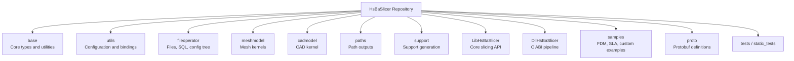
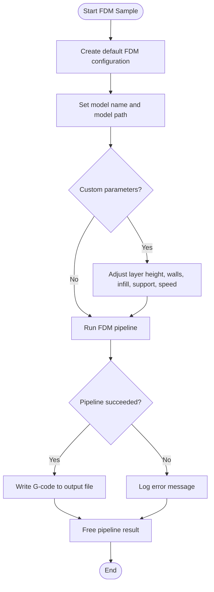

# Getting Started

<cite>
**Referenced Files in This Document**   
- [README.md](file://README.md)
- [CMakeLists.txt](file://CMakeLists.txt)
- [CMakePresets.json](file://CMakePresets.json)
- [vcpkg.json](file://vcpkg.json)
- [samples/FDM/main.cpp](file://samples/FDM/main.cpp)
- [samples/FDM/CMakeLists.txt](file://samples/FDM/CMakeLists.txt)
- [android/README.md](file://android/README.md)
- [docs/en/vcpkg-dependencies.md](file://docs/en/vcpkg-dependencies.md)
</cite>

## Table of Contents
1. [Introduction](#introduction)
2. [System Requirements and Prerequisites](#system-requirements-and-prerequisites)
3. [Project Structure Overview](#project-structure-overview)
4. [Installation and Setup](#installation-and-setup)
5. [Building HsBaSlicer](#building-hsbaslicer)
6. [First-Time Verification and Basic Testing](#first-time-verification-and-basic-testing)
7. [Basic Usage: Simple FDM Slicing Example](#basic-usage-simple-fdm-slicing-example)
8. [Common Installation Issues and Troubleshooting](#common-installation-issues-and-troubleshooting)
9. [Next Steps](#next-steps)

## Introduction
HsBaSlicer is a high-performance, modular, cross-platform C++ framework for 3D-printing slicers. It provides slicing core capabilities suitable for both research and production-level slicing pipelines. The project exposes:
- A C ABI dynamic library interface for external languages such as Java, C#, or Python.
- A C++ static/shared library interface for full pipeline control.
- Multiple platform targets including Windows, Linux, macOS, Android, and iOS.

This getting started guide focuses on environment setup, installation, building, first verification, and a simple FDM slicing example.

## System Requirements and Prerequisites
Before building HsBaSlicer, ensure your system meets the following requirements:

- **CMake**: version 3.28 or newer.
- **Compiler**: a C++ compiler with C++20 support.
- **Dependency manager**: vcpkg is recommended for dependency management.
- **Windows tools**: Visual Studio 2022 or later with “Desktop development with C++”, CMake tools, and Git; PowerShell 7 is recommended (PowerShell 5.1 is acceptable).
- **Linux/macOS tools**: package manager, build tools, and optional desktop graphics libraries depending on your distribution.
- **Android/iOS tools**: Android SDK/NDK for Android builds; iOS builds are validated in CI and may require macOS toolchain configuration.

The repository’s root documentation also mentions CMake 3.12 as a general requirement, but the top-level CMake file enforces CMake 3.28. Use at least CMake 3.28 to avoid configure failures.

**Section sources**
- [README.md:41-55](file://README.md#L41-L55)
- [CMakeLists.txt:4-4](file://CMakeLists.txt#L4-L4)

## Project Structure Overview
HsBaSlicer is organized into logical modules rather than a single monolithic application. Key areas include:

- `base`: basic types, template helpers, thread pool, singleton utilities, and reflection helpers.
- `utils`: configuration, serialization, and Lua binding helpers.
- `fileoperator`: ZIP/7z handling, SQLite access, configuration tree, and Lua adapter.
- `meshmodel`: mesh model backends such as CGAL and IGL.
- `cadmodel`: CAD model support based on OpenCascade where available.
- `paths`: layer paths, point paths, and robot path outputs.
- `support`: FDM and SLA support generation and overhang detection.
- `LibHsBaSlicer`: core slicing API collection.
- `DllHsBaSlicer`: exported C ABI runtime pipeline interface.
- `samples`: example applications, including an FDM slicing demo.
- `proto`: Protobuf definitions used across the pipeline.
- `tests` and `static_tests`: unit tests and static checks.

**Diagram sources**
- [README.md:25-39](file://README.md#L25-L39)
- [CMakeLists.txt:410-454](file://CMakeLists.txt#L410-L454)

**Section sources**
- [README.md:25-39](file://README.md#L25-L39)
- [CMakeLists.txt:410-454](file://CMakeLists.txt#L410-L454)

## Installation and Setup
### Windows
Recommended setup:
1. Install Visual Studio 2022 or later.
2. Select “Desktop development with C++”.
3. Ensure CMake tools and Git are installed.
4. Install vcpkg and add its path to your system environment so it can be used from IDEs and command lines.
5. Prefer using the `windows-release` preset for release builds. Debug builds that include CGAL may encounter issues.

### Linux and macOS
Example setup for Ubuntu/Debian:
1. Update package lists and install required packages.
2. Install vcpkg by cloning the repository and bootstrapping it.
3. Configure and build using CMake with the vcpkg toolchain file.

You can also use CMake presets instead of manual commands.

### Android
Android builds are typically performed on Linux and require Android SDK/NDK with `ANDROID_NDK_HOME` configured. The repository includes a minimal Android app skeleton that shows how native libraries produced by CMake can be packaged.

### iOS
iOS builds are validated in CI. Local macOS builds have not been extensively tested. Use the provided iOS preset if you are on macOS and have the appropriate toolchain configured.

**Section sources**
- [README.md:57-98](file://README.md#L57-L98)
- [android/README.md:1-19](file://android/README.md#L1-L19)

## Building HsBaSlicer
There are two main ways to build HsBaSlicer:

### Direct CMake Commands
Use this approach when you want explicit control over configure and build steps.

For Linux/macOS:
1. Create a build directory.
2. Configure with the vcpkg toolchain file.
3. Build in Release mode.

For Windows:
1. Open a Visual Studio developer shell.
2. Configure with the vcpkg toolchain file.
3. Build in Release mode.

### CMake Presets
The repository ships with CMake presets for common platforms and configurations:
- Windows debug/release presets.
- Linux debug/release presets.
- Linux coverage preset.
- Android release preset.
- macOS debug/release presets.
- iOS release preset.

Presets automatically set:
- Generator.
- Binary and install directories.
- Toolchain file path.
- Build type.
- Platform-specific variables such as Android NDK settings.

To use presets:
1. Configure with a preset name.
2. Build from the generated output directory.

**Section sources**
- [README.md:80-94](file://README.md#L80-L94)
- [CMakePresets.json:1-236](file://CMakePresets.json#L1-L236)

## First-Time Verification and Basic Testing
After building HsBaSlicer, verify the installation and basic functionality:

1. **Check built artifacts**: confirm that executables, shared libraries, and static libraries exist in the expected output directories.
2. **Run the FDM sample**: the FDM sample demonstrates slicing a standard test model and writing G-code output.
3. **Inspect logs**: non-game-console builds include logging that reports progress and results.
4. **Validate output**: check that G-code files are created under the sample’s output directory.

If you installed HsBaSlicer using `cmake --install`, downstream projects can find it via `find_package(HsBaSlicer)` and link against targets such as `HsBaSlicer::DllHsBaSlicer`.

**Section sources**
- [README.md:100-124](file://README.md#L100-L124)
- [samples/FDM/main.cpp:53-96](file://samples/FDM/main.cpp#L53-L96)

## Basic Usage: Simple FDM Slicing Example
The FDM sample demonstrates several usage patterns:
- Running the default FDM pipeline synchronously.
- Customizing slicing parameters such as layer height, wall count, infill density, and support settings.
- Using Lua scripts for custom support and fill generation.
- Running the pipeline asynchronously with completion callbacks.
- Enabling spiral/vase mode.

At a high level, the workflow is:
1. Create a default FDM pipeline configuration.
2. Set the model name and model path.
3. Optionally adjust slicing, infill, support, and path parameters.
4. Run the pipeline synchronously or asynchronously.
5. Check the result for success, total layers, elapsed time, and error messages.
6. Write the G-code content to a file if successful.
7. Free the pipeline result memory.

**Diagram sources**
- [samples/FDM/main.cpp:53-96](file://samples/FDM/main.cpp#L53-L96)
- [samples/FDM/main.cpp:101-165](file://samples/FDM/main.cpp#L101-L165)
- [samples/FDM/main.cpp:170-220](file://samples/FDM/main.cpp#L170-L220)
- [samples/FDM/main.cpp:226-269](file://samples/FDM/main.cpp#L226-L269)
- [samples/FDM/main.cpp:274-318](file://samples/FDM/main.cpp#L274-L318)

The sample links against `DllHsBaSlicer` and includes public headers from the `DllHsBaSlicer` directory. On mobile platforms, the sample is built as a static library so the code remains compiled even without a console executable.

**Section sources**
- [samples/FDM/main.cpp:1-337](file://samples/FDM/main.cpp#L1-L337)
- [samples/FDM/CMakeLists.txt:1-72](file://samples/FDM/CMakeLists.txt#L1-L72)

## Common Installation Issues and Troubleshooting
### CMake Version Too Old
If CMake reports a minimum version mismatch, upgrade to CMake 3.28 or newer. The top-level CMake file requires at least this version.

### Compiler Does Not Support Required C++ Features
HsBaSlicer uses modern C++ features such as concepts, ranges, source location, and template-template parameter matching. If your compiler lacks these features, configure will fail. Use a compiler with full C++20 support.

### vcpkg Not Found or Toolchain File Missing
Ensure vcpkg is installed and accessible. When using presets, the toolchain file path references `$env{VCPKG_ROOT}`. Make sure `VCPKG_ROOT` points to your vcpkg installation.

### Copyleft Kernel Licensing and Feature Flags
By default, the manifest enables the `copyleft` feature on Windows, Linux, macOS, and Android. This adds CGAL, libigl with CGAL, and OpenCascade, which changes the effective license to GPL-3.0-or-later. If you want an MIT-licensed build without copyleft kernels, disable default features before configuring.

### Mobile Platform Dependencies
Android and iOS builds exclude some desktop-only dependencies. For example:
- Desktop logging and locale components are not used on Android/iOS.
- OpenCV is excluded on iOS.
- MySQL/PostgreSQL features of sqlpp11 are excluded on mobile.
- bit7z is disabled on non-desktop platforms.

### Missing System Libraries on Linux/macOS
On Linux/macOS, missing system packages can cause configure or build failures. Install required development packages for graphics, fonts, compression, and build tools according to your distribution.

### Downloading Sample Models
The FDM sample attempts to download a Stanford Bunny STL model during configuration. If the download fails, manually place the model in the expected location.

**Section sources**
- [CMakeLists.txt:4-4](file://CMakeLists.txt#L4-L4)
- [CMakeLists.txt:52-86](file://CMakeLists.txt#L52-L86)
- [CMakePresets.json:1-236](file://CMakePresets.json#L1-L236)
- [vcpkg.json:4-110](file://vcpkg.json#L4-L110)
- [docs/en/vcpkg-dependencies.md:52-80](file://docs/en/vcpkg-dependencies.md#L52-L80)
- [samples/FDM/CMakeLists.txt:34-54](file://samples/FDM/CMakeLists.txt#L34-L54)

## Next Steps
After verifying the build and running the FDM sample:
- Explore other samples such as SLA, SLS, SLM, LOM, TDP, WAAM, and custom pipelines.
- Review the installed CMake configuration files if you plan to integrate HsBaSlicer into another project.
- Use the documented header layout to locate public APIs for slicing, preprocessing, support generation, polygon filling, path generation, and floor generation.
- Consider enabling or disabling copyleft kernels based on your licensing needs.