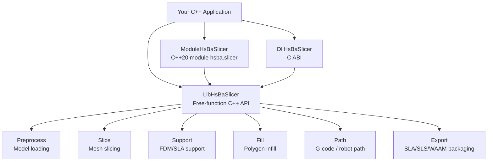
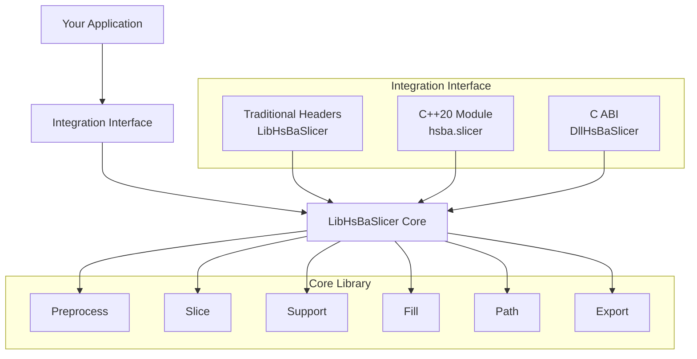
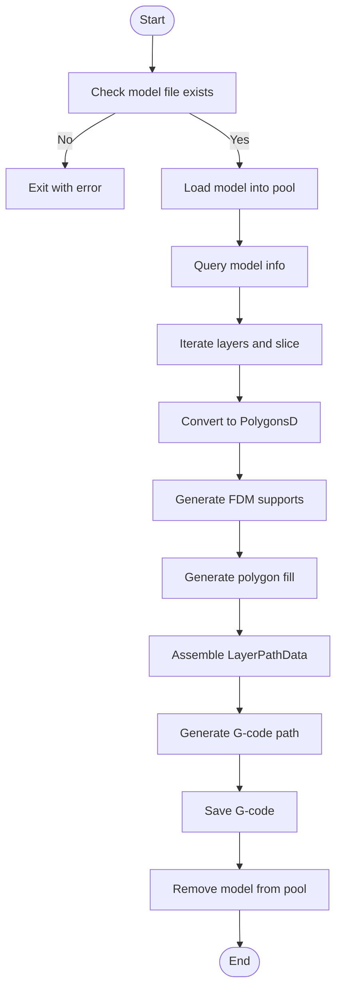
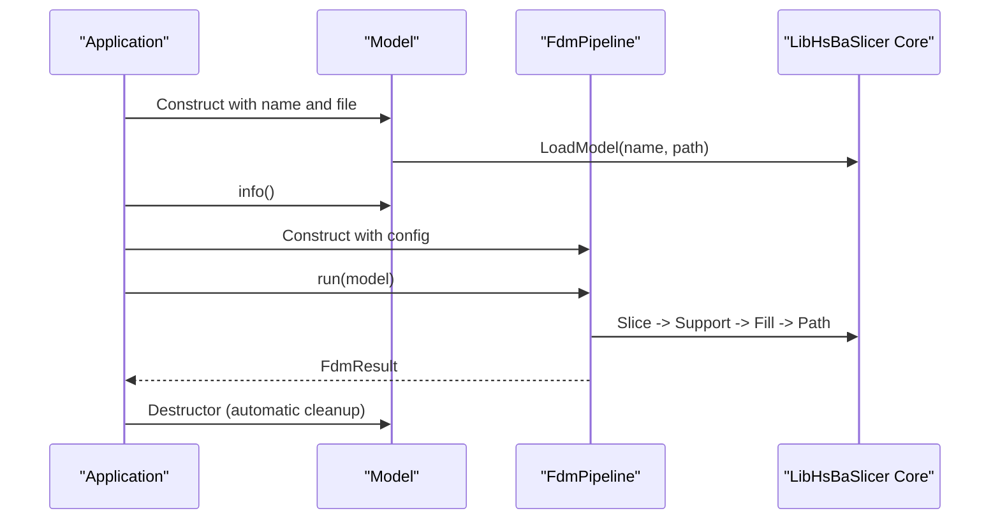
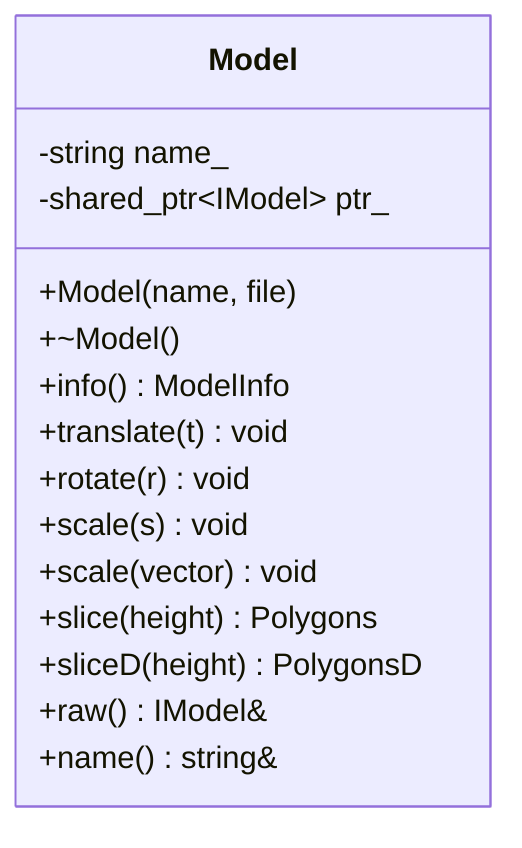
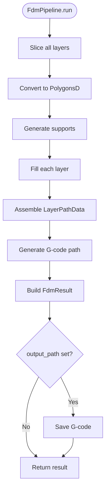
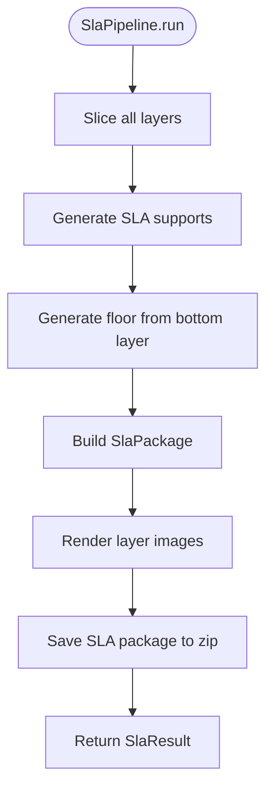
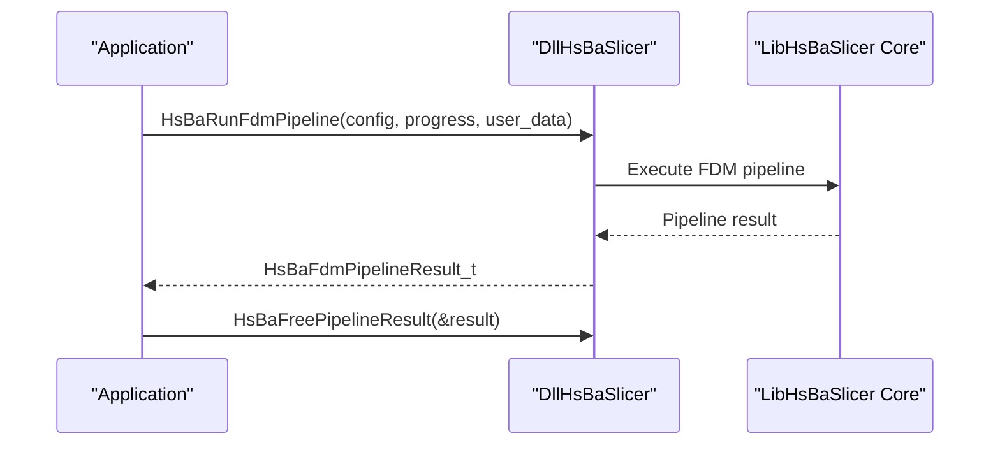
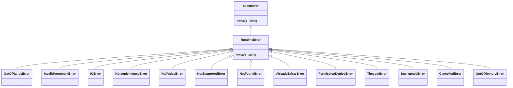

# C++ Integration / C++集成

<cite>
**Referenced Files in This Document**   
- [HsBaSlicer.h](file://HsBaSlicer/HsBaSlicer.h)
- [hsba_slicer.cppm](file://ModuleHsBaSlicer/hsba_slicer.cppm)
- [pipeline_types.h](file://pipelinetypes/pipeline_types.h)
- [fdm_pipeline.h](file://DllHsBaSlicer/fdm_pipeline.h)
- [sla_pipeline.h](file://DllHsBaSlicer/sla_pipeline.h)
- [error.hpp](file://base/error.hpp)
- [ModelLoader.hpp](file://preprocess/ModelLoader.hpp)
- [main_header.cpp](file://samples/LibHsBaSlicer/main_header.cpp)
- [main_module.cpp](file://samples/LibHsBaSlicer/main_module.cpp)
- [CMakeLists.txt](file://CMakeLists.txt)
- [samples_CMakeLists.txt](file://samples/LibHsBaSlicer/CMakeLists.txt)
- [cpp_cmake_usage.md](file://docs/en/cpp_cmake_usage.md)
- [vcpkg-dependencies.md](file://docs/en/vcpkg-dependencies.md)
</cite>

## Table of Contents
1. [Introduction](#introduction)
2. [Project Structure](#project-structure)
3. [Core Components](#core-components)
4. [Architecture Overview](#architecture-overview)
5. [Detailed Component Analysis](#detailed-component-analysis)
6. [Dependency Analysis](#dependency-analysis)
7. [Performance Considerations](#performance-considerations)
8. [Troubleshooting Guide](#troubleshooting-guide)
9. [Conclusion](#conclusion)
10. [Appendices](#appendices)

## Introduction
This document explains how to integrate HsBaSlicer into a C++ project. It covers two integration paths:

- **Traditional header-based integration**: Use `LibHsBaSlicer` free functions and headers directly, without C++20 modules.
- **Modern C++20 module integration**: Use the `ModuleHsBaSlicer` wrapper through `import hsba.slicer;`, which exposes a class-based API with RAII, exceptions, and pipeline classes.

It also documents library linking with CMake, include path configuration, build system setup, high-level APIs such as `Model`, `FdmPipeline`, and `SlaPipeline`, result handling, RAII principles, exception handling via `SlicerError`, memory management, compiler requirements, dependency management, and common integration pitfalls.

The repository provides three main integration surfaces:

| Surface | Purpose | Typical consumer |
|---|---|---|
| `LibHsBaSlicer` | Core C++ slicing algorithms exposed as free functions and headers | Traditional C++20 consumers |
| `ModuleHsBaSlicer` | C++20 module wrapper exposing `Model`, `FdmPipeline`, `SlaPipeline`, etc. | Modern C++20 consumers using `import hsba.slicer;` |
| `DllHsBaSlicer` | C ABI for cross-language or legacy integration | C/C++, C#, Java, Python, Swift, or other language bindings |

**Section sources**
- [cpp_cmake_usage.md:1-11](file://docs/en/cpp_cmake_usage.md#L1-L11)
- [cpp_cmake_usage.md:155-158](file://docs/en/cpp_cmake_usage.md#L155-L158)

## Project Structure
At a high level, the relevant parts for C++ integration are:



**Diagram sources**
- [cpp_cmake_usage.md:1-11](file://docs/en/cpp_cmake_usage.md#L1-L11)
- [hsba_slicer.cppm:37-62](file://ModuleHsBaSlicer/hsba_slicer.cppm#L37-L62)

### Top-Level Build Configuration
The top-level `CMakeLists.txt`:

- Sets C++20 as the default standard.
- Enables position-independent code for shared libraries.
- Checks required C++ features such as concepts, ranges, source location, and template-template matching.
- Optionally builds the C++20 module wrapper when supported by the toolchain.
- Installs targets, headers, and CMake package configuration files.

Key behaviors:

| Area | Behavior |
|---|---|
| C++ standard | `CMAKE_CXX_STANDARD 20` is set when CMake ≥ 3.12 |
| Modules | `HSBA_SLICER_MODULE` enables `ModuleHsBaSlicer` only if the compiler supports C++20 modules |
| Install layout | Binaries go to `bin`, libraries to `lib`, headers to `include/HsBaSlicer`, and CMake config to `lib/cmake/HsBaSlicer` |
| Package export | Exports `HsBaSlicerTargets.cmake` under namespace `HsBaSlicer::` |

**Section sources**
- [CMakeLists.txt:4-44](file://CMakeLists.txt#L4-L44)
- [CMakeLists.txt:48-127](file://CMakeLists.txt#L48-L127)
- [CMakeLists.txt:456-525](file://CMakeLists.txt#L456-L525)
- [CMakeLists.txt:641-665](file://CMakeLists.txt#L641-L665)

### Sample Build Setup
The sample CMake file shows both traditional and module usage:

- `lib_sample_header` links `LibHsBaSlicer`.
- `lib_sample_module` links `ModuleHsBaSlicer` when `HSBA_SLICER_MODULE` is enabled.
- Both samples add the repository root as an include directory so headers like `LibHsBaSlicer/...` can be included directly.
- Post-build commands copy model resources and Lua scripts into the executable output directory.

**Section sources**
- [samples_CMakeLists.txt:1-38](file://samples/LibHsBaSlicer/CMakeLists.txt#L1-L38)
- [samples_CMakeLists.txt:40-71](file://samples/LibHsBaSlicer/CMakeLists.txt#L40-L71)

## Core Components
The core C++ integration surface consists of:

1. **Traditional header-based API (`LibHsBaSlicer`)**
   - Free functions for model loading, slicing, support generation, polygon filling, path generation, and export.
   - No RAII wrapper around models; callers manage the named model pool explicitly.
   - Suitable for any C++20-compatible compiler.

2. **C++20 module API (`ModuleHsBaSlicer`)**
   - `import hsba.slicer;` exposes `HsBa::Slicer` types.
   - `Model` is an RAII handle that loads on construction and removes itself from the pool on destruction.
   - Pipeline classes wrap the full workflow: `FdmPipeline`, `SlaPipeline`, `SlsPipeline`, `SlmPipeline`, `LomPipeline`, `TdpPipeline`, `WaamPipeline`, `FileTransferPipeline`, `ParamStorePipeline`, and `CustomLuaPipeline`.
   - Errors are thrown as `SlicerError`.

3. **C ABI (`DllHsBaSlicer`)**
   - Functions such as `HsBaRunFdmPipeline`, `HsBaRunSlaPipeline`, and corresponding free functions.
   - Requires manual memory management for results.
   - Useful for cross-language bindings or legacy integrations.

### High-Level API Summary

| API Surface | Main Types | Memory Model | Error Model | Best For |
|---|---|---|---|---|
| Traditional headers | `LoadModel`, `Slice`, `GenerateAllFdmSupport`, `FillWithBorder`, `GenerateGCodePathV2` | Named model pool managed by caller | Exceptions from internal components | Fine-grained control without modules |
| C++20 module | `Model`, `FdmPipeline`, `SlaPipeline`, `CustomLuaPipeline` | RAII model handle | `SlicerError` | Modern C++20 applications |
| C ABI | `HsBaFdmPipelineConfig_t`, `HsBaSlaPipelineConfig_t`, `HsBaRun*Pipeline` | Caller frees result strings | Success flags + error message fields | Cross-language or DLL consumers |

**Section sources**
- [hsba_slicer.cppm:67-128](file://ModuleHsBaSlicer/hsba_slicer.cppm#L67-L128)
- [hsba_slicer.cppm:148-191](file://ModuleHsBaSlicer/hsba_slicer.cppm#L148-L191)
- [hsba_slicer.cppm:193-258](file://ModuleHsBaSlicer/hsba_slicer.cppm#L193-L258)
- [fdm_pipeline.h:17-61](file://DllHsBaSlicer/fdm_pipeline.h#L17-L61)
- [sla_pipeline.h:17-56](file://DllHsBaSlicer/sla_pipeline.h#L17-L56)

## Architecture Overview
The integration architecture has three layers:



**Diagram sources**
- [cpp_cmake_usage.md:1-11](file://docs/en/cpp_cmake_usage.md#L1-L11)
- [hsba_slicer.cppm:37-62](file://ModuleHsBaSlicer/hsba_slicer.cppm#L37-L62)

### Traditional Header-Based Workflow
The traditional example performs these steps:

1. Load model into the named model pool.
2. Query model info.
3. Generate layer contours.
4. Convert integer polygons to double precision for support.
5. Generate FDM supports.
6. Generate polygon fills.
7. Assemble `LayerPathData`.
8. Generate G-code path.
9. Save G-code.
10. Remove model from the pool.



**Diagram sources**
- [main_header.cpp:46-185](file://samples/LibHsBaSlicer/main_header.cpp#L46-L185)

**Section sources**
- [main_header.cpp:20-28](file://samples/LibHsBaSlicer/main_header.cpp#L20-L28)
- [main_header.cpp:46-185](file://samples/LibHsBaSlicer/main_header.cpp#L46-L185)

### C++20 Module Workflow
The module example uses RAII and pipeline classes:

1. Import `hsba.slicer`.
2. Include necessary non-module headers for GMF-defined types.
3. Create a `Model` object.
4. Configure `HsBaFdmPipelineConfig_t`.
5. Run `FdmPipeline`.
6. Handle `SlicerError`.
7. Optionally run `CustomLuaPipeline`.



**Diagram sources**
- [main_module.cpp:31-133](file://samples/LibHsBaSlicer/main_module.cpp#L31-L133)
- [hsba_slicer.cppm:567-615](file://ModuleHsBaSlicer/hsba_slicer.cppm#L567-L615)
- [hsba_slicer.cppm:704-751](file://ModuleHsBaSlicer/hsba_slicer.cppm#L704-L751)

**Section sources**
- [main_module.cpp:14-29](file://samples/LibHsBaSlicer/main_module.cpp#L14-L29)
- [main_module.cpp:31-133](file://samples/LibHsBaSlicer/main_module.cpp#L31-L133)

## Detailed Component Analysis

### Model: RAII Model Handle
The module’s `Model` class wraps the named model pool:

- Constructor calls `LoadModel` and throws `SlicerError` if loading fails.
- Destructor calls `RemoveModel` if the model name is still present.
- Move semantics transfer ownership and clear the source model name.
- Copy construction and copy assignment are deleted.
- Provides transformation methods: `translate`, `rotate`, `scale`.
- Provides slicing methods: `slice` and `sliceD`.
- Exposes raw access through `raw()` and the model name through `name()`.



**Diagram sources**
- [hsba_slicer.cppm:148-191](file://ModuleHsBaSlicer/hsba_slicer.cppm#L148-L191)
- [hsba_slicer.cppm:567-615](file://ModuleHsBaSlicer/hsba_slicer.cppm#L567-L615)

#### RAII Principles
- Resource acquisition happens in the constructor.
- Resource release happens in the destructor.
- Move semantics allow safe transfer of model ownership.
- The underlying model is stored as a shared pointer, while the pool registration is tied to the model name.

#### Exception Handling
- Construction throws `SlicerError` when `LoadModel` returns a null model.
- Consumers should catch `SlicerError` before catching generic `std::exception`.

**Section sources**
- [hsba_slicer.cppm:74-79](file://ModuleHsBaSlicer/hsba_slicer.cppm#L74-L79)
- [hsba_slicer.cppm:152-191](file://ModuleHsBaSlicer/hsba_slicer.cppm#L152-L191)
- [hsba_slicer.cppm:567-598](file://ModuleHsBaSlicer/hsba_slicer.cppm#L567-L598)

### FdmPipeline: FDM Full Pipeline
`FdmPipeline` implements the FDM workflow:

1. Slice all layers.
2. Convert integer polygons to double precision.
3. Generate supports.
4. Generate fills.
5. Assemble layer path data.
6. Generate G-code path.
7. Optionally save G-code.



**Diagram sources**
- [hsba_slicer.cppm:197-225](file://ModuleHsBaSlicer/hsba_slicer.cppm#L197-L225)
- [hsba_slicer.cppm:621-751](file://ModuleHsBaSlicer/hsba_slicer.cppm#L621-L751)

#### Key Methods
| Method | Purpose |
|---|---|
| `run(const Model&)` | Full pipeline returning `FdmResult` |
| `sliceAll(const Model&)` | Generate layer contours |
| `generateSupports(const vector<PolygonsD>&)` | Generate FDM supports |
| `fill(const Polygons&)` | Generate polygon infill |
| `generatePath(const vector<LayerPathData>&)` | Generate G-code path |

#### Configuration
The pipeline uses `HsBaFdmPipelineConfig_t`, which includes slice, fill, support, path, firmware, and Lua customization fields.

**Section sources**
- [hsba_slicer.cppm:197-225](file://ModuleHsBaSlicer/hsba_slicer.cppm#L197-L225)
- [hsba_slicer.cppm:621-751](file://ModuleHsBaSlicer/hsba_slicer.cppm#L621-L751)
- [pipeline_types.h:53-127](file://pipelinetypes/pipeline_types.h#L53-L127)

### SlaPipeline: SLA Full Pipeline
`SlaPipeline` implements the SLA workflow:

1. Slice all layers.
2. Generate supports.
3. Generate floor/raft from the bottom layer.
4. Build `SlaPackage`.
5. Render layers to images.
6. Save SLA package to zip.



**Diagram sources**
- [hsba_slicer.cppm:231-258](file://ModuleHsBaSlicer/hsba_slicer.cppm#L231-L258)
- [hsba_slicer.cppm:757-856](file://ModuleHsBaSlicer/hsba_slicer.cppm#L757-L856)

#### Key Methods
| Method | Purpose |
|---|---|
| `run(const Model&, const filesystem::path&)` | Full pipeline returning `SlaResult` |
| `generateFloor(const Polygons&)` | Generate floor/raft |
| `renderLayer(const PolygonsD&, int, int, const string&)` | Render polygons to image |
| `savePackage(const SlaPackage&, const string&)` | Save SLA package |

#### Configuration
The pipeline uses `HsBaSlaPipelineConfig_t`, including exposure settings, floor/raft settings, support settings, image format, and Lua customization.

**Section sources**
- [hsba_slicer.cppm:231-258](file://ModuleHsBaSlicer/hsba_slicer.cppm#L231-L258)
- [hsba_slicer.cppm:757-856](file://ModuleHsBaSlicer/hsba_slicer.cppm#L757-L856)
- [pipeline_types.h:165-232](file://pipelinetypes/pipeline_types.h#L165-L232)

### Other Pipelines
The module also exposes pipelines for other manufacturing processes:

| Pipeline | Output | Notes |
|---|---|---|
| `SlsPipeline` | SLS export via Lua script | Requires `export_lua_script` |
| `SlmPipeline` | SLM export via Lua script | Mirrors SLS flow with metal-specific parameters |
| `LomPipeline` | LOM export via Lua script | Sheet bonding and cutting |
| `TdpPipeline` | 3DP binder jetting export via Lua script | Binder jetting mode and curing parameters |
| `WaamPipeline` | Robot program export | Generates robot language rather than layer zip |
| `FileTransferPipeline` | Remote file transfer | Validates, connects, transfers |
| `ParamStorePipeline` | Parameter persistence | Saves/loads `HsBa*PipelineConfig_t` structs |
| `CustomLuaPipeline` | Fully Lua-driven workflow | Entire stage order defined by Lua script |

**Section sources**
- [hsba_slicer.cppm:260-378](file://ModuleHsBaSlicer/hsba_slicer.cppm#L260-L378)
- [hsba_slicer.cppm:380-445](file://ModuleHsBaSlicer/hsba_slicer.cppm#L380-L445)
- [hsba_slicer.cppm:447-479](file://ModuleHsBaSlicer/hsba_slicer.cppm#L447-L479)
- [hsba_slicer.cppm:858-1052](file://ModuleHsBaSlicer/hsba_slicer.cppm#L858-L1052)
- [hsba_slicer.cppm:1054-1178](file://ModuleHsBaSlicer/hsba_slicer.cppm#L1054-L1178)

### C ABI Pipelines
The C ABI provides synchronous and asynchronous entry points:

- `HsBaCreateDefaultConfig` creates default FDM configuration.
- `HsBaRunFdmPipeline` runs the FDM pipeline synchronously.
- `HsBaRunFdmPipelineAsync` runs it asynchronously with a result callback.
- `HsBaFreePipelineResult` releases allocated result memory.
- SLA has equivalent functions: `HsBaCreateDefaultSlaConfig`, `HsBaRunSlaPipeline`, `HsBaRunSlaPipelineAsync`, `HsBaFreeSlaPipelineResult`.



**Diagram sources**
- [fdm_pipeline.h:17-61](file://DllHsBaSlicer/fdm_pipeline.h#L17-L61)
- [sla_pipeline.h:17-56](file://DllHsBaSlicer/sla_pipeline.h#L17-L56)

**Section sources**
- [fdm_pipeline.h:17-61](file://DllHsBaSlicer/fdm_pipeline.h#L17-L61)
- [sla_pipeline.h:17-56](file://DllHsBaSlicer/sla_pipeline.h#L17-L56)

### Exception Handling and Error Model
The module defines `SlicerError` as the unified exception type for slicer failures. The base error hierarchy in `base/error.hpp` includes many specialized runtime errors, but the module’s public API primarily throws `SlicerError`.

Common failure cases:

- Model loading fails.
- Required Lua script is missing.
- File transfer fails.
- Parameter store operation fails.
- Custom Lua pipeline fails.



**Diagram sources**
- [hsba_slicer.cppm:74-79](file://ModuleHsBaSlicer/hsba_slicer.cppm#L74-L79)
- [error.hpp:15-145](file://base/error.hpp#L15-L145)

**Section sources**
- [hsba_slicer.cppm:74-79](file://ModuleHsBaSlicer/hsba_slicer.cppm#L74-L79)
- [error.hpp:15-145](file://base/error.hpp#L15-L145)

### Memory Management
There are three important memory models:

| API | Ownership | Responsibility |
|---|---|---|
| `Model` (module) | RAII | Automatic load/remove via constructor/destructor |
| Traditional headers | Named model pool | Call `LoadModel` and `RemoveModel` |
| C ABI | Caller-owned result strings | Call `HsBaFreePipelineResult` or `HsBaFreeSlaPipelineResult` |

For parameter store loading, `ParamStorePipeline::load` allocates heap strings inside the config struct; callers must call `freeLoaded` after use.

**Section sources**
- [hsba_slicer.cppm:567-598](file://ModuleHsBaSlicer/hsba_slicer.cppm#L567-L598)
- [hsba_slicer.cppm:1127-1139](file://ModuleHsBaSlicer/hsba_slicer.cppm#L1127-L1139)
- [fdm_pipeline.h:53-61](file://DllHsBaSlicer/fdm_pipeline.h#L53-L61)
- [sla_pipeline.h:49-56](file://DllHsBaSlicer/sla_pipeline.h#L49-L56)

### Complete Working Examples

#### Example 1: Traditional Header-Based FDM Slicing
This example demonstrates:

- Checking model file existence.
- Loading the model.
- Querying model info.
- Slicing layers.
- Generating supports.
- Generating fills.
- Generating G-code.
- Saving output.
- Cleaning up the model pool.

**Section sources**
- [main_header.cpp:46-185](file://samples/LibHsBaSlicer/main_header.cpp#L46-L185)

#### Example 2: C++20 Module FDM Slicing
This example demonstrates:

- Including standard headers before `import`.
- Including non-module headers for GMF-defined types.
- Creating a `Model`.
- Configuring `HsBaFdmPipelineConfig_t`.
- Running `FdmPipeline`.
- Catching `SlicerError`.
- Optionally running `CustomLuaPipeline`.

**Section sources**
- [main_module.cpp:14-29](file://samples/LibHsBaSlicer/main_module.cpp#L14-L29)
- [main_module.cpp:31-133](file://samples/LibHsBaSlicer/main_module.cpp#L31-L133)

#### Example 3: Custom Lua Pipeline
The module supports fully Lua-driven workflows where the Lua script defines the entire stage order. The C++ side provides the operator table and lifecycle, while the Lua script orchestrates model loading, slicing, support, fill, and export.

**Section sources**
- [hsba_slicer.cppm:447-479](file://ModuleHsBaSlicer/hsba_slicer.cppm#L447-L479)
- [hsba_slicer.cppm:1145-1178](file://ModuleHsBaSlicer/hsba_slicer.cppm#L1145-L1178)
- [main_module.cpp:101-127](file://samples/LibHsBaSlicer/main_module.cpp#L101-L127)

## Dependency Analysis

### CMake Targets and Linking
The recommended way to link HsBaSlicer is through `find_package(HsBaSlicer REQUIRED)` and then link one of the exported targets:

| Target | Description |
|---|---|
| `HsBaSlicer::LibHsBaSlicer` | Core C++ slicing library |
| `HsBaSlicer::ModuleHsBaSlicer` | C++20 module wrapper |
| `HsBaSlicer::DllHsBaSlicer` | C ABI export layer |
| `HsBaSlicer::HsBaPipelineTypes` | Header-only type definitions |
| `HsBaSlicer::HsBaSlicerProto` | Protobuf message library |
| `HsBaSlicer::HsBaSlicerConverter` | Proto ↔ internal type conversion |

**Section sources**
- [cpp_cmake_usage.md:142-152](file://docs/en/cpp_cmake_usage.md#L142-L152)
- [CMakeLists.txt:481-498](file://CMakeLists.txt#L481-L498)
- [CMakeLists.txt:641-665](file://CMakeLists.txt#L641-L665)

### Transitive Dependencies
When using `find_package(HsBaSlicer)`, the following public dependencies are automatically located:

- Eigen3
- magic_enum
- Clipper2
- Lua
- Protobuf
- OpenSSL

Additional optional or platform-dependent dependencies include Boost, OpenCV, CGAL, OpenCASCADE, OpenVDB, bit7z, miniz, RapidJSON, tinyxml2, yaml-cpp, and sqlpp11.

**Section sources**
- [cpp_cmake_usage.md:461-472](file://docs/en/cpp_cmake_usage.md#L461-L472)
- [CMakeLists.txt:206-349](file://CMakeLists.txt#L206-L349)
- [vcpkg-dependencies.md:52-65](file://docs/en/vcpkg-dependencies.md#L52-L65)

### Include Paths
Two common patterns exist:

1. **Installed package**: Use `find_package(HsBaSlicer REQUIRED)` and rely on installed headers under `<prefix>/include/HsBaSlicer`.
2. **Subdirectory integration**: Add the repository as a CMake subdirectory and pass `${CMAKE_SOURCE_DIR}` as an include directory, as shown in the sample CMake file.

**Section sources**
- [cpp_cmake_usage.md:57-78](file://docs/en/cpp_cmake_usage.md#L57-L78)
- [samples_CMakeLists.txt:19-21](file://samples/LibHsBaSlicer/CMakeLists.txt#L19-L21)
- [samples_CMakeLists.txt:35-37](file://samples/LibHsBaSlicer/CMakeLists.txt#L35-L37)

## Performance Considerations
Performance considerations for C++ integration include:

- **Model pool size**: When copyleft kernels are available, the model pool size is larger to support boolean operations; otherwise it is smaller.
- **Debug builds**: Boolean operations may be disabled or slowed down in Debug configurations.
- **Layer count**: Higher resolution slicing increases memory and CPU usage.
- **Support generation**: Enabling supports adds significant processing time.
- **Lua scripts**: Custom Lua stages introduce interpreter overhead but provide flexibility.
- **File transfer**: Connection pooling affects throughput; default pool size is 4.

**Section sources**
- [CMakeLists.txt:300-306](file://CMakeLists.txt#L300-L306)
- [CMakeLists.txt:294-298](file://CMakeLists.txt#L294-L298)
- [hsba_slicer.cppm:1026-1052](file://ModuleHsBaSlicer/hsba_slicer.cppm#L1026-L1052)

## Troubleshooting Guide

### Compiler Requirements
The documentation states:

- CMake ≥ 3.28.
- C++20 compatible compiler.
- Module support requires MSVC 19.34+, GCC 14+, Clang 16+.

The top-level CMake sets C++20 and checks required features. If required features are missing, configuration fails early.

**Section sources**
- [cpp_cmake_usage.md:14-18](file://docs/en/cpp_cmake_usage.md#L14-L18)
- [cpp_cmake_usage.md:155-158](file://docs/en/cpp_cmake_usage.md#L155-L158)
- [CMakeLists.txt:17-38](file://CMakeLists.txt#L17-L38)
- [CMakeLists.txt:48-86](file://CMakeLists.txt#L48-L86)

### Common Integration Pitfalls

| Problem | Cause | Resolution |
|---|---|---|
| MSVC C2572 redefinition errors | Standard library `#include` appears after `import hsba.slicer;` | Put standard library includes before `import` |
| GMF types not visible | Types introduced via global fragment includes are not exported by C++20 modules | Include `model_preprocess.hpp` and `pipeline_types.h` directly |
| Missing model file | Sample expects `models/stanford_bunny.stl` | Copy the model into the expected directory or adjust the path |
| Missing Lua script | Custom pipeline requires `pipeline_lua_script` or `pipeline_lua_source` | Provide a valid Lua script or inline source |
| Unfreed C ABI result memory | Caller did not call free function | Call `HsBaFreePipelineResult` or `HsBaFreeSlaPipelineResult` |
| Parameter store loaded strings leaked | `ParamStorePipeline::load` allocates heap strings | Call `freeLoaded` after use |
| Module not built | Toolchain does not support C++20 modules | Disable `HSBA_SLICER_MODULE` or upgrade compiler |
| Dependency not found | Missing vcpkg or system dependency | Install dependencies and configure `CMAKE_PREFIX_PATH` |

**Section sources**
- [cpp_cmake_usage.md:312-332](file://docs/en/cpp_cmake_usage.md#L312-L332)
- [main_module.cpp:37-43](file://samples/LibHsBaSlicer/main_module.cpp#L37-L43)
- [hsba_slicer.cppm:1152-1155](file://ModuleHsBaSlicer/hsba_slicer.cppm#L1152-L1155)
- [fdm_pipeline.h:53-61](file://DllHsBaSlicer/fdm_pipeline.h#L53-L61)
- [sla_pipeline.h:49-56](file://DllHsBaSlicer/sla_pipeline.h#L49-L56)
- [hsba_slicer.cppm:1136-1139](file://ModuleHsBaSlicer/hsba_slicer.cppm#L1136-L1139)
- [CMakeLists.txt:116-127](file://CMakeLists.txt#L116-L127)

### Platform-Specific Notes

#### MSVC
- Standard library includes must precede `import`.
- CGAL propagates compile flags that consumers inherit automatically.
- `ModuleHsBaSlicer` is always built as static to avoid DLL link-stage dependency on system libraries.

#### Clang / GCC
- GMF types are not exported by the module.
- Standard library header ordering is not sensitive.

**Section sources**
- [cpp_cmake_usage.md:312-332](file://docs/en/cpp_cmake_usage.md#L312-L332)

## Conclusion
HsBaSlicer provides three complementary integration paths:

- Use **traditional headers** when you need fine-grained control, maximum compatibility, or cannot use C++20 modules.
- Use the **C++20 module** when you want RAII, exceptions, and a cleaner class-based API.
- Use the **C ABI** when integrating with non-C++ languages or legacy systems.

For most modern C++ projects, the recommended approach is:

1. Install HsBaSlicer or include it as a CMake subdirectory.
2. Use `find_package(HsBaSlicer REQUIRED)`.
3. Link `HsBaSlicer::ModuleHsBaSlicer` for the class-based API.
4. Use `Model` for RAII model management.
5. Use `FdmPipeline` or `SlaPipeline` for complete workflows.
6. Catch `SlicerError` for robust error handling.
7. Fall back to `LibHsBaSlicer` headers or `DllHsBaSlicer` C ABI when module support is unavailable.

**Section sources**
- [cpp_cmake_usage.md:1-11](file://docs/en/cpp_cmake_usage.md#L1-L11)
- [cpp_cmake_usage.md:155-158](file://docs/en/cpp_cmake_usage.md#L155-L158)
- [hsba_slicer.cppm:148-258](file://ModuleHsBaSlicer/hsba_slicer.cppm#L148-L258)

## Appendices

### Appendix A: Minimal CMake Integration

#### Installed Package
```cmake
cmake_minimum_required(VERSION 3.28)
project(MyApp LANGUAGES CXX)
set(CMAKE_CXX_STANDARD 20)
set(CMAKE_CXX_STANDARD_REQUIRED ON)
find_package(HsBaSlicer REQUIRED)
add_executable(my_app main.cpp)
target_link_libraries(my_app PRIVATE HsBaSlicer::LibHsBaSlicer)
```

#### Subdirectory Integration
```cmake
cmake_minimum_required(VERSION 3.28)
project(MyProject LANGUAGES CXX)
set(CMAKE_CXX_STANDARD 20)
set(CMAKE_CXX_STANDARD_REQUIRED ON)
add_subdirectory(third_party/HsBaSlicer)
add_executable(my_app main.cpp)
target_link_libraries(my_app PRIVATE LibHsBaSlicer)
```

**Section sources**
- [cpp_cmake_usage.md:57-78](file://docs/en/cpp_cmake_usage.md#L57-L78)
- [cpp_cmake_usage.md:423-444](file://docs/en/cpp_cmake_usage.md#L423-L444)

### Appendix B: API Selection Matrix

| Requirement | Recommended API |
|---|---|
| Simplest modern C++ experience | `ModuleHsBaSlicer` with `import hsba.slicer;` |
| Maximum compatibility | `LibHsBaSlicer` traditional headers |
| Cross-language binding | `DllHsBaSlicer` C ABI |
| Only struct definitions | `HsBaSlicer::HsBaPipelineTypes` |
| Fully custom workflow | `CustomLuaPipeline` |
| Persistent process parameters | `ParamStorePipeline` |

**Section sources**
- [cpp_cmake_usage.md:142-152](file://docs/en/cpp_cmake_usage.md#L142-L152)
- [hsba_slicer.cppm:380-479](file://ModuleHsBaSlicer/hsba_slicer.cppm#L380-L479)