# C++20 Module Integration / C++20模块集成

<cite>
**Referenced Files in This Document**   
- [hsba_slicer.cppm](file://ModuleHsBaSlicer/hsba_slicer.cppm)
- [CMakeLists.txt](file://ModuleHsBaSlicer/CMakeLists.txt)
- [module_anchor.cpp](file://ModuleHsBaSlicer/module_anchor.cpp)
- [CMakeLists.txt](file://CMakeLists.txt)
- [feature_check.cmake](file://static_check/feature_check.cmake)
- [cpp_cmake_usage.md](file://docs/en/cpp_cmake_usage.md)
- [README.md](file://docs/en/LibHsBaSlicer/README.md)
- [main_module.cpp](file://samples/LibHsBaSlicer/main_module.cpp)
- [main_header.cpp](file://samples/LibHsBaSlicer/main_header.cpp)
- [CMakeLists.txt](file://samples/LibHsBaSlicer/CMakeLists.txt)
</cite>

## Table of Contents
1. [Introduction](#introduction)
2. [Project Structure](#project-structure)
3. [Core Components](#core-components)
4. [Architecture Overview](#architecture-overview)
5. [Detailed Component Analysis](#detailed-component-analysis)
6. [Dependency Analysis](#dependency-analysis)
7. [Performance Considerations](#performance-considerations)
8. [Troubleshooting Guide](#troubleshooting-guide)
9. [Conclusion](#conclusion)
10. [Appendices](#appendices)

## Introduction
This document explains the modern C++20 module integration for HsBaSlicer through `ModuleHsBaSlicer`. It documents the `hsba.slicer` module interface, its class-based API, build system configuration, compiler requirements, migration from traditional headers, and practical usage examples.

The module provides a high-level C++ wrapper around LibHsBaSlicer’s free functions. Consumers use `import hsba.slicer;` to access RAII model handling, pipeline classes, Lua extension helpers, version utilities, and geometry conversion helpers. The module is intentionally implemented as a single-file interface unit so that MSVC does not trigger implicit-std redefinition errors when importing the compiled module interface.

Key benefits include:
- A cleaner, class-oriented API with exceptions and RAII.
- Faster compilation times compared to large header-heavy builds.
- Better encapsulation by exposing only the exported module interface.
- Improved IDE support through module-aware tooling where available.

**Section sources**
- [hsba_slicer.cppm:1-65](file://ModuleHsBaSlicer/hsba_slicer.cppm#L1-L65)
- [CMakeLists.txt:1-19](file://ModuleHsBaSlicer/CMakeLists.txt#L1-L19)
- [cpp_cmake_usage.md:155-173](file://docs/en/cpp_cmake_usage.md#L155-L173)

## Project Structure
The module lives under `ModuleHsBaSlicer` and consists of three main files:

| File | Responsibility |
|---|---|
| `hsba_slicer.cppm` | Declares and implements the `export module hsba.slicer;` interface, including types, pipelines, Lua helpers, and utility functions. |
| `CMakeLists.txt` | Builds `ModuleHsBaSlicer` as a static library, registers the module file set, links LibHsBaSlicer and dependencies, and re-exports required MSVC compile options. |
| `module_anchor.cpp` | Provides an empty translation unit so CMake always produces `ModuleHsBaSlicer.lib`, even when the only source is a CXX_MODULES file set. |

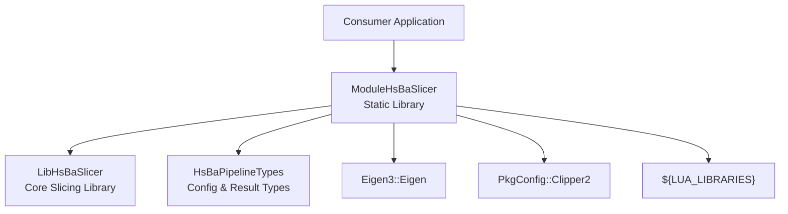

**Diagram sources**
- [CMakeLists.txt:12-29](file://ModuleHsBaSlicer/CMakeLists.txt#L12-L29)

**Section sources**
- [hsba_slicer.cppm:1-65](file://ModuleHsBaSlicer/hsba_slicer.cppm#L1-L65)
- [CMakeLists.txt:1-46](file://ModuleHsBaSlicer/CMakeLists.txt#L1-L46)
- [module_anchor.cpp:1-13](file://ModuleHsBaSlicer/module_anchor.cpp#L1-L13)

## Core Components
The module exports the `HsBa::Slicer` namespace and exposes:

| Category | Exported Interface | Purpose |
|---|---|---|
| Exception | `SlicerError` | Base exception for slicer failures. |
| Type Aliases | `Point2`, `Polygon`, `Polygons`, `Point2D`, `PolygonD`, `PolygonsD` | Re-exported 2D geometry types from Clipper2. |
| Config Re-exports | `HsBaFdmPipelineConfig_t`, `HsBaSlaPipelineConfig_t`, etc. | Pipeline configuration structs shared with header-based API. |
| Default Factories | `defaultFdmConfig()`, `defaultSlaConfig()`, `defaultSlsConfig()`, `defaultCustomConfig()`, `defaultSlmConfig()`, `defaultLomConfig()`, `defaultTdpConfig()`, `defaultWaamConfig()`, `defaultFileTransferConfig()` | Create default pipeline configurations. |
| Model | `Model` | RAII model handle wrapping load/slice/transform operations. |
| FDM Pipeline | `FdmPipeline`, `FdmResult` | Full FDM workflow: slice → support → fill → path → G-code. |
| SLA Pipeline | `SlaPipeline`, `SlaResult` | Full SLA workflow: slice → support → floor → render → package. |
| Lua-driven Pipelines | `SlsPipeline`, `SlmPipeline`, `LomPipeline`, `TdpPipeline`, `WaamPipeline` | Export pipelines driven by Lua scripts. |
| File Transfer | `FileTransferPipeline`, `FileTransferOutcome` | Validate, connect, and transfer files with optional progress callback. |
| Parameter Store | `ParamStorePipeline`, `ParamStoreKind`, `ParamStoreBackend`, `ParamStoreConnection` | Persist and reload pipeline parameters via SQLite/MySQL/PostgreSQL. |
| Custom Lua Pipeline | `CustomLuaPipeline`, `CustomLuaResult` | Fully Lua-defined workflow with C++ operator table. |
| Lua Helpers | `luaCustomFill`, `luaCustomFloor`, `luaCustomSupport` | Call custom Lua fill/floor/support implementations. |
| External Registration | `add2DFunction`, `add3DFunction`, `addFileFunction`, `addEventCallback`, `addZipperEventCallback`, `addDBEventCallback` | Register Lua functions and event callbacks. |
| Version | `versionJson`, `versionXml` | Return version information as JSON or XML. |
| Utilities | `toDouble`, `toInt` | Convert between integer and double polygon precision. |

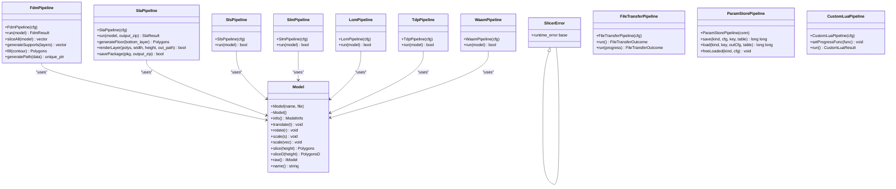

**Diagram sources**
- [hsba_slicer.cppm:70-540](file://ModuleHsBaSlicer/hsba_slicer.cppm#L70-L540)

**Section sources**
- [hsba_slicer.cppm:70-540](file://ModuleHsBaSlicer/hsba_slicer.cppm#L70-L540)

## Architecture Overview
At a high level, `ModuleHsBaSlicer` is a thin C++ layer over LibHsBaSlicer. It does not reimplement slicing algorithms; instead, it wraps existing free functions into RAII objects and pipeline classes.

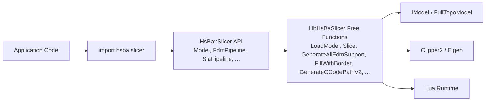

**Diagram sources**
- [hsba_slicer.cppm:37-63](file://ModuleHsBaSlicer/hsba_slicer.cppm#L37-L63)
- [hsba_slicer.cppm:567-751](file://ModuleHsBaSlicer/hsba_slicer.cppm#L567-L751)

**Section sources**
- [hsba_slicer.cppm:1-65](file://ModuleHsBaSlicer/hsba_slicer.cppm#L1-L65)
- [hsba_slicer.cppm:546-751](file://ModuleHsBaSlicer/hsba_slicer.cppm#L546-L751)

## Detailed Component Analysis

### Module Declaration and Build Configuration
The module declares itself using `export module hsba.slicer;`. All standard library and third-party includes are placed in the global module fragment before the export declaration. This avoids exporting implementation details while still allowing the module to depend on them.

Build configuration:
- `ModuleHsBaSlicer` is built as a static library.
- The module interface is registered via `target_sources(... FILE_SET hsba_slicer_modules TYPE CXX_MODULES FILES ...)`.
- It links against `LibHsBaSlicer`, `HsBaPipelineTypes`, `Eigen3::Eigen`, `PkgConfig::Clipper2`, and `${LUA_LIBRARIES}`.
- MSVC-specific flags (`_SCL_SECURE_NO_DEPRECATE`, `_SCL_SECURE_NO_WARNINGS`, `/fp:strict`, `/fp:except`) are re-exported as PUBLIC so consumers inherit the same environment used to build the BMI.

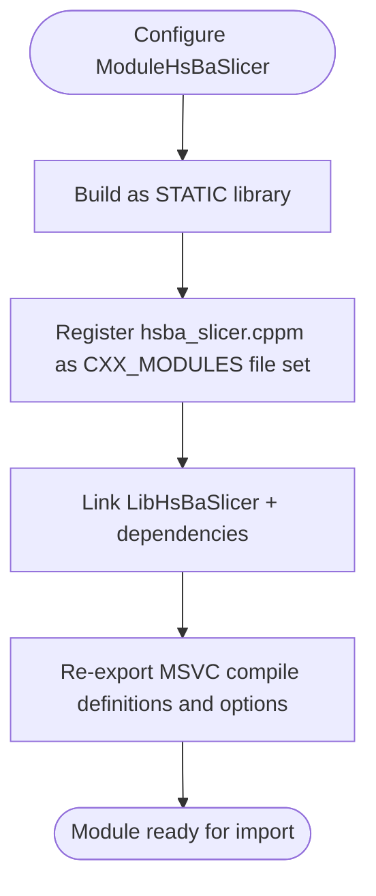

**Diagram sources**
- [CMakeLists.txt:12-45](file://ModuleHsBaSlicer/CMakeLists.txt#L12-L45)

**Section sources**
- [hsba_slicer.cppm:10-65](file://ModuleHsBaSlicer/hsba_slicer.cppm#L10-L65)
- [CMakeLists.txt:1-46](file://ModuleHsBaSlicer/CMakeLists.txt#L1-L46)

### Model API
`Model` is an RAII wrapper around the model pool:
- Construction loads a model by name and file path.
- Destruction removes the model from the pool.
- Move semantics are supported; copy construction and assignment are deleted.
- Methods expose bounding box/volume info, transforms, slicing at a given height, raw model access, and model name.

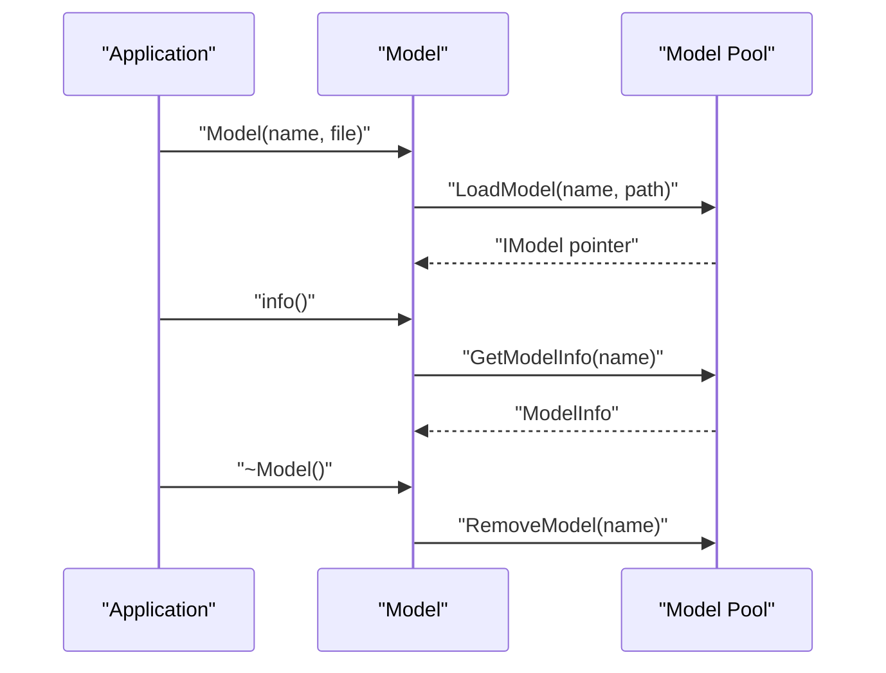

**Diagram sources**
- [hsba_slicer.cppm:152-191](file://ModuleHsBaSlicer/hsba_slicer.cppm#L152-L191)
- [hsba_slicer.cppm:567-615](file://ModuleHsBaSlicer/hsba_slicer.cppm#L567-L615)

**Section sources**
- [hsba_slicer.cppm:152-191](file://ModuleHsBaSlicer/hsba_slicer.cppm#L152-L191)
- [hsba_slicer.cppm:567-615](file://ModuleHsBaSlicer/hsba_slicer.cppm#L567-L615)

### FDM Pipeline
`FdmPipeline` implements the full FDM workflow:
1. Slice all layers.
2. Convert contours to double precision for support generation.
3. Generate supports (built-in or Lua).
4. Fill each layer contour (built-in or Lua).
5. Assemble `LayerPathData` per layer.
6. Generate G-code path and optionally save to file.

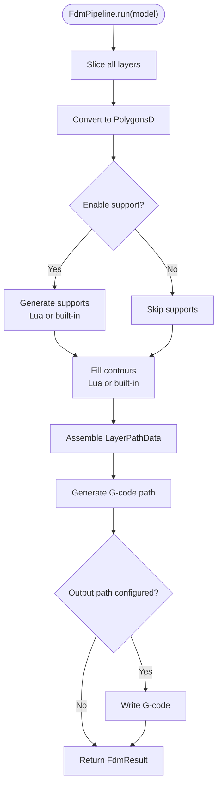

**Diagram sources**
- [hsba_slicer.cppm:197-225](file://ModuleHsBaSlicer/hsba_slicer.cppm#L197-L225)
- [hsba_slicer.cppm:621-751](file://ModuleHsBaSlicer/hsba_slicer.cppm#L621-L751)

**Section sources**
- [hsba_slicer.cppm:197-225](file://ModuleHsBaSlicer/hsba_slicer.cppm#L197-L225)
- [hsba_slicer.cppm:621-751](file://ModuleHsBaSlicer/hsba_slicer.cppm#L621-L751)

### SLA Pipeline
`SlaPipeline` implements the SLA workflow:
1. Slice all layers.
2. Generate supports if enabled.
3. Generate floor/raft from the bottom layer.
4. Render polygons to images.
5. Package layers, supports, floor, and image metadata into a ZIP.

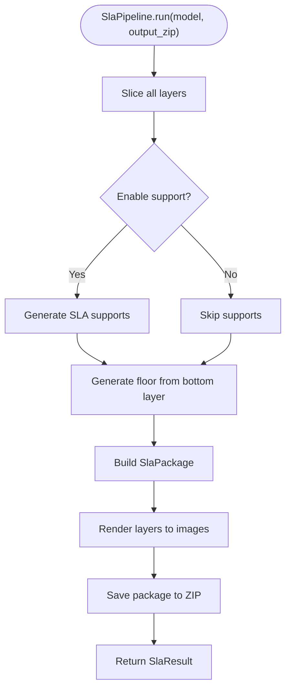

**Diagram sources**
- [hsba_slicer.cppm:231-258](file://ModuleHsBaSlicer/hsba_slicer.cppm#L231-L258)
- [hsba_slicer.cppm:757-856](file://ModuleHsBaSlicer/hsba_slicer.cppm#L757-L856)

**Section sources**
- [hsba_slicer.cppm:231-258](file://ModuleHsBaSlicer/hsba_slicer.cppm#L231-L258)
- [hsba_slicer.cppm:757-856](file://ModuleHsBaSlicer/hsba_slicer.cppm#L757-L856)

### Lua-driven Export Pipelines
`SlsPipeline`, `SlmPipeline`, `LomPipeline`, `TdpPipeline`, and `WaamPipeline` share a similar pattern:
- They require an export Lua script unless otherwise specified.
- They slice the model into layers.
- They build a package structure and call the corresponding Lua export function.
- `WaamPipeline` additionally configures robot/weld parameters and writes a robot path file.

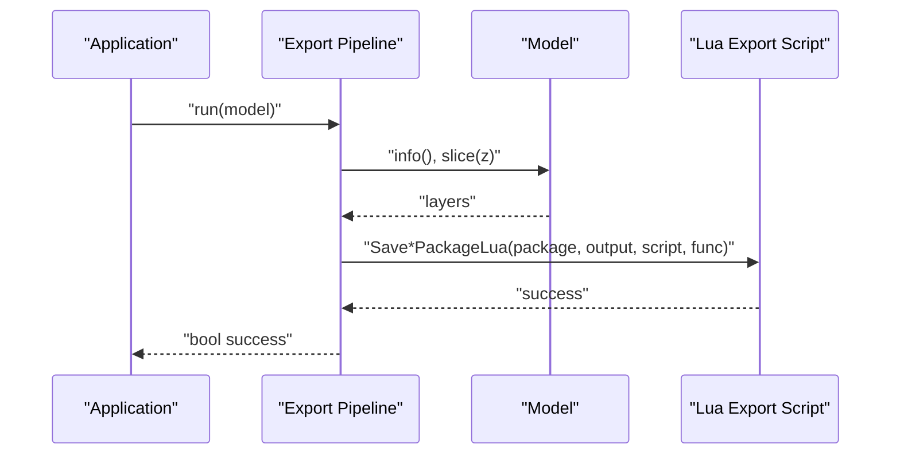

**Diagram sources**
- [hsba_slicer.cppm:264-348](file://ModuleHsBaSlicer/hsba_slicer.cppm#L264-L348)
- [hsba_slicer.cppm:862-1013](file://ModuleHsBaSlicer/hsba_slicer.cppm#L862-L1013)

**Section sources**
- [hsba_slicer.cppm:264-348](file://ModuleHsBaSlicer/hsba_slicer.cppm#L264-L348)
- [hsba_slicer.cppm:862-1013](file://ModuleHsBaSlicer/hsba_slicer.cppm#L862-L1013)

### File Transfer Pipeline
`FileTransferPipeline` validates configuration, maps C++ config to the Lib layer, transfers files, and converts results into a C++ result struct. Errors are thrown as `SlicerError`.

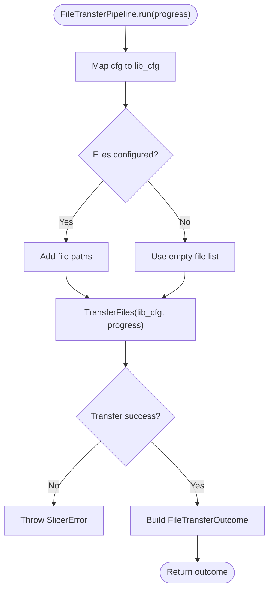

**Diagram sources**
- [hsba_slicer.cppm:354-378](file://ModuleHsBaSlicer/hsba_slicer.cppm#L354-L378)
- [hsba_slicer.cppm:1019-1052](file://ModuleHsBaSlicer/hsba_slicer.cppm#L1019-L1052)

**Section sources**
- [hsba_slicer.cppm:354-378](file://ModuleHsBaSlicer/hsba_slicer.cppm#L354-L378)
- [hsba_slicer.cppm:1019-1052](file://ModuleHsBaSlicer/hsba_slicer.cppm#L1019-L1052)

### Parameter Store Pipeline
`ParamStorePipeline` persists and retrieves pipeline configuration structs:
- `ParamStoreKind` maps to internal `ParamPipelineKind`.
- `ParamStoreBackend` maps to internal `ParamBackend`.
- `save` upserts a config row and returns the stored ID.
- `load` fills a caller-provided config struct and returns the stored ID.
- `freeLoaded` releases heap strings allocated by the library after loading.

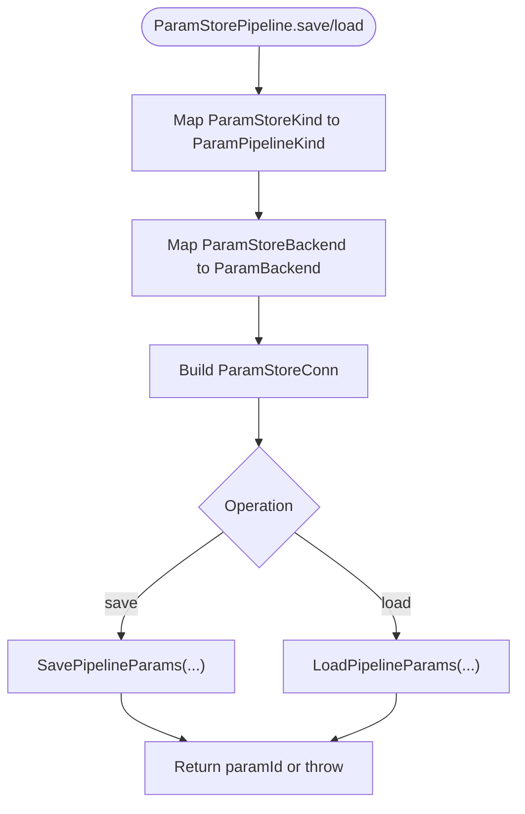

**Diagram sources**
- [hsba_slicer.cppm:384-445](file://ModuleHsBaSlicer/hsba_slicer.cppm#L384-L445)
- [hsba_slicer.cppm:1058-1139](file://ModuleHsBaSlicer/hsba_slicer.cppm#L1058-L1139)

**Section sources**
- [hsba_slicer.cppm:384-445](file://ModuleHsBaSlicer/hsba_slicer.cppm#L384-L445)
- [hsba_slicer.cppm:1058-1139](file://ModuleHsBaSlicer/hsba_slicer.cppm#L1058-L1139)

### Custom Lua Pipeline
`CustomLuaPipeline` allows fully Lua-defined workflows:
- The C++ side constructs a `LuaPipelineContext` from `HsBaCustomPipelineConfig_t`.
- Consumers can register a progress callback.
- On failure, it throws `SlicerError`; on success, it returns `CustomLuaResult`.

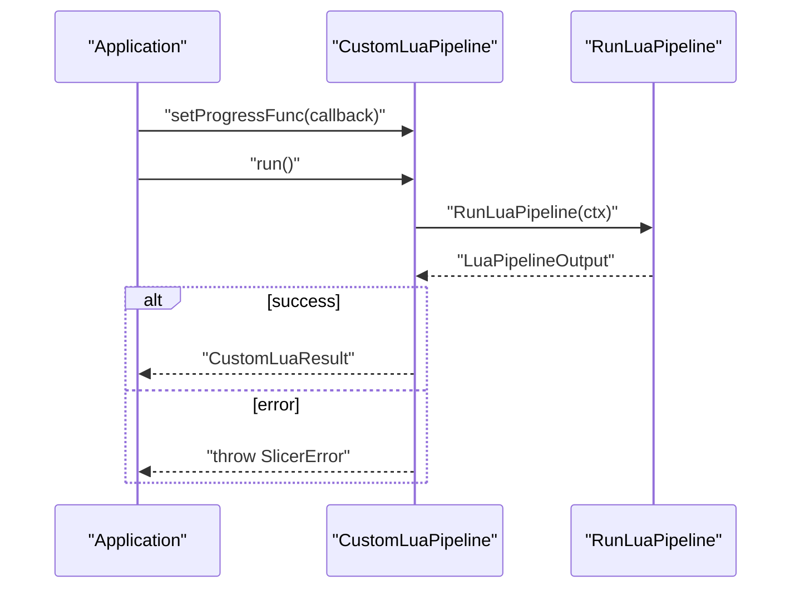

**Diagram sources**
- [hsba_slicer.cppm:451-479](file://ModuleHsBaSlicer/hsba_slicer.cppm#L451-L479)
- [hsba_slicer.cppm:1145-1178](file://ModuleHsBaSlicer/hsba_slicer.cppm#L1145-L1178)

**Section sources**
- [hsba_slicer.cppm:451-479](file://ModuleHsBaSlicer/hsba_slicer.cppm#L451-L479)
- [hsba_slicer.cppm:1145-1178](file://ModuleHsBaSlicer/hsba_slicer.cppm#L1145-L1178)

### Utility APIs
The module exposes:
- Lua helper functions for custom fill, floor, and support.
- External registration functions for 2D/3D/File Lua functions and event callbacks.
- Version query functions returning JSON/XML.
- Polygon precision conversion helpers.

These are thin wrappers around LibHsBaSlicer functions and are intended to keep the module surface consistent and user-friendly.

**Section sources**
- [hsba_slicer.cppm:481-540](file://ModuleHsBaSlicer/hsba_slicer.cppm#L481-L540)
- [hsba_slicer.cppm:1180-1241](file://ModuleHsBaSlicer/hsba_slicer.cppm#L1180-L1241)

## Dependency Analysis
`ModuleHsBaSlicer` depends on:
- `LibHsBaSlicer`: core slicing, preprocessing, support, fill, path generation, and export functions.
- `HsBaPipelineTypes`: pipeline configuration and result type definitions.
- `Eigen3::Eigen`: geometric transformations.
- `PkgConfig::Clipper2`: 2D polygon operations.
- `${LUA_LIBRARIES}`: Lua runtime for scripting and Lua-driven pipelines.

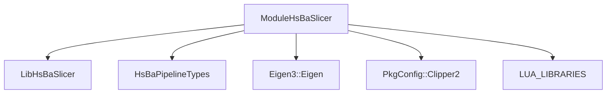

**Diagram sources**
- [CMakeLists.txt:22-29](file://ModuleHsBaSlicer/CMakeLists.txt#L22-L29)

**Section sources**
- [CMakeLists.txt:22-29](file://ModuleHsBaSlicer/CMakeLists.txt#L22-L29)

## Performance Considerations
Module adoption brings several performance-related advantages:
- **Faster compilation**: Modules reduce repeated header parsing and template instantiation across translation units.
- **Better encapsulation**: Only exported symbols are visible, reducing accidental coupling.
- **Improved IDE support**: Module-aware tooling can provide more accurate navigation and diagnostics.

However, current behavior also introduces constraints:
- The module is single-file to avoid MSVC C2572 errors caused by implicit std imports in separate implementation units.
- GMF types are not exported to consumers; they must include relevant headers directly.
- MSVC requires standard library includes before `import` to avoid redefinition conflicts.

[No sources needed since this section provides general guidance]

## Troubleshooting Guide

### Compiler Requirements
The project checks for C++20 module support using CMake:
- Requires CMake 3.28+.
- Accepts MSVC 19.34+, GCC 14+, Clang 16+.
- AppleClang is excluded because it lacks CMake module import-graph discovery support.

If modules are not supported, the top-level CMake disables `HSBA_SLICER_MODULE` and falls back to the header-based API.

**Section sources**
- [feature_check.cmake:96-113](file://static_check/feature_check.cmake#L96-L113)
- [CMakeLists.txt:116-127](file://CMakeLists.txt#L116-L127)

### MSVC-Specific Issues
Common MSVC issues:
- **C2572 redefinition errors**: Standard library `#include` directives must appear before `import hsba.slicer;`.
- **C5050 environment mismatch**: CGAL propagates `/fp:strict` and `_SCL_SECURE_NO_WARNINGS`; `ModuleHsBaSlicer` re-exports these as PUBLIC so consumers inherit them automatically.
- **Static library requirement**: `ModuleHsBaSlicer` is always built as STATIC to avoid DLL link-stage dependency issues.

**Section sources**
- [cpp_cmake_usage.md:312-318](file://docs/en/cpp_cmake_usage.md#L312-L318)
- [CMakeLists.txt:36-45](file://ModuleHsBaSlicer/CMakeLists.txt#L36-L45)

### Clang/GCC-Specific Issues
- **GMF types are not exported**: Types introduced via `#include` in the global module fragment are not visible to consumers. Consumers must include headers such as `LibHsBaSlicer/Preprocess/model_preprocess.hpp` and `pipelinetypes/pipeline_types.h`.
- **Include/import ordering**: Standard library headers are unaffected; `#include`/`import` ordering is not sensitive under Clang/GCC.

**Section sources**
- [cpp_cmake_usage.md:320-327](file://docs/en/cpp_cmake_usage.md#L320-L327)
- [README.md:459-462](file://docs/en/LibHsBaSlicer/README.md#L459-L462)

### Migration from Traditional Headers
Traditional header usage:
- Include multiple LibHsBaSlicer headers.
- Call free functions like `LoadModel`, `Slice`, `GenerateAllFdmSupport`, `FillWithBorder`, `GenerateGCodePathV2`.
- Manage model lifecycle manually.

Module usage:
- Use `import hsba.slicer;`.
- Use `Model` for RAII lifecycle.
- Use `FdmPipeline` for full workflow or step-by-step methods.
- Catch `SlicerError` for error handling.

**Section sources**
- [main_header.cpp:20-28](file://samples/LibHsBaSlicer/main_header.cpp#L20-L28)
- [main_module.cpp:14-29](file://samples/LibHsBaSlicer/main_module.cpp#L14-L29)

## Conclusion
`ModuleHsBaSlicer` provides a modern C++20 module-based entry point to HsBaSlicer. It offers a clean, class-oriented API, better encapsulation, and improved build characteristics compared to traditional header usage. While module support depends on compiler and CMake versions, the repository provides robust fallback behavior and clear documentation for both module and header-based integration.

For most users adopting C++20 modules, the recommended path is:
1. Ensure CMake 3.28+ and a supported compiler.
2. Enable `HSBA_SLICER_MODULE=ON`.
3. Use `import hsba.slicer;` and the `HsBa::Slicer` API.
4. Fall back to traditional headers when module support is unavailable.

[No sources needed since this section summarizes without analyzing specific files]

## Appendices

### Practical Usage Examples

#### Module Import and Namespace Organization
The sample demonstrates:
- Including standard library headers before `import`.
- Including project headers for GMF types.
- Using `import hsba.slicer;`.
- Using `using namespace HsBa::Slicer;`.

**Section sources**
- [main_module.cpp:14-29](file://samples/LibHsBaSlicer/main_module.cpp#L14-L29)

#### Building the Module Sample
The sample target conditionally builds the module example when `HSBA_SLICER_MODULE` is enabled and links against `ModuleHsBaSlicer`.

**Section sources**
- [CMakeLists.txt:23-38](file://samples/LibHsBaSlicer/CMakeLists.txt#L23-L38)

#### Traditional Header Example
The header-based sample shows the equivalent workflow using direct LibHsBaSlicer headers and free functions.

**Section sources**
- [main_header.cpp:1-28](file://samples/LibHsBaSlicer/main_header.cpp#L1-L28)

### Compiler Flags Reference
The repository’s documentation and build logic emphasize:
- C++20 standard.
- CMake 3.28+ for module support.
- Supported compilers: MSVC 19.34+, GCC 14+, Clang 16+.
- MSVC include-before-import rule.
- Public re-export of MSVC floating-point and security definitions.

Note: The repository does not define explicit `-fmodules-ts` or `-fexperimental-module` flags in the provided CMake files; module support is gated by CMake version and compiler version checks. If your toolchain requires manual flags, add them according to your compiler’s module documentation.

**Section sources**
- [feature_check.cmake:96-113](file://static_check/feature_check.cmake#L96-L113)
- [cpp_cmake_usage.md:155-173](file://docs/en/cpp_cmake_usage.md#L155-L173)
- [cpp_cmake_usage.md:312-332](file://docs/en/cpp_cmake_usage.md#L312-L332)