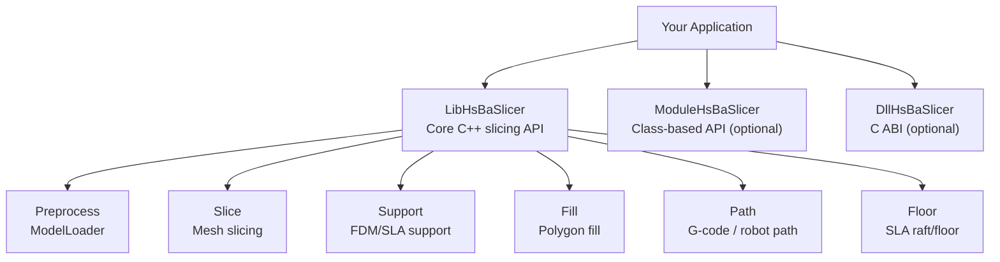
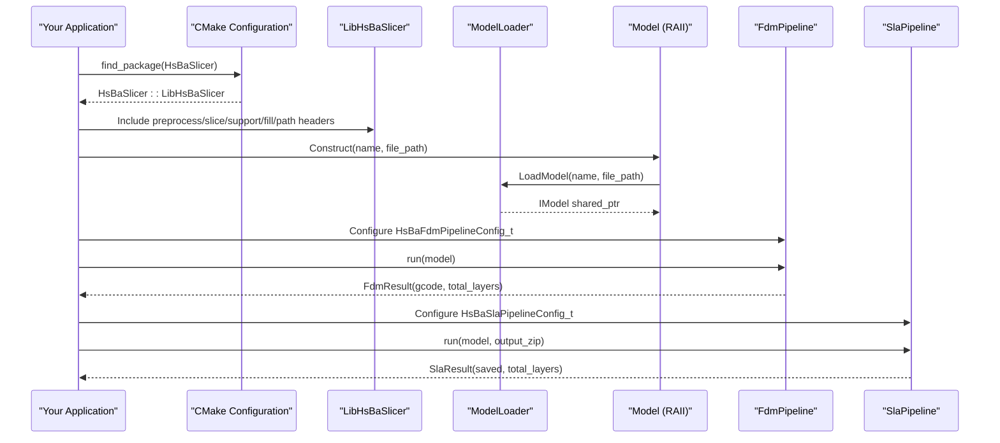
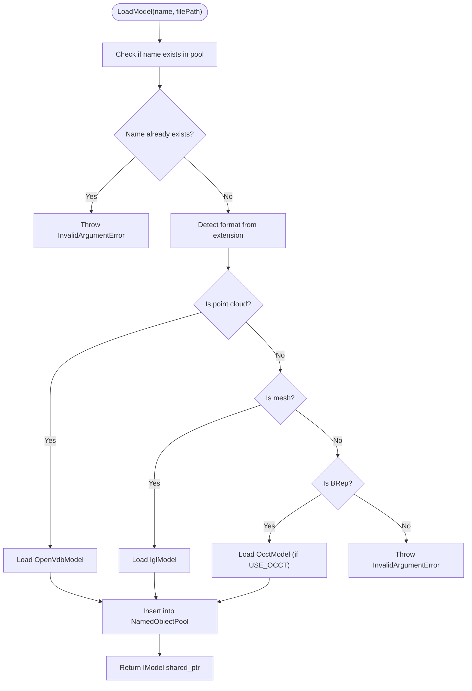
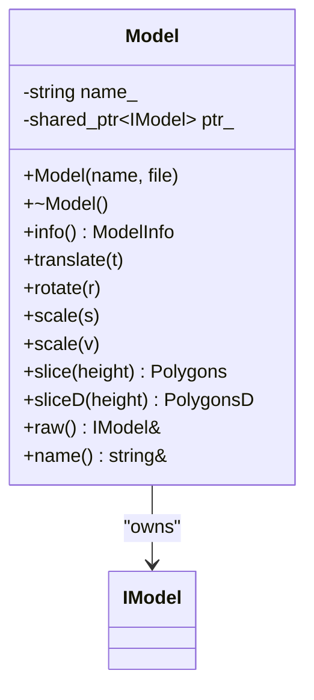
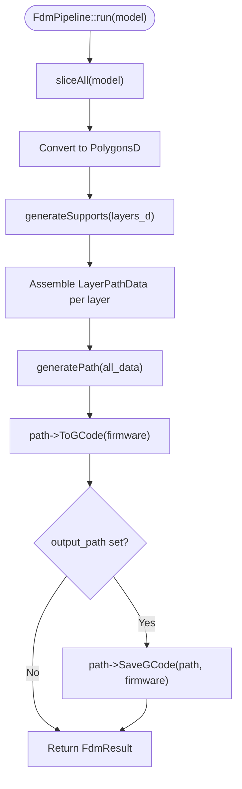
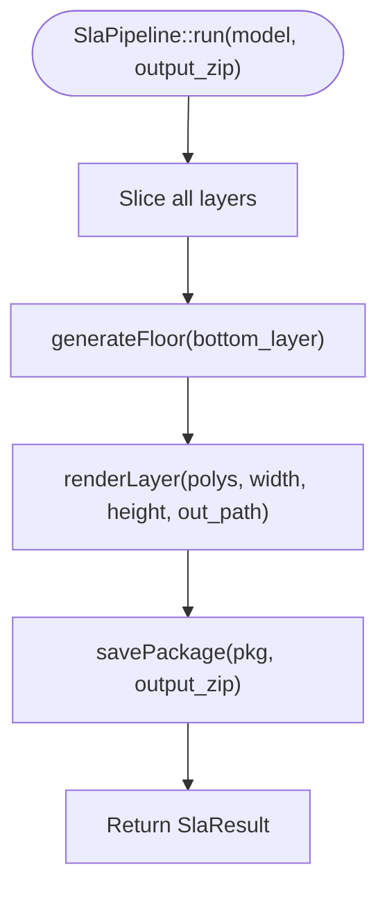
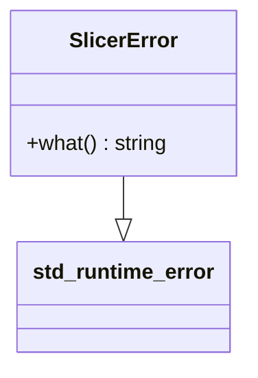
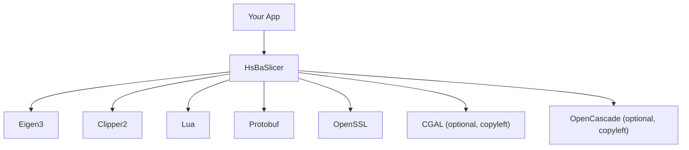

# Traditional Header Integration / 传统头文件集成

<cite>
**Referenced Files in This Document**
- [README.md](file://README.md)
- [cpp_cmake_usage.md](file://docs/en/cpp_cmake_usage.md)
- [vcpkg-dependencies.md](file://docs/en/vcpkg-dependencies.md)
- [vcpkg.json](file://vcpkg.json)
- [export.h](file://LibHsBaSlicer/export.h)
- [pipeline_types.h](file://pipelinetypes/pipeline_types.h)
- [ModelLoader.hpp](file://preprocess/ModelLoader.hpp)
- [ModelLoader.cpp](file://preprocess/ModelLoader.cpp)
- [hsba_slicer.cppm](file://ModuleHsBaSlicer/hsba_slicer.cppm)
- [main_module.cpp](file://samples/LibHsBaSlicer/main_module.cpp)
- [CMakeLists.txt](file://samples/LibHsBaSlicer/CMakeLists.txt)
</cite>

## Table of Contents
1. [Introduction](#introduction)
2. [Project Structure](#project-structure)
3. [Core Components](#core-components)
4. [Architecture Overview](#architecture-overview)
5. [Detailed Component Analysis](#detailed-component-analysis)
6. [Dependency Analysis](#dependency-analysis)
7. [Performance Considerations](#performance-considerations)
8. [Troubleshooting Guide](#troubleshooting-guide)
9. [Conclusion](#conclusion)
10. [Appendices](#appendices)

## Introduction
This document explains how to integrate HsBaSlicer using traditional C++ headers (no C++20 modules). It covers:
- CMake configuration with `target_link_libraries`, include directories, and dependency management via vcpkg.
- The LibHsBaSlicer API structure for model loading, slicing, support generation, infill, path generation, and output.
- RAII usage through the module wrapper’s `Model` class, automatic memory management, and exception handling with `SlicerError`.
- Complete working examples showing model loading from files, pipeline configuration with parameter objects, execution with progress callbacks, and output processing to G-code or other formats.
- Compiler requirements, preprocessor definitions, common linking issues, thread safety considerations, and performance tips.

The traditional header approach is suitable when you do not want to use C++20 modules but still want a clean C++ API. You can either call LibHsBaSlicer free functions directly, or use the module wrapper’s classes (`Model`, `FdmPipeline`, `SlaPipeline`, etc.) by including the relevant headers and linking against the appropriate target.

## Project Structure
For traditional header integration, your project typically links against:
- `HsBaSlicer::LibHsBaSlicer` for the core C++ slicing library.
- Optionally `HsBaSlicer::ModuleHsBaSlicer` if you want the class-based API without using `import hsba.slicer;`.
- Optionally `HsBaSlicer::DllHsBaSlicer` if you prefer the C ABI layer.



**Diagram sources**
- [cpp_cmake_usage.md:82-152](file://docs/en/cpp_cmake_usage.md#L82-L152)
- [README.md:104-124](file://README.md#L104-L124)

**Section sources**
- [README.md:104-124](file://README.md#L104-L124)
- [cpp_cmake_usage.md:82-152](file://docs/en/cpp_cmake_usage.md#L82-L152)

## Core Components
Traditional header integration centers on three layers:

1. **Configuration types**: Pipeline configuration structs are defined in `pipelinetypes/pipeline_types.h`. These are C-compatible and used by both the C ABI layer and the C++ wrappers.
2. **Model loading and preprocessing**: `ModelLoader` provides unified loading of STL/OBJ/PLY and other formats into an `IModel` pool.
3. **Pipeline classes (module wrapper)**: `Model`, `FdmPipeline`, and `SlaPipeline` provide RAII-style APIs that wrap LibHsBaSlicer free functions.

Key responsibilities:
- `HsBaFdmPipelineConfig_t`: FDM parameters such as layer height, fill mode, support settings, G-code firmware, nozzle/bed temperatures, and output path.
- `HsBaSlaPipelineConfig_t`: SLA parameters such as exposure time, lift distance, floor/raft settings, image format, and output zip path.
- `ModelLoader`: Loads models by extension, manages a named pool, and throws typed errors for invalid arguments or unsupported formats.
- `Model` (module wrapper): RAII handle that loads a model on construction and removes it on destruction.
- `FdmPipeline`: Full FDM workflow: slice → support → fill → path → G-code.
- `SlaPipeline`: Full SLA workflow: slice → support → floor → render → package.

**Section sources**
- [pipeline_types.h:56-127](file://pipelinetypes/pipeline_types.h#L56-L127)
- [pipeline_types.h:170-232](file://pipelinetypes/pipeline_types.h#L170-L232)
- [ModelLoader.hpp:23-80](file://preprocess/ModelLoader.hpp#L23-L80)
- [hsba_slicer.cppm:152-191](file://ModuleHsBaSlicer/hsba_slicer.cppm#L152-L191)
- [hsba_slicer.cppm:204-225](file://ModuleHsBaSlicer/hsba_slicer.cppm#L204-L225)
- [hsba_slicer.cppm:238-258](file://ModuleHsBaSlicer/hsba_slicer.cppm#L238-L258)

## Architecture Overview
The traditional header integration architecture connects your application to HsBaSlicer through CMake targets and includes.



**Diagram sources**
- [cpp_cmake_usage.md:82-152](file://docs/en/cpp_cmake_usage.md#L82-L152)
- [ModelLoader.cpp:45-84](file://preprocess/ModelLoader.cpp#L45-L84)
- [hsba_slicer.cppm:567-579](file://ModuleHsBaSlicer/hsba_slicer.cppm#L567-L579)
- [hsba_slicer.cppm:704-751](file://ModuleHsBaSlicer/hsba_slicer.cppm#L704-L751)
- [hsba_slicer.cppm:793-800](file://ModuleHsBaSlicer/hsba_slicer.cppm#L793-L800)

## Detailed Component Analysis

### CMake Configuration for Traditional Headers
To integrate HsBaSlicer using traditional headers:
- Use `find_package(HsBaSlicer REQUIRED)`.
- Link your executable against `HsBaSlicer::LibHsBaSlicer`.
- Add include directories if needed (the sample shows adding the repository root for convenience).

Recommended minimal CMake setup:
```cmake
cmake_minimum_required(VERSION 3.28)
project(MySlicerApp LANGUAGES CXX)
set(CMAKE_CXX_STANDARD 20)
set(CMAKE_CXX_STANDARD_REQUIRED ON)
find_package(HsBaSlicer REQUIRED)
add_executable(my_app main.cpp)
target_link_libraries(my_app PRIVATE HsBaSlicer::LibHsBaSlicer)
```

If you also want the class-based API without modules, link `ModuleHsBaSlicer` instead of or in addition to `LibHsBaSlicer`.

**Section sources**
- [cpp_cmake_usage.md:82-152](file://docs/en/cpp_cmake_usage.md#L82-L152)
- [CMakeLists.txt:8-21](file://samples/LibHsBaSlicer/CMakeLists.txt#L8-L21)

### LibHsBaSlicer API Structure
LibHsBaSlicer exposes modular C++ functionality:
- Preprocess: model loading and pool management.
- Slice: mesh slicing into contours.
- Support: FDM and SLA support generation.
- Fill: polygon infill algorithms.
- Path: G-code and robot path generation.
- Floor: SLA raft/floor generation.
- Transfer: file transfer utilities.
- ParamStore: process-parameter persistence.

You include headers under `<LibHsBaSlicer/...>` after installation or add the source tree include directory during development.

**Section sources**
- [README.md:126-150](file://README.md#L126-L150)
- [cpp_cmake_usage.md:82-152](file://docs/en/cpp_cmake_usage.md#L82-L152)

### Model Loading with ModelLoader
`ModelLoader` is the unified entry point for loading models:
- Supports mesh formats (STL, OBJ, PLY, OFF) via IglModel.
- Supports BRep formats (STEP, IGES, VRML, BREP) via OcctModel when available.
- Supports point cloud formats via OpenVdbModel when available.
- Manages a named object pool with capacity controlled by `HSBA_MODEL_POOL_SIZE`.
- Throws typed exceptions: `InvalidArgumentError` for duplicate names or unsupported formats, `RuntimeError` for load failures.



**Diagram sources**
- [ModelLoader.cpp:45-84](file://preprocess/ModelLoader.cpp#L45-L84)
- [ModelLoader.hpp:47-80](file://preprocess/ModelLoader.hpp#L47-L80)

**Section sources**
- [ModelLoader.hpp:23-80](file://preprocess/ModelLoader.hpp#L23-L80)
- [ModelLoader.cpp:45-84](file://preprocess/ModelLoader.cpp#L45-L84)

### RAII Model Class and Automatic Memory Management
The module wrapper’s `Model` class provides RAII semantics:
- Construction calls `LoadModel` and stores the model name and pointer.
- Destruction calls `RemoveModel` to release the pooled model.
- Move semantics are supported; copy is disabled.
- Provides transformation methods (`translate`, `rotate`, `scale`) and slicing helpers (`slice`, `sliceD`).



**Diagram sources**
- [hsba_slicer.cppm:152-191](file://ModuleHsBaSlicer/hsba_slicer.cppm#L152-L191)
- [hsba_slicer.cppm:567-615](file://ModuleHsBaSlicer/hsba_slicer.cppm#L567-L615)

**Section sources**
- [hsba_slicer.cppm:152-191](file://ModuleHsBaSlicer/hsba_slicer.cppm#L152-L191)
- [hsba_slicer.cppm:567-615](file://ModuleHsBaSlicer/hsba_slicer.cppm#L567-L615)

### FDM Pipeline: Slice → Support → Fill → Path → G-code
`FdmPipeline` encapsulates the full FDM workflow:
- `run(model)` slices all layers, converts to double precision, generates supports, fills contours, assembles layer data, generates G-code paths, and optionally saves to file.
- Configuration uses `HsBaFdmPipelineConfig_t`.
- Output is `FdmResult` containing G-code text and total layer count.



**Diagram sources**
- [hsba_slicer.cppm:704-751](file://ModuleHsBaSlicer/hsba_slicer.cppm#L704-L751)

**Section sources**
- [hsba_slicer.cppm:204-225](file://ModuleHsBaSlicer/hsba_slicer.cppm#L204-L225)
- [hsba_slicer.cppm:704-751](file://ModuleHsBaSlicer/hsba_slicer.cppm#L704-L751)

### SLA Pipeline: Slice → Support → Floor → Render → Package
`SlaPipeline` encapsulates the full SLA workflow:
- `run(model, output_zip)` slices layers, generates floor/raft, renders layers to images, and packages results into a zip.
- Configuration uses `HsBaSlaPipelineConfig_t`.
- Output is `SlaResult` indicating whether the package was saved and the total layer count.



**Diagram sources**
- [hsba_slicer.cppm:757-800](file://ModuleHsBaSlicer/hsba_slicer.cppm#L757-L800)

**Section sources**
- [hsba_slicer.cppm:238-258](file://ModuleHsBaSlicer/hsba_slicer.cppm#L238-L258)
- [hsba_slicer.cppm:757-800](file://ModuleHsBaSlicer/hsba_slicer.cppm#L757-L800)

### Exception Handling with SlicerError
The module wrapper defines `SlicerError` as the unified exception type for slicer operations. It derives from `std::runtime_error` and is thrown by constructors and methods that fail, such as model loading or pipeline execution.



**Diagram sources**
- [hsba_slicer.cppm:74-79](file://ModuleHsBaSlicer/hsba_slicer.cppm#L74-L79)

**Section sources**
- [hsba_slicer.cppm:74-79](file://ModuleHsBaSlicer/hsba_slicer.cppm#L74-L79)

### Complete Working Example: Traditional Headers
Below is a conceptual example of how to use traditional headers:
- Include preprocess, slice, support, fill, path, and floor headers.
- Load a model using `LoadModel`.
- Slice layers using `Slice`.
- Generate supports using `GenerateAllFdmSupport`.
- Fill polygons using `FillWithBorder`.
- Generate G-code using `GenerateGCodePathV2`.
- Handle exceptions with `SlicerError` or base error types.

Reference implementation patterns:
- [cpp_cmake_usage.md:101-140](file://docs/en/cpp_cmake_usage.md#L101-L140)
- [main_module.cpp:45-97](file://samples/LibHsBaSlicer/main_module.cpp#L45-L97)

**Section sources**
- [cpp_cmake_usage.md:101-140](file://docs/en/cpp_cmake_usage.md#L101-L140)
- [main_module.cpp:45-97](file://samples/LibHsBaSlicer/main_module.cpp#L45-L97)

## Dependency Analysis
HsBaSlicer uses vcpkg for dependency management. Key points:
- Public dependencies include Eigen3, magic_enum, Clipper2, Lua, Protobuf, OpenSSL.
- Copyleft kernels (CGAL, OpenCascade) are optional and controlled by the `copyleft` feature.
- Platform exclusions apply for Android and iOS.



**Diagram sources**
- [cpp_cmake_usage.md:461-472](file://docs/en/cpp_cmake_usage.md#L461-L472)
- [vcpkg.json:10-87](file://vcpkg.json#L10-L87)
- [vcpkg.json:89-111](file://vcpkg.json#L89-L111)

**Section sources**
- [cpp_cmake_usage.md:461-472](file://docs/en/cpp_cmake_usage.md#L461-L472)
- [vcpkg.json:10-87](file://vcpkg.json#L10-L87)
- [vcpkg.json:89-111](file://vcpkg.json#L89-L111)
- [vcpkg-dependencies.md:23-41](file://docs/en/vcpkg-dependencies.md#L23-L41)

## Performance Considerations
- Prefer smaller layer heights only when necessary; higher layer counts increase memory and CPU usage.
- Use built-in fill modes (`HSBA_FILL_ZIGZAG`) unless custom Lua scripts provide measurable benefits.
- Avoid unnecessary conversions between integer and double polygon representations; convert only where required (e.g., support generation).
- Reuse model instances via the named pool when possible to reduce repeated loading.
- For large models, consider disabling support or reducing support density to speed up processing.
- On desktop platforms, ensure compiler optimizations are enabled (Release builds) and avoid debug-only overhead in production pipelines.

[No sources needed since this section provides general guidance]

## Troubleshooting Guide
Common issues and resolutions:
- **Missing include directories**: Ensure your CMake adds the correct include paths or uses installed headers under `<install_prefix>/include/HsBaSlicer/`.
- **Linking errors**: Verify you linked `HsBaSlicer::LibHsBaSlicer` or `HsBaSlicer::ModuleHsBaSlicer` as appropriate.
- **MSVC module ordering**: If using modules, standard library `#include` must precede `import hsba.slicer;`.
- **GMF type visibility**: Under Clang/GCC, GMF-defined types are not exported by the module; include relevant headers directly.
- **Copyleft licensing**: Disabling default features prevents CGAL/OpenCascade from being installed and linked, producing an MIT-licensed build.

**Section sources**
- [cpp_cmake_usage.md:312-333](file://docs/en/cpp_cmake_usage.md#L312-L333)
- [vcpkg-dependencies.md:15-21](file://docs/en/vcpkg-dependencies.md#L15-L21)

## Conclusion
Traditional header integration with HsBaSlicer provides a robust, modular C++ experience. By configuring CMake correctly, managing dependencies via vcpkg, and using the LibHsBaSlicer API along with the module wrapper’s RAII classes, you can implement complete slicing workflows for FDM and SLA processes. Proper exception handling with `SlicerError`, careful configuration of pipeline parameters, and attention to performance and platform constraints will help you build reliable and efficient applications.

[No sources needed since this section summarizes without analyzing specific files]

## Appendices

### Compiler Requirements
- C++20 compatible compilers are required.
- Recommended minimum versions: MSVC 19.34+, GCC 14+, Clang 16+.
- CMake ≥ 3.28 is recommended for modern toolchain behavior.

**Section sources**
- [cpp_cmake_usage.md:14-18](file://docs/en/cpp_cmake_usage.md#L14-L18)

### Preprocessor Definitions
- `USE_CGAL`: Enables CGAL-based operations (thick solid, boolean operations).
- `USE_OCCT`: Enables OpenCascade-based BRep operations.
- `USE_OPENVDB`: Enables point cloud operations via OpenVDB.
- `HSBA_MODEL_POOL_SIZE`: Controls the capacity of the named model pool.

**Section sources**
- [ModelLoader.hpp:17-19](file://preprocess/ModelLoader.hpp#L17-L19)
- [ModelLoader.hpp:23-29](file://preprocess/ModelLoader.hpp#L23-L29)

### Export Macro for Library Symbols
The export macro `HSBA_SLICER_LIB_API` controls symbol visibility on Windows and is otherwise empty on non-Windows platforms.

**Section sources**
- [export.h:9-20](file://LibHsBaSlicer/export.h#L9-L20)