# .NET Interop / .NET互操作

<cite>
**Referenced Files in This Document**   
- [README.md](file://README.md)
- [dllexport.h](file://DllHsBaSlicer/dllexport.h)
- [initialize.h](file://DllHsBaSlicer/initialize.h)
- [fdm_pipeline.h](file://DllHsBaSlicer/fdm_pipeline.h)
- [pipeline_types.h](file://pipelinetypes/pipeline_types.h)
- [game_engine_integration.md](file://docs/en/DllHsBaSlicer/game_engine_integration.md)
- [dll_export_readme.md](file://docs/en/DllHsBaSlicer/README.md)
</cite>

## Table of Contents
1. [Introduction](#introduction)
2. [Project Structure](#project-structure)
3. [Core Components](#core-components)
4. [Architecture Overview](#architecture-overview)
5. [Detailed Component Analysis](#detailed-component-analysis)
6. [Dependency Analysis](#dependency-analysis)
7. [Performance Considerations](#performance-considerations)
8. [Troubleshooting Guide](#troubleshooting-guide)
9. [Conclusion](#conclusion)
10. [Appendices](#appendices)

## Introduction
This document explains how to integrate HsBaSlicer from .NET applications using both P/Invoke and C++/CLI. It focuses on the DllHsBaSlicer C ABI, which exposes FDM, SLA, SLS, SLM, LOM, 3DP, WAAM, file transfer, parameter store, custom Lua pipeline, and version APIs through `extern "C"` functions. The primary interop surface for C# is:

- Native structs defined in `pipelinetypes/pipeline_types.h`.
- Pipeline entry points such as `HsBaCreateDefaultConfig`, `HsBaRunFdmPipeline`, `HsBaRunFdmPipelineAsync`, and `HsBaFreePipelineResult`.
- A one-time `initialize()` call before any pipeline operation.
- Progress and result callbacks that fire on a native worker thread and must be marshalled back to the UI thread.

The repository also provides Unity-style C# P/Invoke examples and Unreal Engine integration guidance, which are directly applicable to WPF/WinForms with minor adjustments.

**Section sources**
- [dll_export_readme.md:1-19](file://docs/en/DllHsBaSlicer/README.md#L1-L19)
- [dll_export_readme.md:56-62](file://docs/en/DllHsBaSlicer/README.md#L56-L62)
- [fdm_pipeline.h:17-61](file://DllHsBaSlicer/fdm_pipeline.h#L17-L61)
- [initialize.h:14-19](file://DllHsBaSlicer/initialize.h#L14-L19)

## Project Structure
For .NET interop, the relevant parts of the repository are:

- `pipelinetypes/pipeline_types.h`: C-compatible struct and enum definitions used by all pipelines.
- `DllHsBaSlicer/*`: C ABI headers and exported functions.
- `docs/en/DllHsBaSlicer/game_engine_integration.md`: C# P/Invoke patterns, struct mirroring, delegate lifetime rules, async usage, and platform notes.
- `docs/en/DllHsBaSlicer/README.md`: Module overview, API summary, memory management rules, and callback threading model.

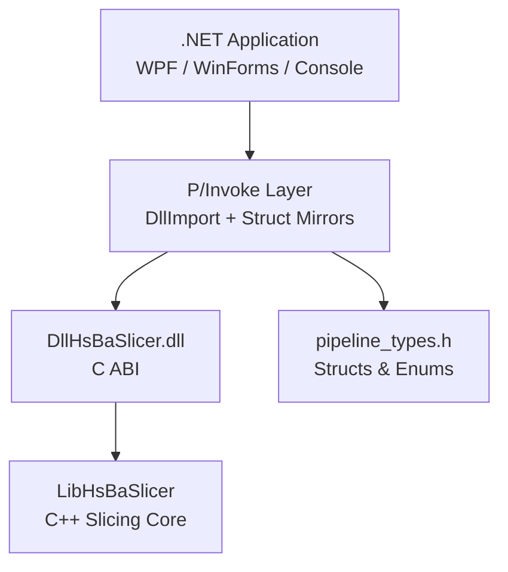

**Diagram sources**
- [dll_export_readme.md:1-19](file://docs/en/DllHsBaSlicer/README.md#L1-L19)
- [fdm_pipeline.h:1-10](file://DllHsBaSlicer/fdm_pipeline.h#L1-L10)
- [pipeline_types.h:1-12](file://pipelinetypes/pipeline_types.h#L1-L12)

**Section sources**
- [README.md:25-39](file://README.md#L25-L39)
- [dll_export_readme.md:21-54](file://docs/en/DllHsBaSlicer/README.md#L21-L54)

## Core Components
The core interop components are:

| Component | Purpose | Key Source |
|---|---|---|
| Export macro | Declares DLL export/import symbols across platforms | [dllexport.h](file://DllHsBaSlicer/dllexport.h) |
| Initialization | One-time runtime setup before calling pipelines | [initialize.h](file://DllHsBaSlicer/initialize.h) |
| FDM pipeline API | Default config, sync run, async run, result free | [fdm_pipeline.h](file://DllHsBaSlicer/fdm_pipeline.h) |
| Pipeline types | C-compatible enums, configs, results, callbacks | [pipeline_types.h](file://pipelinetypes/pipeline_types.h) |
| C# P/Invoke examples | Struct mirrors, delegates, async wrapper, main-thread marshalling | [game_engine_integration.md](file://docs/en/DllHsBaSlicer/game_engine_integration.md) |
| Module documentation | Memory rules, callback threading, API overview | [dll_export_readme.md](file://docs/en/DllHsBaSlicer/README.md) |

### C ABI Entry Points for FDM
The FDM pipeline is the most representative example for .NET interop:

- `HsBaCreateDefaultConfig` returns a default configuration value type.
- `HsBaRunFdmPipeline` runs synchronously.
- `HsBaRunFdmPipelineAsync` starts asynchronous execution and invokes a result callback.
- `HsBaFreePipelineResult` releases managed strings allocated by the native library.

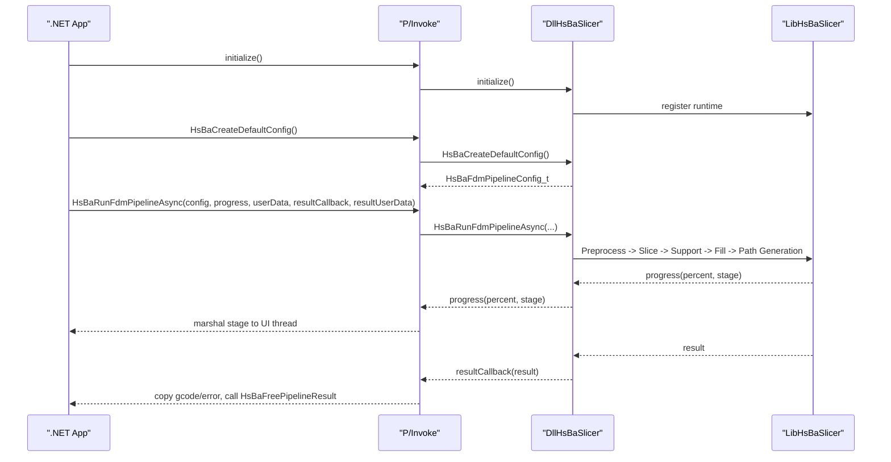

**Diagram sources**
- [initialize.h:14-19](file://DllHsBaSlicer/initialize.h#L14-L19)
- [fdm_pipeline.h:17-61](file://DllHsBaSlicer/fdm_pipeline.h#L17-L61)
- [dll_export_readme.md:684-703](file://docs/en/DllHsBaSlicer/README.md#L684-L703)

**Section sources**
- [fdm_pipeline.h:17-61](file://DllHsBaSlicer/fdm_pipeline.h#L17-L61)
- [dll_export_readme.md:147-162](file://docs/en/DllHsBaSlicer/README.md#L147-L162)

## Architecture Overview
The .NET interop architecture separates three layers:

1. **.NET application**: WPF or WinForms UI, business logic, and interop wrappers.
2. **P/Invoke layer**: `DllImport` declarations, struct mirrors, delegate definitions, UTF-8 marshaling, and thread marshalling.
3. **Native layer**: DllHsBaSlicer C ABI, backed by LibHsBaSlicer slicing core.

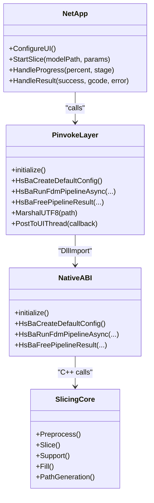

**Diagram sources**
- [game_engine_integration.md:21-123](file://docs/en/DllHsBaSlicer/game_engine_integration.md#L21-L123)
- [dll_export_readme.md:1-19](file://docs/en/DllHsBaSlicer/README.md#L1-L19)

**Section sources**
- [game_engine_integration.md:21-123](file://docs/en/DllHsBaSlicer/game_engine_integration.md#L21-L123)
- [dll_export_readme.md:1-19](file://docs/en/DllHsBaSlicer/README.md#L1-L19)

## Detailed Component Analysis

### P/Invoke Function Declarations
For C#, declare the native library name, calling convention, and function signatures. The Unity example shows the recommended pattern:

- Use a platform-specific library name constant.
- Use `CallingConvention.Cdecl`.
- Mirror every `const char*` as `IntPtr`.
- Mirror enums as `int`.
- Keep delegate references alive so the GC does not collect them while native code holds them.

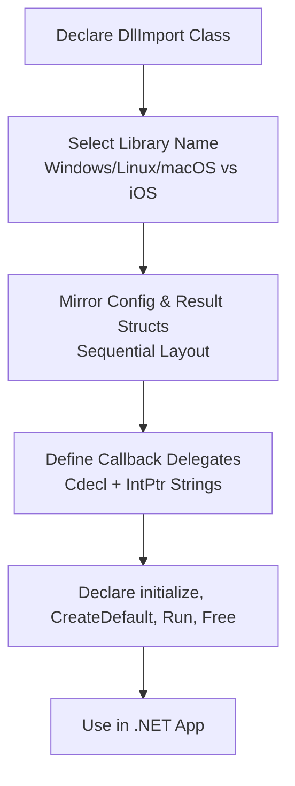

**Diagram sources**
- [game_engine_integration.md:25-123](file://docs/en/DllHsBaSlicer/game_engine_integration.md#L25-L123)

**Section sources**
- [game_engine_integration.md:25-123](file://docs/en/DllHsBaSlicer/game_engine_integration.md#L25-L123)

### Struct Definitions for PipelineConfig and PipelineResult
The C# struct layout must match `pipeline_types.h` exactly. For FDM:

- `HsBaFdmPipelineConfig_t` contains model paths, slice settings, fill settings, support settings, path settings, G-code firmware settings, Lua script fields, and output path.
- `HsBaFdmPipelineResult_t` contains success, total layers, G-code content pointer, error message pointer, and elapsed seconds.

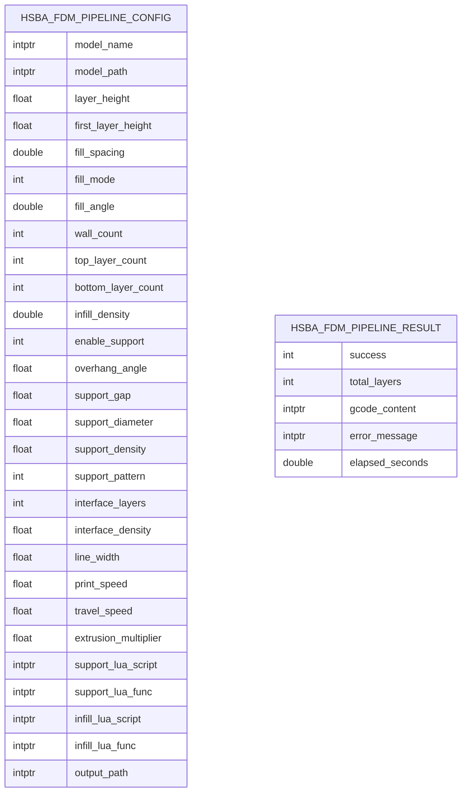

**Diagram sources**
- [pipeline_types.h:53-127](file://pipelinetypes/pipeline_types.h#L53-L127)

**Section sources**
- [pipeline_types.h:53-127](file://pipelinetypes/pipeline_types.h#L53-L127)
- [game_engine_integration.md:38-80](file://docs/en/DllHsBaSlicer/game_engine_integration.md#L38-L80)

### Data Marshaling Strategies for Complex Types
Marshaling strategy:

- **By-value structs**: Pass `ref` for small POD-like structs when appropriate; the Unity example passes `ref FdmPipelineConfig` to async functions.
- **String fields**: Convert managed strings to UTF-8 unmanaged memory using `Marshal.StringToCoTaskMemUTF8`, assign to `IntPtr` fields, and free after the native call completes.
- **Enum fields**: Map C enums to `int` in C#.
- **Callback strings**: Read `const char*` via `Marshal.PtrToStringUTF8`; do not keep the pointer beyond the callback scope.
- **Result strings**: Copy `gcode_content` and `error_message` into managed strings before calling the corresponding `HsBaFree*PipelineResult`.

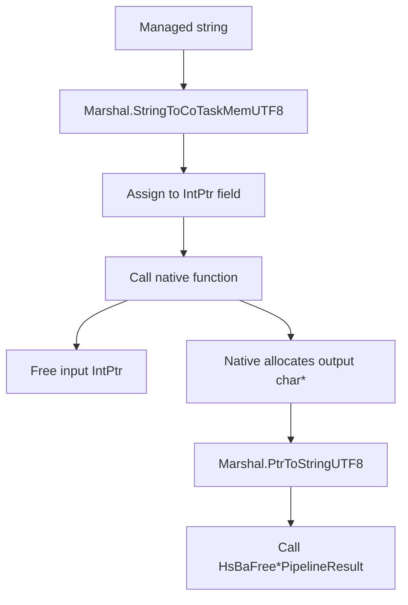

**Diagram sources**
- [game_engine_integration.md:146-181](file://docs/en/DllHsBaSlicer/game_engine_integration.md#L146-L181)
- [dll_export_readme.md:696-703](file://docs/en/DllHsBaSlicer/README.md#L696-L703)

**Section sources**
- [game_engine_integration.md:146-181](file://docs/en/DllHsBaSlicer/game_engine_integration.md#L146-L181)
- [dll_export_readme.md:696-703](file://docs/en/DllHsBaSlicer/README.md#L696-L703)

### String Handling Between Managed and Unmanaged Code
Rules:

- All exported string fields use UTF-8.
- Managed-to-native: allocate UTF-8 bytes and pass as `IntPtr`.
- Native-to-managed: read via `Marshal.PtrToStringUTF8`.
- Ownership: native-owned strings in results must be freed through the matching free function.
- Do not assume `char*` is null-terminated if it comes from non-string contexts; however, the documented result fields are UTF-8 strings.

**Section sources**
- [game_engine_integration.md:152-177](file://docs/en/DllHsBaSlicer/game_engine_integration.md#L152-L177)
- [dll_export_readme.md:696-703](file://docs/en/DllHsBaSlicer/README.md#L696-L703)

### Memory Management Patterns
Key patterns:

- Use `HsBaCreateDefaultConfig` to obtain a zero-initialized default struct.
- Keep config string pointers valid only during the call; they are read-only during pipeline execution.
- Always call `HsBaFreePipelineResult` after copying result strings.
- Keep delegate references alive for the duration of native callbacks.
- For Proto deserialization, use the provided `HsBaFree*ConfigStrings` helpers where applicable.

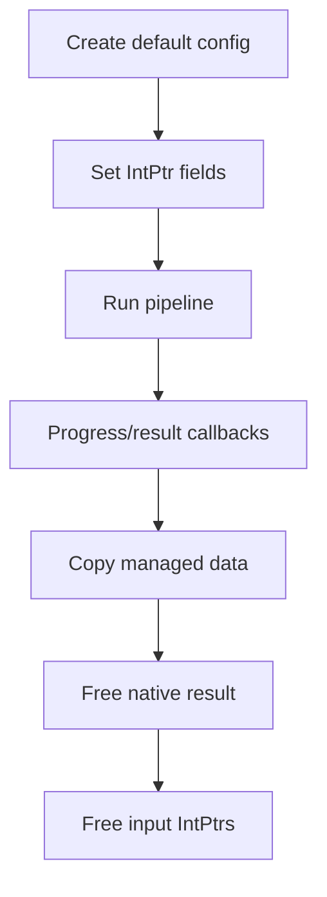

**Diagram sources**
- [game_engine_integration.md:146-181](file://docs/en/DllHsBaSlicer/game_engine_integration.md#L146-L181)
- [dll_export_readme.md:696-703](file://docs/en/DllHsBaSlicer/README.md#L696-L703)

**Section sources**
- [game_engine_integration.md:146-181](file://docs/en/DllHsBaSlicer/game_engine_integration.md#L146-L181)
- [dll_export_readme.md:696-703](file://docs/en/DllHsBaSlicer/README.md#L696-L703)

### Complete Example: WPF/WinForms Using HsBaSlicer
A WPF or WinForms application should:

1. Call `initialize()` once at startup.
2. Build a mirrored `FdmPipelineConfig` struct.
3. Convert UI-provided parameters into config fields.
4. Convert model path and optional output path to UTF-8 `IntPtr`.
5. Start `HsBaRunFdmPipelineAsync`.
6. Marshal progress updates to the UI thread.
7. In the result callback, copy G-code and error, then free the native result.

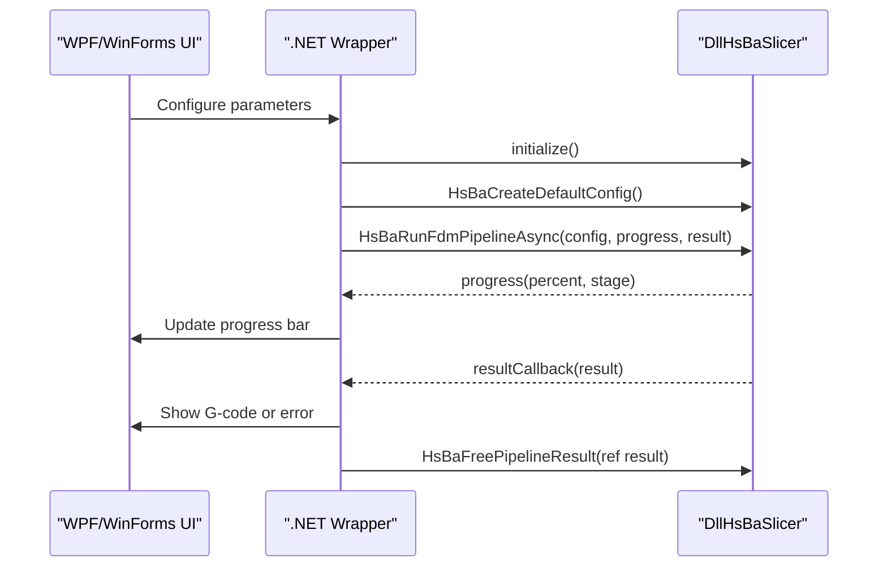

**Diagram sources**
- [game_engine_integration.md:137-181](file://docs/en/DllHsBaSlicer/game_engine_integration.md#L137-L181)
- [fdm_pipeline.h:34-61](file://DllHsBaSlicer/fdm_pipeline.h#L34-L61)

**Section sources**
- [game_engine_integration.md:137-181](file://docs/en/DllHsBaSlicer/game_engine_integration.md#L137-L181)
- [fdm_pipeline.h:34-61](file://DllHsBaSlicer/fdm_pipeline.h#L34-L61)

### Asynchronous Pipeline Execution with Progress Reporting
Asynchronous execution uses two callbacks:

- Progress callback: reports percentage and stage description.
- Result callback: reports final success, layer count, output data, error message, and elapsed time.

Important rules:

- Callbacks fire on a native worker thread.
- UI frameworks must marshal callbacks to the UI thread.
- Delegate instances must be stored in static or member fields to prevent garbage collection.

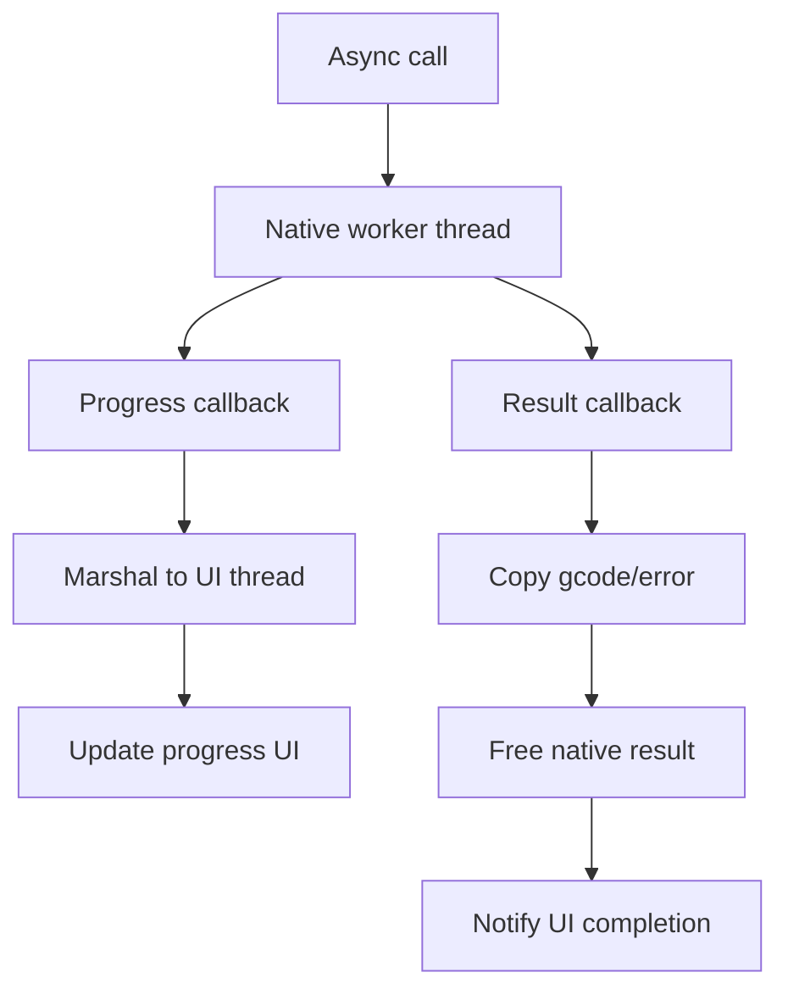

**Diagram sources**
- [game_engine_integration.md:159-181](file://docs/en/DllHsBaSlicer/game_engine_integration.md#L159-L181)
- [dll_export_readme.md:684-694](file://docs/en/DllHsBaSlicer/README.md#L684-L694)

**Section sources**
- [game_engine_integration.md:159-181](file://docs/en/DllHsBaSlicer/game_engine_integration.md#L159-L181)
- [dll_export_readme.md:684-694](file://docs/en/DllHsBaSlicer/README.md#L684-L694)

### Result Processing
After receiving a result:

- Check `success`.
- If successful, process `gcode_content` or `export_path`/`output_path` depending on the pipeline.
- If failed, log or display `error_message`.
- Always call the matching free function.

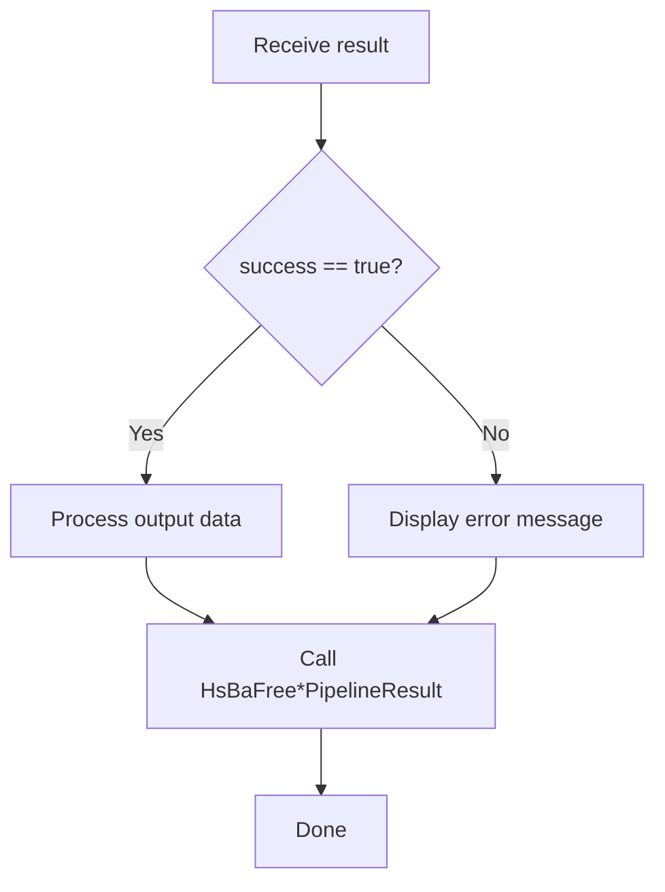

**Diagram sources**
- [game_engine_integration.md:166-177](file://docs/en/DllHsBaSlicer/game_engine_integration.md#L166-L177)
- [dll_export_readme.md:696-703](file://docs/en/DllHsBaSlicer/README.md#L696-L703)

**Section sources**
- [game_engine_integration.md:166-177](file://docs/en/DllHsBaSlicer/game_engine_integration.md#L166-L177)
- [dll_export_readme.md:696-703](file://docs/en/DllHsBaSlicer/README.md#L696-L703)

### Parameter Configuration Through UI Controls
Typical mapping:

- Model path: text box → UTF-8 `IntPtr`.
- Layer height, first layer height: numeric boxes → `float`.
- Fill spacing, fill angle: numeric boxes → `double`.
- Wall count, top/bottom layer count: integer boxes → `int`.
- Enable support: checkbox → `int` 0 or 1.
- Firmware selection: dropdown → enum mapped to `int`.
- Output path: save dialog → UTF-8 `IntPtr`.

**Section sources**
- [pipeline_types.h:53-127](file://pipelinetypes/pipeline_types.h#L53-L127)
- [dll_export_readme.md:164-186](file://docs/en/DllHsBaSlicer/README.md#L164-L186)

### NuGet Package Creation, Dependency Management, and Deployment
The repository documents installation and export through CMake, but does not define a NuGet package structure. For .NET deployment:

- Publish the native `DllHsBaSlicer.dll` alongside the .NET executable.
- Place per-architecture binaries under platform-specific folders if needed.
- Ensure dependent libraries are resolvable at runtime.
- For cross-platform distribution, consider separate packages or a bootstrapper that installs the correct native binary.

The README confirms that downstream projects can link against `HsBaSlicer::DllHsBaSlicer` through CMake, and that install exports headers and targets.

**Section sources**
- [README.md:100-124](file://README.md#L100-L124)
- [README.md:165-185](file://README.md#L165-L185)

### Platform-Specific Considerations
Platform considerations include:

- **x86/x64 targeting**: Match the .NET process architecture with the native library architecture.
- **Side-by-side assembly loading**: On Windows, ensure the correct DLL is found; delay loading can be used but requires proper directory setup.
- **Runtime dependency resolution**: Ensure all native dependencies are available next to the executable or in the system search path.
- **iOS static library**: The module documentation states iOS uses a static library and the C# import name must be `"__Internal"`.

**Section sources**
- [dll_export_readme.md:21-31](file://docs/en/DllHsBaSlicer/README.md#L21-L31)
- [game_engine_integration.md:7-17](file://docs/en/DllHsBaSlicer/game_engine_integration.md#L7-L17)
- [game_engine_integration.md:206-212](file://docs/en/DllHsBaSlicer/game_engine_integration.md#L206-L212)

### Error Handling Patterns and Exception Translation
Patterns:

- Prefer checking `result.success` rather than throwing exceptions from native code.
- Translate `error_message` into user-friendly messages.
- Wrap P/Invoke calls in try/catch blocks to handle `DllNotFoundException`, `BadImageFormatException`, and marshaling errors.
- Log native error messages for diagnostics.

**Section sources**
- [game_engine_integration.md:166-177](file://docs/en/DllHsBaSlicer/game_engine_integration.md#L166-L177)
- [dll_export_readme.md:696-703](file://docs/en/DllHsBaSlicer/README.md#L696-L703)

### Debugging Techniques for Mixed-Language Applications
Recommended techniques:

- Verify `initialize()` is called before any pipeline call.
- Confirm struct field order and types match `pipeline_types.h`.
- Validate UTF-8 encoding for all string fields.
- Keep delegate references alive.
- Marshal callbacks to the UI thread.
- Use native debuggers for C++ issues and managed debuggers for .NET issues.
- Check platform-specific library placement and naming.

**Section sources**
- [game_engine_integration.md:206-212](file://docs/en/DllHsBaSlicer/game_engine_integration.md#L206-L212)
- [game_engine_integration.md:453-462](file://docs/en/DllHsBaSlicer/game_engine_integration.md#L453-L462)

## Dependency Analysis
The .NET interop depends on:

- `pipelinetypes/pipeline_types.h` for struct layouts.
- `DllHsBaSlicer` headers for function declarations.
- The native `DllHsBaSlicer.dll` at runtime.
- Platform-specific loader behavior for finding the DLL.

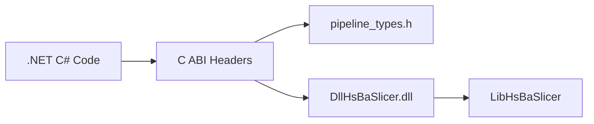

**Diagram sources**
- [fdm_pipeline.h:1-10](file://DllHsBaSlicer/fdm_pipeline.h#L1-L10)
- [pipeline_types.h:1-12](file://pipelinetypes/pipeline_types.h#L1-L12)
- [dll_export_readme.md:1-19](file://docs/en/DllHsBaSlicer/README.md#L1-L19)

**Section sources**
- [fdm_pipeline.h:1-10](file://DllHsBaSlicer/fdm_pipeline.h#L1-L10)
- [dll_export_readme.md:1-19](file://docs/en/DllHsBaSlicer/README.md#L1-L19)

## Performance Considerations
- Avoid unnecessary string allocations by reusing UTF-8 buffers when possible.
- Batch UI updates instead of updating on every progress callback.
- Use async pipeline execution to keep the UI responsive.
- Limit concurrent slicing jobs based on CPU and memory capacity.
- Reuse configuration objects where safe, but reset string fields carefully.

[No sources needed since this section provides general guidance]

## Troubleshooting Guide
Common issues and resolutions:

| Symptom | Likely Cause | Resolution |
|---|---|---|
| `DllNotFoundException` | Wrong platform folder or missing DLL | Place `DllHsBaSlicer.dll` in the correct location and verify platform settings. |
| Crash after callback | Delegate collected by GC | Store delegate in a static or member field. |
| Random crashes or wrong values | Struct layout mismatch | Mirror `pipeline_types.h` exactly. |
| Cannot find DLL at runtime | Missing runtime dependency | Add runtime dependency or place DLL beside executable. |
| iOS build/link failure | Static library requirement | Use static library and `DllImport("__Internal")`. |

**Section sources**
- [game_engine_integration.md:453-462](file://docs/en/DllHsBaSlicer/game_engine_integration.md#L453-L462)

## Conclusion
.NET interop with HsBaSlicer is centered on the stable C ABI exposed by DllHsBaSlicer. For C# applications, the essential steps are:

- Mirror the C structs from `pipeline_types.h`.
- Declare `DllImport` functions with `Cdecl`.
- Convert strings to UTF-8 `IntPtr`.
- Keep delegates alive.
- Marshal callbacks to the UI thread.
- Free native result strings through the provided free functions.

The Unity-style examples in the repository provide a reliable template for WPF and WinForms applications.

[No sources needed since this section summarizes without analyzing specific files]

## Appendices

### Appendix A: Minimal C# P/Invoke Checklist
- Call `initialize()` once.
- Use `HsBaCreateDefaultConfig`.
- Set model path and output path as UTF-8 `IntPtr`.
- Call `HsBaRunFdmPipelineAsync`.
- Marshal progress to UI thread.
- Copy result strings and call `HsBaFreePipelineResult`.

**Section sources**
- [game_engine_integration.md:137-181](file://docs/en/DllHsBaSlicer/game_engine_integration.md#L137-L181)
- [fdm_pipeline.h:17-61](file://DllHsBaSlicer/fdm_pipeline.h#L17-L61)

### Appendix B: Supported Pipeline Families
Beyond FDM, the same interop pattern applies to:

- SLA
- SLS
- SLM
- LOM
- 3DP
- WAAM
- File transfer
- Custom Lua pipeline
- Parameter store

Each family has its own config struct, default initializer, run function, async variant, and free function.

**Section sources**
- [dll_export_readme.md:188-471](file://docs/en/DllHsBaSlicer/README.md#L188-L471)