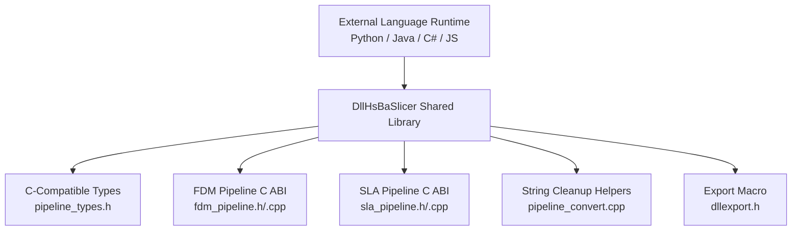
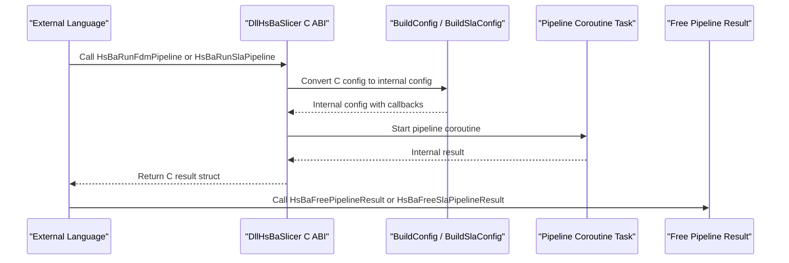
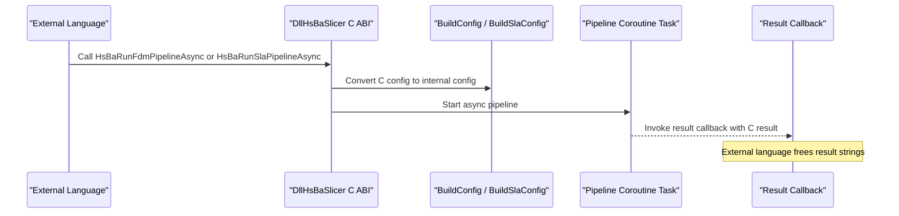
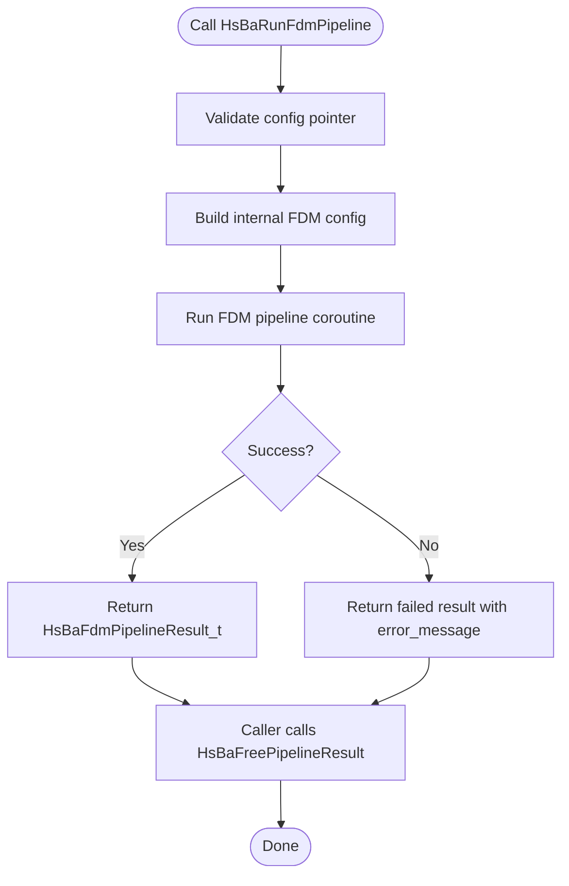
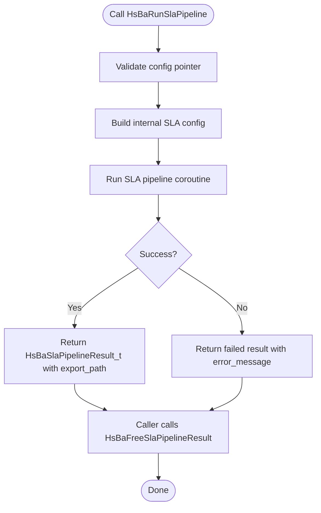
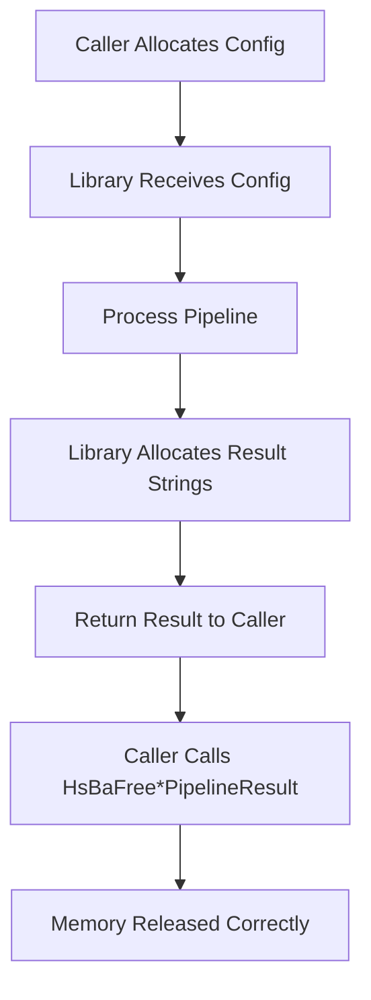
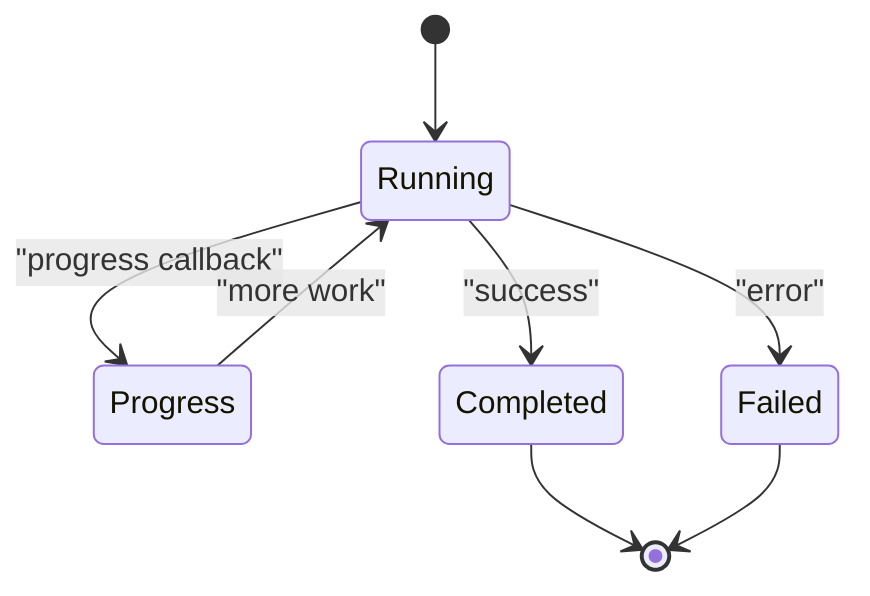
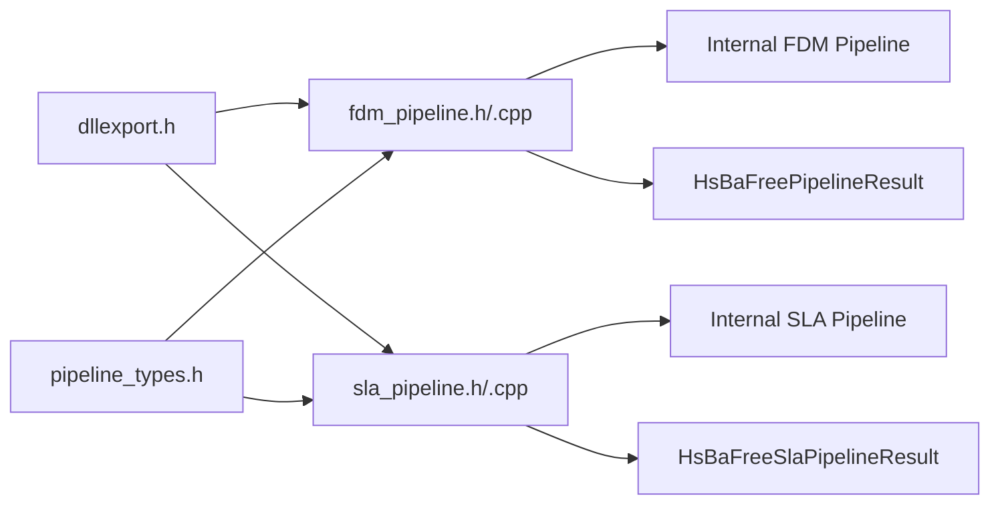

# Cross-Language Integration / 跨语言集成

<cite>
**Referenced Files in This Document**   
- [dllexport.h](file://DllHsBaSlicer/dllexport.h)
- [pipeline_types.h](file://pipelinetypes/pipeline_types.h)
- [fdm_pipeline.h](file://DllHsBaSlicer/fdm_pipeline.h)
- [fdm_pipeline.cpp](file://DllHsBaSlicer/fdm_pipeline.cpp)
- [sla_pipeline.h](file://DllHsBaSlicer/sla_pipeline.h)
- [sla_pipeline.cpp](file://DllHsBaSlicer/sla_pipeline.cpp)
- [pipeline_convert.cpp](file://DllHsBaSlicer/pipeline_convert.cpp)
- [README.md](file://docs/en/DllHsBaSlicer/README.md)
</cite>

## Table of Contents
1. [Introduction](#introduction)
2. [Project Structure](#project-structure)
3. [Core Components](#core-components)
4. [Architecture Overview](#architecture-overview)
5. [Detailed Component Analysis](#detailed-component-analysis)
6. [Dependency Analysis](#dependency-analysis)
7. [Performance Considerations](#performance-considerations)
8. [Troubleshooting Guide](#troubleshooting-guide)
9. [Conclusion](#conclusion)
10. [Appendices](#appendices)

## Introduction
This document explains how external languages can call the HsBaSlicer C ABI exposed by the `DllHsBaSlicer` shared library. It focuses on the stable C interface for FDM and SLA pipelines, including:

- Stable C ABI functions: `HsBaRunFdmPipeline`, `HsBaRunFdmPipelineAsync`, `HsBaFreePipelineResult`, `HsBaCreateDefaultConfig`, `HsBaRunSlaPipeline`, `HsBaRunSlaPipelineAsync`, `HsBaFreeSlaPipelineResult`, and `HsBaCreateDefaultSlaConfig`.
- Data types: pipeline configuration structs, result structs, progress/result callback function pointers, and enums.
- Marshaling rules between native C structures and language-specific types.
- Memory ownership across language boundaries.
- Error handling strategies using success flags, error messages, and elapsed time.
- Callback mechanisms for progress reporting and asynchronous completion.
- Platform considerations for Windows DLL import/export and non-Windows default visibility.
- Deployment guidance for Python (ctypes/pybind11), Java (JNI), C# (.NET interop), JavaScript (WebAssembly), and other languages.

The C ABI is intentionally POD-friendly: it uses plain structs, `const char*` strings, numeric primitives, and function pointers. This makes it suitable for cross-language integration through standard interop mechanisms.

**Section sources**
- [dllexport.h:1-23](file://DllHsBaSlicer/dllexport.h#L1-L23)
- [pipeline_types.h:1-18](file://pipelinetypes/pipeline_types.h#L1-L18)
- [fdm_pipeline.h:1-68](file://DllHsBaSlicer/fdm_pipeline.h#L1-L68)
- [sla_pipeline.h:1-63](file://DllHsBaSlicer/sla_pipeline.h#L1-L63)

## Project Structure
The cross-language surface lives primarily in three places:

| Area | Responsibility | Key Files |
|---|---|---|
| Export macro | Declares `HSBA_SLICER_API` for Windows DLL export/import and non-Windows default visibility | [dllexport.h](file://DllHsBaSlicer/dllexport.h) |
| C-compatible types | Defines all pipeline config/result structs, enums, and callback typedefs under `extern "C"` | [pipeline_types.h](file://pipelinetypes/pipeline_types.h) |
| FDM C ABI | Exposes FDM config creation, synchronous/asynchronous execution, and result freeing | [fdm_pipeline.h](file://DllHsBaSlicer/fdm_pipeline.h), [fdm_pipeline.cpp](file://DllHsBaSlicer/fdm_pipeline.cpp) |
| SLA C ABI | Exposes SLA config creation, synchronous/asynchronous execution, and result freeing | [sla_pipeline.h](file://DllHsBaSlicer/sla_pipeline.h), [sla_pipeline.cpp](file://DllHsBaSlicer/sla_pipeline.cpp) |
| String cleanup helpers | Provides helper functions to free string fields inside configs when needed | [pipeline_convert.cpp](file://DllHsBaSlicer/pipeline_convert.cpp) |

**Diagram sources**
- [dllexport.h:1-23](file://DllHsBaSlicer/dllexport.h#L1-L23)
- [pipeline_types.h:1-18](file://pipelinetypes/pipeline_types.h#L1-L18)
- [fdm_pipeline.h:1-68](file://DllHsBaSlicer/fdm_pipeline.h#L1-L68)
- [sla_pipeline.h:1-63](file://DllHsBaSlicer/sla_pipeline.h#L1-L63)
- [pipeline_convert.cpp:831-868](file://DllHsBaSlicer/pipeline_convert.cpp#L831-L868)

**Section sources**
- [dllexport.h:1-23](file://DllHsBaSlicer/dllexport.h#L1-L23)
- [pipeline_types.h:1-18](file://pipelinetypes/pipeline_types.h#L1-L18)
- [fdm_pipeline.h:1-68](file://DllHsBaSlicer/fdm_pipeline.h#L1-L68)
- [sla_pipeline.h:1-63](file://DllHsBaSlicer/sla_pipeline.h#L1-L63)
- [pipeline_convert.cpp:831-868](file://DllHsBaSlicer/pipeline_convert.cpp#L831-L868)

## Core Components
The core C ABI components are:

### Stable C Functions
| Function | Purpose | Return Type | Notes |
|---|---|---|---|
| `HsBaCreateDefaultConfig` | Create a default FDM pipeline configuration | `HsBaFdmPipelineConfig_t` | Use before setting model paths and slicing parameters |
| `HsBaRunFdmPipeline` | Run FDM pipeline synchronously | `HsBaFdmPipelineResult_t` | Blocks until complete; caller must free result |
| `HsBaRunFdmPipelineAsync` | Run FDM pipeline asynchronously | `void` | Completion delivered via `HsBaResultCallback` |
| `HsBaFreePipelineResult` | Free FDM result memory | `void` | Frees `gcode_content` and `error_message` |
| `HsBaCreateDefaultSlaConfig` | Create a default SLA pipeline configuration | `HsBaSlaPipelineConfig_t` | Use before setting model paths and exposure parameters |
| `HsBaRunSlaPipeline` | Run SLA pipeline synchronously | `HsBaSlaPipelineResult_t` | Blocks until complete; caller must free result |
| `HsBaRunSlaPipelineAsync` | Run SLA pipeline asynchronously | `void` | Completion delivered via `HsBaSlaResultCallback` |
| `HsBaFreeSlaPipelineResult` | Free SLA result memory | `void` | Frees `export_path` and `error_message` |

### Configuration and Result Structures
| Category | Struct | Meaning | Ownership Rule |
|---|---|---|---|
| FDM Config | `HsBaFdmPipelineConfig_t` | Model, slice, fill, support, path, G-code output, Lua customization, output path | Caller owns input strings unless created by library helpers |
| FDM Result | `HsBaFdmPipelineResult_t` | Success flag, layer count, G-code content, error message, elapsed time | Caller must call `HsBaFreePipelineResult` |
| SLA Config | `HsBaSlaPipelineConfig_t` | Model, slice, exposure, floor/raft, support, Lua customization, image format, output path | Caller owns input strings unless created by library helpers |
| SLA Result | `HsBaSlaPipelineResult_t` | Success flag, layer count, exported zip path, error message, elapsed time | Caller must call `HsBaFreeSlaPipelineResult` |

### Callback Types
| Callback | Parameters | Usage |
|---|---|---|
| `HsBaProgressCallback` | `percent`, `stage`, `user_data` | Progress updates during FDM pipeline |
| `HsBaResultCallback` | `result`, `user_data` | Asynchronous FDM completion |
| `HsBaSlaProgressCallback` | `percent`, `stage`, `user_data` | Progress updates during SLA pipeline |
| `HsBaSlaResultCallback` | `result`, `user_data` | Asynchronous SLA completion |

**Section sources**
- [fdm_pipeline.h:17-61](file://DllHsBaSlicer/fdm_pipeline.h#L17-L61)
- [sla_pipeline.h:17-56](file://DllHsBaSlicer/sla_pipeline.h#L17-L56)
- [pipeline_types.h:56-140](file://pipelinetypes/pipeline_types.h#L56-L140)
- [pipeline_types.h:170-245](file://pipelinetypes/pipeline_types.h#L170-L245)

## Architecture Overview
At runtime, an external language calls into `DllHsBaSlicer`. The C ABI layer converts the caller’s data into internal C++ pipeline configurations, executes the pipeline using coroutines, and returns results or invokes callbacks.

**Diagram sources**
- [fdm_pipeline.cpp:464-496](file://DllHsBaSlicer/fdm_pipeline.cpp#L464-L496)
- [sla_pipeline.cpp:496-531](file://DllHsBaSlicer/sla_pipeline.cpp#L496-L531)

For asynchronous execution, the flow adds a completion callback:

**Diagram sources**
- [fdm_pipeline.cpp:469-486](file://DllHsBaSlicer/fdm_pipeline.cpp#L469-L486)
- [sla_pipeline.cpp:505-521](file://DllHsBaSlicer/sla_pipeline.cpp#L505-L521)

**Section sources**
- [fdm_pipeline.cpp:464-496](file://DllHsBaSlicer/fdm_pipeline.cpp#L464-L496)
- [sla_pipeline.cpp:496-531](file://DllHsBaSlicer/sla_pipeline.cpp#L496-L531)

## Detailed Component Analysis

### FDM Pipeline C ABI
The FDM C ABI provides:

- Default configuration creation.
- Synchronous full-pipeline execution.
- Asynchronous full-pipeline execution.
- Result memory cleanup.

**Diagram sources**
- [fdm_pipeline.h:23-61](file://DllHsBaSlicer/fdm_pipeline.h#L23-L61)
- [fdm_pipeline.cpp:464-496](file://DllHsBaSlicer/fdm_pipeline.cpp#L464-L496)

Key implementation details:

- `HsBaRunFdmPipeline` builds an internal configuration, runs the pipeline coroutine, waits for the result, and converts it to a C result struct.
- `HsBaRunFdmPipelineAsync` heap-allocates the internal config so it remains valid during coroutine execution, then schedules a continuation that converts the internal result to a C result and invokes the user-provided result callback.
- `HsBaFreePipelineResult` safely frees `gcode_content` and `error_message` and clears them after freeing.

**Section sources**
- [fdm_pipeline.h:23-61](file://DllHsBaSlicer/fdm_pipeline.h#L23-L61)
- [fdm_pipeline.cpp:464-496](file://DllHsBaSlicer/fdm_pipeline.cpp#L464-L496)

### SLA Pipeline C ABI
The SLA C ABI mirrors the FDM pattern but targets stereolithography workflows:

- Default configuration creation.
- Synchronous full-pipeline execution.
- Asynchronous full-pipeline execution.
- Result memory cleanup.

**Diagram sources**
- [sla_pipeline.h:23-56](file://DllHsBaSlicer/sla_pipeline.h#L23-L56)
- [sla_pipeline.cpp:496-531](file://DllHsBaSlicer/sla_pipeline.cpp#L496-L531)

Key implementation details:

- `HsBaRunSlaPipeline` builds an internal SLA configuration, runs the SLA pipeline coroutine, waits for the result, and returns a C result containing the exported zip path.
- `HsBaRunSlaPipelineAsync` wraps the internal SLA config in a shared object for coroutine lifetime safety and invokes the result callback with a C result.
- `HsBaFreeSlaPipelineResult` frees `export_path` and `error_message`.

**Section sources**
- [sla_pipeline.h:23-56](file://DllHsBaSlicer/sla_pipeline.h#L23-L56)
- [sla_pipeline.cpp:496-531](file://DllHsBaSlicer/sla_pipeline.cpp#L496-L531)

### Data Type Marshaling Rules
The C ABI is designed for straightforward marshaling:

| C Type | Python ctypes | Java JNI | C# .NET Interop | JavaScript WebAssembly |
|---|---|---|---|---|
| `int` | `c_int` | `jint` | `int` | `i32` |
| `float` | `c_float` | `jfloat` | `float` | `f32` |
| `double` | `c_double` | `jdouble` | `double` | `f64` |
| `char*` | `c_char_p` | `jstring` / `jbyteArray` | `IntPtr` / `string` | `WASM_STRING` or byte buffer |
| `const char*` | `c_char_p` | `jstring` / `jbyteArray` | `IntPtr` / `string` | Read-only WASM string or buffer |
| Function pointer | `CFUNCTYPE` | Native method + JNI bridge | `Delegate` + P/Invoke | WASM function reference |
| Struct | `Structure` / `Union` | `struct` layout + `@StructDef` | `[StructLayout]` | WASM linear memory view |

Important marshaling notes:

- All string fields in configs and results use UTF-8 C strings.
- Input string fields (`model_name`, `model_path`, `output_path`, Lua script/function names) are owned by the caller unless the library creates them.
- Output string fields in results (`gcode_content`, `export_path`, `error_message`) are allocated by the library and must be freed using the corresponding `HsBaFree*PipelineResult` function.
- Enums map directly to integer values defined in `pipeline_types.h`.
- Callbacks must preserve calling convention compatibility with C; this matters especially for Python `ctypes`, Java JNI, and C# P/Invoke.

**Section sources**
- [pipeline_types.h:56-140](file://pipelinetypes/pipeline_types.h#L56-L140)
- [pipeline_types.h:170-245](file://pipelinetypes/pipeline_types.h#L170-L245)
- [pipeline_types.h:130-140](file://pipelinetypes/pipeline_types.h#L130-L140)
- [pipeline_types.h:234-245](file://pipelinetypes/pipeline_types.h#L234-L245)

### Memory Management Across Language Boundaries
Memory ownership follows a clear rule:

1. **Input configs**: The caller allocates and owns the configuration struct and its string fields.
2. **Output results**: The library allocates result string fields; the caller must free them using the provided free functions.
3. **Callbacks**: The library may invoke progress and result callbacks from internal threads; the callback must not assume long-lived references to C strings beyond the callback invocation.
4. **String cleanup helpers**: When the caller needs to free string fields inside configs (for example, when converting from higher-level objects), helper functions such as `HsBaFreeSlaConfigStrings` and similar functions exist in the conversion layer.

**Diagram sources**
- [fdm_pipeline.cpp:488-496](file://DllHsBaSlicer/fdm_pipeline.cpp#L488-L496)
- [sla_pipeline.cpp:523-531](file://DllHsBaSlicer/sla_pipeline.cpp#L523-L531)
- [pipeline_convert.cpp:831-868](file://DllHsBaSlicer/pipeline_convert.cpp#L831-L868)

**Section sources**
- [fdm_pipeline.cpp:488-496](file://DllHsBaSlicer/fdm_pipeline.cpp#L488-L496)
- [sla_pipeline.cpp:523-531](file://DllHsBaSlicer/sla_pipeline.cpp#L523-L531)
- [pipeline_convert.cpp:831-868](file://DllHsBaSlicer/pipeline_convert.cpp#L831-L868)

### Error Handling Strategies
Errors are reported through:

- `success`: Integer flag indicating whether the pipeline completed successfully.
- `error_message`: UTF-8 error string allocated by the library; must be freed by the caller.
- `elapsed_seconds`: Timing information useful for diagnostics.
- Callback exceptions: If a callback throws or crashes, behavior depends on the host runtime; callers should wrap callbacks in try/catch or equivalent error handling.

Recommended strategy:

1. Always check `success` before processing outputs.
2. Log or display `error_message` when `success` is false.
3. Always call the corresponding `HsBaFree*PipelineResult` function, even on failure.
4. For async callbacks, handle errors inside the callback and avoid blocking operations.

**Section sources**
- [pipeline_types.h:120-127](file://pipelinetypes/pipeline_types.h#L120-L127)
- [pipeline_types.h:225-232](file://pipelinetypes/pipeline_types.h#L225-L232)
- [fdm_pipeline.cpp:488-496](file://DllHsBaSlicer/fdm_pipeline.cpp#L488-L496)
- [sla_pipeline.cpp:523-531](file://DllHsBaSlicer/sla_pipeline.cpp#L523-L531)

### Callback Mechanisms for Progress Reporting
Both FDM and SLA pipelines support:

- A progress callback invoked during pipeline stages.
- An optional `user_data` pointer passed to the callback.
- Asynchronous result callbacks that deliver the final result.

**Diagram sources**
- [pipeline_types.h:130-140](file://pipelinetypes/pipeline_types.h#L130-L140)
- [pipeline_types.h:234-245](file://pipelinetypes/pipeline_types.h#L234-L245)

Best practices:

- Keep progress callbacks fast and non-blocking.
- Use `user_data` to pass application state such as UI handles or logging contexts.
- Do not assume the callback runs on the main thread.
- For async result callbacks, copy required data immediately if you need it after the callback returns.

**Section sources**
- [pipeline_types.h:130-140](file://pipelinetypes/pipeline_types.h#L130-L140)
- [pipeline_types.h:234-245](file://pipelinetypes/pipeline_types.h#L234-L245)

### Complete Cross-Language Examples

#### Python Example Using ctypes
Typical steps:

1. Load `DllHsBaSlicer.dll` (Windows) or the platform shared library.
2. Define `HsBaFdmPipelineConfig_t` or `HsBaSlaPipelineConfig_t` as `ctypes.Structure`.
3. Define callback types using `CFUNCTYPE`.
4. Create a default config, set model path and parameters.
5. Call `HsBaRunFdmPipeline` or `HsBaRunSlaPipeline`.
6. Check `success`, read output, log `error_message`.
7. Call `HsBaFreePipelineResult` or `HsBaFreeSlaPipelineResult`.

Reference implementation patterns:

- Struct definitions and defaults: [pipeline_types.h:56-140](file://pipelinetypes/pipeline_types.h#L56-L140), [pipeline_types.h:170-245](file://pipelinetypes/pipeline_types.h#L170-L245).
- FDM entry points: [fdm_pipeline.h:21-61](file://DllHsBaSlicer/fdm_pipeline.h#L21-L61).
- SLA entry points: [sla_pipeline.h:21-56](file://DllHsBaSlicer/sla_pipeline.h#L21-L56).

#### Python Example Using pybind11
If embedding HsBaSlicer directly rather than loading the DLL:

1. Bind the C ABI functions using `pybind11::module_::def`.
2. Expose config structs as Python classes or dictionaries.
3. Wrap callbacks using `pybind11::callback`.
4. Manage memory by calling the free functions from Python.

Reference implementation patterns:

- C ABI signatures: [fdm_pipeline.h:21-61](file://DllHsBaSlicer/fdm_pipeline.h#L21-L61), [sla_pipeline.h:21-56](file://DllHsBaSlicer/sla_pipeline.h#L21-L56).
- Callback typedefs: [pipeline_types.h:130-140](file://pipelinetypes/pipeline_types.h#L130-L140), [pipeline_types.h:234-245](file://pipelinetypes/pipeline_types.h#L234-L245).

#### Java Example Using JNI
Typical steps:

1. Declare native methods in a Java class.
2. Generate JNI headers and implement native functions in C/C++.
3. Map Java strings to `jstring` or `jbyteArray` and convert to UTF-8 C strings.
4. Map result strings back to Java strings.
5. Ensure the JVM keeps the loaded library alive during execution.
6. Free result strings through the C free functions.

Reference implementation patterns:

- C ABI signatures: [fdm_pipeline.h:21-61](file://DllHsBaSlicer/fdm_pipeline.h#L21-L61), [sla_pipeline.h:21-56](file://DllHsBaSlicer/sla_pipeline.h#L21-L56).
- String cleanup helpers: [pipeline_convert.cpp:831-868](file://DllHsBaSlicer/pipeline_convert.cpp#L831-L868).

#### C# Example Using .NET Interop
Typical steps:

1. Define `[StructLayout(LayoutKind.Sequential)]` structs matching the C layouts.
2. Define delegate types for callbacks with correct calling conventions.
3. Use `DllImport` to load `DllHsBaSlicer`.
4. Marshal `string` to `IntPtr` or use `MarshalAs(UnmanagedType.LPStr)` for UTF-8.
5. After receiving results, marshal strings and call the free functions.

Reference implementation patterns:

- C ABI signatures: [fdm_pipeline.h:21-61](file://DllHsBaSlicer/fdm_pipeline.h#L21-L61), [sla_pipeline.h:21-56](file://DllHsBaSlicer/sla_pipeline.h#L21-L56).
- Memory management: [fdm_pipeline.cpp:488-496](file://DllHsBaSlicer/fdm_pipeline.cpp#L488-L496), [sla_pipeline.cpp:523-531](file://DllHsBaSlicer/sla_pipeline.cpp#L523-L531).

#### JavaScript Example Using WebAssembly
Typical steps:

1. Compile HsBaSlicer to WebAssembly or provide a thin C wrapper compiled to WASM.
2. Use Emscripten or a WASM runtime to allocate linear memory for structs and strings.
3. Pass UTF-8 encoded strings as pointers into WASM memory.
4. Handle callbacks as WASM function references.
5. Free result strings using the exported free functions.

Reference implementation patterns:

- C ABI signatures: [fdm_pipeline.h:21-61](file://DllHsBaSlicer/fdm_pipeline.h#L21-L61), [sla_pipeline.h:21-56](file://DllHsBaSlicer/sla_pipeline.h#L21-L56).
- Memory management: [fdm_pipeline.cpp:488-496](file://DllHsBaSlicer/fdm_pipeline.cpp#L488-L496), [sla_pipeline.cpp:523-531](file://DllHsBaSlicer/sla_pipeline.cpp#L523-L531).

**Section sources**
- [pipeline_types.h:56-140](file://pipelinetypes/pipeline_types.h#L56-L140)
- [pipeline_types.h:170-245](file://pipelinetypes/pipeline_types.h#L170-L245)
- [fdm_pipeline.h:21-61](file://DllHsBaSlicer/fdm_pipeline.h#L21-L61)
- [sla_pipeline.h:21-56](file://DllHsBaSlicer/sla_pipeline.h#L21-L56)
- [fdm_pipeline.cpp:488-496](file://DllHsBaSlicer/fdm_pipeline.cpp#L488-L496)
- [sla_pipeline.cpp:523-531](file://DllHsBaSlicer/sla_pipeline.cpp#L523-L531)
- [pipeline_convert.cpp:831-868](file://DllHsBaSlicer/pipeline_convert.cpp#L831-L868)

### Platform-Specific Considerations

#### Windows
- The library uses `__declspec(dllexport)` when building and `__declspec(dllimport)` when consuming.
- Consumers must ensure the DLL is available at runtime.
- Calling convention defaults to C ABI; explicit `__cdecl` is implied by `extern "C"`.

#### Non-Windows
- `HSBA_SLICER_API` expands to no annotation, relying on default symbol visibility.
- Consumers must link against the shared library and ensure the runtime loader can find it.

**Section sources**
- [dllexport.h:9-20](file://DllHsBaSlicer/dllexport.h#L9-L20)

### Runtime Dependencies and Deployment Strategies

#### General Deployment
- Distribute `DllHsBaSlicer` as a shared library alongside your application.
- Ensure the target architecture matches the consumer (x86 vs x64 vs ARM64).
- Place dependent libraries according to your platform’s dynamic linker rules.

#### Python
- Use `ctypes.CDLL` or `ctypes.PyDLL` to load the library.
- Set `PATH` or library search paths so the runtime can find dependencies.
- For pybind11, embed the library or build a Python extension that links against HsBaSlicer.

#### Java
- Use `System.loadLibrary` or `System.load` to load the native library.
- On Android, place native libraries under `jniLibs` per ABI.
- Ensure the JVM process has permission to access model files and output directories.

#### C#
- Use `DllImport` with the correct platform name.
- On Windows, place the DLL next to the executable or in a known location.
- On Linux/macOS, ensure the `.so`/`.dylib` is discoverable via `LD_LIBRARY_PATH` or equivalent.

#### JavaScript/WebAssembly
- Compile the C ABI to WASM using Emscripten or a compatible toolchain.
- Provide file system emulation if models or outputs are accessed through paths.
- Manage memory carefully because WASM linear memory is bounded.

**Section sources**
- [dllexport.h:9-20](file://DllHsBaSlicer/dllexport.h#L9-L20)
- [README.md](file://docs/en/DllHsBaSlicer/README.md)

## Dependency Analysis
The C ABI depends on:

- Export macros for symbol visibility.
- C-compatible type definitions.
- Internal pipeline builders that convert C configs to C++ internal configs.
- Coroutine-based pipeline execution.
- Result converters that produce C structs.

**Diagram sources**
- [dllexport.h:1-23](file://DllHsBaSlicer/dllexport.h#L1-L23)
- [pipeline_types.h:1-18](file://pipelinetypes/pipeline_types.h#L1-L18)
- [fdm_pipeline.h:1-68](file://DllHsBaSlicer/fdm_pipeline.h#L1-L68)
- [sla_pipeline.h:1-63](file://DllHsBaSlicer/sla_pipeline.h#L1-L63)

**Section sources**
- [dllexport.h:1-23](file://DllHsBaSlicer/dllexport.h#L1-L23)
- [pipeline_types.h:1-18](file://pipelinetypes/pipeline_types.h#L1-L18)
- [fdm_pipeline.h:1-68](file://DllHsBaSlicer/fdm_pipeline.h#L1-L68)
- [sla_pipeline.h:1-63](file://DllHsBaSlicer/sla_pipeline.h#L1-L63)

## Performance Considerations
- Synchronous calls block the calling thread until the pipeline completes.
- Asynchronous calls use C++20 coroutines internally and return control immediately.
- Progress callbacks should be lightweight; avoid heavy I/O or blocking operations.
- Large G-code content or exported ZIP files can consume significant memory; process or stream results where possible.
- Reusing configurations and callbacks reduces allocation overhead.
- Avoid passing large string buffers repeatedly; prefer file paths when supported.

[No sources needed since this section provides general guidance]

## Troubleshooting Guide
Common issues and resolutions:

| Symptom | Likely Cause | Resolution |
|---|---|---|
| Crash after returning from pipeline | Missing `HsBaFree*PipelineResult` call | Always free result strings |
| Garbage characters in output | Encoding mismatch | Ensure UTF-8 strings across language boundary |
| Null pointer in callback | Invalid `user_data` or callback signature | Validate callback and user data |
| DLL not found | Missing runtime dependency | Install or deploy the shared library correctly |
| Wrong architecture crash | 32-bit vs 64-bit mismatch | Match consumer and library architectures |
| Async result never received | Event loop or callback not processed | Ensure the host runtime processes async completions |

**Section sources**
- [fdm_pipeline.cpp:488-496](file://DllHsBaSlicer/fdm_pipeline.cpp#L488-L496)
- [sla_pipeline.cpp:523-531](file://DllHsBaSlicer/sla_pipeline.cpp#L523-L531)
- [dllexport.h:9-20](file://DllHsBaSlicer/dllexport.h#L9-L20)

## Conclusion
The HsBaSlicer C ABI provides a stable, cross-language interface for FDM and SLA slicing pipelines. By following the documented marshaling rules, memory ownership contracts, and callback conventions, integrators can reliably call HsBaSlicer from Python, Java, C#, JavaScript, and other languages. The most important responsibilities for consumers are:

- Construct valid configuration structs.
- Pass UTF-8 strings correctly.
- Handle progress and result callbacks safely.
- Always free result memory using the provided free functions.
- Deploy the shared library and its dependencies for the target platform.

[No sources needed since this section summarizes without analyzing specific files]

## Appendices

### API Reference Summary

#### FDM Functions
| Function | Description |
|---|---|
| `HsBaCreateDefaultConfig` | Returns a default FDM configuration |
| `HsBaRunFdmPipeline` | Runs FDM pipeline synchronously |
| `HsBaRunFdmPipelineAsync` | Runs FDM pipeline asynchronously |
| `HsBaFreePipelineResult` | Frees FDM result memory |

#### SLA Functions
| Function | Description |
|---|---|
| `HsBaCreateDefaultSlaConfig` | Returns a default SLA configuration |
| `HsBaRunSlaPipeline` | Runs SLA pipeline synchronously |
| `HsBaRunSlaPipelineAsync` | Runs SLA pipeline asynchronously |
| `HsBaFreeSlaPipelineResult` | Frees SLA result memory |

**Section sources**
- [fdm_pipeline.h:21-61](file://DllHsBaSlicer/fdm_pipeline.h#L21-L61)
- [sla_pipeline.h:21-56](file://DllHsBaSlicer/sla_pipeline.h#L21-L56)