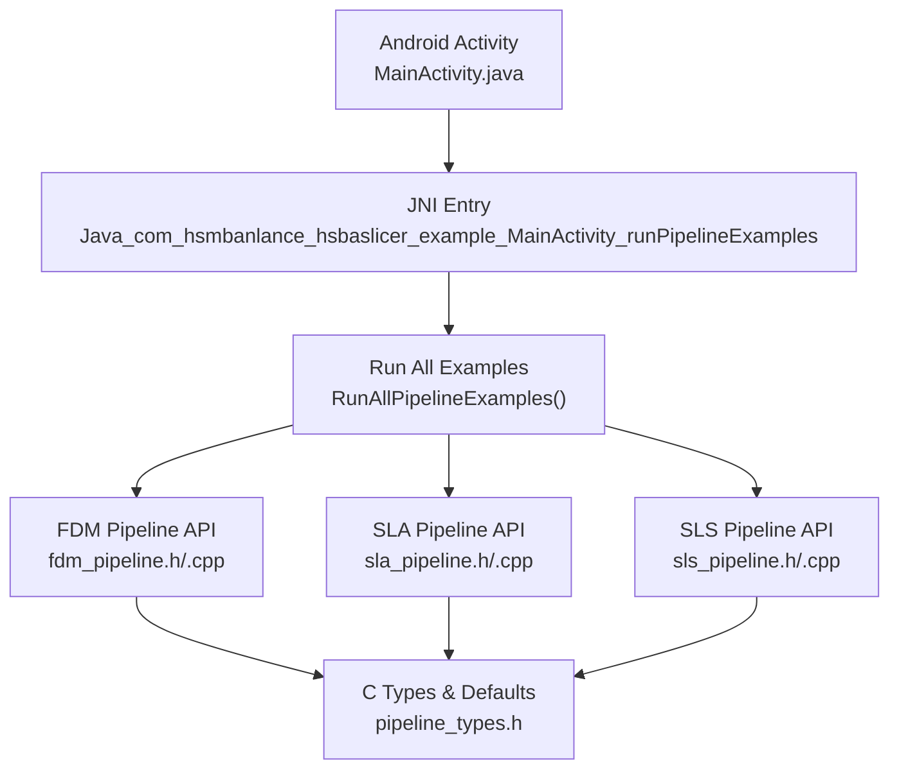
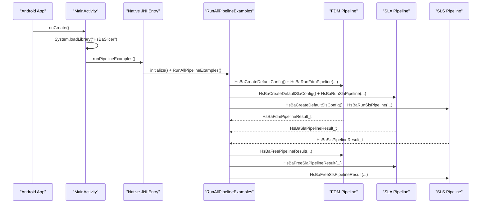
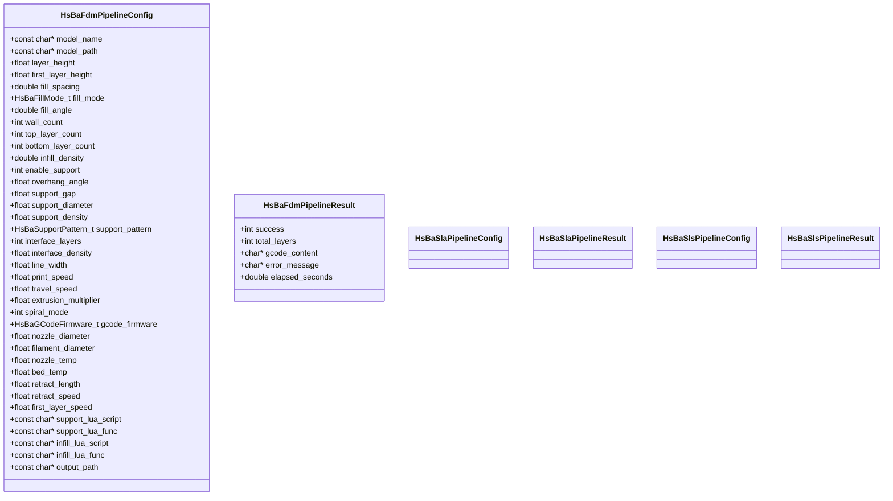
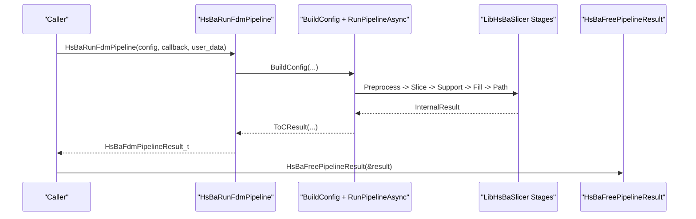
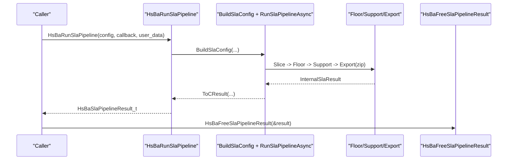
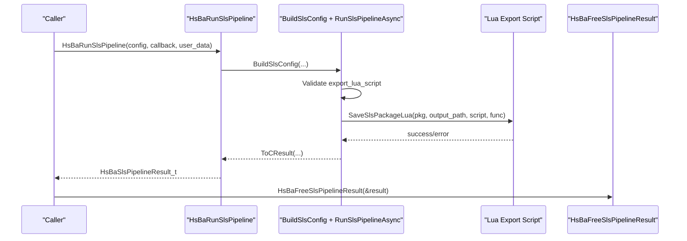
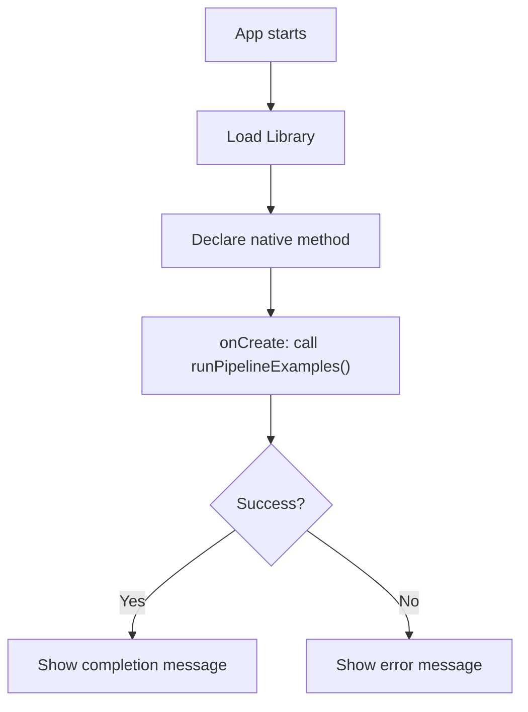
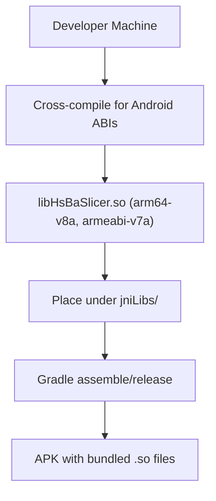
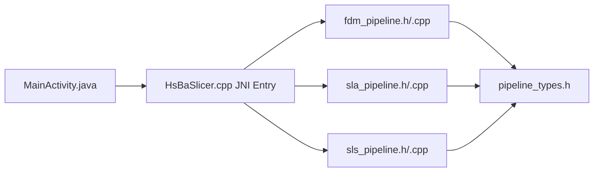

# Java JNI Integration / Java JNI集成

<cite>
**Referenced Files in This Document**
- [MainActivity.java](file://android/app/src/main/java/com/hsmbanlance/hsbaslicer/example/MainActivity.java)
- [HsBaSlicer.cpp](file://HsBaSlicer/HsBaSlicer.cpp)
- [fdm_pipeline.h](file://DllHsBaSlicer/fdm_pipeline.h)
- [sla_pipeline.h](file://DllHsBaSlicer/sla_pipeline.h)
- [sls_pipeline.h](file://DllHsBaSlicer/sls_pipeline.h)
- [pipeline_types.h](file://pipelinetypes/pipeline_types.h)
- [fdm_pipeline.cpp](file://DllHsBaSlicer/fdm_pipeline.cpp)
- [sla_pipeline.cpp](file://DllHsBaSlicer/sla_pipeline.cpp)
- [sls_pipeline.cpp](file://DllHsBaSlicer/sls_pipeline.cpp)
- [build.gradle](file://android/app/build.gradle)
</cite>

## Table of Contents
1. [Introduction](#introduction)
2. [Project Structure](#project-structure)
3. [Core Components](#core-components)
4. [Architecture Overview](#architecture-overview)
5. [Detailed Component Analysis](#detailed-component-analysis)
6. [Dependency Analysis](#dependency-analysis)
7. [Performance Considerations](#performance-considerations)
8. [Troubleshooting Guide](#troubleshooting-guide)
9. [Conclusion](#conclusion)
10. [Appendices](#appendices)

## Introduction
This document explains how HsBaSlicer integrates with Android through Java JNI. It covers the Java entry point, the native C ABI for FDM/SLA/SLS pipelines, data type mapping between Java and C, memory management and garbage collection considerations, build and packaging steps for Android ABIs, and troubleshooting guidance for common JNI issues. The goal is to help you load models, configure slicing parameters, execute pipelines synchronously or asynchronously, and handle results safely on Android.

## Project Structure
The Android integration consists of:
- A Java Activity that loads the native library and invokes a JNI method.
- A C++ shared library entry that exposes an Android JNI function and delegates to pipeline examples.
- Stable C ABI headers defining configuration/result structs and run/free functions for FDM, SLA, and SLS.
- Gradle configuration pointing to prebuilt native libraries under jniLibs.



**Diagram sources**
- [MainActivity.java:17-27](file://android/app/src/main/java/com/hsmbanlance/hsbaslicer/example/MainActivity.java#L17-L27)
- [HsBaSlicer.cpp:230-240](file://HsBaSlicer/HsBaSlicer.cpp#L230-L240)
- [fdm_pipeline.h:21-61](file://DllHsBaSlicer/fdm_pipeline.h#L21-L61)
- [sla_pipeline.h:21-56](file://DllHsBaSlicer/sla_pipeline.h#L21-L56)
- [sls_pipeline.h:21-56](file://DllHsBaSlicer/sls_pipeline.h#L21-L56)
- [pipeline_types.h:56-127](file://pipelinetypes/pipeline_types.h#L56-L127)

**Section sources**
- [MainActivity.java:1-46](file://android/app/src/main/java/com/hsmbanlance/hsbaslicer/example/MainActivity.java#L1-L46)
- [HsBaSlicer.cpp:1-305](file://HsBaSlicer/HsBaSlicer.cpp#L1-L305)
- [build.gradle:1-37](file://android/app/build.gradle#L1-L37)

## Core Components
- Java side: MainActivity declares a native method and loads the native library.
- JNI side: HsBaSlicer.cpp exports a JNI function named according to Java naming conventions and calls the example runner.
- C ABI side: fdm_pipeline.h, sla_pipeline.h, sls_pipeline.h define stable APIs for creating default configs, running pipelines synchronously/asynchronously, and freeing results.
- Data model: pipeline_types.h defines all C-compatible structs and enums used by the APIs.

Key responsibilities:
- Java: UI thread setup, library loading, invoking JNI.
- JNI: Initialize subsystems and call into pipeline examples.
- C ABI: Convert Java-friendly inputs (strings, numbers) into internal C++ types, run pipelines, return results with owned strings.
- Memory: Owned char* fields must be freed via provided free functions.

**Section sources**
- [MainActivity.java:17-27](file://android/app/src/main/java/com/hsmbanlance/hsbaslicer/example/MainActivity.java#L17-L27)
- [HsBaSlicer.cpp:230-240](file://HsBaSlicer/HsBaSlicer.cpp#L230-L240)
- [fdm_pipeline.h:21-61](file://DllHsBaSlicer/fdm_pipeline.h#L21-L61)
- [sla_pipeline.h:21-56](file://DllHsBaSlicer/sla_pipeline.h#L21-L56)
- [sls_pipeline.h:21-56](file://DllHsBaSlicer/sls_pipeline.h#L21-L56)
- [pipeline_types.h:56-127](file://pipelinetypes/pipeline_types.h#L56-L127)

## Architecture Overview
The runtime flow from Android to native pipelines is:



**Diagram sources**
- [MainActivity.java:17-27](file://android/app/src/main/java/com/hsmbanlance/hsbaslicer/example/MainActivity.java#L17-L27)
- [HsBaSlicer.cpp:230-240](file://HsBaSlicer/HsBaSlicer.cpp#L230-L240)
- [fdm_pipeline.h:21-61](file://DllHsBaSlicer/fdm_pipeline.h#L21-L61)
- [sla_pipeline.h:21-56](file://DllHsBaSlicer/sla_pipeline.h#L21-L56)
- [sls_pipeline.h:21-56](file://DllHsBaSlicer/sls_pipeline.h#L21-L56)

## Detailed Component Analysis

### Java JNI Entry Point
- MainActivity loads the native library and declares a native method.
- The native method name follows JNI naming rules and maps to the exported C function in HsBaSlicer.cpp.

```mermaid
flowchart TD
Start(["onCreate"]) --> LoadLib["System.loadLibrary(\"HsBaSlicer\")"]
LoadLib --> CallJNI["runPipelineExamples()"]
CallJNI --> Native["Java_com_hsmbanlance_hsbaslicer_example_MainActivity_runPipelineExamples"]
Native --> Done(["Return to Java"])
```

**Diagram sources**
- [MainActivity.java:17-27](file://android/app/src/main/java/com/hsmbanlance/hsbaslicer/example/MainActivity.java#L17-L27)
- [HsBaSlicer.cpp:230-240](file://HsBaSlicer/HsBaSlicer.cpp#L230-L240)

**Section sources**
- [MainActivity.java:17-27](file://android/app/src/main/java/com/hsmbanlance/hsbaslicer/example/MainActivity.java#L17-L27)
- [HsBaSlicer.cpp:230-240](file://HsBaSlicer/HsBaSlicer.cpp#L230-L240)

### C ABI: Configuration and Result Types
All pipeline configurations and results are defined as C-compatible structs and enums. Strings are UTF-8 char pointers; callers own allocated string buffers returned in result structs and must free them using the provided free functions.



**Diagram sources**
- [pipeline_types.h:56-127](file://pipelinetypes/pipeline_types.h#L56-L127)
- [pipeline_types.h:170-232](file://pipelinetypes/pipeline_types.h#L170-L232)
- [pipeline_types.h:259-297](file://pipelinetypes/pipeline_types.h#L259-L297)

**Section sources**
- [pipeline_types.h:56-127](file://pipelinetypes/pipeline_types.h#L56-L127)
- [pipeline_types.h:170-232](file://pipelinetypes/pipeline_types.h#L170-L232)
- [pipeline_types.h:259-297](file://pipelinetypes/pipeline_types.h#L259-L297)

### FDM Pipeline API and Implementation
- API surface: create default config, run sync/async, free result.
- Implementation builds internal C++ config, runs a coroutine-based pipeline, and returns a C struct with owned strings.



**Diagram sources**
- [fdm_pipeline.h:21-61](file://DllHsBaSlicer/fdm_pipeline.h#L21-L61)
- [fdm_pipeline.cpp:455-496](file://DllHsBaSlicer/fdm_pipeline.cpp#L455-L496)

**Section sources**
- [fdm_pipeline.h:21-61](file://DllHsBaSlicer/fdm_pipeline.h#L21-L61)
- [fdm_pipeline.cpp:142-211](file://DllHsBaSlicer/fdm_pipeline.cpp#L142-L211)
- [fdm_pipeline.cpp:220-447](file://DllHsBaSlicer/fdm_pipeline.cpp#L220-L447)
- [fdm_pipeline.cpp:455-496](file://DllHsBaSlicer/fdm_pipeline.cpp#L455-L496)

### SLA Pipeline API and Implementation
- API surface: create default config, run sync/async, free result.
- Implementation generates floor/raft, supports, and exports a package (zip) optionally driven by Lua.



**Diagram sources**
- [sla_pipeline.h:21-56](file://DllHsBaSlicer/sla_pipeline.h#L21-L56)
- [sla_pipeline.cpp:491-531](file://DllHsBaSlicer/sla_pipeline.cpp#L491-L531)

**Section sources**
- [sla_pipeline.h:21-56](file://DllHsBaSlicer/sla_pipeline.h#L21-L56)
- [sla_pipeline.cpp:244-296](file://DllHsBaSlicer/sla_pipeline.cpp#L244-L296)
- [sla_pipeline.cpp:299-483](file://DllHsBaSlicer/sla_pipeline.cpp#L299-L483)
- [sla_pipeline.cpp:491-531](file://DllHsBaSlicer/sla_pipeline.cpp#L491-L531)

### SLS Pipeline API and Implementation
- API surface: create default config, run sync/async, free result.
- Implementation requires a Lua export script; it slices layers and delegates final packaging to Lua.



**Diagram sources**
- [sls_pipeline.h:21-56](file://DllHsBaSlicer/sls_pipeline.h#L21-L56)
- [sls_pipeline.cpp:304-344](file://DllHsBaSlicer/sls_pipeline.cpp#L304-L344)

**Section sources**
- [sls_pipeline.h:21-56](file://DllHsBaSlicer/sls_pipeline.h#L21-L56)
- [sls_pipeline.cpp:147-179](file://DllHsBaSlicer/sls_pipeline.cpp#L147-L179)
- [sls_pipeline.cpp:182-296](file://DllHsBaSlicer/sls_pipeline.cpp#L182-L296)
- [sls_pipeline.cpp:304-344](file://DllHsBaSlicer/sls_pipeline.cpp#L304-L344)

### Data Type Mapping Between Java and C
- Java primitives map directly to C scalars:
  - int -> int
  - float/double -> float/double
- Java String maps to const char* UTF-8 in C structs.
- Java arrays/maps are not present in the current JNI entry; instead, configuration uses simple scalar fields and optional file paths. If you extend the API to pass arrays, use:
  - jobjectArray -> C array via GetObjectArrayElement + GetStringUTFChars
  - ReleaseStringUTFChars after use
  - For numeric arrays, use GetFloatArrayElements/GetIntArrayElements with proper release semantics
- Complex objects should be flattened into primitive fields or serialized to JSON and passed via a single const char* field.

Memory ownership rules:
- Input strings (model_name, model_path, output_path, Lua scripts): caller owns and must remain valid during the call.
- Output strings (gcode_content, export_path, error_message): callee allocates with malloc; caller must free via the corresponding free function.

**Section sources**
- [pipeline_types.h:56-127](file://pipelinetypes/pipeline_types.h#L56-L127)
- [pipeline_types.h:170-232](file://pipelinetypes/pipeline_types.h#L170-L232)
- [pipeline_types.h:259-297](file://pipelinetypes/pipeline_types.h#L259-L297)
- [fdm_pipeline.cpp:488-496](file://DllHsBaSlicer/fdm_pipeline.cpp#L488-L496)
- [sla_pipeline.cpp:523-531](file://DllHsBaSlicer/sla_pipeline.cpp#L523-L531)
- [sls_pipeline.cpp:336-344](file://DllHsBaSlicer/sls_pipeline.cpp#L336-L344)

### JNI Memory Management and Garbage Collection
- Avoid holding long-lived references to Java objects across native calls unless necessary.
- Do not cache global JNIEnv*; obtain it per-call if needed.
- Use local references for temporary Java objects; delete them when done if you hold many in loops.
- Never return raw Java object references to C/C++. Return plain C types or allocate new C-owned buffers.
- Always pair each allocation made by the native side with its free function.

Best practices:
- Wrap native calls in try/catch at the Java boundary to avoid crashes leaking into the JVM.
- On Android, perform heavy work off the UI thread; the example currently calls the pipeline on the UI thread for simplicity.

**Section sources**
- [MainActivity.java:37-43](file://android/app/src/main/java/com/hsmbanlance/hsbaslicer/example/MainActivity.java#L37-L43)
- [fdm_pipeline.cpp:488-496](file://DllHsBaSlicer/fdm_pipeline.cpp#L488-L496)
- [sla_pipeline.cpp:523-531](file://DllHsBaSlicer/sla_pipeline.cpp#L523-L531)
- [sls_pipeline.cpp:336-344](file://DllHsBaSlicer/sls_pipeline.cpp#L336-L344)

### Android Application Integration Example
End-to-end usage within an Android Activity:
- Load the native library once in a static block.
- Declare the native method matching the JNI symbol.
- In onCreate, invoke the method; wrap in try/catch to display errors.
- For production, move pipeline execution to a background thread and post progress/results back to the UI thread.



**Diagram sources**
- [MainActivity.java:17-43](file://android/app/src/main/java/com/hsmbanlance/hsbaslicer/example/MainActivity.java#L17-L43)

**Section sources**
- [MainActivity.java:17-43](file://android/app/src/main/java/com/hsmbanlance/hsbaslicer/example/MainActivity.java#L17-L43)

### Build Process for JNI Bindings and Android Packaging
- The Android app expects prebuilt native libraries under src/main/jniLibs.
- Gradle configuration sets compile/target SDK, application ID, and abiFilters for arm64-v8a.
- To cross-compile for Android targets:
  - Configure your NDK toolchain for arm64-v8a and armeabi-v7a.
  - Build the shared library targeting Android (e.g., via CMake presets or NDK commands).
  - Place the resulting .so files under android/app/src/main/jniLibs/<abi>/libHsBaSlicer.so.
  - Ensure abiFilters include both arm64-v8a and armeabi-v7a if you want both ABIs packaged.
- APK packaging:
  - Build the Android app with Gradle; Gradle will bundle the jniLibs into the APK.
  - Verify the .so files are included in the generated APK.



**Diagram sources**
- [build.gradle:24-33](file://android/app/build.gradle#L24-L33)

**Section sources**
- [build.gradle:1-37](file://android/app/build.gradle#L1-L37)

## Dependency Analysis
The JNI bridge depends on:
- Java Activity for UI and library loading.
- Native entrypoint exporting a JNI function.
- Stable C ABI headers for pipeline operations.
- C++ implementations that orchestrate preprocessing, slicing, support, fill, path generation, and export.



**Diagram sources**
- [MainActivity.java:17-27](file://android/app/src/main/java/com/hsmbanlance/hsbaslicer/example/MainActivity.java#L17-L27)
- [HsBaSlicer.cpp:230-240](file://HsBaSlicer/HsBaSlicer.cpp#L230-L240)
- [fdm_pipeline.h:21-61](file://DllHsBaSlicer/fdm_pipeline.h#L21-L61)
- [sla_pipeline.h:21-56](file://DllHsBaSlicer/sla_pipeline.h#L21-L56)
- [sls_pipeline.h:21-56](file://DllHsBaSlicer/sls_pipeline.h#L21-L56)
- [pipeline_types.h:56-127](file://pipelinetypes/pipeline_types.h#L56-L127)

**Section sources**
- [MainActivity.java:17-27](file://android/app/src/main/java/com/hsmbanlance/hsbaslicer/example/MainActivity.java#L17-L27)
- [HsBaSlicer.cpp:230-240](file://HsBaSlicer/HsBaSlicer.cpp#L230-L240)
- [fdm_pipeline.h:21-61](file://DllHsBaSlicer/fdm_pipeline.h#L21-L61)
- [sla_pipeline.h:21-56](file://DllHsBaSlicer/sla_pipeline.h#L21-L56)
- [sls_pipeline.h:21-56](file://DllHsBaSlicer/sls_pipeline.h#L21-L56)
- [pipeline_types.h:56-127](file://pipelinetypes/pipeline_types.h#L56-L127)

## Performance Considerations
- Prefer asynchronous pipeline calls when integrating with responsive UIs; process callbacks on appropriate threads.
- Reuse configuration objects where possible to reduce allocations.
- Avoid unnecessary string copies; pass const char* paths directly.
- Parallelization is already used internally for slicing and filling; keep input data immutable during processing.
- On mobile devices, tune layer height, wall count, and infill density to balance quality and performance.

[No sources needed since this section provides general guidance]

## Troubleshooting Guide
Common issues and resolutions:
- UnsatisfiedLinkError:
  - Cause: Missing or mismatched .so ABI.
  - Fix: Ensure libHsBaSlicer.so exists under jniLibs/arm64-v8a and/or armeabi-v7a and matches the device ABI.
- SIGSEGV or crash on string access:
  - Cause: Using freed or invalid char* buffers.
  - Fix: Only read result strings before calling the corresponding free function; do not reuse after free.
- Memory leaks:
  - Cause: Not calling HsBaFreePipelineResult/HsBaFreeSlaPipelineResult/HsBaFreeSlsPipelineResult.
  - Fix: Always free results after use.
- Threading issues:
  - Cause: Long-running pipeline blocking UI thread.
  - Fix: Move pipeline execution to background threads; update UI via handlers or coroutines.
- Lua script errors (SLS/SLA):
  - Cause: Missing or invalid export Lua script/function.
  - Fix: Provide correct export_lua_script and export_lua_func; validate paths before calling.

**Section sources**
- [fdm_pipeline.cpp:488-496](file://DllHsBaSlicer/fdm_pipeline.cpp#L488-L496)
- [sla_pipeline.cpp:523-531](file://DllHsBaSlicer/sla_pipeline.cpp#L523-L531)
- [sls_pipeline.cpp:336-344](file://DllHsBaSlicer/sls_pipeline.cpp#L336-L344)
- [MainActivity.java:37-43](file://android/app/src/main/java/com/hsmbanlance/hsbaslicer/example/MainActivity.java#L37-L43)

## Conclusion
HsBaSlicer’s Android integration is straightforward: a small Java entry point loads the native library and invokes a JNI function that delegates to stable C ABI pipeline APIs. The C ABI uses plain structs and UTF-8 strings with explicit ownership semantics, making it safe and efficient for Android. By following the memory management rules, building for the correct ABIs, and moving heavy work off the UI thread, you can integrate robust slicing pipelines into Android applications.

[No sources needed since this section summarizes without analyzing specific files]

## Appendices

### API Quick Reference
- FDM:
  - Create default config: HsBaCreateDefaultConfig
  - Run sync: HsBaRunFdmPipeline
  - Run async: HsBaRunFdmPipelineAsync
  - Free result: HsBaFreePipelineResult
- SLA:
  - Create default config: HsBaCreateDefaultSlaConfig
  - Run sync: HsBaRunSlaPipeline
  - Run async: HsBaRunSlaPipelineAsync
  - Free result: HsBaFreeSlaPipelineResult
- SLS:
  - Create default config: HsBaCreateDefaultSlsConfig
  - Run sync: HsBaRunSlsPipeline
  - Run async: HsBaRunSlsPipelineAsync
  - Free result: HsBaFreeSlsPipelineResult

**Section sources**
- [fdm_pipeline.h:21-61](file://DllHsBaSlicer/fdm_pipeline.h#L21-L61)
- [sla_pipeline.h:21-56](file://DllHsBaSlicer/sla_pipeline.h#L21-L56)
- [sls_pipeline.h:21-56](file://DllHsBaSlicer/sls_pipeline.h#L21-L56)