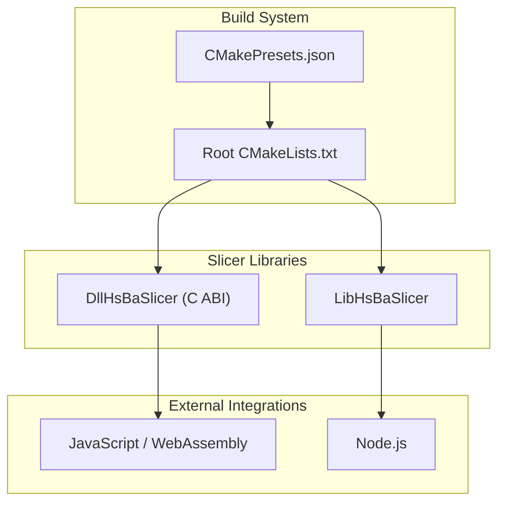
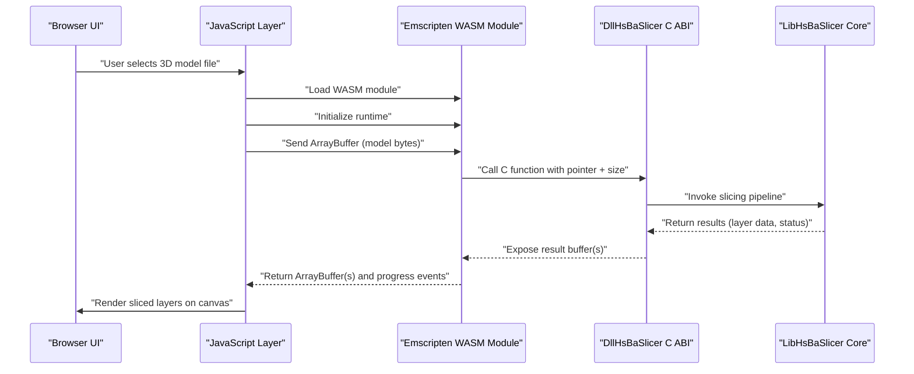
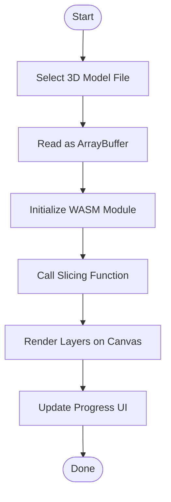
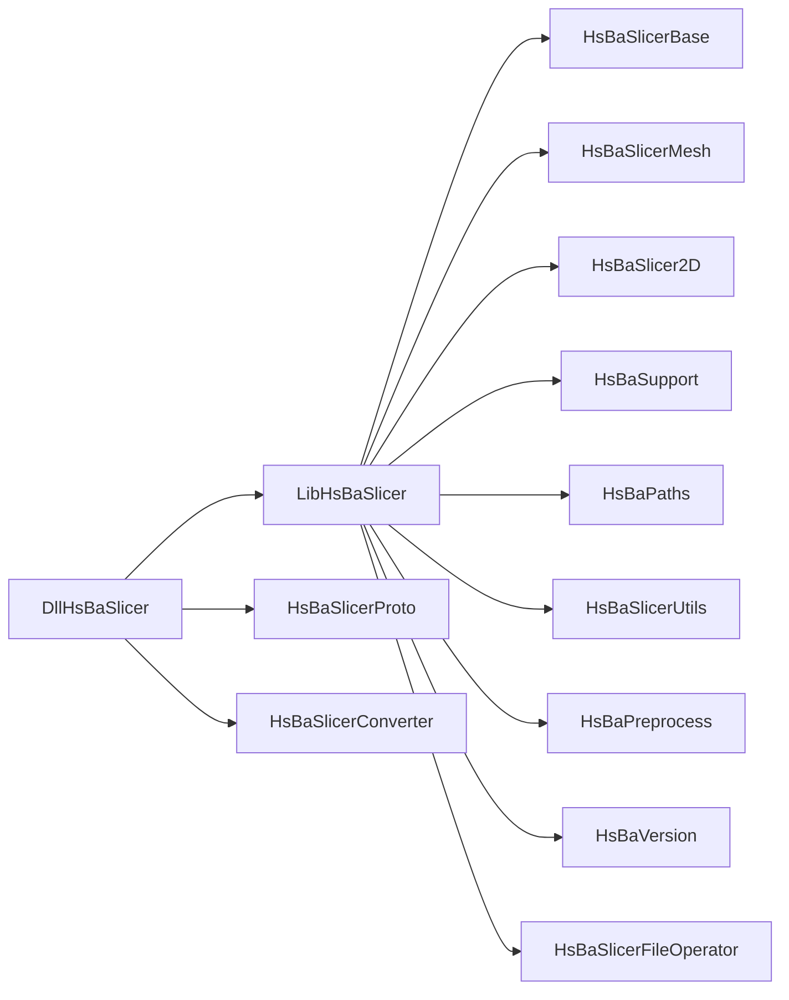

# JavaScript/WebAssembly Integration / JavaScript/WebAssembly集成

<cite>
**Referenced Files in This Document**
- [CMakeLists.txt](file://CMakeLists.txt)
- [README.md](file://README.md)
- [CMakePresets.json](file://CMakePresets.json)
- [DllHsBaSlicer/CMakeLists.txt](file://DllHsBaSlicer/CMakeLists.txt)
- [LibHsBaSlicer/CMakeLists.txt](file://LibHsBaSlicer/CMakeLists.txt)
</cite>

## Table of Contents
1. [Introduction](#introduction)
2. [Project Structure](#project-structure)
3. [Core Components](#core-components)
4. [Architecture Overview](#architecture-overview)
5. [Detailed Component Analysis](#detailed-component-analysis)
6. [Dependency Analysis](#dependency-analysis)
7. [Performance Considerations](#performance-considerations)
8. [Troubleshooting Guide](#troubleshooting-guide)
9. [Conclusion](#conclusion)
10. [Appendices](#appendices)

## Introduction
This document explains how to integrate HsBaSlicer with JavaScript and WebAssembly. It focuses on:
- Emscripten compilation strategy for producing a browser-loadable module from the C++ slicing core
- Data marshaling between JavaScript types and WebAssembly memory, including ArrayBuffer usage
- Browser-based integration patterns for 3D model input, sliced-layer rendering, and real-time progress updates
- Node.js server-side processing using file system operations and worker threads
- Performance optimization, memory management, debugging strategies, and deployment considerations such as CDN hosting, caching, and progressive web app (PWA) support

The repository provides a modular C++ slicer framework with a shared/dynamic library surface suitable for cross-language integration. The build system is CMake-based and exposes both a C++ API through LibHsBaSlicer and a C ABI through DllHsBaSlicer.

## Project Structure
At a high level, the relevant parts for JavaScript/WebAssembly integration are:
- LibHsBaSlicer: Core slicing functionality exposed as a static or shared library
- DllHsBaSlicer: C ABI export layer intended for external language bindings
- Root CMake configuration: Global compiler settings, feature detection, dependency discovery, and install/export targets
- CMake presets: Platform-specific configurations used by CI and local development

**Diagram sources**
- [CMakeLists.txt:1-695](file://CMakeLists.txt#L1-L695)
- [CMakePresets.json:1-239](file://CMakePresets.json#L1-L239)
- [LibHsBaSlicer/CMakeLists.txt:1-115](file://LibHsBaSlicer/CMakeLists.txt#L1-L115)
- [DllHsBaSlicer/CMakeLists.txt:1-100](file://DllHsBaSlicer/CMakeLists.txt#L1-L100)

**Section sources**
- [CMakeLists.txt:1-695](file://CMakeLists.txt#L1-L695)
- [CMakePresets.json:1-239](file://CMakePresets.json#L1-L239)
- [README.md:41-98](file://README.md#L41-L98)

## Core Components
- LibHsBaSlicer: Provides the full slicing pipeline in C++. It can be built as static or shared depending on BUILD_SHARED_LIBS. It links internal modules like mesh processing, 2D polygon handling, support generation, path output, preprocessing, and version utilities.
- DllHsBaSlicer: Exposes a C ABI for cross-language integration. On iOS it is built as STATIC; on other platforms it is SHARED. It depends on LibHsBaSlicer and several internal libraries.

Key responsibilities:
- LibHsBaSlicer encapsulates slicing algorithms and data structures
- DllHsBaSlicer provides stable C symbols that JavaScript/WASM bindings can call via Emscripten

**Section sources**
- [LibHsBaSlicer/CMakeLists.txt:1-115](file://LibHsBaSlicer/CMakeLists.txt#L1-L115)
- [DllHsBaSlicer/CMakeLists.txt:1-100](file://DllHsBaSlicer/CMakeLists.txt#L1-L100)

## Architecture Overview
The recommended architecture for browser-based integration uses Emscripten to compile the C ABI layer into a WebAssembly module. JavaScript loads the WASM module, initializes the runtime, and calls exported C functions to perform slicing. Binary data (e.g., STL/OBJ files and generated layers) is transferred via ArrayBuffer and typed arrays mapped onto the WASM linear memory.

**Diagram sources**
- [DllHsBaSlicer/CMakeLists.txt:1-100](file://DllHsBaSlicer/CMakeLists.txt#L1-L100)
- [LibHsBaSlicer/CMakeLists.txt:1-115](file://LibHsBaSlicer/CMakeLists.txt#L1-L115)

## Detailed Component Analysis

### Emscripten Compilation Strategy
To produce a browser-loadable module:
- Use Emscripten’s toolchain to compile the C ABI layer (DllHsBaSlicer) and its dependencies into a single .wasm bundle
- Export only the necessary C symbols to minimize module size
- Configure memory sizing and stack size appropriately for large models
- Generate an ES module wrapper for easy import in modern browsers

Recommended flags and options:
- -s EXPORTED_FUNCTIONS: restrict exports to required C ABI functions
- -s EXPORT_NAME: set the module initialization name for JavaScript
- -s MODULARIZE: enable ES module mode
- -s ALLOW_MEMORY_GROWTH: allow dynamic growth if needed
- -s INITIAL_MEMORY and -s MAXIMUM_MEMORY: tune memory limits
- -s STACK_SIZE: adjust stack for deep call stacks during slicing
- -O3: optimize for performance in production builds
- --bind: generate type conversions for simple types when appropriate

Note: These flags are general guidance for integrating HsBaSlicer via Emscripten. They are not defined in the repository’s CMake configuration.

**Section sources**
- [CMakeLists.txt:1-695](file://CMakeLists.txt#L1-L695)
- [DllHsBaSlicer/CMakeLists.txt:1-100](file://DllHsBaSlicer/CMakeLists.txt#L1-L100)

### Data Marshaling Between JavaScript and WebAssembly
- Input models: Read files into ArrayBuffer, then pass pointers and sizes to WASM functions
- Output layers: Return new ArrayBuffer instances backed by WASM linear memory; copy out before reuse
- Progress updates: Emit JavaScript events from WASM callbacks or use polling over shared memory regions
- Memory management: Allocate buffers in WASM heap, return them to JS, and free after copying to avoid leaks

Best practices:
- Avoid frequent small allocations; batch data where possible
- Use typed arrays for numeric data to reduce conversion overhead
- Keep large buffers alive only while needed; release promptly

**Section sources**
- [LibHsBaSlicer/CMakeLists.txt:1-115](file://LibHsBaSlicer/CMakeLists.txt#L1-L115)
- [DllHsBaSlicer/CMakeLists.txt:1-100](file://DllHsBaSlicer/CMakeLists.txt#L1-L100)

### Browser-Based Integration Patterns
Typical workflow:
- File input: Use <input type="file"> to load STL/OBJ/other supported formats
- Canvas rendering: Draw each sliced layer as vector paths or rasterized images
- Real-time progress: Update UI with percentage complete, current layer, and estimated time remaining
- Responsive UI: Debounce heavy computations; offload to Web Workers if needed

Example flow:

[No sources needed since this diagram shows conceptual workflow, not actual code structure]

### Node.js Integration for Server-Side Processing
Use LibHsBaSlicer directly in Node.js:
- Build LibHsBaSlicer as a shared library (BUILD_SHARED_LIBS=ON)
- Load the library via ffi-napi or node-addon-api
- Perform slicing in worker threads to avoid blocking the event loop
- Write outputs to disk or stream to clients

Considerations:
- Ensure all transitive dependencies are available at runtime
- Manage memory carefully to prevent OOM on large models
- Use streaming APIs where possible to reduce peak memory

**Section sources**
- [README.md:100-124](file://README.md#L100-L124)
- [LibHsBaSlicer/CMakeLists.txt:1-115](file://LibHsBaSlicer/CMakeLists.txt#L1-L115)

### Performance Optimization Techniques
- Compile with -O3 and link-time optimization (LTO) for WASM
- Minimize exports to reduce module size and startup time
- Pre-warm WASM memory for known maximum model sizes
- Batch operations to reduce interop overhead
- Use SIMD-enabled builds if supported by target platform

Memory management in WASM:
- Track allocated buffers and ensure they are freed after use
- Avoid excessive GC pressure by reusing buffers when safe
- Monitor memory growth with -s ALLOW_MEMORY_GROWTH judiciously

Debugging strategies:
- Enable source maps for WASM to aid debugging in browser devtools
- Use console logging sparingly; prefer structured events
- Validate inputs and outputs early to isolate issues

**Section sources**
- [CMakeLists.txt:1-695](file://CMakeLists.txt#L1-L695)

### Deployment Considerations
CDN hosting:
- Host the WASM module and JS loader on a CDN for fast global delivery
- Set long cache headers for immutable assets; use content hashing in filenames

Caching strategies:
- Cache the WASM binary aggressively; invalidate on version changes
- Cache generated slices per model hash if applicable

Progressive Web App (PWA):
- Register a service worker to cache the WASM module and critical assets
- Provide offline capability for previously processed models
- Implement background sync for queued slicing jobs

**Section sources**
- [CMakePresets.json:1-239](file://CMakePresets.json#L1-L239)

## Dependency Analysis
The build system defines clear boundaries:
- LibHsBaSlicer links public and private dependencies for slicing functionality
- DllHsBaSlicer depends on LibHsBaSlicer and internal modules to expose a C ABI

**Diagram sources**
- [LibHsBaSlicer/CMakeLists.txt:85-100](file://LibHsBaSlicer/CMakeLists.txt#L85-L100)
- [DllHsBaSlicer/CMakeLists.txt:84-100](file://DllHsBaSlicer/CMakeLists.txt#L84-L100)

**Section sources**
- [LibHsBaSlicer/CMakeLists.txt:1-115](file://LibHsBaSlicer/CMakeLists.txt#L1-L115)
- [DllHsBaSlicer/CMakeLists.txt:1-100](file://DllHsBaSlicer/CMakeLists.txt#L1-L100)

## Performance Considerations
- Prefer Release builds with optimizations enabled
- Limit exported symbols to reduce WASM size
- Tune memory and stack sizes based on expected model complexity
- Avoid unnecessary copies between JS and WASM; use shared buffers where feasible
- Profile CPU and memory usage in browser devtools and Node.js inspector

[No sources needed since this section provides general guidance]

## Troubleshooting Guide
Common issues and resolutions:
- Module loading failures: Verify correct MIME types and CORS settings for WASM files
- Out-of-memory errors: Increase INITIAL_MEMORY/MAXIMUM_MEMORY; validate model sizes
- Slow startup: Reduce exports; pre-warm module; consider lazy initialization
- Incorrect data: Ensure consistent endianness and alignment when passing typed arrays

**Section sources**
- [CMakeLists.txt:1-695](file://CMakeLists.txt#L1-L695)

## Conclusion
HsBaSlicer’s modular C++ architecture and C ABI layer make it well-suited for JavaScript and WebAssembly integration. By compiling the C ABI with Emscripten, managing data via ArrayBuffer, and following best practices for performance and deployment, you can deliver responsive browser-based 3D printing preparation tools and robust server-side processing pipelines.

[No sources needed since this section summarizes without analyzing specific files]

## Appendices

### Build Options Reference
- BUILD_SHARED_LIBS: Controls whether libraries are built as shared or static
- HSBA_SLICER_MODULE: Enables C++20 module wrapper
- HSBA_SLICER_BUILD_SAMPLES: Builds sample programs
- HSBA_SLICER_USE_TESTS: Builds tests
- HSBA_COVERAGE: Enables gcov instrumentation and coverage targets
- HSBA_PROTOBUF_OUT: Outputs multi-language Protobuf generated files

**Section sources**
- [README.md:448-501](file://docs/en/cpp_cmake_usage.md#L448-L501)

### Platform Notes
- Desktop platforms: All library targets participate in installation
- Android/iOS/Game consoles: CAD model target excluded due to missing OpenCascade support

**Section sources**
- [README.md:187-191](file://README.md#L187-L191)