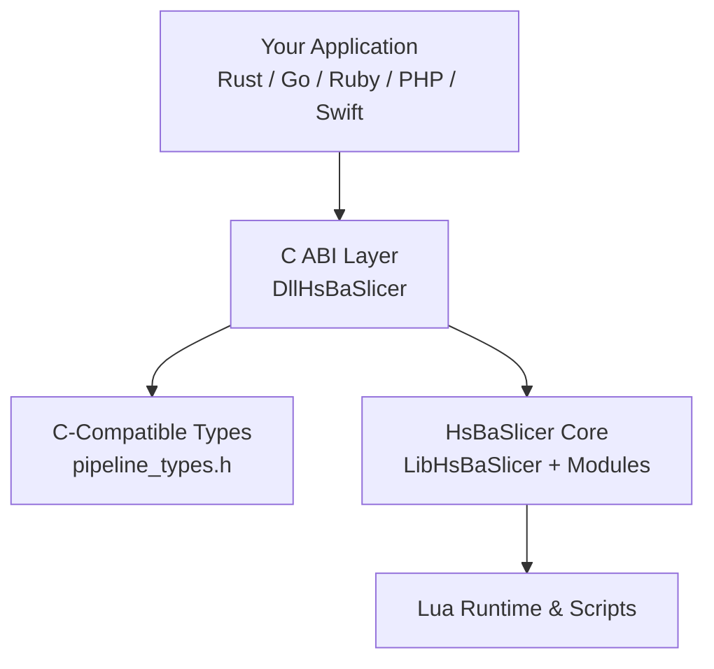
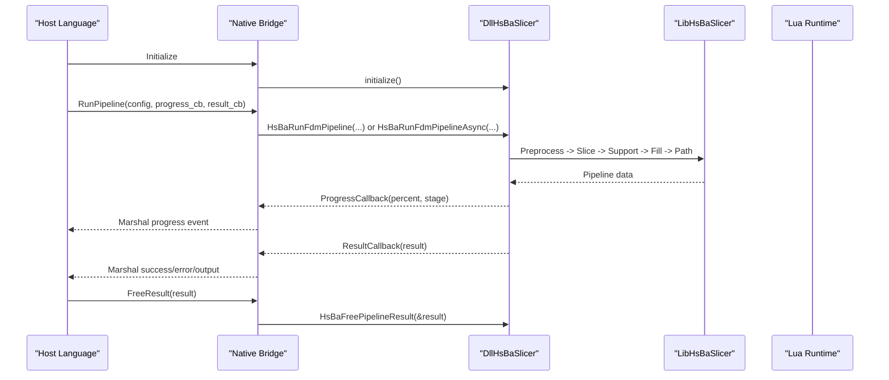
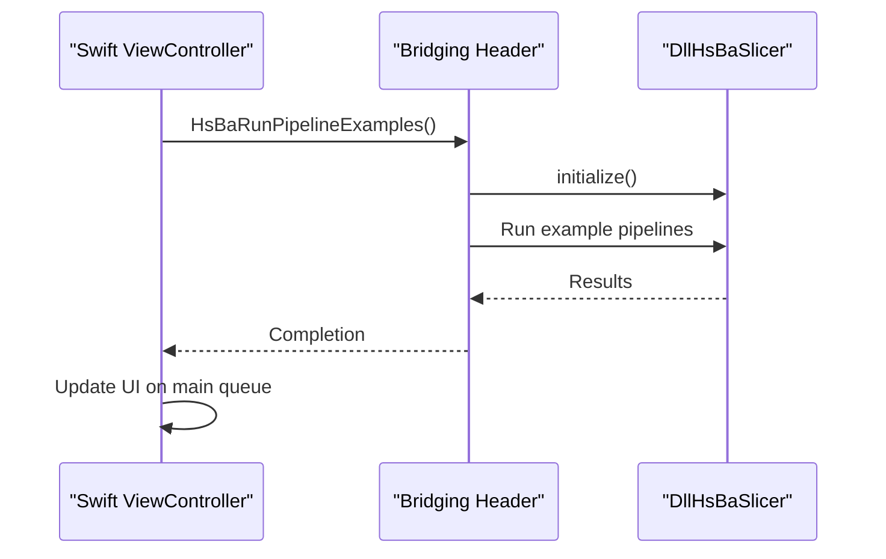

# Other Languages / 其他语言

<cite>
**Referenced Files in This Document**   
- [README.md](file://README.md)
- [dllexport.h](file://DllHsBaSlicer/dllexport.h)
- [initialize.h](file://DllHsBaSlicer/initialize.h)
- [fdm_pipeline.h](file://DllHsBaSlicer/fdm_pipeline.h)
- [pipeline_types.h](file://pipelinetypes/pipeline_types.h)
- [fdm_pipeline.cpp](file://DllHsBaSlicer/fdm_pipeline.cpp)
- [HsBaSlicerBridge.h](file://ios/HsBaSlicerExample/HsBaSlicerBridge.h)
- [ViewController.swift](file://ios/HsBaSlicerExample/ViewController.swift)
- [cpp_cmake_usage.md](file://docs/en/cpp_cmake_usage.md)
- [game_engine_integration.md](file://docs/en/DllHsBaSlicer/game_engine_integration.md)
</cite>

## Table of Contents
1. [Introduction](#introduction)
2. [Project Structure](#project-structure)
3. [Core Components](#core-components)
4. [Architecture Overview](#architecture-overview)
5. [Detailed Component Analysis](#detailed-component-analysis)
6. [Dependency Analysis](#dependency-analysis)
7. [Performance Considerations](#performance-considerations)
8. [Troubleshooting Guide](#troubleshooting-guide)
9. [Conclusion](#conclusion)
10. [Appendices](#appendices)

## Introduction
This page documents how to integrate HsBaSlicer with programming languages beyond the primary C++ targets. The recommended integration surface is the C ABI exposed by `DllHsBaSlicer`, which provides stable, cross-platform entry points for FDM, SLA, SLS, SLM, LOM, TDP, WAAM, and custom Lua-driven pipelines.

The repository exposes:
- A shared library target `DllHsBaSlicer` with a documented C ABI.
- Stable C-compatible structs and enums in `pipelinetypes/pipeline_types.h`.
- An initialization entry point `initialize()` that registers Lua functions and one-time runtime state.
- iOS Swift bridging examples through a bridging header.
- Documentation samples for desktop, game engine, and general CMake usage.

For non-C/C++ languages, you should wrap these C ABI functions in your language’s native interop layer (Rust FFI, Go cgo, Ruby FFI, PHP extension, Swift bridging, etc.).

**Section sources**
- [README.md:104-124](file://README.md#L104-L124)
- [README.md:126-179](file://README.md#L126-L179)

## Project Structure
At the integration boundary, the relevant parts are:
- `DllHsBaSlicer`: C ABI headers and implementation.
- `pipelinetypes/pipeline_types.h`: C-compatible configuration and result types.
- `ios/HsBaSlicerExample`: Swift bridging example.
- `docs/en`: CMake and integration documentation.

**Diagram sources**
- [README.md:104-124](file://README.md#L104-L124)
- [fdm_pipeline.h:1-68](file://DllHsBaSlicer/fdm_pipeline.h#L1-L68)
- [pipeline_types.h:1-12](file://pipelinetypes/pipeline_types.h#L1-L12)

**Section sources**
- [README.md:104-124](file://README.md#L104-L124)
- [README.md:126-179](file://README.md#L126-L179)

## Core Components
The C ABI surface is the foundation for all other-language integrations.

Key elements:
- `HSBA_SLICER_API`: Export/import macro for Windows DLL visibility; no annotation on non-Windows.
- `initialize()`: One-time DLL initialization; safe to call once at load time.
- FDM pipeline API:
  - `HsBaCreateDefaultConfig()`
  - `HsBaRunFdmPipeline(...)`
  - `HsBaRunFdmPipelineAsync(...)`
  - `HsBaFreePipelineResult(...)`
- Callbacks:
  - `HsBaProgressCallback(percent, stage, user_data)`
  - `HsBaResultCallback(result, user_data)`
- Configuration/result structs:
  - `HsBaFdmPipelineConfig_t`
  - `HsBaFdmPipelineResult_t`

Memory ownership rules:
- Result strings (`gcode_content`, `error_message`) are allocated by the library and must be released via `HsBaFreePipelineResult`.
- UTF-8 string fields in configs are owned by the caller; ensure they remain valid during the pipeline run.

Thread model:
- Async APIs use C++20 coroutines internally and return results via callbacks.
- Progress callbacks may execute from internal worker threads; UI updates must be marshaled to the host application’s main thread.

**Section sources**
- [dllexport.h:1-23](file://DllHsBaSlicer/dllexport.h#L1-L23)
- [initialize.h:1-22](file://DllHsBaSlicer/initialize.h#L1-L22)
- [fdm_pipeline.h:1-68](file://DllHsBaSlicer/fdm_pipeline.h#L1-L68)
- [pipeline_types.h:53-140](file://pipelinetypes/pipeline_types.h#L53-L140)

## Architecture Overview
The recommended integration architecture uses a thin native bridge over the C ABI.

**Diagram sources**
- [initialize.h:14-19](file://DllHsBaSlicer/initialize.h#L14-L19)
- [fdm_pipeline.h:23-61](file://DllHsBaSlicer/fdm_pipeline.h#L23-L61)
- [pipeline_types.h:130-140](file://pipelinetypes/pipeline_types.h#L130-L140)

## Detailed Component Analysis

### Rust FFI Integration
Recommended approach:
- Use `std::ffi::{c_char, c_void}` and `libc::size_t` where needed.
- Wrap `initialize()` once at process startup.
- Map `HsBaFdmPipelineConfig_t` and `HsBaFdmPipelineResult_t` to Rust structs using `#[repr(C)]`.
- Implement progress and result callbacks as `extern "C"` functions.
- For async workflows, convert C callback completion into Rust futures using an executor such as Tokio or std `async` primitives.

Safe wrapper generation patterns:
- Create a Rust module per pipeline type (FDM, SLA, SLS, etc.).
- Provide ergonomic Rust methods that accept strongly typed config objects and return `Result<T, Error>`.
- Centralize memory lifecycle:
  - Convert Rust strings to UTF-8 before passing to C.
  - Copy C-owned strings into Rust-owned buffers before freeing them.
  - Ensure `HsBaFreePipelineResult` is called exactly once per result.

Async/await pattern:
- Use a channel or future-completion primitive to translate `HsBaResultCallback` into a Rust future.
- Avoid blocking the Rust runtime thread when calling synchronous C APIs; prefer async APIs or offload to a dedicated blocking pool.

Common pitfalls:
- Mismatched struct layout between Rust and C ABI.
- Passing borrowed pointers across the boundary without ensuring lifetime safety.
- Calling UI or platform-specific code directly from progress callbacks.

Template outline:
- Define `#[repr(C)]` config and result structs.
- Declare `extern "C"` bindings for `initialize`, `HsBaCreateDefaultConfig`, `HsBaRunFdmPipeline`, `HsBaRunFdmPipelineAsync`, `HsBaFreePipelineResult`.
- Provide a Rust function that:
  - Initializes the library.
  - Builds a config.
  - Calls sync or async pipeline.
  - Converts result to Rust types.
  - Frees C memory.

[No sources needed since this section provides general guidance]

### Go cgo Integration
Recommended approach:
- Use cgo to bind the C ABI.
- Set `CGO_ENABLED=1` and ensure the correct compiler toolchain matches the target platform.
- On Windows, link against the built `DllHsBaSlicer.dll`; on Linux/macOS, link against the shared library artifact produced by the build system.

Memory management:
- Treat `char*` fields as C-owned memory returned by the library.
- Copy content into Go strings before calling `HsBaFreePipelineResult`.
- Keep UTF-8 byte slices alive while invoking the pipeline if they are passed as config inputs.

Goroutine interaction:
- Run long-running slicing tasks in goroutines.
- Do not mutate Go heap objects directly from C callbacks; marshal values back to Go channels or channels backed by Go closures.
- Update UI or framework state on the appropriate Go runtime thread.

Template outline:
- Write a `.cgo` file declaring C functions and structs.
- Provide Go wrappers that:
  - Call `initialize()`.
  - Build `HsBaFdmPipelineConfig_t`.
  - Invoke sync or async pipeline.
  - Handle progress events via channels.
  - Convert result to Go types and free memory.

[No sources needed since this section provides general guidance]

### Ruby FFI Integration
Recommended approach:
- Use `ffi` gem to define C structures and callbacks.
- Load the shared library and call `initialize()` once.
- Map Ruby strings to UTF-8 bytes for C input fields.
- Wrap result handling to copy C-owned strings into Ruby strings before freeing.

Template outline:
- Define `FFI::Struct` for config and result.
- Declare `attach_function` for C ABI entry points.
- Implement Ruby methods that:
  - Initialize the library.
  - Build config.
  - Run pipeline synchronously or asynchronously.
  - Convert result and free memory.

[No sources needed since this section provides general guidance]

### PHP Extension Development
Recommended approach:
- Develop a PHP extension using the Zend Engine.
- Expose functions that call `initialize()` and the pipeline C ABI.
- Manage PHP string lifetimes carefully around C-owned buffers.
- Return structured results using PHP arrays or objects.

Template outline:
- Register PHP functions in the extension entry point.
- Implement handlers for:
  - Initialization.
  - Config creation.
  - Sync/async pipeline execution.
  - Result conversion and memory cleanup.

[No sources needed since this section provides general guidance]

### Swift Bridging for iOS/macOS
The repository includes a concrete Swift bridging example:
- `ios/HsBaSlicerExample/HsBaSlicerBridge.h` declares a C function `HsBaRunPipelineExamples()`.
- `ios/HsBaSlicerExample/ViewController.swift` calls it from a background queue and updates UI on the main queue.

Production guidance:
- Prefer the C ABI functions from `DllHsBaSlicer` rather than example-only entry points.
- Always call `initialize()` before running pipelines.
- Run heavy work off the main thread.
- Marshal progress and result events back to the UI thread.

**Diagram sources**
- [HsBaSlicerBridge.h:19-25](file://ios/HsBaSlicerExample/HsBaSlicerBridge.h#L19-L25)
- [ViewController.swift:43-55](file://ios/HsBaSlicerExample/ViewController.swift#L43-L55)

**Section sources**
- [HsBaSlicerBridge.h:1-32](file://ios/HsBaSlicerExample/HsBaSlicerBridge.h#L1-L32)
- [ViewController.swift:1-86](file://ios/HsBaSlicerExample/ViewController.swift#L1-L86)

### Common Patterns Across All Integrations
- Initialization:
  - Call `initialize()` once per process.
- Configuration:
  - Use default initializers where available.
  - Ensure UTF-8 string fields are valid for the duration of the call.
- Execution:
  - Prefer async APIs when integrating with event loops or UI frameworks.
  - If using sync APIs, run them off the main thread.
- Callbacks:
  - Treat progress callbacks as potentially asynchronous.
  - Marshal UI updates to the host application’s main thread.
- Memory:
  - Never assume C-owned strings are valid after freeing.
  - Always call the corresponding free function for each result.
- Errors:
  - Check `success` flags in results.
  - Read `error_message` only when failure occurs.
- Threading:
  - Do not share mutable state between callbacks and the host runtime without synchronization.
  - Avoid long-running operations inside callbacks.

**Section sources**
- [initialize.h:14-19](file://DllHsBaSlicer/initialize.h#L14-L19)
- [fdm_pipeline.h:23-61](file://DllHsBaSlicer/fdm_pipeline.h#L23-L61)
- [pipeline_types.h:115-140](file://pipelinetypes/pipeline_types.h#L115-L140)

## Dependency Analysis
The C ABI depends on:
- Stable C-compatible types in `pipeline_types.h`.
- Internal C++ pipeline logic in `LibHsBaSlicer`.
- Lua runtime for scriptable stages.

**Diagram sources**
- [pipeline_types.h:1-12](file://pipelinetypes/pipeline_types.h#L1-L12)
- [fdm_pipeline.h:1-68](file://DllHsBaSlicer/fdm_pipeline.h#L1-L68)
- [fdm_pipeline.cpp:1-27](file://DllHsBaSlicer/fdm_pipeline.cpp#L1-L27)

**Section sources**
- [fdm_pipeline.cpp:1-27](file://DllHsBaSlicer/fdm_pipeline.cpp#L1-L27)
- [pipeline_types.h:1-12](file://pipelinetypes/pipeline_types.h#L1-L12)

## Performance Considerations
- Prefer async APIs to avoid blocking the host application’s event loop.
- Batch multiple pipeline runs when possible to reduce initialization overhead.
- Reuse configuration objects where safe, but do not reuse C-owned result objects after freeing.
- Minimize string conversions:
  - Convert once to UTF-8.
  - Cache paths and names if reused.
- Avoid excessive logging in progress callbacks; log only meaningful milestones.
- Profile both the host language runtime and the C++ core separately to identify bottlenecks.

[No sources needed since this section provides general guidance]

## Troubleshooting Guide
Common issues and resolutions:
- Library not found:
  - Verify the shared library path and platform naming conventions.
  - On Windows, ensure the DLL is discoverable at runtime.
- Incorrect struct layout:
  - Confirm `#[repr(C)]` or equivalent alignment in the host language.
  - Match field order and types exactly with `pipeline_types.h`.
- Crash on result access:
  - Ensure you copied C-owned strings before calling `HsBaFreePipelineResult`.
  - Check `success` before reading output fields.
- UI freezes:
  - Move synchronous pipeline calls off the main thread.
  - Marshal progress and completion events back to the UI thread.
- Lua errors:
  - Validate Lua script paths and function names in configuration.
  - Inspect error messages returned by the pipeline.

**Section sources**
- [fdm_pipeline.h:53-61](file://DllHsBaSlicer/fdm_pipeline.h#L53-L61)
- [pipeline_types.h:115-140](file://pipelinetypes/pipeline_types.h#L115-L140)

## Conclusion
For integrating HsBaSlicer with other languages, treat the C ABI in `DllHsBaSlicer` as the single source of truth. Build a small, well-tested native bridge that handles initialization, configuration, execution, callbacks, and memory lifecycle. Use async APIs where possible, marshal UI updates safely, and validate UTF-8 string ownership across boundaries. The iOS Swift example demonstrates the bridging pattern, while Rust, Go, Ruby, and PHP follow the same principles with their respective interop mechanisms.

[No sources needed since this section summarizes without analyzing specific files]

## Appendices

### CMake and Installation Reference
- Install the project to expose CMake config files and headers.
- Link downstream applications against `HsBaSlicer::DllHsBaSlicer`.
- Use `find_package(HsBaSlicer CONFIG REQUIRED)` in consumer projects.

**Section sources**
- [README.md:100-179](file://README.md#L100-L179)
- [cpp_cmake_usage.md:82-99](file://docs/en/cpp_cmake_usage.md#L82-L99)

### Game Engine and Desktop Integration References
- Unity and Unreal Engine integration examples demonstrate async execution, progress callback marshaling, and result handling.
- Qt/wxWidgets examples show worker-thread wrapping and signal-slot forwarding.

**Section sources**
- [game_engine_integration.md:298-349](file://docs/en/DllHsBaSlicer/game_engine_integration.md#L298-L349)