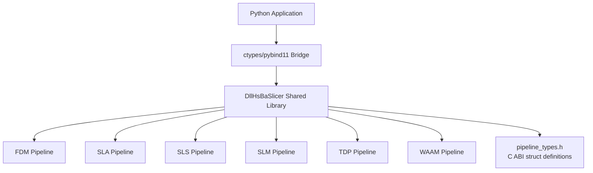
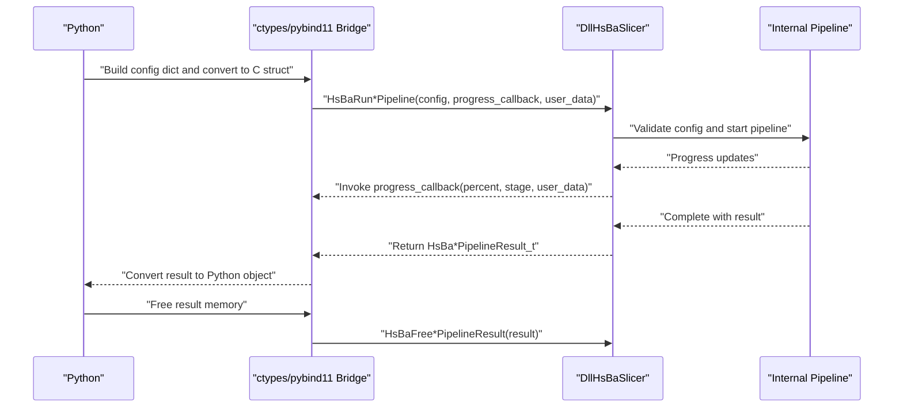
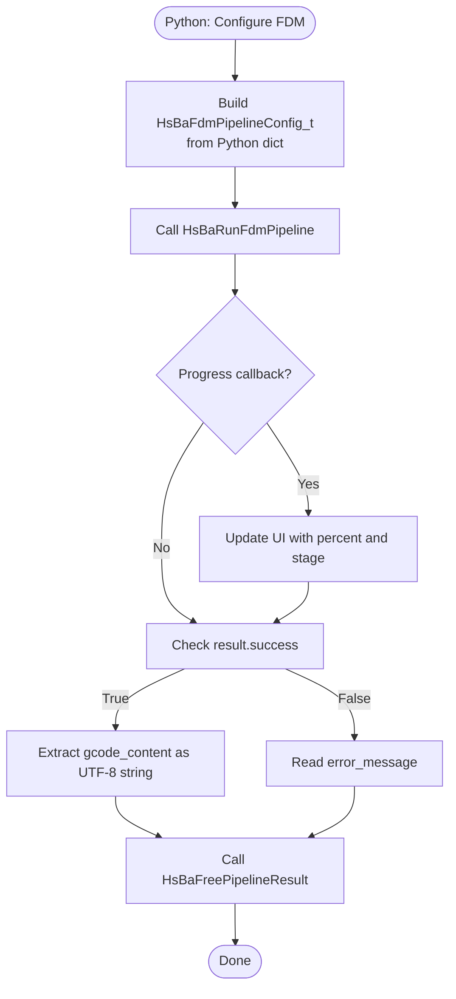
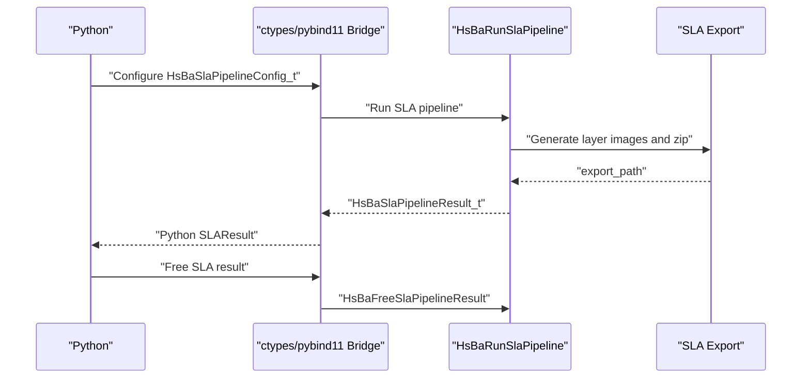
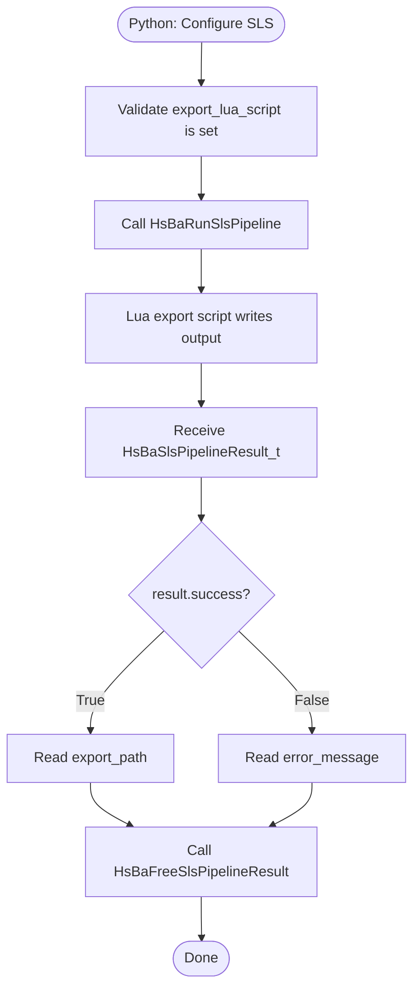
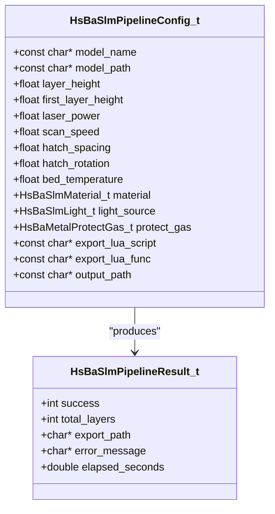
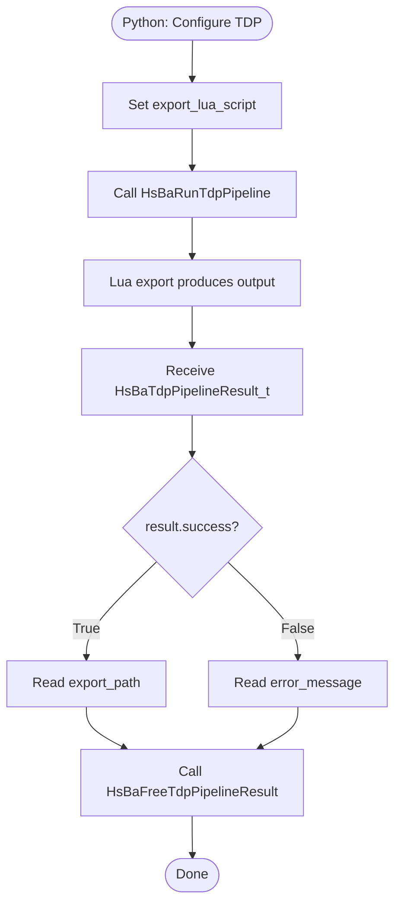
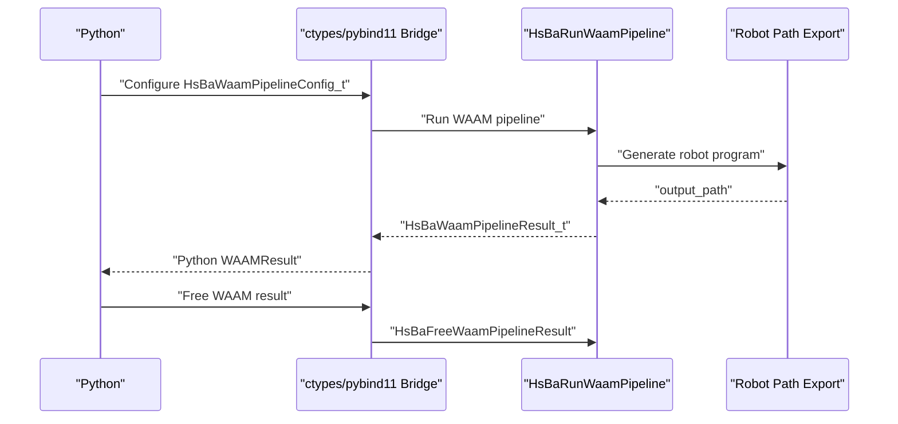
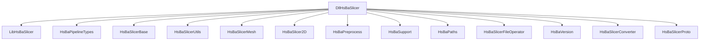

# Python Integration / Python集成

<cite>
**Referenced Files in This Document**   
- [pipeline_types.h](file://pipelinetypes/pipeline_types.h)
- [fdm_pipeline.h](file://DllHsBaSlicer/fdm_pipeline.h)
- [fdm_pipeline.cpp](file://DllHsBaSlicer/fdm_pipeline.cpp)
- [sla_pipeline.h](file://DllHsBaSlicer/sla_pipeline.h)
- [sla_pipeline.cpp](file://DllHsBaSlicer/sla_pipeline.cpp)
- [sls_pipeline.h](file://DllHsBaSlicer/sls_pipeline.h)
- [sls_pipeline.cpp](file://DllHsBaSlicer/sls_pipeline.cpp)
- [slm_pipeline.h](file://DllHsBaSlicer/slm_pipeline.h)
- [slm_pipeline.cpp](file://DllHsBaSlicer/slm_pipeline.cpp)
- [tdp_pipeline.h](file://DllHsBaSlicer/tdp_pipeline.h)
- [tdp_pipeline.cpp](file://DllHsBaSlicer/tdp_pipeline.cpp)
- [waam_pipeline.h](file://DllHsBaSlicer/waam_pipeline.h)
- [waam_pipeline.cpp](file://DllHsBaSlicer/waam_pipeline.cpp)
- [CMakeLists.txt](file://DllHsBaSlicer/CMakeLists.txt)
- [README.md](file://docs/en/DllHsBaSlicer/README.md)
- [cpp_cmake_usage.md](file://docs/en/cpp_cmake_usage.md)
- [game_engine_integration.md](file://docs/en/DllHsBaSlicer/game_engine_integration.md)
</cite>

## Table of Contents
1. [Introduction](#introduction)
2. [Project Structure](#project-structure)
3. [Core Components](#core-components)
4. [Architecture Overview](#architecture-overview)
5. [Detailed Component Analysis](#detailed-component-analysis)
6. [Dependency Analysis](#dependency-analysis)
7. [Performance Considerations](#performance-considerations)
8. [Troubleshooting Guide](#troubleshooting-guide)
9. [Conclusion](#conclusion)
10. [Appendices](#appendices)

## Introduction
This document explains how to integrate HsBaSlicer into Python using the stable C ABI exposed by the `DllHsBaSlicer` shared library. It focuses on ctypes and pybind11 integration patterns for the following pipeline entry points:

- `HsBaRunFdmPipeline`
- `HsBaRunSlaPipeline`
- `HsBaRunSlsPipeline`
- `HsBaRunSlmPipeline`
- `HsBaRunTdpPipeline`
- `HsBaRunWaamPipeline`

It also documents:

- Data type marshaling between C structures (`HsBa*PipelineConfig_t`, `HsBa*PipelineResult_t`) and Python types.
- Memory management across language boundaries, including result freeing functions.
- Error handling with exception translation from C return codes and UTF-8 error messages.
- Callback mechanisms for progress reporting and async completion.
- Complete usage examples covering model loading formats (STL, OBJ, PLY), parameter configuration through Python dictionaries, pipeline execution with progress callbacks, and result processing to extract G-code or other outputs.
- Platform-specific considerations for Windows DLL loading, Linux shared library linking, and macOS dynamic library binding.
- Runtime dependencies and deployment strategies for different Python environments.

The C ABI is intentionally designed to be language-neutral, so Python bindings can be implemented with either ctypes or a thin pybind11 bridge that exposes C-compatible structs and function pointers.

## Project Structure
The Python integration surface is provided by the `DllHsBaSlicer` module, which exports C ABI functions declared in per-pipeline headers and implemented in corresponding `.cpp` files. The data layout for all pipelines is defined in a standalone header without DLL export macros, making it safe for Python bindings to include directly.

**Diagram sources**
- [fdm_pipeline.h:1-68](file://DllHsBaSlicer/fdm_pipeline.h#L1-L68)
- [sla_pipeline.h:1-63](file://DllHsBaSlicer/sla_pipeline.h#L1-L63)
- [sls_pipeline.h:1-63](file://DllHsBaSlicer/sls_pipeline.h#L1-L63)
- [slm_pipeline.h:1-63](file://DllHsBaSlicer/slm_pipeline.h#L1-L63)
- [tdp_pipeline.h:1-63](file://DllHsBaSlicer/tdp_pipeline.h#L1-L63)
- [waam_pipeline.h:1-64](file://DllHsBaSlicer/waam_pipeline.h#L1-L64)
- [pipeline_types.h:1-44](file://pipelinetypes/pipeline_types.h#L1-L44)

**Section sources**
- [pipeline_types.h:1-44](file://pipelinetypes/pipeline_types.h#L1-L44)
- [CMakeLists.txt:82-100](file://DllHsBaSlicer/CMakeLists.txt#L82-L100)

## Core Components
The core Python-facing components are the six pipeline run functions plus their associated config/result types and callback types. Each pipeline has:

- A C-compatible configuration struct (`HsBa*PipelineConfig_t`).
- A C-compatible result struct (`HsBa*PipelineResult_t`).
- A synchronous run function returning the result.
- An asynchronous run function invoking a result callback.
- A progress callback type used during execution.
- A dedicated free function for the result memory.

| Pipeline | Config Struct | Result Struct | Sync Function | Async Function | Progress Callback Type | Free Function |
|---|---|---|---|---|---|---|
| FDM | `HsBaFdmPipelineConfig_t` | `HsBaFdmPipelineResult_t` | `HsBaRunFdmPipeline` | `HsBaRunFdmPipelineAsync` | `HsBaProgressCallback` | `HsBaFreePipelineResult` |
| SLA | `HsBaSlaPipelineConfig_t` | `HsBaSlaPipelineResult_t` | `HsBaRunSlaPipeline` | `HsBaRunSlaPipelineAsync` | `HsBaSlaProgressCallback` | `HsBaFreeSlaPipelineResult` |
| SLS | `HsBaSlsPipelineConfig_t` | `HsBaSlsPipelineResult_t` | `HsBaRunSlsPipeline` | `HsBaRunSlsPipelineAsync` | `HsBaSlsProgressCallback` | `HsBaFreeSlsPipelineResult` |
| SLM | `HsBaSlmPipelineConfig_t` | `HsBaSlmPipelineResult_t` | `HsBaRunSlmPipeline` | `HsBaRunSlmPipelineAsync` | `HsBaSlmProgressCallback` | `HsBaFreeSlmPipelineResult` |
| TDP | `HsBaTdpPipelineConfig_t` | `HsBaTdpPipelineResult_t` | `HsBaRunTdpPipeline` | `HsBaRunTdpPipelineAsync` | `HsBaTdpProgressCallback` | `HsBaFreeTdpPipelineResult` |
| WAAM | `HsBaWaamPipelineConfig_t` | `HsBaWaamPipelineResult_t` | `HsBaRunWaamPipeline` | `HsBaRunWaamPipelineAsync` | `HsBaWaamProgressCallback` | `HsBaFreeWaamPipelineResult` |

Key implementation notes:

- All config structs contain `model_name` and `model_path` as UTF-8 C strings.
- Most results contain `success`, `total_layers`, an output pointer (`gcode_content` for FDM, `export_path` or `output_path` for others), `error_message`, and `elapsed_seconds`.
- String fields returned in results are UTF-8 and must be freed by the caller using the matching free function.
- Progress callbacks receive percentage, stage description, and user data.

**Section sources**
- [pipeline_types.h:53-140](file://pipelinetypes/pipeline_types.h#L53-L140)
- [pipeline_types.h:165-245](file://pipelinetypes/pipeline_types.h#L165-L245)
- [pipeline_types.h:251-310](file://pipelinetypes/pipeline_types.h#L251-L310)
- [pipeline_types.h:353-401](file://pipelinetypes/pipeline_types.h#L353-L401)
- [pipeline_types.h:477-521](file://pipelinetypes/pipeline_types.h#L477-L521)
- [pipeline_types.h:573-625](file://pipelinetypes/pipeline_types.h#L573-L625)
- [fdm_pipeline.h:17-61](file://DllHsBaSlicer/fdm_pipeline.h#L17-L61)
- [sla_pipeline.h:17-56](file://DllHsBaSlicer/sla_pipeline.h#L17-L56)
- [sls_pipeline.h:17-56](file://DllHsBaSlicer/sls_pipeline.h#L17-L56)
- [slm_pipeline.h:17-56](file://DllHsBaSlicer/slm_pipeline.h#L17-L56)
- [tdp_pipeline.h:17-56](file://DllHsBaSlicer/tdp_pipeline.h#L17-L56)
- [waam_pipeline.h:17-57](file://DllHsBaSlicer/waam_pipeline.h#L17-L57)

## Architecture Overview
At runtime, a Python application loads the `DllHsBaSlicer` shared library and calls one of the pipeline functions. The C ABI layer validates inputs, invokes the internal pipeline, reports progress through callbacks, and returns a result structure allocated by the library.

**Diagram sources**
- [fdm_pipeline.h:23-61](file://DllHsBaSlicer/fdm_pipeline.h#L23-L61)
- [fdm_pipeline.cpp:460-469](file://DllHsBaSlicer/fdm_pipeline.cpp#L460-L469)
- [pipeline_types.h:129-140](file://pipelinetypes/pipeline_types.h#L129-L140)

**Section sources**
- [fdm_pipeline.h:23-61](file://DllHsBaSlicer/fdm_pipeline.h#L23-L61)
- [pipeline_types.h:115-140](file://pipelinetypes/pipeline_types.h#L115-L140)

## Detailed Component Analysis

### FDM Pipeline Integration
The FDM pipeline generates G-code for fused deposition modeling. Its C ABI includes:

- `HsBaCreateDefaultConfig`
- `HsBaRunFdmPipeline`
- `HsBaRunFdmPipelineAsync`
- `HsBaFreePipelineResult`

The FDM result contains `gcode_content`, which is UTF-8 text representing the generated G-code.

**Diagram sources**
- [fdm_pipeline.h:17-61](file://DllHsBaSlicer/fdm_pipeline.h#L17-L61)
- [pipeline_types.h:53-140](file://pipelinetypes/pipeline_types.h#L53-L140)

#### Python Marshaling Strategy for FDM
- Use a Python dictionary to represent `HsBaFdmPipelineConfig_t`.
- Convert string fields to UTF-8 bytes before passing to ctypes.
- Map enums such as `HsBaFillMode_t`, `HsBaSupportPattern_t`, and `HsBaGCodeFirmware_t` to integer values.
- Wrap the result in a Python class or dataclass with properties for `success`, `total_layers`, `gcode_content`, `error_message`, and `elapsed_seconds`.
- Always call the free function after reading the result.

**Section sources**
- [pipeline_types.h:53-140](file://pipelinetypes/pipeline_types.h#L53-L140)
- [fdm_pipeline.h:17-61](file://DllHsBaSlicer/fdm_pipeline.h#L17-L61)

### SLA Pipeline Integration
The SLA pipeline slices models into layer images and optionally supports floor/raft generation. Its C ABI includes:

- `HsBaCreateDefaultSlaConfig`
- `HsBaRunSlaPipeline`
- `HsBaRunSlaPipelineAsync`
- `HsBaFreeSlaPipelineResult`

The SLA result contains `export_path`, pointing to an exported archive rather than inline G-code.

**Diagram sources**
- [sla_pipeline.h:17-56](file://DllHsBaSlicer/sla_pipeline.h#L17-L56)
- [pipeline_types.h:165-245](file://pipelinetypes/pipeline_types.h#L165-L245)

**Section sources**
- [pipeline_types.h:165-245](file://pipelinetypes/pipeline_types.h#L165-L245)
- [sla_pipeline.h:17-56](file://DllHsBaSlicer/sla_pipeline.h#L17-L56)

### SLS Pipeline Integration
The SLS pipeline uses a Lua-driven export step. Its C ABI includes:

- `HsBaCreateDefaultSlsConfig`
- `HsBaRunSlsPipeline`
- `HsBaRunSlsPipelineAsync`
- `HsBaFreeSlsPipelineResult`

Important constraint: `export_lua_script` must not be NULL.

**Diagram sources**
- [sls_pipeline.h:17-56](file://DllHsBaSlicer/sls_pipeline.h#L17-L56)
- [pipeline_types.h:251-310](file://pipelinetypes/pipeline_types.h#L251-L310)

**Section sources**
- [pipeline_types.h:251-310](file://pipelinetypes/pipeline_types.h#L251-L310)
- [sls_pipeline.h:17-56](file://DllHsBaSlicer/sls_pipeline.h#L17-L56)

### SLM Pipeline Integration
The SLM pipeline mirrors the SLS flow but adds metal-specific parameters. Its C ABI includes:

- `HsBaCreateDefaultSlmConfig`
- `HsBaRunSlmPipeline`
- `HsBaRunSlmPipelineAsync`
- `HsBaFreeSlmPipelineResult`

Important constraint: `export_lua_script` must not be NULL.

**Diagram sources**
- [pipeline_types.h:353-401](file://pipelinetypes/pipeline_types.h#L353-L401)
- [slm_pipeline.h:17-56](file://DllHsBaSlicer/slm_pipeline.h#L17-L56)

**Section sources**
- [pipeline_types.h:353-401](file://pipelinetypes/pipeline_types.h#L353-L401)
- [slm_pipeline.h:17-56](file://DllHsBaSlicer/slm_pipeline.h#L17-L56)

### TDP Pipeline Integration
The TDP pipeline represents binder jetting and requires a Lua export script. Its C ABI includes:

- `HsBaCreateDefaultTdpConfig`
- `HsBaRunTdpPipeline`
- `HsBaRunTdpPipelineAsync`
- `HsBaFreeTdpPipelineResult`

Important constraint: `export_lua_script` must not be NULL.

**Diagram sources**
- [tdp_pipeline.h:17-56](file://DllHsBaSlicer/tdp_pipeline.h#L17-L56)
- [pipeline_types.h:477-521](file://pipelinetypes/pipeline_types.h#L477-L521)

**Section sources**
- [pipeline_types.h:477-521](file://pipelinetypes/pipeline_types.h#L477-L521)
- [tdp_pipeline.h:17-56](file://DllHsBaSlicer/tdp_pipeline.h#L17-L56)

### WAAM Pipeline Integration
The WAAM pipeline generates robot program code rather than layer archives. Its C ABI includes:

- `HsBaCreateDefaultWaamConfig`
- `HsBaRunWaamPipeline`
- `HsBaRunWaamPipelineAsync`
- `HsBaFreeWaamPipelineResult`

The WAAM result contains `output_path`, pointing to the generated robot program file.

**Diagram sources**
- [waam_pipeline.h:17-57](file://DllHsBaSlicer/waam_pipeline.h#L17-L57)
- [pipeline_types.h:573-625](file://pipelinetypes/pipeline_types.h#L573-L625)

**Section sources**
- [pipeline_types.h:573-625](file://pipelinetypes/pipeline_types.h#L573-L625)
- [waam_pipeline.h:17-57](file://DllHsBaSlicer/waam_pipeline.h#L17-L57)

## Dependency Analysis
The `DllHsBaSlicer` shared library links against several internal modules and depends on the standalone pipeline type definitions. For Python integration, you do not link against these libraries directly; instead, you load the built shared library at runtime.

**Diagram sources**
- [CMakeLists.txt:84-100](file://DllHsBaSlicer/CMakeLists.txt#L84-L100)

**Section sources**
- [CMakeLists.txt:84-100](file://DllHsBaSlicer/CMakeLists.txt#L84-L100)

## Performance Considerations
- Prefer async pipeline functions when integrating with GUI frameworks or long-running Python tasks.
- Avoid blocking the Python event loop by calling sync pipeline functions only in worker threads.
- Minimize callback frequency if progress updates are heavy; batch UI updates where possible.
- Reuse Python-side wrapper objects for configs and results to reduce allocation overhead.
- Be careful with large G-code content from FDM; stream or write to disk instead of keeping it entirely in Python memory when possible.

[No sources needed since this section provides general guidance]

## Troubleshooting Guide
Common issues and resolutions:

- **Missing shared library**: Ensure `DllHsBaSlicer` is discoverable by the Python process. On Windows, use `ctypes.CDLL`; on Linux/macOS, ensure the library path is configured correctly.
- **Wrong struct layout**: Define Python-side structs with field order and types matching `pipeline_types.h`. Mismatched layouts cause crashes or garbage data.
- **UTF-8 encoding errors**: Always encode Python strings as UTF-8 before passing to C string fields, and decode UTF-8 from result strings.
- **Memory leaks**: Always call the matching free function for each result.
- **Lua script missing**: For SLS, SLM, and TDP, ensure `export_lua_script` is set and points to a valid Lua file.
- **Invalid enum values**: Map Python enums to the correct integer values defined in `pipeline_types.h`.

**Section sources**
- [pipeline_types.h:53-140](file://pipelinetypes/pipeline_types.h#L53-L140)
- [pipeline_types.h:165-245](file://pipelinetypes/pipeline_types.h#L165-L245)
- [pipeline_types.h:251-310](file://pipelinetypes/pipeline_types.h#L251-L310)
- [pipeline_types.h:353-401](file://pipelinetypes/pipeline_types.h#L353-L401)
- [pipeline_types.h:477-521](file://pipelinetypes/pipeline_types.h#L477-L521)
- [pipeline_types.h:573-625](file://pipelinetypes/pipeline_types.h#L573-L625)

## Conclusion
HsBaSlicer exposes a stable C ABI through `DllHsBaSlicer`, making it straightforward to integrate into Python via ctypes or pybind11. The key responsibilities for Python integrators are:

- Correctly map C structs and enums to Python types.
- Manage memory by calling the appropriate free functions.
- Handle UTF-8 strings safely.
- Implement progress callbacks for responsive applications.
- Choose sync or async pipeline execution based on application needs.
- Deploy the shared library and its runtime dependencies for each target platform.

[No sources needed since this section summarizes without analyzing specific files]

## Appendices

### Python ctypes Integration Example Outline
This appendix describes a complete Python workflow without embedding source code.

1. Load the shared library.
2. Define Python-side ctypes structures matching `HsBaFdmPipelineConfig_t`, `HsBaSlaPipelineConfig_t`, etc.
3. Define callback types matching `HsBaProgressCallback`, `HsBaSlaProgressCallback`, etc.
4. Create default configs using `HsBaCreateDefaultConfig` or equivalent per-pipeline defaults.
5. Populate config fields from Python dictionaries.
6. Call the sync or async pipeline function.
7. Process the result:
   - For FDM: read `gcode_content`.
   - For SLA/SLS/SLM/TDP/WAAM: read `export_path` or `output_path`.
8. Call the matching free function.

**Section sources**
- [fdm_pipeline.h:17-61](file://DllHsBaSlicer/fdm_pipeline.h#L17-L61)
- [sla_pipeline.h:17-56](file://DllHsBaSlicer/sla_pipeline.h#L17-L56)
- [sls_pipeline.h:17-56](file://DllHsBaSlicer/sls_pipeline.h#L17-L56)
- [slm_pipeline.h:17-56](file://DllHsBaSlicer/slm_pipeline.h#L17-L56)
- [tdp_pipeline.h:17-56](file://DllHsBaSlicer/tdp_pipeline.h#L17-L56)
- [waam_pipeline.h:17-57](file://DllHsBaSlicer/waam_pipeline.h#L17-L57)

### Python pybind11 Integration Example Outline
For pybind11, expose:

- C-compatible struct wrappers.
- Pipeline run functions.
- Callback registration helpers.
- Result-freeing functions.

Use pybind11’s `py::bytes` for UTF-8 strings and `py::object` for callback storage.

**Section sources**
- [pipeline_types.h:115-140](file://pipelinetypes/pipeline_types.h#L115-L140)
- [pipeline_types.h:220-245](file://pipelinetypes/pipeline_types.h#L220-L245)
- [pipeline_types.h:285-310](file://pipelinetypes/pipeline_types.h#L285-L310)
- [pipeline_types.h:378-401](file://pipelinetypes/pipeline_types.h#L378-L401)
- [pipeline_types.h:498-521](file://pipelinetypes/pipeline_types.h#L498-L521)
- [pipeline_types.h:602-625](file://pipelinetypes/pipeline_types.h#L602-L625)

### Model Loading Formats
Model input is specified through `model_path` in each pipeline config. Supported formats include STL, OBJ, and PLY. The exact supported extensions are handled by the underlying model loader; Python callers should pass valid paths to existing model files.

**Section sources**
- [pipeline_types.h:53-113](file://pipelinetypes/pipeline_types.h#L53-L113)
- [pipeline_types.h:165-218](file://pipelinetypes/pipeline_types.h#L165-L218)
- [pipeline_types.h:251-283](file://pipelinetypes/pipeline_types.h#L251-L283)
- [pipeline_types.h:353-376](file://pipelinetypes/pipeline_types.h#L353-L376)
- [pipeline_types.h:477-496](file://pipelinetypes/pipeline_types.h#L477-L496)
- [pipeline_types.h:573-600](file://pipelinetypes/pipeline_types.h#L573-L600)

### Parameter Configuration Through Python Dictionaries
Recommended mapping strategy:

- Use a flat dictionary for simple numeric and boolean fields.
- Use nested dictionaries for grouped parameters.
- Convert enums to integers using a lookup table.
- Convert optional string fields to `None` or empty strings as required by the C API.
- Validate required fields before calling the pipeline function.

**Section sources**
- [pipeline_types.h:53-113](file://pipelinetypes/pipeline_types.h#L53-L113)
- [pipeline_types.h:165-218](file://pipelinetypes/pipeline_types.h#L165-L218)
- [pipeline_types.h:251-283](file://pipelinetypes/pipeline_types.h#L251-L283)
- [pipeline_types.h:353-376](file://pipelinetypes/pipeline_types.h#L353-L376)
- [pipeline_types.h:477-496](file://pipelinetypes/pipeline_types.h#L477-L496)
- [pipeline_types.h:573-600](file://pipelinetypes/pipeline_types.h#L573-L600)

### Platform-Specific Considerations

#### Windows
- Load `DllHsBaSlicer.dll` using `ctypes.CDLL`.
- Ensure dependent DLLs are available in the PATH or alongside the main executable.
- Use absolute or properly resolved relative paths for model and output files.

#### Linux
- Load `libDllHsBaSlicer.so` or the installed shared library name.
- Set `LD_LIBRARY_PATH` or use rpath during deployment.
- Verify symbol resolution with tools like `ldd`.

#### macOS
- Load `libDllHsBaSlicer.dylib` or the installed framework/shared library.
- Use `@loader_path` or install names for dependency resolution.
- Verify code signing requirements if running in sandboxed environments.

**Section sources**
- [README.md:705-735](file://docs/en/DllHsBaSlicer/README.md#L705-L735)
- [cpp_cmake_usage.md:336-400](file://docs/en/cpp_cmake_usage.md#L336-L400)
- [game_engine_integration.md:21-124](file://docs/en/DllHsBaSlicer/game_engine_integration.md#L21-L124)

### Runtime Dependencies and Deployment Strategies
- Distribute `DllHsBaSlicer` and all transitive dependencies required at runtime.
- For Python wheels or packaged applications, bundle the shared library in a known location and resolve it programmatically.
- For development, link against `HsBaSlicer::DllHsBaSlicer` as documented in the C++ usage guide.
- Test deployment on clean environments without preinstalled HsBaSlicer libraries.

**Section sources**
- [cpp_cmake_usage.md:336-400](file://docs/en/cpp_cmake_usage.md#L336-L400)
- [CMakeLists.txt:84-100](file://DllHsBaSlicer/CMakeLists.txt#L84-L100)