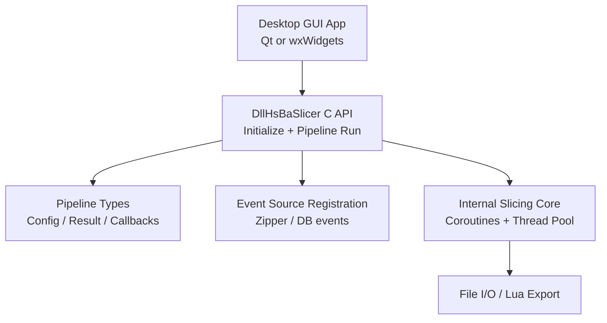
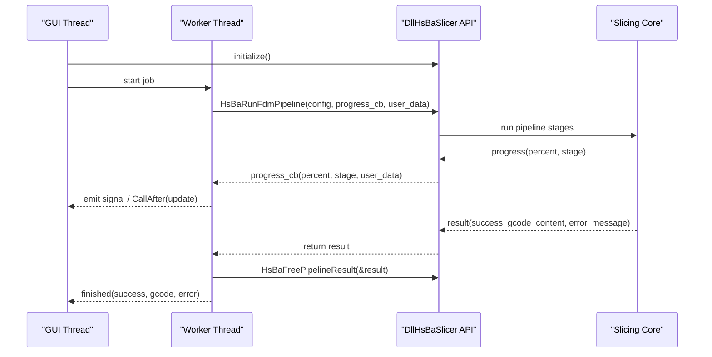
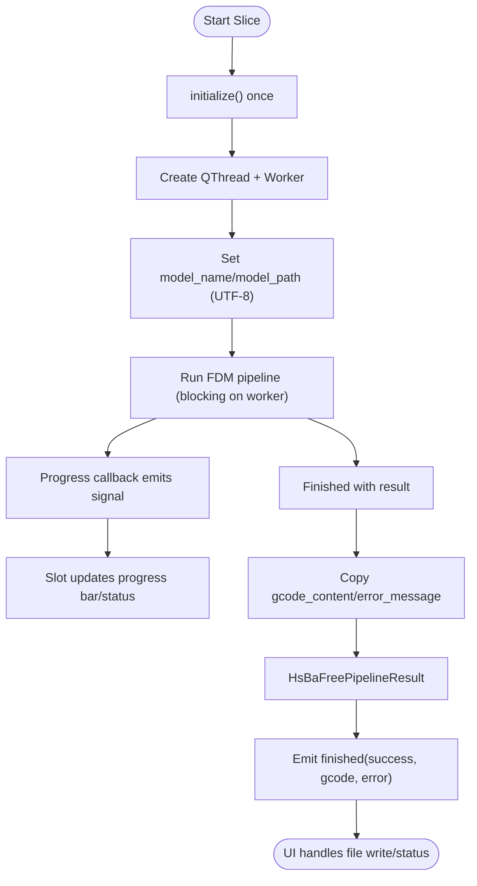
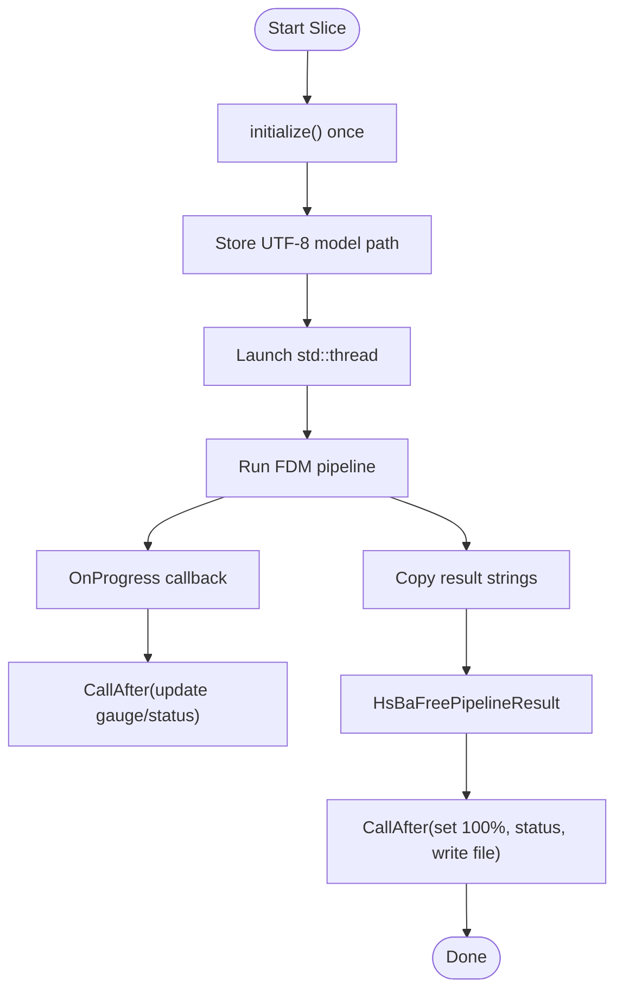
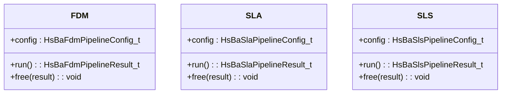
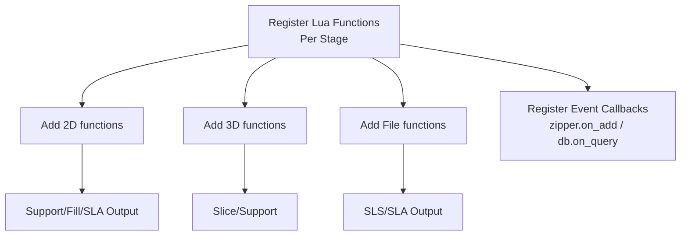
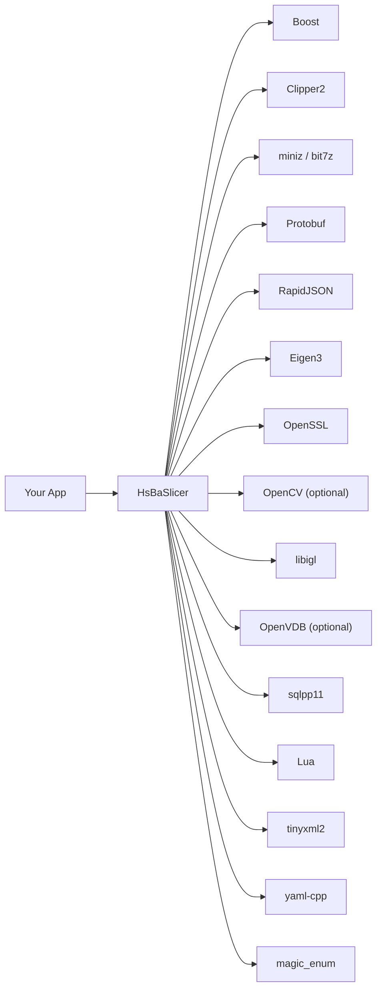
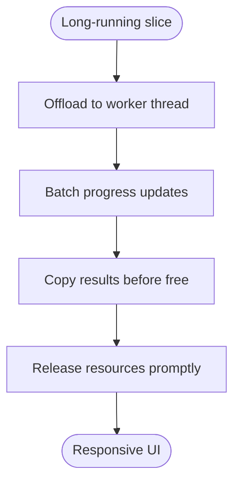

# Desktop Application Integration

<cite>
**Referenced Files in This Document**   
- [qt_wxwidgets_integration.md](file://docs/en/DllHsBaSlicer/qt_wxwidgets_integration.md)
- [fdm_pipeline.h](file://DllHsBaSlicer/fdm_pipeline.h)
- [sls_pipeline.h](file://DllHsBaSlicer/sls_pipeline.h)
- [initialize.h](file://DllHsBaSlicer/initialize.h)
- [event_source_register.h](file://DllHsBaSlicer/event_source_register.h)
- [event_source_register.cpp](file://DllHsBaSlicer/event_source_register.cpp)
- [pipeline_types.h](file://pipelinetypes/pipeline_types.h)
- [thread_pool.hpp](file://base/thread_pool.hpp)
- [coroutine.hpp](file://base/coroutine.hpp)
- [error.hpp](file://base/error.hpp)
- [CMakeLists.txt](file://CMakeLists.txt)
- [vcpkg.json](file://vcpkg.json)
- [README.md](file://README.md)
</cite>

## Table of Contents
1. [Introduction](#introduction)
2. [Project Structure](#project-structure)
3. [Core Components](#core-components)
4. [Architecture Overview](#architecture-overview)
5. [Detailed Component Analysis](#detailed-component-analysis)
6. [Dependency Analysis](#dependency-analysis)
7. [Performance Considerations](#performance-considerations)
8. [Troubleshooting Guide](#troubleshooting-guide)
9. [Conclusion](#conclusion)
10. [Appendices](#appendices)

## Introduction
This guide explains how to integrate HsBaSlicer into desktop applications built with Qt or wxWidgets. It focuses on safe UI threading, progress reporting, cross-platform build and deployment, event handling, resource management, error handling, and performance optimization for long-running slicing operations. The guidance is based on the provided integration documentation and the C ABI headers exposed by DllHsBaSlicer.

## Project Structure
For desktop GUI integration, you primarily interact with:
- DllHsBaSlicer C ABI headers that define pipeline configuration, result, and callback types.
- The official Qt/wxWidgets integration document showing worker-thread patterns and marshalling strategies.
- Base concurrency utilities (thread pool, coroutines) used internally by pipelines.
- Top-level CMake configuration and vcpkg manifest for dependency management.

**Diagram sources**
- [fdm_pipeline.h:17-61](file://DllHsBaSlicer/fdm_pipeline.h#L17-L61)
- [pipeline_types.h:115-140](file://pipelinetypes/pipeline_types.h#L115-L140)
- [event_source_register.h:15-17](file://DllHsBaSlicer/event_source_register.h#L15-L17)
- [coroutine.hpp:41-70](file://base/coroutine.hpp#L41-L70)
- [thread_pool.hpp:29-90](file://base/thread_pool.hpp#L29-L90)

**Section sources**
- [qt_wxwidgets_integration.md:7-12](file://docs/en/DllHsBaSlicer/qt_wxwidgets_integration.md#L7-L12)
- [fdm_pipeline.h:17-61](file://DllHsBaSlicer/fdm_pipeline.h#L17-L61)
- [pipeline_types.h:115-140](file://pipelinetypes/pipeline_types.h#L115-L140)
- [event_source_register.h:15-17](file://DllHsBaSlicer/event_source_register.h#L15-L17)
- [coroutine.hpp:41-70](file://base/coroutine.hpp#L41-L70)
- [thread_pool.hpp:29-90](file://base/thread_pool.hpp#L29-L90)

## Core Components
- Initialization: Call `initialize()` once at process startup before any pipeline call.
- FDM pipeline: Create default config, run sync or async, free results.
- SLS pipeline: Requires an export Lua script; similar run/free pattern.
- Event registration: Register zipper and database event callbacks for progress and diagnostics.
- Progress/result callbacks: Fired from library threads; marshal back to UI thread.

Key responsibilities:
- Config lifetime: `const char*` fields must remain valid during the pipeline execution.
- Result ownership: Copy strings before calling the corresponding `HsBaFree*PipelineResult`.
- Threading: Never block the UI thread; use worker threads and marshal updates.

**Section sources**
- [initialize.h:14-19](file://DllHsBaSlicer/initialize.h#L14-L19)
- [fdm_pipeline.h:17-61](file://DllHsBaSlicer/fdm_pipeline.h#L17-L61)
- [sls_pipeline.h:17-56](file://DllHsBaSlicer/sls_pipeline.h#L17-L56)
- [event_source_register.h:15-17](file://DllHsBaSlicer/event_source_register.h#L15-L17)
- [pipeline_types.h:115-140](file://pipelinetypes/pipeline_types.h#L115-L140)

## Architecture Overview
The recommended desktop integration pattern is:
- Initialize the DLL once.
- Start a worker thread per slicing job.
- Call synchronous or asynchronous pipeline APIs.
- Update UI via signals/slots (Qt) or `CallAfter` (wxWidgets).
- Free pipeline results after copying data.

**Diagram sources**
- [fdm_pipeline.h:23-61](file://DllHsBaSlicer/fdm_pipeline.h#L23-L61)
- [qt_wxwidgets_integration.md:47-105](file://docs/en/DllHsBaSlicer/qt_wxwidgets_integration.md#L47-L105)
- [qt_wxwidgets_integration.md:187-262](file://docs/en/DllHsBaSlicer/qt_wxwidgets_integration.md#L187-L262)

## Detailed Component Analysis

### Qt Integration Pattern
- Use QThread and signals/slots to move blocking calls off the UI thread.
- Keep UTF-8 model paths alive while the pipeline runs.
- In the progress callback, only emit signals; slots update widgets on the UI thread.
- After the pipeline returns, copy result strings, then call `HsBaFreePipelineResult`.

Recommended flow:
1. Initialize once.
2. Create worker object and move it to a QThread.
3. Connect progress and finished signals to UI controls.
4. On completion, write output files and show status.

**Diagram sources**
- [qt_wxwidgets_integration.md:47-105](file://docs/en/DllHsBaSlicer/qt_wxwidgets_integration.md#L47-L105)
- [qt_wxwidgets_integration.md:108-151](file://docs/en/DllHsBaSlicer/qt_wxwidgets_integration.md#L108-L151)
- [fdm_pipeline.h:23-61](file://DllHsBaSlicer/fdm_pipeline.h#L23-L61)

**Section sources**
- [qt_wxwidgets_integration.md:47-105](file://docs/en/DllHsBaSlicer/qt_wxwidgets_integration.md#L47-L105)
- [qt_wxwidgets_integration.md:108-151](file://docs/en/DllHsBaSlicer/qt_wxwidgets_integration.md#L108-L151)
- [fdm_pipeline.h:23-61](file://DllHsBaSlicer/fdm_pipeline.h#L23-L61)

### wxWidgets Integration Pattern
- Use `std::thread` (or wxThread) to run the pipeline off the UI thread.
- Marshal all UI updates using `CallAfter`.
- Convert UTF-8 strings to `wxString` before updating labels or writing files.
- Always copy result strings before freeing them.

Recommended flow:
1. Initialize once.
2. Store UTF-8 model path in panel member.
3. Launch worker thread and call pipeline.
4. In progress callback, use `CallAfter` to update gauge and status.
5. On completion, marshal final result and write output if successful.

**Diagram sources**
- [qt_wxwidgets_integration.md:187-262](file://docs/en/DllHsBaSlicer/qt_wxwidgets_integration.md#L187-L262)
- [fdm_pipeline.h:23-61](file://DllHsBaSlicer/fdm_pipeline.h#L23-L61)

**Section sources**
- [qt_wxwidgets_integration.md:187-262](file://docs/en/DllHsBaSlicer/qt_wxwidgets_integration.md#L187-L262)
- [fdm_pipeline.h:23-61](file://DllHsBaSlicer/fdm_pipeline.h#L23-L61)

### SLA / SLS Pipelines
- SLA outputs layer images packaged into a zip; configure image type and dimensions.
- SLS requires an export Lua script; without it, the pipeline cannot produce output.
- Both follow the same run/free pattern as FDM, with different config/result types.

**Diagram sources**
- [pipeline_types.h:115-140](file://pipelinetypes/pipeline_types.h#L115-L140)
- [pipeline_types.h:220-245](file://pipelinetypes/pipeline_types.h#L220-L245)
- [pipeline_types.h:285-310](file://pipelinetypes/pipeline_types.h#L285-L310)
- [sls_pipeline.h:17-56](file://DllHsBaSlicer/sls_pipeline.h#L17-L56)

**Section sources**
- [qt_wxwidgets_integration.md:268-289](file://docs/en/DllHsBaSlicer/qt_wxwidgets_integration.md#L268-L289)
- [pipeline_types.h:115-140](file://pipelinetypes/pipeline_types.h#L115-L140)
- [pipeline_types.h:220-245](file://pipelinetypes/pipeline_types.h#L220-L245)
- [pipeline_types.h:285-310](file://pipelinetypes/pipeline_types.h#L285-L310)
- [sls_pipeline.h:17-56](file://DllHsBaSlicer/sls_pipeline.h#L17-L56)

### Lua Extension Function Registration
- Register custom Lua functions per stage using the provided registration helpers.
- Function pointers must remain valid for the process lifetime.
- Event callbacks can be registered for zipper and database events.

**Diagram sources**
- [qt_wxwidgets_integration.md:293-338](file://docs/en/DllHsBaSlicer/qt_wxwidgets_integration.md#L293-L338)
- [event_source_register.h:15-17](file://DllHsBaSlicer/event_source_register.h#L15-L17)
- [event_source_register.cpp:9-33](file://DllHsBaSlicer/event_source_register.cpp#L9-L33)

**Section sources**
- [qt_wxwidgets_integration.md:293-338](file://docs/en/DllHsBaSlicer/qt_wxwidgets_integration.md#L293-L338)
- [event_source_register.h:15-17](file://DllHsBaSlicer/event_source_register.h#L15-L17)
- [event_source_register.cpp:9-33](file://DllHsBaSlicer/event_source_register.cpp#L9-L33)

## Dependency Analysis
HsBaSlicer depends on many third-party libraries managed through vcpkg and CMake. For desktop builds, key dependencies include Boost, Clipper2, miniz/bit7z, Protobuf, RapidJSON, Eigen3, OpenSSL, OpenCV (optional), libigl, OpenVDB (optional), sqlpp11, Lua, tinyxml2, yaml-cpp, and magic_enum.

**Diagram sources**
- [CMakeLists.txt:206-348](file://CMakeLists.txt#L206-L348)
- [vcpkg.json:10-87](file://vcpkg.json#L10-L87)

**Section sources**
- [CMakeLists.txt:206-348](file://CMakeLists.txt#L206-L348)
- [vcpkg.json:10-87](file://vcpkg.json#L10-L87)

## Performance Considerations
- Avoid running synchronous pipeline APIs on the UI thread; they block until completion.
- Prefer worker threads and lightweight progress updates; avoid heavy work in callbacks.
- Reuse worker threads where possible to reduce overhead.
- Use the internal ThreadPool and coroutine infrastructure when integrating advanced workflows.
- Be mindful of memory allocation: copy result strings before freeing; avoid unnecessary conversions.

**Diagram sources**
- [thread_pool.hpp:29-90](file://base/thread_pool.hpp#L29-L90)
- [coroutine.hpp:41-70](file://base/coroutine.hpp#L41-L70)
- [fdm_pipeline.h:23-61](file://DllHsBaSlicer/fdm_pipeline.h#L23-L61)

**Section sources**
- [thread_pool.hpp:29-90](file://base/thread_pool.hpp#L29-L90)
- [coroutine.hpp:41-70](file://base/coroutine.hpp#L41-L70)
- [fdm_pipeline.h:23-61](file://DllHsBaSlicer/fdm_pipeline.h#L23-L61)

## Troubleshooting Guide
Common issues and resolutions:
- Missing DLL at runtime (Windows): ensure the DLL is copied next to the executable.
- UI freezes: synchronous API called on UI thread; move to worker thread.
- Crashes updating widgets inside callbacks: callbacks run on library threads; marshal to UI thread.
- Non-ASCII path failures: pass UTF-8 encoded paths.
- Garbled result strings or crashes: free pipeline results too early; copy first, then free.

Additional notes:
- Error messages are returned in result structs; inspect success flag and error_message.
- Internal exceptions are wrapped and surfaced via result structures.

**Section sources**
- [qt_wxwidgets_integration.md:340-349](file://docs/en/DllHsBaSlicer/qt_wxwidgets_integration.md#L340-L349)
- [error.hpp:17-144](file://base/error.hpp#L17-L144)

## Conclusion
Integrating HsBaSlicer into Qt or wxWidgets applications requires careful separation of UI and worker threads, correct handling of UTF-8 strings, and disciplined resource management. Follow the documented patterns for initialization, progress reporting, and result cleanup. Use the provided C ABI headers and event registration mechanisms to extend behavior safely across platforms.

## Appendices

### Build and Deployment Notes
- Requirements: CMake >= 3.28, C++20 compiler, vcpkg, PowerShell (Windows).
- Windows: Visual Studio 2022+ recommended; use presets like windows-release.
- Linux/macOS: Install system dependencies, bootstrap vcpkg, configure with toolchain file.
- Ensure platform-specific build flags and dynamic loader options are set appropriately.

**Section sources**
- [README.md:41-98](file://README.md#L41-L98)
- [CMakeLists.txt:1-104](file://CMakeLists.txt#L1-L104)