# Game Engine Integration

<cite>
**Referenced Files in This Document**   
- [game_engine_integration.md](file://docs/en/DllHsBaSlicer/game_engine_integration.md)
- [pipeline_types.h](file://pipelinetypes/pipeline_types.h)
- [fdm_pipeline.h](file://DllHsBaSlicer/fdm_pipeline.h)
- [custom_pipeline.h](file://DllHsBaSlicer/custom_pipeline.h)
- [lua_register.h](file://DllHsBaSlicer/lua_register.h)
- [event_source_register.h](file://DllHsBaSlicer/event_source_register.h)
- [initialize.h](file://DllHsBaSlicer/initialize.h)
- [thread_pool.hpp](file://base/thread_pool.hpp)
- [memory_pool.hpp](file://base/memory_pool.hpp)
</cite>

## Table of Contents
1. [Introduction](#introduction)
2. [Project Structure](#project-structure)
3. [Core Components](#core-components)
4. [Architecture Overview](#architecture-overview)
5. [Detailed Component Analysis](#detailed-component-analysis)
6. [Dependency Analysis](#dependency-analysis)
7. [Performance Considerations](#performance-considerations)
8. [Troubleshooting Guide](#troubleshooting-guide)
9. [Conclusion](#conclusion)
10. [Appendices](#appendices)

## Introduction
This document explains how to integrate HsBaSlicer into game engines, focusing on Unity and Unreal Engine integration patterns. It covers real-time slicing for interactive applications, asset pipeline integration, asynchronous slicing operations, memory management, procedural content generation, dynamic level creation, and real-time model modification. It also documents frame-rate impact, memory optimization, multi-threading strategies, debugging tools, profiling techniques, and production deployment best practices.

The core integration surface is the C ABI exposed by `DllHsBaSlicer`, which provides synchronous and asynchronous APIs for FDM, SLA, SLS, LOM, TDP/WAAM, file transfer, and fully Lua-driven custom pipelines. The engine wrapper layer is responsible for platform-specific library placement, string encoding, thread discipline, delegate/callback lifetime management, and marshalling results back to the game loop.

## Project Structure
For game-engine integration, the relevant parts of the repository are:

- **C ABI and pipeline types**: `pipelinetypes/pipeline_types.h` defines all configuration structs, result structs, progress/result callback types, and default initializers.
- **Engine-facing C API**: `DllHsBaSlicer/fdm_pipeline.h`, `custom_pipeline.h`, `lua_register.h`, `event_source_register.h`, and `initialize.h`.
- **Game-engine documentation**: `docs/en/DllHsBaSlicer/game_engine_integration.md` contains Unity P/Invoke bindings, Unreal subsystem examples, per-platform library placement, and FAQ.
- **Concurrency and memory primitives**: `base/thread_pool.hpp` and `base/memory_pool.hpp` provide reusable threading and memory-pool abstractions that can be used by engine wrappers or custom pipeline code.

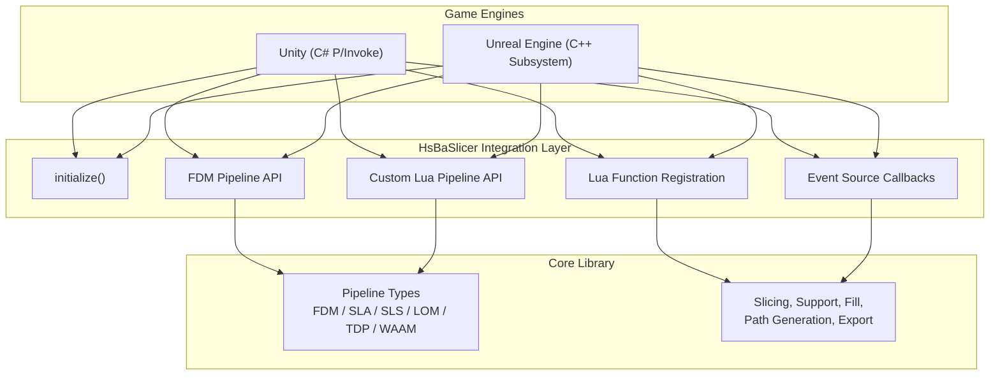

**Diagram sources**
- [initialize.h:15-19](file://DllHsBaSlicer/initialize.h#L15-L19)
- [fdm_pipeline.h:17-61](file://DllHsBaSlicer/fdm_pipeline.h#L17-L61)
- [custom_pipeline.h:17-62](file://DllHsBaSlicer/custom_pipeline.h#L17-L62)
- [lua_register.h:21-31](file://DllHsBaSlicer/lua_register.h#L21-L31)
- [event_source_register.h:15-17](file://DllHsBaSlicer/event_source_register.h#L15-L17)
- [pipeline_types.h:56-127](file://pipelinetypes/pipeline_types.h#L56-L127)

**Section sources**
- [game_engine_integration.md:7-17](file://docs/en/DllHsBaSlicer/game_engine_integration.md#L7-L17)
- [pipeline_types.h:56-127](file://pipelinetypes/pipeline_types.h#L56-L127)
- [fdm_pipeline.h:17-61](file://DllHsBaSlicer/fdm_pipeline.h#L17-L61)
- [custom_pipeline.h:17-62](file://DllHsBaSlicer/custom_pipeline.h#L17-L62)
- [lua_register.h:21-31](file://DllHsBaSlicer/lua_register.h#L21-L31)
- [event_source_register.h:15-17](file://DllHsBaSlicer/event_source_register.h#L15-L17)

## Core Components
The integration surface consists of five main components:

| Component | Responsibility | Key API Surface |
|---|---|---|
| Initialization | One-time DLL setup, Lua registration, runtime initialization | `initialize()` |
| FDM Pipeline | Full FDM slicing workflow: preprocess → slice → support → fill → path generation | `HsBaCreateDefaultConfig`, `HsBaRunFdmPipeline`, `HsBaRunFdmPipelineAsync`, `HsBaFreePipelineResult` |
| Custom Lua Pipeline | Fully Lua-driven workflow where stage order and output are defined by a Lua entry function | `HsBaCreateDefaultCustomConfig`, `HsBaRunCustomPipeline`, `HsBaRunCustomPipelineAsync`, `HsBaFreeCustomPipelineResult` |
| Lua Extension System | Inject custom 2D, 3D, file, and event functions into pipeline Lua environments | `HsBaAdd2DFunction`, `HsBaAdd3DFunction`, `HsBaAddFileFunction`, `HsBaAddEventCallback` |
| Event Sources | Register zipper and database event callbacks used by pipeline stages | `HsBaAddZipperEventCallback`, `HsBaAddDBEventCallback` |

### FDM Configuration and Result Model
The FDM pipeline uses a single C-compatible configuration struct and result struct. Important fields include model name/path, layer height, fill mode, support settings, G-code firmware, nozzle parameters, Lua customization hooks, and output path. The result includes success, total layers, G-code content, error message, and elapsed time.

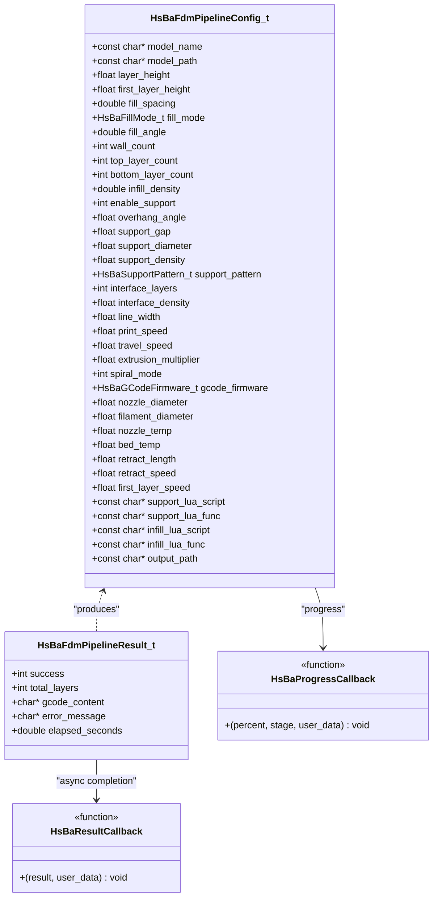

**Diagram sources**
- [pipeline_types.h:56-127](file://pipelinetypes/pipeline_types.h#L56-L127)
- [pipeline_types.h:135-140](file://pipelinetypes/pipeline_types.h#L135-L140)

**Section sources**
- [pipeline_types.h:56-127](file://pipelinetypes/pipeline_types.h#L56-L127)
- [pipeline_types.h:135-140](file://pipelinetypes/pipeline_types.h#L135-L140)
- [fdm_pipeline.h:17-61](file://DllHsBaSlicer/fdm_pipeline.h#L17-L61)

## Architecture Overview
The recommended architecture separates three layers:

1. **Game Engine Layer**: Unity MonoBehaviour or Unreal subsystem owns UI, input, scene state, and frame scheduling.
2. **Integration Wrapper Layer**: Handles native interop, UTF-8 string conversion, delegate/callback lifetime, thread dispatch, and result cleanup.
3. **HsBaSlicer Native Layer**: Executes slicing pipelines using internal C++20 coroutines, thread pools, and optional Lua scripts.

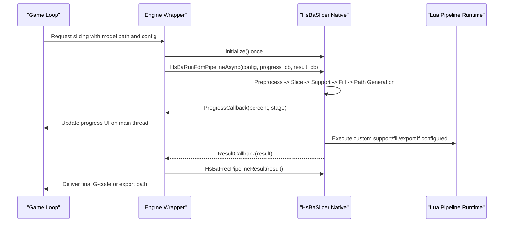

**Diagram sources**
- [fdm_pipeline.h:23-51](file://DllHsBaSlicer/fdm_pipeline.h#L23-L51)
- [pipeline_types.h:135-140](file://pipelinetypes/pipeline_types.h#L135-L140)
- [custom_pipeline.h:23-55](file://DllHsBaSlicer/custom_pipeline.h#L23-L55)

## Detailed Component Analysis

### Unity Integration via C# P/Invoke
Unity integration uses P/Invoke to call exported C functions from `DllHsBaSlicer`. The key responsibilities are:

- Declare C# structs matching the layout and field order of `HsBaFdmPipelineConfig_t` and `HsBaFdmPipelineResult_t`.
- Use `IntPtr` for every `const char*` and `int` for enums.
- Keep delegates alive so the garbage collector does not collect them while native code holds them.
- Marshal UTF-8 strings carefully and free unmanaged memory after copying.
- Post callbacks to the Unity main thread before touching `UnityEngine.Object`.

#### Per-Platform Library Placement
| Platform | Artifact | Unity location |
|---|---|---|
| Windows x64 | `DllHsBaSlicer.dll` | `Assets/Plugins/x86_64/` |
| Linux | `libDllHsBaSlicer.so` | `Assets/Plugins/x86_64/` |
| macOS | `libDllHsBaSlicer.dylib` | `Assets/Plugins/` |
| Android | `libDllHsBaSlicer.so` | `Assets/Plugins/Android/libs/<abi>/` |
| iOS | `libDllHsBaSlicer.a` | `Assets/Plugins/iOS/` |

On iOS, the library is static and the C# `DllImport` name must be `"__Internal"`.

#### Async Slicing Flow in Unity
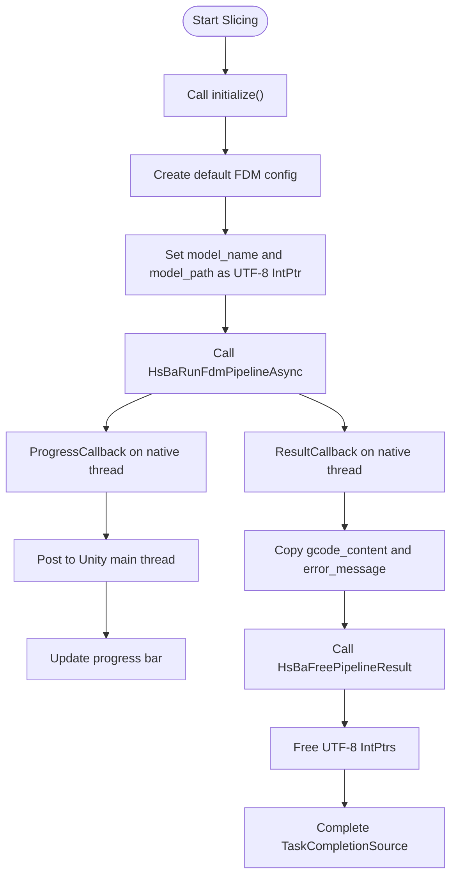

**Diagram sources**
- [game_engine_integration.md:25-123](file://docs/en/DllHsBaSlicer/game_engine_integration.md#L25-L123)
- [game_engine_integration.md:128-183](file://docs/en/DllHsBaSlicer/game_engine_integration.md#L128-L183)
- [fdm_pipeline.h:37-51](file://DllHsBaSlicer/fdm_pipeline.h#L37-L51)

#### Unity Best Practices
- Store progress and result delegates in static or member fields to prevent GC collection.
- Do not access Unity objects directly inside native callbacks; marshal to the main thread.
- For IL2CPP, keep `LayoutKind.Sequential` and match field types exactly.
- Place per-ABI native libraries under the correct `Assets/Plugins` paths.

**Section sources**
- [game_engine_integration.md:7-17](file://docs/en/DllHsBaSlicer/game_engine_integration.md#L7-L17)
- [game_engine_integration.md:21-123](file://docs/en/DllHsBaSlicer/game_engine_integration.md#L21-L123)
- [game_engine_integration.md:128-212](file://docs/en/DllHsBaSlicer/game_engine_integration.md#L128-L212)

### Unreal Engine Integration via C++ Subsystem
Unreal Engine integration wraps the same C ABI in a `UGameInstanceSubsystem`. The wrapper converts `FString` to UTF-8, runs slicing on a background thread, and broadcasts Blueprint-friendly delegates on the GameThread.

#### ThirdParty Module Layout
```
Plugins/HsBaSlicer/
├── HsBaSlicer.uplugin
├── Source/
│   ├── HsBaSlicer/
│   └── ThirdParty/DllHsBaSlicer/
│       ├── DllHsBaSlicer.Build.cs
│       ├── include/
│       └── lib/
```

#### Unreal Async Slicing Flow
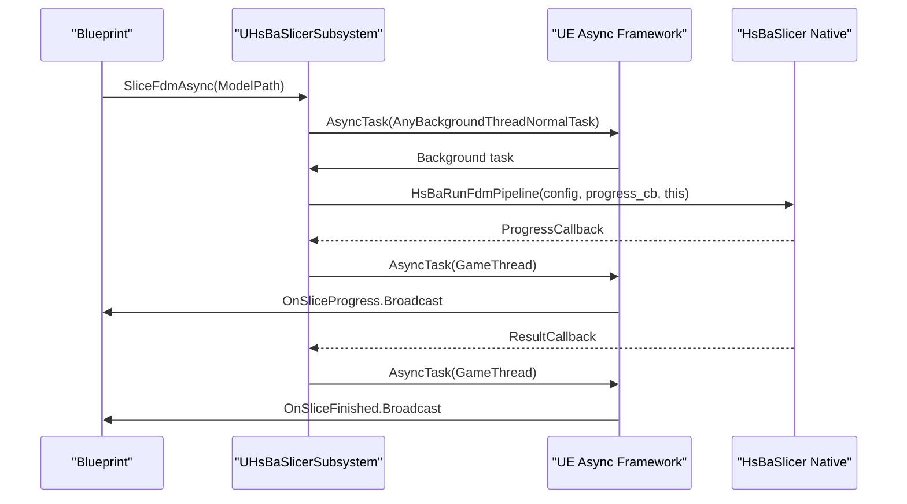

**Diagram sources**
- [game_engine_integration.md:218-234](file://docs/en/DllHsBaSlicer/game_engine_integration.md#L218-L234)
- [game_engine_integration.md:272-349](file://docs/en/DllHsBaSlicer/game_engine_integration.md#L272-L349)
- [fdm_pipeline.h:37-51](file://DllHsBaSlicer/fdm_pipeline.h#L37-L51)

#### Unreal Best Practices
- Convert `FString` to UTF-8 before crossing the C boundary.
- Keep UTF-8 byte arrays alive for the entire slicing run.
- Always wrap native callbacks in `AsyncTask(ENamedThreads::GameThread, ...)`.
- Use `RuntimeDependencies` to package the DLL; use delay loading only when necessary.
- Exclude the module from server/console targets if slicing is not required.

**Section sources**
- [game_engine_integration.md:218-234](file://docs/en/DllHsBaSlicer/game_engine_integration.md#L218-L234)
- [game_engine_integration.md:272-362](file://docs/en/DllHsBaSlicer/game_engine_integration.md#L272-L362)

### Real-Time Slicing and Game Loop Integration
Real-time slicing should avoid blocking the render thread. The recommended pattern is:

1. Accept user input or procedural changes on the game thread.
2. Build or update a lightweight configuration object.
3. Submit an async slicing job.
4. Update UI or preview geometry from progress callbacks.
5. Replace the current model or G-code buffer when the result arrives.

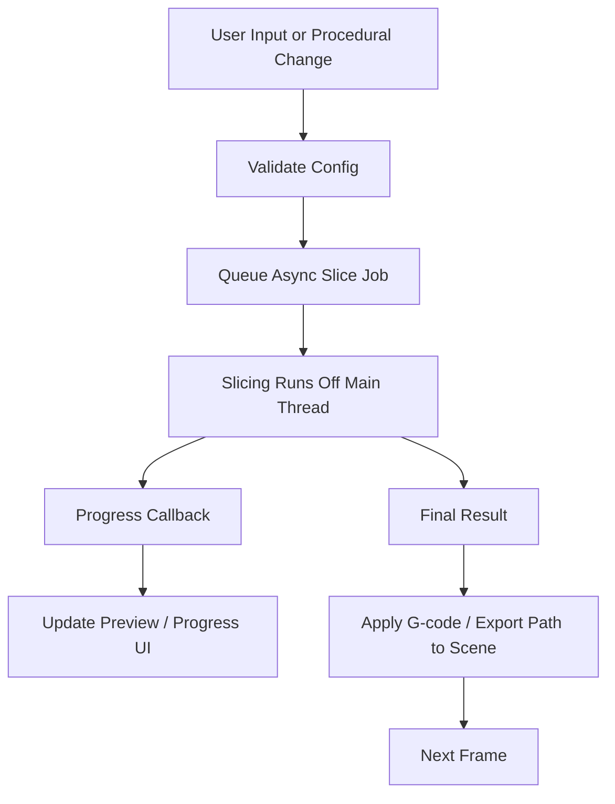

This pattern keeps frame rate stable because heavy geometry processing happens off the main thread, while only small updates are posted back to the engine’s UI or rendering layer.

[No sources needed since this diagram shows conceptual workflow, not actual code structure]

### Asset Pipeline Integration
HsBaSlicer supports multiple manufacturing outputs:

| Process | Output Type | Typical Game Use Case |
|---|---|---|
| FDM | G-code text | Generate printable toolpaths for physical prototypes |
| SLA | Layer images and zip package | Generate high-resolution layer data for resin printing |
| SLS | Lua-defined export | Generate powder-bed process files through custom scripts |
| LOM | Lua-defined export | Generate laminated sheet process files |
| TDP/WAAM | Lua-defined export | Binder jetting or wire arc additive manufacturing outputs |
| File Transfer | Remote file upload | Send generated assets to build servers or printers |

For game development, FDM G-code can drive external hardware, while SLA/SLS/TDP/WAAM exports can be part of a digital-to-physical pipeline. File transfer can integrate with remote slicer services or printer farms.

**Section sources**
- [pipeline_types.h:56-127](file://pipelinetypes/pipeline_types.h#L56-L127)
- [pipeline_types.h:170-232](file://pipelinetypes/pipeline_types.h#L170-L232)
- [pipeline_types.h:259-297](file://pipelinetypes/pipeline_types.h#L259-L297)
- [pipeline_types.h:419-448](file://pipelinetypes/pipeline_types.h#L419-L448)
- [pipeline_types.h:480-508](file://pipelinetypes/pipeline_types.h#L480-L508)
- [pipeline_types.h:578-612](file://pipelinetypes/pipeline_types.h#L578-L612)
- [pipeline_types.h:636-674](file://pipelinetypes/pipeline_types.h#L636-L674)

### Asynchronous Slicing Operations
Both FDM and custom Lua pipelines expose synchronous and asynchronous entry points:

- **Synchronous**: blocks until the pipeline finishes; useful for offline batch jobs.
- **Asynchronous**: returns immediately and invokes a result callback; suitable for interactive apps.

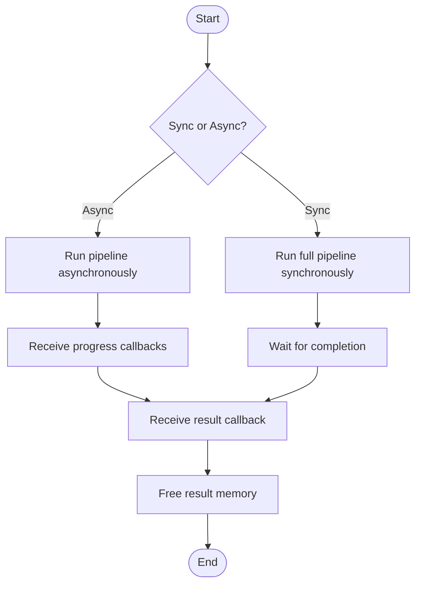

**Diagram sources**
- [fdm_pipeline.h:23-61](file://DllHsBaSlicer/fdm_pipeline.h#L23-L61)
- [custom_pipeline.h:23-62](file://DllHsBaSlicer/custom_pipeline.h#L23-L62)

**Section sources**
- [fdm_pipeline.h:23-61](file://DllHsBaSlicer/fdm_pipeline.h#L23-L61)
- [custom_pipeline.h:23-62](file://DllHsBaSlicer/custom_pipeline.h#L23-L62)

### Memory Management in Game Contexts
HsBaSlicer results allocate memory for strings such as G-code content, error messages, and export paths. The caller must free these buffers using the corresponding `HsBaFree...PipelineResult` function.

In game contexts:

- Copy string data into engine-owned memory before freeing native buffers.
- Avoid holding large G-code strings in long-lived global variables unless necessary.
- Use object pools or memory pools for frequently allocated temporary structures in custom pipeline code.
- Be careful with cross-language memory ownership: do not free memory allocated by another language runtime.

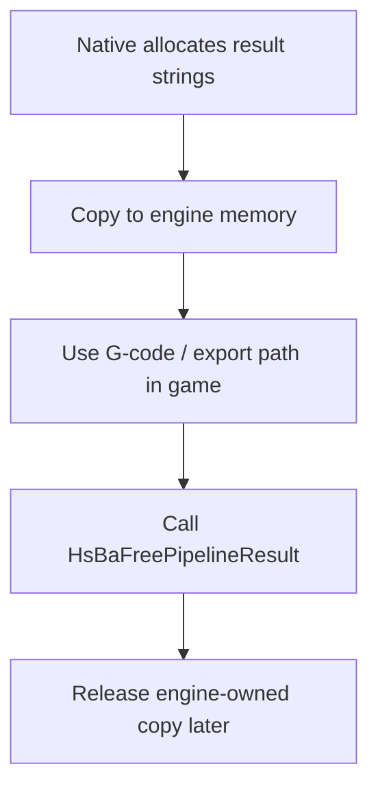

**Diagram sources**
- [pipeline_types.h:120-127](file://pipelinetypes/pipeline_types.h#L120-L127)
- [fdm_pipeline.h:53-61](file://DllHsBaSlicer/fdm_pipeline.h#L53-L61)

**Section sources**
- [pipeline_types.h:120-127](file://pipelinetypes/pipeline_types.h#L120-L127)
- [fdm_pipeline.h:53-61](file://DllHsBaSlicer/fdm_pipeline.h#L53-L61)

### Lua Scripting System for Procedural Content and Dynamic Levels
The Lua extension system allows injecting custom functions into pipeline stages:

- `HsBaAdd2DFunction`: 2D polygon operations for Support, Fill, and SLA Output.
- `HsBaAdd3DFunction`: 3D model operations for Slice and Support.
- `HsBaAddFileFunction`: File output for SLS Output and SLA Output.
- `HsBaAddEventCallback`: Event callbacks such as zipper events.

The fully Lua-driven custom pipeline lets you define the entire workflow through a Lua entry function, exposing model loading, slicing, support, fill, floor, G-code path output, and SLA/SLS packaging through a global Lua table.

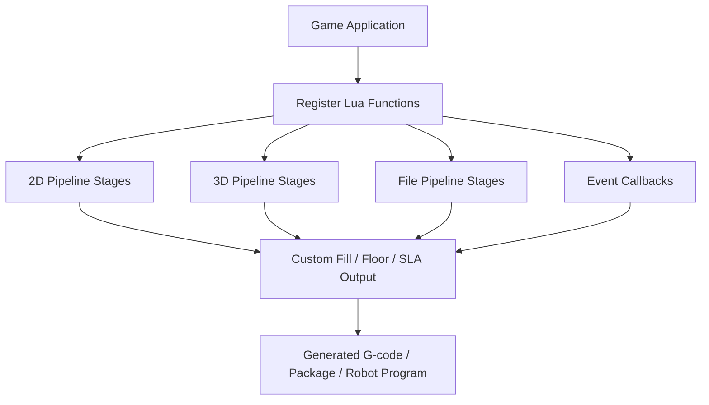

**Diagram sources**
- [lua_register.h:21-31](file://DllHsBaSlicer/lua_register.h#L21-L31)
- [event_source_register.h:15-17](file://DllHsBaSlicer/event_source_register.h#L15-L17)
- [custom_pipeline.h:23-36](file://DllHsBaSlicer/custom_pipeline.h#L23-L36)

**Section sources**
- [lua_register.h:21-31](file://DllHsBaSlicer/lua_register.h#L21-L31)
- [event_source_register.h:15-17](file://DllHsBaSlicer/event_source_register.h#L15-L17)
- [custom_pipeline.h:23-36](file://DllHsBaSlicer/custom_pipeline.h#L23-L36)

### Multi-Threading Strategies Suitable for Game Engines
HsBaSlicer uses C++20 coroutines internally for async execution and exposes callbacks to avoid blocking the caller. The engine wrapper should:

- Run slicing on background threads.
- Post progress and result callbacks to the engine’s main thread.
- Avoid long-running work in callbacks.
- Limit concurrent slicing jobs if the underlying geometry algorithms are CPU-heavy.
- Use a bounded thread pool rather than creating unlimited threads per slice request.

The built-in `ThreadPool` implementation demonstrates a worker-thread queue, future-based submission, pending/active task tracking, and coroutine executor integration.

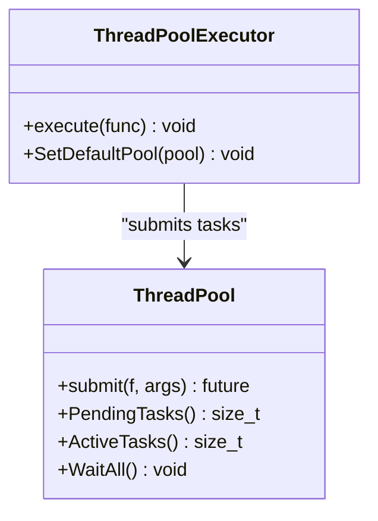

**Diagram sources**
- [thread_pool.hpp:29-162](file://base/thread_pool.hpp#L29-L162)
- [thread_pool.hpp:164-209](file://base/thread_pool.hpp#L164-L209)

**Section sources**
- [thread_pool.hpp:29-162](file://base/thread_pool.hpp#L29-L162)
- [thread_pool.hpp:164-209](file://base/thread_pool.hpp#L164-L209)

### Performance Optimization Techniques
To minimize frame-rate impact:

- Prefer `HsBaRunFdmPipelineAsync` or `HsBaRunCustomPipelineAsync` over synchronous calls during gameplay.
- Batch model updates: group multiple procedural changes and slice once.
- Reuse configurations where possible; only change fields that affect the new model.
- Cap concurrent slicing jobs based on available CPU cores.
- Avoid allocating large temporary buffers on the heap repeatedly; consider memory pools for custom pipeline code.
- Profile both CPU usage and memory allocation spikes during slicing.

The `MemoryPool` and `StaticMemoryPool` implementations provide fixed-size, allocator-style memory management that can reduce fragmentation and allocation overhead in tight loops.

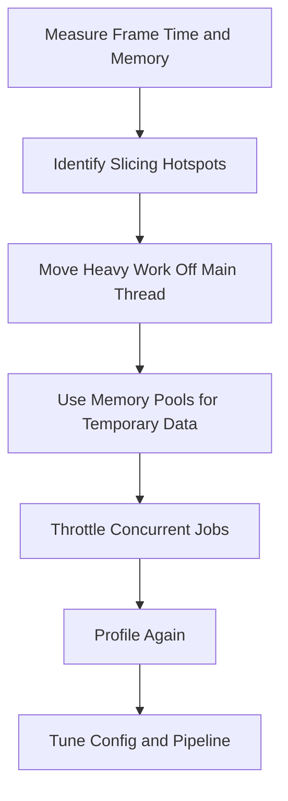

**Diagram sources**
- [memory_pool.hpp:43-208](file://base/memory_pool.hpp#L43-L208)
- [memory_pool.hpp:215-372](file://base/memory_pool.hpp#L215-L372)

**Section sources**
- [memory_pool.hpp:43-208](file://base/memory_pool.hpp#L43-L208)
- [memory_pool.hpp:215-372](file://base/memory_pool.hpp#L215-L372)

## Dependency Analysis
The integration depends on several layers:

- **Engine wrapper**: Unity C# or Unreal C++.
- **C ABI**: `initialize`, FDM/custom pipeline APIs, Lua registration, event registration.
- **Pipeline types**: shared C-compatible structs and enums.
- **Core algorithms**: mesh preprocessing, slicing, support generation, fill, path optimization, and export.

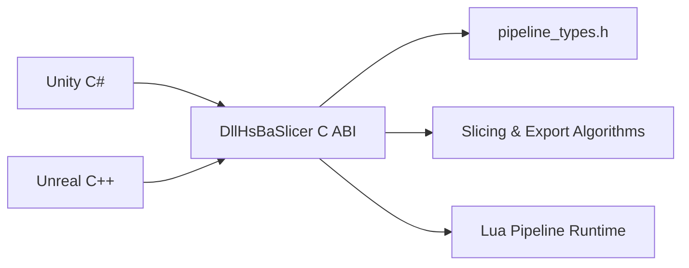

**Diagram sources**
- [initialize.h:15-19](file://DllHsBaSlicer/initialize.h#L15-L19)
- [fdm_pipeline.h:17-61](file://DllHsBaSlicer/fdm_pipeline.h#L17-L61)
- [custom_pipeline.h:17-62](file://DllHsBaSlicer/custom_pipeline.h#L17-L62)
- [lua_register.h:21-31](file://DllHsBaSlicer/lua_register.h#L21-L31)
- [pipeline_types.h:56-127](file://pipelinetypes/pipeline_types.h#L56-L127)

**Section sources**
- [initialize.h:15-19](file://DllHsBaSlicer/initialize.h#L15-L19)
- [fdm_pipeline.h:17-61](file://DllHsBaSlicer/fdm_pipeline.h#L17-L61)
- [custom_pipeline.h:17-62](file://DllHsBaSlicer/custom_pipeline.h#L17-L62)
- [lua_register.h:21-31](file://DllHsBaSlicer/lua_register.h#L21-L31)
- [pipeline_types.h:56-127](file://pipelinetypes/pipeline_types.h#L56-L127)

## Performance Considerations
Key performance considerations for game deployments:

| Concern | Recommendation |
|---|---|
| Frame rate impact | Use async slicing; never block the render thread. |
| CPU utilization | Limit concurrent slicing jobs; monitor `ActiveTasks` or equivalent metrics. |
| Memory spikes | Copy result strings immediately; free native buffers promptly. |
| String handling | Use UTF-8 consistently across C/C#/C++ boundaries. |
| IL2CPP / AOT | Match struct layouts and types exactly; avoid reflection-based marshalling for large configs. |
| Packaging | Ensure native libraries are present on all target platforms. |
| Profiling | Track elapsed seconds from pipeline results and correlate with engine profiler data. |

[No sources needed since this section provides general guidance]

## Troubleshooting Guide
Common issues and their causes:

| Symptom | Cause & Fix |
|---|---|
| `DllNotFoundException` in Unity | Plugin in the wrong folder or platform not enabled; check Inspector and per-platform plugin folders. |
| Unity crash after a callback | Delegate was collected by GC; keep a strong reference to it. |
| UE packaged build cannot find the DLL | Missing `RuntimeDependencies`; verify Binaries directory or delay-load configuration. |
| iOS link failure | iOS requires the static `.a` library and `DllImport("__Internal")`; dylibs cannot be loaded. |
| Struct fields misaligned or random crashes | P/Invoke struct field order or types do not match `pipeline_types.h`. |
| Slicing hangs or stalls | Too many concurrent jobs or missing main-thread marshalling in engine callbacks. |
| Large memory growth | Not freeing pipeline results or retaining G-code strings unnecessarily. |

**Section sources**
- [game_engine_integration.md:453-462](file://docs/en/DllHsBaSlicer/game_engine_integration.md#L453-L462)

## Conclusion
HsBaSlicer provides a robust C ABI for integrating real-time slicing into game engines. Unity integration relies on C# P/Invoke with careful delegate lifetime and main-thread marshalling, while Unreal Engine integration uses a C++ subsystem that bridges native callbacks to the GameThread. For interactive applications, always prefer asynchronous slicing, manage memory explicitly, and throttle concurrency. Lua scripting enables flexible procedural content generation, dynamic level preparation, and real-time model modification without changing the core C++ pipeline. With proper packaging, profiling, and troubleshooting, HsBaSlicer can serve as a reliable bridge between game engines and physical manufacturing workflows.

[No sources needed since this section summarizes without analyzing specific files]

## Appendices

### API Mapping Summary
| Engine | Entry Point | Async API | Result Cleanup |
|---|---|---|---|
| Unity | `initialize()` | `HsBaRunFdmPipelineAsync` | `HsBaFreePipelineResult` |
| Unreal | `initialize()` | `HsBaRunFdmPipeline` with background task | `HsBaFreePipelineResult` |
| Custom Lua | `HsBaCreateDefaultCustomConfig` | `HsBaRunCustomPipelineAsync` | `HsBaFreeCustomPipelineResult` |

**Section sources**
- [fdm_pipeline.h:17-61](file://DllHsBaSlicer/fdm_pipeline.h#L17-L61)
- [custom_pipeline.h:17-62](file://DllHsBaSlicer/custom_pipeline.h#L17-L62)
- [game_engine_integration.md:21-123](file://docs/en/DllHsBaSlicer/game_engine_integration.md#L21-L123)
- [game_engine_integration.md:272-349](file://docs/en/DllHsBaSlicer/game_engine_integration.md#L272-L349)