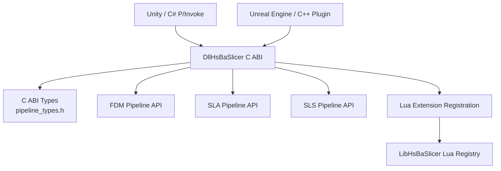
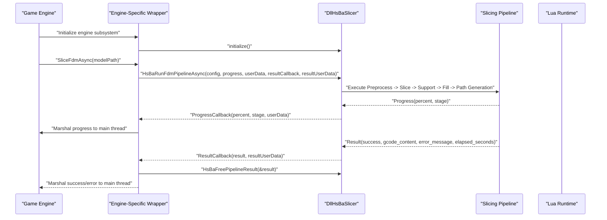
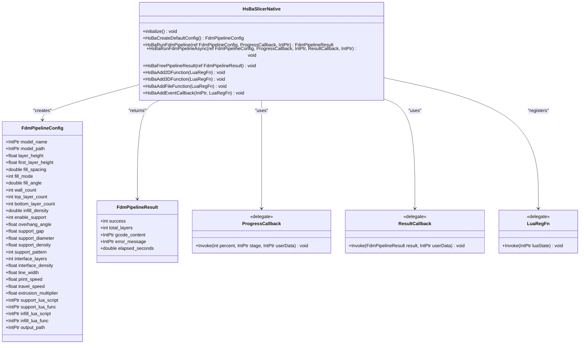
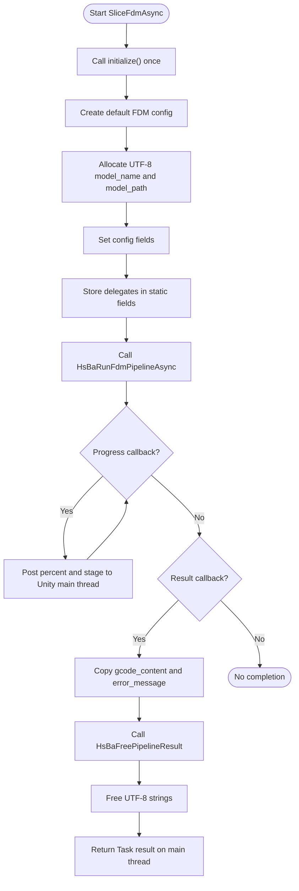
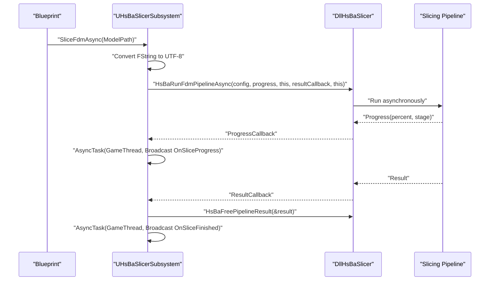
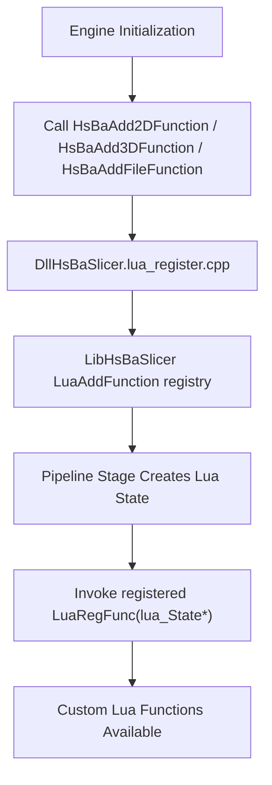
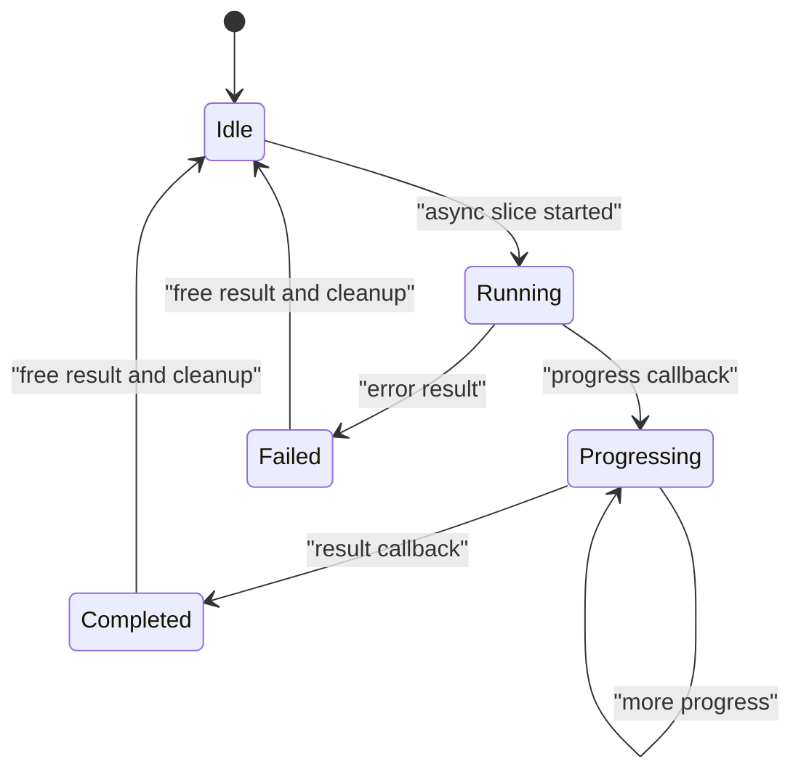
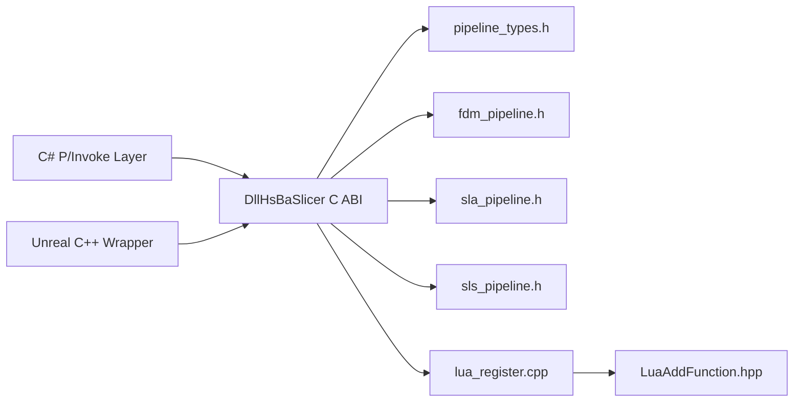

# Game Engine Integration

<cite>
**Referenced Files in This Document**
- [game_engine_integration.md](file://docs/en/DllHsBaSlicer/game_engine_integration.md)
- [pipeline_types.h](file://pipelinetypes/pipeline_types.h)
- [dllexport.h](file://DllHsBaSlicer/dllexport.h)
- [export.h](file://LibHsBaSlicer/export.h)
- [initialize.cpp](file://DllHsBaSlicer/initialize.cpp)
- [lua_register.cpp](file://DllHsBaSlicer/lua_register.cpp)
- [LuaAddFunction.hpp](file://LibHsBaSlicer/Extends/LuaAddFunction.hpp)
- [fdm_pipeline.h](file://DllHsBaSlicer/fdm_pipeline.h)
- [sla_pipeline.h](file://DllHsBaSlicer/sla_pipeline.h)
- [sls_pipeline.h](file://DllHsBaSlicer/sls_pipeline.h)
</cite>

## Table of Contents
1. [Introduction](#introduction)
2. [Project Structure](#project-structure)
3. [Core Components](#core-components)
4. [Architecture Overview](#architecture-overview)
5. [Detailed Component Analysis](#detailed-component-analysis)
6. [Dependency Analysis](#dependency-analysis)
7. [Performance Considerations](#performance-considerations)
8. [Troubleshooting Guide](#troubleshooting-guide)
9. [Conclusion](#conclusion)

## Introduction
This document explains how to integrate HsBaSlicer into game engines through the stable C ABI exposed by `DllHsBaSlicer`. It covers Unity (C# P/Invoke), Unreal Engine (C++ plugin and Blueprint), per-platform library placement, struct layout and memory management, async slicing with progress callbacks, main-thread marshalling, thread safety, delegate lifecycle, IL2CPP compatibility, SLA/SLS pipeline mapping, Lua extension registration, platform-specific optimizations, and common integration issues.

The C ABI is intentionally defined in a standalone header so that downstream code can reference the same types without depending on the shared library itself. The actual exported functions live in the DllHsBaSlicer module and use the `HSBA_SLICER_API` export macro for Windows DLL import/export.

**Section sources**
- [game_engine_integration.md:1-18](file://docs/en/DllHsBaSlicer/game_engine_integration.md#L1-L18)
- [pipeline_types.h:5-17](file://pipelinetypes/pipeline_types.h#L5-L17)
- [dllexport.h:1-23](file://DllHsBaSlicer/dllexport.h#L1-L23)

## Project Structure
At integration time, you are primarily concerned with three layers:

| Layer | Responsibility | Key Files |
|---|---|---|
| C ABI type definitions | Stable struct/enum/callback types used by both engines | `pipelinetypes/pipeline_types.h` |
| DllHsBaSlicer C ABI exports | Pipeline entry points, initialization, Lua registration | `DllHsBaSlicer/*_pipeline.h`, `initialize.cpp`, `lua_register.cpp` |
| LibHsBaSlicer internal API | Internal C++ helpers such as Lua function registries | `LibHsBaSlicer/Extends/LuaAddFunction.hpp`, `LibHsBaSlicer/export.h` |

**Diagram sources**
- [pipeline_types.h:5-17](file://pipelinetypes/pipeline_types.h#L5-L17)
- [fdm_pipeline.h:17-61](file://DllHsBaSlicer/fdm_pipeline.h#L17-L61)
- [sla_pipeline.h:17-56](file://DllHsBaSlicer/sla_pipeline.h#L17-L56)
- [sls_pipeline.h:17-56](file://DllHsBaSlicer/sls_pipeline.h#L17-L56)
- [lua_register.cpp:9-42](file://DllHsBaSlicer/lua_register.cpp#L9-L42)
- [LuaAddFunction.hpp:21-74](file://LibHsBaSlicer/Extends/LuaAddFunction.hpp#L21-L74)

**Section sources**
- [pipeline_types.h:5-17](file://pipelinetypes/pipeline_types.h#L5-L17)
- [dllexport.h:1-23](file://DllHsBaSlicer/dllexport.h#L1-L23)
- [export.h:1-22](file://LibHsBaSlicer/export.h#L1-L22)

## Core Components
The integration surface consists of:

| Component | Purpose | Integration Notes |
|---|---|---|
| `initialize()` | One-time runtime setup before running pipelines | Call once at application startup |
| Default config functions | Create zero-initialized or default-filled config structs | Always prefer these over manual field assignment |
| Sync run functions | Block until slicing completes | Suitable for background threads |
| Async run functions | Return immediately; completion delivered via callback | Preferred in game engines |
| Result free functions | Release strings allocated by the native side | Must be called after copying data |
| Lua registration functions | Inject custom Lua functions into pipeline stages | Register during engine initialization |

For FDM, the primary C ABI functions are declared in the FDM pipeline header. For SLA and SLS, analogous headers expose equivalent create/run/free APIs. All result structs contain UTF-8 string fields that must be freed through the matching free function.

**Section sources**
- [fdm_pipeline.h:17-61](file://DllHsBaSlicer/fdm_pipeline.h#L17-L61)
- [sla_pipeline.h:17-56](file://DllHsBaSlicer/sla_pipeline.h#L17-L56)
- [sls_pipeline.h:17-56](file://DllHsBaSlicer/sls_pipeline.h#L17-L56)
- [initialize.cpp:7-9](file://DllHsBaSlicer/initialize.cpp#L7-L9)

## Architecture Overview
The recommended integration architecture separates engine-specific concerns from the stable C ABI.

**Diagram sources**
- [fdm_pipeline.h:23-51](file://DllHsBaSlicer/fdm_pipeline.h#L23-L51)
- [pipeline_types.h:115-140](file://pipelinetypes/pipeline_types.h#L115-L140)
- [game_engine_integration.md:128-183](file://docs/en/DllHsBaSlicer/game_engine_integration.md#L128-L183)

## Detailed Component Analysis

### Per-Platform Library Placement
HsBaSlicer ships as a shared library for most platforms and as a static library for iOS when integrated with Unity.

| Platform | Artifact | Unity Placement | Unreal Engine Placement |
|---|---|---|---|
| Windows x64 | `DllHsBaSlicer.dll` | `Assets/Plugins/x86_64/` | Plugin `ThirdParty/.../Win64/` |
| Linux | `libDllHsBaSlicer.so` | `Assets/Plugins/x86_64/` | `ThirdParty/.../Linux/` |
| macOS | `libDllHsBaSlicer.dylib` | `Assets/Plugins/` | `ThirdParty/.../Mac/` |
| Android | `libDllHsBaSlicer.so` | `Assets/Plugins/Android/libs/<abi>/` | Packaged via engine toolchain |
| iOS | `libDllHsBaSlicer.a` | `Assets/Plugins/iOS/` | `ThirdParty/.../iOS/` |

On iOS, Unity uses `"__Internal"` as the `DllImport` name because the library is statically linked. In Unreal Engine, the third-party module build script should add the platform-specific library and mark the DLL as a runtime dependency.

**Section sources**
- [game_engine_integration.md:7-18](file://docs/en/DllHsBaSlicer/game_engine_integration.md#L7-L18)

### Unity C# P/Invoke Bindings
Unity integration uses C# P/Invoke to call the C ABI. The binding layer must mirror the C struct layout exactly.

Key rules:
- Use `[StructLayout(LayoutKind.Sequential)]` for every config and result struct.
- Map `const char*` to `IntPtr`.
- Map enums to `int`.
- Mark delegates with `[UnmanagedFunctionPointer(CallingConvention.Cdecl)]`.
- Keep delegate references alive in static or member fields.
- On iOS, set the `DllImport` library name to `"__Internal"`.

**Diagram sources**
- [game_engine_integration.md:23-123](file://docs/en/DllHsBaSlicer/game_engine_integration.md#L23-L123)
- [pipeline_types.h:53-140](file://pipelinetypes/pipeline_types.h#L53-L140)

**Section sources**
- [game_engine_integration.md:23-123](file://docs/en/DllHsBaSlicer/game_engine_integration.md#L23-L123)
- [pipeline_types.h:53-140](file://pipelinetypes/pipeline_types.h#L53-L140)

### Unity High-Level Wrapper: Async Operations and Main-Thread Marshalling
The high-level wrapper hides P/Invoke details and provides an asynchronous API suitable for Unity’s event-driven model.

Recommended pattern:
1. Call `initialize()` once during app startup.
2. Create a default config using the native default-config function.
3. Allocate UTF-8 strings with `Marshal.StringToCoTaskMemUTF8`.
4. Store progress and result delegates in static fields to prevent garbage collection.
5. Marshal progress updates to the Unity main thread.
6. Copy strings from the result before calling the free function.
7. Free unmanaged UTF-8 strings after the async call returns.

**Diagram sources**
- [game_engine_integration.md:128-183](file://docs/en/DllHsBaSlicer/game_engine_integration.md#L128-L183)
- [fdm_pipeline.h:37-61](file://DllHsBaSlicer/fdm_pipeline.h#L37-L61)

**Section sources**
- [game_engine_integration.md:128-183](file://docs/en/DllHsBaSlicer/game_engine_integration.md#L128-L183)

### Unity Notes: Delegates, Threading, and IL2CPP
- **Delegate lifetime**: A delegate passed to native code must remain alive until the native side stops calling it. Storing it in a static or instance field prevents GC collection.
- **Main-thread marshalling**: Native callbacks execute on worker threads. Do not directly access Unity engine objects; instead, post work to the Unity main thread.
- **Android**: Place per-ABI `.so` files under `Assets/Plugins/Android/libs/<abi>/`.
- **iOS**: Use a static `.a` library and `DllImport("__Internal")`.
- **IL2CPP**: By-value struct passing works, but field order and exact numeric types must match the C ABI.

**Section sources**
- [game_engine_integration.md:206-213](file://docs/en/DllHsBaSlicer/game_engine_integration.md#L206-L213)

### Unreal Engine Third-Party Module Layout
Unreal Engine integration uses a third-party module to link against the prebuilt HsBaSlicer library and a wrapper module to expose functionality to Blueprints.

Recommended layout:
- `Plugins/HsBaSlicer/HsBaSlicer.uplugin`
- `Source/HsBaSlicer/` — wrapper module with `UFUNCTION`s
- `Source/ThirdParty/DllHsBaSlicer/` — external library module
- `include/` — copied DllHsBaSlicer headers
- `lib/` — platform-specific libraries and import libraries

The third-party Build.cs should:
- Set `ModuleType.External`.
- Add include paths.
- Link the platform-specific library.
- Add runtime dependencies for packaging.
- Optionally delay-load the DLL on Windows.

**Section sources**
- [game_engine_integration.md:218-270](file://docs/en/DllHsBaSlicer/game_engine_integration.md#L218-L270)

### Unreal Engine C++ Wrapper: Async Operations and GameThread Marshalling
The Unreal wrapper exposes a Blueprint-callable async slicing method and broadcasts dynamic delegates for progress and completion.

Key responsibilities:
- Convert `FString` to UTF-8 before crossing the C boundary.
- Keep the UTF-8 byte array alive for the entire slicing operation.
- Execute slicing on a background task.
- Marshal progress and completion events to the GameThread.
- Free the native result after copying strings.

**Diagram sources**
- [game_engine_integration.md:272-349](file://docs/en/DllHsBaSlicer/game_engine_integration.md#L272-L349)
- [fdm_pipeline.h:37-61](file://DllHsBaSlicer/fdm_pipeline.h#L37-L61)

**Section sources**
- [game_engine_integration.md:272-362](file://docs/en/DllHsBaSlicer/game_engine_integration.md#L272-L362)

### SLA and SLS Pipeline Mapping
SLA and SLS follow the same integration pattern as FDM, but use different config/result types and free functions.

| Process | Config Type | Default Config Function | Run Function | Free Function |
|---|---|---|---|---|
| FDM | `HsBaFdmPipelineConfig_t` | `HsBaCreateDefaultConfig` | `HsBaRunFdmPipeline` / `HsBaRunFdmPipelineAsync` | `HsBaFreePipelineResult` |
| SLA | `HsBaSlaPipelineConfig_t` | `HsBaCreateDefaultSlaConfig` | `HsBaRunSlaPipeline` / `HsBaRunSlaPipelineAsync` | `HsBaFreeSlaPipelineResult` |
| SLS | `HsBaSlsPipelineConfig_t` | `HsBaCreateDefaultSlsConfig` | `HsBaRunSlsPipeline` / `HsBaRunSlsPipelineAsync` | `HsBaFreeSlsPipelineResult` |

Important differences:
- SLA outputs layer images and optionally a zip file.
- SLS requires an export Lua script because its output format is determined by the script.
- Both SLA and SLS results contain `export_path` rather than raw G-code content.

**Section sources**
- [game_engine_integration.md:366-377](file://docs/en/DllHsBaSlicer/game_engine_integration.md#L366-L377)
- [sla_pipeline.h:17-56](file://DllHsBaSlicer/sla_pipeline.h#L17-L56)
- [sls_pipeline.h:17-56](file://DllHsBaSlicer/sls_pipeline.h#L17-L56)
- [pipeline_types.h:165-310](file://pipelinetypes/pipeline_types.h#L165-L310)

### Lua Extension Function Registration
HsBaSlicer supports registering custom Lua functions per pipeline dimension. The registration functions accept a callback that receives a `lua_State*` pointer and installs functions into that Lua environment.

Registration categories:
- 2D functions: used by Support, Fill, and SLA output stages.
- 3D functions: used by Slice and Support stages.
- File functions: used by SLS and SLA output stages.
- Event callbacks: bound to named events such as zipper operations.

**Diagram sources**
- [lua_register.cpp:9-42](file://DllHsBaSlicer/lua_register.cpp#L9-L42)
- [LuaAddFunction.hpp:21-74](file://LibHsBaSlicer/Extends/LuaAddFunction.hpp#L21-L74)
- [game_engine_integration.md:380-452](file://docs/en/DllHsBaSlicer/game_engine_integration.md#L380-L452)

**Section sources**
- [lua_register.cpp:9-42](file://DllHsBaSlicer/lua_register.cpp#L9-L42)
- [LuaAddFunction.hpp:21-74](file://LibHsBaSlicer/Extends/LuaAddFunction.hpp#L21-L74)
- [game_engine_integration.md:380-452](file://docs/en/DllHsBaSlicer/game_engine_integration.md#L380-L452)

### Thread Safety and Delegate Lifecycle Management
Thread safety is the most important integration concern.

Rules:
- Never assume native callbacks run on the engine’s main thread.
- In Unity, marshal UI and engine object access to the main thread.
- In Unreal Engine, marshal all `UFUNCTION` calls and delegate broadcasts to the GameThread.
- Keep C# delegates alive for the full lifetime of the native callback.
- Keep Unreal Engine user data pointers valid while the pipeline runs.
- Copy all owned strings from result structs before freeing them.
- Do not share mutable configuration structs across concurrent pipeline calls unless each call owns its own copy.

**Diagram sources**
- [game_engine_integration.md:139-183](file://docs/en/DllHsBaSlicer/game_engine_integration.md#L139-L183)
- [game_engine_integration.md:312-349](file://docs/en/DllHsBaSlicer/game_engine_integration.md#L312-L349)

**Section sources**
- [game_engine_integration.md:139-183](file://docs/en/DllHsBaSlicer/game_engine_integration.md#L139-L183)
- [game_engine_integration.md:312-362](file://docs/en/DllHsBaSlicer/game_engine_integration.md#L312-L362)

### Memory Management Rules
Every pipeline result contains one or more UTF-8 strings allocated by the native side. The caller must free them using the matching free function.

Ownership summary:
- Config structs are usually created by default-config functions and may contain null-terminated string pointers owned by the caller.
- Result structs contain owned strings that must be released through the free function.
- Progress and result callbacks receive copies of simple values plus pointers to strings whose ownership depends on the result type.
- In Unity, allocate temporary UTF-8 strings with `Marshal.StringToCoTaskMemUTF8` and free them after the async call completes.
- In Unreal Engine, keep the UTF-8 buffer alive for the duration of the slicing operation.

**Section sources**
- [pipeline_types.h:115-140](file://pipelinetypes/pipeline_types.h#L115-L140)
- [pipeline_types.h:220-310](file://pipelinetypes/pipeline_types.h#L220-L310)
- [fdm_pipeline.h:53-61](file://DllHsBaSlicer/fdm_pipeline.h#L53-L61)
- [sla_pipeline.h:49-56](file://DllHsBaSlicer/sla_pipeline.h#L49-L56)
- [sls_pipeline.h:49-56](file://DllHsBaSlicer/sls_pipeline.h#L49-L56)

### Platform-Specific Optimizations
- **Unity IL2CPP**: Prefer by-value struct passing where possible, but ensure exact field alignment and type matching. Avoid unnecessary interop allocations inside hot paths.
- **Unity Android**: Bundle only the required ABIs and avoid loading the library on unsupported platforms.
- **Unity iOS**: Use static linking and `"__Internal"`; dylibs cannot be loaded at runtime.
- **Unreal Engine Packaging**: Use `RuntimeDependencies` so the DLL is included in builds and packages. If using delay loading, ensure the DLL directory is available at runtime.
- **Server or Console Targets**: Exclude the slicing module on targets that do not need slicing functionality.

**Section sources**
- [game_engine_integration.md:206-213](file://docs/en/DllHsBaSlicer/game_engine_integration.md#L206-L213)
- [game_engine_integration.md:357-362](file://docs/en/DllHsBaSlicer/game_engine_integration.md#L357-L362)

## Dependency Analysis
The integration stack has clear boundaries between engine code, the C ABI, and internal C++ components.

**Diagram sources**
- [pipeline_types.h:5-17](file://pipelinetypes/pipeline_types.h#L5-L17)
- [fdm_pipeline.h:1-15](file://DllHsBaSlicer/fdm_pipeline.h#L1-L15)
- [sla_pipeline.h:1-15](file://DllHsBaSlicer/sla_pipeline.h#L1-L15)
- [sls_pipeline.h:1-15](file://DllHsBaSlicer/sls_pipeline.h#L1-L15)
- [lua_register.cpp:1-42](file://DllHsBaSlicer/lua_register.cpp#L1-L42)
- [LuaAddFunction.hpp:1-78](file://LibHsBaSlicer/Extends/LuaAddFunction.hpp#L1-L78)

**Section sources**
- [pipeline_types.h:5-17](file://pipelinetypes/pipeline_types.h#L5-L17)
- [dllexport.h:1-23](file://DllHsBaSlicer/dllexport.h#L1-L23)
- [export.h:1-22](file://LibHsBaSlicer/export.h#L1-L22)

## Performance Considerations
- Use async pipeline calls to avoid blocking the game loop.
- Batch progress updates if the UI does not need every single callback.
- Reuse configuration objects only when safe; otherwise allocate fresh configs per slice.
- Minimize UTF-8 allocations by reusing buffers where possible.
- Avoid holding large G-code strings in managed memory longer than necessary.
- On mobile platforms, consider limiting parallel slicing jobs to preserve CPU and memory.

[No sources needed since this section provides general guidance]

## Troubleshooting Guide

| Symptom | Likely Cause | Recommended Fix |
|---|---|---|
| `DllNotFoundException` in Unity | Wrong plugin folder or platform disabled in Inspector | Verify per-platform placement and enabled platforms |
| Unity crash after a native callback | Delegate was garbage collected | Keep delegate references in static or instance fields |
| Unreal packaged build cannot find the DLL | Missing runtime dependency or wrong binary location | Add `RuntimeDependencies`; check Binaries directory |
| iOS link or load failure | Using a dynamic library instead of a static library | Use `libDllHsBaSlicer.a` and `DllImport("__Internal")` |
| Struct fields misaligned or random crashes | P/Invoke struct layout differs from `pipeline_types.h` | Use sequential layout and match field order and types exactly |
| Memory grows over time | Not calling the result free function | Call `HsBaFreePipelineResult` or the matching free function |
| G-code or error message is empty or corrupted | Accessing result strings after freeing | Copy strings before calling the free function |
| Lua functions not available | Registration not called or wrong stage category | Call the correct `HsBaAdd2DFunction` / `HsBaAdd3DFunction` / `HsBaAddFileFunction` during initialization |
| Blueprint events never fire | Callback executed off GameThread | Wrap delegate broadcasts in GameThread tasks |
| IL2CPP struct mismatch | Numeric type mismatch or missing sequential layout | Match `float`, `double`, `int`, and enum types exactly |

**Section sources**
- [game_engine_integration.md:453-462](file://docs/en/DllHsBaSlicer/game_engine_integration.md#L453-L462)
- [pipeline_types.h:115-140](file://pipelinetypes/pipeline_types.h#L115-L140)
- [fdm_pipeline.h:53-61](file://DllHsBaSlicer/fdm_pipeline.h#L53-L61)

## Conclusion
HsBaSlicer’s game engine integration is centered on a stable C ABI defined in `pipeline_types.h` and exported by `DllHsBaSlicer`. Unity integrates through C# P/Invoke, while Unreal Engine integrates through a C++ wrapper and Blueprint. The most important integration responsibilities are correct struct layouts, proper UTF-8 memory handling, async execution, main-thread marshalling, delegate lifecycle management, and platform-specific packaging. Once these boundaries are respected, SLA, SLS, and other pipeline variants follow the same patterns as FDM.

[No sources needed since this section summarizes without analyzing specific files]