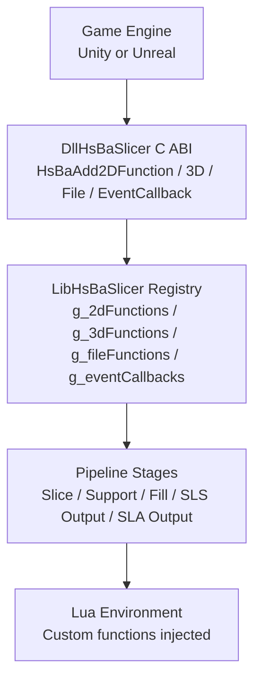
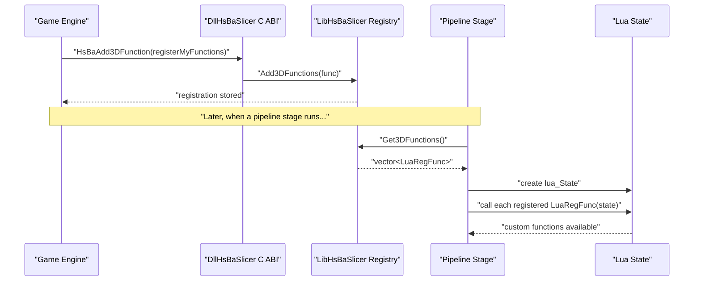
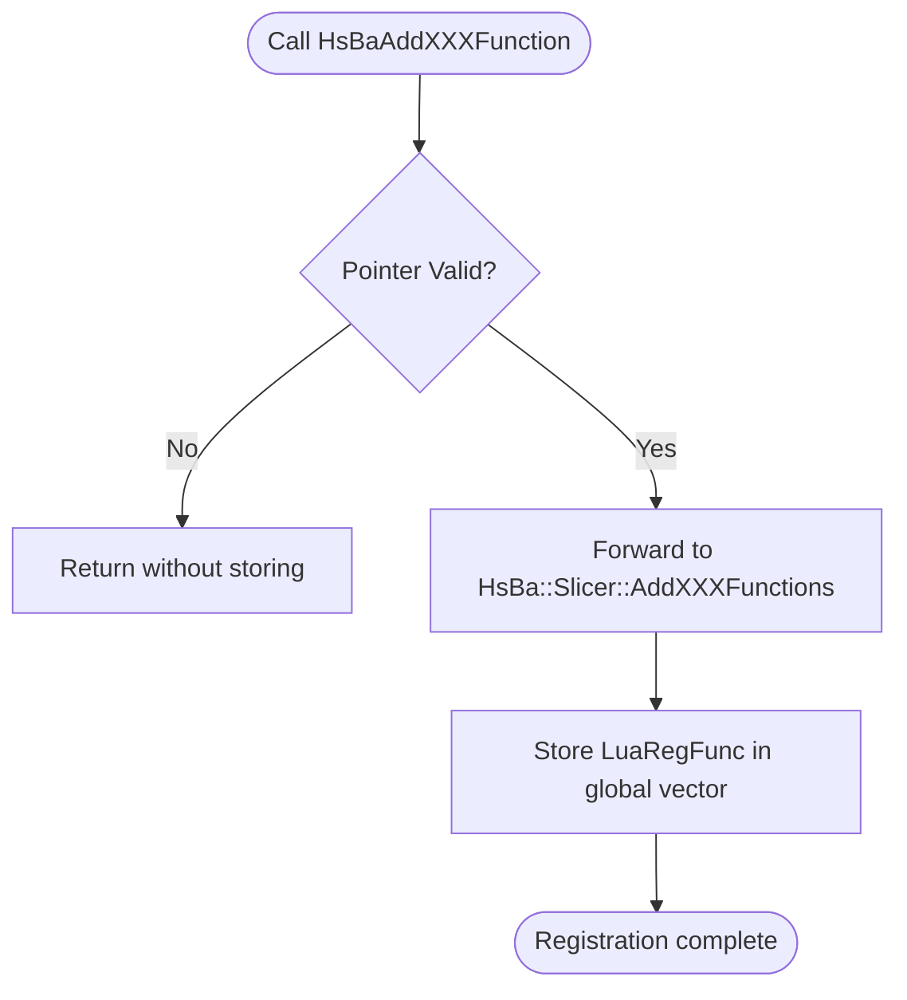
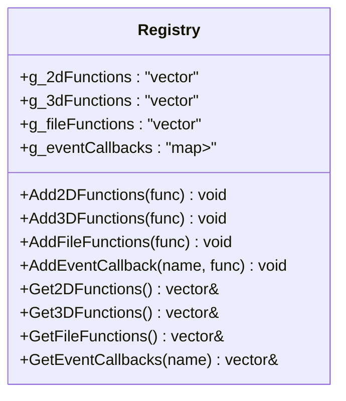
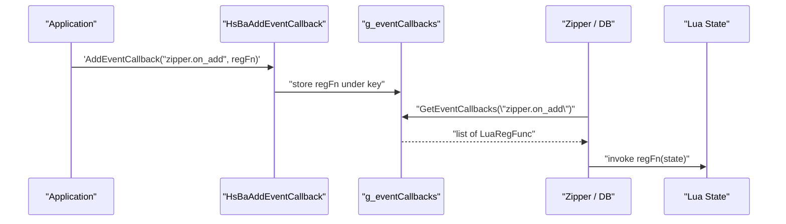
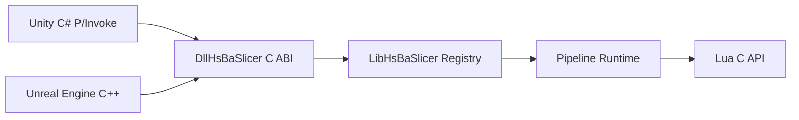
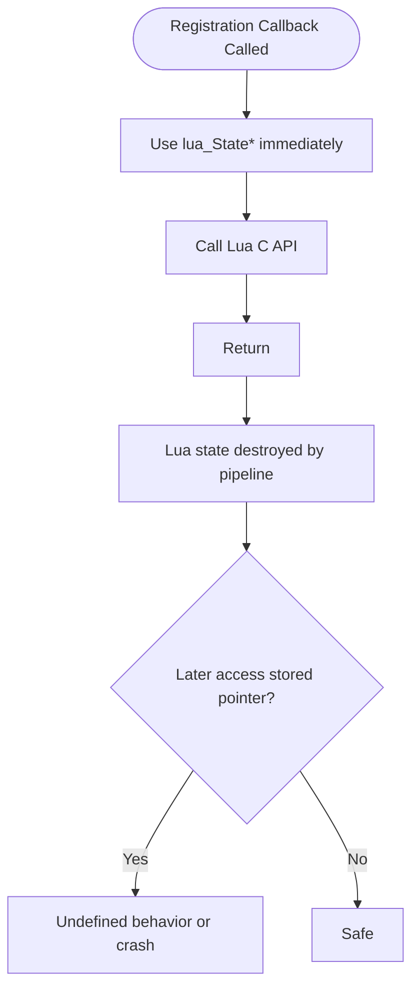
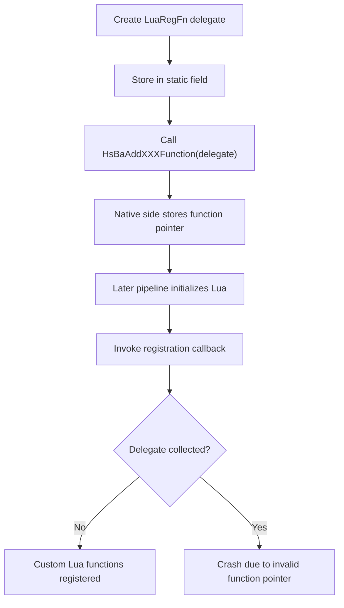
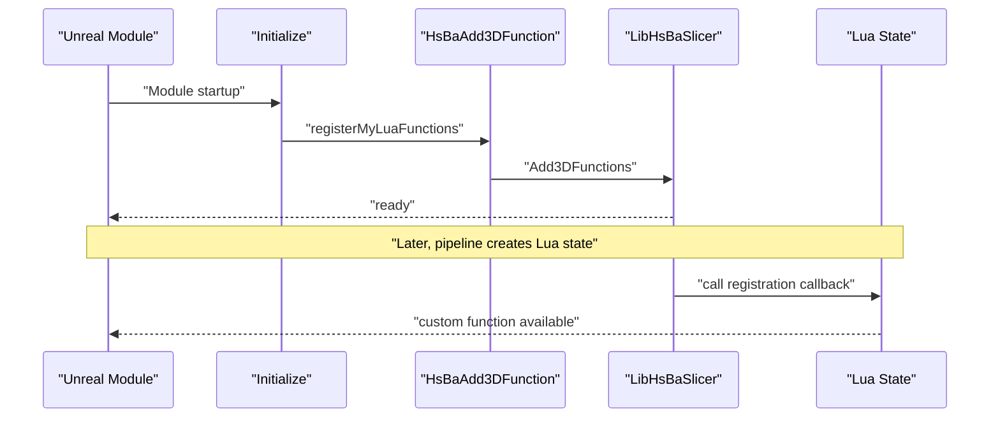
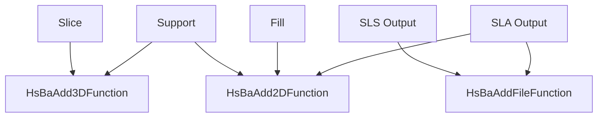

# Lua Extension Function Registration

<cite>
**Referenced Files in This Document**
- [lua_register.h](file://DllHsBaSlicer/lua_register.h)
- [lua_register.cpp](file://DllHsBaSlicer/lua_register.cpp)
- [LuaAddFunction.hpp](file://LibHsBaSlicer/Extends/LuaAddFunction.hpp)
- [LuaAddFunction.cpp](file://LibHsBaSlicer/Extends/LuaAddFunction.cpp)
- [game_engine_integration.md](file://docs/en/DllHsBaSlicer/game_engine_integration.md)
</cite>

## Table of Contents
1. [Introduction](#introduction)
2. [Project Structure](#project-structure)
3. [Core Components](#core-components)
4. [Architecture Overview](#architecture-overview)
5. [Detailed Component Analysis](#detailed-component-analysis)
6. [Dependency Analysis](#dependency-analysis)
7. [Performance Considerations](#performance-considerations)
8. [Thread Safety and Lifetime Management](#thread-safety-and-lifetime-management)
9. [Unity Integration Guide](#unity-integration-guide)
10. [Unreal Engine Integration Guide](#unreal-engine-integration-guide)
11. [Registration Points by Pipeline Stage](#registration-points-by-pipeline-stage)
12. [Troubleshooting Guide](#troubleshooting-guide)
13. [Conclusion](#conclusion)

## Introduction
This document explains how to register custom Lua extension functions for the HsBaSlicer pipeline through the C ABI entry points `HsBaAdd2DFunction`, `HsBaAdd3DFunction`, `HsBaAddFileFunction`, and `HsBaAddEventCallback`. It covers:

- The `HsBaLuaRegFn` / `LuaRegFn` delegate signature.
- How registration is stored and later applied when each pipeline stage creates its Lua environment.
- Which function types are available per pipeline stage: Slice, Support, Fill, SLS Output, and SLA Output.
- Complete integration examples for Unity (C# P/Invoke) and Unreal Engine (C++).
- Best practices for native Lua C API integration, lifetime management, and thread safety.

The core idea is simple: you provide a registration callback that receives a `lua_State*`, and the engine calls it at the right time so your custom Lua functions become available to the pipeline scripts.

## Project Structure
The Lua extension registration path crosses two layers:

| Layer | Responsibility | Key Files |
|---|---|---|
| DllHsBaSlicer C ABI | Exposes stable C entry points for game engines | `DllHsBaSlicer/lua_register.h`, `DllHsBaSlicer/lua_register.cpp` |
| LibHsBaSlicer internal registry | Stores registration callbacks and event bindings | `LibHsBaSlicer/Extends/LuaAddFunction.hpp`, `LibHsBaSlicer/Extends/LuaAddFunction.cpp` |
| Game engine documentation | Shows Unity and Unreal usage patterns | `docs/en/DllHsBaSlicer/game_engine_integration.md` |

**Diagram sources**
- [lua_register.h:11-31](file://DllHsBaSlicer/lua_register.h#L11-L31)
- [lua_register.cpp:11-41](file://DllHsBaSlicer/lua_register.cpp#L11-L41)
- [LuaAddFunction.hpp:21-74](file://LibHsBaSlicer/Extends/LuaAddFunction.hpp#L21-L74)
- [LuaAddFunction.cpp:13-66](file://LibHsBaSlicer/Extends/LuaAddFunction.cpp#L13-L66)

**Section sources**
- [lua_register.h:1-38](file://DllHsBaSlicer/lua_register.h#L1-L38)
- [lua_register.cpp:1-43](file://DllHsBaSlicer/lua_register.cpp#L1-L43)
- [LuaAddFunction.hpp:1-78](file://LibHsBaSlicer/Extends/LuaAddFunction.hpp#L1-L78)
- [LuaAddFunction.cpp:1-68](file://LibHsBaSlicer/Extends/LuaAddFunction.cpp#L1-L68)

## Core Components
The registration system has four public C entry points and one shared delegate type.

| API | Purpose | Available Pipeline Stages |
|---|---|---|
| `HsBaAdd2DFunction(HsBaLuaRegFn func)` | Register 2D Lua functions | Support, Fill, SLA Output |
| `HsBaAdd3DFunction(HsBaLuaRegFn func)` | Register 3D Lua functions | Slice, Support |
| `HsBaAddFileFunction(HsBaLuaRegFn func)` | Register file-related Lua functions | SLS Output, SLA Output |
| `HsBaAddEventCallback(const char* event_name, HsBaLuaRegFn func)` | Bind a named Lua event to a registration callback | Zipper, database, and other named events |

The delegate type is:

| Context | Delegate Signature | Meaning |
|---|---|---|
| C ABI | `typedef void (*HsBaLuaRegFn)(lua_State*)` | Receives a raw `lua_State*` pointer |
| C++ internal | `using LuaRegFunc = std::function<void(lua_State*)>` | Stored internally as a callable |

Important constraints:

- The registration callback must be a valid function pointer for the process lifetime.
- The callback receives a fresh `lua_State*` owned by the pipeline stage.
- The callback should only call Lua C API functions on that state; it must not store the pointer for later use.
- For Unity, the C# delegate must remain alive; otherwise the garbage collector can collect it while the native side still holds it.

**Section sources**
- [lua_register.h:13-31](file://DllHsBaSlicer/lua_register.h#L13-L31)
- [LuaAddFunction.hpp:21-74](file://LibHsBaSlicer/Extends/LuaAddFunction.hpp#L21-L74)

## Architecture Overview
The registration flow is intentionally thin at the C boundary and more flexible inside the library.

**Diagram sources**
- [lua_register.cpp:19-25](file://DllHsBaSlicer/lua_register.cpp#L19-L25)
- [LuaAddFunction.cpp:26-29](file://LibHsBaSlicer/Extends/LuaAddFunction.cpp#L26-L29)
- [LuaAddFunction.cpp:41-44](file://LibHsBaSlicer/Extends/LuaAddFunction.cpp#L41-L44)

## Detailed Component Analysis

### C ABI Entry Points
The C ABI layer exposes stable functions for non-C++ callers such as Unity P/Invoke. Each function validates its input and forwards to the internal registry.

| Function | Behavior |
|---|---|
| `HsBaAdd2DFunction(func)` | If `func` is non-null, stores it in the 2D registration list |
| `HsBaAdd3DFunction(func)` | If `func` is non-null, stores it in the 3D registration list |
| `HsBaAddFileFunction(func)` | If `func` is non-null, stores it in the file registration list |
| `HsBaAddEventCallback(event_name, func)` | If both arguments are non-null, binds `func` to `event_name` |

**Diagram sources**
- [lua_register.cpp:11-41](file://DllHsBaSlicer/lua_register.cpp#L11-L41)

**Section sources**
- [lua_register.cpp:9-42](file://DllHsBaSlicer/lua_register.cpp#L9-L42)

### Internal Registry
The internal registry uses module-level vectors to hold registration callbacks and a map to hold event-bound callbacks.

| Storage | Type | Purpose |
|---|---|---|
| `g_2dFunctions` | `std::vector<LuaRegFunc>` | 2D function registrations |
| `g_3dFunctions` | `std::vector<LuaRegFunc>` | 3D function registrations |
| `g_fileFunctions` | `std::vector<LuaRegFunc>` | File function registrations |
| `g_eventCallbacks` | `std::map<std::string, std::vector<LuaRegFunc>>` | Named event callbacks |

**Diagram sources**
- [LuaAddFunction.hpp:21-74](file://LibHsBaSlicer/Extends/LuaAddFunction.hpp#L21-L74)
- [LuaAddFunction.cpp:13-66](file://LibHsBaSlicer/Extends/LuaAddFunction.cpp#L13-L66)

**Section sources**
- [LuaAddFunction.cpp:9-68](file://LibHsBaSlicer/Extends/LuaAddFunction.cpp#L9-L68)

### Event Callback Registration
Event registration is separate from pipeline dimension registration. Instead of being tied to Slice/Support/Fill/SLS/SLA, it is keyed by an event name string.

Common example event names include:

- `"zipper.on_add"`
- `"db.on_query"`

When the corresponding subsystem emits an event, the runtime looks up the event name and invokes all registered Lua registration callbacks with the current Lua state.

**Diagram sources**
- [lua_register.cpp:35-41](file://DllHsBaSlicer/lua_register.cpp#L35-L41)
- [LuaAddFunction.cpp:55-66](file://LibHsBaSlicer/Extends/LuaAddFunction.cpp#L55-L66)

**Section sources**
- [lua_register.cpp:35-41](file://DllHsBaSlicer/lua_register.cpp#L35-L41)
- [LuaAddFunction.cpp:53-68](file://LibHsBaSlicer/Extends/LuaAddFunction.cpp#L53-L68)

## Dependency Analysis
The dependency chain is layered and intentionally decoupled:

Key observations:

- Unity and Unreal both ultimately call the same C ABI functions.
- The C ABI does not implement registration logic; it forwards to the library namespace.
- The library stores `std::function<void(lua_State*)>` objects, which can wrap static functions, lambdas, or bound delegates.
- The Lua state passed into the registration callback is owned by the pipeline stage and must not escape beyond that callback.

**Diagram sources**
- [lua_register.h:11-31](file://DllHsBaSlicer/lua_register.h#L11-L31)
- [LuaAddFunction.hpp:21-74](file://LibHsBaSlicer/Extends/LuaAddFunction.hpp#L21-L74)

**Section sources**
- [lua_register.h:1-38](file://DllHsBaSlicer/lua_register.h#L1-L38)
- [LuaAddFunction.hpp:1-78](file://LibHsBaSlicer/Extends/LuaAddFunction.hpp#L1-L78)

## Performance Considerations
- Registration itself is cheap: it appends a `std::function` to a global vector.
- The real cost comes from calling the registration callback during pipeline initialization.
- Avoid heavy work inside registration callbacks; prefer registering lightweight Lua wrappers that perform expensive work lazily.
- Reuse registration callbacks where possible instead of allocating new closures repeatedly.
- Do not perform blocking I/O or long-running computations inside Lua C functions exposed to pipeline scripts unless they are explicitly asynchronous.

[No sources needed since this section provides general guidance]

## Thread Safety and Lifetime Management

### Lifetime Rules
| Item | Rule |
|---|---|
| Registration callback pointer | Must remain valid for the entire process lifetime |
| `lua_State*` parameter | Only valid inside the registration callback invocation |
| Custom Lua C functions | Should be static or globally reachable so their addresses do not change |
| Unity delegates | Must be kept in static or member fields to prevent GC collection |
| Event name strings | In Unity, the documentation warns not to free the UTF-8 pointer after passing it to `HsBaAddEventCallback` |

### Why Delegates Can Crash in Unity
If a C# delegate is passed to native code but no strong reference is kept, the garbage collector may collect it. When the native side later calls the function pointer, the address is invalid and the process crashes.

### Why Lua State Must Not Be Stored
The registration callback receives a temporary Lua state created by the pipeline stage. Storing that pointer and using it later can cause undefined behavior because the state may be destroyed or reused.

**Diagram sources**
- [lua_register.h:13-14](file://DllHsBaSlicer/lua_register.h#L13-L14)
- [LuaAddFunction.hpp:21-22](file://LibHsBaSlicer/Extends/LuaAddFunction.hpp#L21-L22)

**Section sources**
- [game_engine_integration.md:139-143](file://docs/en/DllHsBaSlicer/game_engine_integration.md#L139-L143)
- [game_engine_integration.md:387-407](file://docs/en/DllHsBaSlicer/game_engine_integration.md#L387-L407)

## Unity Integration Guide

### C# Binding Declaration
Unity uses `DllImport` to call the exported C functions. The delegate type must match the C ABI:

| C ABI | C# Equivalent |
|---|---|
| `void (*HsBaLuaRegFn)(lua_State*)` | `delegate void LuaRegFn(IntPtr luaState)` |
| `void HsBaAdd2DFunction(HsBaLuaRegFn)` | `[DllImport(...)] static extern void HsBaAdd2DFunction(LuaRegFn func)` |
| `void HsBaAdd3DFunction(HsBaLuaRegFn)` | `[DllImport(...)] static extern void HsBaAdd3DFunction(LuaRegFn func)` |
| `void HsBaAddFileFunction(HsBaLuaRegFn)` | `[DllImport(...)] static extern void HsBaAddFileFunction(LuaRegFn func)` |
| `void HsBaAddEventCallback(const char*, HsBaLuaRegFn)` | `[DllImport(...)] static extern void HsBaAddEventCallback(IntPtr eventName, LuaRegFn func)` |

The binding declaration is defined in the Unity integration guide.

**Section sources**
- [game_engine_integration.md:108-123](file://docs/en/DllHsBaSlicer/game_engine_integration.md#L108-L123)

### Keeping Delegates Alive
The Unity integration guide explicitly warns that delegates handed to native code must be stored in static or member fields. Otherwise, the garbage collector can collect them and cause a crash when the native callback fires.

**Diagram sources**
- [game_engine_integration.md:139-143](file://docs/en/DllHsBaSlicer/game_engine_integration.md#L139-L143)
- [game_engine_integration.md:387-407](file://docs/en/DllHsBaSlicer/game_engine_integration.md#L387-L407)

**Section sources**
- [game_engine_integration.md:139-143](file://docs/en/DllHsBaSlicer/game_engine_integration.md#L139-L143)
- [game_engine_integration.md:387-407](file://docs/en/DllHsBaSlicer/game_engine_integration.md#L387-L407)

### Unity Example Pattern
A typical Unity pattern is:

1. Initialize the slicer once.
2. Create a static `LuaRegFn` delegate.
3. Pass it to `HsBaAdd3DFunction`, `HsBaAdd2DFunction`, or `HsBaAddFileFunction`.
4. For event callbacks, pass a UTF-8 `IntPtr` as the event name and keep it alive.

The Unity example shows registering a 3D function and an event callback.

**Section sources**
- [game_engine_integration.md:380-407](file://docs/en/DllHsBaSlicer/game_engine_integration.md#L380-L407)

## Unreal Engine Integration Guide

### C++ Registration Pattern
In Unreal Engine, you typically write the custom Lua C function in C++, then register it through the C ABI header.

Typical steps:

1. Implement a Lua C function with signature `int (*)(lua_State*)`.
2. Implement a registration function with signature `void (*)(lua_State*)`.
3. Call `HsBaAdd3DFunction`, `HsBaAdd2DFunction`, or `HsBaAddFileFunction` during module or subsystem initialization.
4. Optionally register event callbacks with `HsBaAddEventCallback`.

**Diagram sources**
- [game_engine_integration.md:414-440](file://docs/en/DllHsBaSlicer/game_engine_integration.md#L414-L440)
- [lua_register.cpp:19-25](file://DllHsBaSlicer/lua_register.cpp#L19-L25)

**Section sources**
- [game_engine_integration.md:412-440](file://docs/en/DllHsBaSlicer/game_engine_integration.md#L412-L440)

### Unreal Threading Discipline
Unreal callbacks from native code run on background threads. UI updates and Blueprint delegate broadcasts must be marshaled back to the GameThread using `AsyncTask(ENamedThreads::GameThread, ...)`. This rule applies to pipeline progress callbacks and also to any UI-side effects triggered by Lua extensions.

**Section sources**
- [game_engine_integration.md:326-347](file://docs/en/DllHsBaSlicer/game_engine_integration.md#L326-L347)
- [game_engine_integration.md:357-362](file://docs/en/DllHsBaSlicer/game_engine_integration.md#L357-L362)

## Registration Points by Pipeline Stage
The documentation defines clear mapping between pipeline stages and available function categories.

| Pipeline Stage | Registration Functions | Typical Use Case |
|---|---|---|
| Slice | `HsBaAdd3DFunction` | 3D model operations |
| Support | `HsBaAdd2DFunction` + `HsBaAdd3DFunction` | 2D contours plus 3D model data |
| Fill | `HsBaAdd2DFunction` | 2D polygon operations |
| SLS Output | `HsBaAddFileFunction` | File output operations |
| SLA Output | `HsBaAdd2DFunction` + `HsBaAddFileFunction` | 2D operations plus file output |

**Diagram sources**
- [game_engine_integration.md:443-451](file://docs/en/DllHsBaSlicer/game_engine_integration.md#L443-L451)

**Section sources**
- [game_engine_integration.md:443-451](file://docs/en/DllHsBaSlicer/game_engine_integration.md#L443-L451)

## Troubleshooting Guide

| Symptom | Likely Cause | Recommended Fix |
|---|---|---|
| Unity `DllNotFoundException` | Plugin placed in wrong folder or platform disabled | Place `DllHsBaSlicer.dll` / `.so` / `.dylib` in the correct platform folder and enable the platform in the Inspector |
| Unity crash after callback | Delegate was garbage collected | Keep the `LuaRegFn` delegate in a static or member field |
| Unreal packaged build cannot find DLL | Missing runtime dependency | Add the DLL via `RuntimeDependencies` or ensure it is shipped with the package |
| iOS link failure | Using dynamic library instead of static library | Use the static `.a` library and `DllImport("__Internal")` |
| Struct fields misaligned or random crashes | P/Invoke struct layout does not match native types | Match field order and types exactly with `pipeline_types.h`; use `LayoutKind.Sequential` |
| Custom Lua function not found in script | Wrong registration point used | Register 3D functions for Slice/Support, 2D functions for Support/Fill/SLA Output, file functions for SLS/SLA Output |
| Lua state access crashes later | Stored `lua_State*` pointer beyond registration callback | Only use the `lua_State*` inside the registration callback; do not cache it |
| Event callback never fires | Wrong event name or missing registration | Verify the exact event name string matches the emitter, e.g. `"zipper.on_add"` |

**Section sources**
- [game_engine_integration.md:453-462](file://docs/en/DllHsBaSlicer/game_engine_integration.md#L453-L462)
- [game_engine_integration.md:387-407](file://docs/en/DllHsBaSlicer/game_engine_integration.md#L387-L407)

## Conclusion
The HsBaSlicer Lua extension registration system is designed to be simple at the boundary and flexible internally. For game engine integrations:

- Use `HsBaAdd2DFunction`, `HsBaAdd3DFunction`, `HsBaAddFileFunction`, and `HsBaAddEventCallback` to register custom Lua behavior.
- Choose the registration function based on the pipeline stage where the Lua script will run.
- Keep registration callbacks and Unity delegates alive for the process lifetime.
- Treat the `lua_State*` parameter as local to the registration callback.
- On Unity, marshal callbacks to the main thread before touching Unity APIs.
- On Unreal, marshal callbacks to the GameThread before updating UI or broadcasting Blueprint delegates.

When implemented correctly, this approach lets you extend pipeline scripts with custom native functionality while keeping the C ABI stable across Unity and Unreal Engine projects.