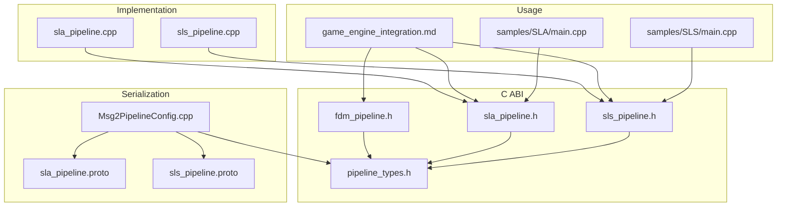
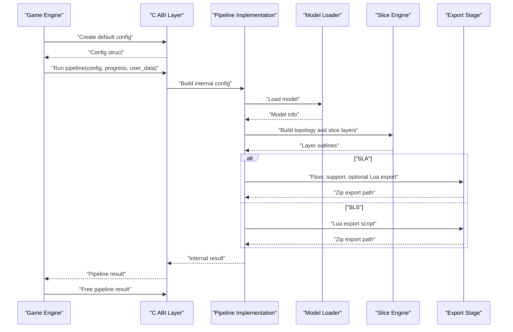
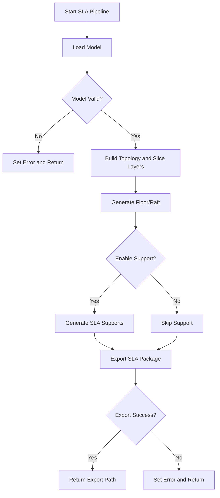
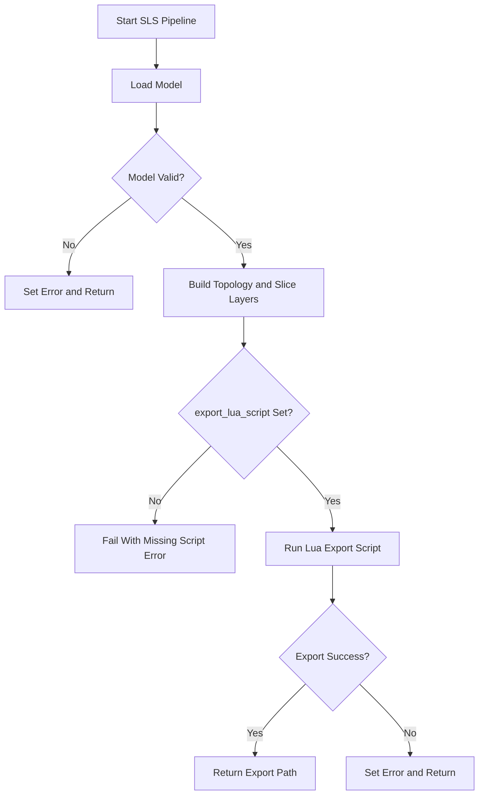
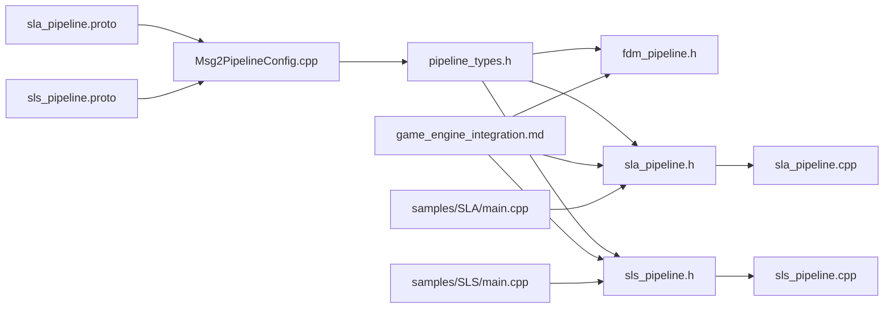

# SLA/SLS Pipeline Mapping

<cite>
**Referenced Files in This Document**   
- [pipeline_types.h](file://pipelinetypes/pipeline_types.h)
- [fdm_pipeline.h](file://DllHsBaSlicer/fdm_pipeline.h)
- [sla_pipeline.h](file://DllHsBaSlicer/sla_pipeline.h)
- [sls_pipeline.h](file://DllHsBaSlicer/sls_pipeline.h)
- [sla_pipeline.cpp](file://DllHsBaSlicer/sla_pipeline.cpp)
- [sls_pipeline.cpp](file://DllHsBaSlicer/sls_pipeline.cpp)
- [Msg2PipelineConfig.cpp](file://convert/Msg2PipelineConfig.cpp)
- [sla_pipeline.proto](file://proto/sla_pipeline.proto)
- [sls_pipeline.proto](file://proto/sls_pipeline.proto)
- [game_engine_integration.md](file://docs/en/DllHsBaSlicer/game_engine_integration.md)
- [samples_SLA_main.cpp](file://samples/SLA/main.cpp)
- [samples_SLS_main.cpp](file://samples/SLS/main.cpp)
</cite>

## Table of Contents
1. [Introduction](#introduction)
2. [Project Structure](#project-structure)
3. [Core Components](#core-components)
4. [Architecture Overview](#architecture-overview)
5. [Detailed Component Analysis](#detailed-component-analysis)
6. [Dependency Analysis](#dependency-analysis)
7. [Performance Considerations](#performance-considerations)
8. [Troubleshooting Guide](#troubleshooting-guide)
9. [Conclusion](#conclusion)
10. [Appendices](#appendices)

## Introduction
This document explains how to map and integrate the SLA (stereolithography) and SLS (selective laser sintering) pipelines alongside the existing FDM integration in game engines. It focuses on:

- Structural differences between FDM, SLA, and SLS pipeline configurations.
- Field mappings and type conversions across C ABI structs, protobuf messages, and Lua export scripts.
- Function name variations for creating configs, running pipelines synchronously/asynchronously, and freeing results.
- SLS-specific requirements, especially `export_lua_script` and result `export_path`.
- Practical adaptation steps for existing FDM integration code.
- Platform-specific considerations for Unity and Unreal Engine.

The goal is to let an existing FDM-based game engine integration be extended to SLA and SLS with minimal changes while respecting each process’s manufacturing semantics.

## Project Structure
The relevant parts of the repository are organized around three layers:

- **C ABI headers**: Define exported functions and POD config/result types.
- **Implementation files**: Implement synchronous and asynchronous pipeline execution using coroutines and parallel layer slicing.
- **Protocol buffers and converters**: Provide message-to-config mapping for serialization or remote invocation.
- **Samples and integration guide**: Show usage patterns and platform-specific binding notes.

**Diagram sources**
- [fdm_pipeline.h:1-68](file://DllHsBaSlicer/fdm_pipeline.h#L1-L68)
- [sla_pipeline.h:1-63](file://DllHsBaSlicer/sla_pipeline.h#L1-L63)
- [sls_pipeline.h:1-63](file://DllHsBaSlicer/sls_pipeline.h#L1-L63)
- [pipeline_types.h:1-1049](file://pipelinetypes/pipeline_types.h#L1-L1049)
- [sla_pipeline.cpp:1-532](file://DllHsBaSlicer/sla_pipeline.cpp#L1-L532)
- [sls_pipeline.cpp:1-345](file://DllHsBaSlicer/sls_pipeline.cpp#L1-L345)
- [sla_pipeline.proto:1-67](file://proto/sla_pipeline.proto#L1-L67)
- [sls_pipeline.proto:1-33](file://proto/sls_pipeline.proto#L1-L33)
- [Msg2PipelineConfig.cpp:1-386](file://convert/Msg2PipelineConfig.cpp#L1-L386)
- [game_engine_integration.md:1-462](file://docs/en/DllHsBaSlicer/game_engine_integration.md#L1-L462)
- [samples_SLA_main.cpp:1-259](file://samples/SLA/main.cpp#L1-L259)
- [samples_SLS_main.cpp:1-209](file://samples/SLS/main.cpp#L1-L209)

**Section sources**
- [fdm_pipeline.h:1-68](file://DllHsBaSlicer/fdm_pipeline.h#L1-L68)
- [sla_pipeline.h:1-63](file://DllHsBaSlicer/sla_pipeline.h#L1-L63)
- [sls_pipeline.h:1-63](file://DllHsBaSlicer/sls_pipeline.h#L1-L63)
- [pipeline_types.h:1-1049](file://pipelinetypes/pipeline_types.h#L1-L1049)

## Core Components
The core components for SLA/SLS mapping are:

- **Configuration structs**: `HsBaFdmPipelineConfig_t`, `HsBaSlaPipelineConfig_t`, `HsBaSlsPipelineConfig_t`.
- **Result structs**: `HsBaFdmPipelineResult_t`, `HsBaSlaPipelineResult_t`, `HsBaSlsPipelineResult_t`.
- **C ABI functions**: Create default config, run pipeline sync/async, free result.
- **Lua export hooks**: Optional custom floor/support/export for SLA; required export script for SLS.
- **Protobuf mapping**: Message fields mapped into C ABI config/result structures.

Key structural differences:

| Aspect | FDM | SLA | SLS |
|---|---|---|---|
| Primary output | G-code content string | Zip export path containing layer images and configuration | Zip export path generated by Lua script |
| Support | Built-in support generation | Built-in SLA support generation | No built-in support; powder bed provides support |
| Floor/raft | Not applicable | Optional floor/raft generation | Not applicable |
| Export customization | Not exposed through config | Optional Lua floor/support/export | Required Lua export script |
| Result data field | `gcode_content` | `export_path` | `export_path` |
| Typical use case | 3D printer G-code | Resin printer layer images + exposure config | Custom powder-bed export format via Lua |

**Section sources**
- [pipeline_types.h:56-127](file://pipelinetypes/pipeline_types.h#L56-L127)
- [pipeline_types.h:170-245](file://pipelinetypes/pipeline_types.h#L170-L245)
- [pipeline_types.h:259-310](file://pipelinetypes/pipeline_types.h#L259-L310)
- [fdm_pipeline.h:17-61](file://DllHsBaSlicer/fdm_pipeline.h#L17-L61)
- [sla_pipeline.h:17-56](file://DllHsBaSlicer/sla_pipeline.h#L17-L56)
- [sls_pipeline.h:17-56](file://DllHsBaSlicer/sls_pipeline.h#L17-L56)

## Architecture Overview
The SLA and SLS pipelines share a common pattern:

1. Load model from name/path.
2. Build slice topology.
3. Slice layers in parallel.
4. Apply process-specific stages:
   - SLA: floor/raft, support, optional Lua floor/support/export.
   - SLS: direct Lua export.
5. Produce result with success flag, total layers, export path, error message, and elapsed time.

**Diagram sources**
- [sla_pipeline.cpp:299-483](file://DllHsBaSlicer/sla_pipeline.cpp#L299-L483)
- [sls_pipeline.cpp:182-296](file://DllHsBaSlicer/sls_pipeline.cpp#L182-L296)
- [sla_pipeline.h:23-56](file://DllHsBaSlicer/sla_pipeline.h#L23-L56)
- [sls_pipeline.h:23-56](file://DllHsBaSlicer/sls_pipeline.h#L23-L56)

## Detailed Component Analysis

### Function Name Variations
The function names differ per process but follow a consistent naming pattern:

| Process | Default Config | Run Sync | Run Async | Free Result |
|---|---|---|---|---|
| FDM | `HsBaCreateDefaultConfig` | `HsBaRunFdmPipeline` | `HsBaRunFdmPipelineAsync` | `HsBaFreePipelineResult` |
| SLA | `HsBaCreateDefaultSlaConfig` | `HsBaRunSlaPipeline` | `HsBaRunSlaPipelineAsync` | `HsBaFreeSlaPipelineResult` |
| SLS | `HsBaCreateDefaultSlsConfig` | `HsBaRunSlsPipeline` | `HsBaRunSlsPipelineAsync` | `HsBaFreeSlsPipelineResult` |

For game engine integration, this means replacing:

- Config struct type.
- Default config function.
- Run function name.
- Progress callback type.
- Result callback type.
- Free result function.

**Section sources**
- [fdm_pipeline.h:17-61](file://DllHsBaSlicer/fdm_pipeline.h#L17-L61)
- [sla_pipeline.h:17-56](file://DllHsBaSlicer/sla_pipeline.h#L17-L56)
- [sls_pipeline.h:17-56](file://DllHsBaSlicer/sls_pipeline.h#L17-L56)
- [game_engine_integration.md:366-377](file://docs/en/DllHsBaSlicer/game_engine_integration.md#L366-L377)

### Configuration Struct Differences

#### FDM vs SLA vs SLS Fields

| Category | FDM | SLA | SLS |
|---|---|---|---|
| Model | `model_name`, `model_path` | `model_name`, `model_path` | `model_name`, `model_path` |
| Slice | `layer_height`, `first_layer_height` | `layer_height`, `first_layer_height` | `layer_height`, `first_layer_height` |
| Process Parameters | Fill mode, wall count, infill density, extrusion settings | Exposure time, lift distance, lift speed, retract speed | Laser power, scan speed, hatch spacing, hatch rotation, bed temperature |
| Support | Built-in FDM support | Built-in SLA support | None |
| Floor/Raft | Not present | Raft offset, border width, fill spacing, angle, count, convex hull | Not present |
| Lua Hooks | Support/infill scripts | Support/floor/export scripts | Export script only |
| Output | `output_path` used with G-code content | `output_path` zip, image type, image size | `output_path` zip generated by Lua |
| Result | `gcode_content` | `export_path` | `export_path` |

Important type conversions:

- Boolean flags like `enable_support` and `floor_use_convex_hull` are `int` in C ABI but `bool` in protobuf.
- Enums such as `HsBaFillMode_t`, `HsBaSupportPattern_t`, `HsBaSlaSupportPattern_t`, and `HsBaSlaImageType_t` are mapped from protobuf enums.
- String pointers (`const char*`) are duplicated into malloc-allocated strings during protobuf conversion.

**Section sources**
- [pipeline_types.h:56-127](file://pipelinetypes/pipeline_types.h#L56-L127)
- [pipeline_types.h:170-245](file://pipelinetypes/pipeline_types.h#L170-L245)
- [pipeline_types.h:259-310](file://pipelinetypes/pipeline_types.h#L259-L310)
- [Msg2PipelineConfig.cpp:35-92](file://convert/Msg2PipelineConfig.cpp#L35-L92)
- [Msg2PipelineConfig.cpp:94-145](file://convert/Msg2PipelineConfig.cpp#L94-L145)
- [Msg2PipelineConfig.cpp:147-176](file://convert/Msg2PipelineConfig.cpp#L147-L176)
- [sla_pipeline.proto:18-58](file://proto/sla_pipeline.proto#L18-L58)
- [sls_pipeline.proto:5-23](file://proto/sls_pipeline.proto#L5-L23)

### SLA Pipeline Processing Logic
The SLA pipeline performs:

1. Preprocess: load model and compute bounding box.
2. Slicing: build topology and slice layers in parallel.
3. Floor/raft: generate raft using built-in algorithm or Lua script.
4. Support: generate SLA supports using built-in algorithm or Lua script.
5. Export: package layer images, floor, support, and configuration JSON into a zip.

**Diagram sources**
- [sla_pipeline.cpp:299-483](file://DllHsBaSlicer/sla_pipeline.cpp#L299-L483)

**Section sources**
- [sla_pipeline.cpp:299-483](file://DllHsBaSlicer/sla_pipeline.cpp#L299-L483)

### SLS Pipeline Processing Logic
The SLS pipeline performs:

1. Preprocess: load model and compute bounding box.
2. Slicing: build topology and slice layers in parallel.
3. Export: require a Lua export script; no standard output format.
4. Result: return `export_path` pointing to the file created by the Lua script.

**Diagram sources**
- [sls_pipeline.cpp:182-296](file://DllHsBaSlicer/sls_pipeline.cpp#L182-L296)

**Section sources**
- [sls_pipeline.cpp:182-296](file://DllHsBaSlicer/sls_pipeline.cpp#L182-L296)

### SLS-Specific Requirements
SLS differs from SLA and FDM in several important ways:

- `export_lua_script` must not be empty; otherwise the pipeline returns an error.
- The Lua export script controls the final output format; the implementation does not enforce a fixed structure.
- The result contains `export_path`, which is the path written by the Lua script.
- There is no built-in floor, raft, or support generation.
- The sample demonstrates that the expected output is typically a zip archive combined with database registration logic inside the Lua script.

**Section sources**
- [sls_pipeline.h:23-34](file://DllHsBaSlicer/sls_pipeline.h#L23-L34)
- [sls_pipeline.cpp:244-282](file://DllHsBaSlicer/sls_pipeline.cpp#L244-L282)
- [samples_SLS_main.cpp:60-91](file://samples/SLS/main.cpp#L60-L91)
- [samples_SLS_main.cpp:118-139](file://samples/SLS/main.cpp#L118-L139)
- [samples_SLS_main.cpp:166-189](file://samples/SLS/main.cpp#L166-L189)

### Adapting Existing FDM Integration Code
To adapt an existing FDM integration to SLA or SLS:

1. Replace the config struct:
   - FDM: `HsBaFdmPipelineConfig_t`
   - SLA: `HsBaSlaPipelineConfig_t`
   - SLS: `HsBaSlsPipelineConfig_t`
2. Replace the default config function:
   - FDM: `HsBaCreateDefaultConfig`
   - SLA: `HsBaCreateDefaultSlaConfig`
   - SLS: `HsBaCreateDefaultSlsConfig`
3. Replace the run function:
   - FDM: `HsBaRunFdmPipeline` / `HsBaRunFdmPipelineAsync`
   - SLA: `HsBaRunSlaPipeline` / `HsBaRunSlaPipelineAsync`
   - SLS: `HsBaRunSlsPipeline` / `HsBaRunSlsPipelineAsync`
4. Replace the progress callback type:
   - FDM: `HsBaProgressCallback`
   - SLA: `HsBaSlaProgressCallback`
   - SLS: `HsBaSlsProgressCallback`
5. Replace the result callback type:
   - FDM: `HsBaResultCallback`
   - SLA: `HsBaSlaResultCallback`
   - SLS: `HsBaSlsResultCallback`
6. Replace the result struct:
   - FDM: `HsBaFdmPipelineResult_t` with `gcode_content`
   - SLA: `HsBaSlaPipelineResult_t` with `export_path`
   - SLS: `HsBaSlsPipelineResult_t` with `export_path`
7. Replace the free function:
   - FDM: `HsBaFreePipelineResult`
   - SLA: `HsBaFreeSlaPipelineResult`
   - SLS: `HsBaFreeSlsPipelineResult`
8. For SLS, set `export_lua_script`; optionally set `export_lua_func` and `output_path`.
9. For SLA, consider setting exposure, lift, floor, support, image type, and image dimensions.

**Section sources**
- [fdm_pipeline.h:17-61](file://DllHsBaSlicer/fdm_pipeline.h#L17-L61)
- [sla_pipeline.h:17-56](file://DllHsBaSlicer/sla_pipeline.h#L17-L56)
- [sls_pipeline.h:17-56](file://DllHsBaSlicer/sls_pipeline.h#L17-L56)
- [pipeline_types.h:120-140](file://pipelinetypes/pipeline_types.h#L120-L140)
- [pipeline_types.h:220-245](file://pipelinetypes/pipeline_types.h#L220-L245)
- [pipeline_types.h:285-310](file://pipelinetypes/pipeline_types.h#L285-L310)
- [game_engine_integration.md:366-377](file://docs/en/DllHsBaSlicer/game_engine_integration.md#L366-L377)

### Platform-Specific Considerations
Platform-specific behavior is primarily about library placement, calling conventions, and memory management:

- Windows: dynamic DLL.
- Linux: shared object.
- macOS: dynamic library.
- Android: per-ABI shared object.
- iOS: static library with `__Internal` import name in Unity.
- Unity IL2CPP requires exact struct layout and field type matching.
- Unreal Engine requires UTF-8 conversion and GameThread marshalling.

The SLA/SLS mapping follows the same rules as FDM; only the function names and struct types change.

**Section sources**
- [game_engine_integration.md:7-18](file://docs/en/DllHsBaSlicer/game_engine_integration.md#L7-L18)
- [game_engine_integration.md:206-213](file://docs/en/DllHsBaSlicer/game_engine_integration.md#L206-L213)
- [game_engine_integration.md:357-362](file://docs/en/DllHsBaSlicer/game_engine_integration.md#L357-L362)
- [game_engine_integration.md:453-462](file://docs/en/DllHsBaSlicer/game_engine_integration.md#L453-L462)

## Dependency Analysis
The dependency relationships between the key components are:

**Diagram sources**
- [pipeline_types.h:1-1049](file://pipelinetypes/pipeline_types.h#L1-L1049)
- [fdm_pipeline.h:1-68](file://DllHsBaSlicer/fdm_pipeline.h#L1-L68)
- [sla_pipeline.h:1-63](file://DllHsBaSlicer/sla_pipeline.h#L1-L63)
- [sls_pipeline.h:1-63](file://DllHsBaSlicer/sls_pipeline.h#L1-L63)
- [sla_pipeline.cpp:1-532](file://DllHsBaSlicer/sla_pipeline.cpp#L1-L532)
- [sls_pipeline.cpp:1-345](file://DllHsBaSlicer/sls_pipeline.cpp#L1-L345)
- [sla_pipeline.proto:1-67](file://proto/sla_pipeline.proto#L1-L67)
- [sls_pipeline.proto:1-33](file://proto/sls_pipeline.proto#L1-L33)
- [Msg2PipelineConfig.cpp:1-386](file://convert/Msg2PipelineConfig.cpp#L1-L386)
- [game_engine_integration.md:1-462](file://docs/en/DllHsBaSlicer/game_engine_integration.md#L1-L462)
- [samples_SLA_main.cpp:1-259](file://samples/SLA/main.cpp#L1-L259)
- [samples_SLS_main.cpp:1-209](file://samples/SLS/main.cpp#L1-L209)

**Section sources**
- [pipeline_types.h:1-1049](file://pipelinetypes/pipeline_types.h#L1-L1049)
- [Msg2PipelineConfig.cpp:1-386](file://convert/Msg2PipelineConfig.cpp#L1-L386)

## Performance Considerations
Both SLA and SLS implementations use:

- Coroutine-based async execution.
- Parallel layer slicing through a shared topology.
- Progress callbacks for UI updates.
- Memory ownership transferred to the caller for result strings.

Performance implications:

- Parallel slicing improves throughput when many layers exist.
- SLA adds floor and support stages, increasing processing time compared to SLS.
- SLS delegates output formatting entirely to Lua, so performance depends on the export script.
- Large models and high layer counts increase memory usage for layer outlines and z-height arrays.

[No sources needed since this section provides general guidance]

## Troubleshooting Guide
Common issues when integrating SLA/SLS:

| Symptom | Cause | Fix |
|---|---|---|
| SLS fails immediately with missing export script | `export_lua_script` is empty | Set a valid Lua export script path |
| SLS export path is empty | Lua export script failed or did not write the expected file | Inspect Lua script error message and ensure it writes to `output_path` |
| SLA export path is empty | Built-in or Lua export failed | Check `error_message` and verify Lua script paths if used |
| Callback crashes in Unity | Delegate was garbage collected | Keep delegate references alive |
| Callback crashes in Unreal Engine | Native callback accessed GameThread incorrectly | Marshal callbacks to GameThread |
| iOS link failure | Wrong library type or import name | Use static library and `DllImport("__Internal")` in Unity |
| Struct misalignment | P/Invoke struct fields do not match C ABI | Match field order and types exactly |

**Section sources**
- [sls_pipeline.cpp:244-282](file://DllHsBaSlicer/sls_pipeline.cpp#L244-L282)
- [sla_pipeline.cpp:449-469](file://DllHsBaSlicer/sla_pipeline.cpp#L449-L469)
- [game_engine_integration.md:453-462](file://docs/en/DllHsBaSlicer/game_engine_integration.md#L453-L462)

## Conclusion
SLA and SLS pipelines extend the HsBaSlicer integration beyond FDM by introducing resin-based and powder-bed manufacturing workflows. The most important mapping rules are:

- Use the correct config and result struct for each process.
- Use the correct create/run/free function family.
- Treat FDM as G-code output, SLA as zip export with layer images, and SLS as Lua-driven export.
- Always set `export_lua_script` for SLS.
- Handle `export_path` instead of `gcode_content` for SLA and SLS.
- Follow platform-specific binding rules for Unity and Unreal Engine.

With these mappings, existing FDM integration code can be adapted to SLA and SLS with predictable changes and clear error handling.

[No sources needed since this section summarizes without analyzing specific files]

## Appendices

### API Reference Summary

| Process | Config Type | Default Config | Run Sync | Run Async | Free Result |
|---|---|---|---|---|---|
| FDM | `HsBaFdmPipelineConfig_t` | `HsBaCreateDefaultConfig` | `HsBaRunFdmPipeline` | `HsBaRunFdmPipelineAsync` | `HsBaFreePipelineResult` |
| SLA | `HsBaSlaPipelineConfig_t` | `HsBaCreateDefaultSlaConfig` | `HsBaRunSlaPipeline` | `HsBaRunSlaPipelineAsync` | `HsBaFreeSlaPipelineResult` |
| SLS | `HsBaSlsPipelineConfig_t` | `HsBaCreateDefaultSlsConfig` | `HsBaRunSlsPipeline` | `HsBaRunSlsPipelineAsync` | `HsBaFreeSlsPipelineResult` |

**Section sources**
- [fdm_pipeline.h:17-61](file://DllHsBaSlicer/fdm_pipeline.h#L17-L61)
- [sla_pipeline.h:17-56](file://DllHsBaSlicer/sla_pipeline.h#L17-L56)
- [sls_pipeline.h:17-56](file://DllHsBaSlicer/sls_pipeline.h#L17-L56)