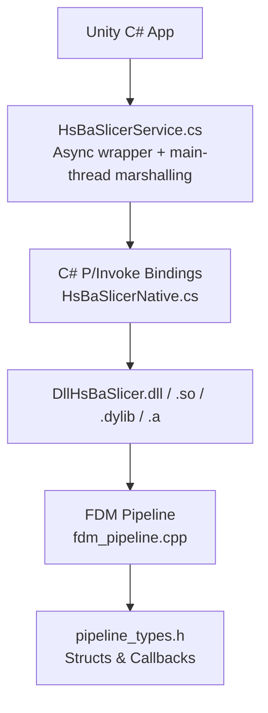
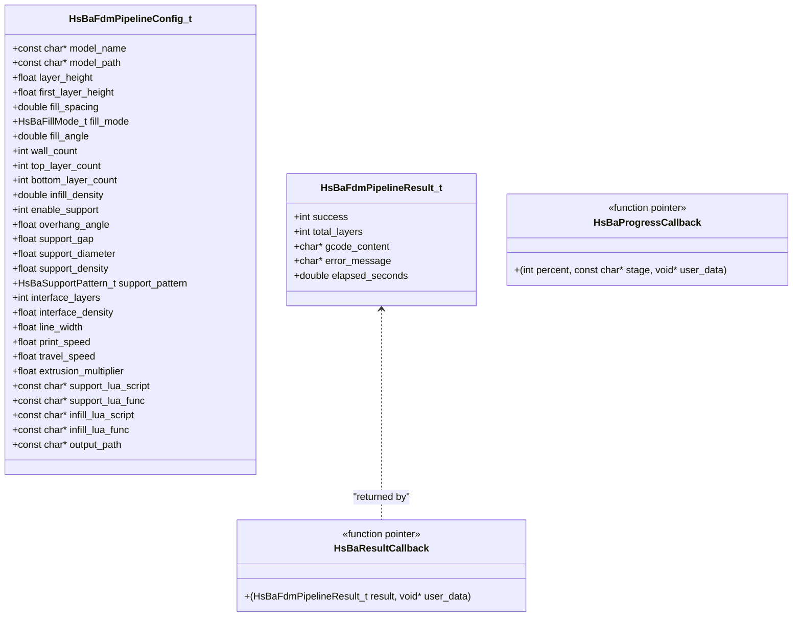
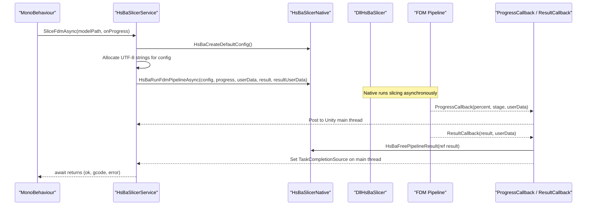
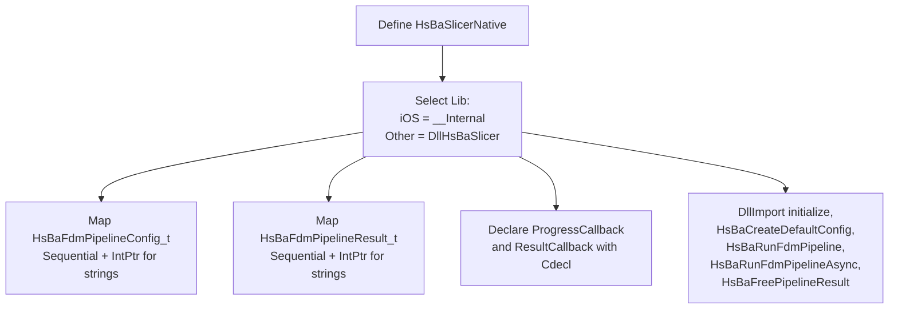
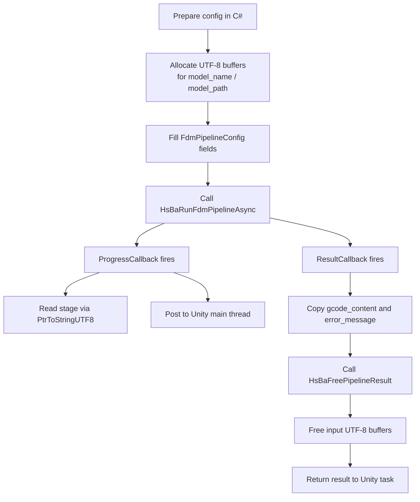
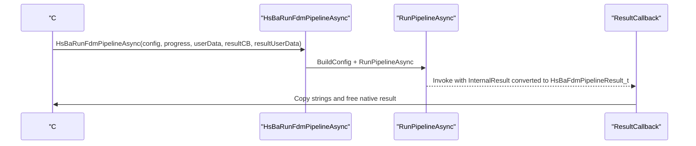
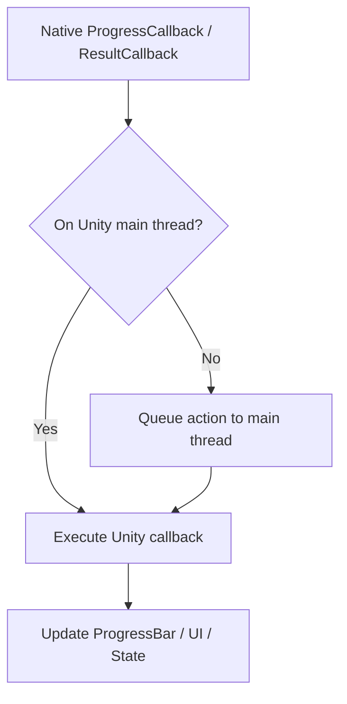
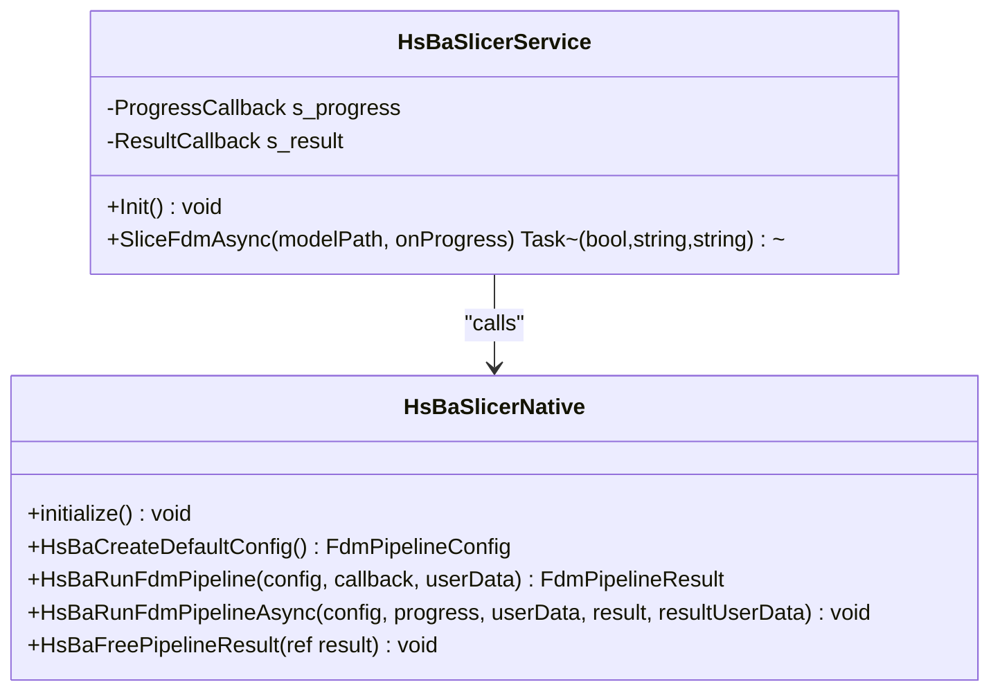
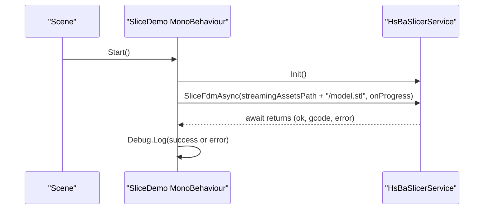

# Unity Integration (C# P/Invoke)

<cite>
**Referenced Files in This Document**   
- [pipeline_types.h](file://pipelinetypes/pipeline_types.h)
- [fdm_pipeline.cpp](file://DllHsBaSlicer/fdm_pipeline.cpp)
- [initialize.cpp](file://DllHsBaSlicer/initialize.cpp)
- [game_engine_integration.md](file://docs/en/DllHsBaSlicer/game_engine_integration.md)
</cite>

## Table of Contents
1. [Introduction](#introduction)
2. [Project Structure](#project-structure)
3. [Core Components](#core-components)
4. [Architecture Overview](#architecture-overview)
5. [Detailed Component Analysis](#detailed-component-analysis)
6. [Dependency Analysis](#dependency-analysis)
7. [Performance Considerations](#performance-considerations)
8. [Troubleshooting Guide](#troubleshooting-guide)
9. [Conclusion](#conclusion)

## Introduction
This document explains how to integrate HsBaSlicer into Unity using C# P/Invoke against the `DllHsBaSlicer` shared library. It covers:
- The complete binding declaration pattern for C ABI structs, especially `HsBaFdmPipelineConfig_t` and `HsBaFdmPipelineResult_t`.
- Per-platform library placement for Windows x86_64, Linux, macOS, Android, and iOS.
- `DllImport` configuration, including the iOS static-library case.
- Async slicing with `ProgressCallback` and `ResultCallback`, UTF-8 string memory management, and delegate lifecycle.
- IL2CPP compatibility, main-thread marshalling for Unity callbacks, and thread safety considerations.
- A complete example wrapper class and MonoBehaviour usage pattern.
- Common Unity-specific issues such as `DllNotFoundException`, struct alignment problems, and packaging/deployment across build targets.

## Project Structure
The Unity integration is documented alongside Unreal Engine integration in the repository’s game-engine documentation. The relevant C ABI definitions live in `pipelinetypes/pipeline_types.h`, while the FDM pipeline implementation and exported functions are in `DllHsBaSlicer/fdm_pipeline.cpp`. Initialization is exposed through `DllHsBaSlicer/initialize.cpp`.

**Diagram sources**
- [game_engine_integration.md:25-123](file://docs/en/DllHsBaSlicer/game_engine_integration.md#L25-L123)
- [fdm_pipeline.cpp:455-496](file://DllHsBaSlicer/fdm_pipeline.cpp#L455-L496)
- [pipeline_types.h:56-140](file://pipelinetypes/pipeline_types.h#L56-L140)

**Section sources**
- [game_engine_integration.md:1-18](file://docs/en/DllHsBaSlicer/game_engine_integration.md#L1-L18)
- [pipeline_types.h:1-17](file://pipelinetypes/pipeline_types.h#L1-L17)

## Core Components
The core integration surface consists of three layers:

| Layer | Responsibility | Key Artifacts |
|---|---|---|
| C ABI types | Stable cross-language data layout | `HsBaFdmPipelineConfig_t`, `HsBaFdmPipelineResult_t`, callback typedefs |
| Native exports | Library entry points called from C# | `initialize`, `HsBaCreateDefaultConfig`, `HsBaRunFdmPipeline`, `HsBaRunFdmPipelineAsync`, `HsBaFreePipelineResult` |
| Unity bindings | C# `DllImport` declarations, struct mapping, delegates, and service wrapper | `HsBaSlicerNative`, `HsBaSlicerService`, MonoBehaviour example |

### C ABI Structs and Callbacks
The C ABI header defines:
- `HsBaFillMode_t`, `HsBaSupportPattern_t`, `HsBaGCodeFirmware_t` enums.
- `HsBaFdmPipelineConfig_t` containing model, slice, fill, support, path, G-code output, Lua customization, and output fields.
- `HsBaFdmPipelineResult_t` containing success, layer count, UTF-8 G-code content, UTF-8 error message, and elapsed time.
- `HsBaProgressCallback` and `HsBaResultCallback` function-pointer types used by both synchronous and asynchronous FDM calls.

**Diagram sources**
- [pipeline_types.h:56-140](file://pipelinetypes/pipeline_types.h#L56-L140)

**Section sources**
- [pipeline_types.h:56-140](file://pipelinetypes/pipeline_types.h#L56-L140)

## Architecture Overview
The Unity integration follows a layered P/Invoke architecture:

**Diagram sources**
- [game_engine_integration.md:130-183](file://docs/en/DllHsBaSlicer/game_engine_integration.md#L130-L183)
- [fdm_pipeline.cpp:469-496](file://DllHsBaSlicer/fdm_pipeline.cpp#L469-L496)

**Section sources**
- [game_engine_integration.md:21-123](file://docs/en/DllHsBaSlicer/game_engine_integration.md#L21-L123)
- [fdm_pipeline.cpp:455-496](file://DllHsBaSlicer/fdm_pipeline.cpp#L455-L496)

## Detailed Component Analysis

### 1. Platform-Specific Library Placement
Place the correct native artifact under Unity’s plugin directories before building or running:

| Platform | Artifact | Unity Placement | Notes |
|---|---|---|---|
| Windows x64 | `DllHsBaSlicer.dll` | `Assets/Plugins/x86_64/` | Editor and device builds may use different folders; ensure the active platform is enabled. |
| Linux | `libDllHsBaSlicer.so` | `Assets/Plugins/x86_64/` | Ensure runtime dependencies are available on the target machine. |
| macOS | `libDllHsBaSlicer.dylib` | `Assets/Plugins/` | dylibs are loaded at runtime. |
| Android | `libDllHsBaSlicer.so` | `Assets/Plugins/Android/libs/<abi>/` | Use per-ABI directories such as `arm64-v8a`. |
| iOS | `libDllHsBaSlicer.a` | `Assets/Plugins/iOS/` | iOS uses a **static library**; C# must load `"__Internal"` instead of a dynamic name. |

**Section sources**
- [game_engine_integration.md:7-17](file://docs/en/DllHsBaSlicer/game_engine_integration.md#L7-L17)

### 2. C# Binding Declarations
The binding layer declares:
- A conditional library name constant: `"__Internal"` on iOS outside the editor, otherwise `"DllHsBaSlicer"`.
- C# structs mapped with `[StructLayout(LayoutKind.Sequential)]` that mirror `HsBaFdmPipelineConfig_t` and `HsBaFdmPipelineResult_t`.
- Delegates marked with `[UnmanagedFunctionPointer(CallingConvention.Cdecl)]` matching `HsBaProgressCallback` and `HsBaResultCallback`.
- `DllImport` methods for initialization, default config creation, synchronous and asynchronous FDM execution, and result freeing.

Key rules:
- Every `const char*` in the C struct maps to `IntPtr` in C#.
- Enumerations map to `int`.
- All `DllImport` methods use `CallingConvention.Cdecl`.
- For iOS, the library name is `"__Internal"`.

**Diagram sources**
- [game_engine_integration.md:25-123](file://docs/en/DllHsBaSlicer/game_engine_integration.md#L25-L123)

**Section sources**
- [game_engine_integration.md:25-123](file://docs/en/DllHsBaSlicer/game_engine_integration.md#L25-L123)

### 3. Memory Management for UTF-8 Strings
When passing strings from C# to C:
- Convert managed strings to unmanaged UTF-8 buffers using `Marshal.StringToCoTaskMemUTF8`.
- Assign the resulting `IntPtr` values to the corresponding `model_name`, `model_path`, and other `const char*` fields in the config struct.
- Keep those unmanaged buffers alive until the native call completes.
- Free them after the async result callback has finished copying the needed data.

For reading strings returned by the native side:
- Read UTF-8 strings from `result.gcode_content` and `result.error_message` using `Marshal.PtrToStringUTF8`.
- Call `HsBaFreePipelineResult(ref result)` immediately after copying the strings, because the native side allocates these buffers and expects the caller to free them.

**Diagram sources**
- [game_engine_integration.md:145-183](file://docs/en/DllHsBaSlicer/game_engine_integration.md#L145-L183)
- [fdm_pipeline.cpp:488-496](file://DllHsBaSlicer/fdm_pipeline.cpp#L488-L496)

**Section sources**
- [game_engine_integration.md:145-183](file://docs/en/DllHsBaSlicer/game_engine_integration.md#L145-L183)
- [fdm_pipeline.cpp:488-496](file://DllHsBaSlicer/fdm_pipeline.cpp#L488-L496)

### 4. Delegate Lifecycle and GC Safety
Delegates passed to native code must not be garbage-collected while the native library may still invoke them. In the provided wrapper:
- `ProgressCallback` and `ResultCallback` instances are stored in static fields of `HsBaSlicerService`.
- This keeps strong references alive for the lifetime of the async operation.
- If a delegate is created inline and not stored, it can be collected between the native call and the callback invocation, causing crashes.

Best practice:
- Store every delegate handed to a native method in a field or another long-lived object.
- Avoid relying on closures alone to keep delegates alive when they are passed directly to `DllImport`.

**Section sources**
- [game_engine_integration.md:137-143](file://docs/en/DllHsBaSlicer/game_engine_integration.md#L137-L143)

### 5. Async Slicing Flow
The asynchronous FDM API separates work from UI:
- `HsBaRunFdmPipelineAsync` takes a config, a progress callback, optional user data, a result callback, and optional result user data.
- Internally, the native implementation builds an internal configuration, runs the coroutine-based pipeline, and invokes the result callback once the pipeline finishes.
- The result contains heap-allocated UTF-8 strings that must be freed by the caller.

**Diagram sources**
- [fdm_pipeline.cpp:469-486](file://DllHsBaSlicer/fdm_pipeline.cpp#L469-L486)

**Section sources**
- [fdm_pipeline.cpp:455-496](file://DllHsBaSlicer/fdm_pipeline.cpp#L455-L496)

### 6. Main-Thread Marshalling for Unity Callbacks
Native callbacks do not run on Unity’s main thread. Therefore:
- Do not access `UnityEngine.Object` subclasses directly inside `ProgressCallback` or `ResultCallback`.
- Marshal UI updates back to the main thread using a synchronization mechanism such as `UnitySynchronizationContext` or a custom `MainThread.Post` helper.
- Update progress bars, log messages, and UI state only after posting to the main thread.

**Diagram sources**
- [game_engine_integration.md:157-177](file://docs/en/DllHsBaSlicer/game_engine_integration.md#L157-L177)

**Section sources**
- [game_engine_integration.md:206-212](file://docs/en/DllHsBaSlicer/game_engine_integration.md#L206-L212)

### 7. IL2CPP Compatibility Requirements
Under IL2CPP:
- By-value struct passing works, but the C# struct layout must exactly match the C struct layout.
- Always use `[StructLayout(LayoutKind.Sequential)]`.
- Match field types precisely: `float` for `float`, `double` for `double`, `int` for `int`, and `IntPtr` for `const char*`.
- Avoid changing field order or inserting padding fields.
- Keep delegate signatures identical to the C function pointers, including calling convention.

**Section sources**
- [game_engine_integration.md:212-212](file://docs/en/DllHsBaSlicer/game_engine_integration.md#L212-L212)

### 8. HsBaSlicerService Wrapper Class
The recommended wrapper provides:
- An `Init` method that calls the native `initialize`.
- An async slicing method returning a `Task` with success, G-code content, and error message.
- UTF-8 allocation and deallocation around the native call.
- Delegate storage to prevent GC collection.
- Main-thread marshalling for progress and completion callbacks.

**Diagram sources**
- [game_engine_integration.md:130-183](file://docs/en/DllHsBaSlicer/game_engine_integration.md#L130-L183)

**Section sources**
- [game_engine_integration.md:130-183](file://docs/en/DllHsBaSlicer/game_engine_integration.md#L130-L183)

### 9. MonoBehaviour Usage Pattern
A MonoBehaviour can:
- Initialize the slicer service during startup.
- Call the async slicing method with a model path.
- Update a UI element such as a slider based on progress percentage.
- Log success or failure after awaiting the task.

**Diagram sources**
- [game_engine_integration.md:186-204](file://docs/en/DllHsBaSlicer/game_engine_integration.md#L186-L204)

**Section sources**
- [game_engine_integration.md:186-204](file://docs/en/DllHsBaSlicer/game_engine_integration.md#L186-L204)

### 10. Error Handling Strategies
Recommended error handling:
- Always check `result.success` in the result callback.
- Treat non-null `error_message` as diagnostic information even if success is true.
- Always call `HsBaFreePipelineResult` after copying strings.
- Wrap Unity-side async operations with try/catch where appropriate.
- Log both native errors and C# exceptions for debugging.
- Avoid accessing Unity objects inside native callbacks; marshal all UI work to the main thread.

**Section sources**
- [game_engine_integration.md:164-177](file://docs/en/DllHsBaSlicer/game_engine_integration.md#L164-L177)
- [fdm_pipeline.cpp:488-496](file://DllHsBaSlicer/fdm_pipeline.cpp#L488-L496)

## Dependency Analysis
The Unity integration depends on:
- The C ABI header defining stable struct layouts and callback types.
- The native export layer exposing initialization, default configuration, synchronous and asynchronous execution, and result cleanup.
- Unity’s threading model requiring explicit main-thread marshalling.

**Diagram sources**
- [pipeline_types.h:56-140](file://pipelinetypes/pipeline_types.h#L56-L140)
- [fdm_pipeline.cpp:455-496](file://DllHsBaSlicer/fdm_pipeline.cpp#L455-L496)
- [initialize.cpp:7-9](file://DllHsBaSlicer/initialize.cpp#L7-L9)
- [game_engine_integration.md:25-183](file://docs/en/DllHsBaSlicer/game_engine_integration.md#L25-L183)

**Section sources**
- [pipeline_types.h:56-140](file://pipelinetypes/pipeline_types.h#L56-L140)
- [fdm_pipeline.cpp:455-496](file://DllHsBaSlicer/fdm_pipeline.cpp#L455-L496)
- [initialize.cpp:1-10](file://DllHsBaSlicer/initialize.cpp#L1-L10)
- [game_engine_integration.md:25-183](file://docs/en/DllHsBaSlicer/game_engine_integration.md#L25-L183)

## Performance Considerations
- Prefer the asynchronous API for long-running slicing operations to avoid blocking Unity’s frame loop.
- Reuse the same service instance rather than recreating delegates repeatedly.
- Minimize UTF-8 allocations by reusing paths when possible, though each native call still requires valid UTF-8 buffers for its duration.
- Avoid excessive logging inside tight progress callbacks; batch or throttle UI updates if necessary.
- On mobile platforms, consider reducing parallelism indirectly by adjusting layer counts, fill modes, and support settings according to your model complexity.

[No sources needed since this section provides general guidance]

## Troubleshooting Guide

| Symptom | Likely Cause | Recommended Fix |
|---|---|---|
| `DllNotFoundException` in Unity | Plugin placed in the wrong folder or the current build platform is not enabled. | Place the correct artifact under `Assets/Plugins/<platform>/` and enable the platform in the Unity Inspector. |
| Unity crash after a callback | Delegate was garbage-collected before the native callback fired. | Store the delegate in a static or member field so it remains alive. |
| iOS link or runtime failure | Using a dynamic library name instead of the static library import. | Use `DllImport("__Internal")` and place `libDllHsBaSlicer.a` under `Assets/Plugins/iOS/`. |
| Struct fields misaligned or random crashes | C# struct field order or types do not match `pipeline_types.h`. | Use `[StructLayout(LayoutKind.Sequential)]` and match every field type and order exactly. |
| NullReferenceException on UTF-8 strings | Reading or freeing native strings incorrectly. | Copy strings with `PtrToStringUTF8`, then call `HsBaFreePipelineResult` once. |
| UI freezes during slicing | Running slicing synchronously on the main thread. | Use `HsBaRunFdmPipelineAsync` and marshal callbacks to the main thread. |
| Android build missing native library | Missing per-ABI `.so` files. | Add `libDllHsBaSlicer.so` under `Assets/Plugins/Android/libs/<abi>/`. |
| Packaging issue in UE or Unity | Runtime dependency not included. | Verify plugin/library placement and packaging configuration. |

**Section sources**
- [game_engine_integration.md:453-462](file://docs/en/DllHsBaSlicer/game_engine_integration.md#L453-L462)

## Conclusion
Integrating HsBaSlicer into Unity via C# P/Invoke requires careful attention to three areas:
1. Exact C ABI mapping: struct layouts, enum types, and callback signatures must match `pipeline_types.h`.
2. Correct platform deployment: Windows, Linux, macOS, Android, and iOS each require specific artifacts and locations.
3. Safe async and memory handling: keep delegates alive, manage UTF-8 buffers explicitly, free native results, and marshal Unity callbacks to the main thread.

When these rules are followed, the `HsBaSlicerService` wrapper provides a clean, async-friendly API for Unity applications, while the underlying native pipeline handles model loading, slicing, support generation, filling, and G-code path generation.

[No sources needed since this section summarizes without analyzing specific files]