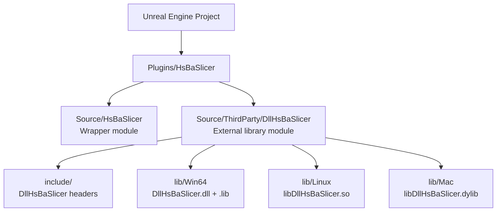
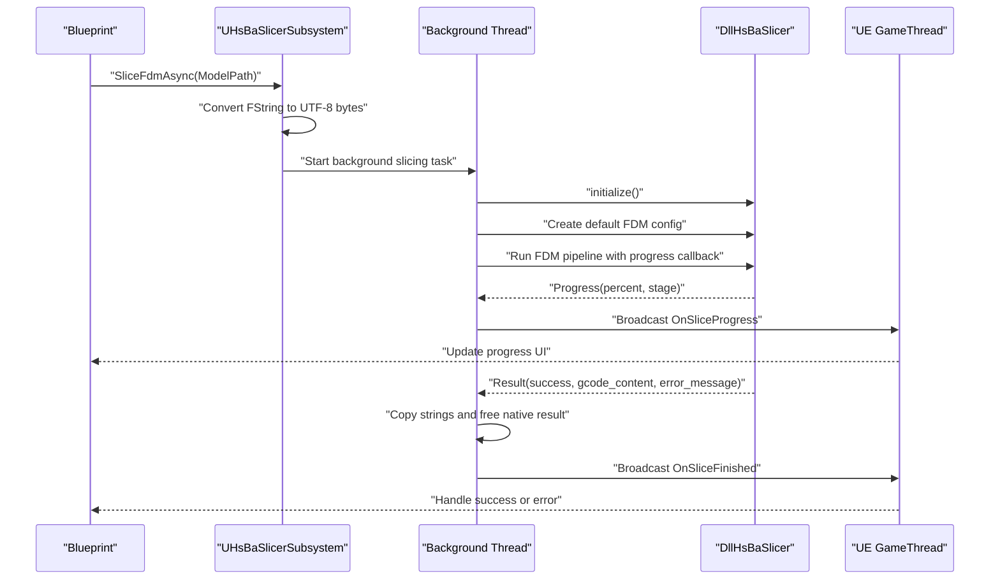
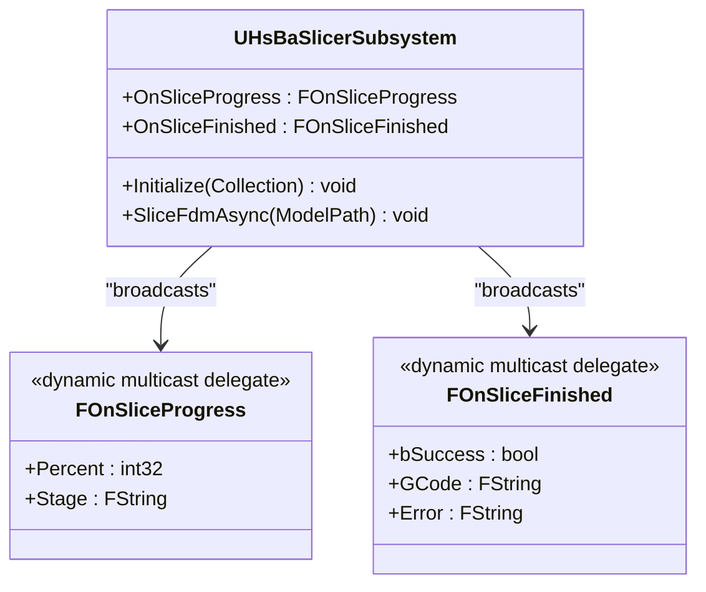
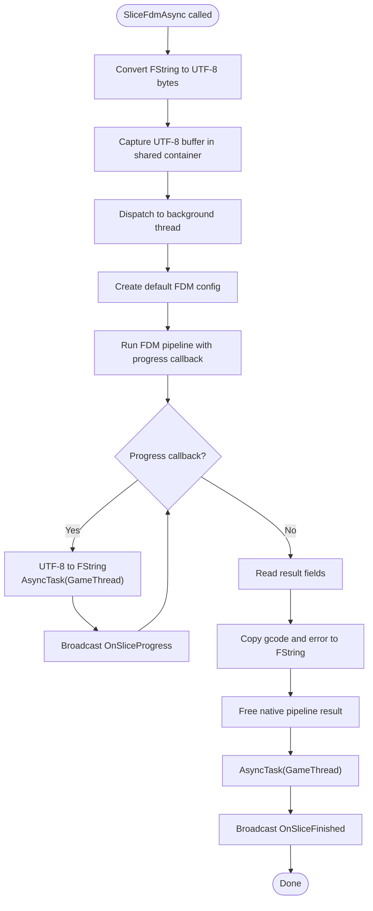
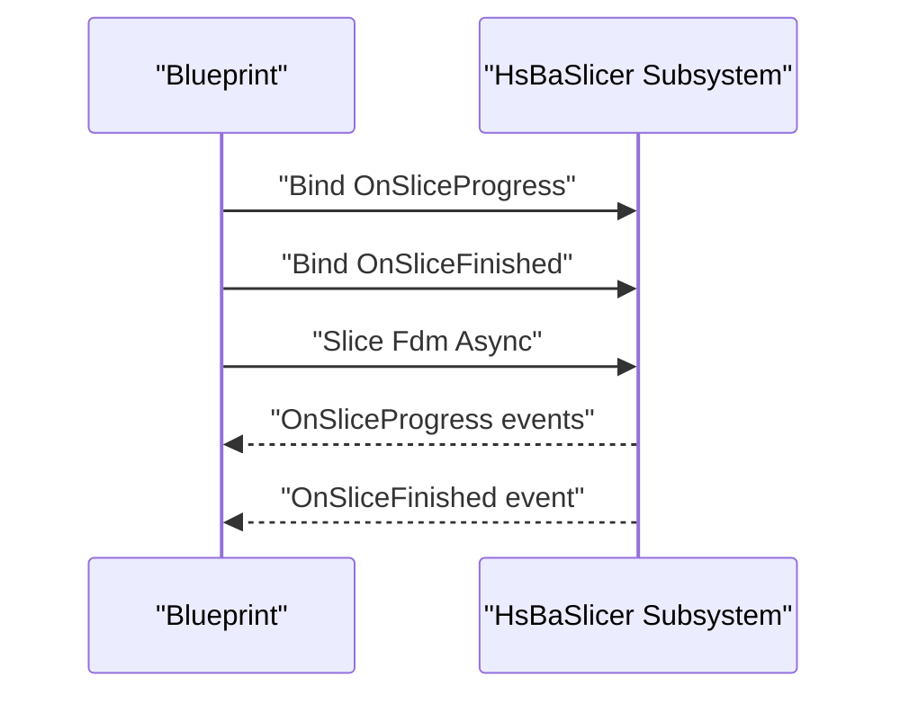
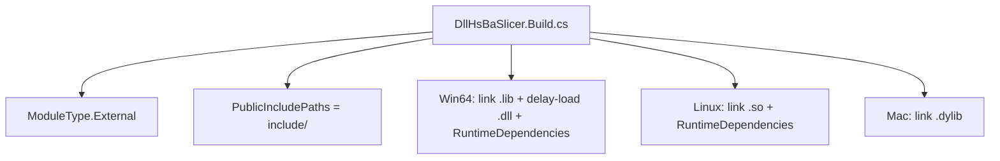
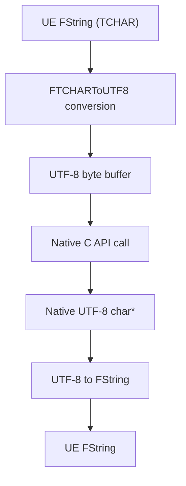
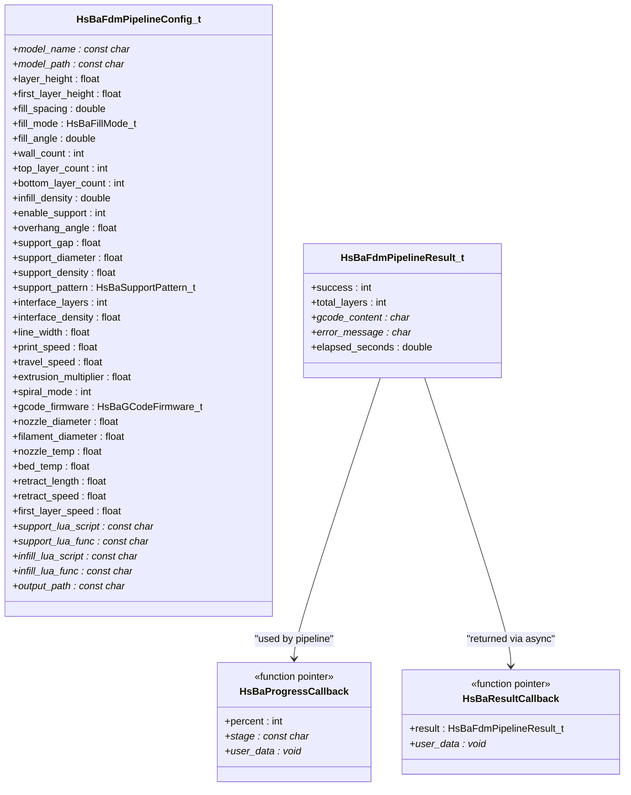
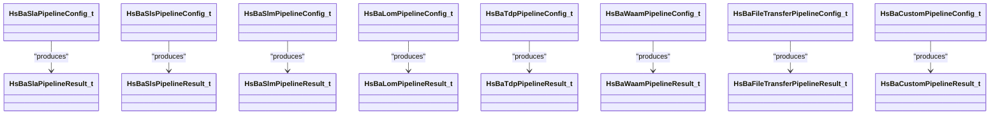
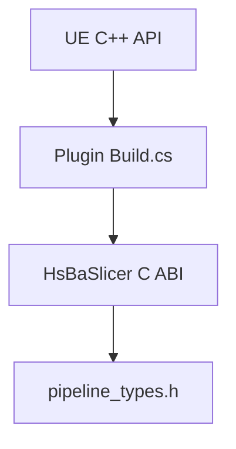

# Unreal Engine Integration (C++ Plugin + Blueprint)

<cite>
**Referenced Files in This Document**
- [game_engine_integration.md](file://docs/en/DllHsBaSlicer/game_engine_integration.md)
- [pipeline_types.h](file://pipelinetypes/pipeline_types.h)
- [encoding_convert.hpp](file://base/encoding_convert.hpp)
</cite>

## Table of Contents
1. [Introduction](#introduction)
2. [Project Structure](#project-structure)
3. [Core Components](#core-components)
4. [Architecture Overview](#architecture-overview)
5. [Detailed Component Analysis](#detailed-component-analysis)
6. [Dependency Analysis](#dependency-analysis)
7. [Performance Considerations](#performance-considerations)
8. [Troubleshooting Guide](#troubleshooting-guide)
9. [Conclusion](#conclusion)

## Introduction
This document explains how to integrate HsBaSlicer into an Unreal Engine project using a C++ plugin and expose slicing operations to Blueprints. It covers the recommended ThirdParty module layout, platform-specific Build.cs configuration for Win64, Linux, and Mac, async slicing through `UGameInstanceSubsystem`, GameThread marshalling with `AsyncTask(ENamedThreads::GameThread, ...)`, dynamic delegate broadcasting for progress and completion events, string encoding conversion between UE's TCHAR and native UTF-8, memory management for path buffers, thread discipline, packaging with `RuntimeDependencies`, and debugging techniques for cross-language calls.

The integration is based on the documented Unity / Unreal Engine guide and the C ABI types defined by HsBaSlicer.

**Section sources**
- [game_engine_integration.md:1-18](file://docs/en/DllHsBaSlicer/game_engine_integration.md#L1-L18)
- [pipeline_types.h:5-17](file://pipelinetypes/pipeline_types.h#L5-L17)

## Project Structure
The recommended Unreal Engine plugin layout places the wrapper module next to a ThirdParty module that owns the DllHsBaSlicer headers and per-platform binaries.

**Diagram sources**
- [game_engine_integration.md:218-234](file://docs/en/DllHsBaSlicer/game_engine_integration.md#L218-L234)

### Recommended Layout
- `Plugins/HsBaSlicer/HsBaSlicer.uplugin` defines the plugin.
- `Source/HsBaSlicer/` contains the wrapper module exposing Blueprint-callable functions.
- `Source/ThirdParty/DllHsBaSlicer/` contains:
  - `DllHsBaSlicer.Build.cs` for linking and runtime dependency handling.
  - `include/` with copied DllHsBaSlicer headers.
  - `lib/` with per-platform artifacts (`Win64`, `Linux`, `Mac`).

**Section sources**
- [game_engine_integration.md:218-234](file://docs/en/DllHsBaSlicer/game_engine_integration.md#L218-L234)

## Core Components
The core integration consists of:

| Component | Responsibility |
|---|---|
| `UHsBaSlicerSubsystem` | Unreal subsystem owning lifecycle and async slicing entry points. |
| Dynamic delegates | `OnSliceProgress` and `OnSliceFinished` for Blueprint event binding. |
| Async worker | Background task running the native FDM pipeline. |
| GameThread marshaler | Wraps native callbacks in `AsyncTask(ENamedThreads::GameThread, ...)` before calling UE APIs. |
| String converter | Converts UE `FString` (TCHAR) to UTF-8 bytes for the native boundary. |
| Memory owner | Holds the UTF-8 path buffer until the native call completes. |
| Native bridge | Calls `initialize()`, default config creation, pipeline run, and result freeing. |

**Section sources**
- [game_engine_integration.md:272-349](file://docs/en/DllHsBaSlicer/game_engine_integration.md#L272-L349)

## Architecture Overview
At runtime, the wrapper subsystem bridges Unreal Engine’s threading model and string representation to HsBaSlicer’s C ABI.

**Diagram sources**
- [game_engine_integration.md:272-349](file://docs/en/DllHsBaSlicer/game_engine_integration.md#L272-L349)

## Detailed Component Analysis

### UGameInstanceSubsystem Implementation
The subsystem derives from `UGameInstanceSubsystem` and exposes:

- `Initialize(...)`: calls the native `initialize()` once per process.
- `SliceFdmAsync(FString ModelPath)`: converts the path, starts a background task, runs the FDM pipeline, and broadcasts events back to the GameThread.
- `OnSliceProgress`: dynamic multicast delegate for progress updates.
- `OnSliceFinished`: dynamic multicast delegate for completion.

**Diagram sources**
- [game_engine_integration.md:272-296](file://docs/en/DllHsBaSlicer/game_engine_integration.md#L272-L296)

**Section sources**
- [game_engine_integration.md:272-296](file://docs/en/DllHsBaSlicer/game_engine_integration.md#L272-L296)

### Async Slicing and GameThread Marshalling
The implementation uses:

- `AsyncTask(ENamedThreads::AnyBackgroundThreadNormalTask, ...)` to move heavy work off the GameThread.
- A captured UTF-8 path buffer so the pointer remains valid during the native call.
- A native progress callback that marshals to the GameThread before broadcasting.
- Final result processing that copies UTF-8 strings into `FString`, frees the native result, and then broadcasts completion on the GameThread.

**Diagram sources**
- [game_engine_integration.md:312-349](file://docs/en/DllHsBaSlicer/game_engine_integration.md#L312-L349)

**Section sources**
- [game_engine_integration.md:312-349](file://docs/en/DllHsBaSlicer/game_engine_integration.md#L312-L349)

### Blueprint Usage Pattern
From Blueprint:

1. Get the game instance subsystem for HsBaSlicer.
2. Bind `OnSliceProgress` and `OnSliceFinished`.
3. Call `Slice Fdm Async`.
4. Update UI elements inside the bound events.

**Diagram sources**
- [game_engine_integration.md:351-355](file://docs/en/DllHsBaSlicer/game_engine_integration.md#L351-L355)

**Section sources**
- [game_engine_integration.md:351-355](file://docs/en/DllHsBaSlicer/game_engine_integration.md#L351-L355)

### ThirdParty Module Build Configuration
The ThirdParty module is declared as an external module and links per-platform libraries while exposing headers.

| Platform | Linking Behavior | Runtime Dependency Handling |
|---|---|---|
| Windows x64 | Links `DllHsBaSlicer.lib`; enables delay loading for `DllHsBaSlicer.dll`; adds DLL to `RuntimeDependencies`. | Copies the DLL to the binary output directory. |
| Linux | Links `libDllHsBaSlicer.so`; adds it to `RuntimeDependencies`. | Ships the shared object with the build. |
| macOS | Links `libDllHsBaSlicer.dylib`. | Relies on engine packaging rules for dylibs. |

**Diagram sources**
- [game_engine_integration.md:236-270](file://docs/en/DllHsBaSlicer/game_engine_integration.md#L236-L270)

**Section sources**
- [game_engine_integration.md:236-270](file://docs/en/DllHsBaSlicer/game_engine_integration.md#L236-L270)

### String Encoding Conversion Between UE and Native Code
UE stores text internally as TCHAR, which is UTF-16 on Windows. The native HsBaSlicer API expects UTF-8 C strings.

Key rules:

- Convert `FString` to UTF-8 before crossing the C boundary.
- Keep the UTF-8 byte array alive for the entire duration of the native call.
- Convert returned UTF-8 C strings back to `FString` after copying.
- Free native-owned result strings through the provided free function.

**Diagram sources**
- [game_engine_integration.md:312-349](file://docs/en/DllHsBaSlicer/game_engine_integration.md#L312-L349)

**Section sources**
- [game_engine_integration.md:312-349](file://docs/en/DllHsBaSlicer/game_engine_integration.md#L312-L349)

### Memory Management for Path Buffers
The example captures the converted UTF-8 path in a shared container so the pointer passed to the native pipeline remains valid while the background task runs. After the native call returns:

- Copy any owned UTF-8 strings from the result into UE-managed strings.
- Call the appropriate free function for the pipeline result.
- Do not access the original UTF-8 buffer after the asynchronous operation completes unless you explicitly manage its lifetime.

**Section sources**
- [game_engine_integration.md:312-349](file://docs/en/DllHsBaSlicer/game_engine_integration.md#L312-L349)

### Thread Discipline Requirements
Cross-language integration requires strict thread discipline:

- Do not call UE UObject APIs from native threads.
- Always marshal progress and completion callbacks to the GameThread using `AsyncTask(ENamedThreads::GameThread, ...)`.
- Delegate broadcasts must happen on the GameThread because they are Blueprint-compatible dynamic delegates.
- Heavy slicing work should run on background threads to avoid blocking the editor or game loop.

**Section sources**
- [game_engine_integration.md:357-362](file://docs/en/DllHsBaSlicer/game_engine_integration.md#L357-L362)

### Packaging and Runtime Dependencies
Packaging considerations:

- Use `RuntimeDependencies` so the native library is included in packaged builds.
- On Windows, delay loading can reduce startup cost but requires the DLL to be discoverable at runtime.
- For delayed loading, ensure the DLL location is available through the binary directory or by pushing the DLL directory at module startup.
- Server and console targets without slicing requirements should conditionally exclude the module in Build.cs.

**Section sources**
- [game_engine_integration.md:357-362](file://docs/en/DllHsBaSlicer/game_engine_integration.md#L357-L362)

### Pipeline Types and API Surface
The C ABI surface used by the Unreal wrapper is defined in the pipeline types header. For FDM:

| Concept | Definition |
|---|---|
| Config struct | `HsBaFdmPipelineConfig_t` |
| Result struct | `HsBaFdmPipelineResult_t` |
| Progress callback | `HsBaProgressCallback` |
| Result callback | `HsBaResultCallback` |
| Default config initializer | Provided inline in the types header |
| Result ownership | Caller must free the result through the corresponding free function |

**Diagram sources**
- [pipeline_types.h:53-140](file://pipelinetypes/pipeline_types.h#L53-L140)

**Section sources**
- [pipeline_types.h:53-140](file://pipelinetypes/pipeline_types.h#L53-L140)

### SLA, SLS, and Other Pipelines
SLA, SLS, SLM, LOM, 3DP, WAAM, file transfer, and custom Lua pipelines follow the same pattern:

- Each has a dedicated config struct.
- Each has a dedicated result struct.
- Each has progress and result callback types.
- Some require an export Lua script path.
- Results generally contain UTF-8 strings owned by the native side that must be freed by the caller.

**Diagram sources**
- [pipeline_types.h:165-732](file://pipelinetypes/pipeline_types.h#L165-L732)

**Section sources**
- [pipeline_types.h:165-732](file://pipelinetypes/pipeline_types.h#L165-L732)

### Encoding Utilities and System Detection
While the Unreal wrapper uses UE’s `FTCHARToUTF8` and `UTF8_TO_TCHAR`, the HsBaSlicer codebase also provides encoding utilities and system detection helpers. These are useful when writing native extensions or custom wrappers around the C ABI.

Relevant capabilities:

- UTF-8 to local encoding conversion.
- Local encoding to UTF-8 conversion.
- Generic encoding conversion.
- Windows console code page helpers.
- System type detection such as Windows, Linux, macOS, Android, iOS, and Unix-like systems.

**Section sources**
- [encoding_convert.hpp:20-39](file://base/encoding_convert.hpp#L20-L39)
- [encoding_convert.hpp:41-70](file://base/encoding_convert.hpp#L41-L70)
- [encoding_convert.hpp:71-132](file://base/encoding_convert.hpp#L71-L132)
- [encoding_convert.hpp:133-276](file://base/encoding_convert.hpp#L133-L276)

## Dependency Analysis
The Unreal integration depends on three layers:

1. **Unreal Engine layer**: subsystem, delegates, async primitives, and Blueprint exposure.
2. **Plugin build layer**: ThirdParty module linking, include paths, delay loading, and runtime dependencies.
3. **Native HsBaSlicer layer**: C ABI structs, enums, callbacks, and pipeline functions.

**Diagram sources**
- [game_engine_integration.md:236-362](file://docs/en/DllHsBaSlicer/game_engine_integration.md#L236-L362)
- [pipeline_types.h:5-17](file://pipelinetypes/pipeline_types.h#L5-L17)

**Section sources**
- [game_engine_integration.md:236-362](file://docs/en/DllHsBaSlicer/game_engine_integration.md#L236-L362)
- [pipeline_types.h:5-17](file://pipelinetypes/pipeline_types.h#L5-L17)

## Performance Considerations
- Run slicing on background threads to keep the GameThread responsive.
- Avoid frequent large string allocations in progress callbacks; reuse or limit update frequency if needed.
- Use delay loading on Windows to defer DLL load time, but ensure the DLL is discoverable at runtime.
- Minimize cross-thread data copying by keeping only necessary fields in delegate payloads.
- Reuse subsystem instances rather than recreating them per slice request.

[No sources needed since this section provides general guidance]

## Troubleshooting Guide

| Symptom | Likely Cause | Recommended Fix |
|---|---|---|
| UE packaged build cannot find the native DLL | Missing or incorrect `RuntimeDependencies` | Add the correct platform artifact to `RuntimeDependencies` and verify the Binaries directory after packaging. |
| Delay-loaded DLL fails to load on Windows | DLL directory not configured or DLL not in expected location | Ensure the DLL is placed where the loader can find it, or push the DLL directory at module startup. |
| Progress or completion crashes in Blueprint | Callback executed off the GameThread | Wrap all delegate broadcasts in `AsyncTask(ENamedThreads::GameThread, ...)`. |
| Garbage or truncated G-code | Incorrect UTF-8 conversion or premature buffer destruction | Convert with `FTCHARToUTF8`, keep the UTF-8 buffer alive for the full native call, and copy result strings before freeing. |
| Native result leak | Missing free call for pipeline result | Call the appropriate result free function after copying owned strings. |
| Server or console target fails to build | Wrapper module compiled unnecessarily | Conditionally exclude the module for platforms without slicing requirements. |
| iOS or static-linking issues | Using shared library instead of required static artifact | Follow platform packaging rules; iOS typically requires a static library and special linkage settings. |

**Section sources**
- [game_engine_integration.md:357-362](file://docs/en/DllHsBaSlicer/game_engine_integration.md#L357-L362)

## Conclusion
The HsBaSlicer Unreal Engine integration centers on a small, disciplined wrapper: a `UGameInstanceSubsystem` that owns initialization, converts strings safely, dispatches slicing work to background threads, and marshals results back to the GameThread for Blueprint consumption. Correctness depends on proper ThirdParty module setup, explicit UTF-8 handling, strict thread discipline, and reliable packaging of runtime dependencies. Once these pieces are in place, Blueprint users can trigger slicing, observe progress, and handle success or failure without directly touching native code.

[No sources needed since this section summarizes without analyzing specific files]