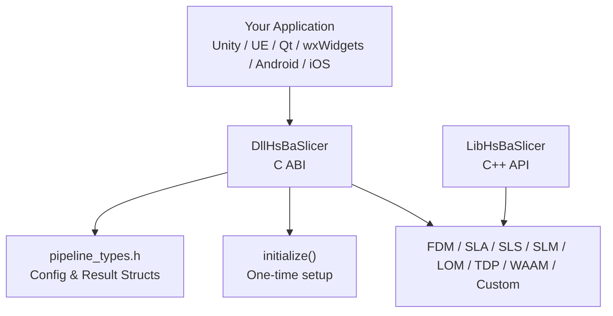
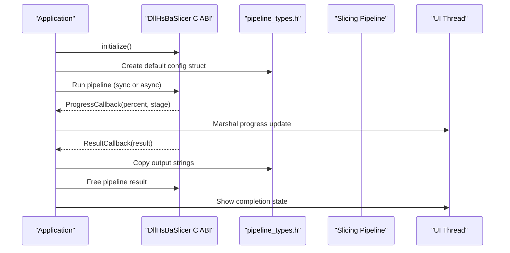
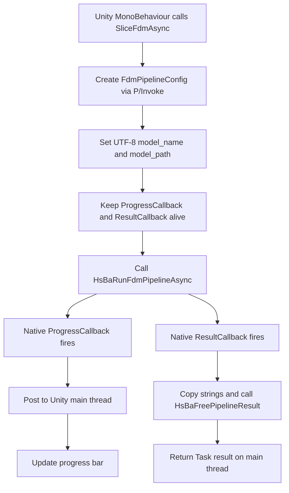
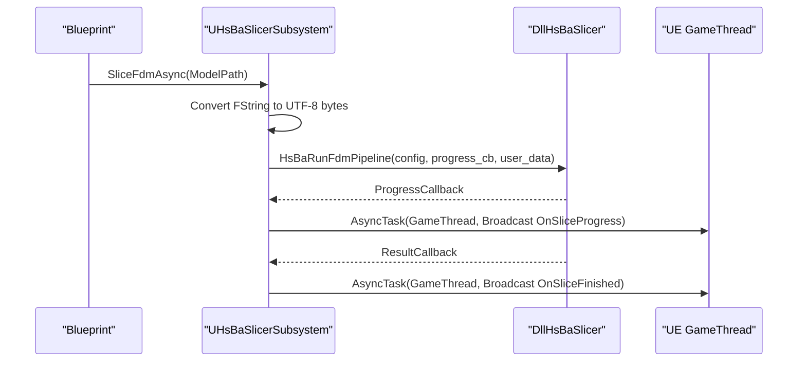
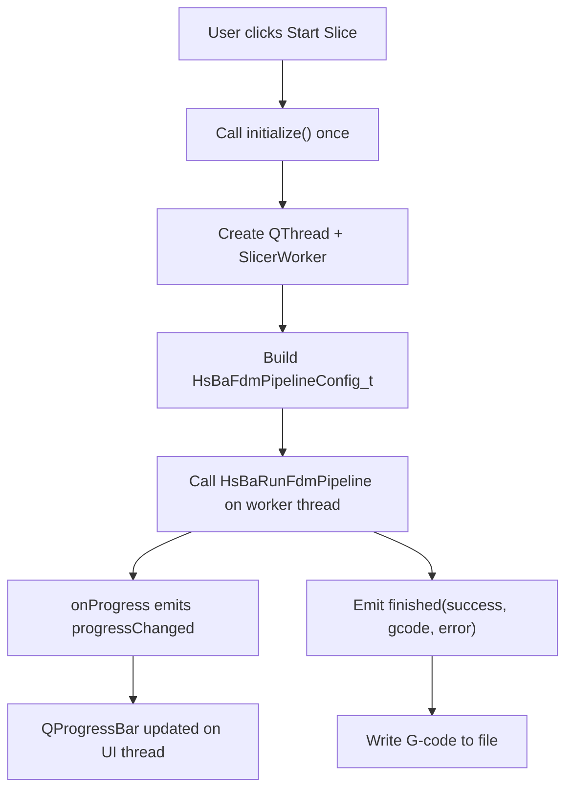
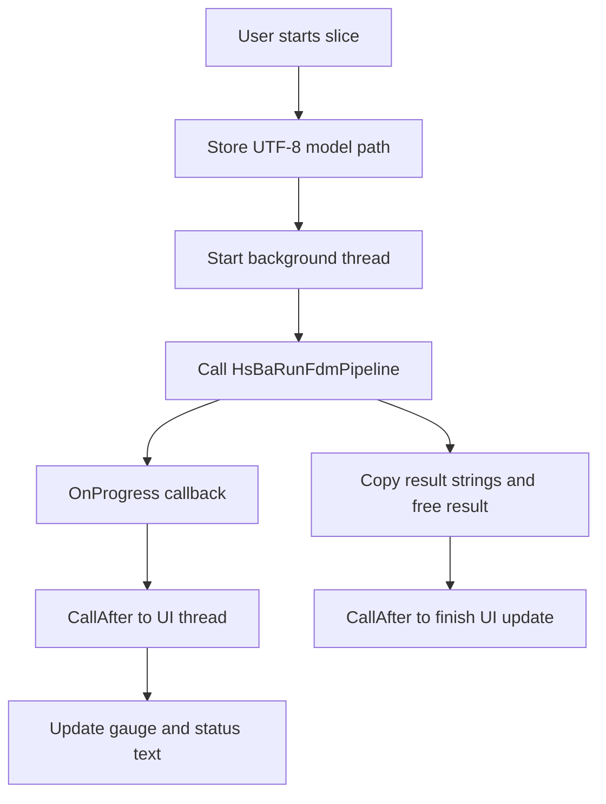
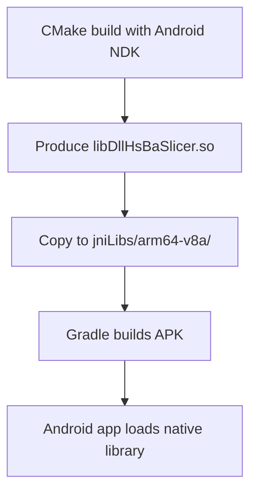
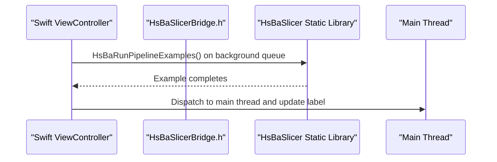
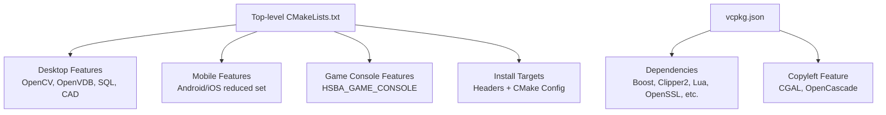

# Integration Guide

<cite>
**Referenced Files in This Document**   
- [README.md](file://README.md)
- [CMakeLists.txt](file://CMakeLists.txt)
- [vcpkg.json](file://vcpkg.json)
- [LICENSE.txt](file://LICENSE.txt)
- [pipeline_types.h](file://pipelinetypes/pipeline_types.h)
- [dllexport.h](file://DllHsBaSlicer/dllexport.h)
- [initialize.h](file://DllHsBaSlicer/initialize.h)
- [game_engine_integration.md](file://docs/en/DllHsBaSlicer/game_engine_integration.md)
- [qt_wxwidgets_integration.md](file://docs/en/DllHsBaSlicer/qt_wxwidgets_integration.md)
- [android README.md](file://android/README.md)
- [ViewController.swift](file://ios/HsBaSlicerExample/ViewController.swift)
- [HsBaSlicerBridge.h](file://ios/HsBaSlicerExample/HsBaSlicerBridge.h)
</cite>

## Table of Contents
1. [Introduction](#introduction)
2. [Project Structure](#project-structure)
3. [Core Components](#core-components)
4. [Architecture Overview](#architecture-overview)
5. [Detailed Component Analysis](#detailed-component-analysis)
6. [Dependency Analysis](#dependency-analysis)
7. [Performance Considerations](#performance-considerations)
8. [Troubleshooting Guide](#troubleshooting-guide)
9. [Security, Licensing, and Distribution](#security-licensing-and-distribution)
10. [Conclusion](#conclusion)

## Introduction
This integration guide explains how to embed HsBaSlicer into different platforms and frameworks: Unity, Unreal Engine, Qt, wxWidgets, Android, and iOS. It focuses on the C ABI exposed by `DllHsBaSlicer`, the standalone type definitions in `pipelinetypes/pipeline_types.h`, and the platform-specific build and deployment patterns documented in this repository.

HsBaSlicer is a modular, cross-platform C++ slicing framework. The recommended integration surface for external applications is the shared library `DllHsBaSlicer`, which exposes C-compatible pipeline functions for FDM, SLA, SLS, SLM, LOM, TDP, WAAM, file transfer, and custom Lua pipelines. For pure C++ consumers, `LibHsBaSlicer` provides higher-level slicing capabilities.

**Section sources**
- [README.md:21-39](file://README.md#L21-L39)
- [README.md:100-124](file://README.md#L100-L124)

## Project Structure
For integration purposes, the most relevant parts are:

| Area | Purpose |
|---|---|
| `DllHsBaSlicer` | Shared library with C ABI entry points such as `initialize()` and pipeline run functions. |
| `pipelinetypes/pipeline_types.h` | Standalone C-compatible struct and enum definitions used by all integrations. |
| `LibHsBaSlicer` | C++ API for full slicing workflows when you do not need a separate DLL. |
| `CMakeLists.txt` | Top-level build configuration, install targets, and platform feature toggles. |
| `vcpkg.json` | Dependency manifest, including optional copyleft kernels that affect licensing. |
| `docs/en/DllHsBaSlicer/*` | Official integration examples for Unity, Unreal Engine, Qt, and wxWidgets. |
| `android/README.md` | Minimal Android packaging instructions for native `.so` artifacts. |
| `ios/HsBaSlicerExample/*` | Swift example showing bridging to a C/C++ static-library entry point. |

**Diagram sources**
- [initialize.h:14-19](file://DllHsBaSlicer/initialize.h#L14-L19)
- [pipeline_types.h:53-127](file://pipelinetypes/pipeline_types.h#L53-L127)
- [README.md:100-124](file://README.md#L100-L124)

**Section sources**
- [README.md:100-150](file://README.md#L100-L150)
- [CMakeLists.txt:456-519](file://CMakeLists.txt#L456-L519)

## Core Components
The integration surface consists of three layers:

1. **Type layer**: `pipeline_types.h` defines all pipeline configurations and results. These structs are intentionally free of DLL export macros so downstream code can include them without linking the shared library.
2. **ABI layer**: `DllHsBaSlicer` exports C functions using `HSBA_SLICER_API`. On Windows, this resolves to `__declspec(dllexport)` or `__declspec(dllimport)`; on other platforms it is empty.
3. **Runtime layer**: Call `initialize()` once at process startup, then call the appropriate pipeline function with a configured struct and optional progress/result callbacks.

Key ABI concepts:

| Concept | Meaning |
|---|---|
| Config structs | Passed by value or pointer depending on the wrapper; string fields must remain valid during the pipeline call. |
| Result structs | Contain success flags, output paths or G-code content, error messages, and elapsed time. |
| Callbacks | Progress and result callbacks fire on library threads; marshal UI updates back to your application’s main thread. |
| Memory ownership | Caller frees result strings through the matching `HsBaFree*PipelineResult` function. |

**Section sources**
- [pipeline_types.h:5-12](file://pipelinetypes/pipeline_types.h#L5-L12)
- [pipeline_types.h:53-127](file://pipelinetypes/pipeline_types.h#L53-L127)
- [dllexport.h:9-20](file://DllHsBaSlicer/dllexport.h#L9-L20)
- [initialize.h:14-19](file://DllHsBaSlicer/initialize.h#L14-L19)

## Architecture Overview
At runtime, an integrated application follows this flow:

**Diagram sources**
- [initialize.h:14-19](file://DllHsBaSlicer/initialize.h#L14-L19)
- [pipeline_types.h:130-140](file://pipelinetypes/pipeline_types.h#L130-L140)
- [game_engine_integration.md:128-183](file://docs/en/DllHsBaSlicer/game_engine_integration.md#L128-L183)
- [qt_wxwidgets_integration.md:47-106](file://docs/en/DllHsBaSlicer/qt_wxwidgets_integration.md#L47-L106)

## Detailed Component Analysis

### Unity Integration
Unity integrates through C# P/Invoke against `DllHsBaSlicer`. The official guide shows:

- Platform-specific library names, including `"__Internal"` for iOS static libraries.
- C# struct declarations that mirror `pipeline_types.h` field order and types.
- A high-level service that keeps delegate references alive and marshals callbacks to the Unity main thread.
- IL2CPP considerations for by-value struct passing and sequential layout.

**Diagram sources**
- [game_engine_integration.md:21-123](file://docs/en/DllHsBaSlicer/game_engine_integration.md#L21-L123)
- [game_engine_integration.md:128-183](file://docs/en/DllHsBaSlicer/game_engine_integration.md#L128-L183)
- [game_engine_integration.md:206-213](file://docs/en/DllHsBaSlicer/game_engine_integration.md#L206-L213)

Practical guidance from the repository:

- Place per-ABI native libraries under the correct Unity plugin folders.
- Keep delegates stored in static or member fields so the garbage collector does not collect them while native code holds them.
- Never touch `UnityEngine.Object` directly inside native callbacks; marshal to the main thread first.
- For IL2CPP, match struct layouts exactly and use `LayoutKind.Sequential`.

**Section sources**
- [game_engine_integration.md:7-18](file://docs/en/DllHsBaSlicer/game_engine_integration.md#L7-L18)
- [game_engine_integration.md:21-123](file://docs/en/DllHsBaSlicer/game_engine_integration.md#L21-L123)
- [game_engine_integration.md:128-213](file://docs/en/DllHsBaSlicer/game_engine_integration.md#L128-L213)

### Unreal Engine Integration
Unreal Engine integrates through a C++ plugin that wraps `DllHsBaSlicer`:

- A `ThirdParty` module declares headers, import libraries, and runtime dependencies.
- A `GameInstanceSubsystem` exposes Blueprint-callable functions.
- Background tasks execute slicing off the GameThread.
- Progress and completion events are broadcast on the GameThread.

**Diagram sources**
- [game_engine_integration.md:218-269](file://docs/en/DllHsBaSlicer/game_engine_integration.md#L218-L269)
- [game_engine_integration.md:272-349](file://docs/en/DllHsBaSlicer/game_engine_integration.md#L272-L349)
- [game_engine_integration.md:357-362](file://docs/en/DllHsBaSlicer/game_engine_integration.md#L357-L362)

Important rules:

- Convert `FString` to UTF-8 before crossing the C boundary.
- Keep UTF-8 byte buffers alive for the entire slicing run.
- Always wrap delegate broadcasts in `AsyncTask(ENamedThreads::GameThread, ...)`.
- Package the DLL through `RuntimeDependencies`; delay loading requires proper DLL directory setup.

**Section sources**
- [game_engine_integration.md:218-362](file://docs/en/DllHsBaSlicer/game_engine_integration.md#L218-L362)

### Qt Integration
Qt integration uses `DllHsBaSlicer` from a C++ desktop application. The guide recommends:

- Using `find_package(HsBaSlicer CONFIG REQUIRED)` or pointing directly at build artifacts.
- Running slicing on a worker thread, not the UI thread.
- Emitting Qt signals from the worker so slots automatically run on the UI thread.
- Keeping UTF-8 path strings alive while the pipeline runs.

**Diagram sources**
- [qt_wxwidgets_integration.md:16-45](file://docs/en/DllHsBaSlicer/qt_wxwidgets_integration.md#L16-L45)
- [qt_wxwidgets_integration.md:47-106](file://docs/en/DllHsBaSlicer/qt_wxwidgets_integration.md#L47-L106)
- [qt_wxwidgets_integration.md:108-151](file://docs/en/DllHsBaSlicer/qt_wxwidgets_integration.md#L108-L151)

**Section sources**
- [qt_wxwidgets_integration.md:7-13](file://docs/en/DllHsBaSlicer/qt_wxwidgets_integration.md#L7-L13)
- [qt_wxwidgets_integration.md:16-167](file://docs/en/DllHsBaSlicer/qt_wxwidgets_integration.md#L16-L167)

### wxWidgets Integration
wxWidgets integration follows the same threading principles as Qt:

- Use a background thread for the blocking pipeline call.
- Use `CallAfter` to marshal progress and completion updates to the UI thread.
- Store UTF-8 model paths in the panel object so they outlive the callback.
- Prefer a managed thread pool over detached threads in production.

**Diagram sources**
- [qt_wxwidgets_integration.md:171-265](file://docs/en/DllHsBaSlicer/qt_wxwidgets_integration.md#L171-L265)

**Section sources**
- [qt_wxwidgets_integration.md:171-265](file://docs/en/DllHsBaSlicer/qt_wxwidgets_integration.md#L171-L265)

### Android Integration
Android integration packages the native `.so` files produced by the CMake build into an Android app:

- Build native libraries with the Android NDK toolchain and vcpkg.
- Copy the resulting `.so` files into `app/src/main/jniLibs/<abi>/`.
- Open the Android project in Android Studio and build or run the APK.
- Add a Java/Kotlin activity that loads the native library via `System.loadLibrary`.

**Diagram sources**
- [android README.md:1-22](file://android/README.md#L1-L22)

**Section sources**
- [android README.md:1-22](file://android/README.md#L1-L22)

### iOS Integration
iOS integration uses a Swift example that bridges to a C/C++ entry point exported from the static library:

- `HsBaSlicerBridge.h` declares `HsBaRunPipelineExamples()` as an `extern "C"` function.
- `ViewController.swift` calls the bridge function on a background queue and updates the UI on the main queue.
- The example is explicitly marked as non-production and intended for testing.

**Diagram sources**
- [HsBaSlicerBridge.h:14-25](file://ios/HsBaSlicerExample/HsBaSlicerBridge.h#L14-L25)
- [ViewController.swift:43-55](file://ios/HsBaSlicerExample/ViewController.swift#L43-L55)

**Section sources**
- [HsBaSlicerBridge.h:1-32](file://ios/HsBaSlicerExample/HsBaSlicerBridge.h#L1-L32)
- [ViewController.swift:1-86](file://ios/HsBaSlicerExample/ViewController.swift#L1-L86)

### Pipeline Mapping Across Platforms
All major platforms share the same pipeline mapping pattern:

| Process | Config Type | Default Function | Run Function | Free Function |
|---|---|---|---|---|
| FDM | `HsBaFdmPipelineConfig_t` | `HsBaCreateDefaultConfig` | `HsBaRunFdmPipeline` or async variant | `HsBaFreePipelineResult` |
| SLA | `HsBaSlaPipelineConfig_t` | `HsBaCreateDefaultSlaConfig` | `HsBaRunSlaPipeline` or async variant | `HsBaFreeSlaPipelineResult` |
| SLS | `HsBaSlsPipelineConfig_t` | `HsBaCreateDefaultSlsConfig` | `HsBaRunSlsPipeline` or async variant | `HsBaFreeSlsPipelineResult` |

SLS requires an export Lua script; the result contains an exported file path rather than inline G-code.

**Section sources**
- [game_engine_integration.md:366-377](file://docs/en/DllHsBaSlicer/game_engine_integration.md#L366-L377)
- [qt_wxwidgets_integration.md:268-289](file://docs/en/DllHsBaSlicer/qt_wxwidgets_integration.md#L268-L289)
- [pipeline_types.h:115-127](file://pipelinetypes/pipeline_types.h#L115-L127)
- [pipeline_types.h:220-232](file://pipelinetypes/pipeline_types.h#L220-L232)
- [pipeline_types.h:285-297](file://pipelinetypes/pipeline_types.h#L285-L297)

## Dependency Analysis
HsBaSlicer uses CMake and vcpkg for dependency management. The top-level CMake configuration:

- Enables position-independent code for static libraries linked into shared libraries.
- Detects desktop vs mobile vs game-console builds.
- Controls optional copyleft kernel usage based on `HSBA_COPL` and vcpkg features.
- Installs targets, headers, and CMake package configuration files.

**Diagram sources**
- [CMakeLists.txt:129-157](file://CMakeLists.txt#L129-L157)
- [CMakeLists.txt:170-204](file://CMakeLists.txt#L170-L204)
- [CMakeLists.txt:270-339](file://CMakeLists.txt#L270-L339)
- [CMakeLists.txt:456-519](file://CMakeLists.txt#L456-L519)
- [vcpkg.json:1-113](file://vcpkg.json#L1-L113)

**Section sources**
- [CMakeLists.txt:129-157](file://CMakeLists.txt#L129-L157)
- [CMakeLists.txt:170-204](file://CMakeLists.txt#L170-L204)
- [CMakeLists.txt:270-339](file://CMakeLists.txt#L270-L339)
- [CMakeLists.txt:456-519](file://CMakeLists.txt#L456-L519)
- [vcpkg.json:1-113](file://vcpkg.json#L1-L113)

## Performance Considerations
Performance-sensitive integrations should follow these patterns:

| Concern | Recommendation |
|---|---|
| Real-time slicing | Use async pipeline APIs where available; avoid blocking the UI or render thread. |
| Threading discipline | Keep native callbacks off UI threads; marshal progress and results back to the application’s main thread. |
| String handling | Convert UTF-16 or platform strings to UTF-8 before calling C functions; keep buffers alive for the whole pipeline run. |
| Memory ownership | Copy result strings before calling `HsBaFree*PipelineResult`; never access freed memory. |
| Delegate lifetime | In Unity, keep delegates passed to native code in static or member fields to prevent GC collection. |
| Large models | Configure realistic layer heights, fill densities, and support settings; avoid unnecessary debug features. |
| Logging and heavy kernels | Disable or reduce logging and copyleft-heavy features on constrained platforms. |

These recommendations are derived from the Unity, Unreal Engine, Qt, and wxWidgets integration guides, which consistently emphasize background execution, main-thread marshalling, and careful memory management.

**Section sources**
- [game_engine_integration.md:128-213](file://docs/en/DllHsBaSlicer/game_engine_integration.md#L128-L213)
- [game_engine_integration.md:357-362](file://docs/en/DllHsBaSlicer/game_engine_integration.md#L357-L362)
- [qt_wxwidgets_integration.md:7-13](file://docs/en/DllHsBaSlicer/qt_wxwidgets_integration.md#L7-L13)
- [qt_wxwidgets_integration.md:47-106](file://docs/en/DllHsBaSlicer/qt_wxwidgets_integration.md#L47-L106)

## Troubleshooting Guide
Common integration issues and their causes:

| Symptom | Likely Cause | Fix |
|---|---|---|
| Unity `DllNotFoundException` | Plugin placed in wrong folder or platform disabled in Inspector. | Place per-ABI libraries in the correct Unity plugin path and enable the target platform. |
| Unity crash after callback | Delegate was collected by the garbage collector. | Keep delegate references in static or member fields. |
| UE packaged build cannot find DLL | Missing runtime dependency or incorrect DLL location. | Add `RuntimeDependencies` and ensure the DLL ships with the build. |
| iOS link failure | Trying to load a dylib instead of using the static library. | Use the static `.a` library and `DllImport("__Internal")` in Unity. |
| Struct misalignment or random crashes | C# or C++ struct layout does not match `pipeline_types.h`. | Match field order, types, and sequential layout exactly. |
| Qt/wxWidgets UI freezes | Sync API called on the UI thread. | Move slicing to a worker thread and marshal callbacks to the UI thread. |
| Crash updating widgets in callback | Callback runs on a library thread. | Post UI updates via signals/slots or `CallAfter`. |
| Non-ASCII path failures | Wrong string encoding across the C boundary. | Pass UTF-8 encoded paths. |
| Garbled result strings | Calling free too early. | Copy strings first, then call the matching free function. |

**Section sources**
- [game_engine_integration.md:453-462](file://docs/en/DllHsBaSlicer/game_engine_integration.md#L453-L462)
- [qt_wxwidgets_integration.md:340-349](file://docs/en/DllHsBaSlicer/qt_wxwidgets_integration.md#L340-L349)

## Security, Licensing, and Distribution
HsBaSlicer uses a conditional dual license:

- Builds that do not include GPL/LGPL components, such as iOS or game-console builds without CGAL or OpenCascade, are licensed under MIT.
- Builds that include copyleft kernels like CGAL or OpenCascade are licensed under GPL-3.0-or-later.
- The effective license is determined at configure time from vcpkg configuration and can be queried at runtime through version information.

Distribution implications:

| Platform | Typical License Outcome | Distribution Notes |
|---|---|---|
| iOS | Usually MIT | Avoid enabling copyleft kernels unless required; bundle static libraries as shown in the iOS example. |
| Game consoles | Usually MIT | The build system detects console triplets and disables some desktop-only features. |
| Desktop Windows/Linux/macOS | Often GPL-3.0-or-later if copyleft kernels are enabled | Ensure source distribution obligations are met if distributing GPL-covered builds. |
| Android | Often GPL-3.0-or-later if copyleft kernels are enabled | Follow Android packaging steps and consider whether CGAL/OpenCascade are needed. |

Dependency and build notes:

- Use `vcpkg.json` to manage dependencies and the optional `copyleft` feature.
- Use `find_package(HsBaSlicer CONFIG REQUIRED)` and link against `HsBaSlicer::DllHsBaSlicer` or other installed targets.
- Install artifacts with `cmake --install` and deploy the required runtime libraries next to your executable or into the platform-specific packaging structure.

**Section sources**
- [LICENSE.txt:1-23](file://LICENSE.txt#L1-L23)
- [README.md:196-210](file://README.md#L196-L210)
- [CMakeLists.txt:170-204](file://CMakeLists.txt#L170-L204)
- [CMakeLists.txt:456-519](file://CMakeLists.txt#L456-L519)
- [vcpkg.json:1-113](file://vcpkg.json#L1-L113)

## Conclusion
HsBaSlicer provides a consistent C ABI for slicing across platforms. For Unity and Unreal Engine, focus on correct P/Invoke or plugin setup, background execution, and main-thread marshalling. For Qt and wxWidgets, use worker threads and UI-safe callback forwarding. For Android and iOS, follow the repository’s packaging and bridging examples. Always respect memory ownership, string encoding, threading discipline, and the conditional dual license determined by your dependency configuration.