# Integration Guide

<cite>
**Referenced Files in This Document**   
- [README.md](file://README.md)
- [CMakeLists.txt](file://CMakeLists.txt)
- [docs/en/cpp_cmake_usage.md](file://docs/en/cpp_cmake_usage.md)
- [docs/en/LibHsBaSlicer/README.md](file://docs/en/LibHsBaSlicer/README.md)
- [docs/en/DllHsBaSlicer/README.md](file://docs/en/DllHsBaSlicer/README.md)
- [docs/en/DllHsBaSlicer/game_engine_integration.md](file://docs/en/DllHsBaSlicer/game_engine_integration.md)
- [LibHsBaSlicer/export.h](file://LibHsBaSlicer/export.h)
- [DllHsBaSlicer/dllexport.h](file://DllHsBaSlicer/dllexport.h)
- [DllHsBaSlicer/initialize.h](file://DllHsBaSlicer/initialize.h)
- [samples/LibHsBaSlicer/main_header.cpp](file://samples/LibHsBaSlicer/main_header.cpp)
- [samples/LibHsBaSlicer/main_module.cpp](file://samples/LibHsBaSlicer/main_module.cpp)
- [android/app/src/main/java/com/hsmbanlance/hsbaslicer/example/MainActivity.java](file://android/app/src/main/java/com/hsmbanlance/hsbaslicer/example/MainActivity.java)
- [android/app/build.gradle](file://android/app/build.gradle)
- [android/README.md](file://android/README.md)
- [.github/workflows/build-android.yml](file://.github/workflows/build-android.yml)
- [ios/HsBaSlicerExample/ViewController.swift](file://ios/HsBaSlicerExample/ViewController.swift)
</cite>

## Table of Contents
1. [Introduction](#introduction)
2. [Project Structure](#project-structure)
3. [Core Components](#core-components)
4. [Architecture Overview](#architecture-overview)
5. [Detailed Component Analysis](#detailed-component-analysis)
6. [Dependency Analysis](#dependency-analysis)
7. [Performance Considerations](#performance-considerations)
8. [Troubleshooting Guide](#troubleshooting-guide)
9. [Conclusion](#conclusion)
10. [Appendices](#appendices)

## Introduction
This document is the integration guide for incorporating HsBaSlicer into applications and platforms. It focuses on:
- C++ integration with header inclusion, library linking, and CMake configuration.
- Cross-language integration through the pure C ABI exported by `DllHsBaSlicer`.
- Platform-specific guidance for Android (JNI + NDK), iOS (Swift/Objective-C bridging), Unity and Unreal Engine.
- Deployment strategies, dependency management, runtime configuration, and common troubleshooting.

HsBaSlicer exposes three main integration surfaces:
- `LibHsBaSlicer`: core C++ slicing pipeline API.
- `ModuleHsBaSlicer`: optional C++20 module wrapper with a class-based API.
- `DllHsBaSlicer`: stable C ABI for cross-language and cross-process integration.

The project supports desktop, Android, and iOS builds, and provides installable CMake package configuration so downstream projects can use `find_package(HsBaSlicer)` to link against the desired targets.

**Section sources**
- [README.md:21-39](file://README.md#L21-L39)
- [README.md:100-124](file://README.md#L100-L124)
- [docs/en/cpp_cmake_usage.md:1-11](file://docs/en/cpp_cmake_usage.md#L1-L11)

## Project Structure
At a high level, HsBaSlicer organizes its build artifacts and public interfaces as follows:
- `base`, `utils`, `cipher`, `2D`, `paths`, `support`, `preprocess`, `meshmodel`, `cadmodel`, `pointcloud`, `fileoperator`, `pipelinetypes`, `convert`, `proto` are internal modules.
- `LibHsBaSlicer` packages the full slicing workflow into a C++ library.
- `DllHsBaSlicer` wraps `LibHsBaSlicer` behind a C ABI.
- `HsBaSlicer` is the top-level executable target that also acts as the platform entry point.
- `ModuleHsBaSlicer` is an optional C++20 module wrapper.

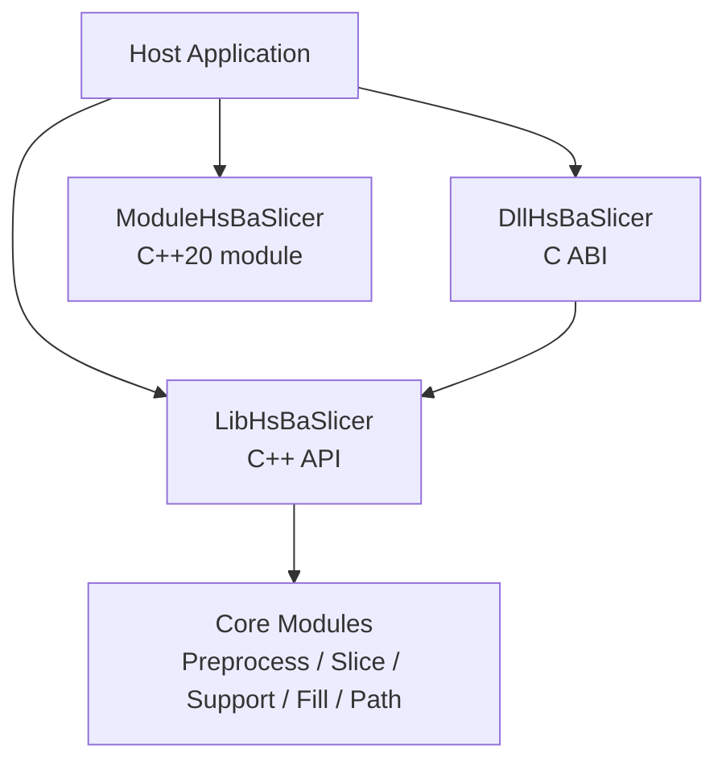

**Diagram sources**
- [docs/en/DllHsBaSlicer/README.md:7-19](file://docs/en/DllHsBaSlicer/README.md#L7-L19)
- [docs/en/LibHsBaSlicer/README.md:18-31](file://docs/en/LibHsBaSlicer/README.md#L18-L31)

**Section sources**
- [README.md:29-39](file://README.md#L29-L39)
- [CMakeLists.txt:409-439](file://CMakeLists.txt#L409-L439)

## Core Components
HsBaSlicer provides three primary integration components:

| Component | Type | Purpose | Typical Use Case |
|---|---|---|---|
| `LibHsBaSlicer` | C++ static/shared library | Full slicing pipeline API | Native C++ apps, research code, custom pipelines |
| `ModuleHsBaSlicer` | C++20 module wrapper | Class-based RAII API | Modern C++ consumers who prefer classes over free functions |
| `DllHsBaSlicer` | C export shared/static library | Stable C ABI for cross-language calls | Qt, wxWidgets, Unity, Unreal, Java, C#, Python, Swift |

Key characteristics:
- `LibHsBaSlicer` exposes preprocessing, slicing, support generation, polygon filling, path generation, SLA floor/render/package, SLS export, file transfer, parameter store, and Lua extension registration.
- `DllHsBaSlicer` only calls `LibHsBaSlicer` exported interfaces, keeping the ABI boundary clean.
- `ModuleHsBaSlicer` is optional and requires a C++20 module-capable compiler.

**Section sources**
- [docs/en/LibHsBaSlicer/README.md:1-16](file://docs/en/LibHsBaSlicer/README.md#L1-L16)
- [docs/en/DllHsBaSlicer/README.md:1-19](file://docs/en/DllHsBaSlicer/README.md#L1-L19)
- [docs/en/cpp_cmake_usage.md:1-11](file://docs/en/cpp_cmake_usage.md#L1-L11)

## Architecture Overview
The recommended architecture separates host application logic from slicing computation:

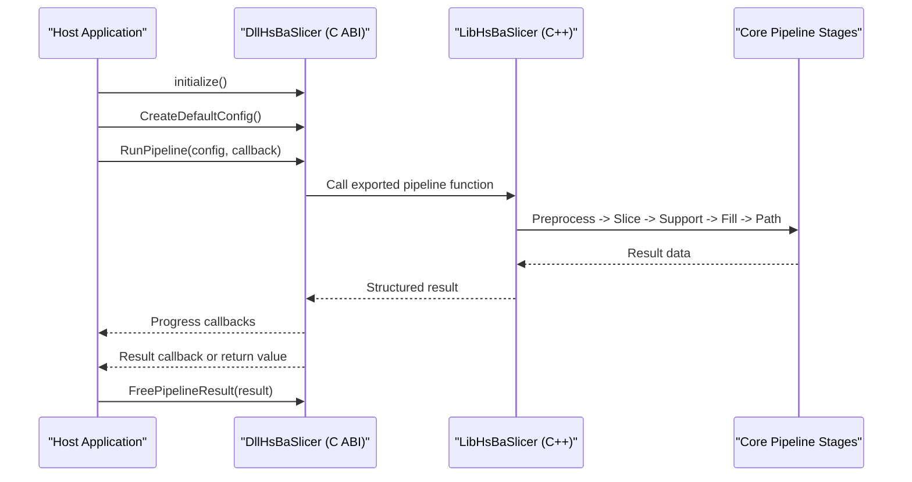

**Diagram sources**
- [docs/en/DllHsBaSlicer/README.md:56-62](file://docs/en/DllHsBaSlicer/README.md#L56-L62)
- [docs/en/DllHsBaSlicer/README.md:684-703](file://docs/en/DllHsBaSlicer/README.md#L684-L703)

## Detailed Component Analysis

### C++ Integration with LibHsBaSlicer
Use `LibHsBaSlicer` when you want direct C++ access to the slicing pipeline.

Recommended steps:
1. Install HsBaSlicer or include it as a subdirectory.
2. Configure your CMake project to find HsBaSlicer.
3. Link against `HsBaSlicer::LibHsBaSlicer`.
4. Include headers such as model preprocessing, mesh slicing, FDM support, polygon fill, and path generation.

Typical workflow:
- Load model.
- Generate layer contours.
- Generate FDM supports.
- Fill polygons.
- Generate G-code paths.

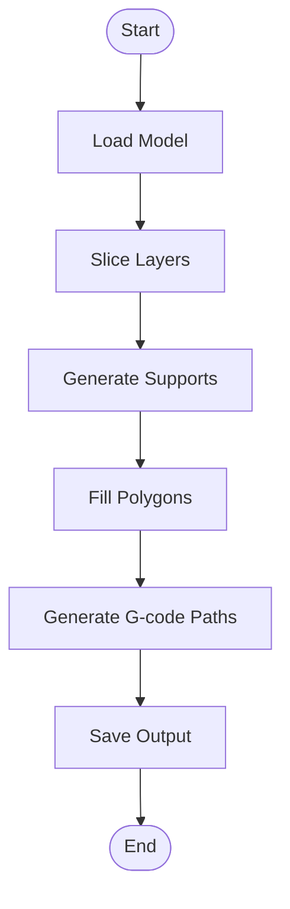

**Diagram sources**
- [docs/en/LibHsBaSlicer/README.md:326-334](file://docs/en/LibHsBaSlicer/README.md#L326-L334)
- [samples/LibHsBaSlicer/main_header.cpp:61-177](file://samples/LibHsBaSlicer/main_header.cpp#L61-L177)

**Section sources**
- [docs/en/cpp_cmake_usage.md:57-99](file://docs/en/cpp_cmake_usage.md#L57-L99)
- [docs/en/LibHsBaSlicer/README.md:33-55](file://docs/en/LibHsBaSlicer/README.md#L33-L55)
- [samples/LibHsBaSlicer/main_header.cpp:20-28](file://samples/LibHsBaSlicer/main_header.cpp#L20-L28)

### C++ Integration with ModuleHsBaSlicer
Use `ModuleHsBaSlicer` when you prefer a class-based API and modern C++20 modules.

Requirements:
- C++20 module-capable compiler.
- Link against `HsHaSlicer::ModuleHsBaSlicer`.
- Use `import hsba.slicer;`.

Key benefits:
- RAII model management.
- Class-based pipeline execution.
- Unified exception handling.

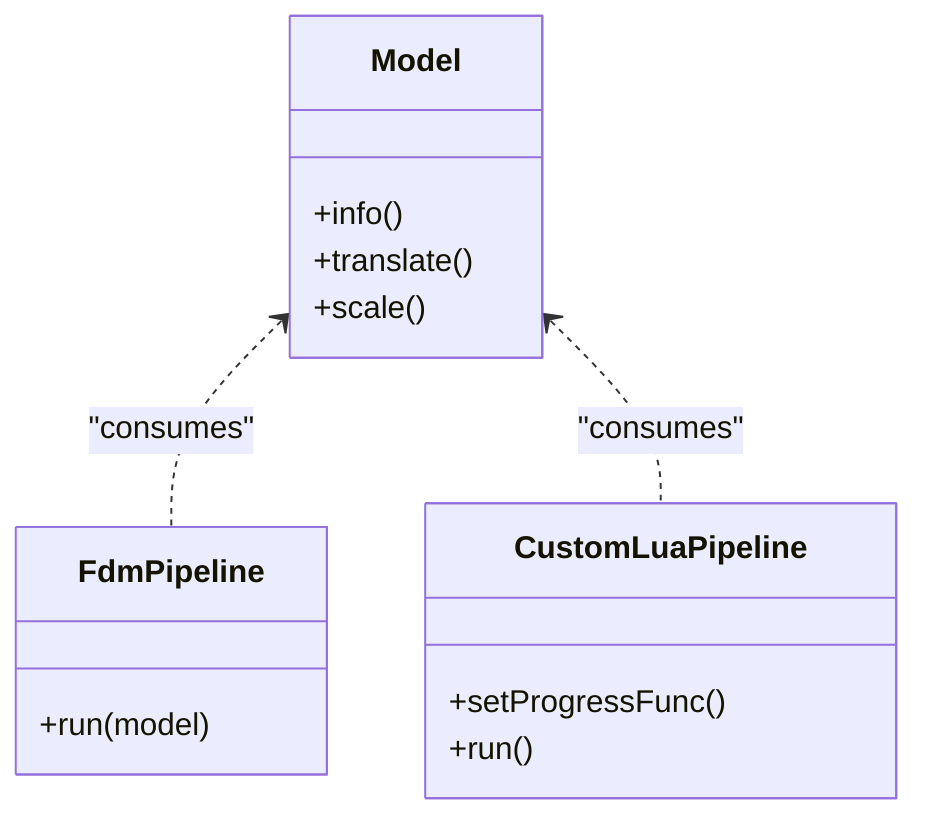

**Diagram sources**
- [docs/en/cpp_cmake_usage.md:155-232](file://docs/en/cpp_cmake_usage.md#L155-L232)
- [samples/LibHsBaSlicer/main_module.cpp:27-29](file://samples/LibHsBaSlicer/main_module.cpp#L27-L29)

**Section sources**
- [docs/en/cpp_cmake_usage.md:155-232](file://docs/en/cpp_cmake_usage.md#L155-L232)
- [samples/LibHsBaSlicer/main_module.cpp:14-29](file://samples/LibHsBaSlicer/main_module.cpp#L14-L29)

### C ABI Integration with DllHsBaSlicer
Use `DllHsBaSlicer` when integrating with non-C++ languages or when you need a stable ABI boundary.

Important ABI concepts:
- `HSBA_SLICER_API` marks exported symbols in the C ABI layer.
- `initialize()` must be called once at process startup.
- Pipeline APIs provide synchronous and asynchronous variants.
- Result structs contain heap-allocated strings that must be freed via matching `HsBaFree*PipelineResult` functions.

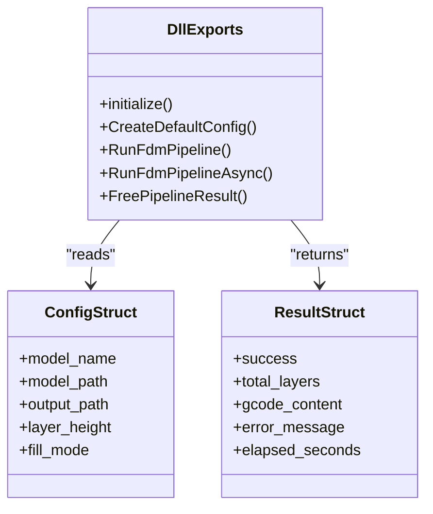

**Diagram sources**
- [DllHsBaSlicer/dllexport.h:1-23](file://DllHsBaSlicer/dllexport.h#L1-L23)
- [DllHsBaSlicer/initialize.h:1-22](file://DllHsBaSlicer/initialize.h#L1-L22)
- [docs/en/DllHsBaSlicer/README.md:56-62](file://docs/en/DllHsBaSlicer/README.md#L56-L62)
- [docs/en/DllHsBaSlicer/README.md:147-162](file://docs/en/DllHsBaSlicer/README.md#L147-L162)

**Section sources**
- [docs/en/DllHsBaSlicer/README.md:21-54](file://docs/en/DllHsBaSlicer/README.md#L21-L54)
- [docs/en/DllHsBaSlicer/README.md:684-703](file://docs/en/DllHsBaSlicer/README.md#L684-L703)

### Build System Configuration with CMake
HsBaSlicer installs CMake package configuration files so downstream projects can use `find_package(HsBaSlicer CONFIG REQUIRED)`.

Recommended patterns:
- Use `find_package(HsBaSlicer REQUIRED)`.
- Link against the appropriate target:
  - `HsBaSlicer::LibHsBaSlicer` for C++ API.
  - `HsBaSlicer::ModuleHsBaSlicer` for C++20 module API.
  - `HsBaSlicer::DllHsBaSlicer` for C ABI.
- If you only need struct definitions without linking the DLL, link `HsBaSlicer::HsBaPipelineTypes`.

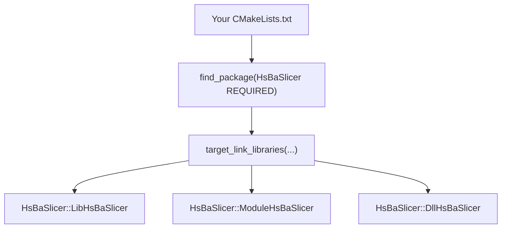

**Diagram sources**
- [docs/en/cpp_cmake_usage.md:57-72](file://docs/en/cpp_cmake_usage.md#L57-L72)
- [docs/en/cpp_cmake_usage.md:336-353](file://docs/en/cpp_cmake_usage.md#L336-L353)

**Section sources**
- [README.md:100-124](file://README.md#L100-L124)
- [README.md:165-179](file://README.md#L165-L179)
- [docs/en/cpp_cmake_usage.md:57-72](file://docs/en/cpp_cmake_usage.md#L57-L72)
- [docs/en/cpp_cmake_usage.md:448-458](file://docs/en/cpp_cmake_usage.md#L448-L458)

### Cross-Language Integration Patterns

#### Python (ctypes / pybind11)
- For ctypes: load the shared library produced by `DllHsBaSlicer`, call `initialize()`, then call pipeline functions using mirrored C structs.
- For pybind11: wrap `LibHsBaSlicer` or `DllHsBaSlicer` into a Python module.
- Use Protobuf-generated Python bindings if you need cross-process serialization.

Key considerations:
- Keep UTF-8 string lifetimes valid across the ABI boundary.
- Marshal progress callbacks carefully; they run on native worker threads.
- Release result strings with the matching `HsBaFree*PipelineResult` function.

#### Java (JNI for Android)
Android uses JNI to call native code. The example Android app loads the native library and invokes a native function that runs pipeline examples.

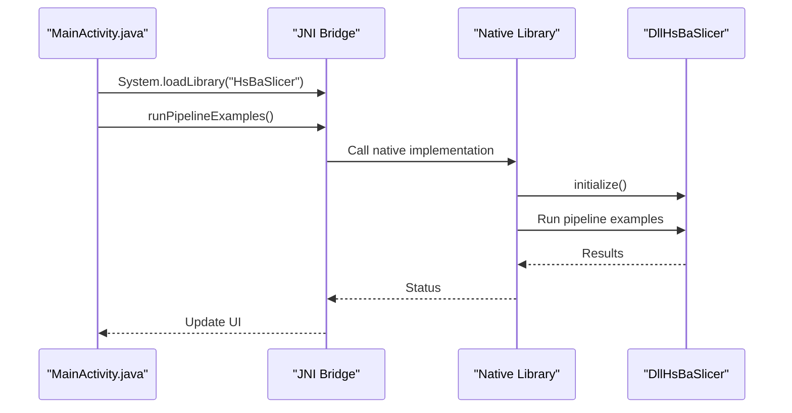

**Diagram sources**
- [android/app/src/main/java/com/hsmbanlance/hsbaslicer/example/MainActivity.java:17-27](file://android/app/src/main/java/com/hsmbanlance/hsbaslicer/example/MainActivity.java#L17-L27)
- [android/app/src/main/java/com/hsmbanlance/hsbaslicer/example/MainActivity.java:29-44](file://android/app/src/main/java/com/hsmbanlance/hsbaslicer/example/MainActivity.java#L29-L44)

**Section sources**
- [android/app/src/main/java/com/hsmbanlance/hsbaslicer/example/MainActivity.java:1-46](file://android/app/src/main/java/com/hsmbanlance/hsbaslicer/example/MainActivity.java#L1-L46)
- [android/app/build.gradle:24-33](file://android/app/build.gradle#L24-L33)

#### C# (.NET Interop)
Unity and Unreal Engine documentation shows how to mirror C structs with `[StructLayout(LayoutKind.Sequential)]`, declare delegates for callbacks, and use `[DllImport]` to call `DllHsBaSlicer`.

Key points:
- Mirror every `const char*` field as `IntPtr`.
- Preserve delegate references so GC does not collect them while native code holds them.
- Marshal progress callbacks back to the UI thread.
- Free pipeline results after copying managed strings.

**Section sources**
- [docs/en/DllHsBaSlicer/game_engine_integration.md:21-127](file://docs/en/DllHsBaSlicer/game_engine_integration.md#L21-L127)
- [docs/en/DllHsBaSlicer/game_engine_integration.md:128-183](file://docs/en/DllHsBaSlicer/game_engine_integration.md#L128-L183)

#### JavaScript (WebAssembly)
For WebAssembly, integrate via:
- Compiling `LibHsBaSlicer` or `DllHsBaSlicer` to WASM where supported.
- Using Emscripten bindings to expose C ABI functions to JavaScript.
- Handling memory ownership carefully because WASM memory and host memory have different lifetimes.

This section is conceptual because the repository does not include a dedicated WebAssembly build script; the same ABI rules apply.

#### Other Languages Calling the C ABI
Any language that can call C functions can integrate with HsBaSlicer by:
- Loading `DllHsBaSlicer`.
- Calling `initialize()`.
- Creating default config structs.
- Running synchronous or asynchronous pipeline functions.
- Freeing result strings.

**Section sources**
- [docs/en/DllHsBaSlicer/README.md:56-62](file://docs/en/DllHsBaSlicer/README.md#L56-L62)
- [docs/en/DllHsBaSlicer/README.md:684-703](file://docs/en/DllHsBaSlicer/README.md#L684-L703)

### Android Integration

#### JNI Setup
The Android example demonstrates:
- Loading the native library with `System.loadLibrary("HsBaSlicer")`.
- Declaring a native method `runPipelineExamples()`.
- Invoking the native function from the Activity lifecycle.

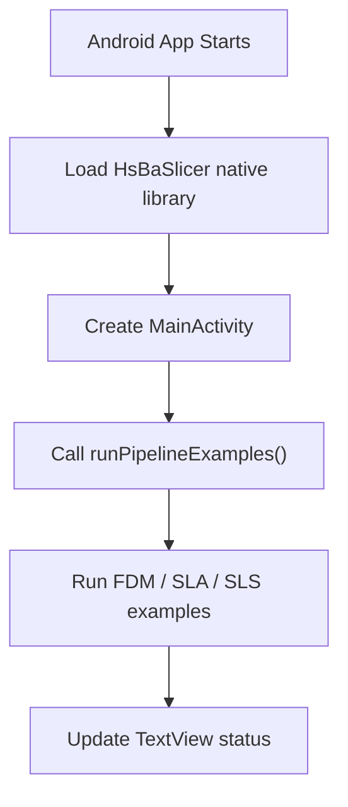

**Diagram sources**
- [android/app/src/main/java/com/hsmbanlance/hsbaslicer/example/MainActivity.java:17-27](file://android/app/src/main/java/com/hsmbanlance/hsbaslicer/example/MainActivity.java#L17-L27)
- [android/app/src/main/java/com/hsmbanlance/hsbaslicer/example/MainActivity.java:29-44](file://android/app/src/main/java/com/hsmbanlance/hsbaslicer/example/MainActivity.java#L29-L44)

**Section sources**
- [android/app/src/main/java/com/hsmbanlance/hsbaslicer/example/MainActivity.java:1-46](file://android/app/src/main/java/com/hsmbanlance/hsbaslicer/example/MainActivity.java#L1-L46)

#### NDK Configuration
The Android Gradle configuration:
- Sets `compileSdk`, `minSdk`, and `targetSdk`.
- Configures `jniLibs.srcDirs` to read `.so` files from `src/main/jniLibs`.
- Filters ABI to `arm64-v8a`.

CI builds native libraries with CMake and copies them into the Android app’s `jniLibs` directory.

**Section sources**
- [android/app/build.gradle:5-33](file://android/app/build.gradle#L5-L33)
- [android/README.md:1-19](file://android/README.md#L1-L19)
- [.github/workflows/build-android.yml:97-107](file://.github/workflows/build-android.yml#L97-L107)

#### Mobile Deployment Considerations
- On Android, dynamic library loading may be limited depending on toolchain and platform restrictions.
- The root CMake disables the dynamic library loader on non-desktop platforms by default.
- Ensure native `.so` files are packaged into the APK under the correct ABI directories.

**Section sources**
- [CMakeLists.txt:228-240](file://CMakeLists.txt#L228-L240)
- [android/README.md:1-19](file://android/README.md#L1-L19)

### iOS Integration

#### Swift/Objective-C Bridging
The iOS example shows:
- A Swift view controller that triggers slicing examples.
- Calling a C function exported by the HsBaSlicer bridge.
- Running slicing work on a background queue and updating the UI on the main queue.

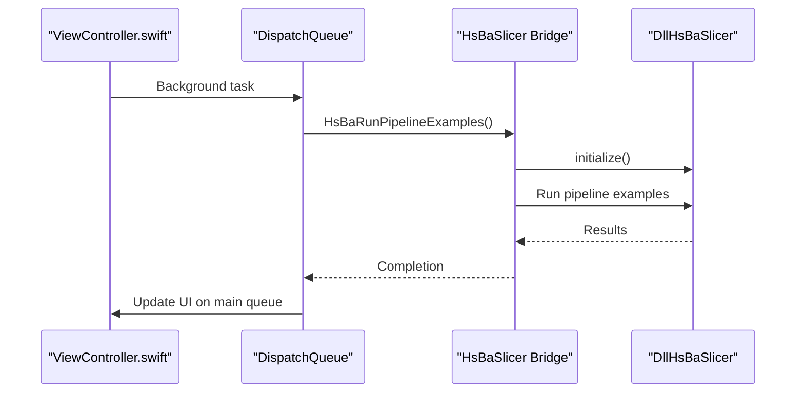

**Diagram sources**
- [ios/HsBaSlicerExample/ViewController.swift:43-55](file://ios/HsBaSlicerExample/ViewController.swift#L43-L55)
- [ios/HsBaSlicerExample/ViewController.swift:73-85](file://ios/HsBaSlicerExample/ViewController.swift#L73-L85)

**Section sources**
- [ios/HsBaSlicerExample/ViewController.swift:1-86](file://ios/HsBaSlicerExample/ViewController.swift#L1-L86)

#### App Store Distribution Requirements
- iOS forbids loading arbitrary dylibs at runtime; `DllHsBaSlicer` is documented as a static library on iOS.
- Ensure all required dependencies are statically linked or bundled according to Apple’s distribution rules.
- Avoid GPL/LGPL kernel features if you must stay within MIT licensing constraints for certain distributions.

**Section sources**
- [docs/en/DllHsBaSlicer/README.md:21-31](file://docs/en/DllHsBaSlicer/README.md#L21-L31)
- [README.md:187-190](file://README.md#L187-L190)
- [README.md:198-210](file://README.md#L198-L210)

### Game Engine Integration

#### Unity Integration
Unity integration uses C# P/Invoke to call `DllHsBaSlicer`:
- Mirror C structs with sequential layout.
- Declare delegates for progress and result callbacks.
- Use `[DllImport]` to call `initialize`, default config creation, pipeline run functions, and result freeing.
- Wrap async calls with `TaskCompletionSource` and marshal callbacks to Unity’s main thread.

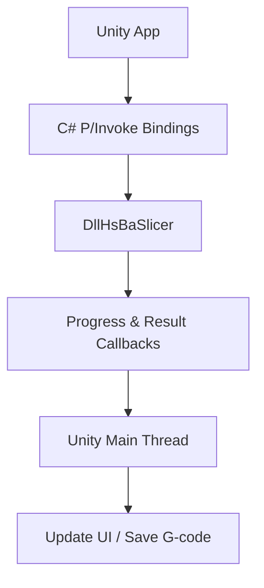

**Diagram sources**
- [docs/en/DllHsBaSlicer/game_engine_integration.md:21-127](file://docs/en/DllHsBaSlicer/game_engine_integration.md#L21-L127)
- [docs/en/DllHsBaSlicer/game_engine_integration.md:128-183](file://docs/en/DllHsBaSlicer/game_engine_integration.md#L128-L183)

**Section sources**
- [docs/en/DllHsBaSlicer/game_engine_integration.md:21-183](file://docs/en/DllHsBaSlicer/game_engine_integration.md#L21-L183)

#### Unreal Engine Integration
Unreal Engine integration uses a ThirdParty module pattern:
- Add `DllHsBaSlicer` headers and binaries under `ThirdParty`.
- Create a C++ subsystem that wraps `DllHsBaSlicer`.
- Use UE threading primitives to move callbacks from native worker threads to the GameThread.
- Expose Blueprint-callable functions for designers.

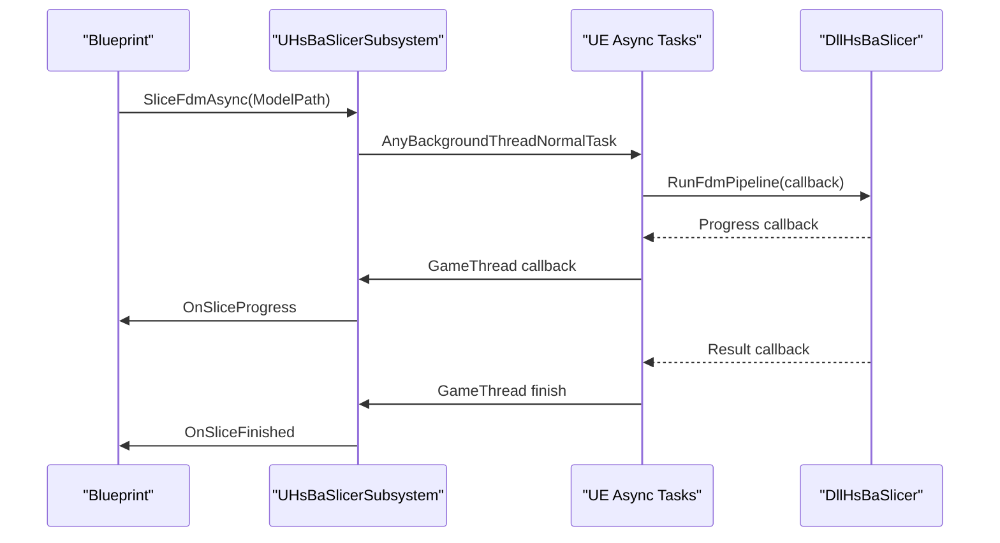

**Diagram sources**
- [docs/en/DllHsBaSlicer/game_engine_integration.md:214-270](file://docs/en/DllHsBaSlicer/game_engine_integration.md#L214-L270)
- [docs/en/DllHsBaSlicer/game_engine_integration.md:270-347](file://docs/en/DllHsBaSlicer/game_engine_integration.md#L270-L347)

**Section sources**
- [docs/en/DllHsBaSlicer/game_engine_integration.md:214-362](file://docs/en/DllHsBaSlicer/game_engine_integration.md#L214-L362)

## Dependency Analysis
HsBaSlicer has many internal and external dependencies. At configure time, it detects platform capabilities, optional copyleft kernels, and feature flags.

Key dependency categories:
- Core math and geometry: Eigen3, libigl, CGAL (optional).
- CAD and mesh processing: OpenCASCADE (optional), IGL.
- Serialization and configuration: Protobuf, RapidJSON, yaml-cpp, tinyxml2.
- Threading and utilities: Boost, OpenSSL, magic_enum.
- Platform-specific: OpenCV (desktop), SQLite/MySQL/PostgreSQL adapters.

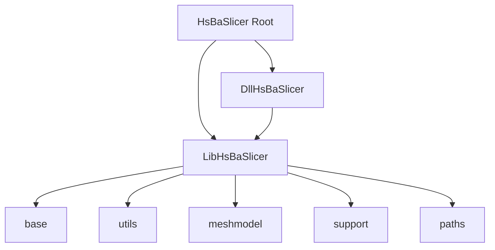

**Diagram sources**
- [CMakeLists.txt:409-439](file://CMakeLists.txt#L409-L439)
- [docs/en/LibHsBaSlicer/README.md:18-31](file://docs/en/LibHsBaSlicer/README.md#L18-L31)

**Section sources**
- [CMakeLists.txt:206-349](file://CMakeLists.txt#L206-L349)
- [CMakeLists.txt:409-439](file://CMakeLists.txt#L409-L439)
- [docs/en/cpp_cmake_usage.md:461-472](file://docs/en/cpp_cmake_usage.md#L461-L472)

## Performance Considerations
- Prefer asynchronous pipeline calls in interactive applications to avoid blocking the UI thread.
- Marshal progress and result callbacks back to the host’s UI or game thread.
- Reuse model handles and avoid repeated model loads when possible.
- Disable heavy optional features (CGAL boolean operations, OpenCascade, OpenVDB) on constrained platforms.
- Use header-only type definitions (`HsBaPipelineTypes`) when mirroring structs for P/Invoke to avoid unnecessary linking.
- On mobile platforms, keep slicing work off the main thread and limit memory allocations during real-time slicing.

[No sources needed since this section provides general guidance]

## Troubleshooting Guide

### Common CMake Issues
- Missing `find_package(HsBaSlicer)` configuration: ensure HsBaSlicer is installed or included as a subdirectory.
- Wrong target name: use `HsBaSlicer::LibHsBaSlicer`, `HsBaSlicer::ModuleHsBaSlicer`, or `HsBaSlicer::DllHsBaSlicer`.
- Transitive dependencies not found: set `CMAKE_PREFIX_PATH` to the vcpkg or system install location.

**Section sources**
- [docs/en/cpp_cmake_usage.md:57-72](file://docs/en/cpp_cmake_usage.md#L57-L72)
- [docs/en/cpp_cmake_usage.md:461-472](file://docs/en/cpp_cmake_usage.md#L461-L472)

### ABI and Memory Management Errors
- Forgetting to call `initialize()`: always call it once after process startup.
- Not freeing result strings: use `HsBaFreePipelineResult` or the matching free function.
- Passing invalid UTF-8 pointers across the C boundary: ensure string lifetimes cover the entire pipeline call.
- Collecting delegates too early in C#: keep delegate references alive while native callbacks may fire.

**Section sources**
- [docs/en/DllHsBaSlicer/README.md:56-62](file://docs/en/DllHsBaSlicer/README.md#L56-L62)
- [docs/en/DllHsBaSlicer/README.md:684-703](file://docs/en/DllHsBaSlicer/README.md#L684-L703)
- [docs/en/DllHsBaSlicer/game_engine_integration.md:128-183](file://docs/en/DllHsBaSlicer/game_engine_integration.md#L128-L183)

### Android-Specific Issues
- Native library not found: verify `.so` files are copied into `src/main/jniLibs/arm64-v8a`.
- ABI mismatch: ensure the built ABI matches `abiFilters` in Gradle.
- Dynamic loader limitations: the project disables the dynamic library loader on non-desktop platforms by default.

**Section sources**
- [android/app/build.gradle:24-33](file://android/app/build.gradle#L24-L33)
- [android/README.md:1-19](file://android/README.md#L1-L19)
- [CMakeLists.txt:228-240](file://CMakeLists.txt#L228-L240)

### iOS-Specific Issues
- Runtime dylib loading is not allowed on iOS: use static library integration.
- Swift bridge must call exported C functions correctly.
- App Store distribution requires careful bundling of dependencies and license compliance.

**Section sources**
- [docs/en/DllHsBaSlicer/README.md:21-31](file://docs/en/DllHsBaSlicer/README.md#L21-L31)
- [ios/HsBaSlicerExample/ViewController.swift:43-55](file://ios/HsBaSlicerExample/ViewController.swift#L43-L55)
- [README.md:187-210](file://README.md#L187-L210)

## Conclusion
HsBaSlicer provides flexible integration options:
- Use `LibHsBaSlicer` for native C++ control.
- Use `ModuleHsBaSlicer` for modern C++20 module-style APIs.
- Use `DllHsBaSlicer` for cross-language and cross-platform integration.
- Follow the provided CMake configuration, ABI memory rules, and platform-specific guidance for Android and iOS.
- For game engines, rely on the documented Unity and Unreal patterns for real-time slicing, asset pipeline integration, and performance optimization.

[No sources needed since this section summarizes without analyzing specific files]

## Appendices

### Minimal C++ Example Paths
- Traditional headers sample: [samples/LibHsBaSlicer/main_header.cpp](file://samples/LibHsBaSlicer/main_header.cpp)
- C++20 module sample: [samples/LibHsBaSlicer/main_module.cpp](file://samples/LibHsBaSlicer/main_module.cpp)

**Section sources**
- [samples/LibHsBaSlicer/main_header.cpp:1-28](file://samples/LibHsBaSlicer/main_header.cpp#L1-L28)
- [samples/LibHsBaSlicer/main_module.cpp:1-29](file://samples/LibHsBaSlicer/main_module.cpp#L1-L29)