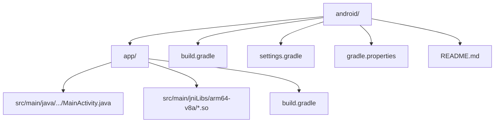
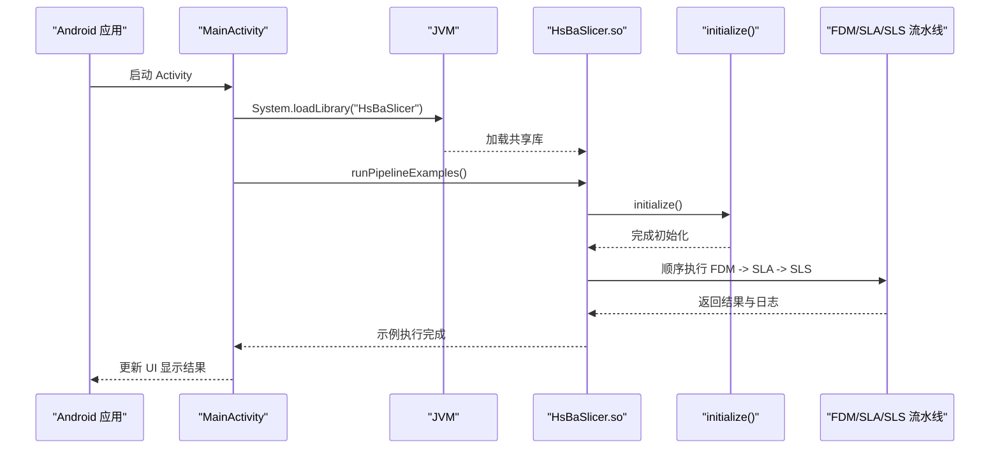
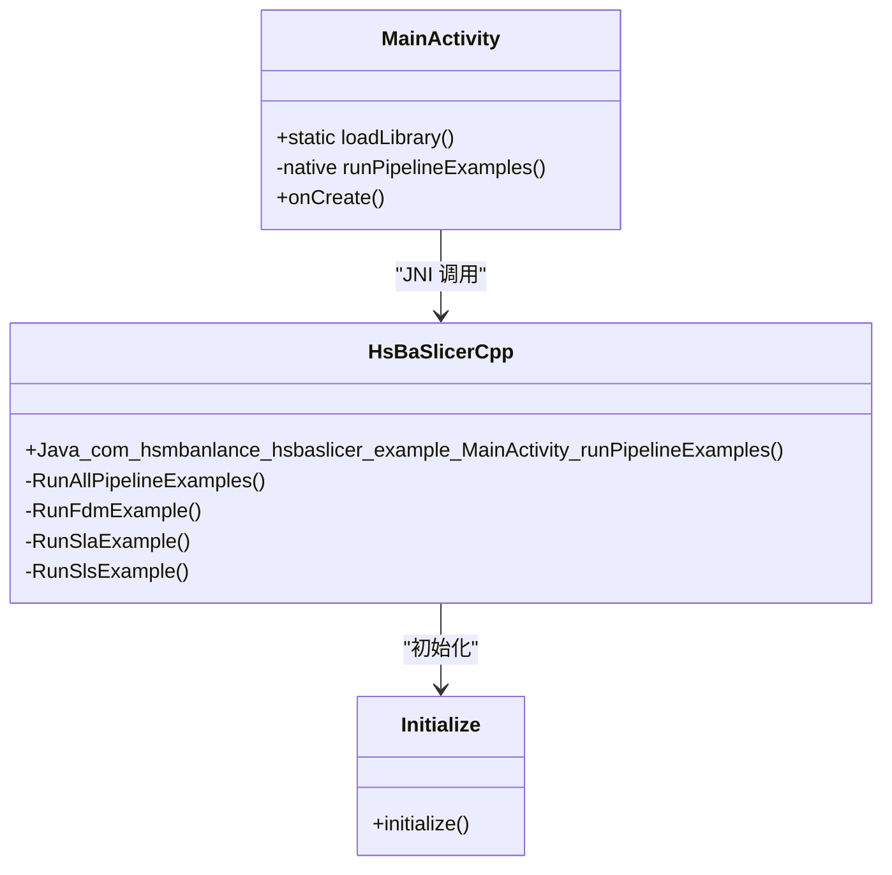
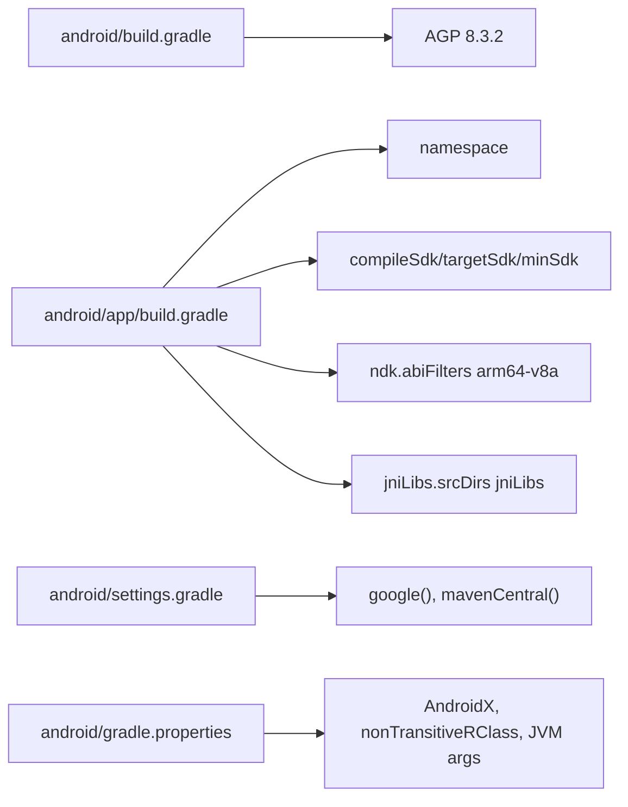
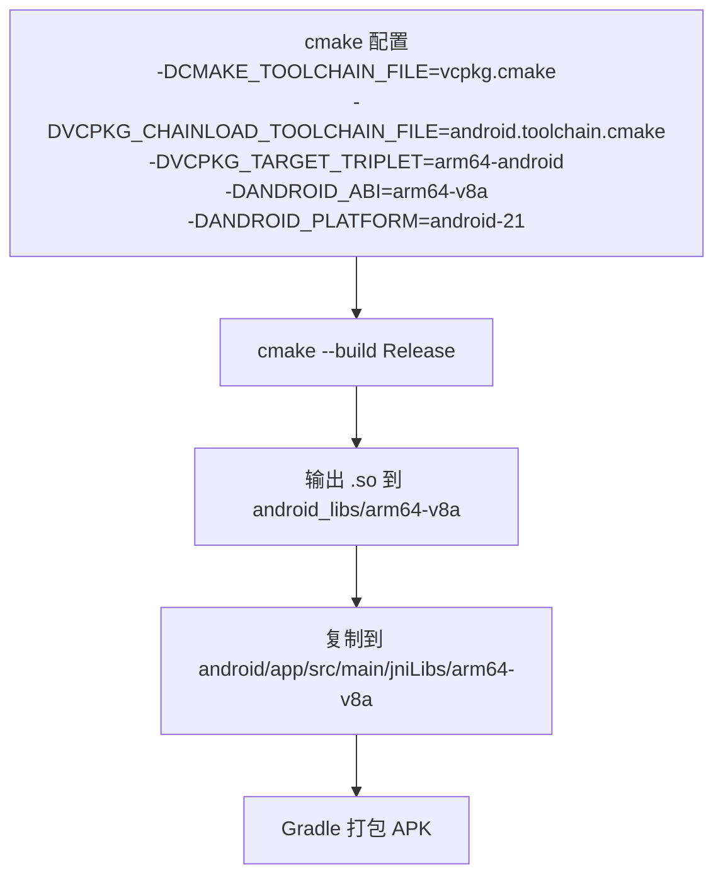
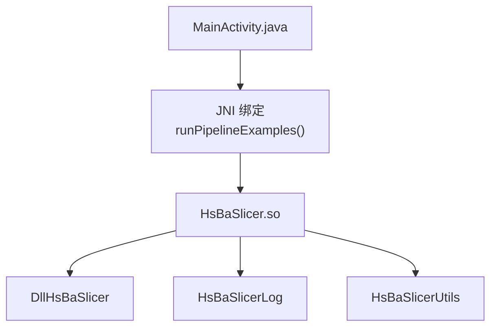

# Android Integration / 安卓集成

<cite>
**本文引用的文件**   
- [MainActivity.java](file://android/app/src/main/java/com/hsmbanlance/hsbaslicer/example/MainActivity.java)
- [app/build.gradle](file://android/app/build.gradle)
- [build.gradle](file://android/build.gradle)
- [settings.gradle](file://android/settings.gradle)
- [gradle.properties](file://android/gradle.properties)
- [README.md](file://android/README.md)
- [HsBaSlicer.cpp](file://HsBaSlicer/HsBaSlicer.cpp)
- [HsBaSlicer.h](file://HsBaSlicer/HsBaSlicer.h)
- [CMakeLists.txt](file://HsBaSlicer/CMakeLists.txt)
- [initialize.h](file://DllHsBaSlicer/initialize.h)
- [initialize.cpp](file://DllHsBaSlicer/initialize.cpp)
</cite>

## 目录
1. [简介](#简介)
2. [项目结构](#项目结构)
3. [核心组件](#核心组件)
4. [架构总览](#架构总览)
5. [详细组件分析](#详细组件分析)
6. [依赖关系分析](#依赖关系分析)
7. [性能与移动端优化](#性能与移动端优化)
8. [构建与打包指南](#构建与打包指南)
9. [常见问题与调试](#常见问题与调试)
10. [部署策略](#部署策略)
11. [结论](#结论)

## 简介
本文件面向希望在 Android 平台上集成 HsBaSlicer 的开发者，提供从工程结构、Gradle 配置、NDK 与 CMake 集成、JNI 调用到 APK 打包、调试与部署的完整说明。示例应用通过 `System.loadLibrary("HsBaSlicer")` 加载原生库，并通过 JNI 调用 `runPipelineExamples()`，依次执行 FDM、SLA、SLS 流水线示例。该入口为示例用途，并非生产入口。

## 项目结构
Android 子工程位于仓库根目录下的 `android/`，采用最小化骨架：一个 Gradle 应用模块 `:app`，包含 Java 入口 Activity 和预置的 `jniLibs/arm64-v8a` 目录，用于放置由 CMake 构建产出的 `.so` 文件。



**图示来源** 
- [MainActivity.java:1-46](file://android/app/src/main/java/com/hsmbanlance/hsbaslicer/example/MainActivity.java#L1-L46)
- [app/build.gradle:1-37](file://android/app/build.gradle#L1-L37)
- [settings.gradle:1-19](file://android/settings.gradle#L1-L19)
- [gradle.properties:1-4](file://android/gradle.properties#L1-L4)
- [README.md:1-22](file://android/README.md#L1-L22)

**章节来源**
- [MainActivity.java:1-46](file://android/app/src/main/java/com/hsmbanlance/hsbaslicer/example/MainActivity.java#L1-L46)
- [app/build.gradle:1-37](file://android/app/build.gradle#L1-L37)
- [settings.gradle:1-19](file://android/settings.gradle#L1-L19)
- [gradle.properties:1-4](file://android/gradle.properties#L1-L4)
- [README.md:1-22](file://android/README.md#L1-L22)

## 核心组件
- MainActivity.java：Android 示例入口，负责加载本地库并触发流水线示例。
- app/build.gradle：定义命名空间、SDK 版本、ABI 过滤、JNI 库目录等。
- HsBaSlicer.cpp：平台入口，在 ANDROID 宏下导出 JNI 函数，初始化并运行流水线示例。
- HsBaSlicer/CMakeLists.txt：在 Android 上构建共享库，输出至 `android_libs/<ABI>`，并复制依赖的 `.so`。
- initialize.*：DLL 初始化接口，供上层入口调用。

**章节来源**
- [MainActivity.java:1-46](file://android/app/src/main/java/com/hsmbanlance/hsbaslicer/example/MainActivity.java#L1-L46)
- [app/build.gradle:1-37](file://android/app/build.gradle#L1-L37)
- [HsBaSlicer.cpp:1-305](file://HsBaSlicer/HsBaSlicer.cpp#L1-L305)
- [CMakeLists.txt:1-78](file://HsBaSlicer/CMakeLists.txt#L1-L78)
- [initialize.h:1-22](file://DllHsBaSlicer/initialize.h#L1-L22)
- [initialize.cpp:1-10](file://DllHsBaSlicer/initialize.cpp#L1-L10)

## 架构总览
下图展示 Android 侧 Java 层与原生层的交互流程：Java Activity 加载共享库，调用 JNI 方法，进入 C++ 入口，初始化运行时后顺序执行 FDM、SLA、SLS 流水线示例。



**图示来源** 
- [MainActivity.java:17-44](file://android/app/src/main/java/com/hsmbanlance/hsbaslicer/example/MainActivity.java#L17-L44)
- [HsBaSlicer.cpp:230-240](file://HsBaSlicer/HsBaSlicer.cpp#L230-L240)
- [HsBaSlicer.cpp:214-225](file://HsBaSlicer/HsBaSlicer.cpp#L214-L225)
- [initialize.h:11-19](file://DllHsBaSlicer/initialize.h#L11-L19)

## 详细组件分析

### MainActivity.java：JNI 入口与生命周期
- 使用静态块加载名为 `HsBaSlicer` 的本地共享库。
- 声明 native 方法 `runPipelineExamples()`，对应 JNI 命名约定。
- 在 `onCreate` 中创建 TextView 并直接调用 native 方法；注释明确指出该方法仅供测试，生产环境应在后台线程执行。

```mermaid
flowchart TD
Start(["Activity 启动"]) --> LoadLib["加载本地库<br/>System.loadLibrary(\"HsBaSlicer\")"]
LoadLib --> CreateUI["创建 TextView 并设置初始文本"]
CreateUI --> CallJNI["调用 runPipelineExamples()"]
CallJNI --> Success{"执行成功？"}
Success --> |是| UpdateSuccess["更新 UI 为成功信息"]
Success --> |否| UpdateError["捕获异常并更新错误信息"]
UpdateSuccess --> End(["结束"])
UpdateError --> End
```

**图示来源** 
- [MainActivity.java:17-44](file://android/app/src/main/java/com/hsmbanlance/hsbaslicer/example/MainActivity.java#L17-L44)

**章节来源**
- [MainActivity.java:1-46](file://android/app/src/main/java/com/hsmbanlance/hsbaslicer/example/MainActivity.java#L1-L46)

### HsBaSlicer.cpp：JNI 绑定与流水线编排
- 在 ANDROID 编译条件下导出 JNI 函数 `Java_com_hsmbanlance_hsbaslicer_example_MainActivity_runPipelineExamples`。
- 先调用 `initialize()` 进行运行时初始化，再顺序执行 FDM、SLA、SLS 三个流水线示例。
- 每个流水线示例均遵循“获取默认配置 → 设置模型与参数 → 同步执行 → 处理结果 → 释放内存”的模式。



**图示来源** 
- [HsBaSlicer.cpp:230-240](file://HsBaSlicer/HsBaSlicer.cpp#L230-L240)
- [HsBaSlicer.cpp:214-225](file://HsBaSlicer/HsBaSlicer.cpp#L214-L225)
- [initialize.h:11-19](file://DllHsBaSlicer/initialize.h#L11-L19)

**章节来源**
- [HsBaSlicer.cpp:1-305](file://HsBaSlicer/HsBaSlicer.cpp#L1-L305)
- [initialize.h:1-22](file://DllHsBaSlicer/initialize.h#L1-L22)
- [initialize.cpp:1-10](file://DllHsBaSlicer/initialize.cpp#L1-L10)

### Gradle 与 NDK 配置
- 应用模块 `app/build.gradle`：
  - 命名空间与应用 ID。
  - compileSdk/targetSdk/minSdk 分别为 34/34/21。
  - 构建类型 release 关闭混淆（minifyEnabled false）。
  - sourceSets.main.jniLibs.srcDirs 指向 `src/main/jniLibs`。
  - android.defaultConfig.ndk.abiFilters 仅包含 `arm64-v8a`。
- 根 build.gradle 指定 Android Gradle Plugin 版本 8.3.2。
- settings.gradle 启用 Google/Maven Central 仓库，包含 `:app` 模块。
- gradle.properties 启用 AndroidX、非传递 RClass，并设置 JVM 堆大小。



**图示来源** 
- [app/build.gradle:1-37](file://android/app/build.gradle#L1-L37)
- [build.gradle:1-4](file://android/build.gradle#L1-L4)
- [settings.gradle:1-19](file://android/settings.gradle#L1-L19)
- [gradle.properties:1-4](file://android/gradle.properties#L1-L4)

**章节来源**
- [app/build.gradle:1-37](file://android/app/build.gradle#L1-L37)
- [build.gradle:1-4](file://android/build.gradle#L1-L4)
- [settings.gradle:1-19](file://android/settings.gradle#L1-L19)
- [gradle.properties:1-4](file://android/gradle.properties#L1-L4)

### CMake 与 NDK 集成
- HsBaSlicer/CMakeLists.txt：
  - 在 ANDROID 环境下将目标定义为 SHARED 库 `HsBaSlicer`。
  - 默认 ANDROID_ABI 为 `arm64-v8a`。
  - 输出目录设置为 `${CMAKE_BINARY_DIR}/android_libs/${ANDROID_ABI}`。
  - 链接依赖 `HsBaSlicerUtils`、`HsBaSlicerLog`、`DllHsBaSlicer`。
  - 构建后自动复制 `DllHsBaSlicer/*.so` 到相同输出目录，便于后续拷贝到 `jniLibs`。
- android/README.md 提供了使用 vcpkg 链式工具链与 Android NDK 的 CMake 配置示例，包括 `-DVCPKG_TARGET_TRIPLET=arm64-android`、`-DANDROID_ABI=arm64-v8a`、`-DANDROID_PLATFORM=android-21`。



**图示来源** 
- [CMakeLists.txt:12-39](file://HsBaSlicer/CMakeLists.txt#L12-L39)
- [README.md:7-17](file://android/README.md#L7-L17)

**章节来源**
- [CMakeLists.txt:1-78](file://HsBaSlicer/CMakeLists.txt#L1-L78)
- [README.md:1-22](file://android/README.md#L1-L22)

## 依赖关系分析
- Java 层依赖：
  - Android Framework（Activity、Bundle、TextView）。
  - 系统库加载机制（System.loadLibrary）。
- 原生层依赖：
  - HsBaSlicer 共享库依赖 DllHsBaSlicer、HsBaSlicerLog、HsBaSlicerUtils。
  - 流水线示例依赖各工艺头文件（fdm_pipeline.h、sla_pipeline.h、sls_pipeline.h）与 logger。



**图示来源** 
- [MainActivity.java:17-27](file://android/app/src/main/java/com/hsmbanlance/hsbaslicer/example/MainActivity.java#L17-L27)
- [HsBaSlicer.cpp:18-22](file://HsBaSlicer/HsBaSlicer.cpp#L18-L22)
- [CMakeLists.txt:25-29](file://HsBaSlicer/CMakeLists.txt#L25-L29)

**章节来源**
- [MainActivity.java:1-46](file://android/app/src/main/java/com/hsmbanlance/hsbaslicer/example/MainActivity.java#L1-L46)
- [HsBaSlicer.cpp:1-305](file://HsBaSlicer/HsBaSlicer.cpp#L1-L305)
- [CMakeLists.txt:1-78](file://HsBaSlicer/CMakeLists.txt#L1-L78)

## 性能与移动端优化
- 内存管理：
  - 原生流水线示例在成功后需调用对应的释放函数（例如 `HsBaFreePipelineResult`、`HsBaFreeSlaPipelineResult`、`HsBaFreeSlsPipelineResult`），避免内存泄漏。
- 后台处理与线程安全：
  - MainActivity 当前在 UI 线程直接调用 native 方法，注释明确提示生产环境应移至后台线程。建议在 Android 中使用 `ExecutorService`、`Coroutine`（Kotlin）、或 `WorkManager` 执行耗时任务，并通过 Handler/CoroutineDispatcher 回主线程更新 UI。
- 移动端性能优化建议：
  - 控制并发度：流水线示例为同步串行执行，可根据设备 CPU 核数调整并行度（若扩展为并行）。
  - 减少对象分配：复用缓冲区、避免频繁字符串拼接与大对象创建。
  - IO 优化：对大文件写入使用缓冲流，必要时分块处理。
  - 资源清理：确保所有原生分配的内存与句柄在使用后释放。

[本节为通用指导，不直接分析具体源码文件]

## 构建与打包指南

### 步骤一：准备 Android Studio 与 NDK
- 安装 Android Studio，并在 SDK Manager 中安装：
  - Android SDK Platform 34。
  - Android SDK Build-Tools。
  - Android NDK（建议使用与 AGP 8.3.2 兼容的版本）。
- 确认环境变量：
  - ANDROID_HOME 指向 Android SDK。
  - ANDROID_NDK_ROOT 指向 NDK 路径（可选，取决于工具链配置）。

### 步骤二：构建原生库（CMake + vcpkg + NDK）
- 参考 android/README.md 中的命令，使用 vcpkg 链式工具链构建 Android 原生库：
  - 配置阶段传入 `-DVCPKG_TARGET_TRIPLET=arm64-android`、`-DANDROID_ABI=arm64-v8a`、`-DANDROID_PLATFORM=android-21`。
  - 构建完成后产物位于 `CMAKE_BINARY_DIR/android_libs/arm64-v8a`。

### 步骤三：拷贝 .so 到 jniLibs
- 将构建产出的 `.so` 文件复制到 `android/app/src/main/jniLibs/arm64-v8a/`。
- 确保 `app/build.gradle` 中 `sourceSets.main.jniLibs.srcDirs` 已正确指向该目录。

### 步骤四：在 Android Studio 中打开工程并构建 APK
- 打开 `android/` 目录作为项目。
- 选择设备或模拟器（arm64 架构）。
- 运行或构建 APK。

### 步骤五：验证运行
- 启动应用后，Activity 会加载本地库并执行流水线示例。
- 观察 UI 文本变化与日志输出，确认 FDM/SLA/SLS 示例是否成功。

**章节来源**
- [README.md:7-17](file://android/README.md#L7-L17)
- [app/build.gradle:24-33](file://android/app/build.gradle#L24-L33)

## 常见问题与调试

### 常见构建问题
- 找不到 NDK 或工具链：
  - 检查 ANDROID_NDK_ROOT 是否正确，或确保 Android Studio 已安装 NDK。
  - 若使用 vcpkg 链式工具链，确认 `-DVCPKG_CHAINLOAD_TOOLCHAIN_FILE=$ANDROID_NDK/build/cmake/android.toolchain.cmake` 路径有效。
- ABI 不匹配：
  - 确保 CMake 构建的 ABI 与 Gradle 的 `abiFilters` 一致（均为 `arm64-v8a`）。
- 缺少依赖 `.so`：
  - CMake 会自动复制 `DllHsBaSlicer/*.so` 到输出目录；若未出现，请检查 CMake 构建日志与自定义命令是否执行。

### 调试技巧
- ndk-gdb：
  - 在 Android Studio 中配置 External Tool 或 Terminal 脚本，使用 `ndk-gdb` 附加到进程。
  - 在 Java 层设置断点，或在 C++ 层使用 `__builtin_trap()` 触发崩溃以生成符号栈。
- 日志输出：
  - 原生层通过 LoggerSingletone 输出信息；可在 Android 上使用 logcat 查看。
  - 若需要更详细的调试信息，可在关键路径添加临时日志。

### 运行时异常处理
- MainActivity 已对 native 调用进行 try-catch，失败时更新 UI 显示错误信息。
- 若发生崩溃，优先检查：
  - 本地库是否成功加载（logcat 中是否有 UnsatisfiedLinkError）。
  - 流水线示例所需资源（模型文件、脚本路径）是否存在。
  - 原生内存释放是否遗漏。

**章节来源**
- [MainActivity.java:37-44](file://android/app/src/main/java/com/hsmbanlance/hsbaslicer/example/MainActivity.java#L37-L44)
- [HsBaSlicer.cpp:80-105](file://HsBaSlicer/HsBaSlicer.cpp#L80-L105)
- [HsBaSlicer.cpp:143-155](file://HsBaSlicer/HsBaSlicer.cpp#L143-L155)
- [HsBaSlicer.cpp:195-207](file://HsBaSlicer/HsBaSlicer.cpp#L195-L207)

## 部署策略

### 开发环境
- 使用 Debug 构建，保留符号以便调试。
- 在设备上直接运行 APK，结合 logcat 与 ndk-gdb 进行调试。
- 保持流水线示例的资源路径与模型文件可用。

### 生产环境
- 使用 Release 构建，可开启混淆与资源压缩（当前示例关闭 minifyEnabled）。
- 签名 APK 并分发到应用商店或内部渠道。
- 考虑移除示例代码或将其封装为可选功能开关，避免暴露非生产入口。
- 针对移动端优化：
  - 限制流水线并发度。
  - 使用后台任务队列与进度回调。
  - 确保所有原生资源与内存正确释放。

[本节为通用指导，不直接分析具体源码文件]

## 结论
本指南基于仓库中的 Android 骨架与原生入口实现，说明了如何在 Android 平台上加载 HsBaSlicer 共享库并通过 JNI 调用流水线示例。通过 Gradle 与 CMake 的配合，可以稳定构建出适用于 arm64-v8a 的 APK。对于生产环境，建议将耗时任务迁移到后台线程，完善错误处理与资源清理，并结合日志与调试工具提升可维护性。