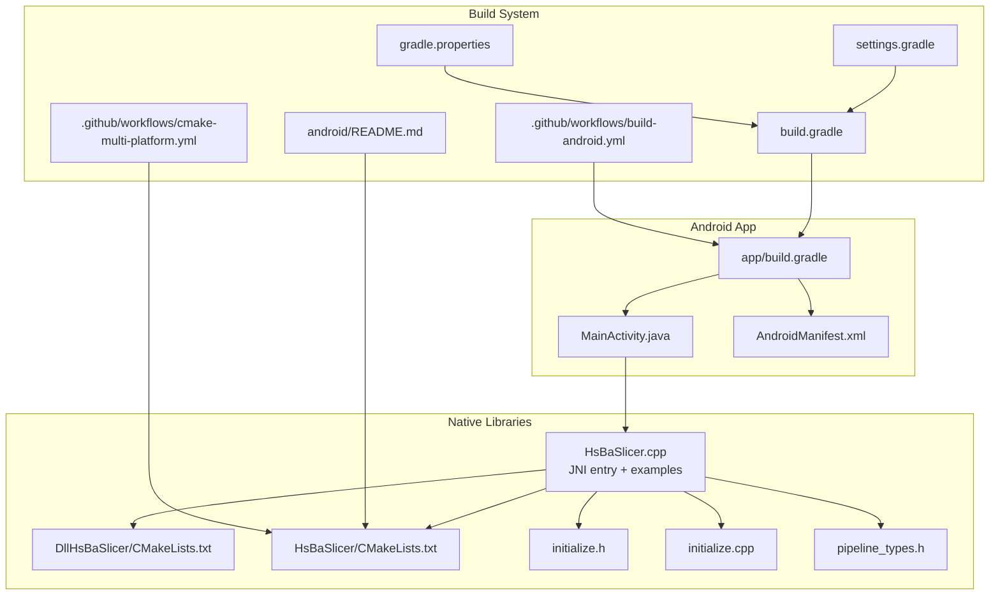
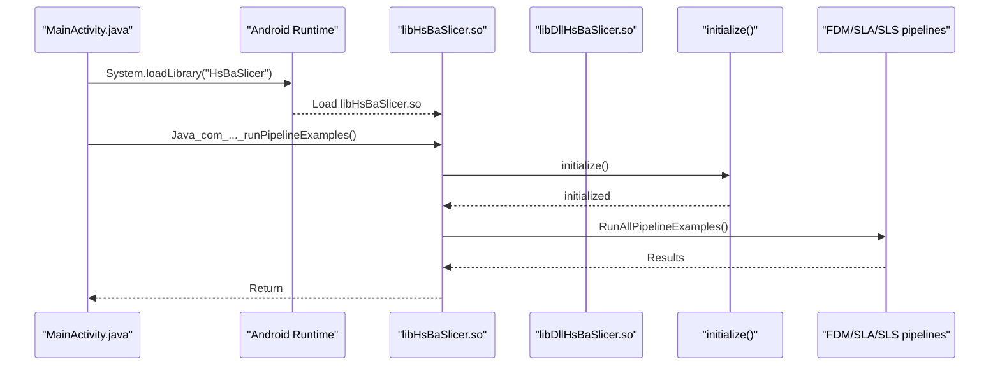
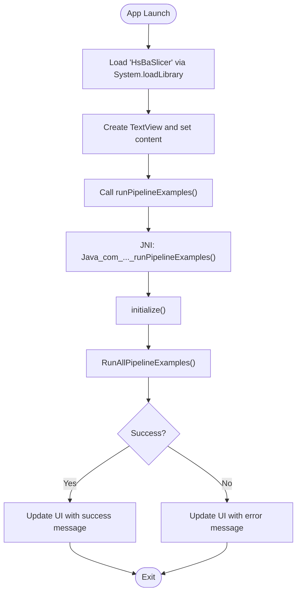
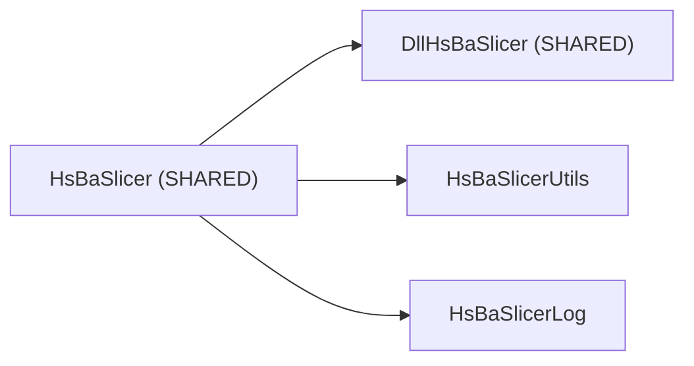
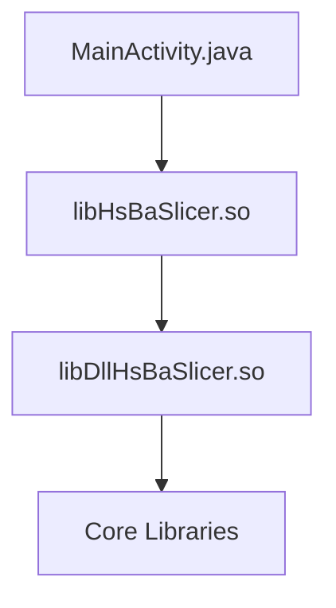

# Android Integration

<cite>
**Referenced Files in This Document**
- [MainActivity.java](file://android/app/src/main/java/com/hsmbanlance/hsbaslicer/example/MainActivity.java)
- [app/build.gradle](file://android/app/build.gradle)
- [build.gradle](file://android/build.gradle)
- [settings.gradle](file://android/settings.gradle)
- [gradle.properties](file://android/gradle.properties)
- [README.md](file://android/README.md)
- [HsBaSlicer.cpp](file://HsBaSlicer/HsBaSlicer.cpp)
- [HsBaSlicer.h](file://HsBaSlicer/HsBaSlicer.h)
- [HsBaSlicer/CMakeLists.txt](file://HsBaSlicer/CMakeLists.txt)
- [DllHsBaSlicer/CMakeLists.txt](file://DllHsBaSlicer/CMakeLists.txt)
- [initialize.h](file://DllHsBaSlicer/initialize.h)
- [initialize.cpp](file://DllHsBaSlicer/initialize.cpp)
- [pipeline_types.h](file://pipelinetypes/pipeline_types.h)
- [cmake-multi-platform.yml](file://.github/workflows/cmake-multi-platform.yml)
- [build-android.yml](file://.github/workflows/build-android.yml)
</cite>

## Table of Contents
1. [Introduction](#introduction)
2. [Project Structure](#project-structure)
3. [Core Components](#core-components)
4. [Architecture Overview](#architecture-overview)
5. [Detailed Component Analysis](#detailed-component-analysis)
6. [Dependency Analysis](#dependency-analysis)
7. [Performance Considerations](#performance-considerations)
8. [Troubleshooting Guide](#troubleshooting-guide)
9. [Conclusion](#conclusion)

## Introduction
This document explains how to integrate HsBaSlicer into an Android application. It covers the complete JNI setup, NDK configuration, ABI-specific library compilation for arm64-v8a and armeabi-v7a, Java wrapper usage, Gradle build configuration, CMake integration, and Android-specific operational guidance such as background processing, memory constraints, battery optimization, and App Store compliance. It also includes troubleshooting steps for common Android build issues, debugging with ndk-gdb, and performance optimization strategies for mobile devices.

The repository provides:
- A minimal Android app skeleton under android/.
- A native entry point that exports a JNI function for Android.
- CMake targets that build the shared libraries for Android.
- GitHub Actions workflows demonstrating CI-based Android builds.

## Project Structure
The Android integration consists of two main parts:
- Native side: C++ code compiled into Android shared libraries via CMake.
- Java side: An example Activity that loads the native library and calls pipeline functions through JNI.

**Diagram sources**
- [MainActivity.java:1-46](file://android/app/src/main/java/com/hsmbanlance/hsbaslicer/example/MainActivity.java#L1-L46)
- [app/build.gradle:1-37](file://android/app/build.gradle#L1-L37)
- [HsBaSlicer.cpp:1-305](file://HsBaSlicer/HsBaSlicer.cpp#L1-L305)
- [HsBaSlicer/CMakeLists.txt:1-78](file://HsBaSlicer/CMakeLists.txt#L1-L78)
- [DllHsBaSlicer/CMakeLists.txt:1-100](file://DllHsBaSlicer/CMakeLists.txt#L1-L100)
- [initialize.h:1-22](file://DllHsBaSlicer/initialize.h#L1-L22)
- [initialize.cpp:1-10](file://DllHsBaSlicer/initialize.cpp#L1-L10)
- [pipeline_types.h:1-800](file://pipelinetypes/pipeline_types.h#L1-L800)
- [README.md](file://android/README.md)
- [cmake-multi-platform.yml:177-280](file://.github/workflows/cmake-multi-platform.yml#L177-L280)
- [build-android.yml:35-126](file://.github/workflows/build-android.yml#L35-L126)

**Section sources**
- [MainActivity.java:1-46](file://android/app/src/main/java/com/hsmbanlance/hsbaslicer/example/MainActivity.java#L1-L46)
- [app/build.gradle:1-37](file://android/app/build.gradle#L1-L37)
- [build.gradle:1-4](file://android/build.gradle#L1-L4)
- [settings.gradle:1-19](file://android/settings.gradle#L1-L19)
- [gradle.properties:1-4](file://android/gradle.properties#L1-L4)
- [README.md](file://android/README.md)

## Core Components
- MainActivity.java: Loads the native library using System.loadLibrary("HsBaSlicer") and declares a native method runPipelineExamples(). The example invokes it on the UI thread for demonstration; production code should move heavy work off the UI thread.
- HsBaSlicer.cpp: Provides the JNI entry Java_com_hsmbanlance_hsbaslicer_example_MainActivity_runPipelineExamples(), initializes the runtime, and runs FDM/SLA/SLS pipeline examples.
- HsBaSlicer/CMakeLists.txt: Builds HsBaSlicer as a SHARED library on Android and outputs .so files under CMAKE_BINARY_DIR/android_libs/<ABI>. It links against DllHsBaSlicer and copies its .so artifacts alongside.
- DllHsBaSlicer/CMakeLists.txt: Defines the cross-language export layer (SHARED on most platforms, STATIC on iOS). On Android, it is built as a shared library and linked by HsBaSlicer.
- initialize.h / initialize.cpp: Declares and implements the one-time initialization function called from the JNI entry.
- pipeline_types.h: Defines C-compatible structs and enums for all pipelines (FDM, SLA, SLS, etc.), including default initializers and callback types.

**Section sources**
- [MainActivity.java:17-27](file://android/app/src/main/java/com/hsmbanlance/hsbaslicer/example/MainActivity.java#L17-L27)
- [HsBaSlicer.cpp:230-240](file://HsBaSlicer/HsBaSlicer.cpp#L230-L240)
- [HsBaSlicer/CMakeLists.txt:12-39](file://HsBaSlicer/CMakeLists.txt#L12-L39)
- [DllHsBaSlicer/CMakeLists.txt:4-41](file://DllHsBaSlicer/CMakeLists.txt#L4-L41)
- [initialize.h:14-19](file://DllHsBaSlicer/initialize.h#L14-L19)
- [initialize.cpp:7-9](file://DllHsBaSlicer/initialize.cpp#L7-L9)
- [pipeline_types.h:23-140](file://pipelinetypes/pipeline_types.h#L23-L140)

## Architecture Overview
At runtime, the Android app loads the HsBaSlicer shared library, which depends on DllHsBaSlicer. The JNI entry initializes the runtime and executes pipeline examples. The pipeline APIs are defined in pipeline_types.h and implemented in the DllHsBaSlicer layer.

**Diagram sources**
- [MainActivity.java:17-27](file://android/app/src/main/java/com/hsmbanlance/hsbaslicer/example/MainActivity.java#L17-L27)
- [HsBaSlicer.cpp:230-240](file://HsBaSlicer/HsBaSlicer.cpp#L230-L240)
- [initialize.h:14-19](file://DllHsBaSlicer/initialize.h#L14-L19)
- [initialize.cpp:7-9](file://DllHsBaSlicer/initialize.cpp#L7-L9)

## Detailed Component Analysis

### JNI Entry and Java Wrapper
- MainActivity.java declares a static block that loads the native library named "HsBaSlicer".
- It declares a private native method runPipelineExamples() corresponding to the JNI function name Java_com_hsmbanlance_hsbaslicer_example_MainActivity_runPipelineExamples.
- In onCreate(), the example calls the native method directly on the UI thread for testing. Production code should use a background executor or WorkManager.

**Diagram sources**
- [MainActivity.java:17-44](file://android/app/src/main/java/com/hsmbanlance/hsbaslicer/example/MainActivity.java#L17-L44)
- [HsBaSlicer.cpp:230-240](file://HsBaSlicer/HsBaSlicer.cpp#L230-L240)

**Section sources**
- [MainActivity.java:17-44](file://android/app/src/main/java/com/hsmbanlance/hsbaslicer/example/MainActivity.java#L17-L44)
- [HsBaSlicer.cpp:230-240](file://HsBaSlicer/HsBaSlicer.cpp#L230-L240)

### Native Library Build Configuration (CMake)
- HsBaSlicer/CMakeLists.txt:
  - On Android, builds HsBaSlicer as a SHARED library.
  - Sets output directories to CMAKE_BINARY_DIR/android_libs/${ANDROID_ABI}.
  - Links against HsBaSlicerUtils, HsBaSlicerLog, and DllHsBaSlicer.
  - Copies DllHsBaSlicer .so files to the same output directory after build.
- DllHsBaSlicer/CMakeLists.txt:
  - Builds DllHsBaSlicer as SHARED on non-iOS platforms (including Android).
  - Links core libraries required by the slicer pipeline.

**Diagram sources**
- [HsBaSlicer/CMakeLists.txt:12-39](file://HsBaSlicer/CMakeLists.txt#L12-L39)
- [DllHsBaSlicer/CMakeLists.txt:42-100](file://DllHsBaSlicer/CMakeLists.txt#L42-L100)

**Section sources**
- [HsBaSlicer/CMakeLists.txt:12-39](file://HsBaSlicer/CMakeLists.txt#L12-L39)
- [DllHsBaSlicer/CMakeLists.txt:42-100](file://DllHsBaSlicer/CMakeLists.txt#L42-L100)

### Pipeline Types and Callbacks
- pipeline_types.h defines C-compatible structs and enums for FDM, SLA, SLS, and other pipelines.
- It also defines progress/result callback types used by the pipeline functions.
- Default config initializers are provided inline for convenience.

Key structures include:
- HsBaFdmPipelineConfig_t and HsBaFdmPipelineResult_t
- HsBaSlaPipelineConfig_t and HsBaSlaPipelineResult_t
- HsBaSlsPipelineConfig_t and HsBaSlsPipelineResult_t
- Progress callbacks and result callbacks for each pipeline

**Section sources**
- [pipeline_types.h:23-140](file://pipelinetypes/pipeline_types.h#L23-L140)
- [pipeline_types.h:142-246](file://pipelinetypes/pipeline_types.h#L142-L246)
- [pipeline_types.h:247-310](file://pipelinetypes/pipeline_types.h#L247-L310)

### Gradle Build Configuration for Android
- app/build.gradle:
  - Defines namespace, compileSdk, minSdk, targetSdk, versionCode, versionName.
  - Configures release build type with ProGuard rules.
  - Sets jniLibs source directory to src/main/jniLibs.
  - Filters ABI to arm64-v8a via android.defaultConfig.ndk.abiFilters.
- Root build.gradle:
  - Applies Android application plugin version 8.3.2.
- settings.gradle:
  - Configures repositories and includes the :app module.
- gradle.properties:
  - Enables AndroidX and sets JVM args.

To support both arm64-v8a and armeabi-v7a:
- Add abiFilters for both ABIs in app/build.gradle.
- Ensure CMake builds both ABIs and copy their .so files into the corresponding jniLibs directories.

**Section sources**
- [app/build.gradle:5-33](file://android/app/build.gradle#L5-L33)
- [build.gradle:1-4](file://android/build.gradle#L1-L4)
- [settings.gradle:1-19](file://android/settings.gradle#L1-L19)
- [gradle.properties:1-4](file://android/gradle.properties#L1-L4)

### CMake Integration and ABI-Specific Compilation
- android/README.md describes building native libs for Android with CMake and copying .so files into the app’s jniLibs directory.
- CI workflows demonstrate configuring CMake with vcpkg and the Android NDK toolchain, setting ANDROID_ABI and ANDROID_PLATFORM, and building Release configurations.

Recommended multi-ABI workflow:
- Configure CMake separately for arm64-v8a and armeabi-v7a.
- Copy outputs into android/app/src/main/jniLibs/arm64-v8a and armeabi-v7a respectively.
- Set abiFilters in Gradle to include both ABIs.

**Section sources**
- [README.md](file://android/README.md)
- [cmake-multi-platform.yml:260-280](file://.github/workflows/cmake-multi-platform.yml#L260-L280)
- [build-android.yml:79-106](file://.github/workflows/build-android.yml#L79-L106)

### Android-Specific Operational Guidance

#### Background Processing with WorkManager
- The example calls runPipelineExamples() on the UI thread for testing. For production:
  - Use WorkManager to schedule long-running slicing tasks.
  - Report progress via WorkInfo and update the UI when the task completes.
  - Avoid blocking the main thread to prevent ANR.

#### Memory Constraints Handling
- Large models can consume significant memory during preprocessing and slicing.
- Prefer streaming or chunked processing where possible.
- Reuse buffers and avoid unnecessary allocations.
- Monitor memory usage and handle OutOfMemoryError gracefully.

#### Battery Optimization
- Long-running tasks should be scheduled during charging or low-priority windows.
- Use Doze mode and App Standby considerations.
- Minimize wake locks and CPU-intensive operations when not necessary.

#### App Store Compliance Requirements
- Ensure proper permissions and privacy disclosures.
- Provide clear user consent for file access and storage.
- Comply with platform policies regarding background execution and resource usage.

[No sources needed since this section provides general guidance]

## Dependency Analysis
The dependency chain for Android is:
- MainActivity.java loads libHsBaSlicer.so via System.loadLibrary.
- libHsBaSlicer.so depends on libDllHsBaSlicer.so and logging/utils libraries.
- libDllHsBaSlicer.so contains the exported pipeline APIs and depends on core libraries.

**Diagram sources**
- [MainActivity.java:17-27](file://android/app/src/main/java/com/hsmbanlance/hsbaslicer/example/MainActivity.java#L17-L27)
- [HsBaSlicer/CMakeLists.txt:25-39](file://HsBaSlicer/CMakeLists.txt#L25-L39)
- [DllHsBaSlicer/CMakeLists.txt:84-100](file://DllHsBaSlicer/CMakeLists.txt#L84-L100)

**Section sources**
- [MainActivity.java:17-27](file://android/app/src/main/java/com/hsmbanlance/hsbaslicer/example/MainActivity.java#L17-L27)
- [HsBaSlicer/CMakeLists.txt:25-39](file://HsBaSlicer/CMakeLists.txt#L25-L39)
- [DllHsBaSlicer/CMakeLists.txt:84-100](file://DllHsBaSlicer/CMakeLists.txt#L84-L100)

## Performance Considerations
- Prefer background threads for heavy computation to keep the UI responsive.
- Tune pipeline parameters (layer height, fill density, support patterns) to balance quality and speed.
- Use appropriate image formats and compression for SLA outputs to reduce I/O overhead.
- Profile memory usage and optimize allocation patterns in critical paths.
- Consider enabling compiler optimizations and linking only necessary dependencies for smaller APK size.

[No sources needed since this section provides general guidance]

## Troubleshooting Guide

### Common Android Build Issues
- Missing .so files in jniLibs:
  - Ensure CMake outputs are copied into android/app/src/main/jniLibs/<ABI>.
  - Verify abiFilters in app/build.gradle match the ABIs you built.
- ABI mismatch:
  - If your device uses armeabi-v7a but you only built arm64-v8a, add armeabi-v7a to abiFilters and rebuild.
- NDK/toolchain configuration errors:
  - Confirm ANDROID_NDK path and toolchain file are correctly set in CMake commands.
  - Use the CI workflow examples as reference for environment variables.

**Section sources**
- [app/build.gradle:31-33](file://android/app/build.gradle#L31-L33)
- [README.md](file://android/README.md)
- [cmake-multi-platform.yml:260-280](file://.github/workflows/cmake-multi-platform.yml#L260-L280)
- [build-android.yml:79-106](file://.github/workflows/build-android.yml#L79-L106)

### Debugging Techniques with ndk-gdb
- Build a Debug variant of the native libraries with symbols enabled.
- Attach ndk-gdb to the running process and set breakpoints in the JNI entry and pipeline functions.
- Inspect stack traces and variable states to diagnose issues.

[No sources needed since this section provides general guidance]

### Logging and Error Handling
- The example uses a logger singleton to emit informational messages.
- Pipeline results include success flags and error messages; ensure these are checked and surfaced to the user.

**Section sources**
- [HsBaSlicer.cpp:29-42](file://HsBaSlicer/HsBaSlicer.cpp#L29-L42)
- [pipeline_types.h:120-140](file://pipelinetypes/pipeline_types.h#L120-L140)

## Conclusion
Integrating HsBaSlicer into Android involves building the native libraries for the desired ABIs, packaging them into the app’s jniLibs directory, and loading them via System.loadLibrary. The example Activity demonstrates calling pipeline functions through JNI. For production, adopt background processing, manage memory carefully, respect battery and platform policies, and follow the provided CMake and Gradle configurations to streamline builds and CI.

[No sources needed since this section summarizes without analyzing specific files]