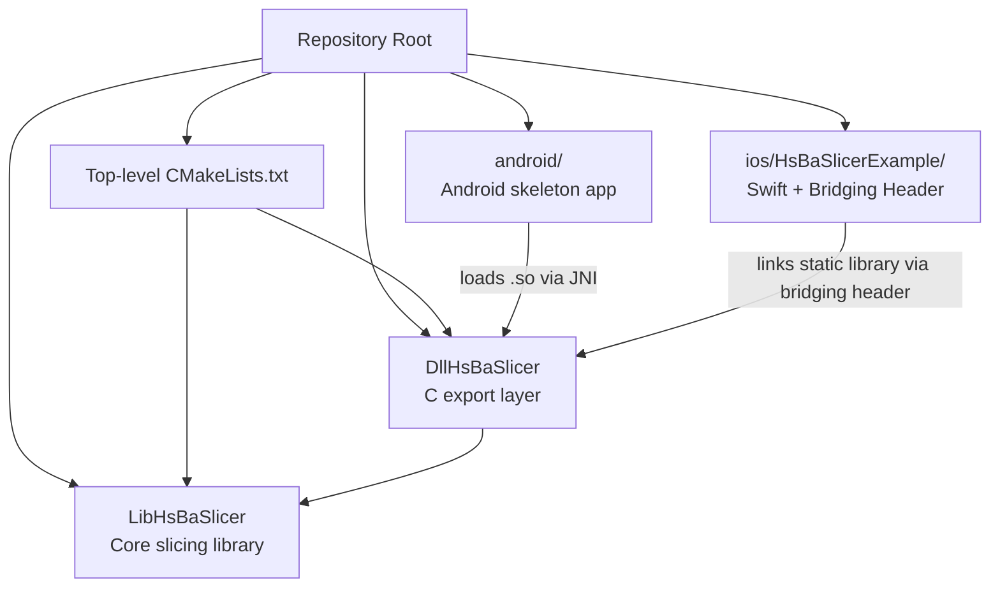
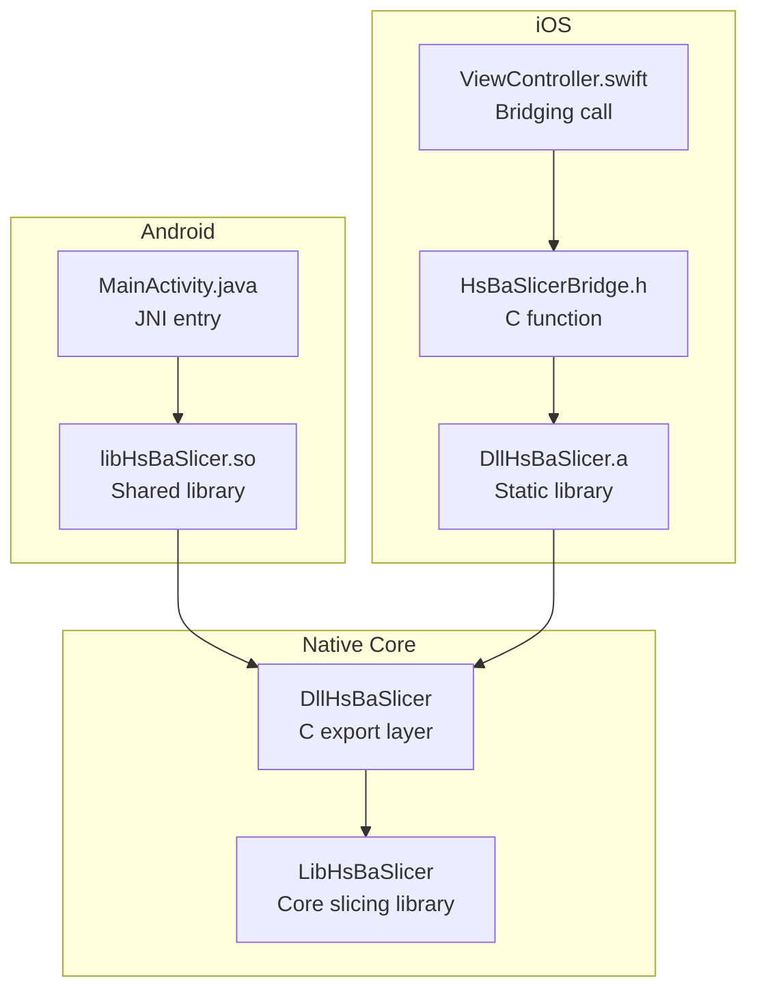
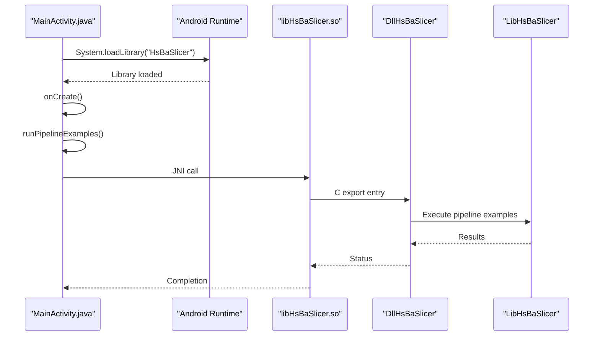
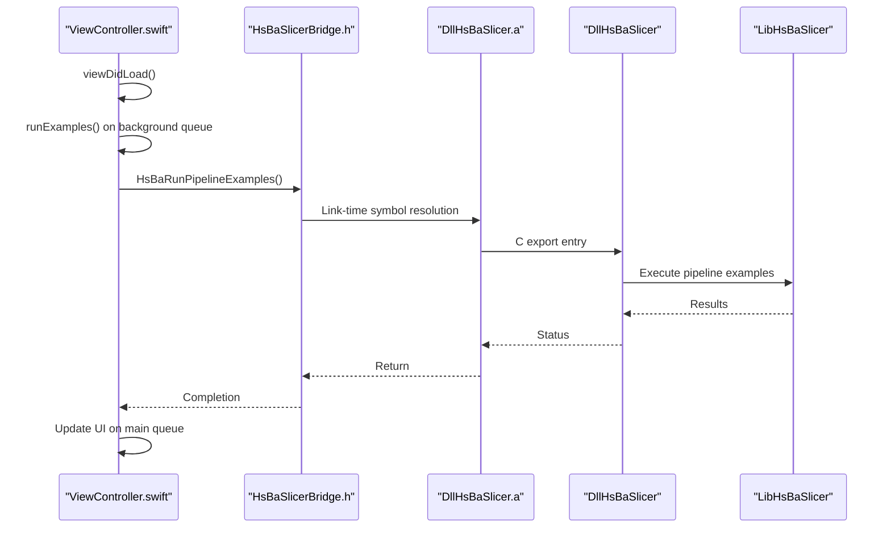
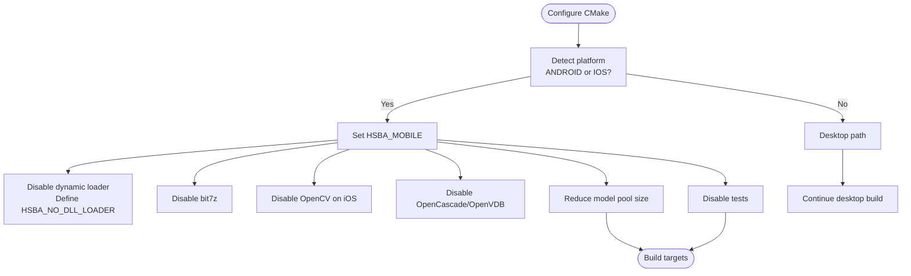
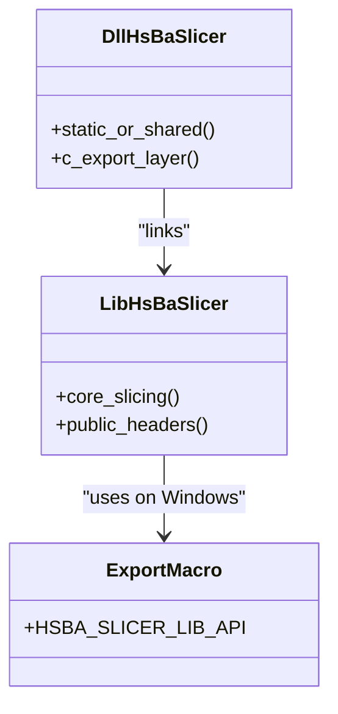
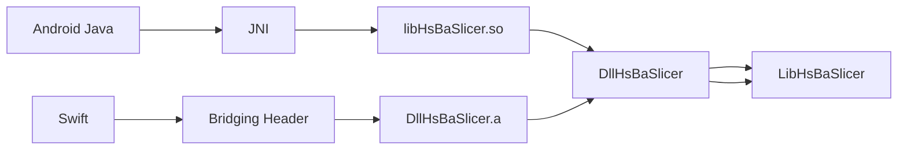

# Mobile Platform Integration

<cite>
**Referenced Files in This Document**
- [CMakeLists.txt](file://CMakeLists.txt)
- [DllHsBaSlicer/CMakeLists.txt](file://DllHsBaSlicer/CMakeLists.txt)
- [LibHsBaSlicer/CMakeLists.txt](file://LibHsBaSlicer/CMakeLists.txt)
- [LibHsBaSlicer/export.h](file://LibHsBaSlicer/export.h)
- [android/README.md](file://android/README.md)
- [android/app/build.gradle](file://android/app/build.gradle)
- [android/app/src/main/java/com/hsmbanlance/hsbaslicer/example/MainActivity.java](file://android/app/src/main/java/com/hsmbanlance/hsbaslicer/example/MainActivity.java)
- [ios/HsBaSlicerExample/HsBaSlicerBridge.h](file://ios/HsBaSlicerExample/HsBaSlicerBridge.h)
- [ios/HsBaSlicerExample/ViewController.swift](file://ios/HsBaSlicerExample/ViewController.swift)
</cite>

## Table of Contents
1. [Introduction](#introduction)
2. [Project Structure](#project-structure)
3. [Core Components](#core-components)
4. [Architecture Overview](#architecture-overview)
5. [Detailed Component Analysis](#detailed-component-analysis)
6. [Dependency Analysis](#dependency-analysis)
7. [Performance Considerations](#performance-considerations)
8. [Troubleshooting Guide](#troubleshooting-guide)
9. [Conclusion](#conclusion)
10. [Appendices](#appendices)

## Introduction
This document explains how to integrate HsBaSlicer on mobile platforms, focusing on Android JNI integration and iOS Swift/Objective-C bridging. It covers NDK configuration, ABI-specific libraries, Java wrapper usage, static library linking for iOS, App Store compliance considerations, mobile-specific optimizations such as background processing and memory constraints handling, platform-specific build configurations, testing strategies, deployment processes, and common mobile integration challenges including memory limits, threading restrictions, and platform compatibility issues.

The repository provides:
- An Android skeleton app that loads a native shared library through JNI.
- An iOS example project with a bridging header exposing a C function to Swift.
- A cross-platform CMake build that detects mobile platforms and adjusts features accordingly.

## Project Structure
At the top level, the CMake configuration identifies mobile builds and disables or reduces heavy desktop-only dependencies. The Android skeleton is under `android`, and the iOS example is under `ios`.

**Diagram sources**
- [CMakeLists.txt:149-157](file://CMakeLists.txt#L149-L157)
- [DllHsBaSlicer/CMakeLists.txt:1-80](file://DllHsBaSlicer/CMakeLists.txt#L1-L80)
- [LibHsBaSlicer/CMakeLists.txt:1-115](file://LibHsBaSlicer/CMakeLists.txt#L1-L115)
- [android/app/src/main/java/com/hsmbanlance/hsbaslicer/example/MainActivity.java:17-20](file://android/app/src/main/java/com/hsmbanlance/hsbaslicer/example/MainActivity.java#L17-L20)
- [ios/HsBaSlicerExample/HsBaSlicerBridge.h:14-25](file://ios/HsBaSlicerExample/HsBaSlicerBridge.h#L14-L25)

**Section sources**
- [CMakeLists.txt:149-157](file://CMakeLists.txt#L149-L157)
- [android/README.md:1-22](file://android/README.md#L1-L22)
- [ios/HsBaSlicerExample/HsBaSlicerBridge.h:1-32](file://ios/HsBaSlicerExample/HsBaSlicerBridge.h#L1-L32)

## Core Components
- Top-level CMake configuration:
  - Detects mobile platforms (`ANDROID` or `IOS`) and sets `HSBA_MOBILE`.
  - Disables dynamic library loader on non-desktop platforms.
  - Disables bit7z on non-desktop platforms.
  - Disables OpenCV, CGAL/OpenCascade, OpenVDB, and some SQL backends on mobile.
  - Reduces model pool size on mobile.
  - Disables tests on Android/iOS by default.
- DllHsBaSlicer:
  - Provides the C export layer for cross-language integration.
  - On iOS, it is built as a static library because iOS apps cannot load arbitrary dylibs.
  - On other platforms, it is built as a shared library.
- LibHsBaSlicer:
  - Core slicing library exposed via public headers.
  - Can be built as static or shared depending on `BUILD_SHARED_LIBS`.
  - Links core modules like base, mesh, 2D, support, paths, preprocess, file operator, version, and converter.
- Android skeleton:
  - Loads native library `HsBaSlicer` via `System.loadLibrary`.
  - Declares a native method `runPipelineExamples()` for JNI invocation.
  - Demonstrates calling pipeline examples from UI thread (not recommended for production).
- iOS example:
  - Exposes `HsBaRunPipelineExamples()` via a bridging header.
  - Swift code calls this function on a background queue and updates UI on main queue.

**Section sources**
- [CMakeLists.txt:214-240](file://CMakeLists.txt#L214-L240)
- [CMakeLists.txt:248-256](file://CMakeLists.txt#L248-L256)
- [CMakeLists.txt:277-280](file://CMakeLists.txt#L277-L280)
- [CMakeLists.txt:300-306](file://CMakeLists.txt#L300-L306)
- [CMakeLists.txt:397-400](file://CMakeLists.txt#L397-L400)
- [DllHsBaSlicer/CMakeLists.txt:1-80](file://DllHsBaSlicer/CMakeLists.txt#L1-L80)
- [LibHsBaSlicer/CMakeLists.txt:1-115](file://LibHsBaSlicer/CMakeLists.txt#L1-L115)
- [android/app/src/main/java/com/hsmbanlance/hsbaslicer/example/MainActivity.java:17-27](file://android/app/src/main/java/com/hsmbanlance/hsbaslicer/example/MainActivity.java#L17-L27)
- [ios/HsBaSlicerExample/HsBaSlicerBridge.h:14-25](file://ios/HsBaSlicerExample/HsBaSlicerBridge.h#L14-L25)
- [ios/HsBaSlicerExample/ViewController.swift:43-55](file://ios/HsBaSlicerExample/ViewController.swift#L43-L55)

## Architecture Overview
The mobile architecture centers around a native C++ core exposed through two layers:
- LibHsBaSlicer: core slicing functionality.
- DllHsBaSlicer: C export layer used by host languages.

On Android, the Java activity loads the shared library and invokes a JNI entry point. On iOS, Swift calls a C function exported by the static library via a bridging header.

**Diagram sources**
- [android/app/src/main/java/com/hsmbanlance/hsbaslicer/example/MainActivity.java:17-27](file://android/app/src/main/java/com/hsmbanlance/hsbaslicer/example/MainActivity.java#L17-L27)
- [DllHsBaSlicer/CMakeLists.txt:1-80](file://DllHsBaSlicer/CMakeLists.txt#L1-L80)
- [LibHsBaSlicer/CMakeLists.txt:1-115](file://LibHsBaSlicer/CMakeLists.txt#L1-L115)
- [ios/HsBaSlicerExample/HsBaSlicerBridge.h:14-25](file://ios/HsBaSlicerExample/HsBaSlicerBridge.h#L14-L25)
- [ios/HsBaSlicerExample/ViewController.swift:43-55](file://ios/HsBaSlicerExample/ViewController.swift#L43-L55)

## Detailed Component Analysis

### Android JNI Integration
- Native library loading:
  - The Java activity uses `System.loadLibrary("HsBaSlicer")` to load the native shared library at class load time.
  - The example declares a native method `runPipelineExamples()` intended to invoke pipeline examples via JNI.
- Gradle configuration:
  - Application ID, min/target SDK versions are defined.
  - `jniLibs.srcDirs` points to `src/main/jniLibs`.
  - `abiFilters` restricts packaging to `arm64-v8a`.
- Build instructions:
  - The Android README shows how to configure CMake with the Android NDK toolchain and VCPKG, then copy produced `.so` files into `android/app/src/main/jniLibs/arm64-v8a/`.

**Diagram sources**
- [android/app/src/main/java/com/hsmbanlance/hsbaslicer/example/MainActivity.java:17-44](file://android/app/src/main/java/com/hsmbanlance/hsbaslicer/example/MainActivity.java#L17-L44)
- [DllHsBaSlicer/CMakeLists.txt:1-80](file://DllHsBaSlicer/CMakeLists.txt#L1-L80)
- [LibHsBaSlicer/CMakeLists.txt:1-115](file://LibHsBaSlicer/CMakeLists.txt#L1-L115)

**Section sources**
- [android/app/src/main/java/com/hsmbanlance/hsbaslicer/example/MainActivity.java:17-44](file://android/app/src/main/java/com/hsmbanlance/hsbaslicer/example/MainActivity.java#L17-L44)
- [android/app/build.gradle:5-33](file://android/app/build.gradle#L5-L33)
- [android/README.md:1-22](file://android/README.md#L1-L22)

### iOS Swift/Objective-C Bridging
- Bridging header:
  - Declares `HsBaRunPipelineExamples()` as an `extern "C"` function callable from Swift.
  - Comments indicate this is an example/test entry, not a production API.
- Swift usage:
  - ViewController sets up a label and gesture recognizer.
  - On tap, runs pipeline examples on a global background queue and updates UI on the main queue.
  - Includes a minimal AppDelegate and SwiftUI-style main entry using `UIApplicationMain`.

**Diagram sources**
- [ios/HsBaSlicerExample/HsBaSlicerBridge.h:14-25](file://ios/HsBaSlicerExample/HsBaSlicerBridge.h#L14-L25)
- [ios/HsBaSlicerExample/ViewController.swift:43-55](file://ios/HsBaSlicerExample/ViewController.swift#L43-L55)
- [DllHsBaSlicer/CMakeLists.txt:1-80](file://DllHsBaSlicer/CMakeLists.txt#L1-L80)
- [LibHsBaSlicer/CMakeLists.txt:1-115](file://LibHsBaSlicer/CMakeLists.txt#L1-L115)

**Section sources**
- [ios/HsBaSlicerExample/HsBaSlicerBridge.h:1-32](file://ios/HsBaSlicerExample/HsBaSlicerBridge.h#L1-L32)
- [ios/HsBaSlicerExample/ViewController.swift:12-86](file://ios/HsBaSlicerExample/ViewController.swift#L12-L86)

### Build Configuration and Feature Flags
- Mobile detection:
  - `HSBA_MOBILE` is set when building for Android or iOS.
- Dynamic loader:
  - Disabled on Android and iOS; `HSBA_NO_DLL_LOADER` is defined.
- Compression:
  - Bit7z disabled on non-desktop platforms.
- Image processing:
  - OpenCV disabled on iOS and game consoles.
- CAD/point cloud:
  - OpenCascade and OpenVDB disabled on Android and iOS.
- Model pool:
  - Reduced to 1 on mobile unless copyleft kernels are available.
- Tests:
  - Disabled on Android/iOS due to output limitations.

**Diagram sources**
- [CMakeLists.txt:149-157](file://CMakeLists.txt#L149-L157)
- [CMakeLists.txt:214-240](file://CMakeLists.txt#L214-L240)
- [CMakeLists.txt:248-256](file://CMakeLists.txt#L248-L256)
- [CMakeLists.txt:277-280](file://CMakeLists.txt#L277-L280)
- [CMakeLists.txt:300-306](file://CMakeLists.txt#L300-L306)
- [CMakeLists.txt:397-400](file://CMakeLists.txt#L397-L400)

**Section sources**
- [CMakeLists.txt:149-157](file://CMakeLists.txt#L149-L157)
- [CMakeLists.txt:214-240](file://CMakeLists.txt#L214-L240)
- [CMakeLists.txt:248-256](file://CMakeLists.txt#L248-L256)
- [CMakeLists.txt:277-280](file://CMakeLists.txt#L277-L280)
- [CMakeLists.txt:300-306](file://CMakeLists.txt#L300-L306)
- [CMakeLists.txt:397-400](file://CMakeLists.txt#L397-L400)

### Library Types and Export Strategy
- DllHsBaSlicer:
  - iOS: static library because iOS apps cannot load arbitrary dylibs.
  - Other platforms: shared library for dynamic loading by host languages.
- LibHsBaSlicer:
  - Built as static or shared based on `BUILD_SHARED_LIBS`.
  - Exports symbols on Windows when shared; otherwise no decoration needed.
- Export macro:
  - `HSBA_SLICER_LIB_API` is defined for Windows DLL import/export; empty on non-Windows.

**Diagram sources**
- [DllHsBaSlicer/CMakeLists.txt:1-80](file://DllHsBaSlicer/CMakeLists.txt#L1-L80)
- [LibHsBaSlicer/CMakeLists.txt:1-115](file://LibHsBaSlicer/CMakeLists.txt#L1-L115)
- [LibHsBaSlicer/export.h:1-22](file://LibHsBaSlicer/export.h#L1-L22)

**Section sources**
- [DllHsBaSlicer/CMakeLists.txt:1-80](file://DllHsBaSlicer/CMakeLists.txt#L1-L80)
- [LibHsBaSlicer/CMakeLists.txt:1-115](file://LibHsBaSlicer/CMakeLists.txt#L1-L115)
- [LibHsBaSlicer/export.h:1-22](file://LibHsBaSlicer/export.h#L1-L22)

## Dependency Analysis
The dependency chain for mobile integration is straightforward:
- Android: Java -> JNI -> Shared Library -> DllHsBaSlicer -> LibHsBaSlicer.
- iOS: Swift -> Bridging Header -> Static Library -> DllHsBaSlicer -> LibHsBaSlicer.

**Diagram sources**
- [android/app/src/main/java/com/hsmbanlance/hsbaslicer/example/MainActivity.java:17-27](file://android/app/src/main/java/com/hsmbanlance/hsbaslicer/example/MainActivity.java#L17-L27)
- [ios/HsBaSlicerExample/HsBaSlicerBridge.h:14-25](file://ios/HsBaSlicerExample/HsBaSlicerBridge.h#L14-L25)
- [DllHsBaSlicer/CMakeLists.txt:1-80](file://DllHsBaSlicer/CMakeLists.txt#L1-L80)
- [LibHsBaSlicer/CMakeLists.txt:1-115](file://LibHsBaSlicer/CMakeLists.txt#L1-L115)

**Section sources**
- [android/app/src/main/java/com/hsmbanlance/hsbaslicer/example/MainActivity.java:17-27](file://android/app/src/main/java/com/hsmbanlance/hsbaslicer/example/MainActivity.java#L17-L27)
- [ios/HsBaSlicerExample/HsBaSlicerBridge.h:14-25](file://ios/HsBaSlicerExample/HsBaSlicerBridge.h#L14-L25)
- [DllHsBaSlicer/CMakeLists.txt:1-80](file://DllHsBaSlicer/CMakeLists.txt#L1-L80)
- [LibHsBaSlicer/CMakeLists.txt:1-115](file://LibHsBaSlicer/CMakeLists.txt#L1-L115)

## Performance Considerations
Mobile performance should account for limited CPU, memory, battery, and background execution policies:
- Background processing:
  - Android: Avoid running heavy JNI calls on the UI thread; use worker threads or coroutines.
  - iOS: Use `DispatchQueue.global(qos: .userInitiated)` for compute tasks and update UI on the main queue.
- Memory constraints:
  - Reduce model pool size on mobile (already configured by CMake).
  - Avoid large temporary allocations; reuse buffers where possible.
  - Prefer streaming or chunked processing for large models.
- Battery optimization:
  - Minimize wakeups and long-running computations on the UI thread.
  - Batch operations and throttle progress updates.
- Threading restrictions:
  - Do not access UIKit/AppKit objects from background threads.
  - Ensure native code does not block indefinitely; implement cancellation and timeouts.
- Feature toggles:
  - Disable heavy optional features (OpenCV, CGAL/OpenCascade, OpenVDB) on mobile to reduce binary size and runtime cost.

[No sources needed since this section provides general guidance]

## Troubleshooting Guide
Common mobile integration issues and resolutions:
- Missing native libraries:
  - Ensure `.so` files are placed under `jniLibs/<ABI>/` and ABI filters match device architectures.
  - Verify Gradle `abiFilters` includes required ABIs.
- Symbol not found errors:
  - Confirm the native library name matches `System.loadLibrary(...)`.
  - Check that DllHsBaSlicer exports the expected C functions.
- iOS static linking failures:
  - Ensure DllHsBaSlicer is built as a static library on iOS.
  - Verify bridging header exposes the correct C function.
- Heavy memory usage:
  - Reduce model pool size and disable unnecessary features on mobile.
  - Monitor memory pressure and release resources promptly.
- UI freezes:
  - Move JNI/Swift bridge calls off the UI thread.
  - Use background queues and dispatch results back to the main queue.

**Section sources**
- [android/app/build.gradle:24-33](file://android/app/build.gradle#L24-L33)
- [android/app/src/main/java/com/hsmbanlance/hsbaslicer/example/MainActivity.java:17-44](file://android/app/src/main/java/com/hsmbanlance/hsbaslicer/example/MainActivity.java#L17-L44)
- [ios/HsBaSlicerExample/HsBaSlicerBridge.h:14-25](file://ios/HsBaSlicerExample/HsBaSlicerBridge.h#L14-L25)
- [ios/HsBaSlicerExample/ViewController.swift:43-55](file://ios/HsBaSlicerExample/ViewController.swift#L43-L55)
- [CMakeLists.txt:300-306](file://CMakeLists.txt#L300-L306)

## Conclusion
HsBaSlicer’s mobile integration relies on a clear separation between the core slicing library and the platform-specific export layer. Android uses JNI to load a shared library, while iOS links a static library and exposes a C function via a bridging header. The top-level CMake configuration adapts features for mobile environments, disabling heavy desktop-only components and reducing resource consumption. For production applications, ensure background processing, memory management, and battery optimization are implemented thoughtfully, and validate ABI compatibility and symbol availability during deployment.

[No sources needed since this section summarizes without analyzing specific files]

## Appendices

### Android Setup Checklist
- Configure CMake with Android NDK toolchain and VCPKG.
- Build native libraries for target ABI(s).
- Copy `.so` files into `android/app/src/main/jniLibs/<ABI>/`.
- Set `abiFilters` in Gradle to include required ABIs.
- Load native library via `System.loadLibrary("HsBaSlicer")`.
- Implement JNI methods and call them from background threads.

**Section sources**
- [android/README.md:1-22](file://android/README.md#L1-L22)
- [android/app/build.gradle:24-33](file://android/app/build.gradle#L24-L33)
- [android/app/src/main/java/com/hsmbanlance/hsbaslicer/example/MainActivity.java:17-27](file://android/app/src/main/java/com/hsmbanlance/hsbaslicer/example/MainActivity.java#L17-L27)

### iOS Setup Checklist
- Add bridging header declaring `HsBaRunPipelineExamples()`.
- Ensure DllHsBaSlicer is built as a static library on iOS.
- Call the C function from Swift on a background queue.
- Update UI on the main queue after completion.
- Validate App Store compliance regarding third-party licenses and feature usage.

**Section sources**
- [ios/HsBaSlicerExample/HsBaSlicerBridge.h:14-25](file://ios/HsBaSlicerExample/HsBaSlicerBridge.h#L14-L25)
- [ios/HsBaSlicerExample/ViewController.swift:43-55](file://ios/HsBaSlicerExample/ViewController.swift#L43-L55)
- [DllHsBaSlicer/CMakeLists.txt:1-80](file://DllHsBaSlicer/CMakeLists.txt#L1-L80)