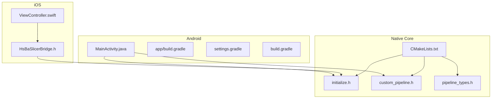
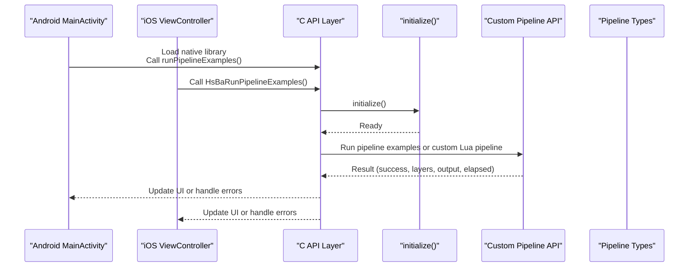
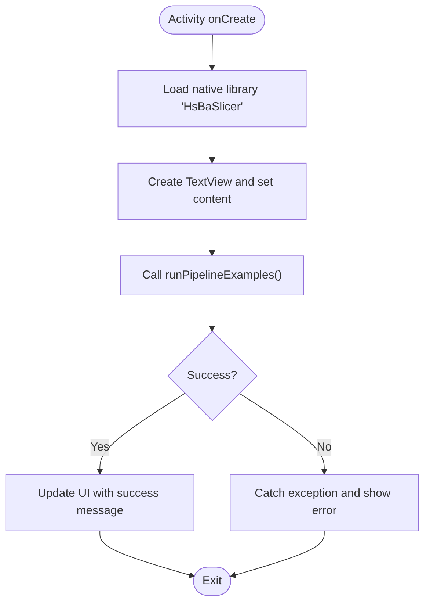
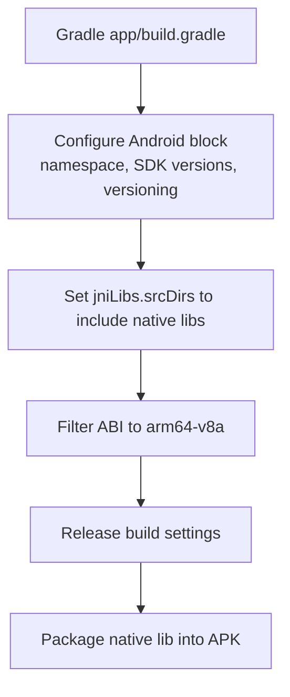
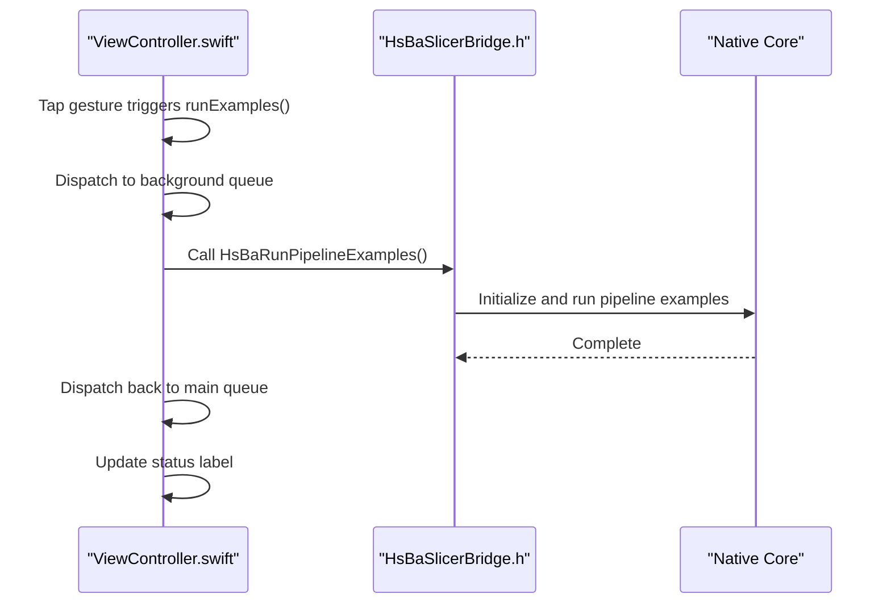
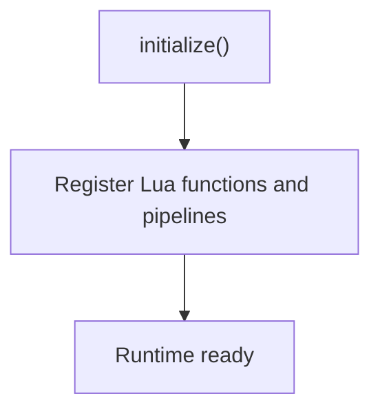
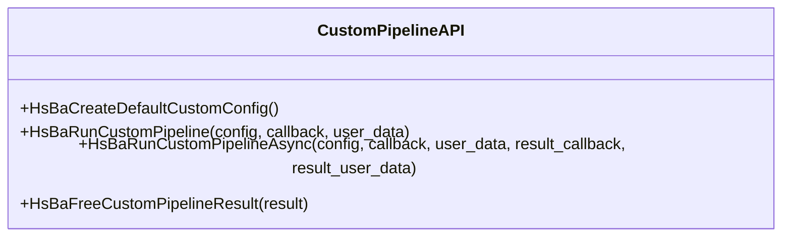
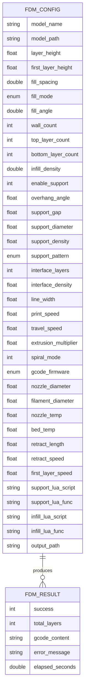
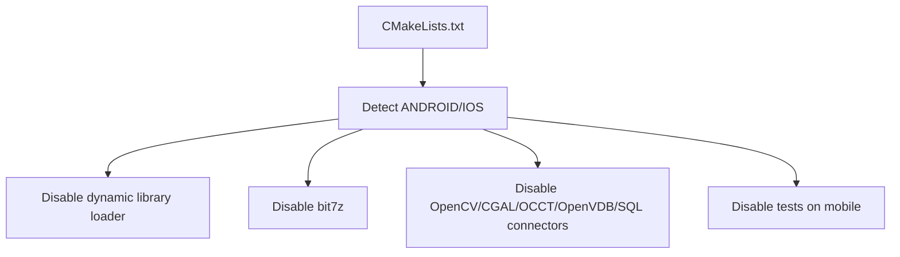

# Mobile Platform Integration / 移动平台集成

<cite>
**Referenced Files in This Document**
- [MainActivity.java](file://android/app/src/main/java/com/hsmbanlance/hsbaslicer/example/MainActivity.java)
- [app/build.gradle](file://android/app/build.gradle)
- [build.gradle](file://android/build.gradle)
- [settings.gradle](file://android/settings.gradle)
- [ViewController.swift](file://ios/HsBaSlicerExample/ViewController.swift)
- [HsBaSlicerBridge.h](file://ios/HsBaSlicerExample/HsBaSlicerBridge.h)
- [CMakeLists.txt](file://CMakeLists.txt)
- [initialize.h](file://DllHsBaSlicer/initialize.h)
- [custom_pipeline.h](file://DllHsBaSlicer/custom_pipeline.h)
- [custom_pipeline.cpp](file://DllHsBaSlicer/custom_pipeline.cpp)
- [pipeline_types.h](file://pipelinetypes/pipeline_types.h)
</cite>

## Table of Contents
1. [Introduction](#introduction)
2. [Project Structure](#project-structure)
3. [Core Components](#core-components)
4. [Architecture Overview](#architecture-overview)
5. [Detailed Component Analysis](#detailed-component-analysis)
6. [Dependency Analysis](#dependency-analysis)
7. [Performance Considerations](#performance-considerations)
8. [Troubleshooting Guide](#troubleshooting-guide)
9. [Conclusion](#conclusion)
10. [Appendices](#appendices)

## Introduction
This document explains how to integrate HsBaSlicer into Android and iOS applications. It covers:
- Android JNI setup, NDK configuration, Gradle build integration, and native library packaging.
- The example Java entry point that loads the native library and calls pipeline examples.
- iOS Swift bridging via a C header, Xcode project expectations, and App Store distribution considerations.
- Platform-specific constraints such as memory limits, background processing, and UI thread safety.
- Build troubleshooting, performance optimization techniques, testing strategies, and deployment workflows for both app stores.

The repository provides an Android example using Java and an iOS example using Swift with a C bridging header. The core slicing logic is implemented in C++ and exposed through C APIs under DllHsBaSlicer and pipelinetypes.

## Project Structure
The mobile integration surface consists of:
- Android application module with a Java activity and Gradle configuration.
- iOS example with a Swift view controller and a C bridging header.
- Top-level CMake configuration that detects mobile platforms and adjusts features.
- C API headers defining pipeline types and custom Lua pipeline interfaces.

**Diagram sources**
- [MainActivity.java:1-46](file://android/app/src/main/java/com/hsmbanlance/hsbaslicer/example/MainActivity.java#L1-L46)
- [app/build.gradle:1-37](file://android/app/build.gradle#L1-L37)
- [settings.gradle:1-19](file://android/settings.gradle#L1-L19)
- [build.gradle:1-4](file://android/build.gradle#L1-L4)
- [ViewController.swift:1-86](file://ios/HsBaSlicerExample/ViewController.swift#L1-L86)
- [HsBaSlicerBridge.h:1-32](file://ios/HsBaSlicerExample/HsBaSlicerBridge.h#L1-L32)
- [CMakeLists.txt:1-695](file://CMakeLists.txt#L1-L695)
- [initialize.h:1-22](file://DllHsBaSlicer/initialize.h#L1-L22)
- [custom_pipeline.h:1-69](file://DllHsBaSlicer/custom_pipeline.h#L1-L69)
- [pipeline_types.h:1-800](file://pipelinetypes/pipeline_types.h#L1-L800)

**Section sources**
- [MainActivity.java:1-46](file://android/app/src/main/java/com/hsmbanlance/hsbaslicer/example/MainActivity.java#L1-L46)
- [app/build.gradle:1-37](file://android/app/build.gradle#L1-L37)
- [settings.gradle:1-19](file://android/settings.gradle#L1-L19)
- [build.gradle:1-4](file://android/build.gradle#L1-L4)
- [ViewController.swift:1-86](file://ios/HsBaSlicerExample/ViewController.swift#L1-L86)
- [HsBaSlicerBridge.h:1-32](file://ios/HsBaSlicerExample/HsBaSlicerBridge.h#L1-L32)
- [CMakeLists.txt:1-695](file://CMakeLists.txt#L1-L695)
- [initialize.h:1-22](file://DllHsBaSlicer/initialize.h#L1-L22)
- [custom_pipeline.h:1-69](file://DllHsBaSlicer/custom_pipeline.h#L1-L69)
- [pipeline_types.h:1-800](file://pipelinetypes/pipeline_types.h#L1-L800)

## Core Components
- Android MainActivity: Loads the native library and invokes a native function to run pipeline examples. It demonstrates where to call HsBaSlicer from Java/Kotlin code and highlights UI-thread safety concerns.
- iOS ViewController: Demonstrates calling a C-exported function from Swift on a background queue and updating UI on the main thread.
- C API layer: Provides initialization and custom pipeline functions used by platform examples.
- Pipeline type definitions: Define C-compatible structs and enums for FDM, SLA, SLS, and other pipelines.

Key responsibilities:
- Android: JNI library loading, example invocation, error handling, and UI updates.
- iOS: Bridging header declaration, Swift async execution, and UI updates.
- Native core: Initialization and custom pipeline execution with progress/result callbacks.

**Section sources**
- [MainActivity.java:1-46](file://android/app/src/main/java/com/hsmbanlance/hsbaslicer/example/MainActivity.java#L1-L46)
- [ViewController.swift:1-86](file://ios/HsBaSlicerExample/ViewController.swift#L1-L86)
- [initialize.h:1-22](file://DllHsBaSlicer/initialize.h#L1-L22)
- [custom_pipeline.h:1-69](file://DllHsBaSlicer/custom_pipeline.h#L1-L69)
- [pipeline_types.h:1-800](file://pipelinetypes/pipeline_types.h#L1-L800)

## Architecture Overview
At runtime, the mobile app loads the native HsBaSlicer library and calls exported C functions. On Android, this is done via System.loadLibrary and a native method binding. On iOS, Swift calls a C function declared in the bridging header. Internally, the native layer initializes the environment and runs pipeline examples or custom Lua-driven pipelines.

**Diagram sources**
- [MainActivity.java:1-46](file://android/app/src/main/java/com/hsmbanlance/hsbaslicer/example/MainActivity.java#L1-L46)
- [ViewController.swift:1-86](file://ios/HsBaSlicerExample/ViewController.swift#L1-L86)
- [initialize.h:1-22](file://DllHsBaSlicer/initialize.h#L1-L22)
- [custom_pipeline.h:1-69](file://DllHsBaSlicer/custom_pipeline.h#L1-L69)
- [pipeline_types.h:1-800](file://pipelinetypes/pipeline_types.h#L1-L800)

## Detailed Component Analysis

### Android Integration

#### JNI Setup and Library Loading
- MainActivity declares a static block that loads the native shared library named "HsBaSlicer".
- It defines a private native method to invoke pipeline examples.
- In onCreate, it sets up a simple TextView UI, then calls the native method directly on the UI thread for demonstration. Production code should move heavy work off the UI thread.

**Diagram sources**
- [MainActivity.java:17-44](file://android/app/src/main/java/com/hsmbanlance/hsbaslicer/example/MainActivity.java#L17-L44)

**Section sources**
- [MainActivity.java:1-46](file://android/app/src/main/java/com/hsmbanlance/hsbaslicer/example/MainActivity.java#L1-L46)

#### Gradle Build System Integration
- The app module uses the Android Application plugin and configures namespace, compileSdk, minSdk, targetSdk, versionCode, and versionName.
- It sets jniLibs source directory to src/main/jniLibs so prebuilt native libraries are packaged into the APK.
- ABI filtering restricts builds to arm64-v8a.
- Release build disables minification for simplicity; ProGuard rules can be added as needed.

**Diagram sources**
- [app/build.gradle:5-33](file://android/app/build.gradle#L5-L33)

**Section sources**
- [app/build.gradle:1-37](file://android/app/build.gradle#L1-L37)
- [settings.gradle:1-19](file://android/settings.gradle#L1-L19)
- [build.gradle:1-4](file://android/build.gradle#L1-L4)

#### Native Library Packaging
- Place the compiled HsBaSlicer shared library under android/app/src/main/jniLibs/arm64-v8a/.
- Ensure the library name matches what MainActivity loads ("HsBaSlicer").
- Verify that the library exports the expected symbols for the native method binding.

**Section sources**
- [MainActivity.java:17-20](file://android/app/src/main/java/com/hsmbanlance/hsbaslicer/example/MainActivity.java#L17-L20)
- [app/build.gradle:24-33](file://android/app/build.gradle#L24-L33)

#### Android-Specific Considerations
- Memory constraints: Avoid large allocations on the UI thread; prefer background threads and reuse buffers.
- Background processing: Move pipeline execution off the UI thread using coroutines, Executors, or similar mechanisms.
- UI thread safety: Always update UI components on the main thread; use handlers or lifecycle-aware components.
- Threading model: Use asynchronous APIs when available to avoid blocking the UI.

[No sources needed since this section provides general guidance]

### iOS Integration

#### Swift/Objective-C Bridging
- HsBaSlicerBridge.h declares a C function HsBaRunPipelineExamples() for Swift to call.
- The Swift ViewController imports UIKit and calls the C function on a background queue, then updates the UI on the main queue.

**Diagram sources**
- [ViewController.swift:43-55](file://ios/HsBaSlicerExample/ViewController.swift#L43-L55)
- [HsBaSlicerBridge.h:19-25](file://ios/HsBaSlicerExample/HsBaSlicerBridge.h#L19-L25)

**Section sources**
- [ViewController.swift:1-86](file://ios/HsBaSlicerExample/ViewController.swift#L1-L86)
- [HsBaSlicerBridge.h:1-32](file://ios/HsBaSlicerExample/HsBaSlicerBridge.h#L1-L32)

#### Xcode Project Configuration
- Add the bridging header path to the Xcode project so Swift can see HsBaSlicerBridge.h.
- Link the HsBaSlicer static or dynamic library produced by the native build.
- Configure architectures and minimum deployment target appropriate for your app.
- Ensure the library symbols are visible to Swift through the bridging header.

[No sources needed since this section provides general guidance]

#### App Store Distribution Requirements
- Sign the app bundle with valid Apple developer certificates and provisioning profiles.
- Strip debug symbols and enable optimizations for release builds.
- Validate binary size and dependencies; ensure no prohibited frameworks are included.
- Test on real devices and verify background task behavior and memory usage.

[No sources needed since this section provides general guidance]

### Native Core Interfaces

#### Initialization
- initialize() is the C entry point for one-time setup and registration. It is safe to call once at load time.

**Diagram sources**
- [initialize.h:14-19](file://DllHsBaSlicer/initialize.h#L14-L19)

**Section sources**
- [initialize.h:1-22](file://DllHsBaSlicer/initialize.h#L1-L22)

#### Custom Lua Pipeline API
- HsBaCreateDefaultCustomConfig returns default configuration values.
- HsBaRunCustomPipeline executes a fully Lua-driven pipeline synchronously.
- HsBaRunCustomPipelineAsync executes asynchronously using coroutines and returns results via callback.
- HsBaFreeCustomPipelineResult frees memory allocated in the result struct.

**Diagram sources**
- [custom_pipeline.h:17-62](file://DllHsBaSlicer/custom_pipeline.h#L17-L62)

**Section sources**
- [custom_pipeline.h:1-69](file://DllHsBaSlicer/custom_pipeline.h#L1-L69)
- [custom_pipeline.cpp:171-213](file://DllHsBaSlicer/custom_pipeline.cpp#L171-L213)

#### Pipeline Type Definitions
- pipeline_types.h defines C-compatible structs and enums for FDM, SLA, SLS, SLM, LOM, 3DP, WAAM, file transfer, and custom Lua pipelines.
- Each pipeline has a config struct, a result struct, progress callback type, and often an async result callback type.
- Default initializer helpers provide sensible defaults for common parameters.

**Diagram sources**
- [pipeline_types.h:56-127](file://pipelinetypes/pipeline_types.h#L56-L127)

**Section sources**
- [pipeline_types.h:1-800](file://pipelinetypes/pipeline_types.h#L1-L800)

## Dependency Analysis
The top-level CMake configuration detects mobile platforms and adjusts feature availability:
- Mobile detection sets HSBA_MOBILE.
- Dynamic library loader is disabled on non-desktop platforms including Android.
- bit7z is disabled on non-desktop platforms.
- OpenCV, CGAL, OpenCASCADE, OpenVDB, and some SQL connectors are disabled on Android/iOS.
- Tests are disabled on Android/iOS/game consoles due to output limitations.

**Diagram sources**
- [CMakeLists.txt:149-157](file://CMakeLists.txt#L149-L157)
- [CMakeLists.txt:229-240](file://CMakeLists.txt#L229-L240)
- [CMakeLists.txt:248-251](file://CMakeLists.txt#L248-L251)
- [CMakeLists.txt:277-280](file://CMakeLists.txt#L277-L280)
- [CMakeLists.txt:313-318](file://CMakeLists.txt#L313-L318)
- [CMakeLists.txt:323-327](file://CMakeLists.txt#L323-L327)
- [CMakeLists.txt:330-336](file://CMakeLists.txt#L330-L336)
- [CMakeLists.txt:397-400](file://CMakeLists.txt#L397-L400)

**Section sources**
- [CMakeLists.txt:149-157](file://CMakeLists.txt#L149-L157)
- [CMakeLists.txt:229-240](file://CMakeLists.txt#L229-L240)
- [CMakeLists.txt:248-251](file://CMakeLists.txt#L248-L251)
- [CMakeLists.txt:277-280](file://CMakeLists.txt#L277-L280)
- [CMakeLists.txt:313-318](file://CMakeLists.txt#L313-L318)
- [CMakeLists.txt:323-327](file://CMakeLists.txt#L323-L327)
- [CMakeLists.txt:330-336](file://CMakeLists.txt#L330-L336)
- [CMakeLists.txt:397-400](file://CMakeLists.txt#L397-L400)

## Performance Considerations
- Android:
  - Offload heavy slicing tasks to background threads to keep the UI responsive.
  - Reuse buffers and avoid excessive allocations during pipeline execution.
  - Monitor memory usage and consider reducing model complexity or layer counts for constrained devices.
- iOS:
  - Execute pipeline tasks on background queues and marshal results back to the main queue for UI updates.
  - Limit concurrent operations to prevent memory pressure and CPU throttling.
- Native core:
  - Prefer asynchronous APIs where available to avoid blocking the caller.
  - Use progress callbacks to update UI incrementally and allow cancellation.
  - Leverage default configurations to reduce parameter validation overhead.

[No sources needed since this section provides general guidance]

## Troubleshooting Guide

### Android Build Issues
- Missing native library: Ensure the HsBaSlicer shared library is placed under jniLibs/arm64-v8a and matches the loaded library name.
- ABI mismatch: Confirm abiFilters includes the correct architecture for your device/emulator.
- Gradle configuration: Verify namespace, SDK versions, and jniLibs source directories are correctly set.

**Section sources**
- [MainActivity.java:17-20](file://android/app/src/main/java/com/hsmbanlance/hsbaslicer/example/MainActivity.java#L17-L20)
- [app/build.gradle:24-33](file://android/app/build.gradle#L24-L33)

### iOS Build Issues
- Bridging header not found: Ensure the bridging header path is configured in Xcode and HsBaSlicerBridge.h is present.
- Symbol resolution: Confirm the native library is linked and exports the expected C symbols.
- Deployment target/architecture: Align Xcode settings with the built library’s architecture and minimum OS version.

**Section sources**
- [HsBaSlicerBridge.h:1-32](file://ios/HsBaSlicerExample/HsBaSlicerBridge.h#L1-L32)
- [ViewController.swift:43-55](file://ios/HsBaSlicerExample/ViewController.swift#L43-L55)

### Runtime Errors
- Null or invalid pipeline configuration: Validate required fields before invoking pipeline APIs.
- Memory allocation failures: Check result strings and paths; free allocated memory using provided free functions.
- Progress callback issues: Ensure callbacks are thread-safe and do not perform heavy work.

**Section sources**
- [custom_pipeline.cpp:171-213](file://DllHsBaSlicer/custom_pipeline.cpp#L171-L213)
- [pipeline_types.h:689-732](file://pipelinetypes/pipeline_types.h#L689-L732)

## Conclusion
Integrating HsBaSlicer on Android and iOS involves loading the native library, exposing C APIs through a bridging layer, and executing pipeline tasks off the UI thread. The repository provides clear examples for both platforms and a robust C API for custom Lua-driven pipelines. By following the Gradle and Xcode configurations, respecting platform constraints, and applying the performance and troubleshooting guidance here, you can reliably package and distribute HsBaSlicer-powered apps on Google Play and the Apple App Store.

[No sources needed since this section summarizes without analyzing specific files]

## Appendices

### Step-by-Step Setup Guides

#### Android
1. Build the native HsBaSlicer shared library for arm64-v8a.
2. Copy the .so file to android/app/src/main/jniLibs/arm64-v8a/.
3. Verify MainActivity loads "HsBaSlicer" and the ABI filter is set.
4. Run the app on a device or emulator and confirm pipeline examples execute.

**Section sources**
- [MainActivity.java:17-20](file://android/app/src/main/java/com/hsmbanlance/hsbaslicer/example/MainActivity.java#L17-L20)
- [app/build.gradle:24-33](file://android/app/build.gradle#L24-L33)

#### iOS
1. Build the native HsBaSlicer library for the target iOS architecture.
2. Add HsBaSlicerBridge.h to the Xcode project and configure the bridging header path.
3. Link the native library in the Xcode target settings.
4. Run the app and tap to execute pipeline examples on a background queue.

**Section sources**
- [HsBaSlicerBridge.h:19-25](file://ios/HsBaSlicerExample/HsBaSlicerBridge.h#L19-L25)
- [ViewController.swift:43-55](file://ios/HsBaSlicerExample/ViewController.swift#L43-L55)

### Testing Strategies
- Unit test pipeline configuration creation and default values.
- Instrument progress callbacks to validate stage transitions.
- Simulate large models and measure memory and CPU usage on real devices.
- Validate async completion callbacks and error propagation.

[No sources needed since this section provides general guidance]

### Deployment Workflows
- Android:
  - Generate signed APK/AAB with release build type.
  - Include only necessary ABIs and resources.
  - Run ProGuard/R8 if enabled and verify native symbol stripping.
- iOS:
  - Archive the app with release configuration.
  - Validate with App Store Connect and submit for review.
  - Ensure background tasks comply with App Store guidelines.

[No sources needed since this section provides general guidance]