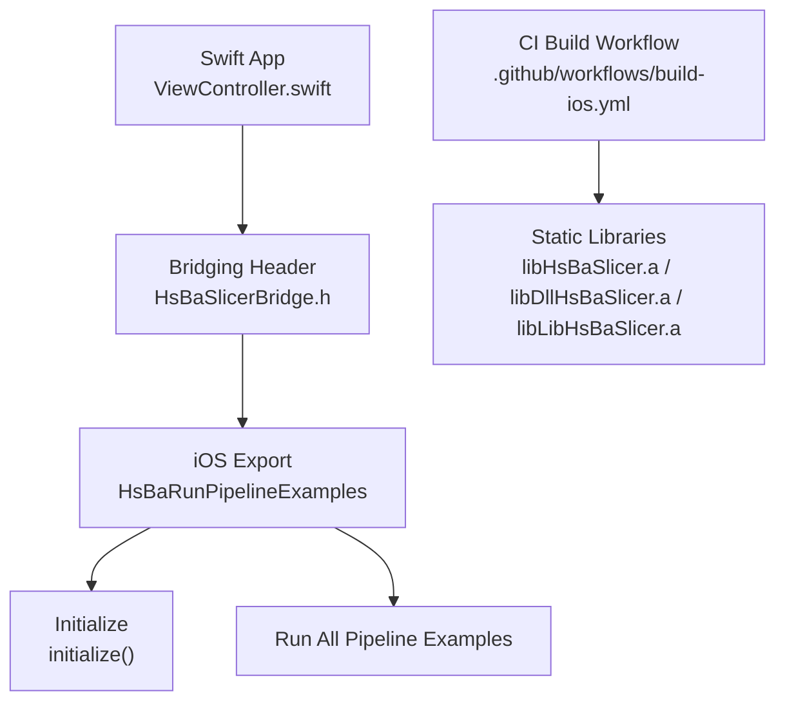
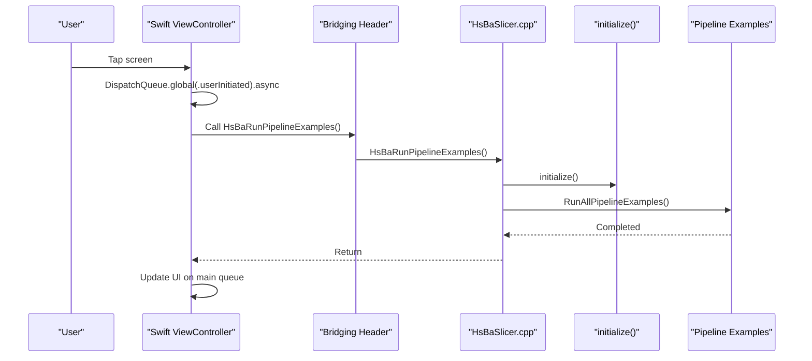
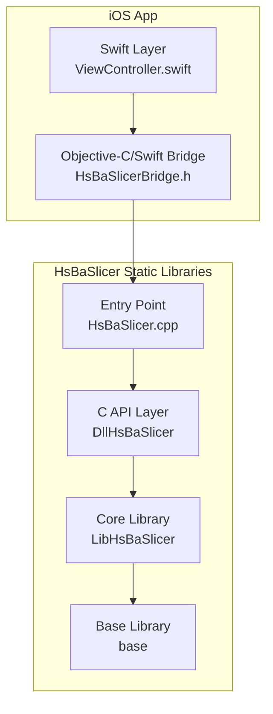
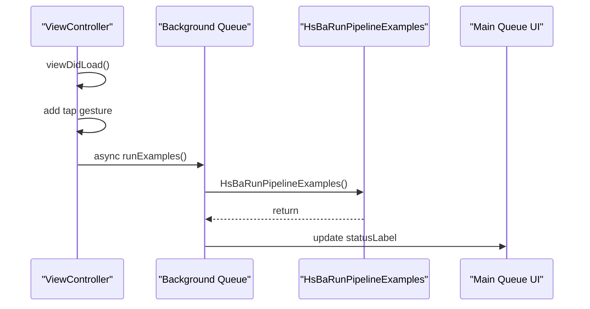
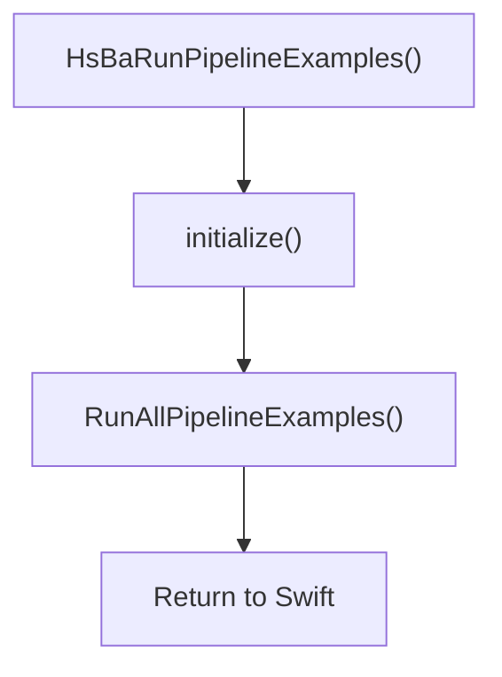
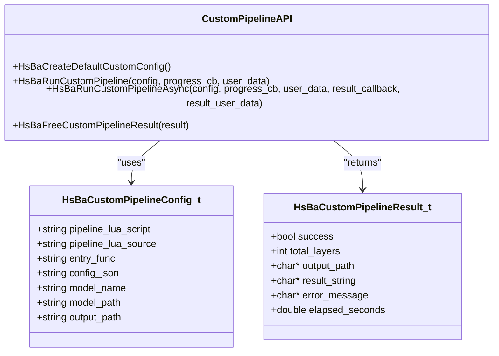
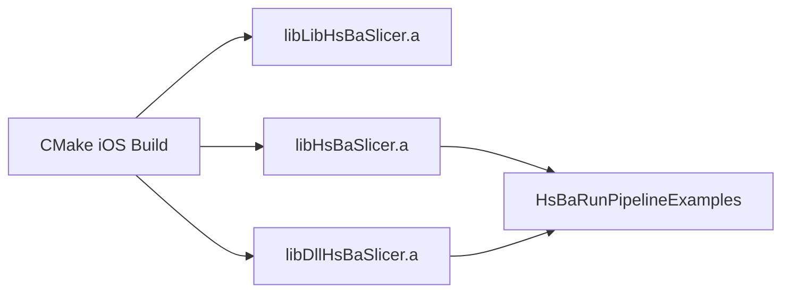
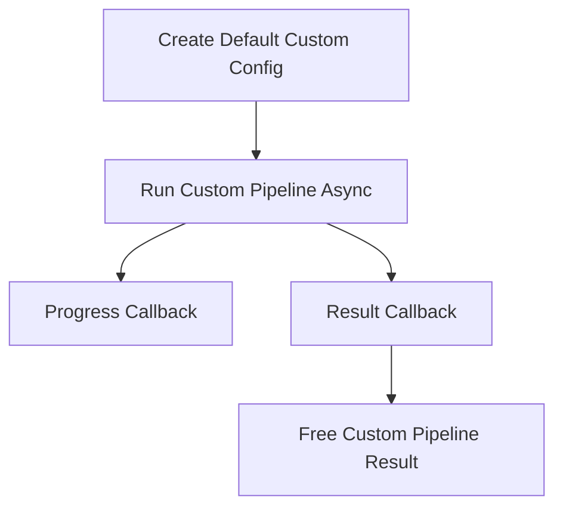

# iOS Integration

<cite>
**Referenced Files in This Document**
- [HsBaSlicerBridge.h](file://ios/HsBaSlicerExample/HsBaSlicerBridge.h)
- [ViewController.swift](file://ios/HsBaSlicerExample/ViewController.swift)
- [build-ios.yml](file://.github/workflows/build-ios.yml)
- [cmake-multi-platform.yml](file://.github/workflows/cmake-multi-platform.yml)
- [CMakePresets.json](file://CMakePresets.json)
- [base CMakeLists.txt](file://base/CMakeLists.txt)
- [initialize.h](file://DllHsBaSlicer/initialize.h)
- [initialize.cpp](file://DllHsBaSlicer/initialize.cpp)
- [custom_pipeline.h](file://DllHsBaSlicer/custom_pipeline.h)
- [custom_pipeline.cpp](file://DllHsBaSlicer/custom_pipeline.cpp)
- [HsBaSlicer.cpp](file://HsBaSlicer/HsBaSlicer.cpp)
</cite>

## Table of Contents
1. [Introduction](#introduction)
2. [Project Structure](#project-structure)
3. [Core Components](#core-components)
4. [Architecture Overview](#architecture-overview)
5. [Detailed Component Analysis](#detailed-component-analysis)
6. [Dependency Analysis](#dependency-analysis)
7. [Performance Considerations](#performance-considerations)
8. [Troubleshooting Guide](#troubleshooting-guide)
9. [Conclusion](#conclusion)
10. [Appendices](#appendices)

## Introduction
This document explains how to integrate HsBaSlicer into an iOS application. It covers Swift/Objective-C bridging through a bridging header, static library linking, Xcode project configuration, architecture settings for device and simulator, code signing requirements, memory management with ARC, background task handling, App Store review considerations, device compatibility across iPhone and iPad architectures, debugging with LLDB, performance profiling with Instruments, and deployment for development and production.

The repository provides:
- A C ABI bridging header that exposes `HsBaRunPipelineExamples` to Swift.
- An iOS example app entry point in Swift that calls the C function on a background queue and updates the UI on the main queue.
- GitHub Actions workflows that build HsBaSlicer as static libraries for iOS using vcpkg and CMake.
- C API definitions for initialization and asynchronous custom pipeline execution.

## Project Structure
The iOS integration surface is small and focused:

| Area | Purpose |
|---|---|
| `ios/HsBaSlicerExample/HsBaSlicerBridge.h` | Bridging header declaring the C function exposed to Swift. |
| `ios/HsBaSlicerExample/ViewController.swift` | Example iOS app showing how to call the native pipeline function asynchronously. |
| `.github/workflows/build-ios.yml` | CI workflow that builds HsBaSlicer for iOS as static libraries and verifies exported symbols. |
| `HsBaSlicer/HsBaSlicer.cpp` | Platform-specific entry point that exports `HsBaRunPipelineExamples` on iOS. |
| `DllHsBaSlicer/initialize.*` | Initialization entry used by the iOS example. |
| `DllHsBaSlicer/custom_pipeline.*` | Asynchronous C API for Lua-driven pipelines. |
| `base/CMakeLists.txt` | iOS-specific dependency wiring, including `iconv`. |



**Diagram sources**
- [ViewController.swift:44-55](file://ios/HsBaSlicerExample/ViewController.swift#L44-L55)
- [HsBaSlicerBridge.h:19-25](file://ios/HsBaSlicerExample/HsBaSlicerBridge.h#L19-L25)
- [HsBaSlicer.cpp:242-253](file://HsBaSlicer/HsBaSlicer.cpp#L242-L253)
- [build-ios.yml:59-107](file://.github/workflows/build-ios.yml#L59-L107)

**Section sources**
- [HsBaSlicerBridge.h:1-31](file://ios/HsBaSlicerExample/HsBaSlicerBridge.h#L1-L31)
- [ViewController.swift:1-86](file://ios/HsBaSlicerExample/ViewController.swift#L1-L86)
- [build-ios.yml:42-107](file://.github/workflows/build-ios.yml#L42-L107)
- [HsBaSlicer.cpp:242-253](file://HsBaSlicer/HsBaSlicer.cpp#L242-L253)

## Core Components
The iOS integration relies on three core components:

1. **Bridging Header**
   - Declares `HsBaRunPipelineExamples` under `extern "C"` so Swift can call it directly.
   - The comment states this is an example/test entry, not a production entry.

2. **Swift ViewController Example**
   - Sets up a simple UI label.
   - Runs the native pipeline function on a global background queue.
   - Updates the UI on the main queue after completion.

3. **Platform-Specific iOS Export**
   - When compiled for iOS, `HsBaSlicer.cpp` exports `HsBaRunPipelineExamples`.
   - The export calls `initialize()` and then runs all pipeline examples.



**Diagram sources**
- [ViewController.swift:44-55](file://ios/HsBaSlicerExample/ViewController.swift#L44-L55)
- [HsBaSlicerBridge.h:19-25](file://ios/HsBaSlicerExample/HsBaSlicerBridge.h#L19-L25)
- [HsBaSlicer.cpp:242-253](file://HsBaSlicer/HsBaSlicer.cpp#L242-L253)

**Section sources**
- [HsBaSlicerBridge.h:1-31](file://ios/HsBaSlicerExample/HsBaSlicerBridge.h#L1-L31)
- [ViewController.swift:14-55](file://ios/HsBaSlicerExample/ViewController.swift#L14-L55)
- [HsBaSlicer.cpp:242-253](file://HsBaSlicer/HsBaSlicer.cpp#L242-L253)

## Architecture Overview
At runtime, the iOS app links against static libraries built by the CMake-based build system. The Swift layer calls a C function declared in the bridging header; that function is implemented in the platform-specific entry point and delegates to initialization and pipeline execution.



**Diagram sources**
- [ViewController.swift:44-55](file://ios/HsBaSlicerExample/ViewController.swift#L44-L55)
- [HsBaSlicerBridge.h:19-25](file://ios/HsBaSlicerExample/HsBaSlicerBridge.h#L19-L25)
- [HsBaSlicer.cpp:242-253](file://HsBaSlicer/HsBaSlicer.cpp#L242-L253)
- [build-ios.yml:59-107](file://.github/workflows/build-ios.yml#L59-L107)

## Detailed Component Analysis

### Bridging Header Configuration
The bridging header is the contract between Swift and the native C ABI.

Key points:
- It uses `extern "C"` to prevent C++ name mangling.
- It declares `HsBaRunPipelineExamples`, which internally initializes the slicer and runs FDM/SLA/SLS pipeline examples.
- The comments explicitly mark this as an example/test entry, not a production entry.

Recommended usage pattern:
- Add `HsBaSlicerBridge.h` to your Xcode project’s Objective-C Bridging Header setting.
- Link the built static libraries produced by the iOS build.
- Import or reference the bridged symbol from Swift.

```mermaid
flowchart TD
Start(["Add Bridging Header"]) --> Declare["Declare extern \"C\" function"]
Declare --> LinkLibs["Link HsBaSlicer static libraries"]
LinkLibs --> SwiftCall["Call from Swift"]
SwiftCall --> BackgroundQueue["Run on background queue"]
BackgroundQueue --> MainQueue["Update UI on main queue"]
```

**Diagram sources**
- [HsBaSlicerBridge.h:14-25](file://ios/HsBaSlicerExample/HsBaSlicerBridge.h#L14-L25)
- [ViewController.swift:44-55](file://ios/HsBaSlicerExample/ViewController.swift#L44-L55)

**Section sources**
- [HsBaSlicerBridge.h:1-31](file://ios/HsBaSlicerExample/HsBaSlicerBridge.h#L1-L31)

### Swift ViewController Example
The example demonstrates:
- Creating a simple UI label.
- Handling a tap gesture.
- Running the native function on a background queue.
- Updating the UI on the main queue.

Important behavior:
- The function call is intentionally placed on `DispatchQueue.global(qos: .userInitiated)` to avoid blocking the UI thread.
- After the native call returns, the UI is updated on the main queue.



**Diagram sources**
- [ViewController.swift:24-41](file://ios/HsBaSlicerExample/ViewController.swift#L24-L41)
- [ViewController.swift:44-55](file://ios/HsBaSlicerExample/ViewController.swift#L44-L55)

**Section sources**
- [ViewController.swift:14-55](file://ios/HsBaSlicerExample/ViewController.swift#L14-L55)

### iOS Export and Initialization Flow
On iOS, the platform-specific entry point exports `HsBaRunPipelineExamples`. This function:
1. Calls `initialize()`.
2. Runs all pipeline examples.

The initialization function is defined as a C ABI entry point and is safe to call once at load time.



**Diagram sources**
- [HsBaSlicer.cpp:242-253](file://HsBaSlicer/HsBaSlicer.cpp#L242-L253)
- [initialize.h:14-19](file://DllHsBaSlicer/initialize.h#L14-L19)
- [initialize.cpp:7-9](file://DllHsBaSlicer/initialize.cpp#L7-L9)

**Section sources**
- [HsBaSlicer.cpp:242-253](file://HsBaSlicer/HsBaSlicer.cpp#L242-L253)
- [initialize.h:1-22](file://DllHsBaSlicer/initialize.h#L1-L22)
- [initialize.cpp:1-10](file://DllHsBaSlicer/initialize.cpp#L1-L10)

### Asynchronous Custom Pipeline API
For production use, prefer the asynchronous custom pipeline API rather than the example entry point.

API highlights:
- `HsBaCreateDefaultCustomConfig` creates default configuration.
- `HsBaRunCustomPipeline` runs synchronously but wraps coroutine-based execution internally.
- `HsBaRunCustomPipelineAsync` runs asynchronously and invokes a result callback.
- `HsBaFreeCustomPipelineResult` frees memory allocated in the result structure.



**Diagram sources**
- [custom_pipeline.h:17-62](file://DllHsBaSlicer/custom_pipeline.h#L17-L62)
- [custom_pipeline.cpp:171-200](file://DllHsBaSlicer/custom_pipeline.cpp#L171-L200)

**Section sources**
- [custom_pipeline.h:1-69](file://DllHsBaSlicer/custom_pipeline.h#L1-L69)
- [custom_pipeline.cpp:1-200](file://DllHsBaSlicer/custom_pipeline.cpp#L1-L200)

## Dependency Analysis
The iOS build produces static libraries and verifies their presence and exported symbols.

Build characteristics:
- The workflow sets `-DCMAKE_OSX_ARCHITECTURES=arm64` and targets iOS.
- On iOS, all libraries are static; there is no dylib support.
- The workflow checks for:
  - `libHsBaSlicer.a`
  - `libDllHsBaSlicer.a`
  - `libLibHsBaSlicer.a`
- It verifies that `HsBaRunPipelineExamples` is present in the built artifacts.



**Diagram sources**
- [build-ios.yml:42-52](file://.github/workflows/build-ios.yml#L42-L52)
- [build-ios.yml:59-107](file://.github/workflows/build-ios.yml#L59-L107)

**Section sources**
- [build-ios.yml:42-107](file://.github/workflows/build-ios.yml#L42-L107)
- [cmake-multi-platform.yml:418-453](file://.github/workflows/cmake-multi-platform.yml#L418-L453)

## Performance Considerations
- Use background queues for long-running slicing operations. The example uses `DispatchQueue.global(qos: .userInitiated)` to avoid blocking the UI.
- Prefer asynchronous APIs when integrating into production apps. The custom pipeline API supports non-blocking execution via callbacks.
- Avoid heavy work on the main thread; update UI only after native work completes.
- Profile CPU-intensive slicing steps with Instruments Time Profiler.
- Monitor memory usage with Allocations and Leaks, especially when working with C strings and results returned from C APIs.

[No sources needed since this section provides general guidance]

## Troubleshooting Guide

### Missing Bridging Header or Symbol
Symptoms:
- Swift cannot find `HsBaRunPipelineExamples`.
- Build fails because the bridging header is missing.

Checks:
- Ensure `HsBaSlicerBridge.h` exists in the expected location.
- Ensure the bridging header declares `HsBaRunPipelineExamples`.
- Verify the symbol exists in the built static library.

Relevant verification logic:
- The CI workflow checks for the bridging header file.
- The CI workflow checks that the bridging header contains the expected function declaration.
- The CI workflow checks for the exported symbol using `nm`.

**Section sources**
- [build-ios.yml:113-137](file://.github/workflows/build-ios.yml#L113-L137)
- [build-ios.yml:98-107](file://.github/workflows/build-ios.yml#L98-L107)

### iOS Static Library Verification
Symptoms:
- Expected static libraries are missing.
- Symbols are not found in the built artifacts.

Checks:
- Confirm `libHsBaSlicer.a`, `libDllHsBaSlicer.a`, and `libLibHsBaSlicer.a` exist.
- Confirm `HsBaRunPipelineExamples` is exported.

**Section sources**
- [build-ios.yml:59-107](file://.github/workflows/build-ios.yml#L59-L107)

### iOS Architecture and Deployment Target
Symptoms:
- Build fails due to unsupported architecture.
- Simulator and device builds behave differently.

Configuration references:
- The iOS workflow sets `CMAKE_OSX_ARCHITECTURES=arm64`.
- The preset file includes `CMAKE_OSX_ARCHITECTURES=arm64`.
- The workflow sets `CMAKE_SYSTEM_NAME=iOS`, `CMAKE_OSX_SYSROOT=iphoneos`, and a deployment target.

Recommendations:
- For device builds, use `arm64`.
- For simulator builds, configure `x86_64` or `arm64` depending on your macOS host and SDK version.
- Keep deployment target consistent with your Xcode project settings.

**Section sources**
- [build-ios.yml:42-52](file://.github/workflows/build-ios.yml#L42-L52)
- [CMakePresets.json:190-198](file://CMakePresets.json#L190-L198)

### iOS Dependencies and iconv
Symptoms:
- Build fails because `iconv` is not found on iOS.

Explanation:
- The base library has iOS-specific logic that finds and links `iconv`.
- If `iconv` is unavailable, the build fails with a fatal error.

**Section sources**
- [base CMakeLists.txt:37-47](file://base/CMakeLists.txt#L37-L47)

### Code Signing and App Store Review
Guidance:
- Configure code signing in Xcode for both development and release schemes.
- Ensure the app bundle includes the required entitlements and provisioning profiles.
- Follow App Store review guidelines for background processing, privacy, and resource usage.
- Avoid blocking the UI thread during slicing operations.

[No sources needed since this section provides general guidance]

### Device Compatibility Across iPhone and iPad Architectures
Guidance:
- iPhone devices use `arm64`.
- iPad devices also use `arm64` on modern hardware.
- Simulator builds may require additional architectures depending on the macOS host and SDK.
- Validate builds for both device and simulator before distribution.

[No sources needed since this section provides general guidance]

### Debugging with LLDB
Recommendations:
- Set breakpoints in Swift and in the C/C++ layers.
- Inspect variables passed across the Swift-to-C boundary.
- Check logs from the slicer if logging is enabled.
- Use `bt` to inspect stack traces when crashes occur in native code.

[No sources needed since this section provides general guidance]

### Performance Profiling with Instruments
Recommendations:
- Use Time Profiler to identify slow slicing stages.
- Use Allocations and Leaks to detect memory issues.
- Use System Trace to understand threading and concurrency behavior.
- Measure elapsed time around pipeline execution to validate performance improvements.

[No sources needed since this section provides general guidance]

## Conclusion
HsBaSlicer’s iOS integration centers on a small, well-defined bridge:
- A bridging header exposing a C function.
- A Swift example that calls the function off the main thread.
- A platform-specific export that initializes the slicer and runs pipeline examples.
- A CI workflow that builds static libraries for iOS and verifies exported symbols.

For production applications:
- Use the asynchronous custom pipeline API.
- Run slicing tasks on background queues.
- Update the UI on the main queue.
- Configure Xcode for proper code signing, architecture targets, and deployment targets.
- Test on real devices and simulators.
- Use LLDB and Instruments for debugging and performance analysis.

[No sources needed since this section summarizes without analyzing specific files]

## Appendices

### Xcode Project Configuration Checklist
- Add `HsBaSlicerBridge.h` to the Objective-C Bridging Header setting.
- Link the built static libraries:
  - `libHsBaSlicer.a`
  - `libDllHsBaSlicer.a`
  - `libLibHsBaSlicer.a`
- Set valid architectures:
  - Device: `arm64`
  - Simulator: `x86_64` or `arm64` depending on environment
- Set minimum deployment target according to your app’s requirements.
- Configure code signing and provisioning profiles.
- Enable background task handling where appropriate.

[No sources needed since this section provides general guidance]

### Production Integration Pattern
Recommended flow:
1. Create a custom pipeline configuration.
2. Run the pipeline asynchronously.
3. Handle progress callbacks.
4. Process the result callback.
5. Free allocated result memory.



**Diagram sources**
- [custom_pipeline.h:17-62](file://DllHsBaSlicer/custom_pipeline.h#L17-L62)
- [custom_pipeline.cpp:171-200](file://DllHsBaSlicer/custom_pipeline.cpp#L171-L200)

**Section sources**
- [custom_pipeline.h:1-69](file://DllHsBaSlicer/custom_pipeline.h#L1-L69)
- [custom_pipeline.cpp:171-200](file://DllHsBaSlicer/custom_pipeline.cpp#L171-L200)