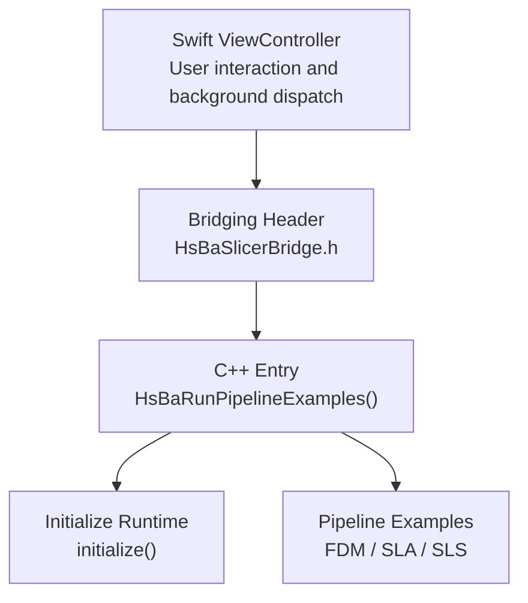
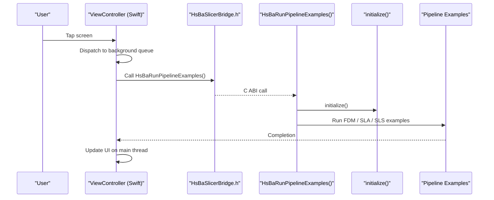
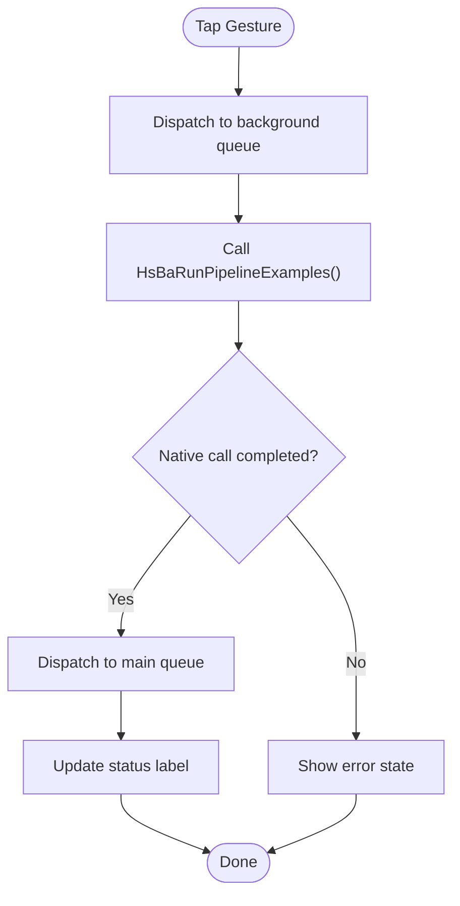
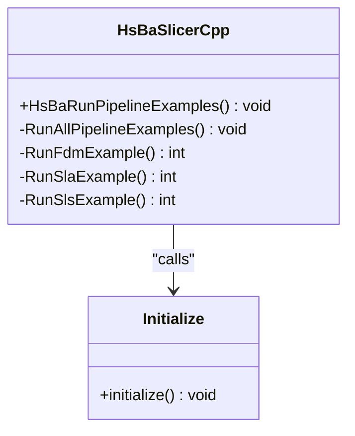
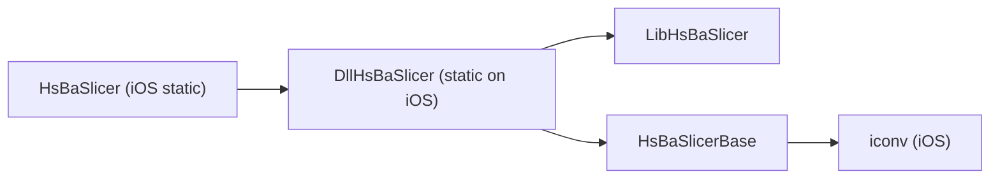

# iOS Integration / iOS集成

<cite>
**Referenced Files in This Document**   
- [ViewController.swift](file://ios/HsBaSlicerExample/ViewController.swift)
- [HsBaSlicerBridge.h](file://ios/HsBaSlicerExample/HsBaSlicerBridge.h)
- [HsBaSlicer.cpp](file://HsBaSlicer/HsBaSlicer.cpp)
- [initialize.h](file://DllHsBaSlicer/initialize.h)
- [initialize.cpp](file://DllHsBaSlicer/initialize.cpp)
- [dllexport.h](file://DllHsBaSlicer/dllexport.h)
- [CMakeLists.txt](file://DllHsBaSlicer/CMakeLists.txt)
- [CMakeLists.txt](file://HsBaSlicer/CMakeLists.txt)
- [CMakeLists.txt](file://base/CMakeLists.txt)
- [CMakeLists.txt](file://CMakeLists.txt)
- [build-ios.yml](file://.github/workflows/build-ios.yml)
- [cmake-multi-platform.yml](file://.github/workflows/cmake-multi-platform.yml)
</cite>

## Table of Contents
1. [Introduction](#introduction)
2. [Project Structure](#project-structure)
3. [Core Components](#core-components)
4. [Architecture Overview](#architecture-overview)
5. [Detailed Component Analysis](#detailed-component-analysis)
6. [Dependency Analysis](#dependency-analysis)
7. [Performance Considerations](#performance-considerations)
8. [Troubleshooting Guide](#troubleshooting-guide)
9. [Conclusion](#conclusion)
10. [Appendices](#appendices)

## Introduction
This document explains how to integrate HsBaSlicer into an iOS application using Swift and Objective-C bridging. It covers Xcode project configuration, linking the static C API layer, loading native libraries on iOS, and implementing a safe Swift entry point that calls the exported C function for pipeline examples. It also documents iOS-specific constraints such as static library linkage, background execution, memory management with ARC, device architecture support (ARM64), testing strategies, simulator versus device deployment, and App Store compliance considerations including binary size optimization and security.

The example app demonstrates:
- A bridging header declaring the C entry point.
- A Swift ViewController that triggers pipeline examples on a background queue and updates the UI on the main thread.
- The C++ entry point that initializes the runtime and runs FDM, SLA, and SLS pipeline examples.

## Project Structure
The iOS integration consists of three layers:
- Swift UI layer: ViewController.swift provides the user interaction and dispatches work off the main thread.
- Bridging header: HsBaSlicerBridge.h exposes the C function to Swift.
- Native C/C++ layer: HsBaSlicer.cpp exports HsBaRunPipelineExamples(), which initializes the runtime and runs example pipelines.

**Diagram sources**
- [ViewController.swift:14-55](file://ios/HsBaSlicerExample/ViewController.swift#L14-L55)
- [HsBaSlicerBridge.h:19-25](file://ios/HsBaSlicerExample/HsBaSlicerBridge.h#L19-L25)
- [HsBaSlicer.cpp:242-253](file://HsBaSlicer/HsBaSlicer.cpp#L242-L253)

**Section sources**
- [ViewController.swift:1-86](file://ios/HsBaSlicerExample/ViewController.swift#L1-L86)
- [HsBaSlicerBridge.h:1-32](file://ios/HsBaSlicerExample/HsBaSlicerBridge.h#L1-L32)
- [HsBaSlicer.cpp:242-253](file://HsBaSlicer/HsBaSlicer.cpp#L242-L253)

## Core Components
- Bridging header declares the C function HsBaRunPipelineExamples(void).
- Swift ViewController uses UIKit, sets up a UILabel, adds a tap gesture, and runs the pipeline example on a global background queue.
- C++ entry point HsBaRunPipelineExamples() is compiled only for iOS targets and calls initialize() then runs all pipeline examples.

Key responsibilities:
- Bridging header: Provide a stable C ABI for Swift to call.
- ViewController: Handle UI lifecycle and ensure heavy work does not block the UI thread.
- HsBaSlicer.cpp: Initialize the runtime once and run example pipelines.

**Section sources**
- [HsBaSlicerBridge.h:19-25](file://ios/HsBaSlicerExample/HsBaSlicerBridge.h#L19-L25)
- [ViewController.swift:14-55](file://ios/HsBaSlicerExample/ViewController.swift#L14-L55)
- [HsBaSlicer.cpp:242-253](file://HsBaSlicer/HsBaSlicer.cpp#L242-L253)

## Architecture Overview
The iOS integration follows a simple bridge pattern:
- Swift calls a C function declared in the bridging header.
- The C function is implemented in C++ and guarded by platform macros so it is available only on iOS.
- The C++ function initializes the runtime and executes example pipelines.

**Diagram sources**
- [ViewController.swift:43-55](file://ios/HsBaSlicerExample/ViewController.swift#L43-L55)
- [HsBaSlicerBridge.h:19-25](file://ios/HsBaSlicerExample/HsBaSlicerBridge.h#L19-L25)
- [HsBaSlicer.cpp:242-253](file://HsBaSlicer/HsBaSlicer.cpp#L242-L253)
- [initialize.h:14-19](file://DllHsBaSlicer/initialize.h#L14-L19)

## Detailed Component Analysis

### Bridging Header Setup
The bridging header declares the C function HsBaRunPipelineExamples(void) with extern "C" linkage so Swift can import it directly. This is the contract between Swift and the native layer.

Best practices:
- Keep the bridging header minimal and focused on C ABI declarations.
- Avoid exposing internal C++ types; use plain C functions and POD structures where possible.
- Ensure the symbol is exported from the static library linked into your app.

**Section sources**
- [HsBaSlicerBridge.h:14-25](file://ios/HsBaSlicerExample/HsBaSlicerBridge.h#L14-L25)

### Swift ViewController Implementation
The ViewController:
- Creates and lays out a status label.
- Adds a tap gesture recognizer.
- On tap, switches to a background queue to avoid blocking the UI.
- Calls HsBaRunPipelineExamples().
- Updates the UI on the main thread after completion.

Important notes:
- Use DispatchQueue.global(qos: .userInitiated) for CPU-heavy tasks.
- Always marshal back to the main queue for UI updates.
- The example is for demonstration; production code should encapsulate error handling and progress callbacks.

**Diagram sources**
- [ViewController.swift:38-55](file://ios/HsBaSlicerExample/ViewController.swift#L38-L55)

**Section sources**
- [ViewController.swift:14-55](file://ios/HsBaSlicerExample/ViewController.swift#L14-L55)

### Native C++ Entry Point
On iOS, HsBaSlicer.cpp defines HsBaRunPipelineExamples() under the TARGET_OS_IPHONE branch. It calls initialize() and then runs FDM, SLA, and SLS pipeline examples.

Behavior:
- initialize(): One-time setup for Lua/pipeline registration and runtime initialization.
- Pipeline examples: Demonstrate configuration, execution, result handling, and memory cleanup.

**Diagram sources**
- [HsBaSlicer.cpp:242-253](file://HsBaSlicer/HsBaSlicer.cpp#L242-L253)
- [initialize.h:14-19](file://DllHsBaSlicer/initialize.h#L14-L19)
- [initialize.cpp:7-9](file://DllHsBaSlicer/initialize.cpp#L7-L9)

**Section sources**
- [HsBaSlicer.cpp:242-253](file://HsBaSlicer/HsBaSlicer.cpp#L242-L253)
- [initialize.h:14-19](file://DllHsBaSlicer/initialize.h#L14-L19)
- [initialize.cpp:7-9](file://DllHsBaSlicer/initialize.cpp#L7-L9)

### Xcode Project Configuration and Framework Integration
To integrate HsBaSlicer into an iOS app:
- Build the static libraries using CMake for iOS (ARM64).
- Link libDllHsBaSlicer.a and libLibHsBaSlicer.a into your Xcode target.
- Add the bridging header path to your Swift settings.
- Ensure the target supports ARM64 devices.

Build system behavior:
- DllHsBaSlicer is built as STATIC on iOS because iOS apps cannot load arbitrary dylibs at runtime.
- The top-level CMake disables dynamic loader features on non-desktop platforms.
- Base dependencies link iconv on iOS when building HsBaSlicerBase.

Recommended steps:
1. Configure CMake for iOS with arm64 architecture and iPhoneOS sysroot.
2. Build the project to produce static libraries.
3. In Xcode:
   - Add the generated .a files to your target’s “Link Binary With Libraries”.
   - Set “Header Search Paths” to include headers for the bridging header.
   - Enable “Always Embed Swift Standard Libraries” if needed.
   - Verify Architectures includes arm64.
4. Add HsBaSlicerBridge.h to the project and enable the bridging header in Build Settings.

**Section sources**
- [CMakeLists.txt:41-49](file://HsBaSlicer/CMakeLists.txt#L41-L49)
- [CMakeLists.txt:4-41](file://DllHsBaSlicer/CMakeLists.txt#L4-L41)
- [CMakeLists.txt:37-47](file://base/CMakeLists.txt#L37-L47)
- [CMakeLists.txt:232-239](file://CMakeLists.txt#L232-L239)

### Memory Management with ARC
- Swift manages object lifetimes automatically via ARC.
- When calling into C/C++, avoid retaining C pointers in Swift objects longer than necessary.
- If you extend the bridge to return C strings or buffers, ensure proper ownership semantics and free them according to the C API contract.
- The example pipelines demonstrate freeing results returned by the C API; mirror this pattern when integrating custom pipelines.

**Section sources**
- [HsBaSlicer.cpp:103-105](file://HsBaSlicer/HsBaSlicer.cpp#L103-L105)
- [HsBaSlicer.cpp:153-155](file://HsBaSlicer/HsBaSlicer.cpp#L153-L155)
- [HsBaSlicer.cpp:205-207](file://HsBaSlicer/HsBaSlicer.cpp#L205-L207)

### Background Task Execution
- Heavy slicing operations must run off the main thread to keep the UI responsive.
- Use DispatchQueue.global(qos: .userInitiated) for CPU-intensive tasks.
- Marshal UI updates back to the main queue.
- For long-running jobs, consider using OperationQueue or async/await patterns with cancellation support.

**Section sources**
- [ViewController.swift:43-55](file://ios/HsBaSlicerExample/ViewController.swift#L43-L55)

### Device Architecture Support (ARM64)
- iOS builds target arm64 architecture.
- CI workflows configure CMAKE_OSX_ARCHITECTURES=arm64 and VCPKG_TARGET_TRIPLET=arm64-ios.
- Ensure your Xcode target includes arm64 and not deprecated architectures like i386 or x86_64.

**Section sources**
- [build-ios.yml:42-52](file://.github/workflows/build-ios.yml#L42-L52)
- [cmake-multi-platform.yml:360-370](file://.github/workflows/cmake-multi-platform.yml#L360-L370)

### Error Handling Strategy
- Check pipeline result.success before accessing outputs.
- Log error messages provided by the C API.
- Wrap native calls in try/catch-free wrappers since the C API returns structured results.
- Surface errors to the UI with user-friendly messages.

**Section sources**
- [HsBaSlicer.cpp:80-105](file://HsBaSlicer/HsBaSlicer.cpp#L80-L105)
- [HsBaSlicer.cpp:143-155](file://HsBaSlicer/HsBaSlicer.cpp#L143-L155)
- [HsBaSlicer.cpp:195-207](file://HsBaSlicer/HsBaSlicer.cpp#L195-L207)

### Testing Strategies with XCTest
- Unit tests: Validate configuration creation, parameter validation, and result parsing.
- Integration tests: Invoke HsBaRunPipelineExamples() in a test target and assert output artifacts exist.
- Simulators vs devices: Test both to catch architecture-specific issues.
- Performance tests: Measure elapsed_seconds and total_layers for regression detection.

[No sources needed since this section provides general guidance]

### Simulator vs Device Deployment
- Build for both simulator (x86_64/arm64 depending on host) and device (arm64) if you need universal binaries.
- The repository’s iOS CI targets arm64 device builds; adjust toolchain settings for simulator builds if required.
- Ensure signing and provisioning profiles are configured for device deployment.

**Section sources**
- [build-ios.yml:42-57](file://.github/workflows/build-ios.yml#L42-L57)

### App Store Compliance Requirements
- Static linkage: iOS requires static libraries; dynamic loading of arbitrary dylibs is restricted.
- Binary size optimization:
  - Strip symbols for release builds.
  - Remove unused architectures and debug symbols.
  - Avoid embedding unnecessary resources.
- Security considerations:
  - Do not load remote code or scripts at runtime unless explicitly allowed and validated.
  - Validate file paths and inputs to prevent filesystem abuse.
  - Follow Apple’s privacy guidelines for logging and diagnostics.

**Section sources**
- [CMakeLists.txt:4-41](file://DllHsBaSlicer/CMakeLists.txt#L4-L41)
- [CMakeLists.txt:232-239](file://CMakeLists.txt#L232-L239)

## Dependency Analysis
The iOS build links multiple static libraries through CMake. The key relationships are:
- HsBaSlicer (iOS static library) depends on DllHsBaSlicer and logging utilities.
- DllHsBaSlicer (static on iOS) depends on LibHsBaSlicer and other core modules.
- Base dependencies link iconv on iOS.

**Diagram sources**
- [CMakeLists.txt:41-49](file://HsBaSlicer/CMakeLists.txt#L41-L49)
- [CMakeLists.txt:84-100](file://DllHsBaSlicer/CMakeLists.txt#L84-L100)
- [CMakeLists.txt:37-47](file://base/CMakeLists.txt#L37-L47)

**Section sources**
- [CMakeLists.txt:41-49](file://HsBaSlicer/CMakeLists.txt#L41-L49)
- [CMakeLists.txt:84-100](file://DllHsBaSlicer/CMakeLists.txt#L84-L100)
- [CMakeLists.txt:37-47](file://base/CMakeLists.txt#L37-L47)

## Performance Considerations
- Offload slicing to background queues to maintain UI responsiveness.
- Reuse configuration objects where possible to reduce allocations.
- Monitor elapsed_seconds and total_layers to detect regressions.
- Avoid excessive logging in release builds; use lightweight logs or os_log on iOS.

[No sources needed since this section provides general guidance]

## Troubleshooting Guide
Common issues and resolutions:
- Missing HsBaRunPipelineExamples symbol:
  - Ensure DllHsBaSlicer is built and linked as a static library.
  - Verify the symbol exists in the static archive using nm.
- Build fails due to missing iconv on iOS:
  - Confirm the base module links iconv correctly.
- Dynamic loader disabled:
  - Non-desktop platforms disable HSBA_USE_DLL_LOADER; rely on static linkage.
- Simulator/device mismatch:
  - Adjust CMAKE_OSX_ARCHITECTURES and sysroot for simulator builds.

**Section sources**
- [build-ios.yml:98-107](file://.github/workflows/build-ios.yml#L98-L107)
- [CMakeLists.txt:37-47](file://base/CMakeLists.txt#L37-L47)
- [CMakeLists.txt:232-239](file://CMakeLists.txt#L232-L239)

## Conclusion
Integrating HsBaSlicer into iOS involves setting up a bridging header, linking static libraries, and ensuring background execution for heavy tasks. The example demonstrates a safe Swift entry point that calls the C++ export HsBaRunPipelineExamples(), which initializes the runtime and runs pipeline examples. Follow the build configurations for ARM64, adhere to App Store requirements for static linkage and binary size optimization, and implement robust error handling and testing strategies.

[No sources needed since this section summarizes without analyzing specific files]

## Appendices

### Step-by-Step Xcode Setup Checklist
- Build static libraries with CMake for iOS (arm64).
- Add libDllHsBaSlicer.a and libLibHsBaSlicer.a to your target.
- Configure Header Search Paths for bridging header.
- Enable ARM64 architecture support.
- Add HsBaSlicerBridge.h and set the bridging header in Build Settings.
- Test on both simulator and device.

**Section sources**
- [build-ios.yml:42-57](file://.github/workflows/build-ios.yml#L42-L57)
- [CMakeLists.txt:41-49](file://HsBaSlicer/CMakeLists.txt#L41-L49)