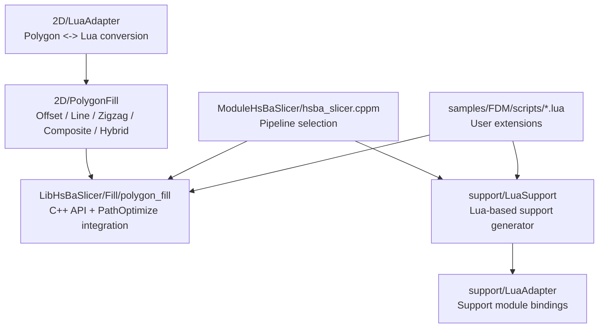
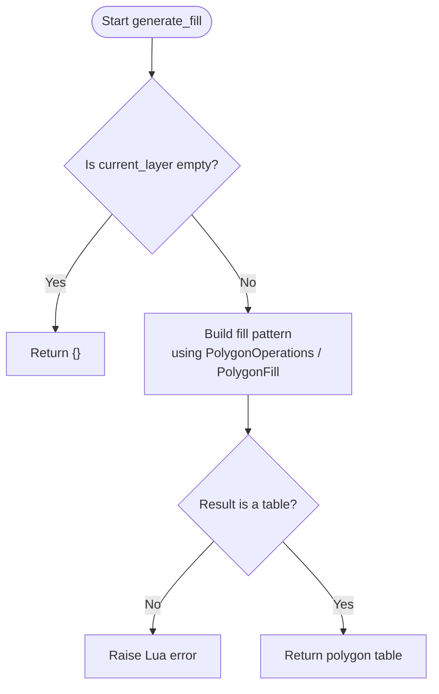
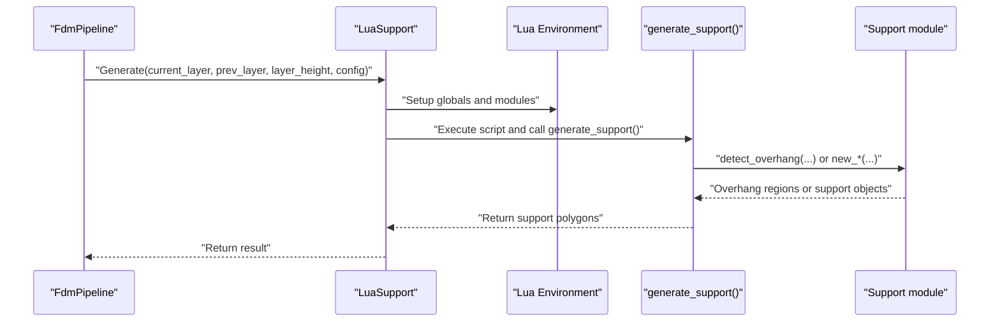
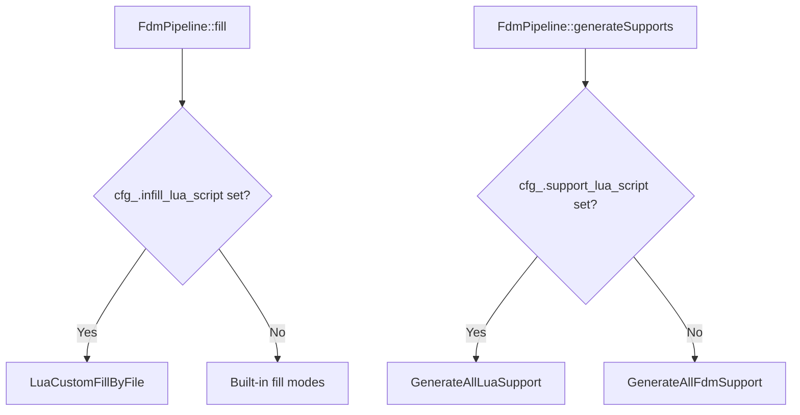
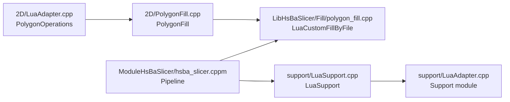

# Algorithm Extension Patterns

<cite>
**Referenced Files in This Document**   
- [README.md](file://README.md)
- [2D/LuaAdapter.hpp](file://2D/LuaAdapter.hpp)
- [2D/LuaAdapter.cpp](file://2D/LuaAdapter.cpp)
- [2D/PolygonFill.hpp](file://2D/PolygonFill.hpp)
- [2D/PolygonFill.cpp](file://2D/PolygonFill.cpp)
- [LibHsBaSlicer/Fill/polygon_fill.hpp](file://LibHsBaSlicer/Fill/polygon_fill.hpp)
- [LibHsBaSlicer/Fill/polygon_fill.cpp](file://LibHsBaSlicer/Fill/polygon_fill.cpp)
- [support/LuaSupport.hpp](file://support/LuaSupport.hpp)
- [support/LuaSupport.cpp](file://support/LuaSupport.cpp)
- [support/LuaAdapter.hpp](file://support/LuaAdapter.hpp)
- [support/LuaAdapter.cpp](file://support/LuaAdapter.cpp)
- [ModuleHsBaSlicer/hsba_slicer.cppm](file://ModuleHsBaSlicer/hsba_slicer.cppm)
- [samples/FDM/scripts/my_infill.lua](file://samples/FDM/scripts/my_infill.lua)
- [samples/FDM/scripts/my_support.lua](file://samples/FDM/scripts/my_support.lua)
- [tests/PolygonFill/polygon_fill_test.cpp](file://tests/PolygonFill/polygon_fill_test.cpp)
</cite>

## Table of Contents
1. [Introduction](#introduction)
2. [Project Structure](#project-structure)
3. [Core Components](#core-components)
4. [Architecture Overview](#architecture-overview)
5. [Detailed Component Analysis](#detailed-component-analysis)
6. [Dependency Analysis](#dependency-analysis)
7. [Performance Considerations](#performance-considerations)
8. [Troubleshooting Guide](#troubleshooting-guide)
9. [Conclusion](#conclusion)

## Introduction
This document explains how to extend HsBaSlicer algorithms through Lua scripting, with a focus on:
- Custom fill patterns using the `PolygonOperations` and `PolygonFill` libraries.
- Boolean operations, offset calculations, and geometric transformations.
- Support generation algorithms, including overhang detection, tree support creation, and honeycomb pattern generation.
- The `generate_fill()` and `generate_support()` hook interfaces, parameter passing conventions, and return value expectations.
- Practical examples for custom infill patterns, advanced supports, and specialized export formats.
- Performance optimization techniques for computationally intensive Lua algorithms and integration with the built-in path optimization system.

HsBaSlicer is a modular, cross-platform C++ framework for 3D-printing slicers that exposes both C++ APIs and Lua scripting hooks for algorithm extension.

**Section sources**
- [README.md:21-39](file://README.md#L21-L39)

## Project Structure
The relevant parts of the repository for algorithm extension are:
- `2D/`: polygon data types, Lua adapter for polygons, and polygon fill engine.
- `LibHsBaSlicer/Fill/`: public C++ API wrapping the 2D fill engine and exposing Lua-based custom fills.
- `support/`: support generation abstractions, Lua support generator, and Lua bindings for support algorithms.
- `ModuleHsBaSlicer/hsba_slicer.cppm`: pipeline glue that selects Lua or built-in algorithms.
- `samples/FDM/scripts/`: example Lua scripts for custom infill and custom support.
- `tests/PolygonFill/`: tests demonstrating Lua fill function registration and usage.



**Diagram sources**
- [2D/LuaAdapter.hpp:1-84](file://2D/LuaAdapter.hpp#L1-L84)
- [2D/PolygonFill.hpp:1-141](file://2D/PolygonFill.hpp#L1-L141)
- [LibHsBaSlicer/Fill/polygon_fill.hpp:1-58](file://LibHsBaSlicer/Fill/polygon_fill.hpp#L1-L58)
- [support/LuaSupport.hpp:1-85](file://support/LuaSupport.hpp#L1-L85)
- [support/LuaAdapter.hpp:1-34](file://support/LuaAdapter.hpp#L1-L34)
- [ModuleHsBaSlicer/hsba_slicer.cppm:481-506](file://ModuleHsBaSlicer/hsba_slicer.cppm#L481-L506)

**Section sources**
- [README.md:25-39](file://README.md#L25-L39)
- [2D/LuaAdapter.hpp:1-84](file://2D/LuaAdapter.hpp#L1-L84)
- [2D/PolygonFill.hpp:1-141](file://2D/PolygonFill.hpp#L1-L141)
- [LibHsBaSlicer/Fill/polygon_fill.hpp:1-58](file://LibHsBaSlicer/Fill/polygon_fill.hpp#L1-L58)
- [support/LuaSupport.hpp:1-85](file://support/LuaSupport.hpp#L1-L85)
- [support/LuaAdapter.hpp:1-34](file://support/LuaAdapter.hpp#L1-L34)
- [ModuleHsBaSlicer/hsba_slicer.cppm:481-506](file://ModuleHsBaSlicer/hsba_slicer.cppm#L481-L506)

## Core Components
This section documents the core components used by Lua algorithm extensions.

### Polygon Data and Lua Conversion
- `PushPolygonDToLua`, `PushPolygonsDToLua`, `PushPolygonToLua`, `PushPolygonsToLua` convert C++ polygons into Lua tables.
- `LuaTableToPolygonD`, `LuaTableToPolygonsD`, `LuaTableToPolygon`, `LuaTableToPolygons` parse Lua tables back into C++ polygons.
- `RegisterLuaPolygonOperations` registers the global `PolygonOperations` table in Lua.

These functions define the contract between C++ geometry and Lua script data structures:
- Points are represented as `{x=..., y=...}`.
- Polygons are arrays of point arrays.
- Multiple polygons are arrays of polygon arrays.

**Section sources**
- [2D/LuaAdapter.hpp:16-81](file://2D/LuaAdapter.hpp#L16-L81)
- [2D/LuaAdapter.cpp:332-491](file://2D/LuaAdapter.cpp#L332-L491)

### Polygon Operations Library
The `PolygonOperations` library provides:
- Boolean operations: `booleanOperation(a, b, op)`, `union`, `intersection`, `difference`, `xor`.
- Offset operation: `offsetOperation(polys, delta)`.
- Hull operations: `convexHullOperation`, `concaveHullOperation`.
- Area computation: `area(poly)`.
- Geometry construction: `makeRectangle`, `makeCircle`, `makeEllipse`, `makeRegularPolygon`.
- Text-to-polygons: `textToPolygons`.

These functions operate on double-precision polygons where appropriate and integer polygons where required by downstream algorithms.

**Section sources**
- [2D/LuaAdapter.cpp:22-329](file://2D/LuaAdapter.cpp#L22-L329)
- [2D/LuaAdapter.cpp:487-491](file://2D/LuaAdapter.cpp#L487-L491)

### Polygon Fill Library
The `PolygonFill` library exposes fill algorithms to Lua:
- `offsetFill`
- `lineFill`
- `simpleZigzagFill`
- `zigzagFill`
- `compositeOffsetFill`
- `hybridFill`
- `offsetOnly`

It also exposes:
- `LuaCustomFill` and `LuaCustomFillString` for loading user scripts.
- `RegisterLuaPolygonFillFunctions` to register the `PolygonFill` table.

**Section sources**
- [2D/PolygonFill.hpp:20-136](file://2D/PolygonFill.hpp#L20-L136)
- [2D/PolygonFill.cpp:231-502](file://2D/PolygonFill.cpp#L231-L502)

### LibHsBaSlicer Fill API
The public C++ API wraps the 2D fill engine:
- `FillPolygon`
- `FillWithBorder`
- `LuaCustomFillByFile`

`LuaCustomFillByFile` composes external 2D functions and path optimization functions into the Lua environment before calling the user’s fill script.

**Section sources**
- [LibHsBaSlicer/Fill/polygon_fill.hpp:17-53](file://LibHsBaSlicer/Fill/polygon_fill.hpp#L17-L53)
- [LibHsBaSlicer/Fill/polygon_fill.cpp:13-49](file://LibHsBaSlicer/Fill/polygon_fill.cpp#L13-L49)

### Support Generation Abstraction
The support subsystem defines:
- `ISupport` interface implemented by concrete generators.
- `LuaSupport`, a Lua-script-based replacement for built-in support algorithms.
- `SupportConfig`, passed to Lua as a table containing fields such as `overhang_angle_threshold`, `layer_height`, `support_gap`, `support_diameter`, `support_density`, `support_pattern`, `tree_branch_angle`, `tree_max_branch_radius`, and `honeycomb_cell_size`.

**Section sources**
- [support/LuaSupport.hpp:21-64](file://support/LuaSupport.hpp#L21-L64)
- [support/LuaSupport.cpp:19-49](file://support/LuaSupport.cpp#L19-L49)

### Support Module Bindings
The `Support` Lua module exposes:
- Generators: `new_plane`, `new_tree`, `new_honeycomb`, `new_sla`, `new_lua`, `new_lua_file`.
- Execution: `generate(support_obj, current_layer, prev_layer, layer_height, config_table)`.
- Utilities: `detect_overhang(current_layer, prev_layer, layer_height, angle)`, `default_config()`.

**Section sources**
- [support/LuaAdapter.hpp:13-30](file://support/LuaAdapter.hpp#L13-L30)
- [support/LuaAdapter.cpp:43-276](file://support/LuaAdapter.cpp#L43-L276)

## Architecture Overview
The extension architecture separates concerns across layers:
- Lua scripts implement algorithm logic.
- `PolygonOperations` and `PolygonFill` provide geometry primitives and fill algorithms.
- `LuaSupport` and `Support` bindings provide support-generation primitives.
- Pipeline glue selects Lua or built-in implementations.
- Path optimization is injected into the Lua environment for fill scripts.

```mermaid
sequenceDiagram
participant User as "User Script"
participant FillAPI as "LibHsBaSlicer/Fill"
participant FillEngine as "2D/PolygonFill"
participant Ops as "2D/LuaAdapter<br/>PolygonOperations"
participant Opt as "PathOptimize"
User->>FillAPI : "LuaCustomFillByFile(script, functionName)"
FillAPI->>FillEngine : "LuaCustomFill(poly, script, funcName, reg)"
FillEngine->>Ops : "Register Lua polygon operations"
FillEngine->>Opt : "Register path optimize functions"
FillEngine->>User : "Call generate_fill(polygons)"
User-->>FillEngine : "Return fill polygons"
FillEngine-->>FillAPI : "Return result"
```

**Diagram sources**
- [LibHsBaSlicer/Fill/polygon_fill.cpp:35-49](file://LibHsBaSlicer/Fill/polygon_fill.cpp#L35-L49)
- [2D/PolygonFill.cpp:488-502](file://2D/PolygonFill.cpp#L488-L502)
- [2D/LuaAdapter.cpp:487-491](file://2D/LuaAdapter.cpp#L487-L491)

## Detailed Component Analysis

### Custom Infill Hooks: `generate_fill()`
The `generate_fill()` hook is the standard entry point for custom infill scripts.

#### Hook Contract
- **Input**: `current_layer`, a table of polygons representing the current layer after wall regions have been removed.
- **Output**: A table of polygons representing the generated fill paths.
- **Environment**:
  - `PolygonOperations` for boolean operations, offsets, hulls, area, and geometry construction.
  - `PolygonFill` for built-in fill algorithms.
  - Optional `PathOptimize` functions when invoked through `LibHsBaSlicer::LuaCustomFillByFile`.

#### Parameter Passing Conventions
- Polygons use `{ {x=.., y=..}, ... }` per polygon.
- Multiple polygons use an array of polygon arrays.
- Numeric parameters are doubles; join types are strings such as `"Square"`, `"Bevel"`, `"Round"`, `"Miter"`.

#### Return Value Expectations
- Return an empty table if no fill is needed.
- Return a non-empty table of closed polygons otherwise.
- Returning a non-table or failing to define the expected function raises errors in the C++ glue layer.



**Diagram sources**
- [2D/PolygonFill.cpp:223-229](file://2D/PolygonFill.cpp#L223-L229)
- [LibHsBaSlicer/Fill/polygon_fill.cpp:35-49](file://LibHsBaSlicer/Fill/polygon_fill.cpp#L35-L49)

**Section sources**
- [2D/PolygonFill.hpp:106-130](file://2D/PolygonFill.hpp#L106-L130)
- [2D/PolygonFill.cpp:223-229](file://2D/PolygonFill.cpp#L223-L229)
- [LibHsBaSlicer/Fill/polygon_fill.hpp:39-53](file://LibHsBaSlicer/Fill/polygon_fill.hpp#L39-L53)
- [LibHsBaSlicer/Fill/polygon_fill.cpp:35-49](file://LibHsBaSlicer/Fill/polygon_fill.cpp#L35-L49)

### Built-in Fill Algorithms via `PolygonFill`
The `PolygonFill` library provides reusable building blocks for custom patterns:
- `offsetFill`: generates concentric offset contours.
- `lineFill`: generates parallel line segments.
- `simpleZigzagFill`: connects scanline segments into zigzag polylines.
- `zigzagFill`: advanced zigzag with improved corner handling.
- `compositeOffsetFill`: combines border offsets with interior fill.
- `hybridFill`: applies offsets first, then fills the innermost offset region.
- `offsetOnly`: returns offset rings and optionally inner/outer boundary polygons.

These functions accept spacing, angles, line thickness, and join type parameters, returning double-precision polygons suitable for further processing.

**Section sources**
- [2D/PolygonFill.hpp:20-102](file://2D/PolygonFill.hpp#L20-L102)
- [2D/PolygonFill.cpp:231-495](file://2D/PolygonFill.cpp#L231-L495)

### Boolean Operations, Offsets, and Geometric Transformations via `PolygonOperations`
`PolygonOperations` exposes:
- Boolean operations for combining polygons.
- Offset operations for expanding or shrinking polygons.
- Convex and concave hull computations.
- Area calculation.
- Rectangle, circle, ellipse, regular polygon construction.
- Text-to-polygon conversion.

These primitives enable spiral, concentric, grid variants, and other custom infill strategies.

**Section sources**
- [2D/LuaAdapter.cpp:22-329](file://2D/LuaAdapter.cpp#L22-L329)
- [2D/LuaAdapter.cpp:487-491](file://2D/LuaAdapter.cpp#L487-L491)

### Custom Support Hooks: `generate_support()`
The `generate_support()` hook replaces the built-in support generation algorithm.

#### Hook Contract
- **Input globals**:
  - `current_layer`: current layer polygons.
  - `prev_layer`: previous layer polygons.
  - `layer_height`: layer height in millimeters.
  - `config`: support configuration table.
- **Output**: A table of support polygons for the current layer.
- **Environment**:
  - `PolygonOperations` for geometry manipulation.
  - `Support` module for built-in support generators and utilities.

#### Supported Support Generators
- Plane support: `Support.new_plane()`.
- Tree support: `Support.new_tree()`.
- Honeycomb support: `Support.new_honeycomb()`.
- SLA sacrificial support: `Support.new_sla()`.
- Custom Lua support: `Support.new_lua(script)` or `Support.new_lua_file(path, funcName)`.

#### Overhang Detection
Use `Support.detect_overhang(current_layer, prev_layer, layer_height, angle)` to identify regions requiring support.

#### Configuration Fields
Common fields include:
- `overhang_angle_threshold`
- `layer_height`
- `support_gap`
- `support_diameter`
- `support_density`
- `support_pattern`
- `tree_branch_angle`
- `tree_max_branch_radius`
- `honeycomb_cell_size`



**Diagram sources**
- [support/LuaSupport.cpp:67-90](file://support/LuaSupport.cpp#L67-L90)
- [support/LuaSupport.cpp:113-177](file://support/LuaSupport.cpp#L113-L177)
- [support/LuaAdapter.cpp:174-213](file://support/LuaAdapter.cpp#L174-L213)

**Section sources**
- [support/LuaSupport.hpp:21-64](file://support/LuaSupport.hpp#L21-L64)
- [support/LuaSupport.cpp:19-177](file://support/LuaSupport.cpp#L19-L177)
- [support/LuaAdapter.hpp:13-30](file://support/LuaAdapter.hpp#L13-L30)
- [support/LuaAdapter.cpp:43-276](file://support/LuaAdapter.cpp#L43-L276)

### Practical Examples

#### Custom Infill Pattern Example
The sample `my_infill.lua` demonstrates:
- Reading `current_layer`.
- Computing bounding box and extent.
- Generating parallel lines at a given angle.
- Intersecting generated lines with the current layer using `PolygonOperations.intersection`.
- Returning the resulting polygons.

This pattern can be adapted to:
- Spiral infill by varying angle or radius per line.
- Concentric infill by generating nested offset polygons.
- Grid variants by combining orthogonal line sets and intersecting with the contour.

**Section sources**
- [samples/FDM/scripts/my_infill.lua:1-89](file://samples/FDM/scripts/my_infill.lua#L1-L89)
- [2D/LuaAdapter.cpp:22-329](file://2D/LuaAdapter.cpp#L22-L329)

#### Advanced Support Pattern Example
The sample `my_support.lua` demonstrates:
- Skipping support for the first layer.
- Detecting overhang regions using `Support.detect_overhang`.
- Selecting a generator based on `config.support_pattern`.
- Creating plane, tree, or honeycomb support via `Support.new_*`.
- Calling `Support.generate` with a configured support object.
- Optionally refining support polygons using `PolygonOperations.offsetOperation`.

This pattern can be extended to:
- Combine multiple support types per layer.
- Use adaptive density based on overhang area.
- Generate specialized export formats by post-processing returned polygons.

**Section sources**
- [samples/FDM/scripts/my_support.lua:1-83](file://samples/FDM/scripts/my_support.lua#L1-L83)
- [support/LuaAdapter.cpp:110-213](file://support/LuaAdapter.cpp#L110-L213)

### Pipeline Integration
The pipeline selects Lua or built-in algorithms based on configuration:
- For infill, `FdmPipeline::fill` checks `cfg_.infill_lua_script` and calls Lua custom fill if present.
- For support, `FdmPipeline::generateSupports` checks `cfg_.support_lua_script` and calls Lua custom support if present.
- The module-level helpers `luaCustomFill`, `luaCustomFloor`, and `luaCustomSupport` expose these behaviors.



**Diagram sources**
- [ModuleHsBaSlicer/hsba_slicer.cppm:640-670](file://ModuleHsBaSlicer/hsba_slicer.cppm#L640-L670)
- [ModuleHsBaSlicer/hsba_slicer.cppm:1184-1202](file://ModuleHsBaSlicer/hsba_slicer.cppm#L1184-L1202)

**Section sources**
- [ModuleHsBaSlicer/hsba_slicer.cppm:640-670](file://ModuleHsBaSlicer/hsba_slicer.cppm#L640-L670)
- [ModuleHsBaSlicer/hsba_slicer.cppm:1184-1202](file://ModuleHsBaSlicer/hsba_slicer.cppm#L1184-L1202)

## Dependency Analysis
The following diagram shows key dependencies among extension-related components.



**Diagram sources**
- [2D/LuaAdapter.cpp:487-491](file://2D/LuaAdapter.cpp#L487-L491)
- [2D/PolygonFill.cpp:488-502](file://2D/PolygonFill.cpp#L488-L502)
- [LibHsBaSlicer/Fill/polygon_fill.cpp:35-49](file://LibHsBaSlicer/Fill/polygon_fill.cpp#L35-L49)
- [support/LuaSupport.cpp:113-177](file://support/LuaSupport.cpp#L113-L177)
- [support/LuaAdapter.cpp:253-276](file://support/LuaAdapter.cpp#L253-L276)
- [ModuleHsBaSlicer/hsba_slicer.cppm:640-670](file://ModuleHsBaSlicer/hsba_slicer.cppm#L640-L670)

**Section sources**
- [2D/LuaAdapter.cpp:487-491](file://2D/LuaAdapter.cpp#L487-L491)
- [2D/PolygonFill.cpp:488-502](file://2D/PolygonFill.cpp#L488-L502)
- [LibHsBaSlicer/Fill/polygon_fill.cpp:35-49](file://LibHsBaSlicer/Fill/polygon_fill.cpp#L35-L49)
- [support/LuaSupport.cpp:113-177](file://support/LuaSupport.cpp#L113-L177)
- [support/LuaAdapter.cpp:253-276](file://support/LuaAdapter.cpp#L253-L276)
- [ModuleHsBaSlicer/hsba_slicer.cppm:640-670](file://ModuleHsBaSlicer/hsba_slicer.cppm#L640-L670)

## Performance Considerations
When implementing computationally intensive Lua algorithms:
- Prefer built-in `PolygonFill` functions for common patterns like offset, line, and zigzag fills.
- Use `PolygonOperations.booleanOperation` and `offsetOperation` instead of manual polygon intersection loops where possible.
- Minimize repeated conversions between Lua tables and C++ polygons by batching operations.
- Leverage `PathOptimize` functions exposed through `LibHsBaSlicer::LuaCustomFillByFile` to reduce path length and improve print quality.
- Avoid excessive recursion or deeply nested Lua loops; precompute constants outside tight loops.
- Use small, focused helper functions and reuse computed geometry rather than recomputing it per layer.
- For large models, consider simplifying polygons before expensive boolean operations.

[No sources needed since this section provides general guidance]

## Troubleshooting Guide
Common issues and their causes:

- **Lua load or runtime errors**: Occur when the script fails to compile or execute. The `LuaSupport` wrapper throws a runtime error with the Lua error message.
- **Function name mismatch**: If the specified function does not exist, the wrapper treats the main chunk result as the output.
- **Invalid return type**: If the script returns a non-table, the result is treated as empty or raises an error depending on the glue layer.
- **Missing `PolygonOperations` or `PolygonFill`**: Ensure the correct registration functions are called during Lua state setup.
- **Unsupported boolean operation string**: `booleanOperation` validates the operation string and raises an error for unknown values.

Recommended debugging steps:
- Verify the script loads successfully before calling the target function.
- Print or log intermediate polygon counts to detect early failures.
- Test simple `PolygonOperations` calls independently.
- Confirm that `generate_fill` or `generate_support` returns a table of polygons.

**Section sources**
- [support/LuaSupport.cpp:130-177](file://support/LuaSupport.cpp#L130-L177)
- [2D/LuaAdapter.cpp:16-54](file://2D/LuaAdapter.cpp#L16-L54)
- [tests/PolygonFill/polygon_fill_test.cpp:522-539](file://tests/PolygonFill/polygon_fill_test.cpp#L522-L539)

## Conclusion
HsBaSlicer’s Lua extension system provides a clear separation between algorithm logic and core geometry engines. By using `PolygonOperations` and `PolygonFill`, developers can implement custom infill patterns efficiently. The `LuaSupport` and `Support` modules enable advanced support generation, including overhang detection, tree supports, and honeycomb patterns. The `generate_fill()` and `generate_support()` hooks define stable contracts for input, environment, and output, while pipeline glue integrates Lua algorithms seamlessly with built-in C++ implementations. Performance-sensitive scripts should leverage built-in geometry functions and the path optimization system to achieve production-quality results.

[No sources needed since this section summarizes without analyzing specific files]