# Built-in Functions / 内置函数

<cite>
**Referenced Files in This Document**   
- [lua_pipeline.cpp](file://LibHsBaSlicer/Extends/lua_pipeline.cpp)
- [LuaAdapter.cpp (2D)](file://2D/LuaAdapter.cpp)
- [LuaAdapter.cpp (support)](file://support/LuaAdapter.cpp)
- [LuaAdapter.cpp (cipher)](file://cipher/LuaAdapter.cpp)
- [LuaAdapter.cpp (fileoperator)](file://fileoperator/LuaAdapter.cpp)
- [lua_pipeline_api.md (EN)](file://docs/en/lua_pipeline_api.md)
- [lua_pipeline_api.md (ZH)](file://docs/zh/lua_pipeline_api.md)
- [README.md (DllHsBaSlicer)](file://docs/en/DllHsBaSlicer/README.md)
</cite>

## Table of Contents
1. [Introduction](#introduction)
2. [Project Structure](#project-structure)
3. [Core Components](#core-components)
4. [Architecture Overview](#architecture-overview)
5. [Detailed Component Analysis](#detailed-component-analysis)
6. [Dependency Analysis](#dependency-analysis)
7. [Performance Considerations](#performance-considerations)
8. [Troubleshooting Guide](#troubleshooting-guide)
9. [Conclusion](#conclusion)
10. [Appendices](#appendices)

## Introduction
This document is the authoritative reference for all built-in functions available to Lua scripts inside HsBaSlicer. It covers:
- Model operations: loading, transformation, and model pool management.
- Slicing and layer utilities: layer count, Z calculation, safe and unsafe slicing, coordinate conversion, and fill.
- Boolean and geometry operations: union, intersection, difference, xor, offset, hulls, area, shape constructors, and text-to-polygon.
- Support generation: FDM and SLA support, overhang detection, and custom Lua-based support algorithms.
- Path output: spiral path generation and G-code export with multi-firmware support.
- Packaging and export: SLS, WAAM, and SLA package creation; image rendering.
- File operations: compression/decompression via Zipper and Bit7zZipper.
- Database access: SQLite, MySQL, and PostgreSQL adapters.
- Configuration management: ParamStore reflection-based parameter persistence.
- Type binding details: how C++ objects are exposed to Lua, memory management, and performance implications.

The documentation is grounded in the repository’s source code and existing API documentation. Where a function name differs from the user-facing documentation, both names are shown so readers can locate the correct binding.

**Section sources**
- [lua_pipeline.cpp:1-40](file://LibHsBaSlicer/Extends/lua_pipeline.cpp#L1-L40)
- [lua_pipeline_api.md (EN):1-6](file://docs/en/lua_pipeline_api.md#L1-L6)

## Project Structure
The built-in Lua API is implemented by several adapter modules that register global libraries into the Lua state:

| Area | Primary implementation file | Main responsibilities |
|------|----------------------------|-----------------------|
| Custom pipeline environment and `HsBa` operation table | `LibHsBaSlicer/Extends/lua_pipeline.cpp` | Model load/transform/slice, fill, support, floor, path/G-code, packaging, progress/file IO |
| 2D polygon operations | `2D/LuaAdapter.cpp` | Boolean ops, offset, hulls, area, shape constructors, text-to-polygons |
| Support generators | `support/LuaAdapter.cpp` | Plane/tree/honeycomb/SLA/Lua support factories, overhang detection, default config |
| Encoding utilities | `cipher/LuaAdapter.cpp` | Base64 and hex encode/decode |
| File/database/config | `fileoperator/LuaAdapter.cpp` | Zipper, Bit7zZipper, SQLite/MySQL/PostgreSQL adapters, ParamStore |

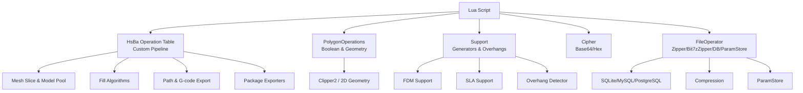

**Diagram sources**
- [lua_pipeline.cpp:17-39](file://LibHsBaSlicer/Extends/lua_pipeline.cpp#L17-L39)
- [LuaAdapter.cpp (2D):311-329](file://2D/LuaAdapter.cpp#L311-L329)
- [LuaAdapter.cpp (support):253-262](file://support/LuaAdapter.cpp#L253-L262)
- [LuaAdapter.cpp (cipher):85-89](file://cipher/LuaAdapter.cpp#L85-L89)
- [LuaAdapter.cpp (fileoperator):134-139](file://fileoperator/LuaAdapter.cpp#L134-L139)

**Section sources**
- [lua_pipeline.cpp:1-40](file://LibHsBaSlicer/Extends/lua_pipeline.cpp#L1-L40)
- [LuaAdapter.cpp (2D):1-11](file://2D/LuaAdapter.cpp#L1-L11)
- [LuaAdapter.cpp (support):1-17](file://support/LuaAdapter.cpp#L1-L17)
- [LuaAdapter.cpp (cipher):1-10](file://cipher/LuaAdapter.cpp#L1-L10)
- [LuaAdapter.cpp (fileoperator):1-15](file://fileoperator/LuaAdapter.cpp#L1-L15)

## Core Components
The built-in API is organized around five main component families:

1. **Custom pipeline environment (`HsBa`)**  
   - Control and file IO: `progress`, `setLayers`, `setOutputPath`, `readFile`, `writeFile`.
   - Model management: `loadModel`, `modelInfo`, `translateModel`, `rotateModel`, `scaleModel`, `removeModel`, `modelNames`.
   - Slicing: `layerCount`, `layerZ`, `slice`, `sliceUnsafe`, `toInt`, `toDouble`.
   - Processing: `fill`, `fdmSupport`, `slaSupport`, `floor`.
   - Output: `spiralize`, `toGcode`, `saveSlsPackage`, `saveWaamPackage`, `saveSlaPackage`, `renderImage`.

2. **2D geometry library (`PolygonOperations`)**  
   - Boolean: `booleanOperation`, `union`, `intersection`, `difference`, `xor`.
   - Construction: `offsetOperation`, `convexHullOperation`, `concaveHullOperation`, `area`.
   - Primitives: `makeRectangle`, `makeCircle`, `makeEllipse`, `makeRegularPolygon`, `textToPolygons`.

3. **Support library (`Support`)**  
   - Generators: `new_plane`, `new_tree`, `new_honeycomb`, `new_sla`, `new_lua`, `new_lua_file`.
   - Execution: `generate`, `detect_overhang`, `default_config`.

4. **Utility libraries**  
   - `Cipher`: `base64_encode`, `base64_decode`, `hex_encode`, `hex_decode`.
   - `Zipper` / `Bit7zZipper`: archive creation and format selection.
   - Database adapters: `SQLiteAdapter`, `MySQLAdapter`, `PostgreSQLAdapter`.
   - `ParamStore`: reflection-based configuration persistence.

5. **Type system and data representation**  
   - Points: `{ x = number, y = number }`.
   - Polygons: array of point arrays.
   - Layers: array of polygon sets.
   - Integerization: internal integer precision for boolean/fill; conversion via `toInt`/`toDouble`.

**Section sources**
- [lua_pipeline.cpp:228-800](file://LibHsBaSlicer/Extends/lua_pipeline.cpp#L228-L800)
- [LuaAdapter.cpp (2D):22-329](file://2D/LuaAdapter.cpp#L22-L329)
- [LuaAdapter.cpp (support):43-276](file://support/LuaAdapter.cpp#L43-L276)
- [LuaAdapter.cpp (cipher):13-95](file://cipher/LuaAdapter.cpp#L13-L95)
- [LuaAdapter.cpp (fileoperator):52-302](file://fileoperator/LuaAdapter.cpp#L52-L302)

## Architecture Overview
The Lua scripting environment has two primary modes:

- **Custom pipeline**: The script owns the full workflow through the `HsBa` operation table.
- **Built-in stage hooks**: Scripts replace only one stage (support, fill, floor, or export) while C++ controls the overall order.

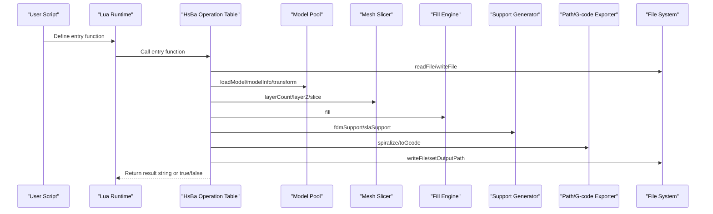

**Diagram sources**
- [lua_pipeline.cpp:228-800](file://LibHsBaSlicer/Extends/lua_pipeline.cpp#L228-L800)
- [lua_pipeline_api.md (EN):19-28](file://docs/en/lua_pipeline_api.md#L19-L28)

**Section sources**
- [lua_pipeline_api.md (EN):19-28](file://docs/en/lua_pipeline_api.md#L19-L28)
- [lua_pipeline_api.md (ZH):19-28](file://docs/zh/lua_pipeline_api.md#L19-L28)

## Detailed Component Analysis

### Model Operations
Model operations expose a pooled model registry accessible from Lua scripts.

| Function | Signature | Returns | Behavior |
|----------|-----------|---------|----------|
| `loadModel` | `HsBa.loadModel(name, path)` | `true` on success | Loads a model into the pool; reuses an existing same-name model; raises error on failure |
| `modelInfo` | `HsBa.modelInfo(name)` | `{ bbox_min, bbox_max, volume }` | Returns bounding box and volume; raises error if model not found |
| `translateModel` | `HsBa.translateModel(name, {x,y,z})` | — | Applies translation |
| `rotateModel` | `HsBa.rotateModel(name, {x,y,z,w})` | — | Applies quaternion rotation |
| `scaleModel` | `HsBa.scaleModel(name, s)` or `(name, {x,y,z})` | — | Uniform or per-axis scaling |
| `removeModel` | `HsBa.removeModel(name)` | — | Removes model from pool |
| `modelNames` | `HsBa.modelNames()` | Array of strings | Lists all model names in the pool |

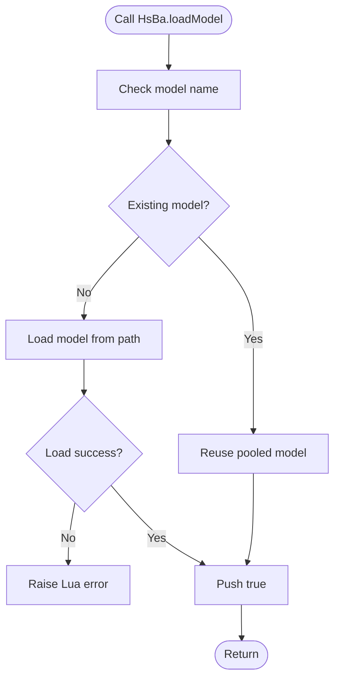

**Diagram sources**
- [lua_pipeline.cpp:292-308](file://LibHsBaSlicer/Extends/lua_pipeline.cpp#L292-L308)

**Section sources**
- [lua_pipeline.cpp:292-397](file://LibHsBaSlicer/Extends/lua_pipeline.cpp#L292-L397)
- [lua_pipeline_api.md (EN):77-87](file://docs/en/lua_pipeline_api.md#L77-L87)

### Slicing and Layer Utilities
Slicing functions compute layers and extract cross-section polygons.

| Function | Signature | Returns | Notes |
|----------|-----------|---------|-------|
| `layerCount` | `HsBa.layerCount(name, layerHeight, firstLayerHeight)` | `int` | Computes total layers from model height |
| `layerZ` | `HsBa.layerZ(index0based, layerHeight, firstLayerHeight)` | `number` | Z height for 0-based index |
| `slice` | `HsBa.slice(name, z)` | Polygons | Safe closed contours only |
| `sliceUnsafe` | `HsBa.sliceUnsafe(name, z)` | Polygons | Normalized unsafe slice; may drop open contours |
| `toInt` | `HsBa.toInt(polygons)` | Polygons | Float → integer polygons |
| `toDouble` | `HsBa.toDouble(intPolygons)` | Polygons | Integer → float polygons |

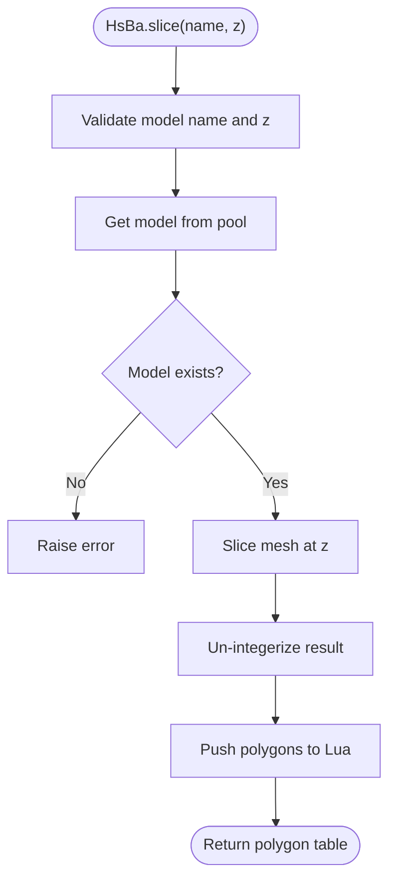

**Diagram sources**
- [lua_pipeline.cpp:435-447](file://LibHsBaSlicer/Extends/lua_pipeline.cpp#L435-L447)

**Section sources**
- [lua_pipeline.cpp:401-478](file://LibHsBaSlicer/Extends/lua_pipeline.cpp#L401-L478)
- [lua_pipeline_api.md (EN):89-104](file://docs/en/lua_pipeline_api.md#L89-L104)

### Boolean and Geometry Operations
The `PolygonOperations` library provides 2D boolean and construction functions.

| Function | Description | Input | Output |
|----------|-------------|-------|--------|
| `booleanOperation(a, b, op)` | Generic boolean operation | Two polygon tables + operation string | Polygon table |
| `union(a, b)` | Union | Two polygon tables | Polygon table |
| `intersection(a, b)` | Intersection | Two polygon tables | Polygon table |
| `difference(a, b)` | Left minus right | Two polygon tables | Polygon table |
| `xor(a, b)` | Symmetric difference | Two polygon tables | Polygon table |
| `offsetOperation(polys, delta)` | Inward/outward offset | Polygon table + number | Polygon table |
| `convexHullOperation(polys)` | Convex hull per polygon | Polygon table | Polygon table |
| `concaveHullOperation(polys, points)` | Concave hull simulation | Polygon table + integer | Polygon table |
| `area(polygon)` | Area of a single polygon | Polygon table | Number |
| `makeRectangle(xmin, ymin, xmax, ymax)` | Rectangle primitive | Four numbers | Polygon table |
| `makeCircle(cx, cy, r[, segments])` | Circle primitive | Center, radius, optional segments | Polygon table |
| `makeEllipse(cx, cy, rx, ry[, segments, rotation])` | Ellipse primitive | Axes, optional segments/rotation | Polygon table |
| `makeRegularPolygon(cx, cy, radius, sides[, rotation])` | Regular polygon | Center, radius, sides, optional rotation | Polygon table |
| `textToPolygons(text, font_file, font_size[, x, y, curve_segments])` | Text to outlines | Text, font path, size, optional position/segments | Polygon table |

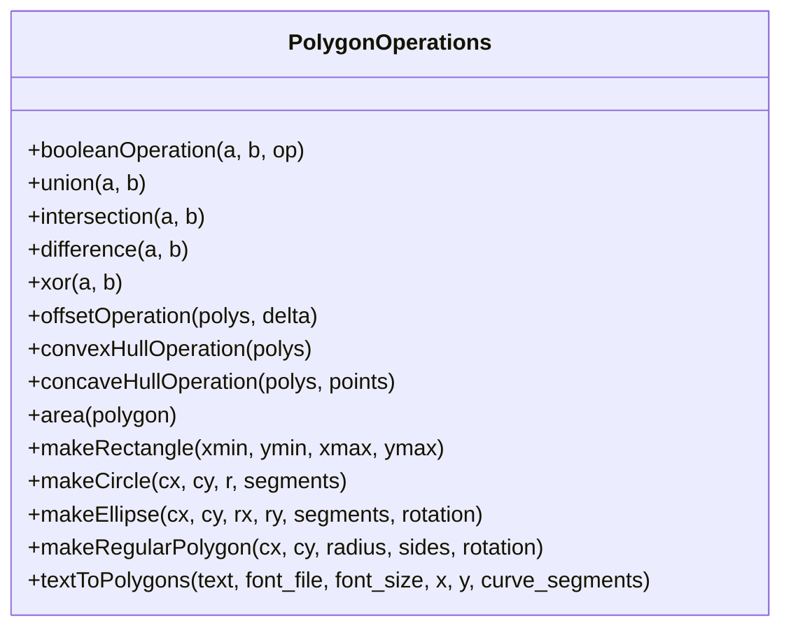

**Diagram sources**
- [LuaAdapter.cpp (2D):22-329](file://2D/LuaAdapter.cpp#L22-L329)

**Section sources**
- [LuaAdapter.cpp (2D):22-329](file://2D/LuaAdapter.cpp#L22-L329)
- [lua_pipeline_api.md (EN):140-155](file://docs/en/lua_pipeline_api.md#L140-L155)

### Fill and Coordinate Conversion
Fill operations accept integer polygon sets and return fill paths.

| Function | Signature | Config fields | Returns |
|----------|-----------|---------------|---------|
| `fill` | `HsBa.fill(polygons[, cfg])` | `spacing`, `mode`, `angle`, `borderCount` | Polygon table |
| `toInt` | `HsBa.toInt(polygons)` | — | Integer polygon table |
| `toDouble` | `HsBa.toDouble(intPolygons)` | — | Float polygon table |

Supported fill modes include line, zigzag, and simple zigzag. When `borderCount > 0`, perimeter borders plus fill are generated.

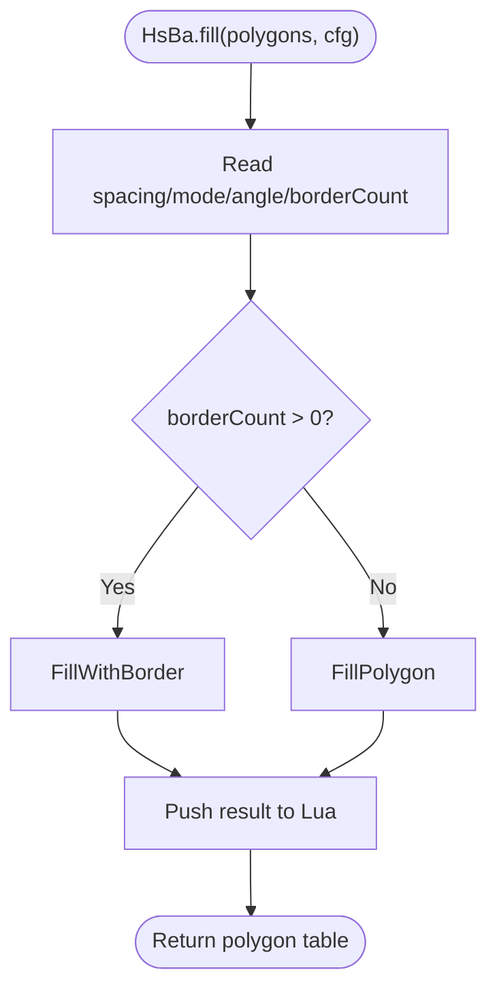

**Diagram sources**
- [lua_pipeline.cpp:482-508](file://LibHsBaSlicer/Extends/lua_pipeline.cpp#L482-L508)

**Section sources**
- [lua_pipeline.cpp:482-508](file://LibHsBaSlicer/Extends/lua_pipeline.cpp#L482-L508)
- [lua_pipeline_api.md (EN):98-104](file://docs/en/lua_pipeline_api.md#L98-L104)

### Support Generation
Support generation supports multiple generator types and custom Lua-based algorithms.

| Function | Signature | Purpose |
|----------|-----------|---------|
| `new_plane` | `Support.new_plane()` | Create plane support generator |
| `new_tree` | `Support.new_tree()` | Create tree support generator |
| `new_honeycomb` | `Support.new_honeycomb()` | Create honeycomb support generator |
| `new_sla` | `Support.new_sla()` | Create SLA sacrificial support generator |
| `new_lua` | `Support.new_lua(script[, funcName])` | Create Lua inline support generator |
| `new_lua_file` | `Support.new_lua_file(path, funcName)` | Create Lua file-based support generator |
| `generate` | `Support.generate(obj, current_layer, prev_layer, layer_height, cfg)` | Generate support polygons |
| `detect_overhang` | `Support.detect_overhang(current, prev, height, angle)` | Detect overhang regions |
| `default_config` | `Support.default_config()` | Return default support config table |

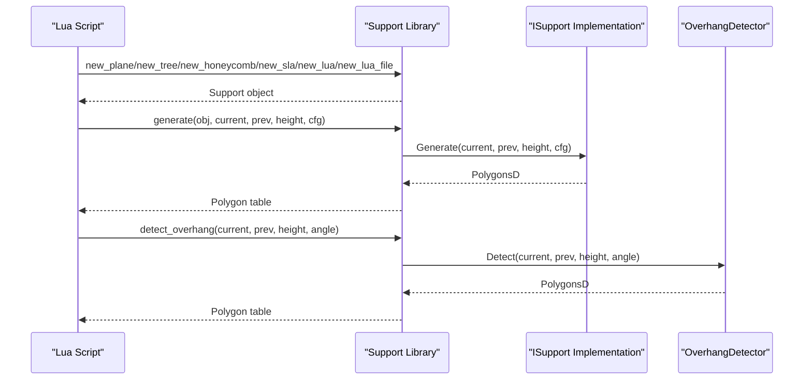

**Diagram sources**
- [LuaAdapter.cpp (support):110-213](file://support/LuaAdapter.cpp#L110-L213)

**Section sources**
- [LuaAdapter.cpp (support):43-276](file://support/LuaAdapter.cpp#L43-L276)
- [lua_pipeline_api.md (EN):169-177](file://docs/en/lua_pipeline_api.md#L169-L177)

### Path Output and Multi-Firmware G-code
Path output includes spiral path generation and G-code export with firmware-specific formatting.

| Function | Signature | Returns | Notes |
|----------|-----------|---------|-------|
| `spiralize` | `HsBa.spiralize(sections[, cfg])` | Array of `{x,y,z}` points | Continuous 3D spiral path for extrusion processes |
| `toGcode` | `HsBa.toGcode(layers, cfg)` | String | Generates G-code; supports Marlin, RepRap, Klipper |

Config fields for `toGcode` include layer height, line width, print speed, travel speed, extrusion multiplier, firmware, nozzle diameter, filament diameter, temperatures, and retraction settings.

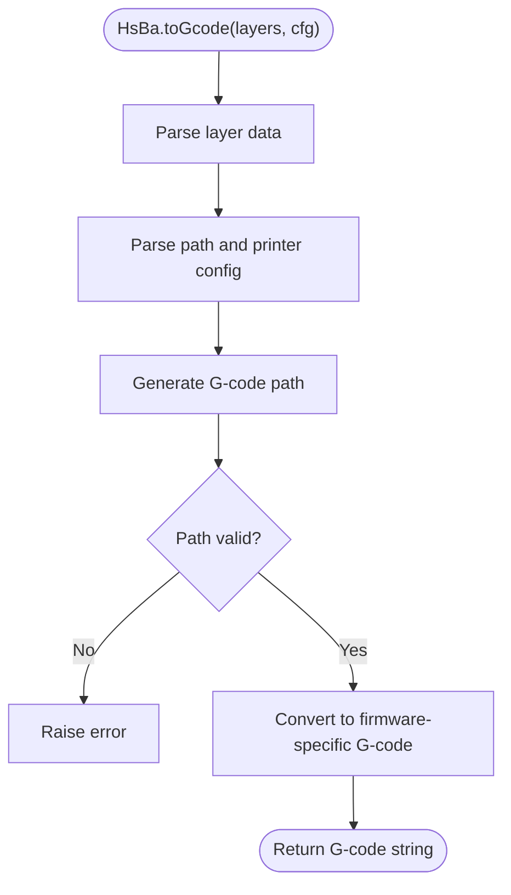

**Diagram sources**
- [lua_pipeline.cpp:622-691](file://LibHsBaSlicer/Extends/lua_pipeline.cpp#L622-L691)

**Section sources**
- [lua_pipeline.cpp:577-691](file://LibHsBaSlicer/Extends/lua_pipeline.cpp#L577-L691)
- [lua_pipeline_api.md (EN):118-123](file://docs/en/lua_pipeline_api.md#L118-L123)

### Packaging and Export
Packaging functions create process-specific outputs such as SLS packages, WAAM robot programs, and SLA images.

| Function | Signature | Returns | Required fields |
|----------|-----------|---------|-----------------|
| `saveSlsPackage` | `HsBa.saveSlsPackage(tbl)` | `bool` | `output`, `script`; optional `func` defaults to `export_sls` |
| `saveWaamPackage` | `HsBa.saveWaamPackage(tbl)` | `bool[, err]` | `output`; optional weld parameters and custom exporter |
| `saveSlaPackage` | `HsBa.saveSlaPackage(tbl)` | `bool` | `output`; optional image dimensions and extension |
| `renderImage` | `HsBa.renderImage(polygons, width, height, path)` | `bool` | Renders polygons to image file |

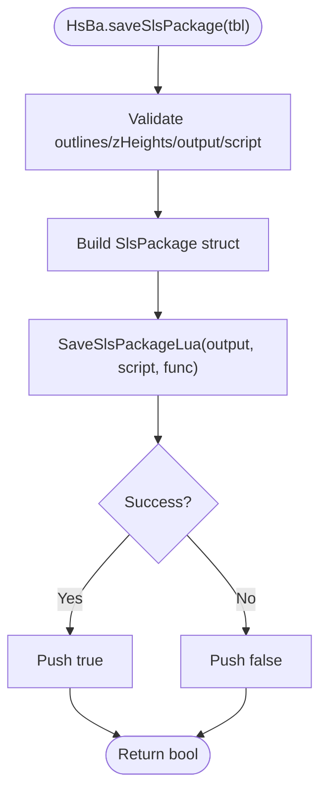

**Diagram sources**
- [lua_pipeline.cpp:695-728](file://LibHsBaSlicer/Extends/lua_pipeline.cpp#L695-L728)

**Section sources**
- [lua_pipeline.cpp:695-800](file://LibHsBaSlicer/Extends/lua_pipeline.cpp#L695-L800)
- [lua_pipeline_api.md (EN):125-132](file://docs/en/lua_pipeline_api.md#L125-L132)

### File Operations: Compression and Decompression
Compression APIs provide ZIP and advanced 7z-style formats.

| Library | Constructor | Methods | Notes |
|---------|-------------|---------|-------|
| `Zipper` | `Zipper.new()` | `AddFile(name, path)`, `AddByteFile(name, data)`, `Save(path)` | Basic ZIP packaging |
| `Bit7zZipper` | `Bit7zZipper.new(format, dll_path[, password])` | Same methods as Zipper | Formats: Zip, SevenZip, XZ, BZIP2, GZIP, TAR, TarGz, TarXz; requires `HSBA_USE_BIT7Z` |

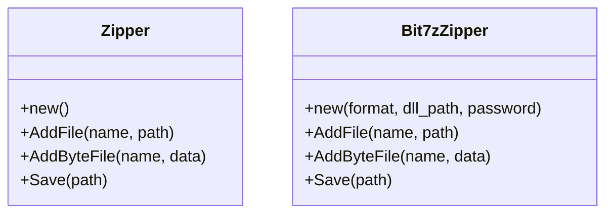

**Diagram sources**
- [LuaAdapter.cpp (fileoperator):52-139](file://fileoperator/LuaAdapter.cpp#L52-L139)
- [LuaAdapter.cpp (fileoperator):142-302](file://fileoperator/LuaAdapter.cpp#L142-L302)

**Section sources**
- [LuaAdapter.cpp (fileoperator):52-302](file://fileoperator/LuaAdapter.cpp#L52-L302)
- [lua_pipeline_api.md (EN):183-191](file://docs/en/lua_pipeline_api.md#L183-L191)

### Database Access: SQLite, MySQL, PostgreSQL
Database adapters expose a consistent interface across backends.

| Adapter | Connect signature | Common methods |
|---------|-------------------|----------------|
| `SQLiteAdapter` | `Connect(path_or_dsn)` | `Execute`, `Query`, `Insert`, `Update`, `Delete`, `CreateTable` |
| `MySQLAdapter` | `Connect(host, user, password, database[, port])` | Same as SQLite |
| `PostgreSQLAdapter` | Similar to MySQL | Same as SQLite |

All adapters return arrays of row tables from `Query`, where each row is a key-value table.

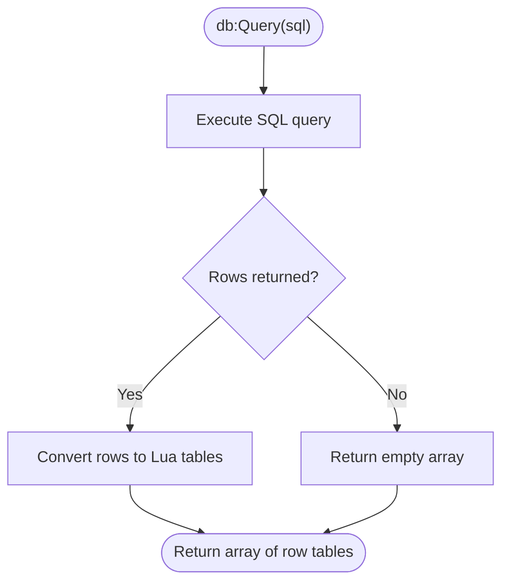

**Diagram sources**
- [LuaAdapter.cpp (fileoperator):356-386](file://fileoperator/LuaAdapter.cpp#L356-L386)

**Section sources**
- [LuaAdapter.cpp (fileoperator):304-565](file://fileoperator/LuaAdapter.cpp#L304-L565)
- [lua_pipeline_api.md (EN):193-207](file://docs/en/lua_pipeline_api.md#L193-L207)

### Configuration Management: ParamStore
ParamStore provides reflection-based persistence for pipeline configurations.

| Method | Purpose |
|--------|---------|
| `EnsureSchema` | Ensure schema exists |
| `Save` | Persist configuration |
| `Load` | Load configuration |
| `List` | List stored configurations |
| `Update` | Update configuration |
| `Delete` | Delete configuration |

On success, methods return `(true, table)`; on failure, `(false, err)`.

**Section sources**
- [lua_pipeline_api.md (EN):209-211](file://docs/en/lua_pipeline_api.md#L209-L211)

### Type Binding Details and Memory Management
C++ objects are exposed to Lua using userdata with metatables and garbage collection hooks.

| Object | Lua type tag | Memory management |
|--------|--------------|-------------------|
| Support generator | `HsBaSupport` | Custom `__gc` destructor releases `ISupport` implementation |
| Zipper | `Zipper` | `LuaGC` wrapper ensures cleanup |
| Bit7zZipper | `Bit7zZipper` | Conditional compilation; `LuaGC` wrapper |
| SQLiteAdapter | `SQLiteAdapter` | `LuaGC` wrapper |
| MySQLAdapter | `MySQLAdapter` | Conditional compilation; `LuaGC` wrapper |
| PostgreSQLAdapter | `PostgreSQLAdapter` | Conditional compilation; `LuaGC` wrapper |

Data conversion between Lua tables and C++ structures uses helper functions:
- `LuaTableToPolygonsD` / `PushPolygonsDToLua` for floating-point polygons.
- `LuaTableToPolygons` / `PushPolygonsToLua` for integer polygons.
- `PushAnyToLua` for database values.

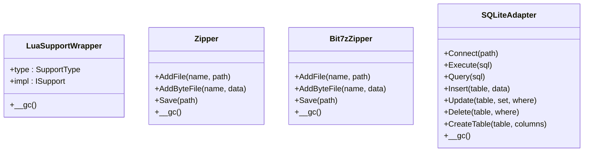

**Diagram sources**
- [LuaAdapter.cpp (support):33-39](file://support/LuaAdapter.cpp#L33-L39)
- [LuaAdapter.cpp (fileoperator):52-139](file://fileoperator/LuaAdapter.cpp#L52-L139)
- [LuaAdapter.cpp (fileoperator):142-302](file://fileoperator/LuaAdapter.cpp#L142-L302)
- [LuaAdapter.cpp (fileoperator):304-565](file://fileoperator/LuaAdapter.cpp#L304-L565)

**Section sources**
- [LuaAdapter.cpp (support):243-276](file://support/LuaAdapter.cpp#L243-L276)
- [LuaAdapter.cpp (fileoperator):128-139](file://fileoperator/LuaAdapter.cpp#L128-L139)
- [LuaAdapter.cpp (fileoperator):289-302](file://fileoperator/LuaAdapter.cpp#L289-L302)
- [LuaAdapter.cpp (fileoperator):551-565](file://fileoperator/LuaAdapter.cpp#L551-L565)

## Dependency Analysis
The built-in Lua API depends on several core subsystems:

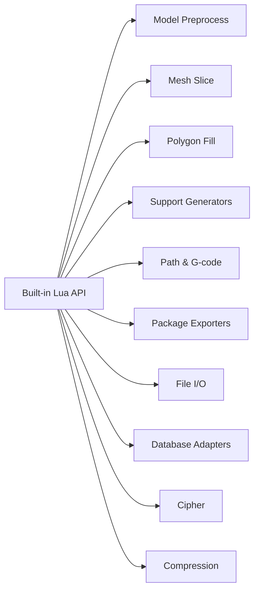

**Diagram sources**
- [lua_pipeline.cpp:17-39](file://LibHsBaSlicer/Extends/lua_pipeline.cpp#L17-L39)

**Section sources**
- [lua_pipeline.cpp:17-39](file://LibHsBaSlicer/Extends/lua_pipeline.cpp#L17-L39)

## Performance Considerations
- **Integerization**: Boolean and fill operations run at integer precision internally. Use `HsBa.toInt`/`HsBa.toDouble` to convert between representations when needed.
- **Memory allocation**: Large polygon sets and layers should be processed carefully to avoid excessive Lua table allocations.
- **I/O**: File read/write operations are binary; ensure proper encoding when handling text files.
- **Database queries**: Query results are converted to Lua tables; large result sets may consume significant memory.
- **Compression**: Bit7zZipper supports multiple formats but requires additional DLLs; use only when necessary.
- **Firmware parsing**: Firmware-specific G-code generation adds overhead; choose the minimal required firmware type.

[No sources needed since this section provides general guidance]

## Troubleshooting Guide
Common issues and their causes:

| Issue | Cause | Resolution |
|-------|-------|------------|
| `loadModel` fails | Invalid model path or unsupported format | Verify file path and model format |
| `slice` raises error | Model not loaded or invalid Z value | Ensure model is loaded and Z is within bounds |
| `toGcode` fails | Invalid layer data or missing config fields | Validate layer structure and config fields |
| Database connection fails | Incorrect credentials or DSN | Verify connection parameters |
| Bit7zZipper not available | Missing compile flag or DLL | Enable `HSBA_USE_BIT7Z` and provide DLL path |
| Export script returns wrong type | Incorrect return structure | Return `{ success=..., export_path=... }` |

**Section sources**
- [lua_pipeline.cpp:292-308](file://LibHsBaSlicer/Extends/lua_pipeline.cpp#L292-L308)
- [lua_pipeline.cpp:622-691](file://LibHsBaSlicer/Extends/lua_pipeline.cpp#L622-L691)
- [LuaAdapter.cpp (fileoperator):304-565](file://fileoperator/LuaAdapter.cpp#L304-L565)

## Conclusion
The HsBaSlicer Lua scripting environment provides a comprehensive set of built-in functions for model processing, slicing, support generation, path output, file operations, database access, and configuration management. The API is designed around clear separation of concerns, with each library focusing on specific functionality while sharing common data representations. Users can build complete pipelines from Lua or extend built-in pipelines with custom stage scripts.

[No sources needed since this section summarizes without analyzing specific files]

## Appendices

### API Availability Matrix
| API | Custom Pipeline | Built-in Stage Scripts |
|-----|:---------------:|:----------------------:|
| `HsBa` operation table | ✅ (full) | ❌ |
| Context globals | ✅ | ❌ |
| `PolygonOperations` | ✅ | ✅ |
| `Support` | ✅ | ✅ (support stage) |
| `PolygonFill` | ✅ | ✅ (fill/floor stage) |
| `PathOptimize` | ✅ | ✅ (fill stage) |
| `Cipher` | ✅ | ✅ (export stage) |
| `Zipper` / `Bit7zZipper` | ✅ | ✅ (export stage) |
| Database adapters | ✅ | ✅ (export stage) |
| `ParamStore` | ✅ | ✅ (export stage) |

**Section sources**
- [lua_pipeline_api.md (EN):264-279](file://docs/en/lua_pipeline_api.md#L264-L279)

### Example Workflows
A minimal custom pipeline workflow demonstrates common usage patterns:

1. Load model and get info
2. Calculate layers and iterate through heights
3. Slice each layer and generate fills
4. Generate G-code with appropriate firmware settings
5. Write output file and report progress

For complete examples, refer to the sample scripts in the repository under `samples/Custom/scripts/`, `samples/FDM/scripts/`, `samples/SLA/scripts/`, `samples/SLS/scripts/`, and `samples/WAAM/scripts/`.

**Section sources**
- [lua_pipeline_api.md (EN):283-331](file://docs/en/lua_pipeline_api.md#L283-L331)